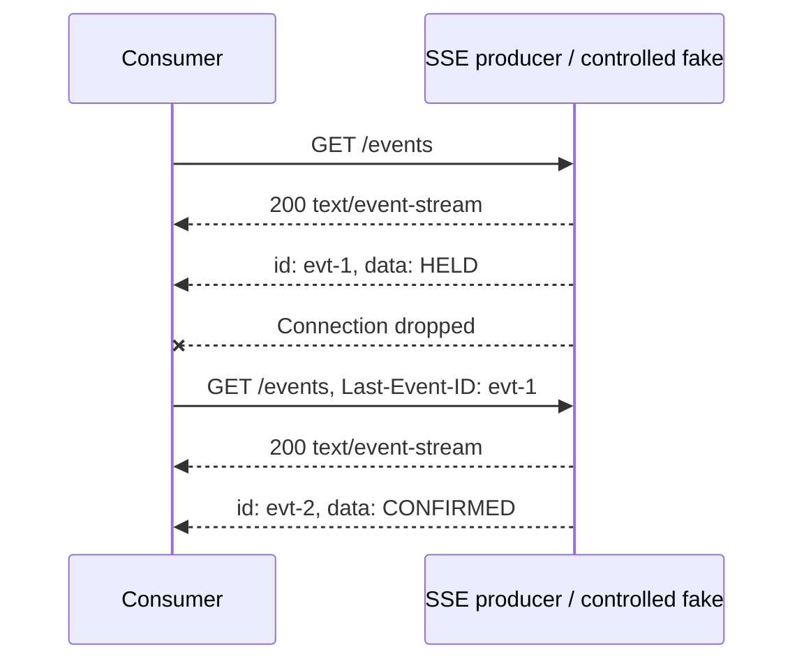
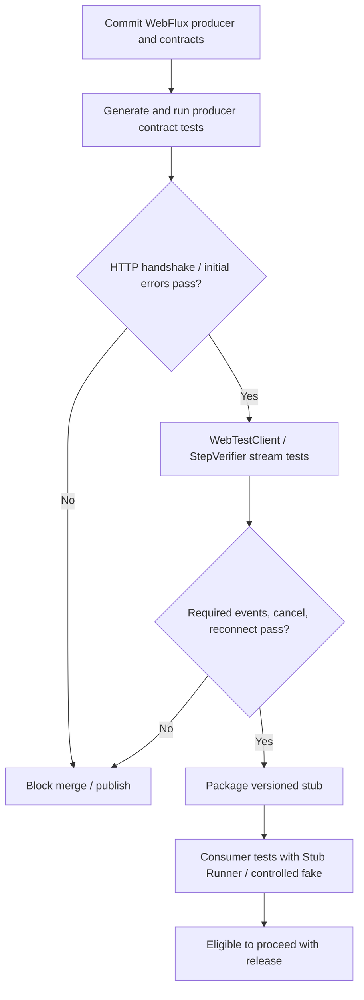

# Streaming, SSE, and the Limits of Contract Descriptions

A standard HTTP API returns a result with a clear endpoint termination: the client sends `GET /api/v1/reservations/RES-100`, and the server returns `200` with a single JSON object and completes the response. With **reactive** applications, however, an endpoint can emit **multiple elements over time**. For instance, after placing an inventory reservation, `OrderService` needs to continuously receive `HELD`, `CONFIRMED`, or `EXPIRED` status updates from `InventoryService` via **Server-Sent Events (SSE)**.

In that setting, checking `status 200` and `Content-Type: text/event-stream` does not prove the consumer receives all events, in the right order, in the right format, or handles disconnections properly. Conversely, forcing a generated test to buffer an entire infinite stream into a single JSON body can make the test **hang or buffer excessive data**. Thus, you must separate **HTTP clauses** from **continuous stream behavior**.

This lesson belongs to the **Reactive Testing** chapter of the **Spring Cloud Contract** module. We will use **Groovy/YAML DSL** contracts, **Contract Verifier**, **WebTestClient**, **Project Reactor**, and **Stub Runner** to protect the commitments producers and consumers actually depend on, while understanding the limits of each test type. The goal is to catch incompatible API changes in CI without equating a stub returning sample payloads to proof that streaming works properly in production.

After this lesson, you will be able to:

- Distinguish finite JSON responses, NDJSON, and SSE.
- Read SSE syntax including `id`, `event`, `data`, `retry`, and event boundaries.
- Write contracts protecting HTTP status, headers, and initial errors of an SSE endpoint.
- Explain why generated contract tests may not verify infinite streams, emission cadence, or reconnects.
- Use `WebTestClient` and `StepVerifier` to verify event contents, ordering, and stream completion/cancellation.
- Design tests for `Last-Event-ID`, replay, disconnects, heartbeats, and backpressure.
- Build CI gates combining producer verification, stream integration tests, and stub-based consumer tests.

## 1. How Does Reactive Streaming Differ from Standard HTTP Responses?

With WebFlux, a controller can return `Mono<T>` for a single result or `Flux<T>` for multiple results. However, **reactive Java types do not by themselves dictate HTTP wire format**; transmission also depends on `Content-Type` and codecs.

| Format | Common media type | Wire format | Verification approach |
| --- | --- | --- | --- |
| Standard JSON | `application/json` | A single complete JSON document | Status, headers, body matchers |
| NDJSON | `application/x-ndjson` | Multiple JSON objects, typically one object per line | Parse per item, order, and termination |
| SSE | `text/event-stream` | Multiple SSE events consisting of `id/event/data` lines | HTTP handshake, framing, event type, data, reconnect |

Single-result JSON example:

```http
HTTP/1.1 200 OK
Content-Type: application/json

{"reservationId":"RES-100","status":"HELD"}
```

NDJSON example:

```http
HTTP/1.1 200 OK
Content-Type: application/x-ndjson

{"reservationId":"RES-100","status":"HELD"}
{"reservationId":"RES-100","status":"CONFIRMED"}
```

SSE example:

```http
HTTP/1.1 200 OK
Content-Type: text/event-stream

id: evt-1
event: reservation-status
data: {"reservationId":"RES-100","status":"HELD"}

id: evt-2
event: reservation-status
data: {"reservationId":"RES-100","status":"CONFIRMED"}

```

**SSE is not WebSocket.** SSE uses a unidirectional HTTP response from server to client; WebSocket is a different mechanism for bidirectional exchange. Nor does merely returning `Flux` automatically turn an endpoint into SSE: the producer must choose the appropriate media type and serialization.

## 2. What in SSE Structure Belongs in a Contract?

An SSE event can be written as:

```text
id: evt-105
event: reservation-status
retry: 3000
data: {"reservationId":"RES-100","status":"HELD"}

```

Fields to understand:

- `id`: event identifier recorded by the client; can support resuming after reconnect.
- `event`: event type name, e.g., `reservation-status`. Consumers may register handlers keyed on this exact name.
- `data`: event payload; if it is JSON, the client must parse the `data` content separately.
- `retry`: reconnection interval hint in milliseconds. Actual behavior depends on the client and network.
- **Blank line**: delimits a complete event.

Several wire-format details matter in practice:

1. Multiple `data:` lines within one event are concatenated into **one event's data**, not multiple events.
2. Lines beginning with `:` are comments, usable as heartbeats; they do not become business events for listeners.
3. One HTTP/TCP chunk **does not equal one SSE event**. A chunk can split mid-line or bundle multiple events.
4. Streams can last indefinitely; there is no closing JSON document bracket for the entire stream.
5. Browser `EventSource` includes built-in reconnect mechanics; `WebClient` or other clients may need custom handling.

### Matrix of What Consumers Actually Need

| Component | Example commitment | Primary verification layer |
| --- | --- | --- |
| HTTP status | `200 OK` when authorized to subscribe | HTTP contract / WebTestClient |
| Media type | `text/event-stream` | HTTP contract / WebTestClient |
| Event type | `reservation-status` | Stream test |
| Event ID | Valid format usable as a cursor | Stream/reconnect test |
| Payload | `reservationId`, `status` matching schema | Stream test + JSON assertions |
| Ordering | Within scenario, `HELD` before `CONFIRMED` | Multi-event test |
| Stream cancellation | Server stops related sources after cancel | Reactive cancellation/integration test |
| Slow network/reconnect | Per timeout, replay, and deduplication policies | Network / end-to-end test |

Do not try to force everything into one contract. Explicitly state **the level of assurance** each test type actually proves.

## 3. HTTP Contract When Opening an SSE Stream

Suppose `OrderService` sends:

```http
GET /api/v1/reservations/RES-100/events HTTP/1.1
Accept: text/event-stream
```

When the reservation exists and authorization passes, the producer returns `200` with the SSE media type. A Groovy contract can focus on the **initial HTTP response**:

```groovy
import org.springframework.cloud.contract.spec.Contract

Contract.make {
    name 'reservation_status_stream_opened'
    description '''
        OrderService subscribes to reservation status updates.
        Status and media type are the HTTP commitment; event payloads
        and reconnects are verified in dedicated stream tests.
    '''

    request {
        method 'GET'
        url '/api/v1/reservations/RES-100/events'
        headers {
            header('Accept', 'text/event-stream')
        }
    }

    response {
        status 200
        headers {
            contentType('text/event-stream')
        }
    }
}
```

The contract **declares no JSON body**. It describes the producer accepting an HTTP request to open a stream; it promises neither the contents nor termination of an infinite stream.

**Tooling note:** do not assume every Contract Verifier version generates tests capable of verifying a never-ending SSE response. Some client/generator modes may wait to read the body or for response completion. **Inspect generated tests and try running them** against your WebFlux endpoint. If the generator cannot handle an infinite stream handshake cleanly on its own, place the handshake check in a dedicated `WebTestClient` test instead of claiming the contract verified the entire stream.

### Same Idea in YAML DSL

```yaml
name: reservation_status_stream_opened
description: OrderService opens SSE stream to watch reservation
request:
  method: GET
  url: /api/v1/reservations/RES-100/events
  headers:
    Accept: text/event-stream
response:
  status: 200
  headers:
    Content-Type: text/event-stream
```

The Groovy and YAML examples are **alternatives to each other**. Leaving both where the plugin reads contracts can generate duplicate tests/stub mappings. Choose one DSL or a non-overlapping layout convention.

SSE is an **HTTP streaming response**. Do not misuse the messaging DSL's `outputMessage` (intended for Kafka/RabbitMQ) as a substitute for SSE; their transport, framing, and lifecycles are different.

## 4. Verifying Errors That Occur Before the Stream Opens

A request can be rejected **before the HTTP response commits** due to a missing ID, lack of permissions, or an unsupported media type. In those cases, write standard error contracts.

Missing reservation example:

```groovy
import org.springframework.cloud.contract.spec.Contract

Contract.make {
    name 'reservation_sse_not_found'
    description 'Do not open SSE for a non-existent reservation'

    request {
        method 'GET'
        url '/api/v1/reservations/RES-MISSING/events'
        headers {
            header('Accept', 'text/event-stream')
        }
    }

    response {
        status 404
        headers {
            contentType(applicationJson())
        }
        body([
            code: 'RESERVATION_NOT_FOUND'
        ])
    }
}
```

The status code and error code above are **example API conventions**, not values imposed by Spring Cloud Contract.

| Precondition | Negotiable response | Consumer implication |
| --- | --- | --- |
| Reservation does not exist | `404`, error JSON | Do not blindly retry the same ID |
| Missing authentication | `401` | Authenticate or refresh token |
| Insufficient permissions | `403` or `404` per policy | Prevent unauthorized access |
| Unsupported media type | `406` depending on content negotiation | Adjust `Accept` header |
| Producer not ready | `503` per policy | Controlled backoff/retry |

**Watch stub matching:** an overly broad URL matcher on the `200` mapping can catch `RES-MISSING` as well, causing consumer tests to receive SSE instead of `404`. Make request conditions specific and inspect generated mappings in the packaged artifact.

## 5. When an Error Occurs After the Stream Has Opened

Suppose the producer already sent:

```http
HTTP/1.1 200 OK
Content-Type: text/event-stream

id: evt-1
event: reservation-status
data: HELD

```

After the first event, the upstream event store fails. Because the HTTP response has already begun, the producer **usually cannot change the initial status from `200` to `500`** mid-stream. Agree on a **stream-level** behavior:

- Emit a **business event** such as `event: reservation-error` with JSON containing an error code.
- End or close the connection so the client decides whether to reconnect.
- Keep the connection open and send heartbeats if the source is only temporarily idle.
- Use another endpoint for consumers to fetch a snapshot when replay is impossible.

These options are **not equivalent**. `event: reservation-error` is application-designed data; it differs from a browser `EventSource` connection-error event.

A `response { status 500 }` contract for a request before streaming starts **cannot test** the scenario "client already received `HELD` and then the stream errored." That is a temporal interaction sequence requiring reactive stream tests or integration tests.

## 6. Sample WebFlux Controller Emitting Two Finite SSE Events

To verify event parsing and ordering deterministically, start with `Flux.just(...)` containing two events:

```java
package com.example.inventory;

import org.springframework.http.MediaType;
import org.springframework.http.codec.ServerSentEvent;
import org.springframework.web.bind.annotation.GetMapping;
import org.springframework.web.bind.annotation.PathVariable;
import org.springframework.web.bind.annotation.RequestMapping;
import org.springframework.web.bind.annotation.RestController;
import reactor.core.publisher.Flux;

@RestController
@RequestMapping("/api/v1/reservations")
class ReservationEventController {

    @GetMapping(value = "/{reservationId}/events",
                produces = MediaType.TEXT_EVENT_STREAM_VALUE)
    Flux<ServerSentEvent<String>> events(
            @PathVariable String reservationId) {
        // Educational sample: no DB lookup or auth checks.
        return Flux.just(
            ServerSentEvent.<String>builder("HELD")
                .event("reservation-status")
                .id("evt-1")
                .build(),
            ServerSentEvent.<String>builder("CONFIRMED")
                .event("reservation-status")
                .id("evt-2")
                .build()
        );
    }
}
```

Real applications must use `reservationId` to look up data, enforce authorization, and emit true state events. This sample intentionally simplifies business logic to focus on **SSE serialization and stream testing**.

Expected flow:

```text
GET /api/v1/reservations/RES-100/events
  -> 200, text/event-stream
  -> event: reservation-status, id: evt-1, data: HELD
  -> event: reservation-status, id: evt-2, data: CONFIRMED
  -> complete
```

In production, many streams stay open for a long time. Testing `onComplete` fits only when the producer genuinely produces a **finite stream** like the sample above.

## 7. Using WebTestClient and StepVerifier to Verify Events

`WebTestClient` can bind to Spring WebFlux's `ApplicationContext` to execute HTTP-layer requests without opening a real network socket. `StepVerifier` from `reactor-test` consumes the `Flux` and verifies items sequentially.

JUnit 5 test example:

```java
package com.example.inventory;

import java.time.Duration;
import org.junit.jupiter.api.BeforeEach;
import org.junit.jupiter.api.Test;
import org.springframework.beans.factory.annotation.Autowired;
import org.springframework.boot.test.context.SpringBootTest;
import org.springframework.context.ApplicationContext;
import org.springframework.core.ParameterizedTypeReference;
import org.springframework.http.MediaType;
import org.springframework.http.codec.ServerSentEvent;
import org.springframework.test.web.reactive.server.FluxExchangeResult;
import org.springframework.test.web.reactive.server.WebTestClient;
import reactor.test.StepVerifier;

import static org.assertj.core.api.Assertions.assertThat;

@SpringBootTest
class ReservationEventsSseTest {

    @Autowired
    ApplicationContext context;

    WebTestClient client;

    @BeforeEach
    void setup() {
        client = WebTestClient.bindToApplicationContext(context)
                .configureClient()
                .responseTimeout(Duration.ofSeconds(5))
                .build();
    }

    @Test
    void streamsTwoStatusEvents() {
        FluxExchangeResult<ServerSentEvent<String>> result = client.get()
                .uri("/api/v1/reservations/RES-100/events")
                .accept(MediaType.TEXT_EVENT_STREAM)
                .exchange()
                .expectStatus().isOk()
                .expectHeader()
                .contentTypeCompatibleWith(MediaType.TEXT_EVENT_STREAM)
                .returnResult(
                    new ParameterizedTypeReference<ServerSentEvent<String>>() {}
                );

        StepVerifier.create(result.getResponseBody())
                .assertNext(event -> {
                    assertThat(event.event()).isEqualTo("reservation-status");
                    assertThat(event.id()).isEqualTo("evt-1");
                    assertThat(event.data()).isEqualTo("HELD");
                })
                .assertNext(event -> {
                    assertThat(event.event()).isEqualTo("reservation-status");
                    assertThat(event.id()).isEqualTo("evt-2");
                    assertThat(event.data()).isEqualTo("CONFIRMED");
                })
                .verifyComplete();
    }
}
```

This is a **supplementary hand-written test**, not code required to be generated by Contract Verifier. It assumes the project has Spring WebFlux, Spring Test/WebTestClient, JUnit 5, and `reactor-test`.

**Why `returnResult(...)` instead of `expectBody()`?** `expectBody()` fits finite responses where the tool can collect and compare the whole payload. For infinite SSE, buffering the body can wait until timeout or grow memory unboundedly. `returnResult(...)` lets you receive a `Flux` and inspect individual events.

With the two finite events above, `verifyComplete()` proves the stream emits exactly two items in order **and then ends**. It is unsuitable when the stream is designed to stay open continuously.

## 8. Non-Terminating Streams: Consume a Slice, Then Cancel

When an endpoint can emit events for hours, do not wait for `onComplete`. Tests typically just need to receive a few key events and then cancel the subscription.

Example **code fragment inside a test with an initialized `client`**:

```java
FluxExchangeResult<ServerSentEvent<String>> result = client.get()
    .uri("/api/v1/reservations/RES-100/events")
    .accept(MediaType.TEXT_EVENT_STREAM)
    .exchange()
    .expectStatus().isOk()
    .returnResult(
        new ParameterizedTypeReference<ServerSentEvent<String>>() {}
    );

StepVerifier.create(result.getResponseBody())
    .assertNext(event -> {
        assertThat(event.event()).isEqualTo("reservation-status");
        assertThat(event.data()).isEqualTo("HELD");
    })
    .thenCancel()
    .verify(Duration.ofSeconds(5));
```

To keep this test fragment stable, fixtures must guarantee `HELD` is emitted within the timeout window. If business logic does not emit an initial event immediately upon subscription, test snapshots first or supply controlled event sources rather than relying on arbitrary timing.

**Two limitations:**

1. Cancelling on the client **does not by itself prove the server released** upstream broker subscriptions or external resources. Add server-side tests for `cancel`/`doFinally` signals and related resources.
2. Timeouts must be finite and realistic. Too short a timeout causes flaky CI tests; never use an infinite timeout that hides missing event emissions.

`StepVerifier.withVirtualTime(...)` can help test pure Reactor schedulers when publishers are created within the virtual scheduler context. It **does not** accelerate real sockets, reverse proxies, or brokers.

## 9. When `data` Contains JSON: Inspect Per Event Instead of the Whole HTTP Body

A real-world SSE event often carries JSON inside `data`:

```text
id: evt-42
event: reservation-status
data: {"reservationId":"RES-100","status":"HELD","version":3}

```

This is an **SSE event whose `data` holds JSON**, not an entire HTTP body forming a single JSON document. Clients read the event first, then decode `data` to access JSON fields.

With `ServerSentEvent<String>`, you can use Jackson `ObjectMapper` and per-field assertions:

```java
// Fragment inside a StepVerifier.assertNext(...).
// Assumes ObjectMapper objectMapper and JUnit 5 are available.
.assertNext(event -> {
    assertThat(event.event()).isEqualTo("reservation-status");
    assertThat(event.id()).isEqualTo("evt-42");

    JsonNode payload = assertDoesNotThrow(
        () -> objectMapper.readTree(event.data())
    );
    assertThat(payload.path("reservationId").asText()).isEqualTo("RES-100");
    assertThat(payload.path("status").asText()).isEqualTo("HELD");
    assertThat(payload.path("version").isInt()).isTrue();
})
```

This is a **snippet to integrate into an existing test**; import `JsonNode` and `assertDoesNotThrow`, or place it in an appropriate test helper. Other codec configurations can decode event `data` directly into a DTO instead of `String`; verify the actual type received by the client.

An assertion reference table:

| Property | Suggested assertion | Why it matters |
| --- | --- | --- |
| `event` | Equals `reservation-status` | Consumer listeners bind to the event name |
| `id` | Valid format, usable as cursor | Consumer needs it for reconnects |
| `reservationId` | Matches subscribed ID or matcher + relational check | Avoids updating the wrong reservation |
| `status` | One of the agreed statuses | Consumer needs valid states to make decisions |
| `version` | Integer JSON number, monotonic on change if committed | Prevents stale events from overwriting newer state |

**Limit:** a matcher on a single `status` proves only that one event holds a valid value; it does not prove two events arrive in the right **order**. If the consumer requires `HELD` before `CONFIRMED`, tests must verify at least two items or state transitions across steps.

## 10. Reconnects and the `Last-Event-ID` Header

SSE clients can lose connections due to network drops, server restarts, proxy timeouts, or user environment switches. Browser `EventSource` supports reconnecting by sending the last received event ID in the `Last-Event-ID` header.

Illustrative reconnect request:

```http
GET /api/v1/reservations/RES-100/events HTTP/1.1
Accept: text/event-stream
Last-Event-ID: evt-42
```

The producer **can** use this cursor to replay events after `evt-42` if backed by a durable event log. However, merely adding `id` to SSE does not turn a producer into a replay-capable event store. Resume policies must be designed explicitly and agreed upon with consumers.

### Questions That Need Explicit Answers

1. Are event IDs **unique and stable** per reservation or globally?
2. How long does the producer retain event history; how are expired cursors handled?
3. After reconnecting, does the producer resend the last event or only events strictly after the cursor?
4. Does the consumer deduplicate events upon reconnect or redelivery?
5. Is ordering guaranteed across multiple partitions/instances or only within a single stream?
6. Does the client receive a **latest state snapshot** if history was compacted/pruned?

### Contract Can Describe the Cursor Request

```groovy
import org.springframework.cloud.contract.spec.Contract

Contract.make {
    name 'reservation_sse_reconnect_handshake'
    description 'OrderService resubscribes from a saved event ID'

    request {
        method 'GET'
        url '/api/v1/reservations/RES-100/events'
        headers {
            header('Accept', 'text/event-stream')
            header('Last-Event-ID', 'evt-42')
        }
    }

    response {
        status 200
        headers {
            contentType('text/event-stream')
        }
    }
}
```

This contract defines a request/HTTP response scenario. It **does not yet prove** the producer replays the exact missing events after the cursor. To protect replay, you need an event-log fixture and stream tests checking **IDs, counts, and order** of received events.

**Watch for overlapping mappings:** if the normal stream-opening contract only checks method/URL/`Accept`, it can also match requests carrying `Last-Event-ID`. When two scenarios need distinct responses, craft conditional matchers to distinguish them or test against a stateful fake; changing only the contract `name` will not make a stub stateful.

## 11. Backpressure: What Reactor Knows and What Browser SSE Does Not

**Reactive Streams** defines subscribers sending `request(n)` signals to regulate how many items a publisher emits. Reactor `Flux` can apply operators and backpressure strategies to control data flow between in-process components.

However, SSE runs over an **HTTP streaming response**, and the browser's `EventSource` API **does not expose Reactor's `request(n)` to JavaScript**. Between producer and user sit TCP buffers, servers, proxies, browsers, and event loops.

Therefore:

- A `StepVerifier` test checking operator backpressure **does not prove** browsers propagate equivalent demand back to the broker.
- A contract with `text/event-stream` **does not prove** the producer avoids memory growth with many slow-reading clients.
- A stub returning two valid SSE events **does not simulate** network flushing, proxy buffering, mid-stream disconnects, or real load.

| Concern | Appropriate verification |
| --- | --- |
| Reactor operators honor demand | `StepVerifier`/`TestPublisher` unit tests |
| Cancelling subscription frees resources | Reactive/integration tests + `doFinally` signal checks |
| Long-lived SSE through proxies | Deployment tests with real ingress/proxies |
| Slow clients, high connection counts | Load/soak tests, queue/buffer metrics |
| Browser auto-reconnect and deduplication | Browser/E2E tests |
| Consumer parses events/schema properly | WebTestClient, consumer tests with stubs/fakes |

**Never treat throughput, latency, or backpressure as something provable by a regex on an HTTP body.** Those belong to dedicated operational and resource testing.

## 12. Static SSE Stubs: Good for Simulating Part of the Interface

To test consumer parsers and callbacks, you can use a **WireMock mapping** returning a finite SSE body:

```json
{
  "request": {
    "method": "GET",
    "url": "/api/v1/reservations/RES-100/events",
    "headers": {
      "Accept": { "contains": "text/event-stream" }
    }
  },
  "response": {
    "status": 200,
    "headers": {
      "Content-Type": "text/event-stream"
    },
    "body": "id: evt-1\nevent: reservation-status\ndata: HELD\n\nid: evt-2\nevent: reservation-status\ndata: CONFIRMED\n\n"
  }
}
```

This is a **WireMock JSON configuration**, **not Spring Cloud Contract Groovy/YAML DSL**. Do not assume the handshake contract in section 3 automatically produces an SSE stub body like this. For Stub Runner to serve it, the project must package the mapping into the artifact compatibly with your plugin and WireMock versions, and then inspect the actual artifact.

### What Does a Finite Stub Help Verify?

- The consumer sends the right method, URL, and `Accept` header.
- The parser reads `id/event/data` syntax properly.
- Consumer code triggers the right `reservation-status` handler.
- The consumer updates UI/internal state upon receiving `HELD` and `CONFIRMED`.
- The consumer handles stream completion cleanly in a finite scenario.

### What That Stub Does Not Prove

- That events actually arrive on production-like intervals.
- That events are flushed as **two separate network chunks** rather than one response body.
- That connections stay open for hours without proxy termination.
- That events replay properly after reconnects or across multiple producer instances.
- That the real producer handles backpressure, cancellation, and resource cleanup.
- That a real `GET` request reflects the database state at that moment.

A static body with two events can be sent immediately by WireMock and closed. To simulate slow delivery, mid-event drops, or long-lived open connections, use a controllable fake server or integration test modeling **true streaming behavior**.

## 13. Simulating Reconnects Across Multiple Requests

A realistic scenario consists of:

1. Consumer connects and receives `evt-1`.
2. Connection drops.
3. Consumer reconnects with `Last-Event-ID: evt-1`.
4. Producer/fake emits `evt-2` without letting `evt-1` corrupt consumer state.



Testing approaches you can use:

- **Header-based static stubs:** return different event sets depending on `Last-Event-ID`.
- **WireMock Scenarios:** maintain state across requests when modeling a stateful sequence; reset scenarios between tests.
- **Stateful fake SSE server:** emit events on schedule, actively sever connections, serve data from a cursor.
- **Real producer with event-store fixtures:** test replay, retention, deduplication, and resume logic.

Do not assume reconnect guarantees **exactly-once** delivery. Consumers generally must handle duplicate or late events per business policy. A contract on a single response never replaces testing the full sequence.

## 14. Heartbeats, Timing, and Idle Timeouts

Some SSE producers send comment heartbeats to keep connections alive:

```text
: heartbeat

```

This comment line **is not necessarily dispatched as a business event** to listeners. Tests reading only `ServerSentEvent` items may skip heartbeats even though bytes continue arriving over the socket.

If heartbeat cadence or idle limits are part of the commitment:

- Define maximum idle timeouts and acceptable tolerance.
- Use test schedulers/virtual time when testing pure Reactor logic.
- Test through a real HTTP server/proxy when the target is **network flushing and idle timeouts**.
- Set finite test timeouts; avoid assuming events arrive instantaneously.
- Verify behavior when clients disconnect between two heartbeats.

Virtual time does not control external system clocks. A `Flux.interval` test passing in a unit test **does not prove** production load balancers keep SSE connections alive properly.

## 15. Contract Verifier with Spring WebFlux: Choosing the Right Test Mode

For a Spring WebFlux producer, `MOCKMVC` (intended for servlet-based Spring MVC) is usually unsuitable. Spring Cloud Contract Verifier provides a **WebTestClient** mode in supporting versions, illustrated by this Maven snippet:

```xml
<plugin>
    <groupId>org.springframework.cloud</groupId>
    <artifactId>spring-cloud-contract-maven-plugin</artifactId>
    <version>SCC_VERSION_DEFINED_IN_POM</version>
    <extensions>true</extensions>
    <configuration>
        <testFramework>JUNIT5</testFramework>
        <testMode>WEBTESTCLIENT</testMode>
        <baseClassForTests>
            com.example.inventory.ContractVerifierBase
        </baseClassForTests>
    </configuration>
</plugin>
```

This is a **configuration fragment**, not a complete POM. `SCC_VERSION_DEFINED_IN_POM` is a placeholder to replace with your project's managed version compatible with Spring Boot, Java, and the test runner. Base class and bridge setup for generated tests must follow **your actual version and generated code**; never copy Spring MVC's `RestAssuredMockMvc` base class into WebFlux.

### Essential Checks to Confirm

1. The plugin discovers contracts and produces **generated producer tests**.
2. Generated tests use the right test mode for WebFlux and the matching base class.
3. The base class sets up the application context/client and required fixtures properly.
4. Tests **compile and run**—no false green builds with zero generated tests.
5. Finite scenarios and standard error responses run reliably.
6. Long/infinite streams have dedicated **`WebTestClient`/`StepVerifier` tests** if the generator cannot verify them safely.

**Do not claim every Contract Verifier version behaves identically for infinite `Flux` endpoints.** Read generated tests, run them against the actual endpoint, and check test-client limits before considering the handshake check successful.

## 16. Role of Stub Runner on the Consumer Side

Once producer contract tests pass, stub artifacts are published so consumers can test without launching the real producer. With SSE, ask **what this consumer test is meant to prove**:

| Consumer goal | Required stub/fake |
| --- | --- |
| Request opens stream at right URL and media type | `200` + `text/event-stream` mapping |
| Listener handles `HELD` | SSE body with at least one `reservation-status` event |
| Handles two state transitions | Two parseable, ordered events |
| Reconnects using cursor | Fake/mapping distinguishing requests with `Last-Event-ID` |
| Cancels after losing authorization | Fake closing/dropping or erroring per scenario |
| Verifies producer frees resources | **Cannot** be proven from stubs alone; needs producer tests |

A contract protecting only status/headers may yield a stub **with no event body**. Consumers waiting for events from that stub will receive nothing; that is a **gap in simulated data**, not necessarily a Stub Runner bug.

When an SSE body is needed, supply mappings/fakes with sufficient content and inspect the packaged artifact. If a stateful fake is shared across tests, reset its state so outcomes never depend on execution order.

## 17. Recommended Test Matrix for an SSE API

| Scenario | Expectation | Verification layer |
| --- | --- | --- |
| Valid subscription | `200`, `text/event-stream` | HTTP contract / WebTestClient |
| Missing ID | `404` and error JSON per API | HTTP contract |
| Unauthorized | `401/403/404` per policy | Security/contract test |
| First event | Expected name, ID, and data | StepVerifier |
| Two consecutive events | `HELD` before `CONFIRMED` | Stream test |
| Malformed JSON data | Catches invalid format/type | Per-event JSON assertion |
| Infinite stream | Consumes N events then cancels | StepVerifier + resource test |
| Error after opening | Error event or close per convention | Reactive/integration test |
| Cursor reconnect | `Last-Event-ID` honored properly | Fake/producer replay test |
| Duplicate events | Consumer handles idempotently | Consumer integration test |
| Heartbeats and idle | Connection not prematurely dropped by buffering | Network/deployment test |
| Many slow-reading clients | No unbounded resource growth | Load/backpressure test |
| Real ingress/proxy | Does not break SSE framing/flushing | End-to-end test |

Not every project needs the entire matrix on day one. Prioritize properties consumers actively depend on: event schema, ordering, disconnect recovery, and state bounds.

## 18. Common Mistakes

| Mistake | Consequence | Fix |
| --- | --- | --- |
| Treating SSE as a single JSON document | Infinite buffering or parse failures | Parse event by event |
| Checking only `200` and declaring the stream good | Producer might emit zero events | Add stream tests |
| Assuming `Flux` automatically means SSE | Wrong media type or codec | Distinguish SSE, NDJSON, and JSON |
| Assuming one network chunk equals one event | Parser fails when chunks split/merge | Parse by SSE framing |
| Using `verifyComplete()` on infinite streams | Test hangs or times out | Consume a few events then cancel |
| Omitting timeouts | CI can hang for a long time | Use bounded test deadlines |
| Treating static SSE stubs as reconnect tests | No real cursor or history | Use stateful fakes / producer tests |
| Switching `200` to `500` after stream commit | Breaks HTTP model | Design error events or close connection |
| `200` mapping matches every ID | Stub returns success even for `404` cases | Narrow matchers |
| Never testing `Last-Event-ID` | Lost events after reconnects | Test resume and replay |
| Failing to reset fake state | Order-dependent tests | Isolate fixtures and scenarios |
| Equating Reactor backpressure with browsers | Ignores proxies/buffers/memory | Run load and network tests |
| Using `MOCKMVC` for WebFlux-only producers | Wrong or incompatible test mode | Choose compatible WebTestClient mode |
| Publishing stubs when generated tests were skipped | False-green consumer tests | Block publish and check test discovery |

## 19. Integrating Streaming Verification into CI

A producer pipeline can combine **contract tests** for HTTP aspects with **stream integration tests** for SSE contents and lifecycle:



For a Maven project configured with Contract Verifier and test runners:

```bash
mvn -B -ntp clean verify
```

After the build, verify:

1. Generated contract tests exist and **actually executed**.
2. `WebTestClient`/`StepVerifier` tests are part of CI's executed test suite, not excluded by naming or filters.
3. Streaming tests use finite timeouts and never call `onComplete` assertions on infinite streams.
4. Tests use isolated or explicitly reset fixtures, clocks, and event sources.
5. Proxy, network, and high-load risks are covered in suitable integration/deployment stages.
6. Stubs are published only from producer versions passing mandatory verification gates.
7. Consumers use the right stub version to check event parsing, error branches, and reconnects within simulation bounds.

If a test runs for hours, place it in a dedicated load/soak job. Still, event schemas, ordering, and cancellation commitments relied on by consumers must have automated tests before release.

## 20. SSE Contract Design and Verification Checklist

- [ ] Distinguished finite JSON, NDJSON, and SSE endpoints.
- [ ] Media type, method, URL, and `Accept` reflect the real integration.
- [ ] HTTP statuses and errors **before stream start** have explicit contracts.
- [ ] Producer/consumer agree on `event`, `id`, `data`, and payload schema.
- [ ] Application error events are not confused with post-commit HTTP error status changes.
- [ ] For finite streams, verified event count, order, and `onComplete`.
- [ ] For infinite streams, verified required slice then cancelled.
- [ ] Never attempted to buffer the full body of a continuous response.
- [ ] Timeouts are bounded and data/clocks are controlled.
- [ ] `Last-Event-ID`, replay, or deduplication tests exist if consumers depend on them.
- [ ] Heartbeat comments are distinguished from business events.
- [ ] HTTP contracts are not used to claim backpressure/network verification.
- [ ] SSE stubs include valid bodies if consumers parse events; actual artifacts inspected.
- [ ] Verifier test mode matches Spring WebFlux and plugin version.
- [ ] Generated producer tests are generated, compiled, and executed.
- [ ] CI runs required stream tests and blocks stub publishing on failures.

### Practice Exercise

`OrderService` subscribes to reservation `RES-100`:

```http
GET /api/v1/reservations/RES-100/events
Accept: text/event-stream
```

The producer is expected to emit:

```text
id: evt-1
event: reservation-status
data: {"reservationId":"RES-100","status":"HELD"}

id: evt-2
event: reservation-status
data: {"reservationId":"RES-100","status":"CONFIRMED"}

```

Complete the following:

1. Write a Groovy contract protecting `200` and `Content-Type: text/event-stream`; explain the limits of the handshake contract.
2. Write the equivalent YAML and avoid putting both files where the generator reads the same contract set.
3. Write a `404` contract for `RES-MISSING` and ensure matchers do not overlap with the `200` scenario.
4. Build a WebFlux controller emitting two finite events; use `WebTestClient` and `StepVerifier` to check event name, ID, data, and order.
5. Change the controller to a non-terminating stream; update the test to receive the first event and then cancel with a finite timeout.
6. Put JSON inside `data`, parse it, and assert `reservationId` and `status`; explain why raw SSE is not a single JSON object.
7. Simulate a disconnect after `evt-1`; reconnect with `Last-Event-ID: evt-1` and verify replay per agreed policy.
8. Create a static SSE stub for the consumer, then explicitly list what it **does not** test: flush timing, real replay, backpressure.
9. Design a test for an error occurring after the stream has sent its first event; compare with a `404` response before opening the stream.
10. Wire Verifier, stream tests, and Stub Runner into CI; verify executed test counts and stub release conditions.

**Completion criteria:** you can clearly draw the boundary between **the HTTP contract opening the stream**, **format/content/lifecycle of individual SSE events**, **reactive testing with WebTestClient and StepVerifier**, and **supplementary consumer/network tests**. Whenever a test passes, you know precisely what it proves—and what it leaves unproven.

## References

- [Spring Cloud Contract Reference](https://docs.spring.io/spring-cloud-contract/reference/): Groovy/YAML DSL, Contract Verifier, test modes, and stubs.
- [Spring Framework — WebTestClient](https://docs.spring.io/spring-framework/reference/testing/webtestclient.html): testing reactive HTTP, reading streams with `returnResult`.
- [Spring Framework — WebFlux](https://docs.spring.io/spring-framework/reference/web/webflux.html): WebFlux and reactive HTTP processing.
- [Project Reactor — Testing](https://projectreactor.io/docs/core/release/reference/testing.html): `StepVerifier`, virtual time, and testing Publishers.
- [MDN — Using server-sent events](https://developer.mozilla.org/en-US/docs/Web/API/Server-sent_events/Using_server-sent_events): event framing, `EventSource`, and reconnects.
