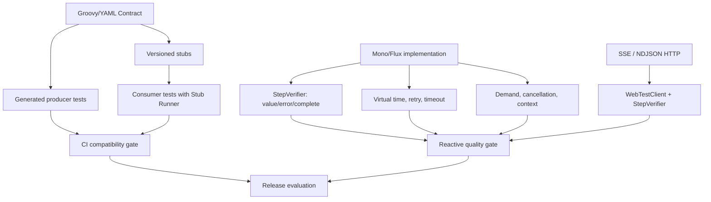
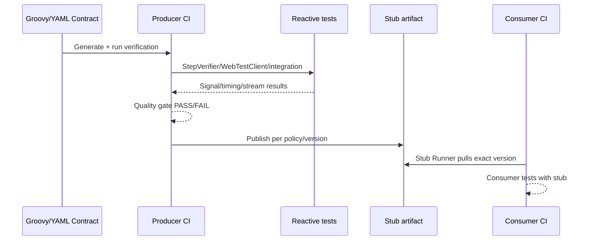

# When to Add Reactive Tests Outside the Contract

## 1. Why Is Spring Cloud Contract Not Enough for All of Reactive?

In a multi-service system, the **producer** provides an HTTP API or emits messages, while the **consumer** calls the API or receives events. **Spring Cloud Contract (SCC)** helps both teams agree on interactions via **Groovy/YAML DSL**, generate **producer verification tests**, package **stubs** for consumers to use with **Stub Runner**, and run these steps in CI to catch incompatible changes.

When a producer uses **Spring WebFlux / Project Reactor**, the external interface may still be HTTP `200` and JSON, yet the implementation uses `Mono<T>` and `Flux<T>`. These Publishers carry distinct semantics around **subscription, emitted values, errors, completion, backpressure, subscription cancellation, and timing**.

For example, a contract verifies `GET /api/orders/42` returns JSON with `state: PAID`. It does not automatically prove that:

- The pipeline triggers side effects only upon subscription.
- A `Flux` emits events in the order and quantity the consumer needs.
- When a consumer cancels a stream, the producer cleans up resources.
- Backpressure is handled properly without unbounded buffering.
- Retries, timeouts, and delays happen the right number of times and at the right intervals.
- Reactor Context propagates correlation/security metadata across operators.
- The application does not block the event loop under load.
- SSE/NDJSON streams are consumed over time without hanging while waiting for completion.

**Lesson objective:** understand when to **add reactive tests outside the contract**, choosing `StepVerifier`, `WebTestClient`, virtual time, `TestPublisher`, `PublisherProbe`, and integration/load tests for the right purposes—while preserving SCC's role in producer/consumer contract testing.

> **Boundary:** Contracts protect **agreed communication behavior**. Supplementary reactive tests protect **Publisher signals, timing, streaming, and resource lifecycles**. Some observable streaming semantics also belong in API requirements, yet you should never assume generated contract tests cover them automatically.

## 2. Choosing Tools Based on What Needs to Be Proven

| Question to answer | Suitable tool | Limitations |
|---|---|---|
| Are HTTP status, headers, and JSON right? | SCC generated producer verification | Only covers scenarios declared in contracts |
| Does the consumer decode/behave right against the simulated API? | Stub Runner + consumer tests | Does not verify new producer versions |
| Does a `Mono` emit exactly one value and complete? | Reactor `StepVerifier` | Does not verify HTTP status |
| How does the service behave when empty or erroring? | StepVerifier | Does not check exception-to-HTTP mapping |
| Does a `Flux` emit in order and expected count? | StepVerifier | Does not measure network or throughput |
| How is `request(n)` demand handled? | StepVerifier and TestPublisher | Does not prove system-wide backpressure |
| Does subscription cancellation happen? | StepVerifier, PublisherProbe, lifecycle tests | Does not prove sockets/databases were freed |
| Do SSE/NDJSON streams respond properly? | WebTestClient + StepVerifier | May still require integration/network tests |
| Do retries and timeouts follow policy? | StepVerifier.withVirtualTime | Does not simulate real clocks/networks outside virtual schedulers |
| Broker ack/nack, DB state, idempotency, load? | Integration/load/chaos tests | Requires isolated test environments and proper resources |



## 3. Reactive Streams Signals to Understand

- **`Mono<T>`** emits at most one item, and can complete empty or signal an error.
- **`Flux<T>`** emits 0 to many items; it can be finite or non-terminating at runtime.
- **`onNext`** is a data signal; `onComplete` is completion; `onError` is a terminal error.
- **`request(n)`** indicates the subscriber requests up to `n` more items at the Reactive Streams level.
- **`cancel()`** notifies upstream that the subscriber wants no more items; operators/resources must react appropriately.
- **`subscribe()`** activates cold Publishers; hot sources may produce independently of subscribers.
- **Schedulers** determine where execution occurs; **Reactor Context** attaches metadata to a subscription rather than relying solely on `ThreadLocal`.

**Key distinction:** `Mono.empty()` emits `onComplete` without `onNext`. `Mono.error(exception)` emits `onError`. Controllers can map both to distinct HTTP responses, but that behavior comes from code/exception handlers—not automatic inference by SCC.

## 4. Running Example: A WebFlux Endpoint

Suppose a consumer needs to look up an order and the producer commits to:

- `GET /api/orders/42` → `200 OK`, JSON `id: "42"`, `state: "PAID"`.
- `GET /api/orders/9999` → `404 Not Found` when the order does not exist.

Contract for the success branch:

```yaml
name: order_found
description: "Consumer looks up a paid order"
request:
  method: GET
  url: /api/orders/42
  headers:
    Accept: application/json
response:
  status: 200
  headers:
    Content-Type: application/json
  body:
    id: "42"
    state: "PAID"
```

This is only an **illustrative interface**; a producer implementation and fixtures must ensure order `42` exists.

A WebFlux controller might implement:

```java
@RestController
@RequestMapping("/api/orders")
class OrderController {
    private final OrderService service;

    OrderController(OrderService service) {
        this.service = service;
    }

    @GetMapping("/{id}")
    Mono<ResponseEntity<OrderDto>> getOrder(@PathVariable String id) {
        return service.findById(id)
            .map(ResponseEntity::ok)
            .defaultIfEmpty(ResponseEntity.notFound().build());
    }
}
```

`OrderService` and `OrderDto` are **project-defined** types; the snippet omits imports and configuration to focus on the concept. Service finds data → `onNext` then `onComplete` → controller builds `200`. Service is empty → `onComplete` without value → `404`. If the service signals `onError`, status depends on real exception handling.

**Two separate things to test:** signals from `service.findById` and the final HTTP response after controller mapping.

## 5. Spring Cloud Contract with WebFlux

Per SCC documentation, WebFlux producers can use test mode **`WEBTESTCLIENT`**, alongside **`EXPLICIT`** (real HTTP requests to a listening server). Maven plugin example:

```xml
<plugin>
    <groupId>org.springframework.cloud</groupId>
    <artifactId>spring-cloud-contract-maven-plugin</artifactId>
    <version>REPLACE_WITH_COMPATIBLE_VERSION</version>
    <extensions>true</extensions>
    <configuration>
        <testMode>WEBTESTCLIENT</testMode>
        <testFramework>JUNIT5</testFramework>
        <baseClassForTests>
            com.example.orders.contract.WebFluxContractBase
        </baseClassForTests>
    </configuration>
</plugin>
```

Semantically equivalent Gradle Groovy DSL:

```groovy
contracts {
    testMode = 'WEBTESTCLIENT'
    testFramework = 'JUNIT5'
    baseClassForTests = 'com.example.orders.contract.WebFluxContractBase'
}
```

These are **configuration excerpts**, not complete build files. Verify dependencies, Boot/Cloud/SCC versions, and that generated tests actually extend the right base class. SCC's `WEBTESTCLIENT` mode documentation uses **`RestAssuredWebTestClient`** in the base test, such as `standaloneSetup(...)` for controllers. Never use Spring MVC's `RestAssuredMockMvc` on a WebFlux-only project assuming it is configured properly.

```java
// Illustrative controller setup supplied by the test.
@BeforeEach
void setUp() {
    RestAssuredWebTestClient.standaloneSetup(orderController);
}
```

`standaloneSetup` covers only the components wired in the test; other filters, codecs, security, and exception handlers may not be set up as in the full application context. When a real HTTP server is required, pick `EXPLICIT` and configure host/port/test server explicitly.

**SCC `WEBTESTCLIENT` does not automatically generate StepVerifier checks for every signal and timing rule.** Generated tests primarily check the requests/responses described in contracts.

## 6. Dependencies Dedicated to Reactive Testing

A Spring WebFlux producer typically requires:

```xml
<dependencies>
    <dependency>
        <groupId>org.springframework.boot</groupId>
        <artifactId>spring-boot-starter-webflux</artifactId>
    </dependency>
    <dependency>
        <groupId>org.springframework.boot</groupId>
        <artifactId>spring-boot-starter-test</artifactId>
        <scope>test</scope>
    </dependency>
    <dependency>
        <groupId>org.springframework.cloud</groupId>
        <artifactId>spring-cloud-starter-contract-verifier</artifactId>
        <scope>test</scope>
    </dependency>
    <dependency>
        <groupId>io.projectreactor</groupId>
        <artifactId>reactor-test</artifactId>
        <scope>test</scope>
    </dependency>
</dependencies>
```

Gradle Groovy DSL:

```groovy
dependencies {
    implementation 'org.springframework.boot:spring-boot-starter-webflux'
    testImplementation 'org.springframework.boot:spring-boot-starter-test'
    testImplementation 'org.springframework.cloud:spring-cloud-starter-contract-verifier'
    testImplementation 'io.projectreactor:reactor-test'
}
```

- **SCC plugin** runs at build time to generate tests/stubs.
- **Contract Verifier** and **reactor-test** belong to test runtime; never add them to production runtime just to write tests.
- **spring-boot-starter-webflux** is a production dependency when the application uses WebFlux.
- Reactor versions should be managed via a compatible BOM; never force an arbitrary version without checking compatibility.
- With Gradle plugins creating a separate `contractTest` task/source set, inspect the classpath of **generated contract tests**, not only `testRuntimeClasspath`.

## 7. StepVerifier for `Mono`: Value, Empty, and Error

`StepVerifier` from `reactor-test` subscribes to a Publisher and asserts signal order.

Case emitting one order then completing:

```java
StepVerifier.create(service.findById("42"))
    .assertNext(order -> {
        assertEquals("42", order.id());
        assertEquals("PAID", order.state());
    })
    .verifyComplete();
```

This example assumes `service`, `OrderDto`, fixtures, and imports are present. It protects signals/values at the **service**, not HTTP `200` or headers.

When not found, if the service is designed to **return an empty Mono**:

```java
StepVerifier.create(service.findById("9999"))
    .verifyComplete();
```

If the service is designed to **emit an error** instead of completing empty, the test must differ:

```java
StepVerifier.create(service.findById("9999"))
    .expectError(OrderNotFoundException.class)
    .verify();
```

**You cannot treat both as valid expectations for the same implementation** without an explicit specification. HTTP `404` is verified by the matching contract/controller test; a `Mono.empty()` in the service becomes `404` only if the controller maps it that way.

Asserting an error code in the service:

```java
StepVerifier.create(service.capture("PAY-LOCKED"))
    .expectErrorMatches(error ->
        error instanceof PaymentLockedException
            && "PAYMENT_LOCKED".equals(error.getMessage()))
    .verify();
```

Whether that exception maps to HTTP `409` with body `code: PAYMENT_LOCKED` needs a separate interface test. For sources that can hang, use a bounded test timeout such as `verify(Duration.ofSeconds(5))`; by default some `verify()` overloads have no timeout.

## 8. StepVerifier for `Flux`: Ordering and Completion

```java
Flux<String> states =
    Flux.just("CREATED", "PAID", "SHIPPED");

StepVerifier.create(states)
    .expectNext("CREATED")
    .expectNext("PAID")
    .expectNext("SHIPPED")
    .verifyComplete();
```

This test verifies three `onNext` signals **in order** followed by `onComplete`. Do not enforce strict ordering if the API does not promise order. If the stream is infinite, do not wait for completion: call `thenCancel()` after consuming the items you need to check.

For a `Flux` with delayed data or broker events, tests need controllable fixtures/event sources instead of waiting on random timing. JSON contracts can protect item structure, yet cannot by themselves prove signal emission order or stream termination.

## 9. Backpressure: `request(n)` and Verification Limits

In Reactive Streams, subscribers request data via `request(n)`. Example of `StepVerifier` starting with **0 demand**:

```java
StepVerifier.create(Flux.range(1, 3), 0)
    .expectSubscription()
    .thenRequest(1)
    .expectNext(1)
    .thenRequest(2)
    .expectNext(2, 3)
    .verifyComplete();
```

This test shows `Flux.range` emits items as requested by the subscriber. It **does not prove** the entire network, broker, Netty buffers, or `flatMap`/`publishOn` operators obey intended memory limits. Reactive operators can prefetch or buffer; inspect pipelines directly and run load/metrics checks when backpressure is critical.

### 9.1. Controlling Sources with TestPublisher

`TestPublisher` can programmatically emit signals into a pipeline under test:

```java
TestPublisher<String> upstream = TestPublisher.create();
Flux<String> upper = upstream.flux().map(String::toUpperCase);

StepVerifier.create(upper)
    .then(() -> upstream.next("ok"))
    .expectNext("OK")
    .then(upstream::complete)
    .verifyComplete();
```

`TestPublisher.createNonCompliant(...)` is used to simulate spec-violating Publishers for advanced defensive testing, not to replace production broker verification. Driving tests with `TestPublisher` helps reproduce event/error sequences hard to trigger with real data.


## 10. Cancellation: What Happens to Resources When Subscribers Stop?

A consumer may navigate away, close an SSE connection, or abort an operation. Then `cancel()` becomes a critical signal. A simple test:

```java
AtomicBoolean cancelled = new AtomicBoolean(false);

Flux<Integer> stream = Flux.range(1, 1000)
    .doOnCancel(() -> cancelled.set(true));

StepVerifier.create(stream, 0)
    .expectSubscription()
    .thenRequest(2)
    .expectNext(1, 2)
    .thenCancel()
    .verify();

assertTrue(cancelled.get());
```

This test proves the **cancellation callback** ran in the example pipeline. It does not yet prove sockets, database cursors, or downstream listeners were genuinely freed. When resource cleanup is a requirement, write **integration/lifecycle tests** observing subscription counts, open connections, threads, or metrics before and after cancellation.

Never call `verifyComplete()` on a stream designed to run forever. Consume enough events to verify, call `thenCancel()`, and set a bounded execution timeout when the source involves timing.

## 11. Virtual Time: Retries, Delays, and Timeouts Without Sleeping

Tests using `Thread.sleep(...)` are slow and sensitive to CI timing. Reactor provides `StepVerifier.withVirtualTime` to test scheduler-based operators using a virtual clock.

### 11.1. Emitting an Event After a Delay

```java
StepVerifier.withVirtualTime(
        () -> Mono.delay(Duration.ofMinutes(5)))
    .expectSubscription()
    .expectNoEvent(Duration.ofMinutes(5))
    .expectNext(0L)
    .verifyComplete();
```

**Critical condition:** create the Publisher containing time-based operators **inside the Supplier**. If you create `Mono.delay` outside the lambda and merely return it inside the Supplier, its scheduler may already be bound before the virtual clock takes effect. `expectNoEvent` also sees the subscription signal, so call `expectSubscription()` first.

Virtual time only swaps compatible schedulers; it **does not control real time** for sockets, databases, brokers, thread sleeps, or custom schedulers outside virtual-time configuration.

### 11.2. Retrying Twice Before Succeeding

```java
AtomicInteger attempts = new AtomicInteger();

StepVerifier.withVirtualTime(() ->
        Mono.defer(() -> attempts.incrementAndGet() < 3
                ? Mono.<String>error(
                    new IllegalStateException("temporary"))
                : Mono.just("OK"))
            .retryWhen(Retry.fixedDelay(
                2, Duration.ofSeconds(1))))
    .expectSubscription()
    .thenAwait(Duration.ofSeconds(2))
    .expectNext("OK")
    .verifyComplete();

assertEquals(3, attempts.get());
```

This example verifies **one initial attempt and two retries** using virtual time. Never assume retries are safe for every HTTP request. If a payment operation has side effects, ensure **idempotency keys, retry policies, and integration tests** to prevent duplicate transactions.

### 11.3. Timeouts Represented as onError

```java
StepVerifier.withVirtualTime(() ->
        Mono.<String>never()
            .timeout(Duration.ofSeconds(2)))
    .expectSubscription()
    .thenAwait(Duration.ofSeconds(2))
    .expectError(java.util.concurrent.TimeoutException.class)
    .verify();
```

At the service layer, timeout is **`onError`**. At the HTTP boundary, that becomes `504`, `503`, or another response depending on exception handling/gateways. **HTTP contracts** verify the status/body actually promised to consumers; StepVerifier does not decide HTTP status codes on its own.

For real asynchronous sources, always set a test time limit to keep CI jobs from hanging. If `withVirtualTime` fails to control the active scheduler, inspect the pipeline and scheduler instead of increasing sleeps.

## 12. WebTestClient: Testing WebFlux HTTP at the Right Level

Spring's **WebTestClient** verifies status, headers, and body. It supports three common binding modes:

| How client is built | Verification scope | What remains unverified |
|---|---|---|
| `bindToController(controller)` | Controller and minimal WebFlux infrastructure | May omit custom filters/security/app config |
| `bindToApplicationContext(context)` | WebFlux configuration inside test context | Does not cross a real TCP socket |
| `bindToServer().baseUrl(url)` | Running real HTTP server | May bypass gateway/load balancer if calling producer directly |

### 12.1. Standard HTTP JSON

Example test in a Spring Boot WebFlux project with a fixture for order `42`:

```java
@SpringBootTest(
    webEnvironment = SpringBootTest.WebEnvironment.MOCK
)
@AutoConfigureWebTestClient
class OrderHttpTest {

    @Autowired
    WebTestClient webTestClient;

    @Test
    void order42IsReturned() {
        webTestClient.get()
            .uri("/api/orders/42")
            .accept(MediaType.APPLICATION_JSON)
            .exchange()
            .expectStatus().isOk()
            .expectHeader().contentType(MediaType.APPLICATION_JSON)
            .expectBody()
            .jsonPath("$.id").isEqualTo("42")
            .jsonPath("$.state").isEqualTo("PAID");
    }
}
```

This is a **test skeleton** requiring an application context, imports, and matching fixtures; `@AutoConfigureWebTestClient` comes from Spring Boot test support and package imports may vary by version. This test checks the **final HTTP response**, not demand or cancellation.

If you need to verify real exception mapping or security, ensure the context/binding includes the right components; an overly minimal mocked controller test can skip production filters or codecs. Never equate WebTestClient with **always** sending HTTP over a socket.

## 13. SSE and NDJSON: Where Stream Tests Matter More Than a Static Body

For HTTP **Server-Sent Events (SSE)** or **NDJSON**, consumers may rely on:

- Media type `text/event-stream` or `application/x-ndjson`.
- Schema of each individual event/JSON object.
- Event ordering, event IDs, or sequences if committed by the API.
- Time to receive the first event.
- Stream cancellation and resource release.
- Reconnects/deduplication/idempotency on network interruptions.

An SCC contract describing one sample response does not automatically enforce **framing, infinite streams, backpressure, reconnects, and cancellation**. Supplement with `WebTestClient` + `StepVerifier` to consume real streams in tests.

### 13.1. Example: Checking the First Event, Then Cancelling

```java
FluxExchangeResult<TrackingEvent> result =
    webTestClient.get()
        .uri("/api/tracking/42/events")
        .accept(MediaType.TEXT_EVENT_STREAM)
        .exchange()
        .expectStatus().isOk()
        .expectHeader()
            .contentTypeCompatibleWith(MediaType.TEXT_EVENT_STREAM)
        .returnResult(TrackingEvent.class);

StepVerifier.create(result.getResponseBody())
    .assertNext(event ->
        assertEquals("CREATED", event.state()))
    .thenCancel()
    .verify(Duration.ofSeconds(5));
```

**Assumptions:** the producer has a fixture emitting the first event, WebTestClient is bound to the right server/context, the decoder can deserialize `TrackingEvent`, and the DTO exposes `state()`. If using `ServerSentEvent<TrackingEvent>`, adjust the decoder type and assertions accordingly.

Setting a `5-second` timeout is an **illustrative test configuration**, not a service SLA. If the stream is designed to be infinite, awaiting completion is wrong. Conversely, if the API is a finite stream, assert `onComplete` when that is part of the commitment.

### 13.2. Testing Ordering and Disconnects

If the consumer requires `CREATED` before `IN_TRANSIT`, verify two sequential `onNext` signals and then cancel. However, if the API does not guarantee order (e.g., broker fan-out), avoid writing overly strict ungrounded assertions. Testing duplicates and reconnects generally requires **integration tests with real networks/brokers**; `withVirtualTime` does not simulate a real HTTP connection.

## 14. PublisherProbe: Verifying Fallback Branches Actually Execute

An empty-completing `Mono<Void>` sometimes obscures which fallback branch ran. Reactor offers `PublisherProbe` to inspect subscription/request/cancellation.

```java
PublisherProbe<String> fallback =
    PublisherProbe.of(Mono.just("fallback"));

Mono<String> result = Mono.<String>empty()
    .switchIfEmpty(fallback.mono());

StepVerifier.create(result)
    .expectNext("fallback")
    .verifyComplete();

fallback.assertWasSubscribed();
fallback.assertWasRequested();
fallback.assertWasNotCancelled();
```

This example proves the fallback **was subscribed to** when the primary source completed empty. It does not prove HTTP error mapping, database side effects, or that production fallbacks avoid infinite loops. Add communication/resilience tests if consumers depend on them.

## 15. Reactor Context, Scheduling, and Blocking

**Reactor Context** is per-subscription metadata, unlike `ThreadLocal` which binds to a specific thread. It can carry correlation IDs, tracing, or request-scoped logic data:

```java
Mono<String> correlation =
    Mono.deferContextual(ctx ->
        Mono.just(ctx.get("correlationId")));

StepVerifier.create(
        correlation.contextWrite(
            reactor.util.context.Context.of(
                "correlationId", "req-42")))
    .expectNext("req-42")
    .verifyComplete();
```

This test only confirms the example pipeline reads context. It does not automatically prove MDC, security, transactions, or downstream clients preserve context across scheduler hops. When that requirement matters, test the **real pipeline** with `publishOn`/`subscribeOn` or framework integration matching your version.

### Blocking on the Event Loop

WebFlux can suffer severe performance degradation if handlers call `Thread.sleep`, synchronous JDBC, blocking file I/O, or `block()` on an event loop. A contract test with a single small request may still pass. Supplement with:

- Deliberate operator/scheduler tests.
- Blocking detection such as **BlockHound** where runtime-compatible and configured for tests.
- Integration/load tests monitoring threads, latency, and throughput.
- Overload, queue/buffer, and subscription-cancellation tests.

Never claim `StepVerifier` alone proves a producer is **non-blocking under real load**. Data sources, schedulers, and runtime tests must represent the risks being measured.

## 16. Reactive Messaging: Payload Contracts Are Not Enough for Broker Semantics

With Kafka, RabbitMQ, or Cloud Stream, Spring Cloud Contract can describe **payloads/headers/destinations**. Yet the following properties typically need extra testing:

| Risk | Supplementary test |
|---|---|
| Duplicate messages trigger double updates | Idempotency and database-state integration tests |
| Wrong ack/nack/retry drops events | Tests with real broker / Testcontainers |
| Dead-letter queue misconfigured | DLQ integration tests |
| Events reordered | Out-of-order consumer tests if required |
| Backpressure/buffering when consumer is slow | Reactive tests + load/metrics |
| Cancelled subscription leaves listener alive | Lifecycle/cleanup tests |
| Transaction commits yet event never publishes | Outbox/consistency integration tests |
| Schema change causes deserialization errors | SCC message contracts + consumer serialization tests |

**Never confuse a verified payload contract with exactly-once guarantees or safe retries.** Contracts, Reactive Streams signals, and broker behavior are distinct scopes.

## 17. CI: Combining Contract and Reactive Evidence

A sound pipeline includes:

1. **Review contracts** with consumers: requests, status codes, headers/bodies, message schemas, and critical error branches.
2. **Generate and run producer verification tests** from Groovy/YAML DSL using a WebFlux-compatible test mode (e.g., `WEBTESTCLIENT` or `EXPLICIT`).
3. **Run `reactor-test` unit tests**: `StepVerifier` for value/empty/error/complete/demand/cancel, plus virtual time for timeouts/retries.
4. **Run `WebTestClient` tests** for HTTP streaming, decoders/media types, security, or detailed branches beyond generated tests.
5. **Run integration tests** whenever databases, brokers, resource cancellation, idempotency, or network behavior are involved.
6. **Package versioned stubs** per CI gates; consumers pull the exact artifact with Stub Runner.
7. **Block releases on failures**; never treat source-only generation, `0 tests`, or tests against stale stubs as proof of current producer compatibility.



### Priorities by API Type

| API type | Recommended tests |
|---|---|
| Single JSON from `Mono<OrderDto>` | SCC HTTP contract + Mono empty/error tests if logic diverges |
| Finite list `Flux` | SCC schema/status + StepVerifier order/count if committed |
| Long-lived SSE/NDJSON | WebTestClient stream + StepVerifier cancel + integration/lifecycle |
| Downstream retries | Virtual time + idempotency/integration tests |
| Reactive message consumer | SCC message contract + signal and broker ack/dedupe tests |
| High-throughput API | Backpressure tests + load/metrics/resource cleanup |
| Security/tracing-sensitive API | HTTP contracts + context propagation/security tests |

## 18. Common Mistakes

| Mistake | Impact | Fix |
|---|---|---|
| Contract `200` is green so concluding reactive is safe | Fails to test demand, cancellation, timeouts | Add risk-targeted tests |
| StepVerifier-only service tests used to claim HTTP contract passes | Status/headers/serializers may still be wrong | Keep producer verification / HTTP tests |
| Calling `block()` and asserting only the object | Misses `onError`/`onComplete`/demand signals | Use StepVerifier at the reactive layer |
| `verifyComplete()` on infinite SSE | Test hangs | Consume needed events then `thenCancel()` |
| Creating Publisher before `withVirtualTime` | Virtual scheduler may not apply | Instantiate pipeline inside Supplier |
| Testing retries with fixed `sleep` | Slow and flaky | Use virtual time with supported schedulers |
| Right retry count assumed to mean no duplicates | Side effects may fire multiple times | Test idempotency at integration layer |
| One simple demand test used to claim whole-system backpressure | Ignores prefetch, buffers, and network | Test real pipelines and measure load |
| Cancellation callback test treated as proof for sockets/DB | Resources can still leak | Run lifecycle/integration tests |
| Controller-bound WebTestClient assumed to prove TLS/gateway | Bypasses real network | Use `bindToServer`/deployment tests appropriately |
| Stub Runner used only on consumer side | Producer may return something different than stub | Run generated producer tests on the exact build |
| Mocks/fixtures leak across tests | Random CI failures | Isolate data, clocks, schedulers, and cleanup |

## 19. Exercise: HTTP Contracts and Shipment Events

### Context

Producer `shipping-service` exposes:

- `GET /api/shipments/TRK-123` → `200`, `trackingCode: TRK-123`, and `state: IN_TRANSIT`.
- `GET /api/shipments/TRK-999` → `404`, error body `SHIPMENT_NOT_FOUND`.
- `GET /api/shipments/TRK-123/events` → SSE with events containing `state`.

The service layer uses `Mono<ShipmentDto>` for lookups and `Flux<TrackingEvent>` for emitting events.

### Tasks

1. Write **two YAML HTTP contracts** for the `200` and `404` branches; describe the producer fixtures required.
2. Select `WEBTESTCLIENT` for SCC and describe the required base test.
3. Write `StepVerifier` tests for both the found case and `Mono.empty()`.
4. Write a `WebTestClient` + `StepVerifier` test reading the first SSE event and calling `thenCancel()` with a timeout.
5. If the stream retries up to two times on transient downstream errors, write a virtual-time test counting attempts.
6. Specify an integration test proving stream cancellation genuinely frees listeners/downstream resources.
7. Design a CI pipeline combining producer verification, reactive tests, Stub Runner consumer tests, and versioning.

### Success-Branch YAML Hint

```yaml
name: shipment_found
description: "Look up an in-transit shipment"
request:
  method: GET
  url: /api/shipments/TRK-123
response:
  status: 200
  headers:
    Content-Type: application/json
  body:
    trackingCode: "TRK-123"
    state: "IN_TRANSIT"
```

### Finite-Stream Test Hint

```java
Flux<String> events = Flux.just("CREATED", "IN_TRANSIT");

StepVerifier.create(events)
    .expectNext("CREATED", "IN_TRANSIT")
    .verifyComplete();
```

**Limits of the hint:** Testing `Flux.just` only verifies signals on a self-created Publisher; it proves neither HTTP SSE nor a real broker. A strong solution identifies the exact **test layer** and **evidence** for each requirement rather than stuffing every assertion into a static JSON contract.

## 20. Pre-CI Checklist

- [ ] Producer contract tests protect HTTP status, headers, body/message schemas, and critical error branches.
- [ ] Consumer tests with Stub Runner use the exact stub version.
- [ ] `Mono` empty/error/success cases have tests when handling logic diverges.
- [ ] `Flux` order/count/completion are verified where consumers depend on them.
- [ ] Long streams are tested with cancellation and timeouts, never waiting forever for completion.
- [ ] Backpressure/demand/buffers have tests and metrics where critical.
- [ ] `delay/timeout/retry` operators have matching virtual-time tests.
- [ ] Retries with side effects are protected by idempotency/integration tests.
- [ ] WebTestClient is bound at the right scope (controller/context/server).
- [ ] SSE/NDJSON endpoints are verified for media type, events, decoders, and lifecycle.
- [ ] Context/security/tracing/blocking are tested where required.
- [ ] Broker/DB interactions have integration tests for acks, duplicates, and transactions/outbox if needed.
- [ ] Generated tests and reactive tests are **generated, discovered, and executed**—never skipped.
- [ ] CI fails on regressions, with version traceability across producer/contracts/stubs.
- [ ] Test data and schedulers are isolated to prevent order dependence.

## 21. Key Takeaways and References

**Spring Cloud Contract protects "what interface producer and consumer agreed upon"; reactive tests protect "how Publishers execute and emit signals."** They complement one another:

- **Groovy/YAML DSL, generated producer verification, Stub Runner**: HTTP/message interface.
- **StepVerifier, virtual time, TestPublisher, PublisherProbe**: signals, demand, errors, cancellation, timing, and control flow.
- **WebTestClient**: HTTP boundary and streaming flows that static bodies cannot fully express.
- **Integration/load/security tests**: DB/brokers, side effects, idempotency, context propagation, connections, and performance.

Add reactive tests when there is a **real risk to protect**—such as event order, stream cancellation, backpressure, retries/timeouts, context, or load. Test results are valid only for the exact scenarios, versions, fixtures, and assertions executed; they never automatically prove everything in production is bug-free.

Official documentation to check per version:

- [Spring Cloud Contract — WebFlux with WebTestClient](https://docs.spring.io/spring-cloud-contract/reference/project-features-flows/feature-webflux.html).
- [Spring Cloud Contract — WebFlux with Explicit Mode](https://docs.spring.io/spring-cloud-contract/reference/project-features-flows/feature-webflux-explicit.html).
- [Spring Framework — WebTestClient and Streaming Responses](https://docs.spring.io/spring-framework/reference/testing/webtestclient.html).
- [Project Reactor — Testing: StepVerifier, Virtual Time, TestPublisher, and PublisherProbe](https://projectreactor.io/docs/core/release/reference/testing.html).
- [Reactor Test API — StepVerifier](https://projectreactor.io/docs/test/release/api/reactor/test/StepVerifier.html).
