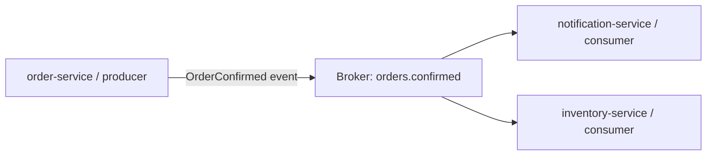
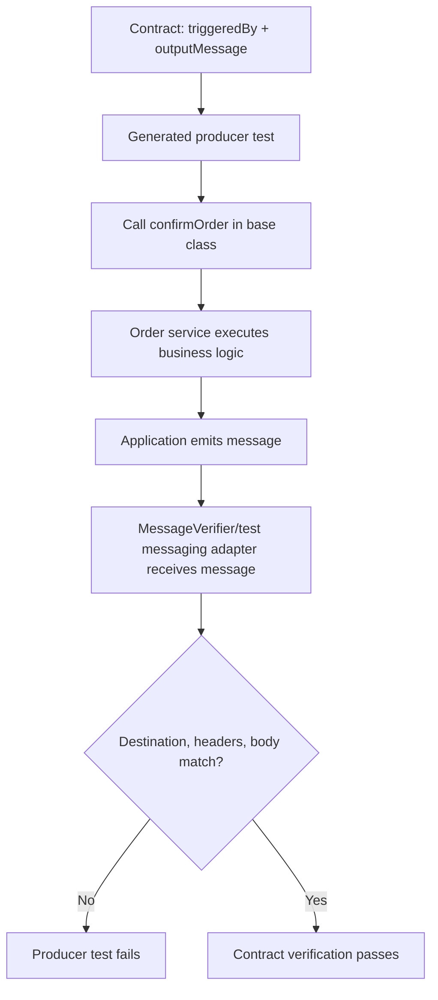
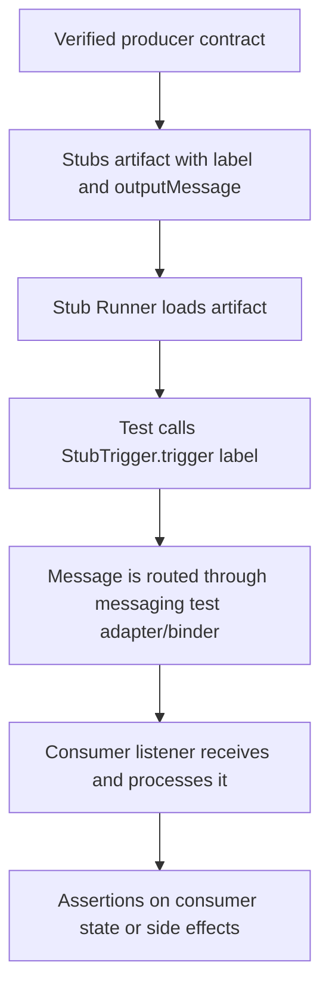
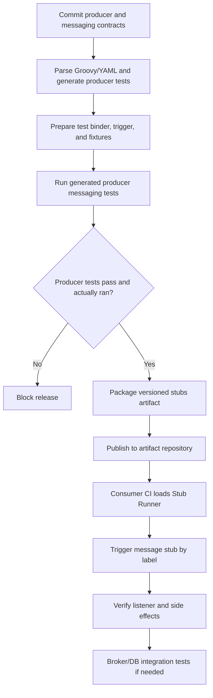

# Producers and consumers in message-based communication

## 1. Why does message-based communication need contracts?

In **Spring Cloud Contract**, producers and consumers do not only exchange HTTP requests and responses. Two services can also communicate asynchronously via a **message broker**, topic, queue, or channel, such as Kafka or RabbitMQ. One service publishes an order event, and another service receives the event to update payment, send a notification, or synchronize data. When a producer renames a field, changes a data type, or alters a header or destination, the consumer can break even though no HTTP API changed.

For example:

- `order-service` confirms order `ord-42` and publishes an `OrderConfirmed` event.
- `notification-service` listens to the event to send a notification.
- `inventory-service` consumes the same event to record that the items have been reserved.

If the producer changes the `orderId` field to `id` while the consumer still deserializes `orderId`, the system might ignore the message or process it incorrectly. If the producer moves the destination from `orders.confirmed` to `orders.events` without notice, the consumer might **receive no messages at all**, even though the payload is still valid.

A **message contract** describes the behavior the producer commits to: what triggers the message, where it is sent, which headers it carries, and what structure/values the payload has. Spring Cloud Contract can use **Groovy/YAML DSL** to generate producer tests and create stubs for consumer testing, provided the project has configured the corresponding messaging integration.

Objectives of this lesson:

1. Distinguish between producer, consumer, and broker in message-based communication.
2. Understand **input**, **output**, trigger, destination, headers, and payload in a contract.
3. Write a typical messaging scenario and understand what generated producer tests verify.
4. Use Stub Runner/trigger to test consumer logic without running the real producer.
5. Distinguish **contract** guarantees from the delivery, ordering, retry, and transaction guarantees of a real broker, and design appropriate CI tests accordingly.

## 2. Three roles: producer, broker, and consumer

| Component | Function | What does it care about? |
| --- | --- | --- |
| **Message producer** | Creates and publishes messages | When to publish, which destination, whether payload/headers match the promise |
| **Broker / transport** | Receives, stores, routes, and delivers messages depending on the technology | Topic/queue, partition, routing key, acknowledgment, retention, delivery |
| **Message consumer** | Subscribes to receive and process messages | Whether it reads the right event type/schema and handles data and errors properly |



A single service can be **both a consumer and a producer at the same time**. For example, `billing-service` receives a payment command from `orders.payments.commands` and then publishes `PaymentCompleted` to `payments.completed`. Therefore, the labels producer and consumer must be tied to **each message flow**, rather than being a fixed label for a microservice.

In Spring Cloud Contract, when we talk about a **producer-side contract test**, we usually want to verify **whether the service described by the contract actually emits the promised output message**. Meanwhile, a consumer-side test needs to verify that the application receives and processes the sample message. They are two perspectives of the same interface, and do not necessarily share the same runtime technology or the same repository.

### What changes compared to HTTP?

| HTTP contract | Message contract |
| --- | --- |
| Client sends a request to a URL, server returns a response | Producer sends a message to a destination; consumer receives it asynchronously |
| Method, path, query, status code are the main parts of the interface | Destination, message headers, body, trigger/input, and event type are the main parts |
| Errors typically appear as HTTP `4xx/5xx` | Errors may take the form of retries, nacks, dead-lettering, timeouts, or dedicated error events |
| Stubs typically serve HTTP via WireMock | Messaging stubs require a trigger/message-publishing mechanism and appropriate messaging integration |
| Tests usually have a request/response close together in time | Tests must account for listener readiness, delayed message arrival, and asynchronous state |

You should not force every message to look like HTTP: an `OrderConfirmed` event does not necessarily have an “HTTP response” or status code. If a system uses both REST and messaging, describe **both interfaces** according to their respective communication mechanisms.

## 3. Distinguishing events, commands, and notifications

Different message types can carry different communication semantics:

| Type | Example | Meaning for producer/consumer |
| --- | --- | --- |
| **Event** | `OrderConfirmed` | Something that **has already happened**; multiple consumers may be interested |
| **Command** | `ConfirmOrder` | Asks a party to **perform an action**; usually has a designated handler |
| **Notification** | `SendOrderEmail` | A notification or request to send information; may act like a command depending on design |

For example, `order-service` receives the `ConfirmOrder` command and emits the `OrderConfirmed` event after processing. In the command flow, it is the **consumer of the input**; in the event flow, it is the **producer of the output**.

Do not use a past-tense event name when the corresponding business state change has not actually occurred. If the producer publishes `OrderConfirmed` before the order confirmation transaction commits, consumers may receive a false promise. **Contract tests verify the shape and emission conditions of a message in a test environment; transaction/outbox correctness must be tested separately.**

### Topic, queue, and destination are not the same concept

`sentTo('orders.confirmed')` in a contract describes a **destination according to the abstraction used by the test/plugin**. It may map to a channel, topic, queue, or binding name depending on the actual integration. Kafka topics, RabbitMQ exchanges/routing keys, and Spring Integration channels have different semantics. Do not assume that every destination string is a physical topic name in a production broker.

Parameters such as consumer groups, partitions, retention, or routing bindings may fall outside the basic contract DSL. When they are important operational interfaces, store them as versioned configuration and add corresponding integration tests.

## 4. Components of a message contract

A message carrying an order confirmation event might look like this:

```json
{
  "eventId": "evt-701",
  "orderId": "ord-42",
  "status": "CONFIRMED",
  "occurredAt": "2026-11-24T09:00:00Z"
}
```

In addition to the body, the transport may carry metadata:

```text
destination: orders.confirmed
headers:
  contentType: application/json
  eventType: OrderConfirmed
  schemaVersion: "1"
```

| Component | Meaning | Compatibility risk |
| --- | --- | --- |
| `destination` | Where the message is sent | Changing the destination prevents consumers from receiving the event |
| `headers.eventType` | Event type used by consumers for branching | Renaming/changing the value breaks routing or handler selection |
| `headers.contentType` | Payload serialization type | Changing JSON to text/Avro before consumers support it |
| `headers.schemaVersion` | Schema version indicator if used by the team | Changes not handled by consumers |
| `body.orderId` | Order ID to be processed | Missing field or number/string change causes deserialization failure |
| `body.status` | Business status | Changing `CONFIRMED` to an undefined value |
| `body.eventId` | Message identifier for correlation/deduplication | Missing ID or wrong format when consumers rely on it |
| `body.occurredAt` | Timestamp when the event occurred | Wrong format/timezone; must distinguish event occurrence time from send time |

**Distinguish payload from message headers:** headers can be transmitted by the broker, binder, or serializer as metadata outside the body. If a consumer reads `eventType` from a header, moving it into the JSON body while dropping the header is a breaking interface change, even though “the information is still there”.

### A good contract does not lock down random data

`eventId` and `occurredAt` can differ on every emission. If the consumer only needs a valid format, the producer test should use an appropriate matcher. Conversely, `status = CONFIRMED` and `eventType = OrderConfirmed` may be **meaningful fixed values** that must be checked strictly. A contract minimizes unnecessary constraints while preserving what the consumer actually relies on.

## 5. One-way scenario: producer emits an event after an action

Suppose `order-service` has a business operation to confirm an order. After processing, it emits `OrderConfirmed`. To test the **output** message without having to define an input message, Spring Cloud Contract can use `input.triggeredBy(...)`: the generated test calls a method that triggers the business logic, then verifies the output message.

Example file `src/test/resources/contracts/messaging/order-confirmed.groovy`:

```groovy
import org.springframework.cloud.contract.spec.Contract

Contract.make {
    description 'Publish OrderConfirmed event after confirming an order'
    label 'order_confirmed'

    input {
        triggeredBy('confirmOrder()')
    }

    outputMessage {
        sentTo('orders.confirmed')
        headers {
            header('contentType', 'application/json')
            header('eventType', 'OrderConfirmed')
            header('schemaVersion', '1')
        }
        body([
            eventId: $(consumer('evt-701'),
                       producer(regex('evt-[0-9]+'))),
            orderId: 'ord-42',
            status: 'CONFIRMED'
        ])
    }
}
```

Reading each part:

| Groovy DSL | Meaning |
| --- | --- |
| `label 'order_confirmed'` | Label identifying the scenario, which can be used when triggering messaging stubs |
| `input.triggeredBy('confirmOrder()')` | Method/action called by the producer verification test to make the application emit the message |
| `outputMessage.sentTo('orders.confirmed')` | Logical destination where the output must be observed |
| `headers { ... }` | Headers the consumer relies on, including content type, event type, and schema version |
| `body.orderId = 'ord-42'` | Sample order ID for the scenario |
| `body.status = 'CONFIRMED'` | Status that must match the promise |
| `consumer('evt-701')` | Stable example for the consumer-side stub |
| `producer(regex('evt-[0-9]+'))` | Condition the producer test uses to verify the actually generated ID |

This is an illustrative DSL example using a common Spring Cloud Contract structure. **Plugin compatibility and matcher support must be verified against the exact version in use**. In particular, the destination `orders.confirmed` must be mapped properly to a channel/binding or broker destination in tests; it does not automatically guarantee that a production broker destination exists.

### Why use `triggeredBy` without an HTTP request?

In an HTTP flow, the generated test sends a request to the producer and checks the response. In this messaging example, there is no mandatory HTTP request: the test needs a way to trigger the business logic, such as calling the order confirmation service method. After triggering, the test waits for and verifies an output message. **`triggeredBy` is not a message sent by the consumer** and does not determine the business workflow itself; it invokes logic that you provide in the test base class.

If the producer needs to receive an **input message** before emitting an event, use the `messageFrom`/`messageBody` structure in the `input` block, covered in Section 7, instead of arbitrarily calling a method that does not represent real input.

## 6. What does the generated producer test prove?

Contract Verifier can generate a producer test from the contract in Section 5. Conceptually, the test flow looks like this:



### The base class provides the trigger action

A Java test base skeleton for the producer can be organized as follows:

```java
import org.springframework.beans.factory.annotation.Autowired;
import org.springframework.boot.test.context.SpringBootTest;

@SpringBootTest
public abstract class MessagingContractBase {

    @Autowired
    OrderApplicationService orderService;

    public void confirmOrder() {
        // Data for ord-42 must be in an appropriate state before the test.
        orderService.confirmOrder("ord-42");
    }
}
```

`OrderApplicationService` is a **hypothetical** application service for this example, not a class provided by Spring Cloud Contract. For the code to work, the project needs the implementation, fixtures, test setup, and a real messaging send/receive mechanism or corresponding test adapter. You must configure the plugin so that generated tests extend `MessagingContractBase` and use the appropriate test framework.

**Avoid false positives:** If the `confirmOrder()` method in the base class directly constructs a sample message and injects it into the test verifier, the test could pass even though the business code never emits an event. The trigger method should invoke the **application path under test**, while message observation should be handled by the test adapter.

### Expected vs. actual results

A proper producer test should catch:

- No message emitted after the trigger, or the message arrives at the wrong destination according to the abstraction under test.
- Missing promised `eventType` or `contentType`.
- `orderId` replaced with `orderNumber` or changed to an incompatible type.
- `status` changed from `CONFIRMED` to `PENDING` in the confirmed scenario.
- `eventId` failing to match the defined regex, such as `invalid`.

If the producer emits `eventId = evt-999`, the test **should pass** according to the matcher; a stub value does not mean the producer must always emit literally `evt-701`. At the same time, if the test only matches an event ID regex, it **does not prove that event IDs are unique** across multiple messages.

### Prerequisites for the producer test environment

There must be a mechanism for capturing output from the messaging system that Spring Cloud Contract can verify—typically **Spring Cloud Stream**, **Spring Integration**, or a corresponding adapter depending on the version and technology. Check your project's `MessageVerifier`, test binder, and channel/destination configuration. Do not assume that every combination of Kafka, RabbitMQ, and Spring Boot works out of the box simply by adding the Contract Verifier dependency.

If tests use an in-memory channel or test binder, they verify the **message the application outputs through that abstraction**, not necessarily a real broker connection, partitions, on-the-wire serialization, or acknowledgments. Those require appropriate integration tests.

## 7. Two-way scenario: service receives a command and emits an event

An application may consume a `ConfirmOrder` command and then emit an `OrderConfirmed` event. In this case, the same service is both **the consumer of the input** and **the producer of the output**.

In Groovy DSL, a common scenario looks like this:

```groovy
import org.springframework.cloud.contract.spec.Contract

Contract.make {
    description 'Receive confirmation command and emit event'
    label 'confirm_order_command'

    input {
        messageFrom('orders.commands')
        messageHeaders {
            header('contentType', 'application/json')
            header('commandType', 'ConfirmOrder')
        }
        messageBody([
            commandId: 'cmd-101',
            orderId: 'ord-42'
        ])
    }

    outputMessage {
        sentTo('orders.confirmed')
        headers {
            header('contentType', 'application/json')
            header('eventType', 'OrderConfirmed')
        }
        body([
            eventId: 'evt-701',
            orderId: 'ord-42',
            status: 'CONFIRMED'
        ])
    }
}
```

Reading the communication direction:

```text
Producer verification test
    → sends input message ConfirmOrder to orders.commands
    → order-service receives and processes it
    → emits output message OrderConfirmed to orders.confirmed
    → verifies destination/headers/body of the output
```

Do not confuse `input` with a “consumer response”. Here, `input` describes the **message received by the system under test**; `output` is the **message that system must emit**. For a separate consumer test in `notification-service`, we instead focus on the `OrderConfirmed` event at the input of the notification service.

**Two different ways to trigger:** `triggeredBy('confirmOrder()')` fits when the test actively calls a method to produce an event; `messageFrom(...)` fits when an input message itself triggers the output. You do not need to declare both for every contract, and you should not assume they share the exact same execution mechanism across all plugin versions.

### Preserving correlation between input and output

In the example, `orderId = ord-42` appears in both the command and the event. If a consumer relies on the output matching the corresponding input, comparing two fixed sample values in a single test may not be enough to protect correlation across varying inputs.

An additional test can send different `orderId` values and verify that each emitted event preserves the right ID/correlation ID. For multi-message workflows, pay attention to data state, message ordering, retries, and deduplication. A single-scenario contract test does not automatically prove all of these invariants.

## 8. The same idea in YAML DSL

Besides Groovy DSL, Spring Cloud Contract can use YAML to describe messaging cases depending on the capabilities of the plugin version. Below is an example expressing the intent of the one-way contract from Section 5:

```yaml
description: Publish OrderConfirmed event after confirming an order
label: order_confirmed
input:
  triggeredBy: confirmOrder()
outputMessage:
  sentTo: orders.confirmed
  headers:
    contentType: application/json
    eventType: OrderConfirmed
    schemaVersion: "1"
  body:
    eventId: "evt-701"
    orderId: "ord-42"
    status: "CONFIRMED"
  matchers:
    body:
      - path: $.eventId
        type: by_regex
        value: 'evt-[0-9]+'
```

**Important limitation:** This example illustrates a common YAML messaging and matcher structure. **Check the YAML schema, field names, and matcher formats supported by the Spring Cloud Contract version in your project** before treating it as runnable configuration. In particular, the plugin must understand `triggeredBy`, `outputMessage`, message headers, and payload matchers in that format; valid YAML indentation alone does not prove the contract is valid for the plugin.

| Intent to preserve | Groovy DSL | YAML DSL |
| --- | --- | --- |
| Scenario identifier | `label 'order_confirmed'` | `label: order_confirmed` |
| Trigger from producer test | `triggeredBy('confirmOrder()')` | `input.triggeredBy` |
| Target destination | `sentTo('orders.confirmed')` | `outputMessage.sentTo` |
| Event header | `header('eventType', 'OrderConfirmed')` | `outputMessage.headers.eventType` |
| Sample event ID for stub | `consumer('evt-701')` | `outputMessage.body.eventId` |
| Producer matcher | `producer(regex('evt-[0-9]+'))` | `outputMessage.matchers.body` per the corresponding schema |

When converting formats, **re-run the generated producer tests and trigger the consumer stub**, rather than only comparing the two files textually. If both files represent the same scenario in the plugin's scan directory, duplicate scenarios may be generated; keep only one authoritative source after verification.

### Minimum requirements for data types

In YAML:

- `eventId: "evt-701"` and `orderId: "ord-42"` are **strings**.
- `schemaVersion: "1"` is a string if the consumer treats it as a text version, which differs from the number `1`.
- `status: "CONFIRMED"` is the exact value for the scenario.
- Timestamps should be quoted if the payload requires an ISO 8601 string, preventing the YAML loader from inferring a timestamp type.
- Arrays, objects, booleans, and `null` must preserve the exact types the consumer deserializes.

A message whose JSON content is sent as a string differs from a message sent by a serializer as a JSON object/bytes; the on-the-wire representation depends on the binder's serializer and content type. Compare the **actual message payload the consumer receives**, rather than inferring wire-level types from YAML alone.

## 9. Consumer tests with Stub Runner and StubTrigger

The consumer needs to test its event-handling code without running the real `order-service` producer. In messaging integrations supported by Spring Cloud Contract, **Stub Runner** can provide message stubs; **`StubTrigger`** lets you actively emit a simulated message from a contract that has a `label`.

Test flow:



Illustrative test skeleton in a Spring Boot consumer:

```java
import org.junit.jupiter.api.Test;
import org.springframework.beans.factory.annotation.Autowired;
import org.springframework.boot.test.context.SpringBootTest;
import org.springframework.cloud.contract.stubrunner.StubRunnerProperties;
import org.springframework.cloud.contract.stubrunner.StubTrigger;
import org.springframework.cloud.contract.stubrunner.spring.AutoConfigureStubRunner;

@SpringBootTest
@AutoConfigureStubRunner(
    ids = "com.example:order-service:1.2.0:stubs",
    stubsMode = StubRunnerProperties.StubsMode.LOCAL
)
class OrderConfirmedConsumerTest {

    @Autowired
    StubTrigger stubTrigger;

    @Test
    void shouldHandleOrderConfirmedEvent() {
        stubTrigger.trigger("order_confirmed");

        // Wait for the listener to process asynchronously, then assert business outcomes:
        // for example, notificationRepository now contains a notification request for ord-42.
    }
}
```

This snippet is an **illustrative skeleton, not a complete test**. The project needs the Stub Runner dependency, a binding/test adapter to deliver the message to the listener, proper test context configuration, an artifact repository, and real assertions. `LOCAL` requires the stubs artifact in the local Maven repository; on CI, a remote repository with the corresponding mode/configuration can be used.

`StubTrigger.trigger("order_confirmed")` is an action that **triggers a message stub by label**; it does not call any producer API and does not create a real Kafka topic on its own. Whether the listener receives the message depends on the messaging integration, routing, consumer binding, and consumer subscription state. Do not treat `trigger` returning without throwing an exception as sufficient proof of correct handling.

### What assertions should the consumer make?

Suppose `notification-service` receives the event:

```json
{
  "eventId": "evt-701",
  "orderId": "ord-42",
  "status": "CONFIRMED"
}
```

The consumer test can verify:

1. The listener was invoked with the expected payload/headers.
2. `orderId` was read accurately and not confused with `eventId`.
3. Business logic created the right notification or an observable side effect.
4. An unrelated event with a different `eventType` is not mistakenly processed.
5. For duplicate events, the consumer behaves idempotently if required by the architecture.

If processing is asynchronous, **wait on a condition** with a reasonable timeout, such as with Awaitility, instead of a fixed `Thread.sleep(...)`. A test that only checks “the listener didn't throw an exception” does not guarantee that the consumer updated data accurately.

## 10. Producer tests and consumer tests are two independent gates

| Question | Generated producer messaging test | Consumer with message stub |
| --- | --- | --- |
| Does the producer app emit output after the trigger/input? | **Verifiable** within the scope of the test adapter | **No** — real producer is not running |
| Do destination/headers/payload match the contract? | **Yes**, within what the verifier and adapter support | **Sees a valid sample**, does not verify producer implementation |
| Does the consumer deserialize and process the sample event? | Not the primary goal | **Yes**, if the test asserts listener logic |
| Does the production broker distribute the message? | No if only using a test binder/in-memory | No if only emitting to a test binder |
| Is the message handled properly under retry/duplicate/out-of-order? | Not automatically | Only if corresponding additional scenarios exist |
| Does the producer write to DB and commit the transaction before emitting the event? | Not automatically | No |

A system can have a **green consumer test against an old stub** while the producer has already renamed a header or destination. Therefore, the pipeline must ensure that **producer verification passes against the current contract**, the stubs artifact is published **from that exact revision**, and the consumer fetches the **agreed artifact version**.

### Why not use HTTP WireMock for every message?

WireMock is primarily an HTTP stub server. **Messaging stubs** need a mechanism to emit messages through an appropriate binding/adapter; an HTTP mapping does not represent a Kafka record or AMQP message with headers, routing, and acknowledgments. If a service exposes both HTTP APIs and message contracts, test each type with its corresponding adapter and keep their test reports distinct.

### The role of `label` in messaging stubs

`label` identifies an event/scenario that a test can trigger. Choose stable, meaningful labels like `order_confirmed`, and avoid reusing one generic label for multiple different outputs if consumers need to test them separately. **A stub label is not an `eventType` or a broker destination**: changing a label may prevent consumer test fixtures from finding the stub without changing the wire-level payload; changing `eventType` or the destination can directly break production consumers.

## 11. Delivery guarantees do not automatically come from contracts

A common misconception is that “a passing producer contract test means events will always reach the consumer exactly once”. In reality, the broker and messaging infrastructure determine operational delivery properties.

| Aspect | Typically checked by Contract DSL | Additional testing needed |
| --- | --- | --- |
| Schema/payload | Fields, types, matchers, fixed values | Deserialization with real serializer and schema registry if used |
| Logical destination | `sentTo` and test channel/binding | Real topic/queue/exchange/routing on the broker |
| Delivery | Message appears on the test channel | Broker integration, acknowledgments, and reconnects |
| At-least-once | Not automatically proven | Inject duplicates/redeliveries, test idempotency |
| Ordering | Not automatically proven across multiple events | Partition key/order, consumer ordering tests |
| Retry and dead-letter | Not automatically proven | Retry/backoff, DLQ, poison message tests |
| Transaction/outbox | Not automatically proven | DB + broker/outbox integration; commit/rollback handling |
| Concurrency | Not automatically proven | Multiple consumer instances, partitions, and race tests |

In **at-least-once delivery** architectures, a message may be received more than once. Consumers should implement an idempotency strategy if required by business rules, typically based on `eventId` or a business key. However, a producer promising an `eventId` field **does not by itself prove that the ID is unique**; that is an invariant that must be tested separately.

**Exactly-once**, when supported by a specific product/broker, usually comes with strict conditions and technical boundaries; you should not claim that an entire business workflow spanning databases and multiple services executes exactly once merely because the broker configuration enables that feature.

### Eventual consistency and latency

After a producer emits an event, a consumer might update its read model after some delay. A consumer test with a stub that emits a message immediately verifies one processing branch, **without measuring production latency or eventual delivery guarantees**. If the UI/API needs polling, timeouts, or a `PENDING` state, define the protocol and test those scenarios at the appropriate layer.

## 12. Managing contract changes and consumer compatibility

Suppose both `notification-service` and `inventory-service` consume `OrderConfirmed`. The producer wants to add a `sourceSystem` field and rename `orderId` to `id`:

```json
{
  "eventId": "evt-701",
  "id": "ord-42",
  "status": "CONFIRMED",
  "sourceSystem": "checkout"
}
```

Analyzing each change:

| Change | Potentially compatible? | Condition |
| --- | --- | --- |
| Add `sourceSystem` | **Possibly** | Consumers ignore unknown fields or have a fallback |
| Rename `orderId` to `id` | **Potentially breaking** | Existing consumers are reading `orderId` |
| Change `status` from string to number | **Potentially breaking** | Consumer deserializer/schema expects a string |
| Change `eventType` header | **Potentially breaking** | Consumers use the header to select a handler |
| Change `orders.confirmed` to another destination | **Potentially breaking** | Consumers may stop receiving the event |
| Add a new event type | Depends | Whether consumers ignore or fall back on unknown events |

Adding a new field is not **always** compatible: a consumer running a deserializer in strict mode may reject unknown fields. Therefore, you must understand actual consumer configurations rather than mechanically applying a “adding fields is safe” rule.

### Evolution strategies that do not break old consumers

During a transition period, you can keep `orderId` and add `id` alongside it if truly necessary, announce a deprecation timeline, and upgrade consumers before removing the old field. For major changes, you can use a version header, schema registry, or a new event type according to your organization's compatibility policy. Choose a strategy based on **which consumers are still supported**, not merely on whether producer code builds successfully.

Contract reviews should inspect **which fields consumers actually use**. For dynamic fields like `eventId`, use format/type matchers instead of locking down a single sample value. For `eventType` and destination, however, keep strict constraints if changing them would cause consumers to miss events.

## 13. Building a CI pipeline from producer to consumer



For a Maven producer with the plugin and base class properly configured:

```bash
./mvnw clean verify
./mvnw install
```

`verify` is meaningful when contract tests are properly bound to the lifecycle; `install` installs the artifact locally, including the stubs JAR **only if** the plugin is configured and attaches the artifact properly. With Gradle, check the actual tasks and run the corresponding workflow:

```bash
./gradlew tasks --all
./gradlew clean check
```

Do not assume `check` runs all messaging contract tests in every version. Always inspect the task graph, generated test sources, and the count of tests **actually executed**, rather than only looking at `BUILD SUCCESS`. Packaging/publishing the stubs artifact with Gradle requires appropriate publication and repository configuration.

### Mandatory release gates to enforce

1. Source contracts are discovered and parsed properly; new files are not silently skipped due to a wrong source root or filter.
2. Generated producer messaging tests **actually executed** with the proper trigger/input and verifier—never 0 tests.
3. Tests protect the promised logical destination, headers, body, and matchers of the event.
4. The stubs artifact is built from the **exact same revision** of the verified contracts, with traceable group/artifact/version/classifier.
5. Consumer CI fetches the right artifact, triggers the right `label`, and asserts consumer listener/side effects.
6. Specific requirements around broker delivery, serializers, schema registry, retries, and DB/outbox have integration tests in appropriate environments.

### Managing test data to avoid flaky tests

Message tests easily become sensitive to ordering and timing:

- The listener is not registered before the trigger; the message is missed or times out.
- An old queue/topic still contains events from a previous test; assertions read the wrong message.
- A consumer group is shared across parallel tests; each test receives nondeterministic data.
- Random event IDs or timestamps are compared against fixed sample values.
- A producer test emits multiple messages, and assertions do not properly distinguish event types or correlation IDs.
- Broker retries cause the same event to appear again.

To prevent this, seed deterministic fixtures, clean up state between tests, isolate test destinations/consumer groups when needed, wait on conditions instead of fixed sleeps, and log key message headers (with sensitive data redacted).

## 14. Diagnosing failures: from source contract to broker and consumer

| Symptom | Layer to investigate | First step |
| --- | --- | --- |
| No generated messaging tests | Contract discovery/plugin | Source root, DSL, tasks, filters |
| Generated test cannot call trigger | Base class/test framework | Does `confirmOrder()` exist, is it accessible, and is it configured properly? |
| Trigger runs but no output appears | Business code/test adapter | Was the publisher called? Are binding/destination correct? |
| Message received but matcher fails | Contract vs. actual payload | Compare event type/headers/JSONPath/data types |
| Random test timeouts | Listener, timing, or shared state | Consumer readiness, cleanup, concurrency, and test binder |
| Stub Trigger cannot find label | Stub artifact/label | Does the contract have a `label`, and are artifact/version right? |
| `trigger(...)` runs but consumer does not process | Consumer binding or listener | Routing/bean context/destination, assertions with timeout |
| Passes locally, fails on CI | Broker/profile/version | Same JDK, binder, serialization, repository, credentials? |
| Consumer fails when a field is added | JSON deserializer/schema | Strict unknown-field mode or incompatible schema? |
| Broker has the event but consumer does not receive it | Transport config | Consumer group, subscription, topic/queue, ACL, offset |
| Consumer processes an event twice | At-least-once/redelivery | Idempotency, ack, retry, and duplicate handling |

### Separating the two “no message” questions

**Question A — did the producer emit it?** In producer verification, check that the trigger/input executed, business logic invoked the publisher, the test adapter listened on the right destination, and the message satisfied the contract.

**Question B — did the consumer receive it?** In a consumer test, check the stub artifact/label, binder integration, listener registration, routing, and trigger timing. With a real broker, check the topic/queue, permissions, subscription, and offset.

These are two different questions. A passing producer test over an in-memory test binder does not prove the production broker allows publishing. A passing consumer test when Stub Trigger injects a message does not prove the producer emitted the right event.

### Do not turn timing issues into overly broad matchers

If `occurredAt` always changes, you can use an ISO 8601 matcher or an appropriate string type matcher. However, do not use `.*` regexes for every field just to avoid test failures. Doing so lets the producer emit bodies missing business data, malformed IDs, or invalid event types without tests catching them.

### Responsible logging

In messaging, headers or payloads sometimes contain tokens, emails, phone numbers, or personally identifiable data. When debugging, log only the message type, schema version, logical destination, non-sensitive correlation IDs, and the specific fields needed for expected/actual comparison. Avoid dumping entire messages containing secrets into public CI artifacts.

## 15. Exercise: producer emits payment event, consumer receives notification

### Context

`payment-service` successfully processes payment for order `ord-42` and emits `PaymentCompleted` to destination `payments.completed`. `notification-service` receives the event and creates a notification request. The two services deploy independently; the consumer must not call the real producer API in its contract test suite.

Assume the sample payload:

```json
{
  "eventId": "payevt-501",
  "orderId": "ord-42",
  "paymentId": "pay-900",
  "status": "COMPLETED"
}
```

Required headers: `contentType = application/json`, `eventType = PaymentCompleted`, and `schemaVersion = "1"`.

### Tasks

1. **Identify roles:** In the `payments.completed` flow, which service is the message producer, which is the consumer, and what is the broker responsible for?
2. **Write the Groovy contract:** Use `label 'payment_completed'`, `input.triggeredBy('completePayment()')`, and `outputMessage` sent to `payments.completed`; describe the headers and body as specified.
3. **Choose matchers:** Allow `eventId` to vary in the format `payevt-[0-9]+`, while `status = COMPLETED`, `eventType = PaymentCompleted`, and `orderId = ord-42` remain commitments of this scenario.
4. **Run the producer test:** The base class invokes the payment-completion business logic on test data, and the generated test observes the message and catches wrong destinations/headers/fields.
5. **Run the consumer test:** Stub Runner loads the `payment-service` artifact, triggers label `payment_completed`, and verifies the listener creates a notification request for the right `orderId`.
6. **Try a breaking change:** Rename `orderId` to `id` or change `eventType` to `PaymentSucceeded`; predict which producer/consumer tests are likely to fail.
7. **Try duplicates:** Trigger the stub twice. If the consumer must prevent duplicate notifications, write a dedicated idempotency assertion. Explain why having a contract for an event does not automatically prove that requirement.

### Groovy DSL hint

```groovy
import org.springframework.cloud.contract.spec.Contract

Contract.make {
    description 'Publish PaymentCompleted after successful payment'
    label 'payment_completed'

    input {
        triggeredBy('completePayment()')
    }

    outputMessage {
        sentTo('payments.completed')
        headers {
            header('contentType', 'application/json')
            header('eventType', 'PaymentCompleted')
            header('schemaVersion', '1')
        }
        body([
            eventId: $(consumer('payevt-501'),
                       producer(regex('payevt-[0-9]+'))),
            orderId: 'ord-42',
            paymentId: 'pay-900',
            status: 'COMPLETED'
        ])
    }
}
```

### Expected results

| Change or experiment | Expectation |
| --- | --- |
| Event with ID `payevt-777` and valid remaining headers/body | Producer test **should pass** per the matcher |
| Event ID is `invalid` | Producer test must detect invalid format |
| Producer renames `orderId` to `id` | Producer test must fail if the contract protects the field name |
| Producer changes `eventType` | Producer test must detect the wrong header |
| Consumer receives one valid stub message | Listener parses and creates exactly one notification request |
| Triggered twice with the same `eventId` | Idempotency test must verify non-duplicate processing **if business rules require it** |
| Real broker lacks topic `payments.completed` | Contract test using an in-memory binder may still pass; broker integration test must catch it |

**Self-check question:** If Stub Runner triggers successfully and `notification-service` sends a notification as expected, have we proven that `payment-service` actually processed a payment and emitted the event after DB commit? **No.** That verifies consumer logic against a sample event. To prove producer business logic and transactional consistency, you need producer contract verification and DB/broker integration tests.

## 16. Checklist before completing a message contract

- [ ] Correctly identified producer/consumer roles for **each message flow**, including services that both receive commands and emit events.
- [ ] Clearly understood the message type (event vs. command) and what triggers the output.
- [ ] Contract accurately specifies `triggeredBy` or `messageFrom` input according to the context and plugin support.
- [ ] `outputMessage` includes the destination, headers, body, and matchers that the real consumer needs.
- [ ] Dynamic values have sufficiently tight matchers; meaningful fixed values like event types remain protected.
- [ ] Payload preserves JSON types, version, nullability, and required fields.
- [ ] Test base class actually triggers producer business logic rather than constructing a fake message in place of the implementation.
- [ ] Messaging test adapter/binder captures the output properly, and generated producer tests **actually run** and pass.
- [ ] Stubs artifact has a traceable label, version, and source revision; consumer uses Stub Trigger through the proper messaging integration.
- [ ] Consumer tests assert listener/side effects, await asynchronous processing, and clean up fixtures between tests.
- [ ] CI blocks release if tests did not run or failed; producer and consumer use matching contract versions.
- [ ] Delivery, retry, idempotency, ordering, broker, schema registry, and transactions are additionally tested at appropriate layers when business rules require it.

**Key takeaway:** In message-based communication, **the producer is responsible for emitting an observable promise** — logical destination, headers, and payload — while **the consumer is responsible for reading and handling that promise correctly**. Spring Cloud Contract helps verify producer output and simulate events for consumers using contracts and stubs, but it does not automatically turn schema checks into delivery guarantees or proof of real broker and transaction correctness. Combining producer verification, consumer Stub Runner tests, and integration tests protects against incompatible API/message changes without conflating test layers.
