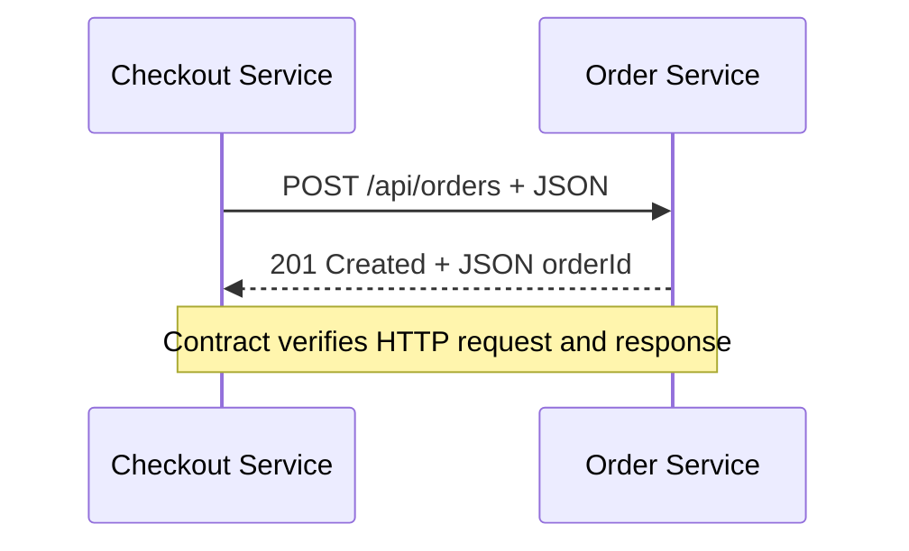
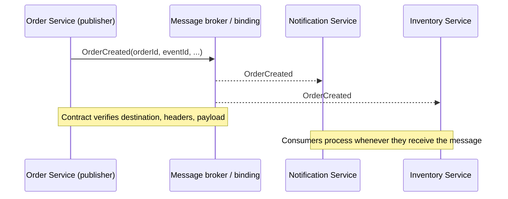
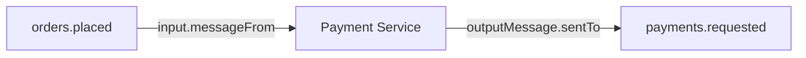
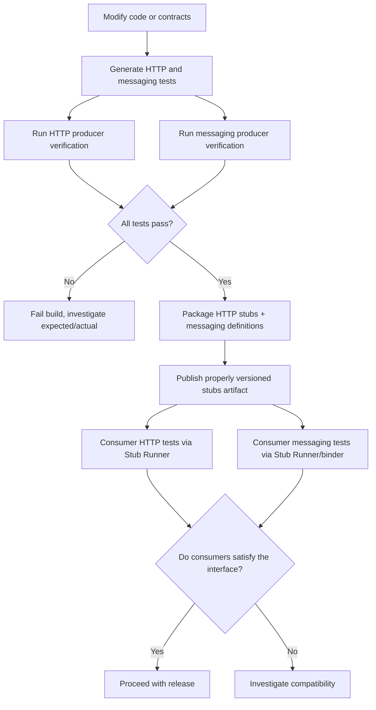

# Distinguishing message contracts from HTTP contracts

## 1. Problem: one business flow, two ways to communicate

In a multi-service system, a business flow may start with an **HTTP request** and continue with a **message**. For example, when a user creates an order:

1. `Checkout Service` calls HTTP `POST /api/orders` on `Order Service`.
2. `Order Service` returns `201 Created` and the order ID.
3. After saving the order successfully, `Order Service` publishes an `OrderCreated` event to destination `orders.created`.
4. `Notification Service` or `Inventory Service` receives the event to carry out its own work.

Both communication steps have **contracts**, but what needs to be checked and when differs. An HTTP contract protects **API request/response interactions**; a message contract protects **published/received data and how it is routed between components**.

**Spring Cloud Contract** supports Groovy/YAML DSL to describe those interactions, generate producer-side tests, create stubs for consumers via **Stub Runner**, and integrate into CI to catch incompatible changes before deployment.

After this lesson, you will be able to:

1. Distinguish HTTP contracts from message contracts by **protocol, DSL structure, and test outcomes**.
2. Understand `request` and `response` blocks compared to `input` and `outputMessage`.
3. Write both contract types for the same business workflow in Groovy and YAML.
4. Explain `triggeredBy`, `messageFrom`, `sentTo`, `label`, headers, and body.
5. Understand how Stub Runner simulates HTTP responses differently from triggering message stubs.
6. Identify guarantees around retries, delivery, ordering, and security that contract tests **do not prove on their own**.

## 2. High-level comparison table

| Criterion | HTTP contract | Message contract |
| --- | --- | --- |
| Typical interaction style | Request–response | Emitting events, commands, or receiving messages; usually asynchronous |
| Communication point | HTTP endpoint: method + URL | Logical destination: topic, queue, channel, or binding |
| Main DSL blocks | `request` and `response` | `input` and `outputMessage` |
| Input data | Method, path, query, headers, request body | Trigger method or incoming message from destination, body, and headers |
| Output data | HTTP status, response headers, response body | Output destination, message headers, and payload |
| Observable success/failure | `2xx`, `4xx`, `5xx` with defined response | Message emitted/received per contract; no inherent HTTP status |
| Producer testing | Send HTTP request, verify actual response | Trigger business logic or send input message, observe output/conditions |
| Consumer-side stub | HTTP stub, usually via WireMock | Messaging stub via messaging integration and triggers/routes |
| Timing concerns | Response to an HTTP request | Messages may arrive later, be processed independently, or in batches |
| Common risks | Wrong status, URL, Content-Type, JSON field | Wrong destination, event type, headers, payload schema, event version |

**These are common patterns, not absolute rules:** HTTP can return `202 Accepted` and process asynchronously afterward; messaging systems can also implement request–reply patterns with correlation IDs. The difference in **contracts** lies in the interface both sides commit to and how Verifier/Stub Runner executes it.

## 3. Reading synchronous flows vs. event flows

### 3.1. HTTP: direct call and response



The consumer sends a request and receives an HTTP response tied to that call. If the producer changes `201` to `200`, removes the `orderId` field, or renames the endpoint, the HTTP contract can catch the discrepancy.

### 3.2. Messaging: publishing events to independent consumers



The publisher does not need an immediate business response from each subscriber. A broker accepting a message or sending a transport-level **acknowledgement** does not mean subscribers have completed business processing.

**Distinction:** `201 Created` is the HTTP status of the order-creation API; `OrderCreated` is a **business event**. A producer could return HTTP `201` properly yet **fail to emit the event** or omit `orderId`. Therefore, when both interfaces matter, you need **two corresponding contracts/test suites**.

## 4. HTTP contract: `request` and `response`

A Groovy DSL contract for creating an order:

```groovy
import org.springframework.cloud.contract.spec.Contract

Contract.make {
    description 'Create order via HTTP'

    request {
        method POST()
        url '/api/orders'
        headers {
            contentType(applicationJson())
        }
        body(
            customerId: 'C-7',
            items: [
                [sku: 'BOOK-01', quantity: 2]
            ]
        )
    }

    response {
        status CREATED()
        headers {
            contentType(applicationJson())
        }
        body(
            orderId: 42,
            status: 'CREATED'
        )
    }
}
```

In this contract:

- `request.method` and `request.url` describe how the consumer calls the API.
- `request.headers` and `request.body` describe the HTTP input.
- `response.status`, `response.headers`, and `response.body` describe the response the producer must return.

When running **producer verification**, the generated test sends the request to the real application and checks status, headers, and body. When running **consumer tests**, the HTTP stub returns the sample response matching the described request, typically via WireMock inside Stub Runner.

Equivalent YAML version:

```yaml
description: Create order via HTTP
request:
  method: POST
  url: /api/orders
  headers:
    Content-Type: application/json
  body:
    customerId: "C-7"
    items:
      - sku: "BOOK-01"
        quantity: 2
response:
  status: 201
  headers:
    Content-Type: application/json
  body:
    orderId: 42
    status: "CREATED"
```

This is an example interaction. For the producer test to run, the test application needs appropriate data/fixtures, and the Spring Cloud Contract plugin must be configured with the right version, test base class, and test framework.

## 5. Message contract: `input` and `outputMessage`

Suppose `Order Service` emits an event once order `42` is created. Messaging contract in Groovy DSL:

```groovy
import org.springframework.cloud.contract.spec.Contract

Contract.make {
    description 'Publish OrderCreated event after saving order'
    label 'order_created'

    input {
        triggeredBy('createOrderAndPublish()')
    }

    outputMessage {
        sentTo('orders.created')
        body(
            eventType: 'OrderCreated',
            eventId: 'evt-42',
            orderId: 42,
            schemaVersion: 1
        )
        headers {
            header('eventType', 'OrderCreated')
        }
    }
}
```

Meaning:

| DSL component | Role |
| --- | --- |
| `label 'order_created'` | Label used to identify/trigger the message stub in appropriate Stub Runner configurations |
| `input.triggeredBy(...)` | Method name called by the producer test to trigger message-emitting logic |
| `outputMessage.sentTo(...)` | Logical destination expected to receive the output message |
| `outputMessage.body(...)` | Expected payload: event type, ID, business data, version |
| `outputMessage.headers { ... }` | Metadata of the emitted message, such as event type or correlation ID |

The contract above has no `response.status`, because **a message is not an HTTP response**. The producer test calls `createOrderAndPublish()`, then observes the message emitted to the destination described in the DSL.

### 5.1. YAML DSL for method-triggered cases

Corresponding to the example above, YAML can express:

```yaml
description: Publish OrderCreated event after saving order
label: order_created
input:
  triggeredBy: createOrderAndPublish()
outputMessage:
  sentTo: orders.created
  body:
    eventType: OrderCreated
    eventId: evt-42
    orderId: 42
    schemaVersion: 1
  headers:
    eventType: OrderCreated
```

In YAML, `input.triggeredBy`, `outputMessage.sentTo`, `outputMessage.body`, and `outputMessage.headers` represent those same concepts. Just like HTTP, YAML cannot replace the test base class, binder, or actual producer application.

### 5.2. Difference between HTTP `Content-Type` and message headers

With HTTP, `Content-Type: application/json` lives in **HTTP request/response headers**.

With messaging, `contentType` is typically a **message header** or framework metadata; brokers or binders may interpret it differently. For example:

```groovy
outputMessage {
    sentTo('orders.created')
    body(eventType: 'OrderCreated', orderId: 42)
    headers {
        messagingContentType(applicationJson())
        header('eventType', 'OrderCreated')
    }
}
```

This is a **fragment inside a contract**, not a complete Groovy file. A message with a JSON payload still does not automatically produce an HTTP status `200` or `201`. Conversely, an HTTP response with a `Content-Type` header does not automatically become a message on a broker.

## 6. Two ways to trigger a message contract

The `input` block of a message contract typically describes one of two trigger sources.

### 6.1. Emitting a message after calling a method: `triggeredBy`

Operations such as schedulers, transaction completion, or database writes can trigger message emission. In such cases, the test can invoke a method from the base test class:

```groovy
input {
    triggeredBy('createOrderAndPublish()')
}
```

`createOrderAndPublish()` is **not an endpoint or queue name**. It is a Java/Groovy method that the test must be able to call to trigger real producer behavior.

An illustrative base test class:

```java
package com.example.order.contract;

import org.springframework.beans.factory.annotation.Autowired;
import org.springframework.boot.test.context.SpringBootTest;
import org.springframework.cloud.contract.verifier.messaging.boot.AutoConfigureMessageVerifier;

@SpringBootTest
@AutoConfigureMessageVerifier
public abstract class MessagingContractBase {

    @Autowired
    protected OrderApplicationService orderApplicationService;

    public void createOrderAndPublish() {
        orderApplicationService.createOrderAndPublish(42L);
    }
}
```

**Note:** `OrderApplicationService` and `createOrderAndPublish` are illustrative APIs that do not exist in an empty project. A real base class needs proper fixtures and dependencies; the method must not be empty or mock only the final message if the goal is to verify the real publisher.

### 6.2. Emitting a message after receiving another message: `messageFrom`

For example, `Payment Service` receives `OrderPlaced` from `orders.placed`, processes it, and emits `PaymentRequested` to `payments.requested`:

```groovy
import org.springframework.cloud.contract.spec.Contract

Contract.make {
    description 'Handle OrderPlaced message and publish PaymentRequested'
    label 'payment_requested'

    input {
        messageFrom('orders.placed')
        messageBody(
            eventType: 'OrderPlaced',
            orderId: 42,
            amount: 125000
        )
        messageHeaders {
            header('eventType', 'OrderPlaced')
        }
    }

    outputMessage {
        sentTo('payments.requested')
        body(
            eventType: 'PaymentRequested',
            orderId: 42,
            amount: 125000
        )
        headers {
            header('eventType', 'PaymentRequested')
        }
    }
}
```

In this case, the producer test needs to **send an input message** to the intake destination described by `messageFrom`, then observe the **output message** per `outputMessage`. The test system must have an appropriate listener and message transport/binder.



**Distinguish carefully:**

- `messageFrom` is the **input destination** the test uses to feed a message into the application.
- `messageBody` and `messageHeaders` are the **data of the incoming message**.
- `sentTo` is the **output destination** to observe.
- `outputMessage.body` and `outputMessage.headers` are the **data of the emitted message**.

Across Spring Cloud Contract versions, detailed support for `messageFrom` and input attributes in **YAML DSL** may vary. The `messageFrom` example here uses Groovy DSL; if converting to YAML, check the YAML schema of your locked library version before adopting it.

### 6.3. An input message does not necessarily produce an output message

A consumer might receive `OrderCreated` and update its database **without** emitting another message. In that case, you need to verify the agreed **side effect**. Spring Cloud Contract supports invoking an assertion method such as `assertThat` in certain messaging contract forms; however, the method must be implemented by the project and should only verify observable outcomes.

Do not invent a fake `outputMessage` just to turn every messaging contract into a “request–response”. If the business flow emits no message, design an appropriate assertion style and check what your DSL version supports.

## 7. Who are the producer and consumer in each communication style?

### 7.1. In HTTP

- **Producer/provider:** the service owning the API, receiving requests, and generating responses (e.g., `Order Service`).
- **Consumer/client:** the service sending requests to the API (e.g., `Checkout Service`).

### 7.2. In messaging

- **Producer/publisher:** the service emitting the `OrderCreated` message (e.g., `Order Service`).
- **Consumer/subscriber:** the service receiving the message (e.g., `Inventory Service`).

In a system that both **receives message A** and **emits message B**, one service can be the consumer of A and the producer of B. Assign roles **per interaction**, rather than permanently pinning them to a whole microservice.

This matters especially when authoring contracts: who owns the event schema? Who is responsible for publishing to the right destination? Which consumers need required fields? Who runs verification? In publisher-side tests, the producer must prove real messages meet the commitment; on the subscriber side, tests must prove the application handles valid data from stubs.

## 8. Distinguishing HTTP paths from messaging destinations

An **HTTP URL** like `/api/orders/42` includes the resource path; together with the HTTP method and other criteria, it determines the endpoint.

A **message destination** like `orders.created` is a **logical address** for sending/receiving messages. It can map to a topic, queue, channel, binding, or integration component. What `sentTo`/`messageFrom` refers to depends on the messaging mechanism:

- With **Spring Cloud Stream/Spring Integration**, the framework may resolve destination or channel names.
- With **Spring JMS**, it may be a configured queue or topic.
- With **Apache Camel**, the destination may be an endpoint URI such as `jms:...`.

Therefore, do not assume `sentTo('orders.created')` automatically creates a Kafka topic or RabbitMQ queue in every environment. Application configuration, binder setup, and test message verifier must align those names properly.

A contract with the right destination string while the application is configured to publish to a different binding must still be caught by producer verification. If a test only mocks `send(...)` and asserts it was called, it may fail to test the final mapping out to the broker.

## 9. Payload and headers: same JSON, different semantics

In HTTP, status codes and headers indicate the request outcome and media type. In messaging, the envelope and headers often carry fields such as:

| Field/header | Example | Why the consumer needs it |
| --- | --- | --- |
| `eventType` | `OrderCreated` | Select the right handler |
| `schemaVersion` | `1` | Choose how to interpret the payload |
| `eventId` | `evt-42` | Identify the event, support idempotency |
| `orderId` | `42` | Link to the order |
| `occurredAt` | ISO-8601 timestamp string | Know when the business event occurred |
| `correlationId` | `corr-77` | Trace across processing steps |
| `contentType` | `application/json` | Decode the payload in the right format |

Example message:

```json
{
  "eventType": "OrderCreated",
  "schemaVersion": 1,
  "eventId": "evt-42",
  "orderId": 42,
  "customerId": "C-7",
  "items": [
    {"sku": "BOOK-01", "quantity": 2}
  ]
}
```

A message can contain JSON identical to an HTTP body, yet its semantics differ:

- An HTTP response reports the **outcome of the current call**.
- An event announces **something that has happened**, which may be processed at another time and by multiple subscribers.

If a message represents a **command** (`ReserveInventory`) rather than an event (`InventoryReserved`), its name and content should express the requested action rather than a completed event. Do not name an event in the past tense if the actual action has not yet occurred.

## 10. How are generated producer tests different?

### 10.1. For HTTP

Spring Cloud Contract Verifier can generate tests (depending on mode) using MockMvc or REST Assured:

1. Send `POST /api/orders` with a specific request body.
2. Receive the HTTP response from the real controller/serializer.
3. Verify status `201`, `Content-Type`, and JSON fields.

### 10.2. For messaging

Generated messaging tests need to:

1. Call the `triggeredBy` method **or** send a message per `messageFrom`.
2. Observe the message emitted by the producer, or invoke the assertion method declared in the contract.
3. Verify `sentTo`, headers, payload, and related matchers.

The two test styles can use **different test base classes**. An HTTP base prepares MockMvc and API fixtures; a messaging base prepares `@AutoConfigureMessageVerifier`, message binder/test transport, and trigger methods when needed.

Example annotation setup for a messaging test base:

```java
@SpringBootTest
@AutoConfigureMessageVerifier
public abstract class MessagingContractBase {
    // Trigger method, fixtures, and transport setup defined by the project.
}
```

This is an illustrative skeleton, not a standalone runnable class. With Spring Cloud Stream, `spring-cloud-stream-test-binder` may be needed in test scope to inspect messages without a real broker, depending on version and integration setup. For other systems (Spring Integration, Spring JMS, Camel), message verifier and transport choices differ.

**Messaging contract tests do not automatically create brokers, queues, or topics.** If the test application lacks a mechanism to receive/publish/observe messages, tests will fail or fail to verify the intended behavior.

## 11. How Stub Runner differs between HTTP and messaging

### 11.1. HTTP stubs

In HTTP, stubs are typically request-and-response mappings. The consumer points its HTTP client at Stub Runner/WireMock; the stub matches method, URL, headers, and body, and returns sample JSON/status.

### 11.2. Messaging stubs

In messaging, Stub Runner uses contract definitions together with an appropriate transport integration to set up stub routes and emit messages. For contracts with a `label`, consumer tests can trigger messages using `StubTrigger` or `StubFinder`.

Conceptual example in a consumer test:

```java
@Autowired
private StubTrigger stubTrigger;

@Test
void handlesOrderCreated() {
    boolean triggered = stubTrigger.trigger("order_created");
    assertThat(triggered).isTrue();

    // Then wait/observe the consumer handling the event within a bounded time.
    // Specific assertions depend on the application and test binder.
}
```

The code above is an **illustrative snippet** requiring `@AutoConfigureStubRunner`, a stubs artifact with the corresponding label, messaging framework integration, and an assertion library. `trigger()` returning true indicates the stub was triggered; it does not prove the consumer finished processing without assertions on the message-handling outcome.

**Key difference:** An HTTP stub typically *returns a response to a call*; a messaging stub can *publish an event to a binding for subscribers to receive*. Do not try to use WireMock HTTP mappings as a message broker when real producer/consumer communication uses messaging.

## 12. Handling asynchrony and timing conditions

An HTTP contract test can verify the response immediately after the call. Messaging tests often need to wait for a message to be emitted or processed by the consumer.

This leads to three pitfalls:

1. **Asserting too early:** assertions run before the listener processes the message, causing flaky failures.
2. **Waiting forever:** tests hang when messages go to the wrong destination or the subscriber never receives them.
3. **Fixed sleeps:** `Thread.sleep(...)` may be too short on slow CI runners or unnecessarily slow down tests.

Use **bounded timeouts** and condition-based waiting, such as Awaitility in consumer tests:

```java
await()
    .atMost(Duration.ofSeconds(5))
    .untilAsserted(() ->
        assertThat(notificationRepository.existsForOrder(42L)).isTrue()
    );
```

This Java snippet is part of a test requiring appropriate imports/beans; it checks the consumer's processing result within a 5-second limit. The timeout is an **example**, not a mandatory constant for every broker or pipeline.

**Separate two concepts:** the producer *emitted the right message* and the consumer *processed the message*. A test that only observes publisher output does not replace testing subscriber behavior.

## 13. Messaging concerns a payload contract does not guarantee on its own

| Concern | Why does it matter? | Additional testing needed |
| --- | --- | --- |
| **At-least-once delivery** | Messages may be delivered/received multiple times | Consumer idempotency, duplicate events |
| **Ordering** | Multiple events may arrive out of order | Version/sequence logic and partition semantics |
| **Retry/backoff** | Failed processing may be retried | Retry policy, DLQ, poison messages |
| **Durability** | Messages must survive temporary consumer downtime | Broker persistence, retention, and recovery |
| **Transaction boundary** | DB commit and publish can get out of sync | Outbox/transactional messaging tests |
| **Security** | Broker ACLs and topic access differ from HTTP auth | Integration tests for permissions and broker config |
| **Schema evolution** | Older consumers must still understand newer events | Contract versioning and compatibility tests |
| **Observability** | Hard to trace an event across multiple services | Correlation ID, trace propagation, and logging |

Spring Cloud Contract helps verify **content, headers, and described interactions**, without inherently verifying **exactly-once** delivery, Kafka partitioning, retry timing, or a real broker cluster. Those guarantees require appropriate integration, failure-injection, or E2E tests.

### 13.1. Why `eventId` and idempotency matter

In systems with at-least-once delivery, a consumer may receive two copies of `OrderCreated`. If each receipt deducts inventory, the order could be deducted twice. Events should carry a stable identifier like `eventId`; consumers must detect already-processed events according to their policy.

A contract can require `eventId` to exist and match a format, but **does not prove by itself** that the consumer prevents duplicate processing. You need tests that send the same event twice and verify only the permitted business effect occurs.

### 13.2. Timestamps are not always a contract obligation

`occurredAt` can be when the business event occurred; `publishedAt` is when the message was sent; `receivedAt` is when the consumer received it. If they are used to calculate SLAs or business ordering, distinguish them. Do not lock all three to a static timestamp when the producer is allowed to generate dynamic values in the promised format.

## 14. Which changes are compatible, which are risky?

### 14.1. HTTP

| Change | Possible impact |
| --- | --- |
| Change `POST /api/orders` to `POST /v2/orders` | Older consumers calling the old URL may fail |
| Remove `response.body.orderId` | Consumers can no longer read the ID |
| Change `201` to `202` | Consumers may misinterpret completion status |
| Add a new JSON field | Usually safe if consumers ignore extra fields |

### 14.2. Messaging

| Change | Possible impact |
| --- | --- |
| Change destination `orders.created` to `order.events` | Subscribers may miss the event |
| Change `eventType` from `OrderCreated` to `OrderPlaced` | Consumers may fail to match a handler |
| Change `orderId` from number to string | Consumer DTO/parser may fail |
| Remove `eventId` | Consumers lose the ability to detect duplicates |
| Add an optional field with clear default | Potentially compatible if older consumers ignore it |
| Change the meaning of `occurredAt` while keeping the name | Dangerous because semantic bugs are hard for schemas to catch |

**A change that looks schema-compatible can still break business logic.** For example, keeping the `status` field while changing its meaning from “order saved” to “order paid” is a semantic shift. Contracts should describe behavior consumers genuinely depend on, while deeper business invariants can be covered by dedicated tests.

## 15. Designing versioning for HTTP APIs and events

For HTTP, teams may version via URL, headers, or media types depending on API policy. When breaking changes happen, old and new consumers can use separate versions during a transition window.

For messaging, consider:

- The **schema** version of the event (e.g., `schemaVersion: 1`) and the artifact/stub version.
- Whether older consumers can process messages containing new fields.
- Whether incompatible events require a separate topic/destination or a clearly versioned event type.
- Ability to replay older events from the broker or event store.

**`schemaVersion` in the payload does not replace the Spring Cloud Contract library version, nor does it replace the producer's artifact version.** They serve different purposes: data-interface version, tooling version, and deployable-package version.

When using Avro, Protobuf, or JSON Schema, a message contract should align with a schema registry/compatibility strategy if the system uses one. Spring Cloud Contract does not automatically replace all schema-evolution checks performed by those tools.

## 16. CI workflow combining HTTP and messaging

A producer exposing both interfaces should organize its pipeline for both test suites:



Implementation checklist:

1. **Organize contracts clearly by group**: HTTP endpoints vs. events/messages; avoid accidentally mixing test base classes.
2. **Use compatible plugins and dependencies** for Spring Boot/Spring Cloud; configure the test base class and message verifier.
3. **Prepare fixtures and test bindings**: HTTP data fixtures and appropriate message listeners/publishers.
4. **Run both producer test groups**: verify tests are actually generated and executed, not skipped.
5. **Publish stubs only after producer verification passes**: do not treat generated stub files alone as sufficient proof.
6. **Run consumer tests with real clients/handlers**: HTTP client sends requests, message subscriber receives events.
7. **Check compatibility changes**: status/URL/body for HTTP; destination/event type/headers/payload for messaging.
8. **Keep integration/E2E tests** for real brokers, security, retries, DLQ, ordering, and operations.

For messaging consumers, a test dependency such as `spring-cloud-stream-test-binder` may be needed when using Spring Cloud Stream. Destination mapping and Stub Runner mechanics vary by framework/version, so check your project's documentation and actual configuration.

## 17. Common mistakes when confusing the two contract types

| Symptom | Possible cause | How to fix |
| --- | --- | --- |
| Using `request/response` to test an event | Confusing a message with an HTTP response | Write `input/outputMessage` for messages |
| Looking for HTTP status `200` from `outputMessage` | Messages do not inherently have HTTP statuses | Check destination, headers, payload, and processing outcome |
| Producer HTTP tests pass but subscribers miss events | Only tested the endpoint, no messaging contract | Add publisher and consumer message tests |
| `triggeredBy` does nothing | Missing method in base class or not emitting a real message | Implement trigger and check application context |
| Message sent to wrong target | Misconfigured binding/destination mapping | Check `sentTo`, binder, and routing configuration |
| Producer test sees no message | Missing message verifier/binder or listener not ready | Configure `@AutoConfigureMessageVerifier` and test transport |
| Stub Runner runs but emits no message | Missing label/messaging integration or wrong stub version | Check `StubTrigger`, artifact, binder, and mapping |
| JSON is valid yet event is ignored | Different `eventType` header, routing key, or version | Check both headers and payload |
| Messaging tests occasionally fail on CI | Race condition, timeout too short | Wait on conditions with a bounded timeout |
| Consumer processes an event twice | Broker redelivery, non-idempotent consumer | Test duplicates and deduplication logic |

### 17.1. “Right payload, wrong destination”

A message containing valid `orderId`, `eventId`, and `eventType` is still useless if published to a destination different from where the consumer subscribes. That is why **`sentTo` is part of the interface too**, not just the JSON body.

### 17.2. “Producer test passes, consumer fails”

A producer may emit a contract-compliant message while the subscriber deserializes it incorrectly, ignores a header, or misunderstands a status. Consumer tests using message stubs must verify **real subscriber logic**, not just that a message arrived on a channel.

### 17.3. “Consumer test passes, producer doesn't actually emit”

A stub can emit `OrderCreated` when the test calls `trigger('order_created')`, even if the `Order Service` implementation accidentally dropped the publish call. Only **producer verification** against the current code directly verifies the obligation to emit the event.

## 18. Practice exercise: choose the right contract type

Consider four requirements:

**A.** `Checkout Service` calls `POST /api/orders` and receives HTTP `201` and `orderId`.

**B.** After creating an order, `Order Service` emits `OrderCreated` to `orders.created`.

**C.** `Inventory Service` receives `OrderCreated` and writes an inventory-reservation record to its database; it emits no further messages.

**D.** `Payment Service` receives `PaymentRequested` on `payments.requested` and emits `PaymentAuthorized` to `payments.authorized`.

### 18.1. Questions

1. Choose the contract type for A–D and explain why.
2. For B, write the `input` and `outputMessage` blocks; what must the producer test prepare?
3. For C, why shouldn't you create a fake `response.status: 200` or fake `outputMessage`?
4. For D, distinguish `messageFrom`, `messageBody`, `messageHeaders`, and `sentTo`.
5. What happens if B emits the same event twice? Is a body contract enough to protect the consumer?
6. If HTTP A returns `201` properly but event B is missing `orderId`, what should the pipeline do?

### 18.2. Suggested answers

| Scenario | Suitable contract type | What must be protected |
| --- | --- | --- |
| A | HTTP `request/response` | Method, URL, JSON request, `201`, response body |
| B | Messaging `input.triggeredBy/outputMessage` | Real trigger, `orders.created`, payload, and headers |
| C | Messaging input + appropriate side-effect assertion/test | Incoming message and created DB record; do not fake non-existent output |
| D | Messaging `input.messageFrom/outputMessage` | Input/output destinations and schemas of both messages |

For B, the base class must have a trigger method calling real business logic, along with a message verifier/binder. For C, tests must observe business effects in the manner supported by the framework and version. For D, `input` specifies the **incoming message**, while `output` specifies the **emitted message**. For Question 5, dedicated idempotency testing is needed because a payload contract alone does not prevent duplicate processing. For Question 6, messaging producer verification must fail the build or block publishing stubs if the event violates the contract.

## 19. Checklist before reviewing a message contract

- Is the contract describing **HTTP** or **messaging**, and were the right DSL blocks chosen?
- If messaging, are the publisher, subscriber, and logical destination clearly identified?
- Does `input` use `triggeredBy` or `messageFrom` matching the actual trigger source?
- Do `outputMessage.sentTo`, payload, `eventType`, and headers reflect consumer needs?
- Are data versions/formats clear, with a strategy for handling optional or new fields?
- Does the test base provide a real trigger, `@AutoConfigureMessageVerifier`, and the required messaging infrastructure?
- Do producer tests check real messages, and do consumer tests verify proper subscriber handling?
- Does Stub Runner receive the right artifact, label, and transport/binder configuration?
- Are additional tests included outside the contract for duplicates, retries, DLQ, ordering, and broker security when needed?
- Does CI run both HTTP and messaging verification before publishing stubs?

**Official documentation to consult for your project version:**

- [Spring Cloud Contract — HTTP Contracts](https://docs.spring.io/spring-cloud-contract/reference/project-features-contract/http.html).
- [Spring Cloud Contract — Messaging](https://docs.spring.io/spring-cloud-contract/reference/project-features-messaging.html).
- [Spring Cloud Contract — YAML Schema](https://docs.spring.io/spring-cloud-contract/reference/yml-schema.html).
- [Spring Cloud Contract — Stub Runner](https://docs.spring.io/spring-cloud-contract/reference/project-features-stubrunner.html).

**Key takeaway:** An HTTP contract describes **`request` → `response`** of an API; a message contract describes **`input` → `outputMessage`** or message-handling conditions in an event flow. With Spring Cloud Contract, both can be verified on the producer side and stubbed for consumers, but **they do not share the same trigger mechanics, result observation, or delivery guarantees**. A system that creates an order over HTTP and then emits `OrderCreated` must protect **both interfaces** and supplement them with integration tests for operational properties that contract testing does not verify on its own.
