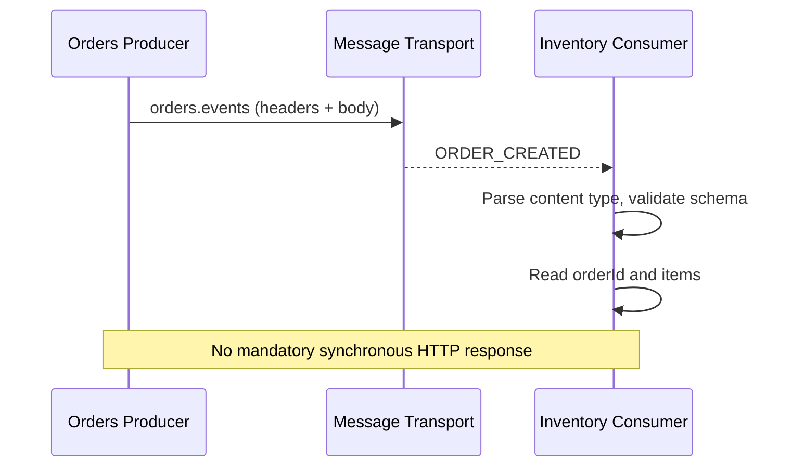
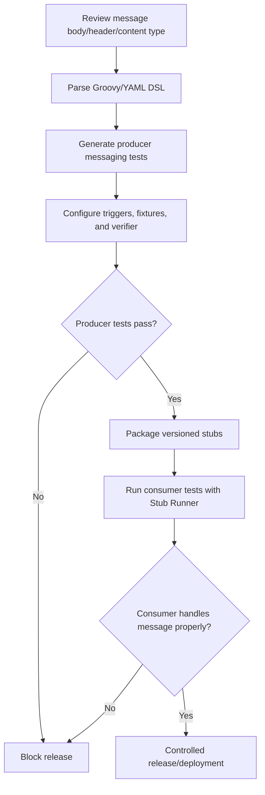

# Message body, headers, and content type

## 1. Why describe body, headers, and content type together?

In **Spring Cloud Contract** (module `SPRING_CLOUD_CONTRACT`), a contract is an agreed behavioral specification between a **producer** and a **consumer**. Beyond HTTP contracts, the framework supports **messaging contracts** using **Groovy DSL** or **YAML DSL**. From a contract, Contract Verifier can generate producer tests to observe real messages, produce stubs for consumers via **Stub Runner**, and integrate into CI to catch incompatible changes.

With messaging, simply knowing “a message was sent” is not enough. The consumer needs to know **where to receive the message, how to interpret the data, and which metadata to rely on**:

- **Body/payload**: business data, such as `orderId`, `items`, `eventType`.
- **Headers**: metadata attached to the message, such as `correlationId`, `eventType`, or `schemaVersion` if specified by the system.
- **Content type**: the declared format so converters/consumers know how to interpret the body, e.g., `application/json`.
- **Destination**: the channel, topic, queue, or target where the message is published; in the DSL this typically lives in `sentTo(...)`.

Suppose Orders Service emits a message after creating an order:

```text
Destination: orders.events
Headers:
  contentType   = application/json
  eventType     = ORDER_CREATED
  correlationId = corr-1001
Body:
  {
    "orderId": "ord-1001",
    "items": [{"productId": "SKU-001", "quantity": 2}]
  }
```

If the producer renames `orderId` to `id`, older consumers may fail to look up the order. If `eventType` is dropped, consumers may fail to pick the right processing branch. If the body contains JSON while content type states `text/plain`, a message converter may interpret the payload differently than expected. **These three elements are interrelated, not interchangeable.**

The goal of this lesson is to design and verify body, headers, and content type for both **input messages** and **output messages**, recognize converter/broker limits, and build repeatable producer–consumer tests in CI.

## 2. Comparing messages with HTTP request/response

A message in Spring Cloud Contract does not necessarily have a “response” like an HTTP request. A message may be emitted as an event, forwarded by a broker, and processed asynchronously by consumers.

| Perspective | HTTP contract | Messaging contract |
| --- | --- | --- |
| Input | `request.method`, `url`, `headers`, `body` | `input.triggeredBy` or `input.messageFrom`, `messageBody`, `messageHeaders` |
| Output | `response.status`, `headers`, `body` | `outputMessage.sentTo`, `body`, `headers` |
| Status code | `200`, `201`, `400`, `409`... | No mandatory HTTP status; status may live inside the payload or another message |
| Content format | HTTP `Content-Type` header | Message content type handled by the app/binder/converter |
| Producer testing | Call real endpoint, assert HTTP response | Trigger producer or feed input message, then observe output message |
| Consumer stub | HTTP stub returning a response | Stub Runner triggers/emits message via appropriate messaging integration |

In HTTP, `response.status 200` is a protocol code. In messaging, a field like `status: 'RESERVED'` inside a JSON payload is just a **business status**. You should not put `response.status` into an event contract to describe message-processing outcomes.

### 2.1. Sample event flow



The diagram depicts the logical flow; it does not promise that the broker delivers messages **exactly once**, in a global order, or within a fixed latency. Those properties belong to transport, retry, and idempotency design and require separate testing.

## 3. Groovy DSL structure for an emitted message

An **output** message emitted by a producer can be described as follows:

```groovy
import org.springframework.cloud.contract.spec.Contract

Contract.make {
    name 'order_created_event'
    label 'order_created'
    description 'Publish event after order creation succeeds'

    input {
        triggeredBy('publishOrderCreated()')
    }

    outputMessage {
        sentTo('orders.events')
        body([
            eventType: 'ORDER_CREATED',
            orderId  : 'ord-1001',
            items    : [
                [productId: 'SKU-001', quantity: 2]
            ]
        ])
        headers {
            header('eventType', 'ORDER_CREATED')
            header('correlationId', 'corr-1001')
            messagingContentType(applicationJson())
        }
    }
}
```

**How to read each block:**

1. `name` identifies the contract; `label` names the scenario so consumer tests can ask Stub Runner to trigger it.
2. `input.triggeredBy('publishOrderCreated()')` instructs the producer test to call a trigger method **implemented by your team** in the test base.
3. `outputMessage.sentTo('orders.events')` specifies the destination the producer must publish to.
4. `outputMessage.body([...])` describes the business payload.
5. `outputMessage.headers` constrains the metadata consumers rely on, where `messagingContentType(applicationJson())` declares the message's content type.

**Note:** `publishOrderCreated()` is not a built-in Spring Cloud Contract method. The test base must call into **real producer logic** to emit the event. Manually constructing a message with the expected payload and feeding it straight to the verifier can hide real producer bugs.

In the example, `eventType` appears in both **body** and **header** to illustrate both locations. In a real system, a team may choose one location as the source of truth, or mandate that both exist and match. Avoid requiring the same value in two places if consumers do not use both and the producer does not publish that commitment.

## 4. The same contract in YAML DSL

Equivalent YAML representation:

```yaml
name: order_created_event
description: Publish event after order creation succeeds
label: order_created
input:
  triggeredBy: publishOrderCreated()
outputMessage:
  sentTo: orders.events
  body:
    eventType: ORDER_CREATED
    orderId: ord-1001
    items:
      - productId: SKU-001
        quantity: 2
  headers:
    eventType: ORDER_CREATED
    correlationId: corr-1001
    contentType: application/json
```

In **YAML DSL**, `outputMessage.headers.contentType: application/json` expresses the content type. In **Groovy DSL**, the earlier example uses `messagingContentType(applicationJson())` inside `outputMessage.headers`. Do not replace it with `response.headers.contentType(...)` from HTTP contracts.

The Groovy and YAML examples describe the **same scenario**. When putting contracts into a project, choose one format to prevent the plugin from scanning both and generating duplicate tests/stubs.

### 4.1. Distinguishing contract metadata from message headers

| Name in DSL | Example | Role |
| --- | --- | --- |
| `name` | `order_created_event` | Identifies the case in tests/contracts |
| `description` | Behavioral description string | Documentation for readers |
| `label` | `order_created` | Trigger label for stub scenarios when supported |
| `sentTo` | `orders.events` | Output destination |
| `body.eventType` | `ORDER_CREATED` | Data inside the payload |
| `headers.eventType` | `ORDER_CREATED` | Actual header carried on the message |
| `headers.contentType` | `application/json` | Metadata describing payload format |

Changing `name` or `label` does not create a header on the actual message. Likewise, declaring `eventType` inside `body` **does not automatically add an `eventType` header**, unless the producer or converter is explicitly coded to do so.

## 5. Body: the data structure consumers actually use

`outputMessage.body` is the payload content emitted by the producer. With JSON, you can describe the body using a map/list structure:

```groovy
body([
    orderId: 'ord-1001',
    customer: [
        id: 'customer-001'
    ],
    items: [
        [productId: 'SKU-001', quantity: 2],
        [productId: 'SKU-002', quantity: 1]
    ],
    totalAmount: 150000
])
```

This notation makes it clear to readers that:

- `orderId` and `customer.id` are strings.
- `items` is a list of objects.
- `quantity` and `totalAmount` are numeric values.
- `customer` is a nested object.

Consumers face risks when the producer **removes a field**, **changes its type**, **renames it**, or **changes its semantics** when consumers depend on it.

### 5.1. JSON string body

A contract can also express the body as a JSON string:

```groovy
body('''{
  "eventType": "ORDER_CREATED",
  "orderId": "ord-1001",
  "items": [
    {"productId": "SKU-001", "quantity": 2}
  ]
}''')
```

Things to distinguish:

1. **Map/list DSL body** is structured data in the contract model.
2. **JSON string DSL body** is a text representation of JSON.
3. **The real message on the transport** may hold a `String`, `byte[]`, object, or payload type managed by a converter.

Do not assume a map in the DSL is always emitted to Kafka as a specific UTF-8 JSON string. That depends on the **message converter/serializer** and transport configuration. Conversely, a string that looks like JSON will not necessarily be deserialized as JSON by the consumer if the content type or converter does not match.

### 5.2. Choosing required vs. optional fields

| Field | Example role | Impact if changed |
| --- | --- | --- |
| `orderId` | Key linking to the order | Consumer does not know which order to process |
| `eventType` | Identifies event kind | Wrong processing branch selected |
| `items[].productId` | Identifies product | Wrong item inventory updated |
| `items[].quantity` | Requested quantity | Incorrect stock reservation/deduction |
| `occurredAt` | Event timestamp | Format, timezone, and nullability must be defined |
| `notes` | Optional note | Can be added without breaking consumers that tolerate unknown fields |

An **optional field** does not mean its semantics may be changed arbitrarily. If a consumer actually relies on `notes`, changing its data type can cause failures. Required/optional decisions should be aligned in the schema and consumer expectations, not just inferred from field names.

### 5.3. Three distinct states: missing, null, empty

Example payloads:

```json
{"orderId": "ord-1001"}
```

```json
{"orderId": "ord-1001", "notes": null}
```

```json
{"orderId": "ord-1001", "notes": ""}
```

These cases can make consumers behave differently. Spring Cloud Contract checking a single concrete example does not establish every nullability rule by itself. When strict typing or required fields matter, supplement with JSON Schema, Avro/Protobuf schema validation, or dedicated consumer tests.

## 6. Headers: metadata used for routing and processing

Message headers typically carry information needed by consumers or middleware that does not necessarily belong to the core business payload:

| Illustrative header | Value | Purpose |
| --- | --- | --- |
| `contentType` | `application/json` | Hints/specifies how to decode the payload |
| `eventType` | `ORDER_CREATED` | Enables handler selection or event filtering |
| `correlationId` | `corr-1001` | Traces a chain of processing |
| `schemaVersion` | `1` | Selects decoding rules when schema versioning is agreed |
| `tenantId` | `tenant-demo` | Scopes data in multi-tenant systems, if part of the integration contract |
| `messageId` | `msg-1001` | Identifies the message when used by middleware/apps |

These names are **illustrative conventions**, not a default header list across all brokers. A system may place the event type in the payload, in a header, or in both. A contract must reflect **the headers the producer actually commits to and the consumer actually reads**.

### 6.1. Declaring output headers in Groovy

```groovy
outputMessage {
    sentTo('orders.events')
    body([orderId: 'ord-1001', eventType: 'ORDER_CREATED'])
    headers {
        header('eventType', 'ORDER_CREATED')
        header('correlationId', 'corr-1001')
        header('schemaVersion', '1')
        messagingContentType(applicationJson())
    }
}
```

This is a **fragment inside `Contract.make`**, not a standalone file. Setting `schemaVersion` as the string `'1'` carries a different contract meaning than an integer header. On some transports, actual headers may be transmitted as `byte[]` or another metadata type. Check the **value/type at the boundary observed by generated tests** and how converters interpret them.

### 6.2. Avoid wrong assumptions about header types

Spring Messaging uses `MessageHeaders` with keys and typed values; brokers/adapters may map them to metadata in Kafka, RabbitMQ, JMS, or other transports. Therefore:

- `contentType` in Spring Messaging often relates to `MessageHeaders.CONTENT_TYPE`, not necessarily the final raw header name on every broker.
- Do not assume a Java header is a `String` at every step. A converter may use `MimeType` or a specialized type.
- Do not design contracts around header ordering: metadata order is not a universal guarantee.
- Never place real bearer tokens or sensitive data inside message fixtures.

**Typical mistake:** the body contains `eventType: ORDER_CREATED` while the consumer reads `headers.eventType`. If the producer only puts the value in the body, the consumer will not see the header. The contract must pick the exact boundary or update the consumer to read from the agreed location.

## 7. Content type: decoding instruction, not decoration

**Content type** describes the payload format at the messaging boundary. Examples:

| Content type | Expected interpretation | Additional verification needed |
| --- | --- | --- |
| `application/json` | JSON object/array/string/number per JSON spec | Does the converter actually produce valid JSON with the right types? |
| `text/plain` | Plain text content | Encoding and language/character conventions |
| `application/xml` | XML document | Namespaces, schema/encoding, and parser |
| `application/octet-stream` | Generic binary data | Custom schema/format understood by the consumer |
| Media types with `+json` suffix | JSON following that media type's schema/semantics | Supported by both converter and client? |

These are common examples, **not a list of formats automatically supported by every Spring Cloud Contract messaging integration**. For Avro, Protobuf, or custom formats, you must have appropriate serializers/deserializers, schemas, and transport tests.

### 7.1. Groovy DSL: `messagingContentType`

```groovy
outputMessage {
    sentTo('orders.events')
    body([
        eventType: 'ORDER_CREATED',
        orderId  : 'ord-1001'
    ])
    headers {
        messagingContentType(applicationJson())
    }
}
```

The `messagingContentType(applicationJson())` helper belongs to the **message headers** block, not `response.headers.contentType(applicationJson())` from the HTTP DSL. It informs the tooling that the message is expected to carry a JSON content type.

### 7.2. YAML DSL: `contentType` header

```yaml
outputMessage:
  sentTo: orders.events
  body:
    eventType: ORDER_CREATED
    orderId: ord-1001
  headers:
    contentType: application/json
```

In YAML, `contentType` is a **key inside `outputMessage.headers`**. Do not place it alongside `sentTo` or `body` as if it were a top-level structural property of the contract.

### 7.3. Content type and body must not contradict each other

Counterintuitive example:

```text
contentType: application/json
body: This is a plain text line with no JSON syntax.
```

If the client/converter expects JSON, this data may fail to parse as a JSON document. A valid JSON string must be properly quoted on the wire, or properly wrapped/escaped by the converter.

**Necessary check:** do not merely assert the `contentType = application/json` header; observe the **actual payload** emitted by the producer and how the consumer decodes it. Contract tests verify the described fields; integration tests with the real message converter help catch misconfigured serializers.

### 7.4. Charset, schema version, and content type are three separate concerns

`application/json` does not by itself tell you:

- Which schema version the payload uses.
- Whether `orderId` is a string or number per the business contract.
- Whether the data is encrypted or compressed.
- Which consumers the active converter is compatible with.

If schemas are versioned, `schemaVersion` can be a dedicated header or body field. Agree on schema-evolution rules and do not treat content type as a complete versioning mechanism.

## 8. Input messages: `messageBody` and `messageHeaders`

Not every producer simply emits an event after a direct method call. An **Inventory** service might receive an `ORDER_CREATED` message and then emit a reservation result.

In this case, the contract has both an **input message** and an **output message**:

```groovy
import org.springframework.cloud.contract.spec.Contract

Contract.make {
    name 'inventory_reservation_accepted'
    description 'Receive order and publish successful inventory reservation result'

    input {
        messageFrom('orders.events')
        messageBody([
            orderId  : 'ord-1001',
            productId: 'SKU-001',
            quantity : 2
        ])
        messageHeaders {
            header('eventType', 'ORDER_CREATED')
            header('contentType', 'application/json')
        }
    }

    outputMessage {
        sentTo('inventory.reservations')
        body([
            orderId: 'ord-1001',
            result : 'RESERVED'
        ])
        headers {
            header('eventType', 'INVENTORY_RESERVED')
            messagingContentType(applicationJson())
        }
    }
}
```

In **`input`**:

- `messageFrom('orders.events')` specifies the message source that tests send/receive through the configured integration.
- `messageBody([...])` describes the input payload.
- `messageHeaders { ... }` describes the input headers.

In **`outputMessage`**:

- `sentTo('inventory.reservations')` specifies the result destination.
- `body([...])` describes the output payload.
- `headers { ... }` describes the output headers, including content type.

The two name pairs **must not be confused**: `input.messageBody`/`messageHeaders` is distinct from `outputMessage.body`/`headers`.

### 8.1. YAML DSL for message-in → message-out

```yaml
name: inventory_reservation_accepted
description: Receive order and publish successful inventory reservation result
input:
  messageFrom: orders.events
  messageBody:
    orderId: ord-1001
    productId: SKU-001
    quantity: 2
  messageHeaders:
    eventType: ORDER_CREATED
    contentType: application/json
outputMessage:
  sentTo: inventory.reservations
  body:
    orderId: ord-1001
    result: RESERVED
  headers:
    eventType: INVENTORY_RESERVED
    contentType: application/json
```

The YAML snippet expresses a correlation between one input message and one output message under hypothetical behavior. A real project must resolve destinations from `messageFrom`/`sentTo` as interpreted by the messaging integration—whether as a channel, binder destination, queue/topic, or framework-specific URI. Never assume the same name string works identically across all brokers.

### 8.2. When there is a rejection branch

If stock is insufficient, the application may emit:

```json
{
  "orderId": "ord-1001",
  "result": "REJECTED",
  "reason": "OUT_OF_STOCK"
}
```

Create a **separate contract** for this branch using a stock = 0 fixture, along with the promised headers and content type. A `RESERVED` contract is not enough to verify that consumers handle `REJECTED`. Never use “no message observed” as a stand-in for rejection: absence could also result from latency, wrong bindings, or environment errors.

## 9. How to express dynamic values in body/headers?

Many messages have `eventId`, `correlationId`, or `occurredAt` dynamically generated by the producer. Requiring a fixed literal in the producer test can cause unnecessary failures. In **Groovy DSL**, Spring Cloud Contract supports dual-sided expressions via `$(consumer(...), producer(...))`.

Example of a dynamic ID field in **`outputMessage`**:

```groovy
outputMessage {
    sentTo('orders.events')
    body([
        eventType: 'ORDER_CREATED',
        orderId  : 'ord-1001',
        eventId  : $(consumer('evt-100001'),
                     producer(regex('evt-[0-9]{6}')))
    ])
    headers {
        messagingContentType(applicationJson())
    }
}
```

Idea:

- **Stub messages** for consumers carry `eventId = evt-100001`, a predictable sample value.
- **Producer verification** accepts real IDs like `evt-928374` as long as they match the agreed format.

Inspect **generated tests and stub output** to verify matchers work in the intended direction for your Spring Cloud Contract version; do not assume every payload/header type applies matchers identically to HTTP. For specialized message converters or binary headers, custom assertions may be needed.

### 9.1. Do not use matchers to hide schema errors

A `.*` regex on `eventId` or `orderId` accepts empty strings and many invalid values. If consumers rely on IDs for idempotency, enforce tighter format, length, and non-empty constraints.

If `correlationId` in a header must equal a field in the body, two **independent** regex matchers do not prove the two values are equal. Add assertions verifying **cross-field relationships** in the producer test or an appropriate integration test.

### 9.2. Be careful with timestamps

The field:

```json
{"occurredAt": "2026-11-24T03:15:30Z"}
```

is a JSON string. If the consumer requires ISO 8601 UTC, clarify:

- Are offsets other than `Z` allowed?
- Are milliseconds/nanoseconds supported?
- Is a timezone mandatory?
- Is `null` or omitting the field allowed?

A matcher only checks the **described format**; it does not prove the timestamp reflects the exact moment the business event occurred. When accuracy matters, use a fixed clock and assert timing logic in additional tests.

## 10. Producer testing: verifying real payload, headers, and content type

A producer test generated from a messaging contract requires two elements:

1. **Triggering producer behavior** or delivering the right input message.
2. **Observing the message emitted by the producer**, including destination, body, and headers.

Depending on the integration (Spring Cloud Stream, Spring Integration, Spring JMS, Apache Camel...), the project must configure an appropriate message verifier/test binder or test transport. Per Spring Cloud Contract guidance, the base class for generated messaging tests can use `@AutoConfigureMessageVerifier` to configure this mechanism. Tests cannot work from the DSL alone if the messaging environment is not ready.

### 10.1. Test base with an application method trigger

Illustrative skeleton:

```java
package com.example.orders.contract;

import org.springframework.beans.factory.annotation.Autowired;
import org.springframework.boot.test.context.SpringBootTest;
import org.springframework.cloud.contract.verifier.messaging.boot.AutoConfigureMessageVerifier;

@SpringBootTest
@AutoConfigureMessageVerifier
public abstract class OrdersMessagingContractBase {

    @Autowired
    private OrderEventTestDriver orderEventTestDriver;

    public void publishOrderCreated() {
        orderEventTestDriver.createOrderAndPublishEvent("ord-1001");
    }
}
```

`OrderEventTestDriver` and `createOrderAndPublishEvent(...)` **are hypothetical classes/methods that your project must implement**. They must execute through the real event-creation/publishing logic rather than constructing a fake message identical to the contract and handing it directly to the verifier. Imports and configuration for `@AutoConfigureMessageVerifier` and the message binder must match the **framework/test stack version** in use.

For the `ORDER_CREATED` event, the test should verify:

| Part | Expected outcome | Risk if omitted |
| --- | --- | --- |
| Destination | `orders.events` | Consumer misses message even if payload is right |
| Body `orderId` | `ord-1001` | Consumer processes wrong order |
| Body `items[]` | SKUs and quantities per contract | Wrong inventory update |
| Header `eventType` | `ORDER_CREATED` | Consumer routes incorrectly |
| Header `contentType` | `application/json` | Converter may decode improperly |
| Header `correlationId` | Agreed format/value | Broken trace/correlation if consumer uses it |

Do not conclude that observing **any message** means observing **the right message**. Use destination checks and assertions tied to the exact properties the contract protects.

### 10.2. When the input is a message

In a `messageFrom(...)` contract:

- The generated test must send an input message matching `messageBody`/`messageHeaders`.
- The producer application must process that message.
- The test must observe the emitted `outputMessage` and verify body/headers/content type as promised.

If the application still connects to a real broker, avoid leftover messages in queues from prior tests. With a test binder, ensure test channels are properly reset and asynchronous processing has an appropriate wait; do not use arbitrary `Thread.sleep(...)` calls as proof of stability.

### 10.3. Right content type, wrong serialized bytes?

A generated test may observe the payload as an **object after converter processing**. Therefore, when compatibility depends directly on **bytes on the wire** (such as schema registry, Avro/Protobuf serializers, or special encodings), add integration tests using the real transport/serializer. Simply asserting `contentType = application/json` in the message model does not prove Kafka payload bytes were serialized into the expected JSON.

## 11. Consumer testing message stubs via Stub Runner

After producer verification, a stubs artifact can be published with the `stubs` classifier, for example:

```text
com.example:orders-producer:1.4.2:stubs
```

For a contract with `label 'order_created'`, a consumer test can instruct Stub Runner to **trigger that scenario** via `StubTrigger` when the corresponding messaging integration is configured.

Illustrative JUnit 5 example:

```java
import org.junit.jupiter.api.Test;
import org.springframework.beans.factory.annotation.Autowired;
import org.springframework.boot.test.context.SpringBootTest;
import org.springframework.cloud.contract.stubrunner.StubTrigger;
import org.springframework.cloud.contract.stubrunner.StubRunnerProperties;
import org.springframework.cloud.contract.stubrunner.spring.AutoConfigureStubRunner;

import static org.assertj.core.api.Assertions.assertThat;

@SpringBootTest
@AutoConfigureStubRunner(
    ids = "com.example:orders-producer:1.4.2:stubs",
    stubsMode = StubRunnerProperties.StubsMode.LOCAL
)
class OrderCreatedConsumerTest {

    @Autowired
    private StubTrigger stubTrigger;

    @Autowired
    private ReceivedOrderTestProbe receivedOrderTestProbe;

    @Test
    void consumesOrderCreatedEvent() {
        assertThat(stubTrigger.trigger("order_created")).isTrue();

        // A real project needs to wait for async consumer processing,
        // then assert the data stored/observed by the handler.
        receivedOrderTestProbe.assertEventuallyReceived(
            "ord-1001", "SKU-001", 2
        );
    }
}
```

`ReceivedOrderTestProbe` and `assertEventuallyReceived(...)` are **illustrative helpers implemented by the consumer test**. `LOCAL` requires the producer stubs artifact to be installed in the local Maven repository; in CI you can choose `REMOTE` and configure an accessible Maven repository. Annotation syntax, dependencies, and modes must match the running version.

**What the consumer test must verify** is not merely that `trigger(...)` returns `true`, but that the consumer **decoded the message accurately and executed the expected behavior**:

- Did the `contentType` header help the converter pick the right format?
- Did the handler read `orderId` and `items` accurately?
- If `eventType` differs from the expected value, does the consumer take the right branch?
- If the message is delivered twice, is idempotency protected by a dedicated test?

Stub Runner only emits messages through supported/configured integrations; **it does not automatically spin up a Kafka/RabbitMQ/JMS broker or replace real network infrastructure** in every environment. JMS may require a running broker; Stream may use a test binder depending on your design.

## 12. Managing schemas and contract changes

Payloads and headers evolve over time. Adding a new field may be compatible with one consumer while breaking another due to strict deserializers, closed schemas, or conversion logic.

| Change | Risk | How to verify |
| --- | --- | --- |
| Add optional `customerId` | Old consumers may reject unknown fields | Consumer test with new stub, review schema |
| Rename `orderId` to `id` | Old consumers lose their required key | Keep old field during transition or version it |
| Change numeric `quantity` to string | Deserializer/calculations may fail | Schema test + consumer integration |
| Change `contentType` to `text/plain` | Message converter picks wrong payload type | Real converter/transport test |
| Drop `eventType` header | Consumers misroute messages | Assert headers in producer and consumer tests |
| Change `sentTo('orders.events')` to another topic | Consumers miss events | Verify binding and destination in test environment |
| Change `schemaVersion` from `1` to `2` | Older parsers lack support | Producer/consumer compatibility matrix by schema version |
| Add enum `PARTIALLY_RESERVED` | Consumers may lack handling branch | Consumer tests for new value |

Do not confuse the **stubs artifact version** with the **message schema version**:

| Concept | Example | Purpose |
| --- | --- | --- |
| Producer artifact version | `orders-producer:1.4.2` | Identifies the published producer/stub release |
| Schema version | Header `schemaVersion: '1'` | Identifies payload rules if used by the system |
| Event type | `ORDER_CREATED` | Indicates event category and handling behavior |
| Content type | `application/json` | Indicates how payload is represented/decoded |

A change might bump the artifact version while keeping the schema version unchanged, or vice versa depending on system policy. Most importantly, **consumers must know which schemas they can receive** and the pipeline must test compatibility across supported versions.

## 13. Common mistakes when testing body, headers, and content type

| Symptom | Common cause | How to check |
| --- | --- | --- |
| Generated test receives no output message | Wrong `sentTo`, trigger didn't publish, binder/verifier unconfigured | Inspect destination, base class, and message transport |
| Payload is valid JSON yet consumer fails to parse | Missing/wrong content type, missing converter, or schema mismatch | Inspect raw payload, headers, and converter config |
| Test fails for missing `eventType` | Producer only put eventType in body, contract requires header | Align data placement between producer and consumer |
| Test fails on `contentType` even though values look alike | Different header type/media-type format or converter | Read generated assertion and actual value |
| Consumer receives message yet ignores it | Routing/filtering on another header, event type mismatch | Check subscriptions, header predicates, and handlers |
| Test passes yet wire format on broker is wrong | Test uses an in-memory converter unlike production | Add integration test with real serializer/broker |
| Stub trigger returns false | Label doesn't exist or stubs artifact not loaded | Check `label`, stub version, plugin mode |
| Input message sent yet no output | Handler didn't run, bad fixture, async timeout, or binder issue | Verify `messageFrom`, fixture, consumer logic, and wait time |
| Two tests interfere with each other | Stale messages in queue, shared state, or parallel execution | Clean channels/queues and isolate fixtures |
| CI is green yet 0 message tests ran | Plugin didn't scan contracts or runner skipped generated tests | Inspect contract list/generated tests and test reports |

### 13.1. Five-layer diagnosis

```text
1. Is the contract readable?
   -> 2. Did the input/trigger run properly?
      -> 3. Was the message emitted to the destination?
         -> 4. Are headers and contentType accurate?
            -> 5. Are body and consumer logic accurate?
```

If **no message appears**, do not tweak body matchers yet; check triggers, bindings, and transport first. If the message arrived with **wrong headers**, check where the producer constructs metadata. If headers are right yet the consumer fails to parse, inspect **content type, serializer, and schema**. Only update a contract when the new behavior is agreed upon by both producer and consumer—never loosen expected values arbitrarily just to turn CI green.

## 14. Designing a CI pipeline for messaging contracts

A complete workflow can include:



**Producer CI** must verify that generated tests check the destination, key headers, content type, and payload needed by consumers. **Consumer CI** must select the right stub version, trigger messages via the appropriate label or input, and assert the consumer's processing logic.

For systems relying on a schema registry, custom serializers, Kafka partition keys, JMS selectors, or critical broker routing, add integration tests running against the corresponding infrastructure. Contract tests do not guarantee by themselves:

- **Exactly-once** message delivery.
- Ordering across all messages on partitions/queues.
- Retries, dead-letter queues, and idempotency.
- Broker access permissions and real network behavior.
- That every valid schema variant has been exercised.

At release time, **pin the stub version in consumer CI** so results remain reproducible; never overwrite a released artifact under the same coordinates once contract content has changed.

## 15. Practice exercise: payment confirmation message

### 15.1. Requirements

Suppose Payment Service emits a `PAYMENT_SUCCEEDED` event when transaction `pay-1001` completes.

| Component | Contract value |
| --- | --- |
| Destination | `payments.events` |
| Header `eventType` | `PAYMENT_SUCCEEDED` |
| Header `correlationId` | `corr-pay-1001` |
| Header `contentType` | `application/json` |
| Body `paymentId` | `pay-1001` |
| Body `orderId` | `ord-1001` |
| Body `amount` | `125000` |
| Body `currency` | `VND` |

Tasks:

1. Write a Groovy contract with `name`, `label`, `input.triggeredBy`, and a complete `outputMessage` containing body, headers, and content type.
2. Write the equivalent YAML representation while **avoiding** registering both duplicate files in the same build.
3. Explain why `currency` belongs in the body if consumers use it in calculations, whereas `contentType` is metadata describing how to decode the body.
4. Set up a producer test base that triggers **real payment logic** with reproducible fixtures and observes the emitted message.
5. Have the consumer test use Stub Runner to trigger `payment_succeeded`; verify the consumer receives the right `paymentId` and amount.
6. Add a `PAYMENT_FAILED` branch with `reason = DECLINED` and identify which body/headers must differ; create a separate contract.
7. Intentionally drop `contentType` from the producer or change `amount` to a string; observe which contract/consumer tests catch the mismatch and explain when additional integration/schema tests are needed.

### 15.2. Reference solution: Groovy

```groovy
import org.springframework.cloud.contract.spec.Contract

Contract.make {
    name 'payment_succeeded_event'
    label 'payment_succeeded'

    input {
        triggeredBy('publishPaymentSucceeded()')
    }

    outputMessage {
        sentTo('payments.events')
        body([
            paymentId: 'pay-1001',
            orderId  : 'ord-1001',
            amount   : 125000,
            currency : 'VND'
        ])
        headers {
            header('eventType', 'PAYMENT_SUCCEEDED')
            header('correlationId', 'corr-pay-1001')
            messagingContentType(applicationJson())
        }
    }
}
```

`publishPaymentSucceeded()` is an **illustrative method implemented by your project**, not a built-in API. In a real test, prepare a valid transaction and trigger the producer to genuinely emit the event. The `PAYMENT_FAILED` branch should have a separate contract for `reason = DECLINED` and the required headers.

### 15.3. Reference solution: YAML

```yaml
name: payment_succeeded_event
label: payment_succeeded
input:
  triggeredBy: publishPaymentSucceeded()
outputMessage:
  sentTo: payments.events
  body:
    paymentId: pay-1001
    orderId: ord-1001
    amount: 125000
    currency: VND
  headers:
    eventType: PAYMENT_SUCCEEDED
    correlationId: corr-pay-1001
    contentType: application/json
```

### 15.4. Self-check questions

**Question 1.** Does having `body.eventType` automatically create `headers.eventType`?

**Answer:** No. They are two separate data locations; the header exists only if the producer or converter actually sets it.

**Question 2.** Is `contentType = application/json` enough to prove the real payload on the broker is valid JSON?

**Answer:** No. You must verify the actual payload and serializer/converter; when wire format matters, add appropriate integration tests.

**Question 3.** Does an input message use `body` and `headers` or `messageBody` and `messageHeaders`?

**Answer:** In `input`, use `messageBody`/`messageHeaders`; in `outputMessage`, use `body`/`headers`.

**Question 4.** Does Stub Runner automatically execute the producer's full business logic when calling `trigger('payment_succeeded')`?

**Answer:** No. It triggers the message stub defined by the contract; separate producer verification must test that the real producer application emits the right message.

**Question 5.** Why does adding `schemaVersion` not replace artifact version management?

**Answer:** Schema version describes message format/semantics; artifact version identifies the published producer/stub build. They serve two distinct purposes.

## 16. Checklist when writing and verifying message contracts

- [ ] Clearly identified the destination and producer/consumer roles.
- [ ] Know whether the contract is triggered by `triggeredBy` or `messageFrom`.
- [ ] Body accurately describes important business fields, types, structure, and values.
- [ ] Important headers are declared with exact names, values, and data-type rules.
- [ ] Content type reflects the payload format and aligns with the project's message converter.
- [ ] `input.messageBody/messageHeaders` are never confused with `outputMessage.body/headers`.
- [ ] `label` is set clearly when consumer tests need to trigger the message stub.
- [ ] Dynamic values have sensible matchers; fixtures contain no secrets or real production data.
- [ ] Producer test base has the proper trigger/message verifier and exercises real producer logic.
- [ ] Consumer tests use the right stub version and verify **processing logic** upon receiving the event.
- [ ] Separate contracts exist for success/failure event branches when consumers handle them differently.
- [ ] Schema/serializer/broker are additionally verified when compatibility depends on wire format.
- [ ] CI confirms contracts are scanned, generated tests actually execute, and stubs artifacts are verified.

### References

- [Spring Cloud Contract — Messaging](https://docs.spring.io/spring-cloud-contract/reference/project-features-messaging.html): `input`/`outputMessage` blocks, headers, content type, producer verification, and Stub Runner.
- [Spring Cloud Contract — Getting Started](https://docs.spring.io/spring-cloud-contract/reference/getting-started/first-application.html): introduction to the contract lifecycle, generated tests, and stubs.

**Key takeaway:** **body** protects business data, **headers** protect metadata relied upon by consumers and middleware, and **content type** specifies how the payload is interpreted. When these three elements align with the destination, producer verification, and Stub Runner consumer tests, Spring Cloud Contract helps catch incompatible changes early; guarantees around real brokers, serializers, retries, and delivery still require appropriate dedicated testing.
