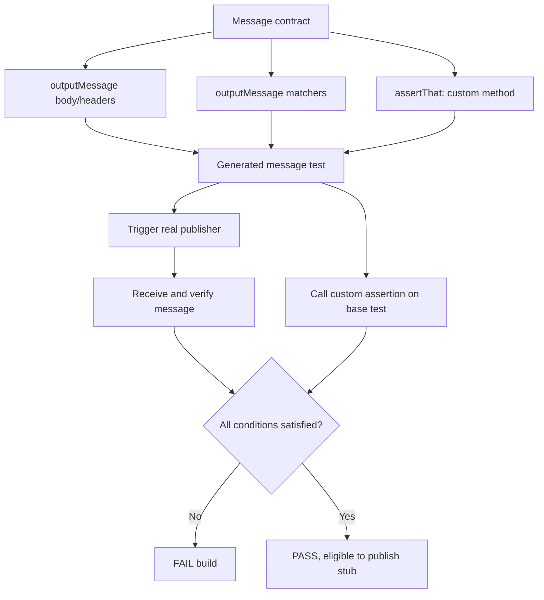
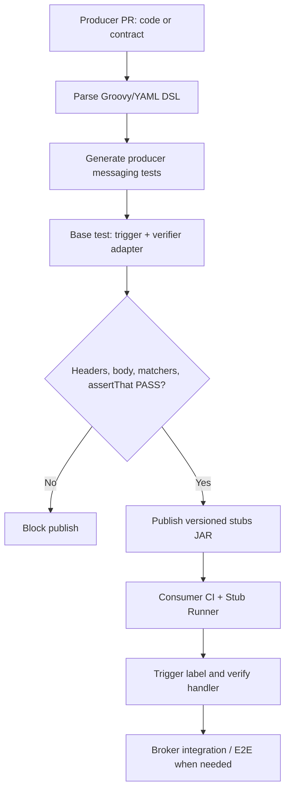

# Verifying conditions with assertions in contracts

> **Chapter:** Message contracts  
> **Module:** Spring Cloud Contract (`SPRING_CLOUD_CONTRACT`) — learning contract testing between producer and consumer, describing HTTP or messaging behavior in Groovy/YAML DSL, generating producer-side tests, publishing stubs, using Stub Runner, and integrating verification steps into CI.

## Learning objectives

After this lesson, you will be able to:

1. Distinguish **assertions in message contracts** from handwritten assertions in unit/integration tests.
2. Explain how Spring Cloud Contract Verifier checks a message's **destination, headers, payload, fixed values, and dynamic values**.
3. Use `bodyMatchers` (Groovy DSL) or `outputMessage.matchers.body` (YAML DSL) to verify IDs, timestamps, and dynamic fields without losing business invariants.
4. Use `assertThat` in `input` or `outputMessage` to invoke **custom verification methods** defined in the base test class or via static imports.
5. Set up producer tests with `@AutoConfigureMessageVerifier`, prepare triggers and messaging channels, and read generated tests to confirm assertion methods are genuinely called.
6. Distinguish **producer messaging verification** from **consumer Stub Runner + StubTrigger**, and understand testing limits around brokers, delivery, retries, and ordering.
7. Design CI pipelines that block releases when real messages violate the contract, even when UUIDs/timestamps are dynamic.

## 1. The problem to solve

An order application emits an `OrderAccepted` event when an order is accepted. Consumers (payment or email services) depend on the event structure:

```json
{
  "eventType": "OrderAccepted",
  "eventId": "d4148738-a6a4-4335-a976-2b68d64c5383",
  "orderId": "ORD-1001",
  "occurredAt": "2026-11-24T09:15:30Z",
  "total": 240000,
  "currency": "VND"
}
```

The message is sent to destination `orders.events`, with headers such as `contentType: application/json` and `eventType: OrderAccepted`.

This event has two categories of constraints:

- **Controlled variation:** `eventId` and `occurredAt` may differ on every emission, yet must still conform to valid formats.
- **Business invariants:** `eventType` must be `OrderAccepted`; `orderId` must match the accepted order ID; `total` must be the number `240000` in the fixture; `currency` must be `VND`.

If a test hardcodes the entire JSON, it fails unnecessarily just because the UUID and timestamp change. If a test only checks “a message was sent”, the producer could change `eventType` to `OrderRejected` or `currency` to `USD` while CI stays green.

**Assertions in contracts** enforce strong verification without depending on random data.

### 1.1. Comparison with HTTP contracts

| HTTP contract | Messaging contract | Role |
| --- | --- | --- |
| `request` | `input` | Trigger condition for a call or message |
| `request.method`, `request.url` | `input.triggeredBy` or `input.messageFrom` | How behavior is triggered in tests |
| `response.status` | No HTTP status for pure messages | Messages do not use HTTP status codes |
| `response.headers` | `outputMessage.headers` | Headers that must be emitted |
| `response.body` | `outputMessage.body` | Committed payload |
| `response.matchers` | `outputMessage.matchers` | Verification rules for dynamic output |
| HTTP test sends a request | Messaging test calls a trigger or sends an input message | Triggers the real producer |

A messaging contract does not automatically create a Kafka topic, RabbitMQ exchange, or ensure consumers ACK messages. It describes behavior verifiable by the **test infrastructure**.

## 2. Two assertion layers to distinguish

Spring Cloud Contract supports two complementary ways to verify messages.

### Layer A — assertions generated from the contract

When `outputMessage` is declared, Verifier can generate tests checking:

- The producer actually emits a message to the destination described in the contract.
- The message is non-null and carries required headers.
- The payload contains the committed fixed fields and values.
- Dynamic fields satisfy `bodyMatchers` / `matchers.body` instead of being forced to match literal sample values.

This is the **default** choice whenever conditions can be clearly expressed in the DSL.

### Layer B — custom assertions via `assertThat`

Inside `input` or `outputMessage`, you can declare `assertThat` with the **name of a Java/Groovy method**. The generated test will invoke that method. The method must be provided via the **generated tests' base class** or corresponding static import/configuration.

For example, suppose you want to verify that an **internal audit record** was saved after the publisher emitted an event. This is an additional condition not directly expressible via a JSONPath matcher. You can use:

```groovy
outputMessage {
    sentTo('orders.events')
    // body and headers ...
    assertThat('assertAuditRecordPresent()')
}
```

**Important:** `assertThat` here is **not** an inline AssertJ/Groovy boolean expression evaluated inside the contract. It is a directive to **call a method** from the generated test; that method itself must throw an `AssertionError` (or fail appropriately) when the condition does not hold.



Do not replace **all** body/header checks with a vague `assertThat` method. Keep the contract readable, using custom assertions **only for rules requiring custom logic**.

## 3. Groovy example: contract emitting `OrderAccepted`

Create `src/test/resources/contracts/order_accepted_event.groovy` in the producer:

```groovy
org.springframework.cloud.contract.spec.Contract.make {
    name 'order_accepted_event'
    description 'Order service emits event when order is accepted'
    label 'order_accepted'

    input {
        triggeredBy('publishAcceptedOrder()')
    }

    outputMessage {
        sentTo('orders.events')

        headers {
            messagingContentType(applicationJson())
            header 'eventType': 'OrderAccepted'
        }

        body(
            eventType: 'OrderAccepted',
            eventId: 'd4148738-a6a4-4335-a976-2b68d64c5383',
            orderId: 'ORD-1001',
            occurredAt: '2026-11-24T09:15:30Z',
            total: 240000,
            currency: 'VND'
        )

        bodyMatchers {
            jsonPath('$.eventId', byRegex(
                '[0-9a-fA-F]{8}-[0-9a-fA-F]{4}-[0-9a-fA-F]{4}-[0-9a-fA-F]{4}-[0-9a-fA-F]{12}'
            ))
            jsonPath('$.occurredAt', byRegex(
                '[0-9]{4}-[0-9]{2}-[0-9]{2}T[0-9]{2}:[0-9]{2}:[0-9]{2}Z'
            ))
        }

        assertThat('assertAuditRecordPresent()')
    }
}
```

How to read the contract:

1. `label 'order_accepted'` sets a label so consumer tests can trigger the **message stub** via Stub Runner.
2. `input.triggeredBy` tells the generated producer test to call `publishAcceptedOrder()`.
3. `outputMessage.sentTo` specifies the destination where the message must be emitted.
4. `outputMessage.headers` defines the content type and event type headers.
5. `outputMessage.body` defines a sample payload, including fixed business values.
6. `bodyMatchers` verifies dynamic values produced by the producer.
7. `assertThat(...)` adds a custom condition from the base test.

### 3.1. Why use `triggeredBy`?

Not every producer emits a message after receiving another message. Events can also originate from HTTP handlers, schedulers, or business commands. `triggeredBy` lets **the producer test actively invoke a method** to trigger event emission without standing up an entire external consumer workflow.

When the application receives an input message and emits an output message, the DSL can use `input.messageFrom`, `input.messageBody`, and `input.messageHeaders`. In that case, tests feed inputs via messaging infrastructure. The two verification models differ; **do not declare both as if they were the same condition unless real business logic matches**.

### 3.2. Why must timestamps match a format?

The `occurredAt` regex verifies the **shape** `YYYY-MM-DDTHH:mm:ssZ`. It does not guarantee by itself that:

- The date is a valid calendar date.
- The time is actually close to the current clock.
- Two events were emitted in the right order.
- `occurredAt` is later than request receipt time.

If consumers require those guarantees, add assertions using a Java time parser/controllable clock and dedicated business tests. **Never try to solve every timing rule with a `.*` regex.**

## 4. Same interaction in YAML DSL

YAML uses `input`, `outputMessage`, and `outputMessage.matchers`; do not paste Groovy `bodyMatchers { ... }` blocks directly into YAML files.

File `src/test/resources/contracts/order_accepted_event.yml`:

```yaml
name: order_accepted_event
description: "Order service emits event when order is accepted"
label: order_accepted

input:
  triggeredBy: publishAcceptedOrder()

outputMessage:
  sentTo: orders.events
  headers:
    contentType: application/json
    eventType: OrderAccepted
  body:
    eventType: OrderAccepted
    eventId: d4148738-a6a4-4335-a976-2b68d64c5383
    orderId: ORD-1001
    occurredAt: "2026-11-24T09:15:30Z"
    total: 240000
    currency: VND
  matchers:
    body:
      - path: $.eventId
        type: by_regex
        predefined: uuid
      - path: $.occurredAt
        type: by_regex
        value: '[0-9]{4}-[0-9]{2}-[0-9]{2}T[0-9]{2}:[0-9]{2}:[0-9]{2}Z'
  assertThat: assertAuditRecordPresent()
```

The Spring Cloud Contract YAML schema provides a **string** `assertThat` field inside `input` and `outputMessage`. Here `assertThat: assertAuditRecordPresent()` matches the intent of the method call in the Groovy version.

**Pick only one format—Groovy or YAML—for the same scenario in a single build.** Storing both versions in the contracts directory can generate duplicate tests and stubs.

### 4.1. Mapping table

| Purpose | Groovy DSL | YAML DSL |
| --- | --- | --- |
| Event label | `label 'order_accepted'` | `label: order_accepted` |
| Trigger | `triggeredBy('publishAcceptedOrder()')` | `input.triggeredBy: publishAcceptedOrder()` |
| Message destination | `sentTo('orders.events')` | `outputMessage.sentTo: orders.events` |
| Header | `header 'eventType': 'OrderAccepted'` | `outputMessage.headers.eventType: OrderAccepted` |
| Body | `body(eventType: 'OrderAccepted')` | `outputMessage.body.eventType: OrderAccepted` |
| JSONPath regex | `bodyMatchers { jsonPath(..., byRegex(...)) }` | `outputMessage.matchers.body` + `type: by_regex` |
| Custom check | `assertThat('assertAuditRecordPresent()')` | `outputMessage.assertThat: assertAuditRecordPresent()` |

Looking at **where a field lives** matters more than bracket syntax. Putting message matchers under `response.matchers` (as in HTTP) instead of `outputMessage.matchers` is a common mistake.

### 4.2. Sample body values still matter

`eventId` in `body` is a **sample UUID**. It provides a stable stub for consumers to read. Regex/`predefined: uuid` lets the **producer test** accept real UUIDs different from the sample.

This **does not mean Stub Runner must generate a new UUID** on every trigger. Consumer tests with stubs are designed to verify data handling **according to the contract**, not to replace producer uniqueness tests.

## 5. Which assertions are generated automatically?

From the contract, the producer test conceptually performs:

```text
1. Call publishAcceptedOrder() from the base test.
2. Wait to receive a message at destination orders.events.
3. Verify the message exists.
4. Verify contentType and eventType headers.
5. Read/decode payload to verify eventType, orderId, total, currency.
6. Verify eventId is a UUID and occurredAt matches the UTC ...Z pattern.
7. Execute the custom assertion method specified by the contract.
8. Fail if any verification condition does not pass.
```

This is a **behavioral model**, not verbatim Java code generated by the plugin. Exact generated code depends on version, JUnit framework, and messaging adapter. When inspecting real generated tests, check the actual call order rather than assuming order from this outline alone.

### 5.1. Try breaking the message

In the real publisher, intentionally change:

```java
payload.put("eventType", "OrderRejected"); // breaks the contract
```

Keep the contract requiring `OrderAccepted`. The generated test must fail when checking the payload.

Other failure examples:

| Producer change | Expected result | Why |
| --- | --- | --- |
| New valid-format UUID | **PASS** | Matcher permits dynamic `eventId` |
| `eventId: "not-an-id"` | **FAIL** | Not a UUID |
| `occurredAt: "tomorrow"` | **FAIL** | Fails UTC format |
| `eventType: "OrderRejected"` | **FAIL** | Violates fixed invariant |
| `total: "240000"` | **FAIL** | String instead of JSON number |
| `currency: "USD"` | **FAIL** | Does not equal committed `VND` |
| Sent to another destination | **FAIL/timeout** | Test waits on the wrong target, misses expected message |
| Audit record missing | **FAIL when custom assertion is right and invoked** | Supplementary condition no longer holds |
| Message valid while production broker is down | **May PASS** | Test uses in-memory adapter/binder |

Never apply `.*` matchers to every string just to make CI green. Doing so lets invalid event types or currencies slip through verification.

## 6. `assertThat`: when custom condition checks are needed

Spring Cloud Contract supports `assertThat` on **`input` or `outputMessage`**. Its value is a **method invocation**, not arbitrary inline Java executed inside YAML.

### 6.1. A sensible example: checking an audit record

System requirement: whenever the producer emits `OrderAccepted`, it also writes an internal audit trail for order `ORD-1001`. Checking the payload via JSONPath is not enough to confirm that trail.

Add to the contract:

```groovy
outputMessage {
    sentTo('orders.events')
    // ... headers, body, matchers ...
    assertThat('assertAuditRecordPresent()')
}
```

Or YAML:

```yaml
outputMessage:
  sentTo: orders.events
  # ... headers, body, matchers ...
  assertThat: assertAuditRecordPresent()
```

**Both snippets are shorthand syntax explaining field placement**, not complete runnable contracts. In practice, keep `input`, `headers`, `body`, and matchers as in Sections 3–4.

The `assertAuditRecordPresent()` method can live in the generated tests' base class:

```java
protected void assertAuditRecordPresent() {
    assertTrue(
        auditStore.contains("ORD-1001"),
        "Audit record must exist after publishing OrderAccepted"
    );
}
```

`auditStore` is an inspectable test dependency; it must reflect **real side effects from the publisher within the test**, not a value forced to `true` by the base class before calling the publisher.

When `assertTrue` fails, the generated test fails. If the method does not exist, has wrong visibility/imports, or fails to compile, tests cannot run either; that is a **configuration or code-generation error**, not a passing producer.

### 6.2. Does the assertion method automatically receive the payload?

**Do not assume so.** Writing `assertThat('assertAuditRecordPresent()')` causes the generated test to call the named method. It **does not automatically pass the entire event payload into the method** unless the signature declares parameters supported by a DSL mechanism.

For complex payload checks, prefer `bodyMatchers`, `by_command` when appropriate, or test helpers with a clear data source. For rules spanning multiple messages, writing a dedicated integration test often keeps the contract easier to maintain.

### 6.3. Do not turn custom methods into a way to skip matchers

Avoid writing only:

```groovy
outputMessage {
    sentTo('orders.events')
    assertThat('someVagueCheck()')
}
```

while omitting body/headers that consumers actually require. Another reviewer cannot tell what `someVagueCheck()` protects. Use the DSL to express the **public contract**, and custom assertions only to supplement **hard-to-express rules**.

## 7. Base test for messaging producers

Unlike HTTP contract tests using MockMvc, messaging contract tests require **message verifier infrastructure**. For supported Spring integrations, the base class typically includes:

- `@SpringBootTest` or a test context suitable for the publisher.
- `@AutoConfigureMessageVerifier` to configure send/receive verification for generated tests.
- The method invoked by `input.triggeredBy`, e.g., `publishAcceptedOrder()`.
- Custom assertion methods invoked by `assertThat`, e.g., `assertAuditRecordPresent()`.
- Test data and corresponding message destination/binder.

**Illustrative** base class example:

```java
package com.example.orders;

import org.junit.jupiter.api.BeforeEach;
import org.springframework.beans.factory.annotation.Autowired;
import org.springframework.boot.test.context.SpringBootTest;
import org.springframework.cloud.contract.verifier.messaging.boot.AutoConfigureMessageVerifier;

import static org.junit.jupiter.api.Assertions.assertTrue;

@SpringBootTest
@AutoConfigureMessageVerifier
public abstract class ContractTestBase {

    @Autowired
    OrderEventPublisher publisher;

    @Autowired
    OrderAuditStore auditStore;

    @BeforeEach
    protected void resetFixture() {
        auditStore.clear();
    }

    protected void publishAcceptedOrder() {
        publisher.publishAccepted("ORD-1001", 240000L, "VND");
    }

    protected void assertAuditRecordPresent() {
        assertTrue(auditStore.contains("ORD-1001"));
    }
}
```

This is a **design pattern**, assuming the application provides `OrderEventPublisher`, `OrderAuditStore`, and Spring Cloud Contract messaging dependencies. To run it, you must implement them and map the real destination; do not treat this snippet as a complete project.

In a real producer, `publishAccepted` must:

1. Construct the message with contract-compliant body/headers.
2. Send the message to `orders.events` via the configured messaging adapter.
3. Update the audit record according to business logic (or via the service under test).

In tests, `auditStore.clear()` prevents stale data from causing false-positive custom assertions. If messaging uses an in-memory queue, also **isolate/drain messages between test cases** so a test never reads an event from a prior run.

### 7.1. Why is `@AutoConfigureMessageVerifier` required?

Contract Verifier needs to find the channel/destination to observe emitted messages. Spring Cloud Contract documentation highlights `@AutoConfigureMessageVerifier` on the base test. Omitting the annotation or lacking a compatible messaging integration may prevent generated tests from receiving messages even when the publisher sent them.

`sentTo('orders.events')` does not create topics or brokers by itself. Across Spring Integration/Stream/Camel/JMS, destination names resolve via the **adapter** and existing configuration. When using the Spring Cloud Stream test binder, ensure the test binder, bindings, and destination match the contract.

### 7.2. Example illustrating publisher and channel

In a simple Spring Integration setup, a `QueueChannel` can be registered as a message-receiving bean:

```java
@Configuration
public class OrderChannelConfig {

    @Bean(name = "orders.events")
    public PollableChannel ordersEvents() {
        return new QueueChannel();
    }
}
```

The publisher can send to that channel, for instance via `MessageChannel.send(Message<?>)` with a JSON/object payload and matching headers. Sharing the channel allows the messaging verifier to observe the output in tests.

**Prerequisites for this example to run:** Spring Integration/Spring Messaging imports, injecting the right channel into the publisher bean, message converter setup, and compatible verifier libraries. A map/object payload may be converted differently from a raw JSON string by an adapter; inspect the payload that generated tests actually read.

This example explains **where assertions obtain data**, not how to simulate a production broker. A test using an in-memory `QueueChannel` can still miss serializer issues, Kafka partitions/offsets, or real broker connectivity.

## 8. How do input assertions and output assertions differ?

In addition to `outputMessage.assertThat`, Spring Cloud Contract supports `input.assertThat`.

For an **incoming message → outgoing message** problem (e.g., receiving `PaymentCaptured` and emitting `OrderPaid`), `input` can describe the destination, message body/headers, and a custom check method.

Partial Groovy DSL example:

```groovy
input {
    messageFrom('payments.events')
    messageBody(
        eventType: 'PaymentCaptured',
        orderId: 'ORD-1001'
    )
    messageHeaders {
        messagingContentType(applicationJson())
    }
    assertThat('assertPaymentFixtureReady()')
}

outputMessage {
    sentTo('orders.events')
    body(
        eventType: 'OrderPaid',
        orderId: 'ORD-1001'
    )
}
```

When generated, the test must inject the input event into messaging infrastructure and verify output per the contract. Depending on how the plugin generates the test, `assertThat` can serve extra checks on the input or output side.

**Do not confuse:** `input.assertThat` does not replace declaring `messageBody`/`messageHeaders`; `outputMessage.assertThat` does not replace `sentTo`/`body`. Inspect the generated test to confirm **the method is invoked at the exact stage** intended for what you are testing.

### 8.1. When should you place a custom assertion on input?

It makes sense when verifying a **precondition or reaction tied to the input** that the basic DSL cannot express, such as confirming fixtures are ready before message handling. However, if it is purely **setup**, putting it in `@BeforeEach` on the base class is often clearer.

Avoid stuffing setup and verification into a single cryptic `assertThat`. A proper assertion must **fail when the condition is violated**.

## 9. Matchers for dynamic message payloads

In YAML, `outputMessage.matchers.body` lets you specify matchers by JSONPath. For an event with a UUID and timestamp:

```yaml
outputMessage:
  sentTo: orders.events
  headers:
    contentType: application/json
  body:
    eventType: OrderAccepted
    eventId: d4148738-a6a4-4335-a976-2b68d64c5383
    occurredAt: "2026-11-24T09:15:30Z"
    total: 240000
    currency: VND
  matchers:
    body:
      - path: $.eventId
        type: by_regex
        predefined: uuid
      - path: $.occurredAt
        type: by_regex
        value: '[0-9]{4}-[0-9]{2}-[0-9]{2}T[0-9]{2}:[0-9]{2}:[0-9]{2}Z'
```

This is an **alternative `outputMessage` block** for illustration, not a new YAML document appended to the original file.

### 9.1. Matcher types and meanings

| Matcher | When to use | What it does not prove |
| --- | --- | --- |
| `by_equality` | Field must equal the exact committed value | Cannot replace cross-field checks |
| `by_regex` | Dynamic IDs, formatted codes, timestamp strings | Regex only checks pattern |
| `by_type` | JSON type must be stable while value varies | Right-typed number could still be negative |
| `by_date` | Date strings in a DSL-supported format | Does not check one date is after another |
| `by_time` | Time strings in a DSL-supported format | Does not verify business SLAs |
| `by_timestamp` | Timestamps in a DSL-supported format | Does not implicitly support every offset |
| `by_command` | Specialized helper check when supported | Requires proper method and test setup |

Keep **equality** for `eventType` and `currency` when consumers depend on them. If the order in the fixture has a specific amount, keep `total` equal to the committed value as well. Do not relax `total` to `by_type` and assume arithmetic is correct.

### 9.2. Checking presence, nulls, and collections

A JSONPath matcher points to a field **present in the sample body**. If `eventId` is omitted from the real payload, a UUID matcher should fail when it cannot read the required field.

For collections, never assume `$.items[0].sku` checks every element. If consumers iterate over the whole array, verify **all elements**, element counts/types, and invariants such as totals. A matcher on the first element does not protect the rest.

To verify `total == sum(quantity * unitPrice)`, a single-field `by_type` matcher is insufficient; use a custom assertion or dedicated business test.

## 10. Should you use `by_command` instead of `assertThat`?

Both mechanisms address similar needs with different scopes:

| Mechanism | Syntax | Best suited when |
| --- | --- | --- |
| **Body matcher** | `jsonPath('$.eventId', byRegex(...))` | Checking individual fields against patterns |
| **Custom body matcher** | `byCommand('verifyAmount($it)')` | Checking a value extracted by a JSONPath |
| **Messaging `assertThat`** | `assertThat('assertAuditRecordPresent()')` | Checking conditions provided by the test base, beyond one JSON field |
| **Separate integration test** | Custom JUnit/AssertJ | Checking multiple events, transactions, ordering, or brokers |

`by_command` targets **a value extracted by JSONPath** and passes it to a custom function per DSL configuration, where `$it` represents the inspected value. Messaging `assertThat` is a **method-call hook** from the contract. Never assume the two share signatures or can be swapped without updating generated tests.

Conceptual Groovy example using `byCommand` inside `outputMessage.bodyMatchers`:

```groovy
bodyMatchers {
    jsonPath('$.total', byCommand('assertPositiveAmount($it)'))
}
```

`assertPositiveAmount` must exist with a parameter type compatible with the value produced by JSONPath. This is an advanced option; for complex business rules, a clearly structured separate test is sometimes easier to maintain.

With `assertThat`, the method can check an audit store, service state, or persistence outcome after emitting an event, provided that check genuinely belongs to the test goal.

## 11. Testing one event does not mean testing the whole flow

A message contract like `OrderAccepted` does not typically verify any of the following with a single trigger-and-receive:

- **Exactly-once delivery:** messages may be duplicated during retries.
- **Ordering:** two distinct events may arrive out of order across partitions.
- **Durability:** whether messages survive broker restarts.
- **Consumer ACK/retry:** whether consumers acknowledge, retry, or route failures to a DLQ properly.
- **Schema evolution across all consumers:** not every consumer may have upgraded yet.
- **Real broker connectivity:** in-memory binder tests do not test firewalls, ACLs, routing, or TLS.
- **Idempotency:** whether a consumer receiving the same `eventId` twice processes it only once.

These require appropriate unit/integration/component/E2E tests. You can use Testcontainers or a real broker in integration tests when targeting Kafka/RabbitMQ delivery mechanics, but that sits outside a minimal **producer message contract verification**.

### 11.1. Distinguishing meaningful PASS from false green

| Test setup | Reliable signal? | Risk |
| --- | --- | --- |
| Generated test receives event from real publisher on test channel | Yes, within configured scope | Does not test production broker |
| Test constructs a sample event itself and asserts that sample | Low | Does not test real publisher |
| Test calls publisher without checking output | Insufficient | Producer may emit to wrong destination or wrong body |
| Test has `assertThat` with an empty method | Worthless | Custom hook always passes |
| Test has UUID regex yet omits `eventType` | Insufficient | Consumer may receive wrong event type |
| Test has message assertions yet is skipped in CI | Zero evidence | Compatibility unchecked |

## 12. Stub Runner and consumer tests for messages

In HTTP, Stub Runner typically starts WireMock and consumers call the mock endpoint. For **messaging**, Stub Runner loads packaged contracts from the stubs artifact and sets up routes via the corresponding messaging integration. Consumers trigger sample events by `label`.

The following assumes the producer has published the stub:

```text
com.example:order-service:1.0.0:stubs
```

In consumer tests, you can use `@AutoConfigureStubRunner` and `StubTrigger`:

```java
@SpringBootTest
@AutoConfigureStubRunner(
    ids = "com.example:order-service:1.0.0:stubs",
    stubsMode = StubRunnerProperties.StubsMode.LOCAL
)
class OrderEventConsumerContractTest {

    @Autowired
    StubTrigger stubTrigger;

    @Test
    void canReceiveOrderAccepted() {
        boolean triggered =
            stubTrigger.trigger("order_accepted");

        assertTrue(triggered);
        // Continue verifying the consumer's real listener/handler
        // processed the message over the test binder/channel.
    }
}
```

This is an **illustrative test snippet**: it needs imports, a test binder/broker adapter, a consumer listener, and assertions verifying **the handler actually processed the message**. `assertTrue(triggered)` only proves Stub Runner can trigger the label; **it does not prove consumer logic handled it properly**.

Messaging-specific notes:

- `label` in the contract is the key used to trigger the stub via `StubTrigger`.
- Destination `orders.events` must match the consumer test's binding/channel configuration.
- With the Spring Cloud Stream test binder, include the appropriate test binder dependency (such as `spring-cloud-stream-test-binder`).
- If multiple messaging frameworks are on the classpath, configure Stub Runner to pick the intended integration; never assume every adapter works automatically side by side.
- `LOCAL` requires the stubs artifact in the local Maven repository. For CI with separate runners, use an artifact repository or pass files between jobs.

### 12.1. Why is producer verification still required?

A consumer test against an old stub version can pass even if the latest producer changed `eventType` or removed `currency`. That happens because Stub Runner uses the **selected contract/stub**, not the latest producer code.

Therefore, **run producer tests before publishing stubs**, and ensure consumer CI knows the exact version under test.

## 13. Bringing messaging assertions into CI

A reference pipeline:



For a Maven producer configured with the Spring Cloud Contract plugin:

```bash
mvn clean verify
```

Once verification passes, the pipeline can package/install or publish stubs:

```bash
mvn clean install
```

**Never use `-DskipTests` and treat stubs as verified.** Goal names, generated test directories, and stub generation can vary by version/configuration. CI must confirm **tests were genuinely generated, executed, and reported**.

### 13.1. Try mutations to confirm assertions actually work

On a scratch branch, alter properties of the event and re-run producer verification:

1. Change `eventType` to `OrderRejected`.
2. Change `total` to `-1`.
3. Change `eventId` to `bad-id`.
4. Stop writing the audit record while still emitting the message.
5. Send the message to another destination.

Each mutation should cause **a corresponding assertion to fail**. If generated tests still pass:

- The contract may be missing the field you meant to protect.
- A matcher may be too broad, such as `.*`.
- The `assertThat` method may be empty or never called.
- The test may be reading a stale message from a queue.
- The build may be skipping generated tests.
- The test publisher may not be the real implementation.

This is a practical way to evaluate **evidence quality** instead of just watching for `BUILD SUCCESS`.

## 14. Diagnosing failures

| Symptom | Possible cause | How to check |
| --- | --- | --- |
| No messaging tests generated | Wrong directory, plugin/lifecycle not picking up DSL | Check contract path, plugin logs, generated test sources |
| Generated test does not compile | `publishAcceptedOrder()` or `assertAuditRecordPresent()` missing from base class | Check name/signature/visibility and base class config |
| Test receives no message | Missing `@AutoConfigureMessageVerifier` or adapter/binder | Confirm test messaging setup and destination |
| Timeout waiting for output | Publisher sent to wrong channel or delayed delivery | Check binding, channel, and logs |
| Header test fails | Wrong `contentType` or `eventType` | Compare headers actually emitted by the producer |
| UUID test fails | `eventId` mismatches pattern or was omitted | Compare payload against JSONPath matcher |
| Test fails even though a different UUID is valid | Missing matcher | Add `bodyMatchers` / `outputMessage.matchers.body` |
| Custom assertion always passes | Empty method or test forces condition true | Read real post-trigger state; test with mutation |
| Flaky pass/fail | Stale message in queue or shared fixture | Drain queue, reset fixtures, isolate cases |
| Consumer misses event | Missing binder/adapter or wrong label/binding | Check StubTrigger, destination, and listener |
| Producer test passes yet real Kafka receives nothing | Test only uses in-memory channel | Add broker integration test |
| CI has stubs yet no test report | Published with tests skipped or plugin didn't run | Block publish and verify test count |

## 15. Practice exercises

**Exercise 1 — Preserving invariants with dynamic fields.** Starting from `order_accepted_event.yml`, change `eventId` to a new UUID in the producer. Should the test fail? Next, change `eventType` to `OrderRejected`. Which test must turn red and why?

**Exercise 2 — Writing a custom assertion.** Add `outputMessage.assertThat: assertAuditRecordPresent()` and define the method in the base class. Explain how to guarantee the method checks **data produced by the publisher**, not a fixture forced true by the test itself.

**Exercise 3 — Converting DSLs.** Convert the Groovy contract in Section 3 to YAML, including `label`, `triggeredBy`, `sentTo`, `headers`, `body`, `matchers`, and `assertThat`. Verify field placement against the schema.

**Exercise 4 — Catching format errors.** The producer emits `occurredAt: "tomorrow"` and `total: "240000"`. Identify which matchers/assertions must catch each bug. Why is `by_type` on `total` insufficient to prove the monetary amount is right?

**Exercise 5 — Input messages.** Describe a `PaymentCaptured` event from `payments.events` causing the system to emit `OrderPaid` to `orders.events`. Write `input.messageFrom`, `messageBody`, and `outputMessage`, then explain when `input.assertThat` is needed.

**Exercise 6 — Consumer StubTrigger.** Write a test using a real consumer listener. After calling `stubTrigger.trigger("order_accepted")`, assert an observable outcome (such as the order being marked ready for payment). Why is checking only a `true` return value insufficient?

**Exercise 7 — CI and brokers.** Design a pipeline combining messaging contract verification, stub publishing, consumer handler tests, and a broker integration test. State what contract tests protect and what broker integration tests protect.

### Suggested answers

1. A new valid UUID must still PASS; a wrong event type must FAIL because it violates a fixed constraint.
2. The method must assert a side effect produced by real code after the trigger; reset state before each test and intentionally break the side effect to watch the test fail.
3. In YAML, matchers live under `outputMessage.matchers.body`, and the custom assertion lives at `outputMessage.assertThat`.
4. A timestamp failing the regex must FAIL; `total` as a string instead of a number must FAIL when body/type is checked. `by_type` only checks type, not calculation formulas.
5. `input` specifies where to receive and its payload, `outputMessage` specifies where to publish; custom assertions are used when a rule falls outside built-in DSL matchers.
6. The test must observe the listener or state change after triggering, with proper asynchronous handling.
7. Contract tests protect payload/headers/destination and testable side effects; broker tests protect real routing, encoding, delivery, and consumer connectivity.

## 16. Summary

**Verifying conditions with assertions in message contracts** works at two levels. The primary level consists of **header/body assertions and matchers** generated by Spring Cloud Contract Verifier from Groovy/YAML DSL: checking the right destination, data types, dynamic IDs/timestamps, and invariants like `eventType`, `orderId`, `total`, and `currency`. The extension level is **`assertThat`**, a hook invoking a method in the base class/static import to check special conditions such as audit records or internal side effects.

A good contract does not turn everything into `.*` or hide all logic inside an opaque custom method. It **keeps data commitments explicit**, relaxes only truly dynamic fields, runs generated producer tests with `@AutoConfigureMessageVerifier`, publishes stubs only after verification passes, and lets consumers use version-pinned Stub Runner/StubTrigger. Broker integration and E2E tests complement this for properties beyond the scope of a message contract test.

## References

- [Spring Cloud Contract — Messaging](https://docs.spring.io/spring-cloud-contract/reference/project-features-messaging.html) — `input`/`outputMessage`, `assertThat`, `@AutoConfigureMessageVerifier`, producer tests, and stub triggering.
- [Spring Cloud Contract — Dynamic Properties](https://docs.spring.io/spring-cloud-contract/reference/project-features-contract/dsl-dynamic-properties.html) — `bodyMatchers`, `byRegex`, `byType`, `byCommand`, and YAML matchers.
- [Spring Cloud Contract — YML Schema](https://docs.spring.io/spring-cloud-contract/reference/yml-schema.html) — `outputMessage.assertThat` and `outputMessage.matchers` fields.
- [Spring Cloud Contract — Maven Project](https://docs.spring.io/spring-cloud-contract/reference/maven-project.html) — generating and executing producer tests.
- [Spring Cloud Contract — Stub Runner Core](https://docs.spring.io/spring-cloud-contract/reference/project-features-stubrunner/stub-runner-core.html) — publishing and consuming stubs.
