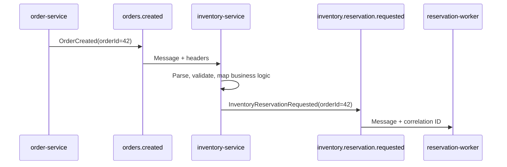
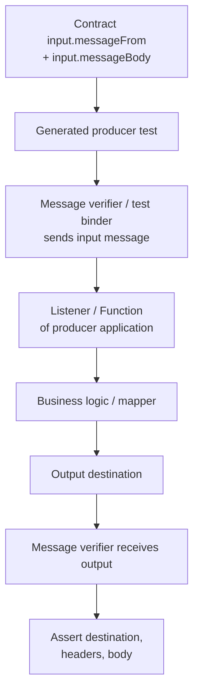
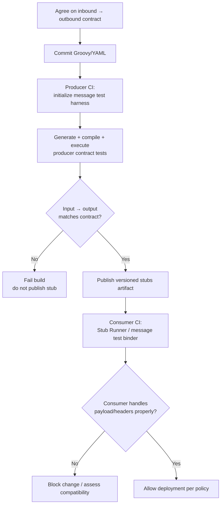

# Contracts that receive one message and emit another

## 1. The problem: producers do not only receive HTTP requests

In an **event-driven architecture**, a service can **receive a message from one channel**, execute business logic, and **emit a new message to another channel**. For example, `inventory-service` receives an `OrderCreated` event from `orders.created`, checks order details, and emits an `InventoryReservationRequested` request to `inventory.reservation.requested`.

This is also a contract between parties:

- **The producer of the processing flow** is the service receiving the input and creating the output message.
- **The input consumer** (or upstream publisher) is the system sending `OrderCreated`.
- **The output consumer** is the system receiving `InventoryReservationRequested`.
- **Spring Cloud Contract** can express an inbound → outbound scenario using **Groovy DSL** or **YAML DSL**, generate producer-side tests, package stubs, and support **Stub Runner** for certain consumer-side tests.

Key point: the service in this example is both a **consumer** of one message type and a **producer** of another. These two roles depend on **communication direction**, not necessarily on two permanently fixed applications.

The objectives of this lesson in the **Message contracts** chapter are to clearly understand how to specify an input message, output message, headers, payload, and target route; how to prepare the environment so generated tests genuinely run and verify; and the limits regarding asynchrony, retries, duplicates, ordering, and CI.

## 2. The inbound → processing → outbound model



At the test boundary, Spring Cloud Contract needs to know:

1. **Where does it receive from?** — The input source/channel name.
2. **What does it receive?** — Input body and headers, plus values to match.
3. **Where does it publish to?** — Destination/channel of the output message.
4. **What does it publish?** — Output body, data types, and headers.
5. **What is the relationship between the two messages?** — How fields like `orderId`, `sku`, `quantity`, or correlation IDs must be preserved or transformed.

For message-based contracts, **there is no HTTP status `200` or `201`** as the primary result. Assertions must focus on the **destination, headers, and payload** of the actually emitted message. If an application exposes both HTTP endpoints and messaging, test both interface types with their respective contracts.

### 2.1. Distinguishing two trigger styles

| Flow style | Trigger source | Typical DSL | Example |
|---|---|---|---|
| **Receive a message and emit another** | An inbound message | `input { messageFrom(...); messageBody(...); messageHeaders { ... } }` | OrderCreated → InventoryReservationRequested |
| **Emit a message directly from an internal action** | Calling a method in the generated test | `input { triggeredBy('...') }` | Batch job emits summary report |

This lesson focuses on **`messageFrom`**. Using `triggeredBy` for a scenario that actually has an **incoming message** can skip testing the deserialization, routing, or listener behavior that consumers depend on.

## 3. Designing the business contract before writing DSL

Suppose the inbound message has the structure:

```json
{
  "eventId": "EVT-42",
  "orderId": 42,
  "customerId": "CUS-7",
  "items": [
    {"sku": "BOOK-101", "quantity": 2}
  ]
}
```

Expected outbound message:

```json
{
  "requestId": "RSV-4201",
  "orderId": 42,
  "reservationType": "INITIAL",
  "lines": [
    {"sku": "BOOK-101", "units": 2}
  ]
}
```

Illustrative headers:

```text
Inbound:
  eventType     = OrderCreated
  correlationId = CORR-42
  contentType   = application/json

Outbound:
  eventType     = InventoryReservationRequested
  correlationId = CORR-42
  contentType   = application/json
```

Key commitments to agree on:

| Component | Input | Output | Business rule |
|---|---|---|---|
| Destination | `orders.created` | `inventory.reservation.requested` | Do not publish to wrong topic/channel |
| Order ID | `orderId: 42` | `orderId: 42` | Preserve order identifier |
| Item | `items[0].sku` | `lines[0].sku` | Preserve SKU |
| Quantity | `quantity: 2` | `units: 2` | Field renamed, numeric value preserved |
| Correlation | `CORR-42` | `CORR-42` | Enables end-to-end flow tracing |
| Event type | `OrderCreated` | `InventoryReservationRequested` | Differs between input and output |
| Request ID | None | `RSV-4201` in sample | Can be generated dynamically if the API permits |

**Do not equate header names with a universal standard across all brokers.** `eventType` and `correlationId` here are **conventions of the illustrative application**. Kafka, RabbitMQ, Spring Messaging, and serializer libraries represent and normalize headers differently; producers and consumers must agree on the public interface.

## 4. Groovy DSL: describing an input message and an output message

Here is a complete example focused on one scenario:

```groovy
import org.springframework.cloud.contract.spec.Contract

Contract.make {
    description 'Receive OrderCreated and publish inventory reservation request'
    label 'order_created_to_reservation_requested'

    input {
        messageFrom('orders.created')

        messageHeaders {
            header('eventType', 'OrderCreated')
            header('correlationId', 'CORR-42')
            header('contentType', 'application/json')
        }

        messageBody(
            eventId: 'EVT-42',
            orderId: 42,
            customerId: 'CUS-7',
            items: [
                [sku: 'BOOK-101', quantity: 2]
            ]
        )
    }

    outputMessage {
        sentTo('inventory.reservation.requested')

        headers {
            header('eventType', 'InventoryReservationRequested')
            header('correlationId', 'CORR-42')
            header('contentType', 'application/json')
        }

        body(
            requestId: 'RSV-4201',
            orderId: 42,
            reservationType: 'INITIAL',
            lines: [
                [sku: 'BOOK-101', units: 2]
            ]
        )
    }
}
```

### 4.1. Reading the DSL in order

- `Contract.make { ... }` creates the contract specification.
- `description` explains the scenario to readers; `label` can be used to identify/trigger the stub in supported messaging flows, **and does not replace the generated producer test**.
- `input { messageFrom('orders.created') }` describes a message received from the given logical source.
- `messageHeaders { ... }` are the **headers of the input message**.
- `messageBody(...)` is the **payload of the input message** fed into the test flow.
- `outputMessage { sentTo(...) }` describes the **destination of the message emitted by the application**.
- `headers { ... }` and `body(...)` inside `outputMessage` are the output data the verifier must validate.

**Do not confuse `messageBody` with `body`**: in this contract style, `messageBody` belongs to `input`, while `body` belongs to `outputMessage`. Similarly, `messageHeaders` belongs to `input` and `headers` belongs to `outputMessage`.

### 4.2. What does the contract say, and what does it leave unsaid?

The contract above checks a **concrete input sample** and an **expected output sample**. It does not assert on its own that:

- Every order in production is handled properly.
- Any arbitrary number of `items` elements is mapped accurately.
- The broker guarantees exactly-once delivery.
- The system implements deduplication, retries, dead-letter queues, or an outbox.
- Output is always emitted **exactly once** under every failure mode.
- The message is emitted within a specific production latency bound beyond the test's wait window.

If those constraints are business commitments, they require **additional scenarios and tests**. Do not infer them solely from the presence of an `outputMessage`.

## 5. YAML DSL for the same interaction style

Spring Cloud Contract also supports describing message contracts in YAML DSL. Example:

```yaml
description: Receive OrderCreated and publish inventory reservation request
label: order_created_to_reservation_requested
input:
  messageFrom: orders.created
  messageHeaders:
    eventType: OrderCreated
    correlationId: CORR-42
    contentType: application/json
  messageBody:
    eventId: EVT-42
    orderId: 42
    customerId: CUS-7
    items:
      - sku: BOOK-101
        quantity: 2
outputMessage:
  sentTo: inventory.reservation.requested
  headers:
    eventType: InventoryReservationRequested
    correlationId: CORR-42
    contentType: application/json
  body:
    requestId: RSV-4201
    orderId: 42
    reservationType: INITIAL
    lines:
      - sku: BOOK-101
        units: 2
```

Notes:

1. `input.messageBody` and `outputMessage.body` here are YAML mappings with nested arrays. Unquoted fields like `orderId` and `quantity` are parsed as numbers per standard YAML rules.
2. If an identifier is truly the string **`"0042"`**, quote `'0042'` to preserve leading zeros and JSON string typing.
3. Field names like `messageFrom`, `messageHeaders`, and `messageBody` are not an arbitrary direct translation of every Groovy closure into YAML; verify support in your project's **Spring Cloud Contract version**.
4. These Groovy and YAML examples are **two representations for one lesson**. In a real project, do not place duplicate contracts for the same scenario in the source directory.

### 5.1. When to choose Groovy, when to choose YAML?

| Criterion | Groovy DSL | YAML DSL |
|---|---|---|
| Expression style | Closures/methods such as `messageFrom(...)`, `body(...)` | Structured mappings/sequences |
| Non-JVM readers | Need familiarity with Groovy syntax | Often easier to read for polyglot teams |
| Matchers/dynamic values | Many DSL helpers with direct syntax | Must use corresponding YAML matcher syntax |
| Escaping | Follows Groovy string literals | Follows plain/single/double-quoted YAML scalars |
| Verifiability | Verifier generates tests/stubs if plugin supports the config | Same, though syntax in use must be verified |

Choose one consistent DSL for the team. **A contract's correctness lies in the verified behavior**, not in whichever format looks cleaner.

## 6. What does the generated producer test actually do?

For an **input message → output message** contract, the producer test must observe **the application processing a real message**, then check the output message.

A general lifecycle:



Spring Cloud Contract Verifier requires an appropriate **message verifier/transport integration** to inject the input and capture the output in tests. Depending on version and ecosystem, this integrates via the Spring Cloud Stream test binder, Spring Integration, or supported transport mechanisms. **Simply placing a contract in the resources folder does not automatically connect Kafka/RabbitMQ/test binder.**

### 6.1. Why is a base test still needed?

The base test may need to:

- Start the Spring application context containing the real listener/function.
- Ensure the producer has registered a handler for the inbound channel.
- Configure messaging test infrastructure and aligned destination names.
- Seed the database or mock downstream services so processing can produce the contract's output.
- Clear stale messages and reset queue/correlation state between tests.
- Configure wait bounds so generated tests do not flake due to asynchronous processing.

Generated tests are only valuable when **generated, compiled, discovered by the runner, executed, and passing assertions**. `BUILD SUCCESS` with zero contract tests, or generating stub mappings without running tests, **does not prove the producer handles the inbound → outbound flow**.

### 6.2. Pseudocode illustrating the generated test idea

```java
// PSEUDOCODE: not a fixed Spring Cloud Contract API.
void shouldMapOrderCreatedToReservationRequested() {
    sendMessage("orders.created", inputHeaders, inputPayload);

    Message<?> message = awaitOutputFrom(
        "inventory.reservation.requested");

    assertThat(message.getHeaders())
        .containsEntry("eventType", "InventoryReservationRequested");
    assertThat(message.getPayload())
        .contains("orderId", 42);
    assertThat(message.getPayload())
        .contains("reservationType", "INITIAL");
}
```

This is a **conceptual illustration**, not code to copy verbatim into a project. Exact method names, deserialized payload types, send/receive APIs, and output waiting depend on your application's message verifier/adapter version.

## 7. Real processing example using a Spring Cloud Stream function

One way to implement the flow in Spring Cloud Stream is declaring a **`Function`** that takes an input payload and returns an output payload. The following simple Java example is **not a complete runnable application**, but illustrates the business mapping checked by the contract:

```java
import java.util.List;
import java.util.function.Function;
import org.springframework.context.annotation.Bean;
import org.springframework.context.annotation.Configuration;

record OrderItem(String sku, int quantity) {}

record OrderCreated(
    String eventId,
    long orderId,
    String customerId,
    List<OrderItem> items
) {}

record ReservationLine(String sku, int units) {}

record InventoryReservationRequested(
    String requestId,
    long orderId,
    String reservationType,
    List<ReservationLine> lines
) {}

@Configuration
class InventoryFlowConfig {

    @Bean
    Function<OrderCreated, InventoryReservationRequested> reserve() {
        return order -> {
            List<ReservationLine> lines = order.items().stream()
                .map(item ->
                    new ReservationLine(item.sku(), item.quantity()))
                .toList();

            return new InventoryReservationRequested(
                "RSV-4201",
                order.orderId(),
                "INITIAL",
                lines
            );
        };
    }
}
```

With Spring Cloud Stream functional binding conventions, the `reserve` function gets logical bindings `reserve-in-0` and `reserve-out-0`. To map them to business destinations:

```yaml
spring:
  cloud:
    function:
      definition: reserve
    stream:
      bindings:
        reserve-in-0:
          destination: orders.created
          contentType: application/json
        reserve-out-0:
          destination: inventory.reservation.requested
          contentType: application/json
```

**Important limitation:** the illustrative function only maps the **payload** and returns a fixed `requestId` for the learning fixture; it **does not preserve the `correlationId` header**. When a contract requires preserving headers, the implementation must read/write headers explicitly—for instance using `Message`, `MessageBuilder`, or a configured and tested header-propagation mechanism. Never turn tests green by disabling header assertions.

Similarly, `requestId` in production might be generated from a service/sequence; in that case, use a matcher for the dynamic value instead of hardcoding a fake ID into every request.

### 7.1. A payload contract does not automatically define the broker serializer

A Java `record` is an internal Java type; payloads across Kafka/RabbitMQ may be JSON bytes, Avro, Protobuf, or another format. Clarify:

- `contentType` and serializer/deserializer.
- How Java properties map to JSON fields.
- Behavior for missing fields, `null`, numbers/strings, and enums.
- Header handling across the broker or converter.
- Actual logical destination names used by the message verifier.

Contracts should protect the **public schema after serialization**, not just the Java object before sending.

## 8. Checking the relationship between input and output

The input and output messages are not identical. The service keeps `orderId`, renames `items` to `lines`, renames `quantity` to `units`, and changes `eventType`.

| Relationship | Input | Output | Check to include |
|---|---|---|---|
| Preserved | `orderId=42` | `orderId=42` | Exact output value |
| Preserved | `sku=BOOK-101` | `sku=BOOK-101` | Right elements and list |
| Renamed | `quantity=2` | `units=2` | JSON number, not string |
| Type changed | `eventType=OrderCreated` | `eventType=InventoryReservationRequested` | Exact output header |
| Preserved correlation | `CORR-42` | `CORR-42` | Header is propagated |
| Newly generated | No `requestId` | `RSV-4201` | Sample value or format matcher |

### 8.1. One fixed-input example does not prove all valid inputs

If the input has only one item in `items`, the contract does not yet protect cases such as:

- Two SKUs resulting in two `lines`.
- An empty list.
- Zero or negative quantity.
- Two lines with the same SKU but different quantities.
- SKUs containing Unicode or special characters.

Write **additional scenarios** for key rules consumers rely on; there is no need to enumerate every combination if unit/integration tests cover pure Java logic. Contract tests should focus on **cross-service interfaces** and changes likely to break consumers.

### 8.2. Dynamic values and matchers in the output message

If `requestId` varies but follows the format `RSV-` followed by digits, you can specify a sample value for the stub and a matcher on the producer side:

```groovy
outputMessage {
    sentTo('inventory.reservation.requested')
    headers {
        header('eventType', 'InventoryReservationRequested')
    }
    body(
        requestId: $(
            consumer('RSV-4201'),
            producer(regex('RSV-[0-9]+'))
        ),
        orderId: 42,
        reservationType: 'INITIAL'
    )
}
```

This is an **`outputMessage` snippet** illustrating matchers, not a standalone contract. Per response/output principles, the **consumer side** provides a sample value so stubs have predictable data; the **producer side** defines how generated tests verify actual output. Ensure your project's DSL version and message verifier support that matcher at that payload position.

**Never relax business values arbitrarily:** `orderId`, `reservationType`, or `eventType` usually need equality in deterministic scenarios. A `.*` regex on `eventType` can let the wrong event type slip through.

## 9. Headers: part of the contract, not just debug metadata

Message headers can directly affect routing, schema selection, tracing, and error handling. Common names include:

| Header | Possible role | Risk if changed |
|---|---|---|
| `contentType` | Tells consumer the payload format | Cannot deserialize message |
| `eventType` | Selects handler or event schema | Consumer ignores or misprocesses it |
| `correlationId` | Links steps in a workflow | Breaks correlation and tracing |
| `schemaVersion` | Selects compatible schema | Parses with wrong version |
| `tenantId` | Scopes data by tenant | Violates tenant data isolation |

**Do not assume every application header passes through the binder untouched.** Some headers are added by transport, some are stripped, and some require explicit configuration. If the contract says output must carry `correlationId=CORR-42`, generated tests must verify exactly that; if it is missing in practice, fix propagation logic/config or update the contract after re-aligning the API.

At the same time, avoid asserting transient internal headers such as broker-generated timestamps when consumers have no dependency on them. Such assertions make tests brittle without improving compatibility.

## 10. Asynchrony: wait for the right outcome, not by guesswork

Many message flows execute **asynchronously**. The generated test may send an inbound message and then wait for the producer to emit the outbound message.

### 10.1. Causes of test flakiness

- Listener/function is not bound yet when the test starts.
- Output is emitted after the verifier's wait timeout expires.
- Stale messages remain in a queue, causing the test to pick up the wrong event.
- Another consumer group already consumed the message, or offsets are misaligned.
- Retries/redeliveries produce multiple copies of the same message.
- Concurrent tests share a topic/destination, racing for messages.

Do not paper over this with an arbitrary `Thread.sleep(5000)`. Configure a **bounded timeout**, an await/poll mechanism compatible with the verifier, and ensure outputs are matched by the scenario's destination/correlation ID.

### 10.2. Fixtures for each generated test

Example preconditions before each test:

```text
Input destination: orders.created
Output destination: inventory.reservation.requested
Correlation ID: CORR-42
Order 42: ready for processing, no existing reservation
Queue/output capture: no leftover messages from prior tests
Test binder: listener/function initialized
```

In the base test, manage test data, application context, and the message verifier according to your technology stack. State cleanup must be **safe when tests fail**, never deleting shared queues or disrupting other CI jobs. Under parallel execution, dedicated destinations/namespaces/consumer groups are usually more reliable than cleaning a shared topic.

### 10.3. Wait timeouts are not system SLAs

If the verifier waits up to a few seconds for output, that is primarily a **test execution bound**, not an implicit production latency guarantee. If consumers have concrete SLAs, add dedicated performance measurements and tests. Accurate body/header contracts also do not prove throughput or broker durability.

## 11. Duplicates, ordering, idempotency, and transactions

An inbound → outbound contract illustrates **one incoming message** and **one emitted message**, yet real brokers may exhibit **at-least-once** delivery or redeliveries. If an input arrives twice, the producer might emit two inventory reservation requests without deduplication.

Policies to align on:

| Concern | Business question | Supplementary test |
|---|---|---|
| Duplicate input | What happens if the same `eventId` arrives twice? | Send twice and assert idempotency policy |
| Duplicate output | Is emitting two `ReservationRequested` events for one order allowed? | Check publish count/correlation and state |
| Ordering | How are two events for the same order handled if they arrive out of order? | Sequence tests with valid fixtures/snapshots |
| Transaction boundary | What if DB commits but publish fails? | Outbox or retry policy integration tests |
| At-least-once | Message redelivered when consumer fails | Test retry and deduplication behavior |
| Error routing | Does a malformed payload go to DLQ or get rejected? | Test against real binder/broker behavior |

**Spring Cloud Contract does not provide exactly-once guarantees on its own.** That is a property of application design, brokers, consumers, and transaction protocols. When such guarantees are needed, checking a single output message is not enough.

### 11.1. Duplicate scenarios usually need integration-level tests

For example, you can test:

1. Send `OrderCreated(eventId=EVT-42)` once and verify one reservation request is emitted.
2. Send the same `eventId=EVT-42` again.
3. Verify no duplicate request is emitted, or that a `DuplicateIgnored` event is emitted per policy.

Behaviors like **emitting no additional message** are hard to express using only a positive `outputMessage`. Supplement them with integration tests checking message counts, outbox state, or deduplication logic. Never infer **absence** of other outputs from a single positive contract.

## 12. When input is invalid or processing fails

The happy-path flow is not enough to protect error handling. Given a message:

```json
{"eventId":"EVT-43","orderId":43,"items":[{"sku":"BOOK-101","quantity":0}]}
```

The producer might:

- Reject the message and let the broker retry.
- Route it to a dead-letter queue after a set number of retries.
- Emit a different business message, such as `InventoryReservationRejected`.
- Record an error status in the database/outbox.

**These are design choices, not default behaviors inferable from the DSL.**

If the application commits to **emitting an error event**, you can write a **separate** contract for input `quantity=0` with `outputMessage.sentTo('inventory.reservation.rejected')`, payload `code=INVALID_QUANTITY`, and `orderId=43`. Test preconditions must make that error branch genuinely fire.

If the requirement is **to publish no message**, declaring `input` without `outputMessage` may not reliably prove absence of output; write tests checking message counts or publisher state with appropriate policies and tools.

### 12.1. Distinguishing validation from deserialization failure

An input with `quantity=0` is valid JSON that may violate business rules. Conversely, unparseable JSON, an invalid Avro/Protobuf schema, or a missing content-type may fail **before the business handler is ever called**. Binder/broker error handling can differ from Java handler logic inside the service.

Separate the scenarios:

1. **Parseable yet invalid payload:** verify committed business error outcomes.
2. **Unparseable payload:** verify real transport-level error handling.
3. **Dependency failure:** verify retry/backoff/DLQ/outbox at integration level.

Never just look for an error log and conclude consumers are protected. Consumers need either an error message or an observable state defined by the published API.

## 13. Stub Runner and consumer tests for message contracts

From contracts, Spring Cloud Contract can generate stubs so consumers can test handling **output messages** without running the whole producer. How message stubs are triggered/emitted depends on supported messaging integrations (such as Spring Cloud Stream, Spring Integration, or custom mechanisms).

### 13.1. Two consumer perspectives to consider

| Consumer under test | What it needs | Suitable test style |
|---|---|---|
| **reservation-worker** receiving `InventoryReservationRequested` | Deserialize payload, read headers, apply business logic | Use supported stub/message trigger to feed sample output message into consumer |
| **order-service** emitting `OrderCreated` | Know its emitted input message matches what downstream producer expects | Can check its emitted message against the input schema/contract; stub usage depends on workflow |

**Do not assume Stub Runner automatically launches a Kafka broker and drives every message type.** Unlike HTTP WireMock mappings, messaging stubs require an appropriate adapter, test binder, or integration. Where direct transport support is unavailable, write consumer integration tests using a broker/test binder and sample data derived from the contract.

### 13.2. Meaning of `label`

`label` in a messaging contract can be used to **identify and trigger a message stub** in flows supporting label-based triggering. It is **not** a broker address, does not create a listener, and does not verify that the producer processed an input.

For instance, `order_created_to_reservation_requested` is a descriptive name; avoid generic labels like `test` when multiple messages exist. Consumer tests must configure the right artifact and trigger mechanism compatible with the libraries in use.

### 13.3. Consumer tests must verify real application behavior

A reliable consumer test does not just verify “a message was received”. It must verify:

- Payload `orderId`, `lines[*].sku`, and `units` deserialize with the right types.
- Header `eventType` selects the right handler.
- Correlation ID is persisted or used per consumer rules.
- The consumer's business action occurs, such as creating a reservation in the test database.
- Error/duplicate branches are tested if the real consumer depends on them.

Do not consume new stubs via an uncontrolled `LATEST` reference in CI. Pin the stubs artifact version or use a traceable, verified versioning strategy.

## 14. Verifying contracts on the producer: beyond code generation

With Spring Cloud Contract Verifier, separate five distinct stages:

1. **Groovy/YAML parsed successfully:** the parser recognizes the contract.
2. **Tests generated successfully:** generated test sources exist.
3. **Compiled successfully:** test classes are on the test classpath.
4. **Test runner discovers and runs them:** reports list actual generated tests, not skipped.
5. **Assertions pass:** input was sent and actual output matched destination, headers, and payload.

Common producer commands (illustrative, not a build run here):

```bash
# Maven, with the plugin bound to the appropriate lifecycle
mvn clean verify

# Gradle wrapper, with the plugin and required tasks configured
./gradlew clean test
```

The Gradle command assumes the `test` task is wired to contract test generation. Inspect the **task graph, reports, and actual version configuration**, rather than assuming every project shares identical task names and outputs.

If Maven reports `BUILD SUCCESS` with `-DskipTests`, or Gradle `test` shows `NO-SOURCE`, **there is no proof the producer contract was executed**. Check Surefire/Failsafe or Gradle Test reports; confirm generated class/method names, executed test count > 0, and zero failures/errors/skips.

### 14.1. Why generated message tests fail

| Symptom | Common cause | Check |
|---|---|---|
| Cannot send input | Wrong `messageFrom` name, binder/verifier unconfigured | Source binding and test transport |
| Input arrives yet no output | Function/listener unregistered or errored | Application context, handler logs |
| Output goes to wrong destination | Wrong `reserve-out-0` binding or route | Logical destination mapping |
| JSON body mismatch | `quantity → units` mapping, naming strategy, data types | Payload after serialization |
| Missing `correlationId` header | Not propagated or stripped by binder | Publisher code, binder header mapping |
| Test timeout | Slow async output, race condition | Conditional wait mechanism, fixtures |
| Passes alone, fails in suite | Stale messages, shared queue, competing consumer groups | Test isolation, dedicated destinations |
| Passes yet misses duplicate cases | Only happy-path scenario exists | Write idempotency integration test |
| Stub generated yet consumer misses it | Messaging adapter/trigger unconfigured | Stub Runner messaging integration |
| All tests skipped | Build/test engine/filters | Test reports, task/lifecycle |

## 15. CI and stub publishing to catch breaking changes

A sound workflow:



Changes that can break consumers:

- Changing destination from `inventory.reservation.requested` to another topic.
- Changing numeric `units` to string `"2"`.
- Dropping `orderId` or renaming `lines`.
- Changing `eventType` so downstream stops recognizing the event.
- Losing `correlationId` when consumers rely on it.
- Changing array ordering or cardinality when the API promises them.
- Changing from emitting one event to emitting multiple events that consumers cannot handle.

**Not every change is compatible just because JSON still parses.** If existing consumers rely on the semantics of `reservationType` or IDs, assess impact before updating contracts and publishing stubs.

### 15.1. Choosing a balanced test suite

| Layer | Primary focus |
|---|---|
| **Mapper unit tests** | Transforming `items` to `lines`, edge values, validation |
| **Producer contract tests** | Input message, output destination, payload, headers at the communication boundary |
| **Messaging integration tests** | Binder/broker, serialization, retry/DLQ, transaction/outbox |
| **Consumer tests with stubs** | Consumer deserializing and processing sample output messages |
| **Selective E2E tests** | Order → Inventory flow on integrated infrastructure |

Contract tests do not replace all other layers; they are specifically suited to **keeping cross-service interfaces stable**.

## 16. Practice exercise: from OrderCreated to InventoryReservationRequested

**Context:** independent teams develop `order-service`, `inventory-service`, and `reservation-worker`. `inventory-service` receives an order-created message and emits an inventory reservation request. The primary requirement is that the output message preserves `orderId`, SKU, quantity, and correlation ID.

**Tasks:**

1. Create a Groovy contract with `input.messageFrom('orders.created')` and `outputMessage.sentTo('inventory.reservation.requested')`.
2. Input has `eventId=EVT-42`, `orderId=42`, `items[0].sku=BOOK-101`, `quantity=2`, `correlationId=CORR-42`.
3. Output has `orderId=42`, `lines[0].sku=BOOK-101`, `units=2`, `reservationType=INITIAL`; headers `eventType=InventoryReservationRequested` and `correlationId=CORR-42`.
4. Configure the base test and appropriate transport: generated tests must push the inbound message through the real listener/function and collect the outbound message.
5. Run producer verification. Verify in **reports that generated tests ran and passed**, not merely that code generation succeeded.
6. Intentionally alter the mapper to emit `units=1` or change the destination. Tests must fail if the contract asserts them.
7. Restore the code. Package/publish a versioned stubs artifact.
8. In the consumer test, use Stub Runner/compatible messaging adapter to deliver the sample output to `reservation-worker`, verifying DTOs and business logic.
9. Add another input scenario with **two items** to protect full-array mapping.
10. Add dedicated tests for duplicate `eventId` or dead-letter queues per the application's actual policy.

### 16.1. Self-check questions

| Question | Answer |
|---|---|
| Do `messageFrom` and `sentTo` play the same role? | **No**. One specifies input source; the other specifies output destination |
| Do `messageBody` and `body` belong to the same direction here? | **No**. `messageBody` is in input; `body` is in output |
| Does every message contract require `triggeredBy`? | **No**. For message-triggered scenarios, use `messageFrom` |
| Does generating tests without running them verify the producer? | **No** |
| Is starting Stub Runner without a messaging adapter enough? | **No** for concluding the consumer received and handled the message |
| Does one passing contract prove exactly-once delivery? | **No** |
| If output misses correlation ID while body is right, should tests fail? | **Yes**, if correlation ID is committed in the contract |
| Why add a two-item scenario? | Because a single-element example does not prove multi-element mapping |

## 17. Checklist when reviewing an inbound → outbound contract

- [ ] Identified publisher/consumer roles for **each direction** of communication.
- [ ] `messageFrom` points to the right logical source for inbound messages.
- [ ] `messageBody` and `messageHeaders` describe the input the listener/function must process.
- [ ] `sentTo` points to the right destination for outbound messages.
- [ ] Output `body` and `headers` protect the schema, data types, and semantics downstream relies on.
- [ ] Preserved/renamed fields such as `orderId`, `sku`, and `quantity → units` are explicitly checked.
- [ ] Empty/multi-element list scenarios are covered where meaningful.
- [ ] Format matchers are never confused with equality commitments on business fields.
- [ ] Application context, message verifier, binder, and destinations are properly configured.
- [ ] Fixtures and queue/correlation state for each test are reproducible; tests are order-independent.
- [ ] Generated producer tests are actually generated, compiled, executed, and pass assertions.
- [ ] Stub Runner/messaging adapter is configured for the consumer with the right artifact version.
- [ ] Retries, duplicates, DLQ, ordering, and transactions have supplementary tests per policy.
- [ ] CI never publishes stubs when producer verification fails or zero tests execute.
- [ ] Evaluated breaking changes across destination, headers, event type, and payload.

**Key takeaway:** A contract that **receives one message and emits another** verifies an *input → output* relationship at the **messaging boundary**. Clearly specifying `messageFrom/messageBody/messageHeaders` and `sentTo/body/headers`, executing generated producer tests over an appropriate transport, and running consumer tests against versioned stubs lets teams evolve implementations while protecting inter-service message interfaces.
