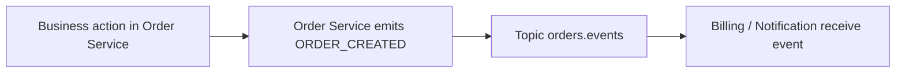
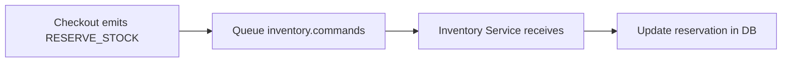
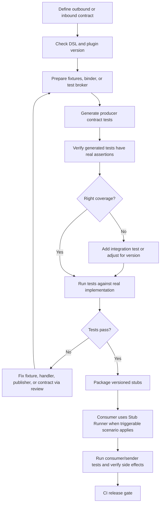

# Contracts that only emit or only receive messages

In an *event-driven* system, a service does not always **receive one message and emit another**. Some services only **emit events** when business actions occur—for example, Order Service emits `ORDER_CREATED` for Billing and Notification to handle. Other services mainly **receive commands or events** and update internal state **without emitting a direct reply**—for example, Inventory Service receives a stock-reservation command and writes the result to its database.

With **Spring Cloud Contract**, producer and consumer teams can specify HTTP or messaging contracts using **Groovy/YAML DSL**, generate provider-side tests (*producer verification*), package stubs, use **Stub Runner**, and integrate into CI to catch incompatible changes. For message contracts, you need to understand **data direction**, how the application is triggered, where assertions observe outcomes, and cases where a plugin/version **does not generate tests as expected**.

This lesson belongs to the **Message contracts** chapter of the **SPRING_CLOUD_CONTRACT** track, focusing on two patterns: **emit-only** (*outbound-only*) and **receive-only** (*inbound-only*). Examples use a message broker or Spring messaging adapter, though exact semantics and destination names must be adapted to your project's **Spring Cloud Contract Verifier, Spring Cloud Stream/Spring Integration, and binder versions**.

## 1. Why doesn't every contract have both input and output?

Familiar HTTP contracts follow a request → response pattern. With messaging, a message may be emitted after an internal action, or a service may receive a message to produce a **side effect** without sending an immediate reply message.

Three models to distinguish:

| Model | Where does it start? | What is observed/verified? | Example |
|---|---|---|---|
| **Emit-only** (*output-only*) | A method/event in the producer is triggered | Message sent to destination with expected headers/body | Order Service emits `ORDER_CREATED` |
| **Receive-only** (*input-only*) | A message arrives from an input destination | Handler receives valid data and produces side effect/passes assertion | Inventory Service receives `RESERVE_STOCK` and writes state |
| **Receive-then-emit** (*input-to-output*) | Incoming message | Reply message or another event is emitted | Inventory receives `RESERVE_STOCK` and emits `STOCK_RESERVED` |

The term **producer** in Spring Cloud Contract usually refers to **the application under verification**, not necessarily that it only sends messages. One application can simultaneously be a **consumer of an input topic** and a **producer of an output event**. Therefore, be explicit about “the contract's producer” versus “the message-publishing service” during discussions.

### 1.1. Two data directions





In the second model, **seeing no output message** does not mean **there is no business outcome**. The outcome may be a database record, operational metrics, a subsequent HTTP state query, or another side effect. Test conditions must specify **which observation point may be verified**.

## 2. Core concepts in the message DSL

A message contract typically uses the following elements; not every contract needs all of them:

| Element | Meaning | Notes |
|---|---|---|
| `label` | Scenario identifier label, useful for triggering message stubs | Keep stable, avoid collisions |
| `input` | Describes the trigger source or incoming message | Does not mean every contract must receive a broker message |
| `triggeredBy(...)` | Calls a hook method to trigger **the producer to emit a message** | Typically used in emit-only style |
| `messageFrom(...)` | Source/destination receiving the input message | Typically used when verifying a message consumer/handler |
| `messageBody(...)` | Input message payload | Must match types/serialization expected by the consumer |
| `messageHeaders { ... }` | Input message headers | May include content type, event version, correlation ID |
| `assertThat(...)` | Assertion hook for side effects/input-message handling where supported by DSL | Check syntax and generated code for your version |
| `outputMessage` | Describes the message emitted by the producer | May be omitted in input-only designs when supported by the version |
| `sentTo(...)` | Output message destination | Not synonymous with an HTTP URL |
| `body(...)`, `headers { ... }` | Output message payload and headers | Verify formats and required matchers |

**Important:** `triggeredBy(...)` and `messageFrom(...)` **do not substitute for each other**. `triggeredBy` expresses an internal operation invoked by the generated producer test so the app emits a message. `messageFrom` expresses a message fed into the application from an intake channel.

### 2.1. Comparing generated test flows

| Step | Emit-only | Receive-only |
|---|---|---|
| Setup | Seed data so the business hook can run | Seed data so the handler can process the message |
| Trigger | Generated test invokes `triggeredBy` hook | Test/infrastructure sends message to `messageFrom` |
| Observation | Message at `sentTo` | Handler side effect/assertion hook |
| Primary assertion | Destination, headers, body of output message | Input processing outcome as supported |
| Consumer-side stub | Can trigger sample message by `label` | Has no message to “return”; requires separate sender test strategy |

The **input-only** style requires extra care: **omitting `outputMessage` does not guarantee every plugin version will generate a complete test**. Only use this pattern when your Spring Cloud Contract version supports input declarations with assertions or an equivalent side-effect verification mechanism. After generating tests, **inspect the generated source** to confirm assertions actually exist.

## 3. Running realistic scenario

Suppose an e-commerce system has three services:

- **Order Service**: manages orders and emits `ORDER_CREATED`.
- **Billing Service**: receives `ORDER_CREATED` to prepare the payment workflow.
- **Inventory Service**: receives the `RESERVE_STOCK` command and writes a reservation to its database.

Agreed data for this lesson:

| Field | Fixture value |
|---|---|
| Order ID | `ORDER-42` |
| Customer ID | `CUSTOMER-7` |
| Product SKU | `SKU-42` |
| Quantity | `2` |
| Event ID | `EVENT-ORDER-42` |
| Command ID | `CMD-RESERVE-42` |
| Event type | `ORDER_CREATED` |
| Command type | `RESERVE_STOCK` |

An output message from Order Service:

```json
{
  "eventId": "EVENT-ORDER-42",
  "eventType": "ORDER_CREATED",
  "orderId": "ORDER-42",
  "customerId": "CUSTOMER-7",
  "sku": "SKU-42",
  "quantity": 2
}
```

An input message to Inventory Service:

```json
{
  "commandId": "CMD-RESERVE-42",
  "commandType": "RESERVE_STOCK",
  "orderId": "ORDER-42",
  "sku": "SKU-42",
  "quantity": 2
}
```

These values are **test fixtures**, not production data. In a real environment, IDs may vary per request; contracts can use appropriate matchers instead of hardcoding every ID if consumers do not rely on exact literal values.

## 4. Emit-only message contract — outbound-only

When Order Service emits `ORDER_CREATED` after a business operation, the test must:

1. Prepare order `ORDER-42` in a valid state.
2. Trigger the real application method.
3. Observe the message emitted to the expected destination.
4. Match headers, event type, and payload against the contract.

In Spring Cloud Contract Groovy DSL, the standard pattern pairs `input { triggeredBy(...) }` with `outputMessage`.

### 4.1. Groovy DSL: emitting `ORDER_CREATED`

```groovy
import org.springframework.cloud.contract.spec.Contract

Contract.make {
    name 'billing_order_created_event_v1'
    label 'billing_order_created_v1'
    description 'Order Service emits event when order is created'

    input {
        triggeredBy('publishOrderCreated()')
    }

    outputMessage {
        sentTo('orders.events')
        headers {
            header('contentType', 'application/json')
            header('eventType', 'ORDER_CREATED')
        }
        body(
            eventId: 'EVENT-ORDER-42',
            eventType: 'ORDER_CREATED',
            orderId: 'ORDER-42',
            customerId: 'CUSTOMER-7',
            sku: 'SKU-42',
            quantity: 2
        )
    }
}
```

This snippet illustrates an **emit-only contract** even though an `input` block appears: here `input` contains an **internal method invocation**, not a message from a queue. That is why you should never conclude “a contract with `input` must receive a message from a broker”.

Meaning of each section:

- `name`: contract name for test generation and traceability.
- `label`: identifies the event scenario for certain Stub Runner mechanisms.
- `triggeredBy('publishOrderCreated()')`: the generated test must be able to invoke `publishOrderCreated`.
- `sentTo('orders.events')`: destination where the producer publishes, resolved via binder configuration.
- `headers` and `body`: data Billing relies on to deserialize and process the event.

### 4.2. Base test providing the trigger hook

Structural example on the producer side:

```java
import org.springframework.beans.factory.annotation.Autowired;
import org.springframework.boot.test.context.SpringBootTest;

@SpringBootTest
public abstract class OrderMessageContractBase {

    @Autowired
    private OrderApplicationService orderApplicationService;

    public void publishOrderCreated() {
        orderApplicationService.publishCreatedEvent("ORDER-42");
    }
}
```

`OrderApplicationService` and `publishCreatedEvent` are **project-implemented code**, not Spring Cloud Contract APIs. Before the hook runs, fixtures must ensure `ORDER-42` is in a valid state and the messaging/binder environment is ready.

For producer verification to be meaningful, the hook should invoke the **real event-emitting business flow**. Never rewrite the hook to build a sample JSON payload and send it straight into a mock channel if the goal is verifying Order Service's publishing logic.

Depending on Spring Cloud Contract version and messaging test mode, the base class may also require **MessageVerifier, Spring Cloud Stream binder, Spring Integration, or broker test infrastructure**. Simply defining the hook method does not guarantee the generated test will receive the message.

### 4.3. Illustrative YAML form for emit-only

Versions with matching YAML message DSL support can express the structure as follows:

```yaml
name: billing_order_created_event_v1
label: billing_order_created_v1
description: Order Service emits event when order is created
input:
  triggeredBy: publishOrderCreated()
outputMessage:
  sentTo: orders.events
  headers:
    contentType: application/json
    eventType: ORDER_CREATED
  body:
    eventId: EVENT-ORDER-42
    eventType: ORDER_CREATED
    orderId: ORDER-42
    customerId: CUSTOMER-7
    sku: SKU-42
    quantity: 2
```

This is an **illustrative representation to cross-check against your version's YAML schema**, especially for `triggeredBy` and `headers` structure. After the plugin runs, inspect the generated code and stub mappings rather than trusting a YAML syntax check alone.

In a real project, pick **one source—Groovy or YAML—** for the same `ORDER_CREATED` scenario; loading both easily produces duplicate generated tests and message stubs.

## 5. What is verified in an emit-only contract?

Producer tests typically check:

- **A message** is emitted by the triggered action.
- **Destination** matches the commitment.
- **Required headers** are present with matching values or matchers.
- **Payload** has the expected schema, types, and business values.
- **Wrong event types are not emitted** when consumers route on `eventType`.

For instance, if Billing uses `orderId`, `quantity`, and `eventType`, those fields are critical parts of the contract. If a refactor changes `quantity` from an integer to a string, producer verification must catch the break.

Even though messages are emitted asynchronously, tests must not stop at “the publisher method ran without throwing”. That **does not prove** the message reached the right destination or carried the right body. Generated tests must observe the message through the configured verifier/binder.

### 5.1. One message or multiple messages?

Different behaviors exist:

| Actual behavior | What tests must observe |
|---|---|
| Emits exactly one `ORDER_CREATED` | Event type/body and message count if committed |
| Emits both `ORDER_CREATED` and an audit event | Do not mistake the audit event for the contract event |
| Emits duplicates due to retries | Account for at-least-once semantics and idempotency |
| Emits out of order | Do not enforce ordering unless the broker promises it |
| Emits to a different partition | Check keys/partitions when consumers truly rely on them |

Contract Verifier generally checks the **expected message** per configuration. If the product requires “never emit any other message”, you may need dedicated producer integration tests guarding counts or absence; do not assume a single `outputMessage` contract inspects every emitted event.

## 6. Receive-only message contract — inbound-only

This is the model where Inventory Service **receives a command** `RESERVE_STOCK` from `inventory.commands`, validates data, and updates reservation state. It is not required to emit an immediate reply message.

```text
Checkout / Order Service
       |
       | RESERVE_STOCK
       v
inventory.commands
       |
       v
Inventory Service
       |
       +--> validate sku, quantity
       +--> create reservation in database
       +--> no direct output message required
```

Testing this style must verify that **the real handler processed the message**, not merely that a message was placed on a topic. Without an output assertion point, you need a **side-effect verification hook** or a supplementary integration test.

### 6.1. Groovy DSL: input with side-effect assertion

For Spring Cloud Contract versions that support **an input message and `assertThat` without requiring `outputMessage`**, the specification can look like:

```groovy
import org.springframework.cloud.contract.spec.Contract

Contract.make {
    name 'inventory_reserve_stock_inbound_v1'
    description 'Inventory receives stock-reservation command and updates reservation'

    input {
        messageFrom('inventory.commands')
        messageBody(
            commandId: 'CMD-RESERVE-42',
            commandType: 'RESERVE_STOCK',
            orderId: 'ORDER-42',
            sku: 'SKU-42',
            quantity: 2
        )
        messageHeaders {
            header('contentType', 'application/json')
        }
        assertThat('reservationWasCreated()')
    }
}
```

Key points:

- `messageFrom` is the **incoming** message source, not an output message destination.
- `messageBody` and `messageHeaders` define a message used to trigger the consumer/handler on the producer side.
- `assertThat('reservationWasCreated()')` is intended to reference logic verifying post-processing state.
- **No `outputMessage` is declared** because the scenario does not commit to emitting a reply message.

**Version warning:** this is a **conditional pattern**, not a claim that every Groovy DSL version supports input-only/`assertThat` contracts or generates the exact side-effect assertion desired. Check documentation for your **pinned Spring Cloud Contract Verifier version** and test code generation. If generated tests are skipped, fail to call the hook, or do not assert side effects, add a dedicated **message-consumer integration test** and never claim producer verification covers the scenario.

### 6.2. YAML DSL: declaring equivalent intent

Structural reference YAML example:

```yaml
name: inventory_reserve_stock_inbound_v1
description: Inventory receives stock-reservation command
input:
  messageFrom: inventory.commands
  messageBody:
    commandId: CMD-RESERVE-42
    commandType: RESERVE_STOCK
    orderId: ORDER-42
    sku: SKU-42
    quantity: 2
  messageHeaders:
    contentType: application/json
  assertThat: reservationWasCreated()
```

Only use this form when **your version's YAML schema supports `input.assertThat` and input-only contracts**. If the schema only supports input-to-output messaging, **do not invent a fake `outputMessage`** just to appease the plugin, as that alters the contract's meaning. When tooling lacks support, keep consumer verification in an independent integration test and document the contract coverage limit clearly.

### 6.3. Assertion hook must verify observable state

Example checking reservation state after the message handler runs:

```java
public abstract class InventoryMessageContractBase {

    @Autowired
    InventoryTestRepository testRepository;

    public boolean reservationWasCreated() {
        return testRepository.hasReservation(
            "ORDER-42",
            "SKU-42",
            2
        );
    }
}
```

**This describes the hook concept**, not a `boolean` signature guaranteed across all generator versions. In a real project, inspect the generated source: how `assertThat` is invoked, whether it must return `boolean` or act as a void assertion method, and what visibility/package it requires. `InventoryTestRepository` is a project-written helper.

If the handler runs **asynchronously**, querying the repository immediately after sending the message may see uncommitted data and cause flakiness. Use **condition-based waiting with a bounded timeout** in test infrastructure, such as Awaitility or StepVerifier, rather than blind `Thread.sleep` calls.

### 6.4. What counts as “received successfully” when there is no output?

An inbound-only contract must agree on an observation point. Possible examples:

| Side effect | Suggested check |
|---|---|
| Reservation created | Record exists for `orderId`, `sku`, `quantity` |
| Order status updated | Record transitions from `PENDING` to `RESERVED` |
| External API called | Adapter/mock endpoint called with right data, at an intentional boundary |
| Message routed to error queue | Message is dead-lettered or marked errored per policy |
| Audit record written | Audit contains event ID and processing result |
| Unchanged on duplicate event | No second reservation created for the same `commandId` |

**Having no output message** does not mean every handler behavior belongs inside Spring Cloud Contract DSL. Checks for DB transactions, duplicate delivery, rollbacks, and dead-letter routing usually fit best in **dedicated integration tests**.

## 7. How does receive-then-emit differ from input-only?

To contrast, consider Inventory receiving the reservation command and then emitting `STOCK_RESERVED`:

```groovy
import org.springframework.cloud.contract.spec.Contract

Contract.make {
    name 'inventory_reservation_emits_event_v1'
    label 'inventory_reserved_v1'

    input {
        messageFrom('inventory.commands')
        messageBody(
            orderId: 'ORDER-42',
            sku: 'SKU-42',
            quantity: 2
        )
    }

    outputMessage {
        sentTo('inventory.events')
        body(
            eventType: 'STOCK_RESERVED',
            orderId: 'ORDER-42',
            sku: 'SKU-42',
            quantity: 2
        )
    }
}
```

This is **no longer input-only**: the producer has committed to emitting a second message. Tests can inject the input message and check the output message.

If Inventory does not actually emit an event, **never invent `STOCK_RESERVED`** just to make the example look like request–response. Doing so turns a contract verifying internal side effects into a contract for a nonexistent message protocol.

## 8. Preparing the base test and messaging infrastructure

Message contracts may require:

1. **Spring application context** to invoke business services or load message handlers.
2. **Message verifier** or adapter compatible with Contract Verifier.
3. **Test binder/broker** such as Spring Cloud Stream test binder or Testcontainers broker, depending on architecture and version.
4. **Data fixtures** so handlers/publishers execute deterministic scenarios.
5. **Trigger/assertion hooks** in the base test.
6. **Waiting for message/side-effect completion** with a reasonable timeout.
7. **Isolation/cleanup** so tests do not pick up messages from previous runs.

Unlike HTTP contracts, messages are not necessarily processed the instant a send method returns. Message brokers can deliver at least once, introduce delays, or redeliver. Hence the base test must match observed messages by **correlation key** and keep the environment free of stale data.

### 8.1. Choosing the right test binder or broker

| Strategy | Advantages | Limitations |
|---|---|---|
| In-memory/test binder | Fast, reproducible, no external broker | Does not prove all real broker properties |
| Embedded broker or Testcontainers | Close to real send/receive behavior | Slower startup, needs isolation and cleanup |
| Spring Integration message channel tests | Useful for internal integration flows | May not reflect full binder/broker behavior |
| Mock publisher/consumer adapter | Focuses on business layer | Does not prove end-to-end routing/serialization |
| Shared broker in integration environment | Can verify multiple components | Prone to flakiness and cross-test interference unless strictly managed |

Never assume a logical binding name in Spring Cloud Stream, such as `orderEvents-out-0`, equals the physical destination `orders.events`. Binder configuration can map binding names to topics/queues. `sentTo` and `messageFrom` must be verified against **the destination-resolution rules of your Verifier/binder version**.

### 8.2. Functional beans are not contract DSL

Modern Spring Cloud Stream often uses functional beans such as `Supplier<T>`, `Function<T,R>`, and `Consumer<T>`. For instance:

```java
@Bean
Consumer<ReserveStockCommand> reserveStock(InventoryService service) {
    return command -> service.reserve(
        command.orderId(),
        command.sku(),
        command.quantity()
    );
}
```

This snippet illustrates an **application message handler**; `ReserveStockCommand` and `InventoryService` are project code. `Consumer<T>` in Spring Cloud Stream handles incoming data; it **does not automatically generate `Contract.make` or producer tests**.

Contract Verifier must be wired properly to the message binding to deliver test messages to this bean. Across different Spring Cloud Stream or Contract Verifier versions, integration mechanics, dependencies, and test binder configuration can change.

## 9. How does Stub Runner help consumers test both contract forms?

**Stub Runner** provides stubs that consumers can rely on to test independently of producers. However, for message contracts, interaction direction determines what can be tested.

### 9.1. Emit-only: Stub Runner can emit sample messages

When Order Service commits to emitting `ORDER_CREATED`, consumer Billing wants to test its event-listening code:

1. Load Order Service's stubs artifact.
2. Set up message stub infrastructure compatible with the binder/channel.
3. Trigger the scenario by **`label`** such as `billing_order_created_v1`, if supported by Stub Runner's API and version.
4. Receive the stub message at the consumer test's destination.
5. Verify Billing deserializes the payload and handles the event accurately.

Some Stub Runner versions expose label-triggering APIs via `StubTrigger` or an equivalent mechanism. Illustrative direction:

```java
@Autowired
StubTrigger stubTrigger;

@Test
void shouldHandleCreatedOrder() {
    stubTrigger.trigger("billing_order_created_v1");

    // Wait and verify Billing processed ORDER_CREATED.
    // Use appropriate test fixtures and timeouts.
}
```

Exact imports/annotations and triggering support depend on dependencies and versions. Before relying on it, confirm the stubs artifact contains a **labeled message contract** and the binder/transport is active. Calling `trigger(...)` does not mean the consumer handled the message; Billing-side side-effect assertions are still mandatory.

### 9.2. Receive-only: no output message for a stub to emit

If Inventory Service only receives `RESERVE_STOCK` and updates its DB, **there is no output message** for Stub Runner to emit to Checkout. Therefore, do not assume you can use the same `label`/`StubTrigger` flow as emit-only contracts to verify the whole path.

On the **sender** side (the service emitting the command), verify:

- Client/publisher sends to the right logical destination.
- Payload/headers match the contract and schema.
- Correlation/message IDs are appropriate.
- Retries or publish failures follow policy.

On the **Inventory Service** side, verify:

- The real handler receives the message.
- Validation and side effects match the payload.
- Error handling/idempotency are covered by required integration tests.

Depending on Stub Runner and binder versions, there may be mechanisms to simulate an intake channel or verify outbound sends; however, **prove it with a concrete test** rather than assuming an input-only contract automatically generates reply stubs.

### 9.3. A green stub does not prove the real producer works

Producer verification and consumer stub tests examine **two different targets**:

| Check | Running system | What it proves |
|---|---|---|
| Outbound producer test | Real Order Service + test message infrastructure | Application emits messages per contract |
| Inbound receiver test | Real Inventory Service + input message test | Real handler processes payload with verified semantics |
| Stub Runner test | Real Billing/Checkout + simulated stub | Consumer/sender uses the right message contract in stubbed scenarios |
| End-to-end | Services + real broker/DB | End-to-end integration and transport characteristics |

A producer emitting messages through a fake message verifier does not prove production Kafka/RabbitMQ configuration is always right; use integration/E2E tests when those properties are required.

## 10. Matchers and dynamic data in message-only contracts

Many messages contain dynamic fields:

```json
{
  "eventId": "9bc155de-98b0-4fc2-8bfb-85423b71a3b0",
  "eventType": "ORDER_CREATED",
  "occurredAt": "2026-01-15T09:30:00Z",
  "orderId": "ORDER-42"
}
```

**Do not hardcode a random real UUID** from a prior run into a producer contract test and require every emission to match it. Instead, you can:

- Fix the test ID generator or Clock in the producer verification environment.
- Use dual values and type/regex matchers in the DSL **where the message body position and version support them**.
- Let stubs provide stable sample values for consumers while producer tests check formatting rules.
- Keep exact checks for `eventType` and critical business fields.

### 10.1. Avoid overly broad matchers

| Field | Weak matcher | Better constraint |
|---|---|---|
| `eventType` | Any string | Exact `ORDER_CREATED` |
| `orderId` | `.*` | Non-empty and/or committed ID format |
| `quantity` | Any value | Business-valid positive integer |
| `occurredAt` | Any string | Properly formatted/timezone timestamp; or fixed Clock |
| `contentType` | Unchecked | Published value, e.g., JSON |
| `eventVersion` | Ignored | Version value compatible with consumers |

Matchers for message bodies/headers are not identical to HTTP JSONPath matchers, and syntax can differ between Groovy and YAML as well as across Spring Cloud Contract releases. Consult documentation for your **running version**, generate tests, and inspect actual assertions.

### 10.2. Avoid confusing message ID with `label`

- `eventId`: data for **one instance** of an event; may be randomly generated.
- `label`: identifier for a **stub scenario**, which should stay stable across builds and consumer tests.
- `commandId`: idempotency/correlation key for a command; tests should manage it explicitly.

Never append random timestamps or UUIDs to `label`, or consumer tests will not know which scenario to trigger.

## 11. Retries, duplicate messages, and idempotency

In messaging, a broker may redeliver messages. When a service is receive-only for commands, the risk is that the same `CMD-RESERVE-42` creates **two reservations**. When a service is emit-only for events, the risk is that publisher retries cause consumers to receive duplicates.

Distinguish three layers:

- **Schema and routing contract:** event type, payload, headers, destination.
- **Business idempotency contract:** receiving the same command ID multiple times does not create duplicate side effects.
- **Broker delivery properties:** at-most-once, at-least-once, partition ordering, retries, dead-letter queues.

Never assume a single-payload message contract proves idempotency or exactly-once delivery. If business rules require it, add an integration test sending the same message twice in a controlled scenario and assert record counts/state. Contracts can verify input format, while idempotency tests usually need to verify **stateful workflows** separately.

### 11.1. Error message tests

An inbound-only handler may reject:

- Missing `orderId`.
- `quantity <= 0`.
- SKU missing from the catalog.
- Unsupported event/command version.

Depending on policy, the handler may throw an exception, retry, ignore with logging, dead-letter the message, or write a failure status. Because there is no direct reply message, **you cannot assume an HTTP `400`/`409` mapping** for these cases. Explicitly define observable outcomes at the message/broker/DB layer and write appropriate tests.

## 12. Relationship to HTTP contracts

A service often exposes an HTTP endpoint and emits a message together. For example:

```text
POST /api/orders
    |
    +--> HTTP 201 Created
    |
    +--> emit ORDER_CREATED to orders.events
```

There are at least **two commitments**:

1. HTTP response: status `201`, `Location` header, JSON order ID.
2. Message output: event type, order ID, payload, and destination.

Sometimes both happen in one business flow, though they do not necessarily belong crammed into a single hard-to-maintain contract. You can write separate **HTTP contracts** and **message contracts**, plus an integration test guaranteeing correlation between the response ID and event ID.

**Caution:** if the message contract trigger calls `publishCreatedEvent` directly and skips the HTTP create-order flow, producer message tests can pass even if the HTTP controller forgets to invoke the publisher. When the link between both flows is critical, test through the **actual business entry point** or add an end-to-end integration test.

## 13. Controlling state when testing message-only flows

Message tests are sensitive to shared data and asynchrony.

| Source of flakiness | Symptom | Mitigation |
|---|---|---|
| Broker holds stale messages | Test receives event from another scenario | Dedicated topics/consumer groups, correlation IDs |
| Listener not started yet | Test times out even though producer emitted | Wait for readiness or configure binder properly |
| DB fixture incomplete | Inbound handler reports missing SKU | Seed before sending input and wait for completion |
| Message handled asynchronously | Assertion runs too early | Conditional await with bounded timeout |
| Same `commandId` across tests | Idempotency state causes handler to ignore message | Reset/isolate state per test |
| Parallel test execution | Shared queue/group steals messages | Separate namespaces or broker instances |
| Changing test clock/tokens | Unexpected header/validation failure | Controlled clock and test credentials |
| Duplicate stub mappings/labels | Wrong scenario triggered | Clear label and versioning conventions |

Do not simply call `Thread.sleep(1000)` and hope all events arrived. Wait on an **observable condition** with a timeout and clear failure messages. Also keep PII and production tokens out of test data.

## 14. Configuration and version compatibility

Spring Cloud Contract integrates with multiple messaging systems; wiring with Spring Cloud Stream, Spring Integration, and brokers varies across versions. Using Spring Cloud Stream functional beans **does not guarantee** every message contract is recognized and turned into working tests by the plugin.

Pre-implementation checklist:

1. Lock compatible **Spring Boot**, Spring Cloud release train, and Spring Cloud Contract Verifier/plugin versions.
2. Choose **Groovy or YAML DSL** capable of expressing the required scenario.
3. Read the **Messaging Contract DSL** section of docs for that **exact version**.
4. Verify `triggeredBy`, `messageFrom`, `messageBody`, `messageHeaders`, `assertThat`, and presence/absence of `outputMessage`.
5. Pick an appropriate message verifier/binder/test broker.
6. Configure the base class/hooks and data fixtures.
7. Generate producer tests, **read the generated source**, and execute them for real.
8. Verify stubs artifacts/message triggers for your version.
9. Add integration tests when contracts alone do not cover all side effects.
10. Wire producer verification and consumer tests into CI.

Official references for checking specific versions:

- [Spring Cloud Contract Reference](https://docs.spring.io/spring-cloud-contract/reference/)
- [Spring Cloud Release Trains](https://spring.io/projects/spring-cloud)
- [Spring Boot System Requirements](https://docs.spring.io/spring-boot/system-requirements.html)

If the build rejects an input-only syntax, **do not force it into input-to-output using fake messages**. Keep the scenario accurate with an integration test that has a clear observation point, and use contracts only where your Verifier version supports them.

## 15. CI integration for emit-only and receive-only

Recommended verification flow:



Before turning the pipeline green:

- Were generated producer message tests **generated and executed**?
- Did **emit-only** contracts observe real messages at the destination?
- Did **receive-only** contracts observe real side effects, rather than just sending a message and ending the test?
- Was the `assertThat` hook actually invoked and asserting meaningful conditions?
- Is the test binder/broker receiving the current scenario's message rather than stale leftovers?
- Does Stub Runner have the right label/message artifact and binder?
- If input-only does not generate reply stubs, does the consumer/sender have separate send tests?
- Are retries/idempotency/dead-lettering tested when required by business rules?
- Can the stubs artifact be traced back to the verified commit, contract, and producer build?

**A stubs artifact can be generated from an unverified contract**, yet it must be clearly marked as an early-development/preview artifact and never treated as official release evidence.

## 16. Practice exercise: two services, two message directions

Goal: create two message tests with distinct semantics and verify the right Contract Verifier scope.

### Part A — emit-only `ORDER_CREATED`

1. Create fixture `ORDER-42` with `customerId=CUSTOMER-7`, `sku=SKU-42`, `quantity=2`.
2. Write a Groovy or YAML contract as in Section 4.
3. Set `label=billing_order_created_v1` and hook `publishOrderCreated()`.
4. Configure the Order Service test base to invoke real business logic so binder/verifier receives the event.
5. Generate and run producer tests, checking destination, headers, and body.
6. Package stubs and have Billing use Stub Runner to trigger the corresponding label if supported by the version.
7. Verify Billing's handler receives the right `ORDER_CREATED` and updates test state.

### Part B — receive-only `RESERVE_STOCK`

1. Create an inventory fixture with sufficient stock of `SKU-42` for quantity 2.
2. Write an input-only contract with `messageFrom=inventory.commands`, `messageBody`, `messageHeaders`, and assertion hook as supported by your Verifier version.
3. Generate tests, **read the generated code**, and confirm the real message reaches the handler and asserts side effects.
4. If Verifier does not support input-only as described, write a separate Spring messaging integration test sending the message to the input destination.
5. Wait for reservation `ORDER-42/SKU-42` to appear with a reasonable timeout.
6. Verify that sending the same `commandId` twice does not create two reservations if business rules require it.
7. Never fabricate an output message just to appease the generator.

### Part C — error handling and CI

1. Test missing `orderId` or `quantity=-1` in the command.
2. Verify rejection behavior per real policy: retries, dead-lettering, or recording failure status.
3. Run tests individually, as a full suite, and in parallel if the environment permits.
4. Verify topics/consumer groups do not mix stale messages.
5. Pin Spring Cloud Contract plugin, JDK, and stubs artifact versions.
6. Add producer tests, supplementary integration tests, and consumer/sender tests into CI.

**Completion criteria:** outbound-only verifies real events; inbound-only verifies intake and side effects via supported mechanisms or supplementary tests; labels are never confused with message IDs; tests are repeatable; and CI never publishes unverified stubs.

## 17. Common failures and troubleshooting

| Symptom | Possible cause | Troubleshooting step |
|---|---|---|
| `publishOrderCreated()` not found | Base class missing hook or wrong signature/visibility | Read generated test, fix base class |
| Hook runs yet no output message appears | Wrong binder/destination, publisher didn't emit, listener not ready | Inspect business logic and messaging infrastructure |
| No tests generated for input-only | DSL/plugin version lacks support or missing condition | Check docs/version, add integration test |
| Input-only test passes even though DB didn't update | No real assertion or async incomplete | Add/inspect `assertThat` hook and wait for side effect |
| Wrong JSON message body | Serialization or content type mismatch | Inspect headers/codec and emitted payload |
| Consumer cannot trigger label | Label missing from artifact or Stub Runner lacks trigger support | Check contract, mappings, version, and binder |
| Test receives wrong event | Stale messages on topic/queue or missing correlation | Isolate broker/group and filter by event ID |
| Duplicate messages create duplicate data | Handler not idempotent or fixture reuses command ID | Add duplicate tests and deduplication logic |
| Fails only on CI | Broker not ready, differing credentials/test profile, race | Configure readiness, fixtures, and isolation |
| Stub trigger succeeds yet consumer ignores it | Message emitted, but consumer handler unsubscribed or deserialization failed | Observe consumer side effects and check bindings |
| “Receive-only” test fixed by adding fake output | Contract meaning was altered | Remove fake output, pick right test strategy |
| Build green yet no generated tests | Wrong contract path/plugin task or tests skipped | Check generated sources, test reports, release gates |

## 18. Self-check questions

1. **Can an emit-only contract have an `input` block?** Yes. `input { triggeredBy(...) }` is an internal trigger hook, not receiving a message from a broker.
2. **How do `triggeredBy` and `messageFrom` differ?** One calls a method so the producer emits an event; the other specifies the source of a message entering a handler.
3. **Why doesn't input-only necessarily have `outputMessage`?** Because the business outcome may be a database side effect without directly emitting a message.
4. **If input-only DSL isn't supported by your version, should you add a fake output?** No. Use an integration test with proper assertions and document the limitation.
5. **Does the `assertThat` hook automatically guarantee side effects are right?** Only if the generated test actually calls the hook and the hook asserts meaningful state; always inspect generated code.
6. **Is `label` the ID of a single message instance?** No. Label identifies a scenario; instance IDs can be dynamic.
7. **How does Stub Runner help in emit-only cases?** It can trigger sample events by label when supported by the version and binder, letting consumers test handlers.
8. **Does Stub Runner automatically create responses for inbound-only?** Do not assume so; without an output message, use separate sender/receiver testing strategies.
9. **Why isn't “publisher method threw no exception” enough?** Because it does not prove the message reached the right destination with the right payload.
10. **Must a message verifier test against a real broker?** Depends on scope: test binders can suffice for contracts, while real transport characteristics require integration/E2E tests.
11. **Why do input-only tests need bounded timeouts?** Because handlers may process asynchronously, and asserting too early causes flakiness.
12. **Does a single input-message test prove exactly-once handling?** No. Duplicate delivery and idempotency require dedicated tests.
13. **Can `eventType` use a `.*` matcher?** Do not do so if consumers rely on the event type; keep exact assertions.
14. **What must a producer with both HTTP POST and event emission verify?** HTTP commitments, message commitments, and correlation between both flows if required by business rules.
15. **What must be verified before publishing official stubs?** Producer tests actually executed with assertions, alongside required supplementary integration tests.
16. **Why can the DSL destination differ from a binding name in code?** Binders can map logical bindings to physical topics/queues; check configuration.
17. **Why do shared test brokers cause random failures?** Stale messages, consumer groups, and concurrency can make tests pick up wrong or missing events.
18. **What does a green inbound-only contract where the handler never changed data indicate?** Likely no side-effect assertion or broken fixture/hook; inspect what actually ran.

## Conclusion

**Emit-only contracts** and **receive-only contracts** represent two distinct messaging directions, not two variants of HTTP request–response. In Spring Cloud Contract, **emit-only** typically uses `triggeredBy` to trigger the producer and `outputMessage` to verify the event; **receive-only** can use `messageFrom`, `messageBody`, and side-effect assertions **when supported by your project's DSL/Verifier version**. For tests to be meaningful, verify that generated tests actually run, binders/brokers are configured properly, fixtures and async state are isolated, and consumers use Stub Runner within what it can simulate. Combining **producer verification**, **message integration tests**, **versioned stubs**, and **CI release gates** catches incompatible message changes without fabricating nonexistent output commitments.
