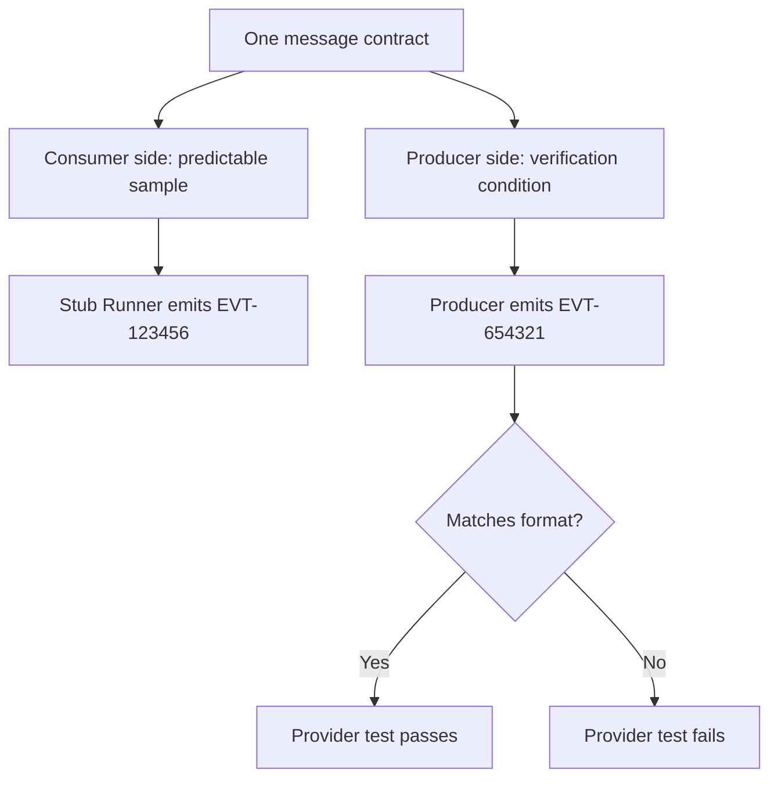
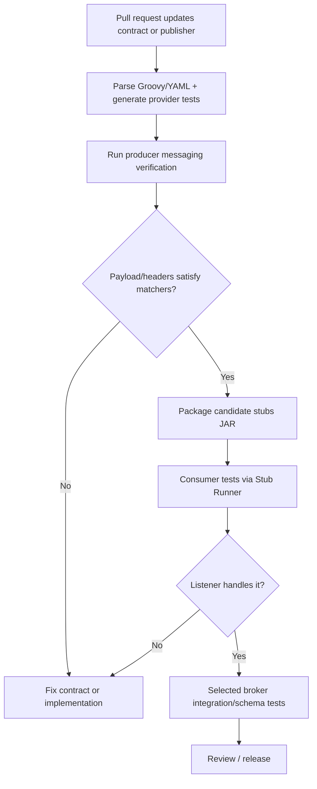

# Dynamic values and matchers in the payload or headers of a message contract

In microservices systems, an `OrderCreated` event often contains **non-fixed** fields: `eventId` is generated on each emission, `occurredAt` follows the clock, `correlationId` changes per workflow, and sometimes `orderId` is a newly generated identifier. Even so, consumers still need the producer to uphold stable commitments: **event type, schema version, data types, payload structure, ID formats, and headers used for routing/correlation**.

**Spring Cloud Contract (SCC)** lets you describe those commitments using **Groovy DSL or YAML DSL**. The tooling generates **provider verification tests** to verify the producer emits messages matching the contract and **stubs** so consumers can test via **Stub Runner**. When data is generated dynamically, hardcoding exact values for every field makes tests brittle; yet loosening everything to a `.*` matcher prevents tests from catching breaking changes.

This lesson in the **Message contracts** chapter explains how to use **dynamic values and matchers in the payload or headers** of a message contract, compares producer and consumer perspectives, and outlines the limits of using stubs instead of a real broker. The running example uses `order-producer` emitting an order event and `order-consumer` receiving it.

## 1. Mental model: what does an event consist of?

Suppose the producer emits an event after creating an order:

```json
{
  "eventId": "EVT-123456",
  "eventType": "OrderCreated",
  "schemaVersion": 1,
  "orderId": "ORD-123456",
  "occurredAt": "2026-11-24T03:15:30.123Z",
  "status": "CREATED",
  "totalMinor": 125000,
  "currency": "VND"
}
```

Illustrative message headers:

```text
contentType: application/json
X-Correlation-Id: corr-123456
X-Producer: order-producer
```

Logical destination: `orders.created`.

Each component serves a role:

| Component | Example | What the contract must make clear |
| --- | --- | --- |
| Destination | `orders.created` | Where the message must be published |
| `label` | `order_created_v1` | Which name the consumer test uses to trigger the message stub |
| `eventType` | `OrderCreated` | Business-meaningful event type |
| `schemaVersion` | `1` | Payload schema version, needs stable protection |
| `eventId` | `EVT-123456` | Dynamic value, yet must follow a valid format |
| `orderId` | `ORD-123456` | Changing ID, yet consumer needs to know type/format |
| `occurredAt` | ISO 8601 with UTC `Z` | Dynamic timestamp with formatting rules |
| `totalMinor` | `125000` | Integer monetary amount in minor units |
| `contentType` | `application/json` | How the payload is interpreted |
| `X-Correlation-Id` | `corr-123456` | Dynamic tracing header |
| `X-Producer` | `order-producer` | Fixed header per this example's convention |

In this lesson, a message is viewed from two sides:

- **Producer verification:** runs the real producer in a test environment, triggers message emission, observes destination, headers, and payload, and compares them against the contract.
- **Consumer stub test:** emits a **sample** message from the contract via Stub Runner to verify the listener/consumer handles the committed data.

These two sides do not automatically receive the same input. A **sample value** like `EVT-123456` is helpful for the consumer; a **matcher** like `^EVT-[0-9]{6}$` lets provider tests accept multiple valid IDs.

## 2. A basic message contract in Groovy DSL

Example file `src/test/resources/contracts/messaging/order-created-v1.groovy`:

```groovy
import org.springframework.cloud.contract.spec.Contract

Contract.make {
    description 'After creating order successfully, producer emits OrderCreated v1'
    label 'order_created_v1'

    input {
        triggeredBy('publishOrderCreated()')
    }

    outputMessage {
        sentTo('orders.created')

        headers {
            messagingContentType(applicationJson())
            header('X-Correlation-Id', 'corr-123456')
            header('X-Producer', 'order-producer')
        }

        body(
            eventId: 'EVT-123456',
            eventType: 'OrderCreated',
            schemaVersion: 1,
            orderId: 'ORD-123456',
            occurredAt: '2026-11-24T03:15:30.123Z',
            status: 'CREATED',
            totalMinor: 125000,
            currency: 'VND'
        )
    }
}
```

Meaning:

1. `description` helps readers understand the behavior being protected.
2. `label` is the name used to trigger the **message stub** from consumer tests.
3. `input.triggeredBy` names the method in the provider test base used to trigger the producer to **actually emit the message**.
4. `outputMessage.sentTo` specifies the logical destination where the message is sent; destination semantics depend on the messaging integration/adapter in use.
5. `outputMessage.headers` defines message metadata. `messagingContentType(applicationJson())` declares the content type in a messaging context.
6. `outputMessage.body` describes the payload emitted by the producer and used as sample data by the stub.

**Do not confuse three names:** `order-created-v1.groovy` is the filename, `order_created_v1` is the test label, and `orders.created` is the destination. Changing the label does not necessarily change the topic; changing the topic does not necessarily change the schema; bumping the Maven artifact version does not necessarily mean bumping the event's `schemaVersion`.

The example above uses **exact values** to clarify structure before adding matchers. If `eventId` or `occurredAt` is generated at runtime, provider tests may fail even when the producer is valid. The next section solves this.

## 3. Distinguishing sample values from dynamic values

A dynamic value has two aspects:

- **A concrete value** for the stub to send to the consumer; e.g., `eventId: EVT-123456`.
- **An acceptance rule** when the provider emits a real value; e.g., `eventId` must match `^EVT-[0-9]{6}$`.



**Direction matters greatly.** For a message **emitted** by the producer, the consumer side uses a sample payload to test event handling; the producer side needs matchers to verify real output. This resembles checking an HTTP response, not an incoming request body sent **to** the producer.

### 3.1. Fields that should remain exact

Do not loosen everything:

| Field | Keep exact when | Risk if matcher is too broad |
| --- | --- | --- |
| `eventType` | Scenario only emits `OrderCreated` | Other events get mistaken for OrderCreated |
| `schemaVersion` | Consumer only supports schema v1 | Consumer misparses a newer payload version |
| `status` | Newly created orders must be `CREATED` | Producer emits an invalid status |
| `currency` | Contract processes VND | Consumer calculates money in the wrong unit |
| `totalMinor` | Input fixture has a fixed total | Calculation bugs get masked |
| Destination | `orders.created` is the routing commitment | Listener misses the event |

A varying field **does not automatically require a regex**. If it is an integer with a defined domain, a type matcher plus business tests may be more suitable.

### 3.2. Typically dynamic fields

`eventId`, `correlationId`, `traceId`, timestamps, and runtime-generated IDs are candidates. Still, ask what the consumer actually relies on:

- Is the ID a string or a number?
- Does it have a prefix or UUID format?
- Must it be unique across events?
- Does the timestamp require UTC or any offset?
- Is a header mandatory or optional?
- Is there a link between `X-Correlation-Id` and tracing data in another system?

A simple matcher can check **format**, yet does not by itself prove uniqueness, causality, or relationships across multiple events.

## 4. Body matchers in `outputMessage` using Groovy DSL

Spring Cloud Contract supports `bodyMatchers` on `outputMessage`. In this example, three dynamic fields use matchers while stable fields stay fixed:

```groovy
import org.springframework.cloud.contract.spec.Contract

Contract.make {
    description 'Emit OrderCreated v1 with properly formatted ID and timestamp'
    label 'order_created_v1'

    input {
        triggeredBy('publishOrderCreated()')
    }

    outputMessage {
        sentTo('orders.created')

        headers {
            messagingContentType(applicationJson())
            header('X-Correlation-Id', 'corr-123456')
        }

        body(
            eventId: 'EVT-123456',
            eventType: 'OrderCreated',
            schemaVersion: 1,
            orderId: 'ORD-123456',
            occurredAt: '2026-11-24T03:15:30.123Z',
            status: 'CREATED',
            totalMinor: 125000,
            currency: 'VND'
        )

        bodyMatchers {
            jsonPath('$.eventId',
                byRegex('^EVT-[0-9]{6}$'))
            jsonPath('$.orderId',
                byRegex('^ORD-[0-9]{6}$'))
            jsonPath('$.occurredAt',
                byRegex('^[0-9]{4}-[0-9]{2}-[0-9]{2}T[0-9]{2}:[0-9]{2}:[0-9]{2}[.][0-9]{3}Z$'))
        }
    }
}
```

Explanation:

- `body` still supplies the **message sample** for repeatable consumer tests.
- `bodyMatchers` instructs the generated producer test to validate specific fields via JSONPath.
- `byRegex` on `eventId` or `orderId` lets the producer generate varying valid IDs.
- `occurredAt` is checked for a UTC timestamp **structure** with three fractional second digits.
- `eventType`, `schemaVersion`, `status`, `totalMinor`, and `currency` are not relaxed with matchers in this scenario.

If the producer emits `eventId: EVT-654321`, the ID matcher passes. If it emits `eventId: wrong-id`, the matcher must fail. And if the producer emits `status: UNKNOWN`, the contract still catches it via the fixed value.

**Note:** A timestamp regex only checks syntax. A string like `2026-99-99T99:99:99.999Z` matches the pattern yet is not a valid calendar date/time. To verify semantics, add assertions using a time parser or dedicated business tests.

### 4.1. JSONPath for nested payloads and arrays

Suppose another payload has the structure:

```json
{
  "eventId": "EVT-123456",
  "order": {
    "id": "ORD-123456",
    "status": "CREATED"
  },
  "items": [
    {"sku":"BOOK-01","quantity":2}
  ]
}
```

You can use:

```groovy
bodyMatchers {
    jsonPath('$.eventId', byRegex('^EVT-[0-9]{6}$'))
    jsonPath('$.order.id', byRegex('^ORD-[0-9]{6}$'))
}
```

`$.order.id` targets a nested field inside `order`; `$.items[0].sku` targets the first array element. If array ordering is not part of the commitment, avoid pinning matchers blindly to `[0]`; use appropriate element-set or size checks instead.

### 4.2. `byType`, `byRegex`, and `byCommand` serve different goals

| Matcher | When to use | Limitations |
| --- | --- | --- |
| `byRegex('^EVT-[0-9]{6}$')` | String with a specific format | Does not verify uniqueness or existence |
| `byType()` | Value must share the sample body's type | Does not check value domain or business logic |
| `byEquality()` | Checks equality with the sample value | Can be too rigid for runtime-generated data |
| `byCommand('validateEventId($it)')` | Custom assertion logic needed on producer side | Method must exist in test base; does not run in consumer stubs |
| `byNull()` | Field must be null in the scenario | Differs from the field being completely absent |

For instance, if `orderId` is a **number** instead of a string, applying a string regex can cause type confusion; keep a JSON number sample and choose a type-appropriate matcher. If `totalMinor` is calculated from a fixed input fixture, an exact value remains stronger than `byType()`.

**A matcher must live in `outputMessage.bodyMatchers`**, not `response.bodyMatchers` from HTTP contracts. The two contract types have different structures.

## 5. Groovy DSL: expressing consumer and producer sides via `value`

Besides `bodyMatchers`, **Groovy DSL** can express dual-sided dynamic values inline via `value(consumer(...), producer(...))` or `$(consumer(...), producer(...))`.

Inside **`outputMessage`**, read it as:

- `consumer(...)` holds the **concrete value the consumer stub may emit**, e.g., `EVT-123456`.
- `producer(...)` holds the **rule or value used to verify the real producer**, e.g., the regex for `eventId`.

Condensed example:

```groovy
import org.springframework.cloud.contract.spec.Contract

Contract.make {
    label 'order_created_v1'
    input {
        triggeredBy('publishOrderCreated()')
    }
    outputMessage {
        sentTo('orders.created')
        headers {
            messagingContentType(applicationJson())
        }
        body(
            eventId: value(
                consumer('EVT-123456'),
                producer(regex('^EVT-[0-9]{6}$'))
            ),
            eventType: 'OrderCreated',
            schemaVersion: 1,
            status: 'CREATED'
        )
    }
}
```

This keeps both halves of a value right inside the payload, which is convenient when few fields are dynamic. However, for large payloads or many matchers, separating `bodyMatchers` from `body` can be easier to review.

**Never mix conflicting declarations** for the same field in one contract. Using `value` with one regex while also adding a different `bodyMatchers` rule makes it hard for reviewers to see the effective rule; pick one consistent style and inspect the generated test.

### 5.1. Do not swap `consumer` and `producer`

If you accidentally write:

```groovy
eventId: value(
    consumer(regex('^EVT-[0-9]{6}$')),
    producer('EVT-123456')
)
```

the intent flips: the producer may be constrained to a fixed ID while the consumer loses the intended deterministic sample. This is not equivalent to the example above.

For an **output** message, ask yourself:

1. When running Stub Runner, which value will the consumer receive?
2. When running the generated provider test, which values is the producer allowed to emit?
3. Do both protect the semantics the consumer genuinely needs?

After answering, inspect both the generated **provider test** and **message stub**.

## 6. Matchers in message headers: keeping metadata stable while allowing dynamic values

A message may carry headers such as:

```text
contentType: application/json
X-Correlation-Id: corr-123456
X-Producer: order-producer
```

`contentType` describes the data format; `X-Correlation-Id` is created per workflow; and `X-Producer` is a fixed source name in this example.

For a header allowed to vary, Groovy DSL can specify consumer and producer values via `value(...)`:

```groovy
outputMessage {
    sentTo('orders.created')

    headers {
        messagingContentType(applicationJson())
        header('X-Correlation-Id', value(
            consumer('corr-123456'),
            producer(regex('^corr-[0-9]{6}$'))
        ))
        header('X-Producer', 'order-producer')
    }

    body(
        eventId: 'EVT-123456',
        eventType: 'OrderCreated',
        schemaVersion: 1
    )
}
```

In this example:

- The consumer receives a sample message with `X-Correlation-Id: corr-123456`.
- Generated producer verification checks the dynamic header against the declared regex, subject to how the adapter surfaces headers into the test.
- `X-Producer` remains a fixed-value header.
- `contentType` specifies JSON representation; **actual header names and types are determined by the message transport/binder**.

### 6.1. Header matchers differ from payload matchers

`bodyMatchers { jsonPath(...) }` operates on the **JSON payload**. It does not check message metadata. Headers typically live in a separate map (name → value); checking headers requires a header value matcher or the DSL's header matchers section.

For instance, a consumer needs `X-Correlation-Id` for logging/tracing. Checking a `correlationId` field inside the body alone **does not prove the header exists**. Likewise, the header existing does not prove it **equals** the value in the payload unless a relational assertion checks both.

### 6.2. Framework-generated headers should not be hardcoded

Spring Messaging, binders, or brokers may supply metadata such as message IDs, timestamps, delivery tags, partition keys, or trace headers. They can:

- Change on every emission even when the payload is identical.
- Have non-string types, such as numbers, timestamps, or specialized header objects.
- Be generated or rewritten by the binder/broker rather than application code.
- Appear on one transport yet be absent on another.

Never assume every header seen in integration logs is a **public API commitment**. Only put headers consumers genuinely depend on into the contract, using matchers of the right type/format.

## 7. YAML DSL: `outputMessage` with payload and header matchers

In **YAML DSL**, dynamic values are typically declared under **`matchers`**, separate from `body` and `headers`. An example matching the intent above:

```yaml
description: "After creating order, emit OrderCreated v1 with dynamic ID and correlation"
label: order_created_v1
input:
  triggeredBy: publishOrderCreated()
outputMessage:
  sentTo: orders.created
  headers:
    contentType: application/json
    X-Correlation-Id: corr-123456
    X-Producer: order-producer
  body:
    eventId: EVT-123456
    eventType: OrderCreated
    schemaVersion: 1
    orderId: ORD-123456
    occurredAt: "2026-11-24T03:15:30.123Z"
    status: CREATED
    totalMinor: 125000
    currency: VND
  matchers:
    body:
      - path: $.eventId
        type: by_regex
        value: '^EVT-[0-9]{6}$'
      - path: $.orderId
        type: by_regex
        value: '^ORD-[0-9]{6}$'
      - path: $.occurredAt
        type: by_regex
        value: '^[0-9]{4}-[0-9]{2}-[0-9]{2}T[0-9]{2}:[0-9]{2}:[0-9]{2}[.][0-9]{3}Z$'
    headers:
      - key: X-Correlation-Id
        regex: '^corr-[0-9]{6}$'
```

Points to read carefully:

| YAML location | Meaning |
| --- | --- |
| `outputMessage.body` | Sample payload for the message stub |
| `outputMessage.headers` | Sample headers for the message |
| `outputMessage.matchers.body[].path` | JSONPath to the field under verification |
| `outputMessage.matchers.body[].type` | Matcher type, such as `by_regex` |
| `outputMessage.matchers.body[].value` | Regex pattern for the field |
| `outputMessage.matchers.headers[].key` | Name of the header to check |
| `outputMessage.matchers.headers[].regex` | Regex for the header value |
| `input.triggeredBy` | Method name the provider test uses to trigger the event |

**Noteworthy syntax difference:** the YAML header matcher in the example uses `key` and `regex`; it **does not** share the `path`, `type`, `value` structure of body matchers.

YAML does not use Groovy's `value(consumer(...), producer(...))`. In YAML, putting sample values in `body`/`headers` and rules in `matchers` keeps things clear. Every `path` or `key` must reference an actually declared piece of data.

### 7.1. Preserving types and quoting in YAML

```yaml
body:
  schemaVersion: 1
  totalMinor: 125000
  orderId: "ORD-123456"
  occurredAt: "2026-11-24T03:15:30.123Z"
```

`schemaVersion` and `totalMinor` are JSON numbers; `orderId` and `occurredAt` are strings. For timestamps containing colons, quote them so the YAML parser does not misinterpret them.

Regexes in YAML are single-quoted in the example to preserve special characters cleanly. If you use `\d`, note that YAML double-quoted strings and Groovy strings follow different escaping rules. Using `[0-9]` and `[.]` as shown also avoids multi-layer escaping headaches.

### 7.2. Checking version and generated output

Spring Cloud Contract versions can differ in schema and matcher generation. For **message contracts**, specifically verify:

1. The plugin picks up YAML `outputMessage.matchers.body` and `matchers.headers`.
2. Generated provider tests include assertions for both payload and headers.
3. Tests are not skipped or run with the wrong transport verifier type.
4. Message stubs still carry the intended **sample values**.
5. The consumer listener genuinely receives the right message in the test environment.

**Successful YAML parsing is not proof** that matchers are enforced. Inspect generated tests and intentional pass/fail runs.

## 8. Numeric fields, enums, nulls, and nested data

Regexes are particularly useful for strings, yet message payloads also contain numbers, booleans, arrays, and objects.

### 8.1. Integers and money

Suppose a message contains:

```json
{
  "orderId": "ORD-123456",
  "totalMinor": 125000,
  "currency": "VND"
}
```

If `totalMinor` represents money in VND minor units, changing `125000` to `1250.00` in the same field can alter both type and meaning. For fixtures with a known total, an **exact value** is stronger than a regex for “a number”.

If totals vary, clarify at least:

- Must the field be a **JSON number** or a decimal string?
- Are integers, non-negative values, or upper bounds required?
- Are units and currency consistent?
- Does the consumer read `long`, `BigDecimal`, or `Number`, and with what precision limits?

A `byType()` matcher protects the type, yet does not guard domain bounds or calculation formulas. When needed, add business assertions in provider tests and unit tests—never use `.*` regexes for monetary values.

### 8.2. Enums

For the `OrderCreated` event:

```json
{
  "eventType": "OrderCreated",
  "status": "CREATED"
}
```

This is usually a **scenario-exact value**. If the producer emits `status: PAID` right at order creation, the contract should catch it rather than widening the matcher to `^(CREATED|PAID|CANCELLED)$` without consumer agreement.

When the same event type genuinely permits multiple statuses, document the allowed set explicitly and confirm downstream consumers support every value.

### 8.3. Nulls, absent fields, and optionals

Three distinct payloads:

```json
{"discountCode": null}
```

```json
{}
```

```json
{"discountCode": ""}
```

They carry different meanings: a `null` field, a missing field, and an empty string. A matcher checking only “any string” cannot replace a schema decision about whether omitting the field is allowed. If consumers distinguish these states, write contracts/tests reflecting the exact optional/null policy.

### 8.4. Message item arrays

Given:

```json
{
  "items": [
    {"sku":"BOOK-01","quantity":2},
    {"sku":"PEN-02","quantity":1}
  ]
}
```

If the consumer depends on **order**, verify order. If order does not matter, avoid writing tests that only accept two items in one fixed order and calling that API protection. When array lengths vary, type/size matchers and dedicated tests may be needed.

## 9. Timestamp matchers: syntax and semantics are two different things

A common timestamp:

```text
2026-11-24T03:15:30.123Z
```

Regex:

```regex
^[0-9]{4}-[0-9]{2}-[0-9]{2}T[0-9]{2}:[0-9]{2}:[0-9]{2}[.][0-9]{3}Z$
```

It checks characters, not calendar/clock validity. Moreover, two strings:

```text
2026-11-24T03:15:30.123Z
2026-11-24T10:15:30.123+07:00
```

can represent the **same instant** with different string encodings. Producer and consumer must agree: is UTC `Z` with exactly three millisecond digits required, or is any valid ISO 8601 offset acceptable?

One way to raise verification quality:

1. Document the exact format in the schema contract.
2. Use a format matcher if the timestamp is runtime-generated.
3. Use `java.time.Instant` or `OffsetDateTime` parsing in business tests when real date-time validity matters.
4. Use `Clock.fixed` or fixtures when an exact timestamp must be verified.
5. Never depend on the CI machine's default timezone.
6. Never use overly broad regexes that accept empty strings or nonsensical dates.

**Matchers do not automatically verify relationships between `occurredAt` and `createdAt` in the database**, or between two messages in the same workflow. Such relationships require tests with full data and context.

## 10. Correlation headers and payload relationships

Some applications carry the same correlation ID in both payload and header:

```json
{
  "eventId": "EVT-123456",
  "correlationId": "corr-123456"
}
```

Header:

```text
X-Correlation-Id: corr-123456
```

If the contract places independent regexes on both:

```text
payload.correlationId matches ^corr-[0-9]{6}$
header.X-Correlation-Id matches ^corr-[0-9]{6}$
```

then the producer could still emit payload `corr-111111` and header `corr-222222`; **both pass the regex yet differ from each other**. If consumers require the two values to match, independent regexes are **not enough**.

How to handle this:

- Use a fixed-correlation fixture for the relationship check when possible.
- Use a producer-side custom assertion with access to both payload and headers in a higher-level test.
- Write an integration test observing the complete message and comparing both fields.
- If using `assertThat` or `byCommand` in the DSL, confirm the method receives **sufficient context** and generated tests invoke it properly; never assume an isolated JSONPath has access to headers.

An event with a properly formatted `eventId` also **does not prove uniqueness** across millions of events. Uniqueness, idempotency, and deduplication must be enforced in the storage/consumer event-processing layer.

## 11. Two message input forms: `triggeredBy` and `messageFrom`

So far the example showed a **producer actively emitting an event** triggered by a method:

```groovy
input {
    triggeredBy('publishOrderCreated()')
}
```

In event-driven applications, a producer can also **receive an input message and emit an output message**. Spring Cloud Contract provides `messageFrom`, `messageBody`, and `messageHeaders`:

```groovy
import org.springframework.cloud.contract.spec.Contract

Contract.make {
    description 'When receiving OrderPaid, emit OrderCompleted'
    label 'order_completed_v1'

    input {
        messageFrom('orders.paid')
        messageBody(
            orderId: 'ORD-123456',
            paymentStatus: 'PAID'
        )
        messageHeaders {
            header('contentType', 'application/json')
        }
    }

    outputMessage {
        sentTo('orders.completed')
        body(
            orderId: 'ORD-123456',
            eventType: 'OrderCompleted',
            status: 'COMPLETED'
        )
        headers {
            messagingContentType(applicationJson())
        }
    }
}
```

Key points:

- `input.messageFrom` is the **input destination**.
- `input.messageBody` / `messageHeaders` describe the message fed as input during provider verification.
- `outputMessage` describes the message emitted by the producer after handling the input.
- `label` can still let consumer-side Stub Runner trigger the output stub, depending on configuration and integration.

Having **`outputMessage` matchers** does not mean every matcher can be copied verbatim into `input`. For incoming-message flows, read the schema/capabilities of your SCC version and inspect generated input tests, especially when input formats change. An output contract does not verify that a listener handles **every valid input**.

## 12. Provider verification tests: prerequisites for matchers to actually take effect

Writing Groovy/YAML is only step one. To verify the publisher, generated tests must **trigger the producer and receive a real message** through an appropriate message verifier/transport.

Example base class with Spring Boot assuming a project-defined `OrderEventPublisher` bean:

```java
import org.springframework.beans.factory.annotation.Autowired;
import org.springframework.boot.test.context.SpringBootTest;
import org.springframework.cloud.contract.verifier.messaging.boot.AutoConfigureMessageVerifier;

@SpringBootTest
@AutoConfigureMessageVerifier
public abstract class OrderMessagingContractBase {

    @Autowired
    private OrderEventPublisher publisher;

    public void publishOrderCreated() {
        publisher.publishCreatedEventForContractTest();
    }
}
```

This example **requires implementing `OrderEventPublisher` in the real application** and configuring an appropriate test message transport/binder. Across mechanisms (Spring Cloud Stream, Spring Integration, JMS, Camel, or custom adapters), how `sentTo` is resolved and output observed can differ.

**You do not need a production broker to run every provider contract test**; a test binder/message verifier can suffice where appropriate. However, a simple test binder does not prove full real-broker behavior (partitions, retries, DLQs, retention, external serialization).

### 12.1. What generated tests should verify

A provider verification test for an event with matchers should:

1. Invoke `publishOrderCreated()` per the contract.
2. Observe the message at destination `orders.created` via the test adapter.
3. Verify the content-type header and committed headers.
4. Parse the body as JSON with the right shape.
5. Verify `eventType`, `schemaVersion`, `status`, and `currency` against exact values.
6. Verify `eventId`, `orderId`, and `occurredAt` against matchers.
7. Fail when the producer changes important data outside the contract.

Generated code details vary by SCC version and adapter. When debugging, **open the generated test** to verify actual assertions rather than guessing from the existence of the contract file.

### 12.2. Avoiding tests dependent on clocks and external data

If the publisher calls `Instant.now()` or generates a fresh UUID every time:

- Appropriate matchers for dynamic data keep tests from locking onto sample literals.
- When exact timestamps must be verified, inject `Clock.fixed` into the test environment.
- Ensure fixture data and message queue state are clean between tests.
- Never let leftover messages from a previous test cause a provider test to pick up the wrong message.
- Never depend on uncontrolled external services/brokers for contract test event emission.

A test that passes by accidentally catching a leftover message from an earlier test is not proof that the current producer satisfies the contract.

## 13. Stub Runner: emitting sample messages to test consumers

Once the producer packages its stubs JAR, consumers can use Stub Runner to emit sample events by label. Example `StubTrigger` bean:

```java
import org.springframework.beans.factory.annotation.Autowired;
import org.springframework.cloud.contract.stubrunner.StubTrigger;

class OrderConsumerMessagingTest {

    @Autowired
    private StubTrigger stubTrigger;

    void triggerOrderCreatedMessage() {
        stubTrigger.trigger("order_created_v1");
    }
}
```

This snippet illustrates **how to invoke the trigger**, not a complete JUnit test. The project must enable `@AutoConfigureStubRunner`, connect message stubs to the active binder/transport, and run the consumer listener inside the test context.

Example configuration:

```java
import org.springframework.boot.test.context.SpringBootTest;
import org.springframework.cloud.contract.stubrunner.spring.AutoConfigureStubRunner;
import org.springframework.cloud.contract.stubrunner.spring.StubRunnerProperties;

@SpringBootTest
@AutoConfigureStubRunner(
    ids = "com.example:order-producer:1.0.0:stubs",
    stubsMode = StubRunnerProperties.StubsMode.LOCAL
)
class OrderConsumerMessagingContractTest {
    // Configure corresponding test binder / consumer listener.
    // Call StubTrigger and assert consumer processing effects.
}
```

The `groupId:artifactId:version:classifier` coordinate above is illustrative; Stub Runner must resolve the right stubs artifact, and CI must test the **candidate version** under evaluation. For messaging, an HTTP stub port is not the primary piece of emitting messages.

### 13.1. Required assertions on the consumer

Do not simply call `stubTrigger.trigger("order_created_v1")` and conclude the listener handled the message properly. Verify:

- The listener actually received the event.
- The JSON payload parses into the consumer's DTO/schema.
- `eventId` is read/stored with the right type.
- The `X-Correlation-Id` header is forwarded or recorded as designed.
- `schemaVersion=1` causes the consumer to pick the right deserialization path.
- `totalMinor` and `currency` are interpreted in the right units.
- Processing errors (if any) are surfaced rather than swallowed.

Because listeners are often asynchronous, tests should **wait with a bound** for observable results (e.g., using Awaitility or an appropriate synchronization primitive), avoiding long `Thread.sleep` calls and avoiding immediate assertions when handlers need time.

### 13.2. Message stubs do not generate random data on every trigger

In contracts, `consumer('EVT-123456')` or the YAML sample body is a **stable sample value**. Stub Runner typically emits messages containing that literal value—it does not generate a new `eventId` on every trigger. If you want to test consumer behavior across distinct IDs, add consumer tests with multiple samples or other producer/consumer tests.

A stable stub helps keep tests reproducible; **production `eventId` uniqueness** must be tested at another layer.

## 14. Transport headers: limits to state explicitly

Message transports are heterogeneous:

| Layer | What may appear | Why distinguish it? |
| --- | --- | --- |
| Application message | Payload, content type, business headers | Consumers may rely on them |
| Spring Messaging | Message headers, message ID/timestamp | Partially framework-generated |
| Binder/client library | Partition key, delivery metadata | Names/types depend on adapter |
| Real broker | Offset, redelivery count, partition, DLQ | May only appear when passing through a real broker |
| Tracing infrastructure | Trace ID, span ID, baggage | Headers may be injected automatically |

**A header verified in a test binder does not guarantee that exact header survives unchanged across production brokers, serializers, and adapters.** If real consumers depend on it, add integration tests using a broker/testcontainer or representative environment.

### 14.1. Content type does not prove the payload parses

Example:

```text
contentType: application/json
```

while the actual payload is a non-JSON string. Having the right header does not make invalid data valid. Contracts should protect **both body and headers**, while integration tests catch encoding, serializer/deserializer, and converter issues on the real transport.

### 14.2. Correlation headers can be altered across gateways/brokers

Some middleware rewrites headers or changes naming conventions. When producer contract tests only emit into an in-memory channel, everything may pass; yet consumers reading through a real broker may receive different header representations. Place test boundaries where consumers **actually receive messages**, especially during version migrations or when using multiple binders.

## 15. Combining matchers with schema evolution

Suppose the producer wants to evolve from schema v1:

```json
{
  "eventType": "OrderCreated",
  "schemaVersion": 1,
  "orderId": "ORD-123456"
}
```

to schema v2:

```json
{
  "eventType": "OrderCreated",
  "schemaVersion": 2,
  "order": {
    "id": "ORD-123456"
  }
}
```

Moving the field from `orderId` to `order.id` can break v1 consumers, **even though the ID matches the same regex**. To manage this:

1. Keep v1 contracts/stubs while v1 consumers are still active.
2. Create v2 contracts with payloads and matchers matching the new structure.
3. Distinguish labels/stubs and candidate versions, such as `order_created_v1` and `order_created_v2`.
4. Run producer verification and consumer contract tests against all supported versions.
5. Check ownership/telemetry/broker subscriptions before retiring v1.
6. Avoid overly broad matchers that blind tests to removed or renamed fields.

**Format matchers do not automatically create schema compatibility.** Check field names, types, nested structures, enums, destinations, and routing headers. Adding a field may leave flexible consumers intact, whereas removing/retyping a field or bumping to an unrecognized version is usually high risk.

## 16. Common mistakes and how to fix them

| Mistake | Impact | Fix |
| --- | --- | --- |
| Hardcoding runtime `eventId` | Flaky provider tests | Format matcher or controlled test fixture |
| Using `.*` for every field | Masks breaking changes | Exact for enums/versions, tight regex for IDs |
| Swapping `consumer` and `producer` in `outputMessage` | Stub and provider assertions flip roles | Inspect generated tests and sample messages |
| Adding body matchers expecting header checks | Headers go unprotected | Use proper DSL header matchers |
| Forgetting `contentType` | Consumer decoder may fail | Declare media type and verify payload |
| Wrong JSONPath matcher | Assertion misses target field | Inspect generated test and JSON structure |
| YAML matcher at wrong nesting level | SCC ignores the rule | Place under `outputMessage.matchers` |
| Regex checks only timestamp shape | Accepts invalid calendar dates/times | Add parser/semantic assertions |
| Matching money by type only | Misses unit or sum errors | Exact values or business tests |
| Confusing `label` and `sentTo` | Consumer triggers label yet routing fails | Check destination and binder |
| Calling only `StubTrigger` | Listener may not have processed it | Bounded-wait assertions on side effects |
| Assuming stubs prove broker integration | Misses encoding/partition/redelivery issues | Test real broker or representative transport |
| Changing schema fields while keeping regex | Old consumers can break | Versioned contracts and consumer compatibility tests |
| Test passes on leftover message from prior case | False positive | Drain queues/reset fixtures, deterministic correlation |

A useful debugging workflow separates questions: **Did the contract parse? Did the generated test include the matcher? Did the producer emit to the right destination? Did the test receiver capture the right message? Did the consumer test load the right stub artifact version?** Never replace every matcher with a wildcard just because a test turned red.

## 17. CI verification: three minimum gates and supplementary gates

For message contracts with dynamic fields, CI typically needs:



With Maven, once `spring-cloud-contract-maven-plugin`, test dependencies, and message verifier are configured:

```bash
mvn clean verify
```

This command **does not automatically run every test** in the diagram unless the project wired them into the pipeline. Verify generated provider tests were actually generated and executed—never settle for `BUILD SUCCESS` alone.

### 17.1. Intentional failure testing

| Change | Step that should catch it |
| --- | --- |
| `eventId` changed from `EVT-123456` to `BAD-ID` | Producer body regex assertion |
| `eventId` changed from `EVT-123456` to `EVT-654321` | Valid per matcher, so should pass |
| `schemaVersion` changed from 1 to 2 without a v2 contract | Exact field assertion |
| `eventType` changed from `OrderCreated` to `OrderCancelled` | Exact field assertion |
| `X-Correlation-Id` changed to `invalid` | Header matcher |
| `contentType` omitted | Appropriate header/media-type assertion |
| `orderId` field removed | Provider body assertion |
| `totalMinor` changed from number to string | Type/value test per commitment |
| Consumer v1 deserialization breaks | Consumer test with candidate stubs |
| Destination renamed while listener remains on old topic | Producer test and corresponding broker integration |
| Broker drops application header | Broker integration test, never rely on stubs |

If a change that should fail still leaves CI green, check **which tests actually ran**, whether matchers were generated properly, which destination the test binder observes, and whether the consumer loaded the right artifact version.

### 17.2. Testing regexes at both boundaries

Example pattern `^EVT-[0-9]{6}$`:

| Value | Expected | Reason |
| --- | --- | --- |
| `EVT-000001` | Pass | Prefix and six digits |
| `EVT-123456` | Pass | Sample value |
| `EVT-999999` | Pass | Valid dynamic value |
| `EVT-12345` | Fail | Too few digits |
| `EVT-1234567` | Fail | Too many digits |
| `EVT-12A456` | Fail | Non-digit character |
| `evt-123456` | Fail | Wrong case |
| `PREFIX-EVT-123456` | Fail | Extra prefix text |

Do not write only a passing test; add failing cases to confirm regexes are not overly broad and the test harness did not silently skip matchers.

## 18. Practice exercises and completion criteria

Prepare a Spring Boot producer able to emit messages and a consumer listener able to receive events through a test binder/transport. Configure Spring Cloud Contract messaging support and Stub Runner with compatible versions.

1. **Static contract:** Write `order-created-v1.groovy` with `label: order_created_v1`, `triggeredBy: publishOrderCreated()`, destination `orders.created`, sample payload, and headers.
2. **Payload matchers:** Add `bodyMatchers` for `eventId` and `occurredAt`, keeping exact `eventType` and `schemaVersion`. Test producer emitting other valid IDs and invalid IDs.
3. **Dynamic header:** Add `X-Correlation-Id` using Groovy `value(consumer(...), producer(regex(...)))`. Confirm the stub gets the sample and provider verification enforces the regex.
4. **Equivalent YAML:** Write `outputMessage.matchers.body` and `matchers.headers` on a separate branch. Compare generated output across both DSLs.
5. **Nested JSONPath:** Move `orderId` to `order.id`, update the matcher, and verify whether v1 consumers need migration.
6. **Numeric types and units:** Set `totalMinor` as a number and `currency` exact; intentionally switch to a string or another currency to observe test failures.
7. **Timestamps:** Use a UTC timestamp regex, then test a format-valid yet calendar-invalid timestamp; add parser/business tests.
8. **Provider setup:** Configure `@AutoConfigureMessageVerifier` and the `publishOrderCreated()` hook. Confirm generated tests capture the right message and clean state between cases.
9. **Consumer:** Use Stub Runner + `StubTrigger` with the label; assert listener reception/parsing of payload and headers with a bounded timeout.
10. **Broker integration:** If a real broker is available, run transport tests to check whether headers and payloads preserve types/encoding across the broker.
11. **Versioning:** Create a v2 contract with a different structure and test v1/v2 consumers against separate candidate stubs.
12. **CI:** Run provider tests, publish candidate stubs, run consumer tests and selected integration tests; intentionally introduce three breaking changes to confirm the pipeline blocks them.

Self-assessment rubric:

| Competency | Evidence |
| --- | --- |
| Distinguishing message contracts | Understands `triggeredBy`, `label`, `sentTo`, `headers`, `body` |
| Choosing exact vs. dynamic properly | Knows which fields stay fixed and which vary |
| Groovy body matchers | Uses `jsonPath`, `byRegex` inside `outputMessage.bodyMatchers` |
| Groovy dynamic headers | Uses `consumer` / `producer` correctly for output headers |
| YAML matchers | `outputMessage.matchers.body` and `matchers.headers` declare clear rules |
| Provider verification | Message-emitting hook runs; matchers are genuinely checked |
| Consumer Stub Runner | StubTrigger fires and listener includes assertions |
| Understanding limits | Never confuses stubs with broker, uniqueness, or deduplication tests |
| CI compatibility gating | Significant payload/header changes fail corresponding tests |

## 19. Key takeaways and references

**Dynamic values in a message contract do not mean data can change arbitrarily.** Provide **a valid sample value for consumers** while declaring **tight enough verification rules for producers**. Use JSONPath matchers for JSON payloads, and DSL-appropriate header matchers for headers. Keep consumer dependencies exact—such as `eventType`, `schemaVersion`, destination, and currency rules.

**Three questions to check whenever modifying a message contract:**

1. Which exact payload/headers does the producer emit, and do generated tests verify them properly?
2. Which sample message does the consumer receive from Stub Runner, and can it process it?
3. Are there behaviors outside static contracts—broker encoding, ordering, retries, DLQs, deduplication, uniqueness, cross-message correlation—that need dedicated integration tests?

Technical documentation to cross-check against your project version:

- [Spring Cloud Contract — Messaging](https://docs.spring.io/spring-cloud-contract/reference/project-features-messaging.html)
- [Spring Cloud Contract — Contract DSL](https://docs.spring.io/spring-cloud-contract/reference/project-features-contract.html)
- [Spring Cloud Contract — Dynamic properties](https://docs.spring.io/spring-cloud-contract/reference/project-features-contract/dsl-dynamic-properties.html)

Combining **producer verification**, **Stub Runner consumer tests**, and **appropriate transport/broker tests in CI** keeps message contracts flexible for dynamic data while catching incompatible changes early.
