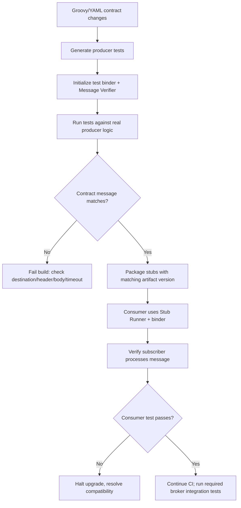

# Test Binder and Testing Adapters in Messaging Flows

## 1. Goal: Testing Messages Without Depending on a Real Broker on Every Run

In a multi-service system, a business operation may produce a **message** instead of returning the full result immediately over HTTP. For example, `Order Service` publishes `OrderPlaced`, and `Payment Service` receives that event and publishes `PaymentRequested`. `Notification Service` or `Billing Service` can then continue processing downstream events.

A seemingly small change can break integration: the producer sends to the wrong destination, drops the `orderId` field, changes `amount` from a number to a string, or forgets the `eventType` header. **Spring Cloud Contract** lets you describe messaging behavior using Groovy/YAML DSL, generate tests to verify the producer, publish stubs, and use **Stub Runner** on the consumer side in CI.

The challenge is that producer tests must **feed a message into the application, trigger the business logic, and observe the output message**. If every test depends on a real Kafka/RabbitMQ/JMS broker, tests can be slow, hard to isolate, and prone to failing due to infrastructure rather than interface issues. In many Spring Cloud Stream projects, the **test binder** allows testing this data path directly in memory, while the **testing adapter** enables Spring Cloud Contract Verifier to communicate with the specific messaging system.

This lesson belongs to the **Messaging Contract Testing** chapter and focuses on:

1. Distinguishing **Spring Cloud Stream Binder**, **test binder**, and **Message Verifier adapter**.
2. Setting up `InputDestination` and `OutputDestination` to test functions/consumers/publishers.
3. Writing `input`/`outputMessage` contracts and wiring them into producer verification.
4. Understanding when to use `triggeredBy`, `messageFrom`, `@AutoConfigureMessageVerifier`, and `StubTrigger`.
5. Diagnosing destination, serialization, Content-Type, timeout, classpath, and tests-not-actually-running issues.
6. Drawing a clear boundary between in-memory testing and real broker testing.

## 2. Four Layers Easily Confused With One Another

A message transmission path can be viewed as four layers:

| Layer | Responsibility | Example |
| --- | --- | --- |
| **Business code** | Receives event, processes it, and produces a new event | `Function<OrderPlaced, PaymentRequested>` |
| **Spring Cloud Stream Binder** | Connects input/output bindings to a middleware | Kafka binder, Rabbit binder |
| **Test binder** | Replaces transport in tests with internal send/receive destinations | `spring-cloud-stream-test-binder`, `InputDestination`, `OutputDestination` |
| **Spring Cloud Contract Message Verifier adapter** | Enables generated tests to send/receive messages by destination name in the contract | Spring Cloud Stream, Spring Integration integration; custom adapter when needed |

**A test binder is not a real message broker.** It helps verify that the application processes, serializes, and emits messages through bindings in a test environment; it does not prove Kafka partitioning, RabbitMQ acknowledgements, ACLs, retention, retries, or production broker durability.

**An adapter is not a broker either.** It is the bridge between Contract Verifier actions (where to send a message, where to wait for a message) and the messaging framework's API. If Spring Cloud Contract does not understand a custom transport, the team must provide an appropriate integration/adapter rather than rewriting Groovy DSL into HTTP.


The diagram above illustrates the roles, without requiring components to be wired in that exact direct order across every version or framework. With `triggeredBy`, the test can **invoke a business method** instead of sending an input message.

## 3. Which Type of Test Should You Choose?

Three test types have different starting points and purposes:

| Type | What does it run? | Question it answers |
| --- | --- | --- |
| **Function testing with test binder** | Sends a message with `InputDestination`, receives a message with `OutputDestination` | Do the function and bindings produce the expected payload/headers? |
| **Producer contract verification** | Generated test from `Contract.make`/YAML triggers the flow and verifies `outputMessage` | Does the current producer satisfy the contract agreed upon with consumers? |
| **Consumer test with Stub Runner** | Stub emits a described message; the real consumer receives and processes it | Does the consumer decode and process the agreed event properly? |

Testing a function with the test binder **does not automatically become a contract test**: without DSL contracts, there is no shared contract basis for publishing stubs. Conversely, declaring contracts without a working binder/adapter does not guarantee tests will successfully send/receive messages either.

## 4. Setting Up the Test Binder for Spring Cloud Stream

For **modern versions** of Spring Cloud Stream, the testing module is typically:

```xml
<!-- pom.xml: test dependency, version managed by compatible BOM -->
<dependency>
    <groupId>org.springframework.cloud</groupId>
    <artifactId>spring-cloud-stream-test-binder</artifactId>
    <scope>test</scope>
</dependency>
```

Equivalent in Gradle Groovy DSL:

```groovy
dependencies {
    testImplementation 'org.springframework.cloud:spring-cloud-stream-test-binder'
}
```

In addition to the test binder, the producer still needs the core application dependencies (Spring Cloud Stream, Spring Boot, actual binders if used) and the **Spring Cloud Contract Verifier** dependency/plugin to generate contract tests. Choose a Spring Cloud release train compatible with Spring Boot and pin the appropriate build plugin version.

**Version note:** Some older Spring Cloud Stream/Contract documentation uses the `test-binder` classifier of `spring-cloud-stream` or the `spring-cloud-stream-test-support` module. Do not add all of these variants at once. Use the test binder mechanism supported by your project's Spring Cloud Stream/Contract version.

### 4.1. Enabling the Test Binder in the Spring Test Context

A common configuration imports:

```java
import org.springframework.boot.test.context.SpringBootTest;
import org.springframework.cloud.stream.binder.test.EnableTestBinder;

@SpringBootTest
@EnableTestBinder
class PaymentStreamTest {
    // InputDestination / OutputDestination are injected in the example below.
}
```

Current Spring Cloud Stream documentation uses `@EnableTestBinder` to register the test binder in the application context. In some earlier versions or test setups, you may see `@Import(TestChannelBinderConfiguration.class)` or `TestChannelBinderConfiguration.getCompleteConfiguration(...)`. **Pick the one approach that matches your version** rather than mixing multiple mechanisms arbitrarily. Simply adding the dependency is sometimes not enough in a customized test configuration. If the project has multiple binders or multiple bindings, verify that **the test binder is selected for the right binding** and does not accidentally send messages to a production broker.

## 5. Application Example: Function Receiving and Publishing Messages

Suppose `Payment Service` receives `OrderPlaced` from the logical destination `orders.placed`, then emits `PaymentRequested` to `payments.requested`.

A Java 17+ example using the Spring Cloud Stream functional model:

```java
package com.example.payment;

import java.util.function.Function;
import org.springframework.context.annotation.Bean;
import org.springframework.context.annotation.Configuration;
import org.springframework.messaging.Message;
import org.springframework.messaging.support.MessageBuilder;

@Configuration
public class PaymentStreamConfiguration {

    public record OrderPlaced(long orderId, long amount, String currency) {}
    public record PaymentRequested(long orderId, long amount,
                                   String currency, String status) {}

    @Bean
    Function<Message<OrderPlaced>, Message<PaymentRequested>>
    createPaymentRequest() {
        return incoming -> {
            OrderPlaced order = incoming.getPayload();
            PaymentRequested result = new PaymentRequested(
                order.orderId(), order.amount(), order.currency(), "REQUESTED"
            );
            return MessageBuilder.withPayload(result)
                .setHeader("eventType", "PaymentRequested")
                .build();
        };
    }
}
```

This snippet illustrates **message transformation**, not real payment processing, database persistence, or exactly-once guarantees. In production implementations, business logic can be more complex and require idempotency, transactions, and correlation metadata.

The default binding names for the `createPaymentRequest` function are:

- `createPaymentRequest-in-0` for the input message.
- `createPaymentRequest-out-0` for the output message.

Example `application.yml` configuration for the sample application:

```yaml
spring:
  cloud:
    function:
      definition: createPaymentRequest
    stream:
      bindings:
        createPaymentRequest-in-0:
          destination: orders.placed
          content-type: application/json
        createPaymentRequest-out-0:
          destination: payments.requested
          content-type: application/json
```

**Distinguishing binding name and destination:** `createPaymentRequest-in-0` is the binding name inside the application; `orders.placed` is the logical destination configured for that binding. The contract `messageFrom('orders.placed')` does not mean the generator will necessarily look for a bean/channel literally named `orders.placed` in every framework. For Spring Cloud Stream/Integration, Spring Cloud Contract resolves the destination first, and then falls back to channel names in supported cases.

If the project renames `orders.placed` to `order.placed.v2` without updating the binding/contract, messages may fail to reach the consumer. Therefore, **the destination is part of the interface**, not just the payload.

## 6. Manual Function Testing with `InputDestination` and `OutputDestination`

The test binder provides two useful objects:

- **`InputDestination`**: sends a message into an application's input binding in a test-friendly way.
- **`OutputDestination`**: receives a message emitted by an output binding for inspection.

JUnit 5 example (requires importing Spring Test, Jackson, AssertJ, and related classes):

```java
@SpringBootTest
@EnableTestBinder
class PaymentStreamTest {

    @Autowired InputDestination inputDestination;
    @Autowired OutputDestination outputDestination;
    @Autowired ObjectMapper objectMapper;

    @Test
    void transformsOrderPlacedIntoPaymentRequested() throws Exception {
        byte[] body = """
            {"orderId":42,"amount":125000,"currency":"VND"}
            """.getBytes(StandardCharsets.UTF_8);

        Message<byte[]> incoming = MessageBuilder.withPayload(body)
            .setHeader(MessageHeaders.CONTENT_TYPE, MimeTypeUtils.APPLICATION_JSON)
            .setHeader("eventType", "OrderPlaced")
            .build();

        inputDestination.send(incoming, "orders.placed");

        Message<byte[]> outgoing =
            outputDestination.receive(3000, "payments.requested");

        assertThat(outgoing).isNotNull();
        JsonNode json = objectMapper.readTree(outgoing.getPayload());
        assertThat(json.path("orderId").asLong()).isEqualTo(42L);
        assertThat(json.path("amount").asLong()).isEqualTo(125000L);
        assertThat(json.path("currency").asText()).isEqualTo("VND");
        assertThat(json.path("status").asText()).isEqualTo("REQUESTED");
        assertThat(outgoing.getHeaders().get("eventType"))
            .isEqualTo("PaymentRequested");
    }
}
```

This is a **test template meant to be placed in a project containing the application context and function from section 5**; it is not yet a standalone compilable Java file because imports are omitted. Keep the test binder in test scope, and do not use the result of `receive()` without checking for `null` when timeouts occur.

### 6.1. Why Specify a Concrete Destination?

In a project with only a single binding, you can sometimes send/receive without passing a name. However, when there are multiple functions or multiple inputs/outputs, the destination name identifies the flow under test:

```java
inputDestination.send(incoming, "orders.placed");
Message<byte[]> result =
    outputDestination.receive(3000, "payments.requested");
```

If an application uses binding names instead of destination names in a specific API/version, check the configuration and documentation for the running Spring Cloud Stream version. When a `destination` is declared, official test binder examples allow passing that destination name to send/receive; do not guess names solely by looking at method names.

### 6.2. Why Are Timeouts and Header Checks Important?

`receive(3000, ...)` caps the example wait window at **3 seconds**. If no message is emitted, the result can be `null`; asserting directly on `outgoing.getPayload()` will throw a `NullPointerException` and obscure the root cause.

Check in order:

1. Was a message received?
2. Did it come from the expected destination?
3. Can the body be decoded in the expected format?
4. Are headers such as `eventType`/correlation ID correct?
5. Does the payload have all required fields and types?

In CI environments, avoid relying on a fixed `Thread.sleep`. Use a timeout-bounded receive/wait mechanism or conditional assertions.

## 7. Moving from Binder Tests to Contract Tests

The test in section 6 checks the same flow, but **the conditions live inside the producer's Java test**. To let consumers use the same agreement to build stubs, define it using the Spring Cloud Contract DSL.

### 7.1. Groovy Contract with Input Message and Output Message

```groovy
import org.springframework.cloud.contract.spec.Contract

Contract.make {
    description 'OrderPlaced is transformed into PaymentRequested'
    label 'order_placed_to_payment_requested'

    input {
        messageFrom('orders.placed')
        messageBody(
            orderId: 42,
            amount: 125000,
            currency: 'VND'
        )
        messageHeaders {
            header('eventType', 'OrderPlaced')
        }
    }

    outputMessage {
        sentTo('payments.requested')
        body(
            orderId: 42,
            amount: 125000,
            currency: 'VND',
            status: 'REQUESTED'
        )
        headers {
            header('eventType', 'PaymentRequested')
        }
    }
}
```

Reading the contract:

| Syntax | Action the test must perform |
| --- | --- |
| `input.messageFrom` | Send/feed a message to `orders.placed` |
| `input.messageBody` | Input message data |
| `input.messageHeaders` | Input message metadata |
| `outputMessage.sentTo` | Observe message emitted to `payments.requested` |
| `outputMessage.body` | Expected output payload |
| `outputMessage.headers` | Expected output metadata |

A generated producer test uses the **Message Verifier integration** to send the input message and receive the output message. `InputDestination`/`OutputDestination` are APIs at the test binder layer; **do not assume the generated test calls these two APIs directly**, as it may work through Spring Cloud Contract's adapter.

### 7.2. Contract When the Application Emits a Message on Its Own: `triggeredBy`

Not every event originates from an incoming message. For example, `Payment Service` may have a scheduled job or process an API call and then emit `PaymentRequested`:

```groovy
import org.springframework.cloud.contract.spec.Contract

Contract.make {
    description 'Emit PaymentRequested from business logic'
    label 'payment_requested'

    input {
        triggeredBy('publishPaymentRequested()')
    }

    outputMessage {
        sentTo('payments.requested')
        body(
            orderId: 42,
            status: 'REQUESTED'
        )
        headers {
            header('eventType', 'PaymentRequested')
        }
    }
}
```

`publishPaymentRequested()` is a method that must be provided by the base test class or a mechanism the generator can invoke. It is **not** an HTTP call, nor does Spring Cloud Contract generate the internal business logic on its own. This method must actually invoke the producer's publisher.

### 7.3. Equivalent YAML DSL with a Trigger Method

```yaml
description: Emit PaymentRequested from business logic
label: payment_requested
input:
  triggeredBy: publishPaymentRequested()
outputMessage:
  sentTo: payments.requested
  body:
    orderId: 42
    status: REQUESTED
  headers:
    eventType: PaymentRequested
```

YAML and Groovy express the same interface. Specific features of `input.messageFrom`, dynamic matchers, and destination resolution should be checked against the **exact YAML schema version** in use. Avoid using Groovy syntax for a YAML key if the schema does not support it.

## 8. `@AutoConfigureMessageVerifier`: Adapter Between Tests and Transport

Spring Cloud Contract does not just generate assertions; when testing messaging, it needs a standard way to **send messages** and **receive messages**. Documentation for newer versions mentions two interfaces:

- `org.springframework.cloud.contract.verifier.messaging.MessageVerifierSender`
- `org.springframework.cloud.contract.verifier.messaging.MessageVerifierReceiver`

They represent the two directions of interaction with the messaging system. Some older versions describe a combined `MessageVerifier` interface; therefore, when writing a custom adapter, verify the **exact API of the pinned Spring Cloud Contract version** rather than copying method signatures from tutorials for another release.

For frameworks with built-in integration (such as Spring Cloud Stream or Spring Integration), configuration can be automated with:

```java
import org.springframework.boot.test.context.SpringBootTest;
import org.springframework.cloud.contract.verifier.messaging.boot.AutoConfigureMessageVerifier;
import org.springframework.cloud.stream.binder.test.EnableTestBinder;

@SpringBootTest
@AutoConfigureMessageVerifier
@EnableTestBinder
public abstract class MessagingContractBase {
    // Context, fixtures, and triggers provided by the project.
}
```

The class above is a **base class skeleton**: it does not yet contain logic for `triggeredBy`. For `messageFrom` contracts, the test requires a real consumer function/listener and a test message transport capable of receiving/sending messages.

If using `triggeredBy('publishPaymentRequested()')`, you can extend it:

```java
public abstract class MessagingContractBase {

    @Autowired
    protected PaymentPublisher paymentPublisher;

    public void publishPaymentRequested() {
        paymentPublisher.publish(42L, "REQUESTED");
    }
}
```

The second snippet only illustrates the **body/trigger method**, and does not replace the annotations and imports from the previous snippet. `PaymentPublisher` is an application-provided service; it can be reused in the full base class alongside the Spring context, message verifier, and test binder.

**Do not configure a test just to emit a fake message matching the contract.** If the base class crafts a sample message itself and hands it to the verifier, the test will pass without exercising the application's publisher. The trigger must execute the real code responsible for publishing the message.

### 8.1. When Do You Need a Custom Adapter?

If the application uses a framework without built-in integration, a specialized message transport, or non-standard testing needs, you can write an adapter compatible with the interfaces required by that Verifier version.

A proper adapter must handle:

1. **Send:** forward payload and headers from the test to the application's logical destination.
2. **Receive:** wait for an output message at the right destination with a reasonable timeout.
3. **Conversion:** preserve the right content representation (bytes, JSON, string) and metadata.
4. **Isolation:** prevent messages from one test from leaking into another.
5. **Error reporting:** distinguish missing messages, wrong destinations, and parsing failures.

**Pseudocode** example, not a directly compilable interface implementation:

```text
send(destination, payload, headers):
    resolve destination / binding
    build message preserving headers and payload
    forward message into application input

receive(destination, timeout):
    subscribe or poll the specified output
    return received message, or report timeout
```

Do not invent Java interface method names based on this pseudocode. When implementing a real adapter, inspect the `MessageVerifierSender`/`MessageVerifierReceiver` signatures from your project dependencies and register beans compatible with that version's auto-configuration.

### 8.2. Which Integrations Are Supported?

Spring Cloud Contract documentation describes messaging integrations such as **Spring Cloud Stream, Spring Integration, Spring JMS, and Apache Camel**. How destinations are interpreted can differ: Spring Cloud Stream/Integration have bindings or channels; Camel has endpoint URIs; JMS has queues/topics.

**The Spring Cloud Stream test binder does not replace every kind of adapter.** A project using only Spring JMS cannot simply add `spring-cloud-stream-test-binder` and expect generated tests to automatically test a custom `JmsTemplate`. Choose the integration matching your framework or set up the corresponding adapter/test infrastructure.

## 9. Why Do Routing and Content Type Frequently Break Tests?

### 9.1. Wrong Destination

The contract requires:

```groovy
outputMessage {
    sentTo('payments.requested')
    body(orderId: 42, status: 'REQUESTED')
}
```

But the application declares:

```yaml
spring:
  cloud:
    stream:
      bindings:
        createPaymentRequest-out-0:
          destination: payments.pending
```

In this case, output is sent to `payments.pending`, not the contract destination. If the test is listening on `payments.requested`, it may receive `null` or time out.

Do not change the contract to `payments.pending` just to make the test green if consumers still subscribe to `payments.requested`. Align on versioning/migration with consumers first.

### 9.2. Wrong Content-Type or Payload Conversion

Spring Cloud Stream converts between Java objects, JSON bytes, `String`, and `Message<?>` depending on content-type configuration, function signatures, serializers/converters, and bindings.

Check:

- Is the incoming message carrying `byte[]`, `String`, or a DTO?
- Is the `contentType` header / binding `content-type` set to `application/json`?
- Does the producer output actually contain JSON as specified in the contract, or a double-escaped string?
- Is the message verifier receiving internal framework headers, and are they being mixed up with business headers?

For example, JSON `{"orderId":42}` differs from a **wrapped JSON string** such as `"\"{\\\"orderId\\\":42}\""` in terms of what the consumer decodes. If the content type is wrong, a producer might pass an overly loose string-based test while the consumer fails deserialization.

### 9.3. Business Headers vs. Infrastructure Headers

Some headers added by the framework (such as internal message IDs or timestamps) may vary on every run. Pin or use matchers for headers **consumers actually depend on**, such as `eventType`, `correlationId`, or schema version; do not assert that every internal header byte equals an immutable value.

## 10. Consumer Testing with Stub Runner and Message Triggers

Producer contract tests verify the real publisher, whereas consumers can use **message stubs** to test subscribers without starting the real publisher.

For a contract with `label 'payment_requested'`, Stub Runner supports `StubTrigger` under the appropriate messaging configuration. Example:

```java
@SpringBootTest
@AutoConfigureStubRunner(
    ids = "com.example:payment-service:1.0.0:stubs",
    stubsMode = StubRunnerProperties.StubsMode.LOCAL
)
@EnableTestBinder
class PaymentRequestedConsumerTest {

    @Autowired
    StubTrigger stubTrigger;

    @Test
    void receivesPaymentRequested() {
        boolean started = stubTrigger.trigger("payment_requested");
        assertThat(started).isTrue();

        // Wait for the consumer to process the message and verify side effects
        // using the consumer's repository/service.
    }
}
```

This is an **illustrative skeleton**: it requires imports, a message binder/consumer function, the stub artifact installed in local Maven, and real business assertions. `StubRunnerProperties.StubsMode.LOCAL` is only appropriate when stubs are already in the local repository; in CI, use the appropriate artifact repository.

**Important:** `trigger()` returning success does not prove the subscriber executed business logic. The consumer test must still verify an observable effect—for example, a database record, updated service state, or a valid outgoing message.

Do not equate Stub Runner emitting a message with a real broker being configured properly. Stub Runner + test binder can be very effective for fast and reliable consumer tests, but deployment verification still requires appropriate infrastructure tests.

## 11. Differences Between Test Binder and Broker Integration Tests

| Attribute | Spring Cloud Stream test binder | Broker integration test (e.g., Testcontainers) |
| --- | --- | --- |
| Infrastructure | In-memory / test context | Kafka/RabbitMQ or real broker running in test environment |
| Speed and isolation | Usually fast, minimal environment dependencies | Slower, but reflects real transport |
| Verifying functions and bindings | Suitable | Suitable |
| Serialization/deserialization | Testable within the scope of used converters/bindings | Also verifies compatibility with real serializers/brokers |
| Partitions, broker routing, retention | Insufficient evidence | Can be verified according to test environment config |
| Ack, retry, re-delivery, DLQ | Should not be inferred from test binder | Requires dedicated integration/failure tests |
| Broker ACLs and authentication | Not fully simulated | Requires real config/permissions in tests |
| CI stability | Usually high with independent fixtures | Depends on container lifecycle and resources |

Combine them: test binder and contract verifier for fast feedback loops; targeted broker integration/E2E tests for critical transport risks. **Not every project needs to spin up a real broker for every contract**, nor should anyone claim the test binder verifies all broker properties.

### 11.1. Idempotency Example Requiring a Separate Test

In a broker with at-least-once delivery, the same `OrderPlaced` may be delivered twice. A contract containing `orderId=42` only verifies the **shape and data** of one described interaction, and does not prove the consumer handles duplicates safely.

If business rules forbid charging twice, add an `eventId` and design a test that sends the same event twice, then checks the business effect against the application's deduplication mechanism. That can be a separate integration test or service test.

## 12. Diagnosing Common Failures

| Symptom | Possible Cause | How to Check |
| --- | --- | --- |
| `InputDestination` is not injected | Test binder not enabled, missing dependency | Check `spring-cloud-stream-test-binder`, `@EnableTestBinder` or corresponding test binder config, Spring context |
| Message sent but output is `null` | Wrong destination, function definition, or output binding | Check `spring.cloud.function.definition`, binding names, `destination` |
| JSON parse failure | Wrong content type, double-serialized payload, mismatched converter | Log payload/header types and JSON bytes with sensitive data redacted |
| Output has right body but missing header | Function does not attach `eventType` or header was stripped/altered | Check `MessageBuilder` and converter/binder |
| Generated messaging tests do not run | Missing `@AutoConfigureMessageVerifier`, wrong base class, or plugin did not generate tests | Check generated sources, test count, and test annotations |
| `triggeredBy` cannot find method | Base class does not declare the right method or visibility is unsuitable | Compare method signature and `baseClassForTests`/`baseClassMappings` |
| `messageFrom` does not feed data into application | Adapter fails to resolve destination or listener not ready | Check message verifier, channel/binding, and test transport |
| Stub Runner fails to trigger label | No contract with that `label`, wrong stub version, or messaging config | Check artifact, label, and `StubTrigger` |
| Tests fail intermittently with timeout on CI | Wait too short or event processed asynchronously | Check async steps, bounded timeouts, and isolation |
| Test binder passes but deployed app receives no messages | Differences in broker config, ACLs, routing key, partitions | Run additional broker integration tests with production-like config |

### 12.1. Test Binder Ignored Despite Adding Dependency

A common mistake is only adding the `spring-cloud-stream-test-binder` dependency while the test context still selects another binder or fails to create `InputDestination`/`OutputDestination` beans. Verify `@EnableTestBinder` (or the version-appropriate activation mechanism), enabled binders, and dependency resolution results. With Gradle/Maven, keep the dependency in the **proper test scope**.

### 12.2. Test Receives a Message from Another Test

If multiple contracts share a destination and tests run in parallel, leftover messages from a previous run may remain in the queue/test context. Isolate state, use appropriate test contexts/queues, or drain lingering messages before asserting. Do not loosen payload matchers so broadly that they accidentally accept a message belonging to a different interaction.

### 12.3. "Green Producer Test" That Only Tests a Mock

If the base class constructs a fake `Message` identical to the contract and pushes it straight to output without invoking the business publisher, Verifier cannot catch when the real publisher is deleted. Producer verification must exercise the application behavior you intend to protect. Replacing the broker with a test binder replaces the **transport**, not the business obligation.

## 13. CI Pipeline for Producers and Consumers



Minimum CI checklist:

1. **Pin compatible versions** of Spring Boot/Cloud, Spring Cloud Stream, and Spring Cloud Contract; verify test-generation plugin execution.
2. **Initialize the test binder/adapter intentionally**, preventing tests from accidentally accessing a production broker.
3. **Run generated producer tests**, confirming test count is non-zero and none are skipped.
4. **Verify destination, headers, and payload**, not merely that some message arrived.
5. **Publish stubs only after verification passes** and tie them to the producer's artifact version.
6. **Run consumer tests against the right stub version** using Stub Runner, verifying real handlers/side effects.
7. **Keep broker integration tests** for schemas/serialization, ACLs, routing, partitions, retries/DLQ, and critical operational behaviors.

## 14. Practice Exercise: From Binder Test to Contract Test

Suppose `Shipping Service` receives `OrderPaid` on `orders.paid`, and emits `ShipmentRequested` to `shipments.requested` with:

```json
{
  "eventType": "ShipmentRequested",
  "orderId": 42,
  "warehouseId": "WH-1",
  "schemaVersion": 1
}
```

### Requirements

1. Write the two-binding configuration for the `requestShipment` function, mapping input `orders.paid` and output `shipments.requested`.
2. Write a JUnit test using `InputDestination` to send `OrderPaid` and `OutputDestination` to receive `ShipmentRequested`; verify `orderId`, `warehouseId`, and `eventType`.
3. Write the Groovy DSL `input.messageFrom` + `outputMessage.sentTo` for the same interaction.
4. Explain the role of `@AutoConfigureMessageVerifier` compared to `@EnableTestBinder`.
5. If the function returns the right payload but sends to `shipments.created`, what should producer verification do?
6. If the test binder passes but on Kafka messages do not reach the subscriber due to ACLs, what type of testing should be added?

### Suggested Binding Configuration

```yaml
spring:
  cloud:
    function:
      definition: requestShipment
    stream:
      bindings:
        requestShipment-in-0:
          destination: orders.paid
          content-type: application/json
        requestShipment-out-0:
          destination: shipments.requested
          content-type: application/json
```

### Suggested Groovy Contract

```groovy
import org.springframework.cloud.contract.spec.Contract

Contract.make {
    description 'OrderPaid triggers ShipmentRequested'
    input {
        messageFrom('orders.paid')
        messageBody(orderId: 42, warehouseId: 'WH-1')
    }
    outputMessage {
        sentTo('shipments.requested')
        body(
            eventType: 'ShipmentRequested',
            orderId: 42,
            warehouseId: 'WH-1',
            schemaVersion: 1
        )
        headers {
            header('eventType', 'ShipmentRequested')
        }
    }
}
```

**Solution hints:** (2) use `send(..., "orders.paid")` and `receive(timeout, "shipments.requested")`, checking the message is non-null before decoding JSON; (4) the test binder provides the in-memory transport, while Message Verifier provides the bridge for generated contract tests; (5) it must fail if the contract requires the old destination; (6) a broker integration/E2E test with appropriate permissions and routing configuration is needed.

## 15. Pre-Merge Checklist

- Is the project testing a **function via binder**, a **producer contract**, or a **consumer stub**? Are these goals clearly separated?
- Has the right test binder been added for the Spring Cloud Stream version and enabled via `@EnableTestBinder` or the corresponding test configuration?
- Do `InputDestination`/`OutputDestination` use the right **destination** or binding name per the active configuration?
- Does the payload have the right type/JSON Content-Type, and are business headers verified?
- Do `messageFrom`/`triggeredBy` and `outputMessage` contracts express the actual flow accurately?
- Do generated producer tests have `@AutoConfigureMessageVerifier`/an appropriate base class, a framework-matched adapter, and a real trigger?
- Are bounded timeouts, null checks, and message isolation between tests in place?
- Does Stub Runner use the right label and artifact version, and does the consumer test verify **processing outcomes**?
- Does CI block stub publishing if producer verification fails, and are broker integration tests present for behaviors outside the test binder's scope?

**Official reference documentation by version:**

- [Spring Cloud Contract — Messaging](https://docs.spring.io/spring-cloud-contract/reference/project-features-messaging.html).
- [Spring Cloud Stream — Testing / Test Binder](https://docs.spring.io/spring-cloud-stream/reference/spring-cloud-stream/spring_integration_test_binder.html).
- [Spring Cloud Contract — Stub Runner](https://docs.spring.io/spring-cloud-contract/reference/project-features-stubrunner.html).

**Remember:** The **test binder** lets you send/receive messages via `InputDestination` and `OutputDestination` in a test environment; the **Message Verifier adapter** connects Spring Cloud Contract's `messageFrom` and `sentTo` send/receive operations to the messaging framework, while `triggeredBy` invokes a provided method on the producer test side. Producer tests must observe real messages produced by the application, consumers use stubs to verify receipt and handling, and broker integration tests safeguard transport properties like routing, ACLs, retries, and delivery that an in-memory test binder cannot prove on its own.
