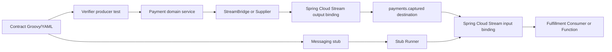
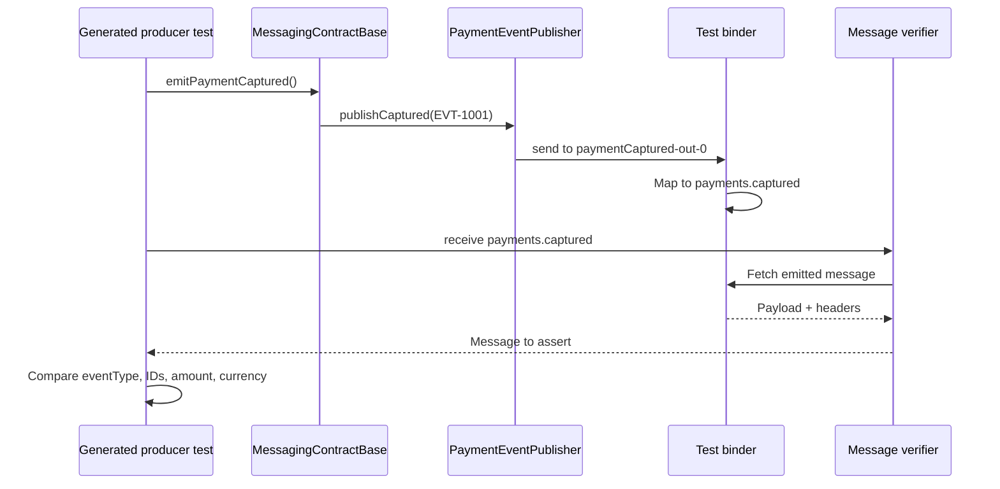
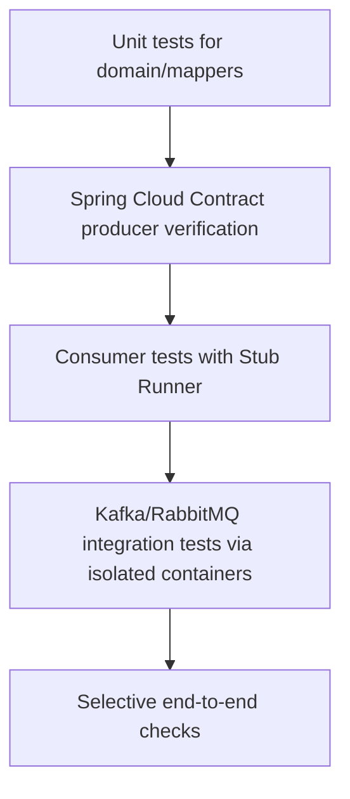
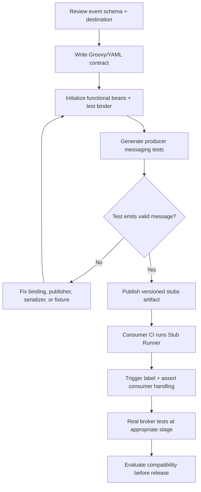

# Integrating Spring Cloud Stream with Supported Programming Models

## 1. Context: Messaging Contracts Must Exercise Real Application Flows

An e-commerce system consists of `payment-service` (producer) and `fulfillment-service` (consumer). When payment for order `ORD-2001` is confirmed, Payment emits a `PaymentCaptured` event to the `payments.captured` destination. Fulfillment reads the event to create a shipping request. Both sides need to agree on **destination, event type, payload contents, headers, and field semantics**.

**Spring Cloud Contract** allows defining HTTP or messaging contracts using **Groovy/YAML DSL**, generating producer verification tests, packaging stubs, and letting consumers use **Stub Runner**. When combined with **Spring Cloud Stream**, producer tests can trigger message-sending code and observe emitted messages; consumer tests can receive simulated events on a controlled destination. CI uses these steps to catch incompatible changes before deployment.

Unlike HTTP, which has a request and response on the same connection, messages are typically sent **asynchronously** through a broker and processed at a different point in time. Therefore, a "valid JSON" test alone is not enough: if the payload is right but sent to the wrong topic, or the consumer is not bound to that topic, the applications remain incompatible.

This topic focuses on a practical question: **which Spring Cloud Stream programming model should you connect to Contract Verifier so tests actually verify real application code?** In modern Spring Cloud Stream releases, the recommended direction is the **functional model** based on `Supplier<T>`, `Function<T,R>`, `Consumer<T>`, and `StreamBridge`, replacing legacy examples using `@EnableBinding`/`@StreamListener`.

After this lesson, you will be able to identify the programming model suited to your project's version, configure functional bindings, write messaging contracts, set up the test binder and `@AutoConfigureMessageVerifier`, use Stub Runner to test consumers, and separate producer contract tests from integration tests using a real Kafka/RabbitMQ broker.

## 2. Three Technology Layers with Distinct Responsibilities

| Layer | Role | Example Components |
| --- | --- | --- |
| **Spring Cloud Contract** | Describes and verifies **communication commitments**. | `input { triggeredBy(...) }`, `outputMessage { sentTo(...) }`, generated tests, `StubTrigger`. |
| **Spring Cloud Stream** | Connects business code with messaging **bindings** and abstractions. | `Consumer`, `Function`, `Supplier`, `StreamBridge`, `payments.captured`. |
| **Binder/broker** | Delivers messages to recipients; handles infrastructure properties. | In-JVM test binder, Kafka binder, Rabbit binder, and the corresponding broker. |

An illustrative architecture:



**A contract is not broker configuration.** A contract with `sentTo('payments.captured')` states that the event must arrive at the agreed destination; for the application to actually send it there, Spring Cloud Stream needs an appropriately declared binding. Conversely, setting the right `destination` in YAML configuration does not prove the event payload is correct: contract assertions are still required.

## 3. The Recommended Functional Model

In newer Spring Cloud Stream releases, functional Java beans are at the center of the message-processing model:

| Bean | Input and Output | Use Case |
| --- | --- | --- |
| `Supplier<T>` | No input binding; produces values to an output binding. | Event source polled/invoked by the framework according to configured source/polling mechanics. |
| `Function<T,R>` | Receives messages from input; emits results to output. | Transforms `PaymentCaptured` into a fulfillment request. |
| `Consumer<T>` | Receives messages from input; no function output binding. | Updates read models, persists state, or executes side effects. |
| `StreamBridge` | Actively sends a message to an output binding/destination. | An HTTP/domain operation or scheduler that decides when to emit an event. |

Example of a message-processing bean:

```java
@Configuration
class FulfillmentStreamConfiguration {

    @Bean
    Consumer<PaymentCaptured> recordCapturedPayment(
            FulfillmentService service) {
        return event -> service.registerPaidOrder(
            event.orderId(), event.paymentId()
        );
    }
}
```

This snippet assumes `PaymentCaptured` and `FulfillmentService` types, along with appropriate Spring/Java imports. When Spring Cloud Stream detects a functional bean and is configured to activate that function, it creates an **input binding** by convention. This is the real handler that consumer tests must exercise, not a mock that always returns an expected result.

If the application has multiple functional beans, set `spring.cloud.function.definition` to specify the bean or composition to bind. With a single bean, the framework can auto-detect it, but **explicit declaration** keeps tests and CI from changing behavior when a new bean is added.

### Warning About the Legacy Annotation Model

You may encounter code like:

```java
// Legacy pattern, DO NOT use as the default design for new projects:
@EnableBinding(OldChannels.class)
class OldListener {
    @StreamListener("input")
    public void handle(String payload) { /* ... */ }
}
```

Older Spring Cloud Stream guides used channel interfaces and annotations like the above. Starting in 3.x, the documentation recommends the functional model; support levels for legacy annotation APIs **depend on the version**, and several newer combinations no longer allow usage like the legacy examples. **Do not assume merely adding `@EnableBinding` integrates cleanly with current Spring Cloud Contract.**

When upgrading a system, write `Consumer/Function/Supplier` beans, migrate binding configuration to functional names, and re-run generated producer tests and consumer tests to prove the same contract still works. Only keep the legacy model if pinned to a specific older version with clear test verification.

## 4. Naming Bindings and Destinations Properly

Given the functional bean:

```java
@Bean
Consumer<PaymentCaptured> recordCapturedPayment(
        FulfillmentService service) {
    return event -> service.registerPaidOrder(
        event.orderId(), event.paymentId()
    );
}
```

Spring Cloud Stream generates the default input binding name:

```text
recordCapturedPayment-in-0
```

This is the application's **internal binding name**. We map it to the destination agreed upon by both sides:

```yaml
spring:
  cloud:
    function:
      definition: recordCapturedPayment
    stream:
      bindings:
        recordCapturedPayment-in-0:
          destination: payments.captured
          content-type: application/json
```

Do not confuse them:

- `recordCapturedPayment` is the **function bean name**.
- `recordCapturedPayment-in-0` is the **input binding name**, generated by the convention `<functionName>-in-0`.
- `payments.captured` is the **logical destination** (e.g., topic/exchange mapped by the binder), which must match the contract.
- `content-type: application/json` is format metadata used for message conversion, not a URL or HTTP header.

A typical `Function<T,R>` has **two bindings**: `<functionName>-in-0` and `<functionName>-out-0`. A `Supplier<T>` has an output binding `<functionName>-out-0`. If you rename the function in code without updating configuration, messages may fail to reach where the consumer is listening.

If you want to customize binding names explicitly, Spring Cloud Stream supports mapping via `spring.cloud.stream.function.bindings.<implicit-name>`, though this adds **an extra mapping layer**. Use it only when backwards compatibility with old configuration is required; by default, stick to functional names so it is easy to trace from bean to destination.

## 5. Using StreamBridge for Business-Triggered Events

The `PaymentCaptured` event typically occurs after the application receives an action, updates the payment state to succeeded, and decides to publish the outcome. In this scenario, **`StreamBridge` is usually a better fit than a continuously polling `Supplier`**, because we want to control the exact moment of emission within the workflow.

A simple DTO:

```java
public record PaymentCaptured(
    String eventId,
    String eventType,
    String paymentId,
    String orderId,
    long amount,
    String currency
) {}
```

Publisher using StreamBridge:

```java
@Service
public class PaymentEventPublisher {
    private final StreamBridge streamBridge;

    public PaymentEventPublisher(StreamBridge streamBridge) {
        this.streamBridge = streamBridge;
    }

    public boolean publishCaptured(PaymentCaptured event) {
        return streamBridge.send(
            "paymentCaptured-out-0",
            MessageBuilder.withPayload(event)
                .setHeader(MessageHeaders.CONTENT_TYPE,
                           MimeTypeUtils.APPLICATION_JSON)
                .setHeader("eventType", event.eventType())
                .build()
        );
    }
}
```

The example requires importing `StreamBridge`, `MessageBuilder`, `MessageHeaders`, and `MimeTypeUtils` matching the Spring Cloud Stream version. `send(...)` returning a boolean does not by itself guarantee the downstream broker persisted the message durably; delivery confirmation semantics depend on the binder/configuration and require dedicated integration tests.

Configuration defining the output binding explicitly:

```yaml
spring:
  cloud:
    stream:
      output-bindings: paymentCaptured-out-0
      bindings:
        paymentCaptured-out-0:
          destination: payments.captured
          content-type: application/json
```

`StreamBridge` can also create bindings dynamically when `send()` is called; here we choose a **pre-declared** output binding to reduce routing errors and make the destination explicit. Do not put `paymentCaptured-out-0` in the contract when the actual consumer only knows the `payments.captured` destination.

**Ensure deterministic test data:** for a sample event, `eventId`, `paymentId`, `orderId`, and timestamp (if present) must be controlled. Do not generate a new UUID or timestamp on every Contract Verifier run and then assert exact values. When dynamic values must be tested, use appropriate matchers and sample fixtures.

## 6. Writing Contracts for Emitted Messages

Suppose after a successful capture, `payment-service` emits the payload:

```json
{
  "eventId": "EVT-1001",
  "eventType": "PaymentCaptured",
  "paymentId": "PAY-1001",
  "orderId": "ORD-2001",
  "amount": 250000,
  "currency": "VND"
}
```

### Groovy DSL

```groovy
import org.springframework.cloud.contract.spec.Contract

Contract.make {
    name 'payment_captured_event'
    description 'Notify that payment PAY-1001 has been captured'
    label 'payment_captured_1001'

    input {
        triggeredBy('emitPaymentCaptured()')
    }

    outputMessage {
        sentTo('payments.captured')
        body([
            eventId: 'EVT-1001',
            eventType: 'PaymentCaptured',
            paymentId: 'PAY-1001',
            orderId: 'ORD-2001',
            amount: 250000,
            currency: 'VND'
        ])
        headers {
            messagingContentType(applicationJson())
            header('eventType', 'PaymentCaptured')
        }
    }
}
```

Analysis:

1. `label 'payment_captured_1001'` is the name used to **trigger the messaging stub** via `StubTrigger` on the consumer side.
2. `input { triggeredBy('emitPaymentCaptured()') }` tells the generated producer test to **invoke the method** `emitPaymentCaptured()` from the base test or another valid resolver.
3. `sentTo('payments.captured')` specifies the destination that must receive the output message.
4. `body([...])` describes the JSON payload; `headers` describes metadata the consumer depends on.
5. The contract must be paired with a **test binder/message verifier** so the test can observe the message; the DSL file itself does not start Kafka or emit events.

For Spring Cloud Stream, the name in `sentTo(...)` is resolved via the binding's destination when mapped; therefore, use the destination name matching your Stream configuration. A test that only checks a payload in a Java variable without verifying the message was sent to the destination **is insufficient**.

### Equivalent YAML DSL

```yaml
description: Notify that payment PAY-1001 has been captured
name: payment_captured_event
label: payment_captured_1001
input:
  triggeredBy: emitPaymentCaptured()
outputMessage:
  sentTo: payments.captured
  body:
    eventId: EVT-1001
    eventType: PaymentCaptured
    paymentId: PAY-1001
    orderId: ORD-2001
    amount: 250000
    currency: VND
  headers:
    contentType: application/json
    eventType: PaymentCaptured
```

Choose **one of the two** (Groovy or YAML) as the source contract for the same scenario to avoid generating duplicate tests/stubs. The `triggeredBy` and `sentTo` syntax belongs to **messaging contracts**, unlike `request.method` and `response.status` for HTTP.

## 7. Connecting Contract Verifier to the Test Binder

For producer verification to verify output messages without needing a shared broker, you can use Spring Cloud Stream's **Spring Integration Test Binder**. It provides test inputs/outputs **inside the JVM** instead of a real broker, keeping runs fast and data deterministic.

Maven dependencies under the modern test binder model:

```xml
<dependency>
    <groupId>org.springframework.cloud</groupId>
    <artifactId>spring-cloud-stream-test-binder</artifactId>
    <scope>test</scope>
</dependency>
<dependency>
    <groupId>org.springframework.cloud</groupId>
    <artifactId>spring-cloud-starter-contract-verifier</artifactId>
    <scope>test</scope>
</dependency>
```

Corresponding Gradle Groovy DSL:

```groovy
dependencies {
    testImplementation 'org.springframework.cloud:spring-cloud-stream-test-binder'
    testImplementation 'org.springframework.cloud:spring-cloud-starter-contract-verifier'
}
```

The snippets above are **configuration fragments**, not complete POM/Gradle scripts. The project needs Spring Cloud Stream dependencies, Spring Boot test, the Spring Cloud Contract test generator, and compatible version management. Some older Spring Cloud Contract docs use the **`test-binder` test-jar classifier** of `spring-cloud-stream` or `spring-cloud-stream-test-support`. **Do not mix test binder artifacts across generations**; verify your project's actual Spring Boot, Spring Cloud Stream, and Spring Cloud Contract versions.

An illustrative producer verification base class:

```java
package com.example.payment.contract;

@SpringBootTest(classes = PaymentApplication.class)
@AutoConfigureMessageVerifier
@Import(TestChannelBinderConfiguration.class)
public abstract class MessagingContractBase {

    @Autowired
    PaymentEventPublisher publisher;

    public void emitPaymentCaptured() {
        PaymentCaptured event = new PaymentCaptured(
            "EVT-1001",
            "PaymentCaptured",
            "PAY-1001",
            "ORD-2001",
            250000L,
            "VND"
        );
        publisher.publishCaptured(event);
    }
}
```

This is a **base class outline**: you must import the annotations, `TestChannelBinderConfiguration`, and application types matching your library versions. If the generator uses JUnit 5, the base test must be configured to be compatible with JUnit Jupiter; the Maven/Gradle plugin must point `baseClassForTests` to this class's fully qualified name. A project may use `@ImportAutoConfiguration(TestChannelBinderConfiguration.class)` instead of `@Import(...)` depending on supported test configuration. **In newer Spring Cloud Stream releases, the Testing documentation also guides using `@EnableTestBinder`** to activate the test binder; choose the annotation/mechanism matching your version rather than stacking multiple binder configs and hoping the test picks the right one.

**Role of each part:**

- `@SpringBootTest` boots the application context to run the real publisher.
- `@AutoConfigureMessageVerifier` enables the messaging verification infrastructure for generated tests in Spring Cloud Contract.
- `TestChannelBinderConfiguration` registers the test binder in the appropriate context, avoiding real Kafka/RabbitMQ connections during tests.
- `emitPaymentCaptured()` is a **controlled trigger** invoked by the contract; it uses the real publisher rather than inserting a message straight into the output queue and claiming the producer works.

In modern Spring Cloud Contract releases, generated tests use `ContractVerifierMessaging` to receive and verify messages. If test reports list generated tests but no message appears, check the binder import, `@AutoConfigureMessageVerifier`, classpath, or destination mapping. Do not edit generated tests by hand because the generator will overwrite them.

## 8. What Does the Verifier Actually Check?

For the contract in section 6, the producer verification cycle is:



The test must prove **the event generated by the producer's code**. Critical business values:

| Field | Example | Why It Must Be Constrained |
| --- | --- | --- |
| `eventType` | `PaymentCaptured` | Consumer selects handler based on event type. |
| `paymentId` | `PAY-1001` | Corresponds to the exact captured transaction. |
| `orderId` | `ORD-2001` | Fulfillment must not create a shipment for the wrong customer order. |
| `amount` | `250000` | Prevents recording the wrong monetary amount. |
| `currency` | `VND` | Prevents currency mismatches. |
| `eventId` | `EVT-1001` | Supports consumer duplicate detection and idempotency. |
| Content-Type header | `application/json` | Ensures the receiver can decode the payload. |

If `eventId` is a dynamically generated UUID in production, avoid brittle literal assertions: use a matcher for the **published format** and a sample stub value so consumer tests remain deterministic. If the event contains a timestamp, control the `Clock` or use time matchers; checking format alone does not guarantee ordering or temporal relationships.

Failures that should be caught: the producer changes `eventType` to `PaymentAuthorized` while the consumer expects `PaymentCaptured`; sends the right payload to `payments.refunded` by mistake; drops `currency`; or changes `amount` from an integer to a string. A test that only asserts "a message arrived" is not enough.

## 9. Testing a Consumer Function with InputDestination

For the `fulfillment-service` consumer, we can test the functional bean **without Spring Cloud Contract stubs** first, confirming the handler and binding themselves work.

Bean configuration example:

```java
@Configuration
class FulfillmentFunctions {
    @Bean
    Consumer<PaymentCaptured> recordCapturedPayment(
            FulfillmentService service) {
        return event -> service.registerPaidOrder(
            event.orderId(), event.paymentId()
        );
    }
}
```

Spring Cloud Stream test using the test binder:

```java
@SpringBootTest(properties = {
    "spring.cloud.function.definition=recordCapturedPayment",
    "spring.cloud.stream.bindings.recordCapturedPayment-in-0.destination=payments.captured",
    "spring.cloud.stream.bindings.recordCapturedPayment-in-0.content-type=application/json"
})
@Import(TestChannelBinderConfiguration.class)
class FulfillmentFunctionTest {

    @Autowired InputDestination input;
    @Autowired FulfillmentProbe probe;

    @Test
    void processesCapturedPayment() {
        String json = """
            {"eventId":"EVT-1001","eventType":"PaymentCaptured",
             "paymentId":"PAY-1001","orderId":"ORD-2001",
             "amount":250000,"currency":"VND"}
            """;

        input.send(
            MessageBuilder.withPayload(
                json.getBytes(StandardCharsets.UTF_8))
                .setHeader(MessageHeaders.CONTENT_TYPE,
                           MimeTypeUtils.APPLICATION_JSON)
                .build(),
            "payments.captured"
        );

        await().untilAsserted(() ->
            assertThat(probe.hasOrder("ORD-2001")).isTrue()
        );
    }
}
```

**Example limitations:** `FulfillmentProbe` is a test-provided observation helper, such as an in-memory repository injected into the service; `await()` comes from Awaitility if the project uses it. You must import `InputDestination` from the test binder, `MessageBuilder`, `StandardCharsets`, and the appropriate annotations/matchers. For synchronous implementations, you can assert directly; for asynchronous ones, use a bounded wait instead of `Thread.sleep(...)`.

What this test proves is that Spring Cloud Stream **binds to the right destination** and the `Consumer` bean can process the payload. It does not prove the Payment producer emits the right message—that requires the **producer verification** from sections 7–8. Nor does it prove Kafka/RabbitMQ offsets, partitions, acks, or retries; those belong to integration tests with a real binder/broker.

### If the Consumer Is a Function

An application might use:

```java
@Bean
Function<PaymentCaptured, FulfillmentRequested> requestFulfillment() {
    return payment -> new FulfillmentRequested(
        payment.orderId(), payment.paymentId()
    );
}
```

Binding names by convention:

```yaml
spring:
  cloud:
    function:
      definition: requestFulfillment
    stream:
      bindings:
        requestFulfillment-in-0:
          destination: payments.captured
        requestFulfillment-out-0:
          destination: fulfillments.requested
```

With the test binder, use `InputDestination.send(...)` to feed the input message and `OutputDestination.receive(...)` to read the output (with an appropriate timeout and destination name). Do not confuse a `Function`'s **output** with `Consumer` having an output binding: `Consumer<T>` returns `void` and does not emit an output message through a functional binding.

## 10. Stub Runner Messaging: Delivering Events to the Real Consumer

Once producer verification passes, the producer publishes a **stub artifact** containing the contract definitions. For messaging, Stub Runner uses the contract metadata to set up routing and lets consumer tests **trigger messages by label**.

Consumer test configuration example:

```java
@SpringBootTest(properties = {
    "spring.cloud.function.definition=recordCapturedPayment",
    "spring.cloud.stream.bindings.recordCapturedPayment-in-0.destination=payments.captured"
})
@Import(TestChannelBinderConfiguration.class)
@AutoConfigureStubRunner(
    ids = "com.example:payment-service:1.4.2:stubs",
    stubsMode = StubRunnerProperties.StubsMode.LOCAL
)
class FulfillmentMessagingStubTest {

    @Autowired StubTrigger stubTrigger;
    @Autowired FulfillmentProbe probe;

    @Test
    void handlesPaymentCapturedStub() {
        boolean triggered =
            stubTrigger.trigger("payment_captured_1001");

        assertThat(triggered).isTrue();
        await().untilAsserted(() ->
            assertThat(probe.hasOrder("ORD-2001")).isTrue()
        );
    }
}
```

This is an **illustrative coordination example**: it requires the `spring-cloud-starter-contract-stub-runner` dependency, Spring Cloud Stream, test binder, imports, and application/probe types. `LOCAL` pulls stub artifacts already installed in the local Maven repository; CI can use an artifact repository in `REMOTE` mode when configured. Version `1.4.2` is hypothetical; use the actual verified producer version.

**Core mechanism:**

1. The test boots Fulfillment with input binding `recordCapturedPayment-in-0` pointing to `payments.captured`.
2. Stub Runner reads the matching contract from the versioned artifact.
3. `stubTrigger.trigger("payment_captured_1001")` fires the message by label.
4. The message enters the destination that `Consumer<PaymentCaptured>` is listening on.
5. The consumer processes it, and the test verifies the **business outcome**, not merely that the label exists.

No live producer needs to run during this consumer test. However, **a passing stub test does not replace producer verification**—if Payment starts sending a broken event, consumer tests using an old stub can still pass.

### Avoiding Binding Name vs. Destination Confusion in Stub Runner

Spring Cloud Contract documentation describes how `messageFrom` and `sentTo` names are resolved with Spring Cloud Stream: it usually resolves by the **destination** mapped from the binding first, and may fall back to the **channel name** if no destination mapping is found. Keep it unambiguous:

```text
Contract: sentTo("payments.captured")
Producer binding: paymentCaptured-out-0 -> payments.captured
Consumer binding: recordCapturedPayment-in-0 -> payments.captured
```

If the contract specifies `sentTo('paymentCaptured-out-0')` while the consumer binding only knows `payments.captured`, the test may fail to receive the message. Do not try to "fix" it by renaming arbitrarily or pointing multiple bindings to an unintended topic. Reconcile Stream config, contracts, generated tests, and stub runtime together.

## 11. Contracts for Input-Message-to-Output-Message Flows

Besides `triggeredBy(...)`, Spring Cloud Contract supports describing an **input message that causes an output message**. This fits `Function<PaymentCaptured, FulfillmentRequested>`.

Groovy DSL example:

```groovy
import org.springframework.cloud.contract.spec.Contract

Contract.make {
    name 'captured_payment_requests_fulfillment'
    label 'payment_capture_creates_fulfillment'

    input {
        messageFrom('payments.captured')
        messageBody([
            eventId: 'EVT-1001',
            eventType: 'PaymentCaptured',
            paymentId: 'PAY-1001',
            orderId: 'ORD-2001',
            amount: 250000,
            currency: 'VND'
        ])
        messageHeaders {
            header('contentType', 'application/json')
        }
    }

    outputMessage {
        sentTo('fulfillments.requested')
        body([
            orderId: 'ORD-2001',
            paymentId: 'PAY-1001',
            state: 'READY'
        ])
        headers {
            messagingContentType(applicationJson())
        }
    }
}
```

Meaning:

- The generated producer verification test **sends a message to** `payments.captured`.
- It waits for and verifies the **outgoing** message on `fulfillments.requested`.
- This is the contract of the application that **processes input to produce output**. It does not automatically replace the contract Payment provides to Fulfillment; both boundaries need clear ownership.

Equivalent YAML DSL:

```yaml
name: captured_payment_requests_fulfillment
label: payment_capture_creates_fulfillment
input:
  messageFrom: payments.captured
  messageBody:
    eventId: EVT-1001
    eventType: PaymentCaptured
    paymentId: PAY-1001
    orderId: ORD-2001
    amount: 250000
    currency: VND
  messageHeaders:
    contentType: application/json
outputMessage:
  sentTo: fulfillments.requested
  body:
    orderId: ORD-2001
    paymentId: PAY-1001
    state: READY
  headers:
    contentType: application/json
```

Both contracts are DSL examples only: the project needs a test binder, functional application, and proper fixtures to verify them. If a bean simply **consumes a message and saves to a database** without producing output, you can pair the input DSL with an assertion provided by the base test (such as `assertThat('fulfillmentWasRegistered()')` in supported versions), rather than inventing a fake output message that does not exist.

## 12. Choosing the Right Pattern for Each Scenario

| Scenario | Suitable Spring Cloud Stream Pattern | Suitable Spring Cloud Contract Pattern |
| --- | --- | --- |
| REST API triggers `PaymentCaptured` emission | `StreamBridge` on an output binding. | `triggeredBy(...)` to invoke workflow; `outputMessage.sentTo` to verify event. |
| Scheduler/periodic source emits messages | `Supplier<T>` with controlled polling/lifecycle. | Controlled trigger or contract reflecting real output; avoid tests relying on random scheduler runs. |
| Receives message and updates state | `Consumer<T>`. | Input contract + assertion on outcome; test binder executes consumer logic. |
| Receives `PaymentCaptured`, emits `FulfillmentRequested` | `Function<T,R>`. | `input.messageFrom` + `outputMessage.sentTo`, verifying both input and output payloads. |
| Consumer runs against a simulated Payment event | `Consumer<T>`/`Function<T,R>` + test binder. | Stub Runner + `StubTrigger.trigger(label)`. |
| Verifying Kafka partitions, retries, offsets, rebalances | Real Kafka binder/broker in test environment. | Keep contracts for payload, but add separate infrastructure integration tests. |

**Both sides do not have to use the same functional pattern.** Payment can use `StreamBridge` while Fulfillment uses `Consumer<T>`, as long as both agree on the destination and schema. A contract is an external protocol, not a requirement that both applications share identical bean names.

## 13. Messaging Properties the Test Binder Does Not Prove

The test binder verifies flows and contents inside the JVM, but usually **does not faithfully simulate a full real broker**:

- **Kafka:** partition keys, ordering within a partition, offsets, consumer groups, rebalancing, retries/commits.
- **RabbitMQ:** exchanges, routing keys, queue bindings, ack/nack, dead-letter exchanges, and broker permissions.
- **Network and deployment:** TLS connections, ACLs, binary serialization, backpressure, disconnects, duplicate messages during retries.
- **Transactions:** DB commits succeeding before event publish fails, publish succeeding before DB rollback, transactional outbox, and idempotency.

If the same test module puts both the **test binder** and a **real middleware binder** on the classpath, the test binder may take precedence in the test context, causing what is labeled a "Kafka integration test" to run purely in memory. When verifying a real broker, use a module or test setup **isolated** from the test binder and confirm an actual connection is established to the test environment's broker.

Therefore, add complementary test layers:



You do not need to turn every pull request into an end-to-end run against a shared broker. Still, **a green contract does not mean** you have proven messages are delivered exactly once, survive application crashes without loss, or remain resilient during broker network partitions.

### Consumer Idempotency

A consumer may receive `EVT-1001` multiple times due to broker redelivery, retries, or failovers. In the Fulfillment example, `eventId` is a useful key for detecting duplicate events. Verify that processing a duplicate **does not create two shipment requests** if that is a system guarantee.

The schema/contract verifies that `eventId` is present and well-formatted; **it does not verify deduplication algorithms itself**. Write a dedicated test: send `EVT-1001` twice via `InputDestination` or a broker test, and assert only one fulfillment request is created.

## 14. Common Pitfalls When Combining Contract and Stream

| Symptom | Cause to Check | Remediation |
| --- | --- | --- |
| Generated test does not receive message | Missing `@AutoConfigureMessageVerifier` or test binder inactive. | Check base class, test binder dependency, configuration imports, and test logs. |
| Contract specifies `payments.captured` but output goes elsewhere | Wrong `paymentCaptured-out-0.destination` binding. | Reconcile logical destination, binding name, and `sentTo`. |
| `Consumer` is never invoked | Wrong `spring.cloud.function.definition` or `recordCapturedPayment-in-0.destination`. | Check bean name, binding name, function configuration, and output/traces. |
| Code uses `@EnableBinding` and fails on newer Stream | Applying incompatible legacy annotation examples. | Migrate to `@Bean Consumer/Function/Supplier` and re-run tests. |
| Test binder accidentally picks Kafka binder | Multiple binders on classpath/config without activating test binder properly. | Enable the test binder per version guidance; keep live brokers out of unit/contract tests. |
| StreamBridge sends message but `receive` misses it | Dynamic binding created under a different name or output not mapped to expected destination. | Declare the output binding explicitly and compare actual message destination. |
| `byte[]` payload fails to decode to DTO | Incorrect content-type header or message conversion. | Use `application/json`, compatible DTO schemas, and inspect conversion exceptions. |
| Stub Runner has label but consumer does not process it | Stub sends to a destination the consumer is not bound to. | Check `sentTo`, function bindings, test binder, and business probe. |
| Flaky tests | Non-deterministic scheduler, `UUID.randomUUID()`, leftover messages from previous tests in queue. | Use fixed fixtures/clock, controlled triggers, and isolated contexts/destinations. |
| Consumer test passes while producer emits wrong event | Stale stub artifact not verified against current producer. | Run producer verification, publish matching stub version, and update consumer. |
| Multiple messaging frameworks on classpath | Stub Runner picks an unintended integration. | Configure `stubrunner.stream.enabled`/`integration.enabled` flags per version. |
| Build passes with zero messaging tests | Plugin misses contracts, tests skipped, or wrong base mapping. | Inspect generated tests, executed counts, and fail on 0 tests. |

### Four Quick Checks When "No Event Arrives"

1. **Does the contract have the right `label`, `triggeredBy`/`messageFrom`, and `sentTo`?**
2. **Do the publisher/consumer use functional beans or `StreamBridge` with the right binding names?**
3. **Are the test binder and `Message Verifier` actually active in the Spring `TestContext`?**
4. **Did the generated test run and observe the expected destination?** If not, inspect logs and test execution counts instead of just looking at generated files.

## 15. CI Integration and Stub Publishing

A consistent pipeline:



Conditions to enforce in CI:

1. **Source of truth:** contracts and binding configurations are tracked by commit/version; never implicitly download "latest".
2. **Test generation:** generated producer messaging tests must be discovered by the compiler/test engine. Never accept `BUILD SUCCESS` when 0 tests ran.
3. **Isolation:** test binder, fixtures, and clock are reproducible; do not depend on a shared Kafka/RabbitMQ broker during the contract stage.
4. **Destination and payload:** tests verify `payments.captured`, `eventType`, `paymentId`, `orderId`, `amount`, `currency`, and critical headers.
5. **Stubs:** artifacts are published **only after producer verification passes**, include the agreed messaging contracts, and are versioned.
6. **Consumer:** Stub Runner fires events by `label`; tests execute the real handler bean and verify business state.
7. **Broker integration:** a separate stage tests Kafka/RabbitMQ for binder properties, ordering, partitions, acknowledgements, and retries that the test binder does not guarantee.
8. **Framework upgrades:** when changing Spring Boot/Cloud Stream/Contract, check the compatibility matrix, test binder artifact, binding names, and message verifier auto-configuration.

To prove CI genuinely catches breaking changes, introduce an **intentional change on a test branch**: have the producer rename `orderId` to `orderCode` or send to `payments.refunded`. Producer verification must fail. Then revert and re-run. Never update contracts merely to "chase" a broken implementation without consumer agreement.

## 16. Practice Exercise: Migrating a Legacy Event to Functional

An `inventory-service` project previously used `@StreamListener` to consume `StockReserved` from `stock.reserved`. The new application uses the functional model. After receiving it, it emits `InventoryAllocationReady` to `inventory.allocations`.

Sample input message:

```json
{
  "eventId": "EVT-STOCK-1001",
  "eventType": "StockReserved",
  "orderId": "ORD-2001",
  "sku": "SKU-001",
  "quantity": 2
}
```

Expected output:

```json
{
  "eventType": "InventoryAllocationReady",
  "orderId": "ORD-2001",
  "sku": "SKU-001",
  "allocatedQuantity": 2
}
```

**Tasks:**

1. Write a `@Bean Function<StockReserved, InventoryAllocationReady> allocateInventory()` bean to replace the legacy annotation model.
2. Configure `spring.cloud.function.definition=allocateInventory` and the two bindings `allocateInventory-in-0`, `allocateInventory-out-0` mapping to `stock.reserved` and `inventory.allocations`, respectively.
3. Write a Groovy messaging contract using `messageFrom('stock.reserved')` with the input `messageBody` and `outputMessage.sentTo('inventory.allocations')`; assert `orderId`, `sku`, and business quantity.
4. Write the equivalent YAML DSL, then choose one to store as the source contract in the repository.
5. Configure the test binder and `@AutoConfigureMessageVerifier` in the base class so generated producer tests send input and receive output **without a real Kafka/RabbitMQ broker**.
6. Write a test using `InputDestination.send(...)` and `OutputDestination.receive(...)` verifying the `allocateInventory` bean itself runs through Stream bindings.
7. Produce a versioned stub from the verified contract; in the consumer test, use `StubTrigger.trigger(label)` to deliver the message to the handler under test.
8. Rename `allocateInventory-in-0.destination` to `stock.cancelled` while keeping the `stock.reserved` contract. Which test results must fail and why?
9. Design a separate Kafka/RabbitMQ broker test to verify delivery, retries, and duplicate messages. Explain why contract tests using the test binder do not prove those properties.

**Self-check hints:** a solid solution distinguishes **function bean**, **binding name**, **destination**, and **contract field**; uses only patterns supported by the version; producer tests execute real application code; consumer tests process stubs using the real handler.

## 17. Key Takeaways

- Modern Spring Cloud Stream favors **functional beans** (`Supplier`, `Function`, `Consumer`) and **`StreamBridge`** for imperative message emission. `@EnableBinding`/`@StreamListener` examples are legacy and require compatibility checks.
- Functional binding names follow `<functionName>-in-0` or `<functionName>-out-0`; they are **not identical** to destinations like `payments.captured`.
- For producers emitting events, Spring Cloud Contract uses `input.triggeredBy(...)` and `outputMessage.sentTo(...)`; for input-to-output transformations, use `input.messageFrom(...)` and `outputMessage.sentTo(...)`.
- Producer verification requires **`@AutoConfigureMessageVerifier`**, a test binder or appropriate messaging integration, and a trigger/fixture exercising real producer code.
- **Spring Cloud Stream test binder** verifies flows and bindings inside the JVM; it does **not** prove all properties of real Kafka/RabbitMQ brokers.
- **Stub Runner + StubTrigger** let consumer tests receive messages from versioned artifacts and verify real handlers, without replacing producer verification.
- In CI, check **generated tests, executed test counts, message destination, payload, headers, stub version**, and required broker integration tests.

### References

- [Spring Cloud Contract — Messaging](https://docs.spring.io/spring-cloud-contract/reference/project-features-messaging.html): `triggeredBy`, `messageFrom`, `outputMessage`, `@AutoConfigureMessageVerifier`, and StubTrigger.
- [Spring Cloud Stream — Producing and Consuming Messages](https://docs.spring.io/spring-cloud-stream/reference/spring-cloud-stream/producing-and-consuming-messages.html): functional model, StreamBridge, and message conversion.
- [Spring Cloud Stream — Functional Binding Names](https://docs.spring.io/spring-cloud-stream/reference/spring-cloud-stream/functional-binding-names.html): `-in-0`/`-out-0` binding naming conventions and destination mapping.
- [Spring Cloud Stream — Testing](https://docs.spring.io/spring-cloud-stream/reference/spring-cloud-stream/spring_integration_test_binder.html): test binder, InputDestination, OutputDestination, and testing scope.
- [Spring Cloud Contract — Stub Runner](https://docs.spring.io/spring-cloud-contract/reference/project-features-stubrunner.html): running stubs on the consumer side.
