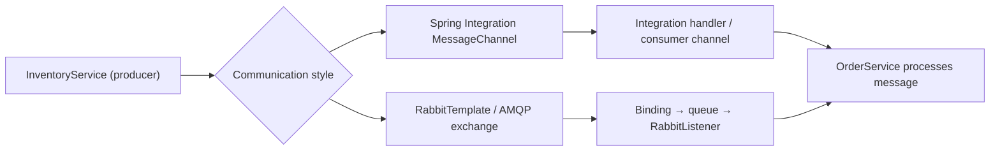
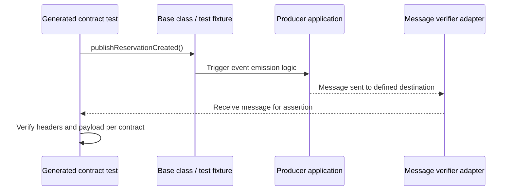
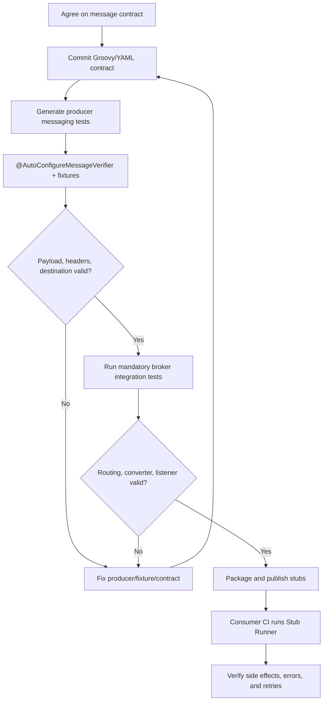

# Version-Aware Integration of Spring Integration and Spring AMQP

When applications communicate via **messages**, contracts describe more than JSON payloads. Producers and consumers must also agree on where messages are sent, where they are received, headers, content formats, and when a message is emitted. In the Spring ecosystem, **Spring Integration** handles flows via `MessageChannel` and integration endpoints, whereas **Spring AMQP** typically handles messages via RabbitMQ exchanges, routing keys, and queues. The same Spring Cloud Contract definition can support communication testing, but **how it connects to the transport and what auto-configures depends on library versions**.

This lesson belongs to the **Messaging Contract Testing** chapter of the **SPRING_CLOUD_CONTRACT** module. We will use **Groovy/YAML DSL** to describe message emission/receipt behavior, **Contract Verifier** to generate producer tests, **Stub Runner** to trigger sample messages for consumers, and **CI** to prevent incompatible changes. Particular emphasis is placed on not confusing a Spring Integration channel with a RabbitMQ exchange, not copying older AMQP Stub Runner configuration into newer versions unverified, and not equating a messaging test with real broker delivery guarantees.

After this lesson, you will be able to:

- Compare Spring Integration's `MessageChannel` model with Spring AMQP's `exchange -> binding -> queue -> listener` model.
- Understand the roles of `input`, `triggeredBy`, `messageFrom`, `outputMessage`, `sentTo`, and `label` in messaging contracts.
- Use `@AutoConfigureMessageVerifier` and a base class so generated tests verify messages emitted by the producer.
- Know when Stub Runner can trigger messages by label using `StubTrigger`.
- Choose the right integration for your running versions of **Spring Cloud Contract, Spring Boot, Spring Integration, and Spring AMQP**.
- Avoid conflicts when multiple messaging frameworks sit on the same classpath.
- Supplement with broker integration tests for routing, acks, retries, dead-lettering, and guarantees outside a payload contract.

## 1. Two Messaging Infrastructures Easy to Confuse

**Spring Integration** is a framework for organizing message-processing flows at the application level. Central building blocks typically include `Message<?>`, `MessageChannel`, gateways, transformers, routers, filters, or service activators. A channel can operate **in memory** without a broker.

**Spring AMQP** is Spring's toolkit for AMQP. With conventional RabbitMQ, the application sends messages to an **exchange**; the broker uses a **routing key** and **bindings** to route messages into queues; consumers usually handle them via `@RabbitListener` or a listener container.

| Component | Spring Integration | Spring AMQP / RabbitMQ |
| --- | --- | --- |
| Send/receive target | `MessageChannel`, adapter, gateway | Exchange, queue, routing key, listener |
| Send example | `channel.send(message)` | `rabbitTemplate.convertAndSend(exchange, key, body)` |
| Receive example | `PollableChannel.receive()` or message handler | `@RabbitListener(queues = "...")` |
| Broker dependency | Not required | Typically requires a broker in live flows |
| What the contract protects | Destination name, payload, headers, trigger scenario | Payload, headers, destination, and consumer-relevant routing |
| What the contract does not prove alone | Full IntegrationFlow, concurrency, retries | Real broker bindings, acks, redelivery, durability, DLQ |

An application may use **both**: a Spring IntegrationFlow ending in an AMQP outbound adapter, or an AMQP inbound adapter pushing messages into an Integration channel. Even so, calling both "messaging" **does not mean `sentTo('events')` resolves identically** across every version and adapter.

### Overall Producer -> Consumer Flow



Choose the branch matching your system's real transport. Contract tests verify the interface the consumer relies on, while broker tests exercise the corresponding infrastructure.

## 2. Why Mention Versions?

In the Spring ecosystem, **the same product name does not guarantee the same API, starter, or auto-configuration** across generations. Moreover, Spring Cloud Contract documentation across different versions lists different sets of messaging adapters.

| Documentation / Product Line | Key Things to Note |
| --- | --- |
| **Spring Cloud Contract 3.1.x** | The 3.1.1 docs include a dedicated section **Consumer Side Messaging With Spring AMQP**, describing `RabbitTemplate`/`@RabbitListener` integration and `stubrunner.amqp.*` properties. |
| **Spring Cloud Contract 4.2.x** | Messaging docs emphasize **Spring Integration**, Spring Cloud Stream, Camel, and JMS; do not copy old `@SpyBean` guides or AMQP properties verbatim without testing against the actual libraries. |
| **Spring Cloud Contract 5.0.x** | Reference docs continue covering Integration, Stream, Camel, JMS, and AMQP-on-classpath scenarios; however, availability, behavior, and how to enable an AMQP adapter must be verified against the **specific artifact/version**, not inferred from a generic note. |
| **Spring Boot 3.x / 4.x** | AMQP starter names and client models evolve across generations. In particular, Boot 4 docs distinguish RabbitMQ AMQP 0.9.1 and AMQP 1.0; do not assume one starter covers every protocol. |
| **Spring Integration across releases** | Java DSL moved into the core project in Spring Integration 5.0; APIs, channel config, and test support must match the compatible Spring Framework release train. |

**Note on the table:** this is a **compatibility verification guide**, not a claim that "version 5.x removed AMQP". Something not listed as a dedicated section in current docs **is not sufficient proof a feature was removed**. Check the actual APIs/modules present in your dependency graph, which configuration properties bind, and run a smoke test that sends/receives a message. Avoid mixing 3.1.1 documentation with newer runtimes without verifying.

### Relationship Between Spring Boot and Spring Cloud

Spring Cloud ships in **release trains** compatible with specific Spring Boot generations. For example, in Spring Cloud's compatibility table, `2025.0.x` targets Boot `3.5.x`; `2025.1.x` targets Boot `4.0.x` and certain `4.1.x` maintenance releases. Do not arbitrarily mix Spring Cloud Contract plugins, Spring Boot, and Spring Integration from different generations and expect every annotation and bean to exist.

**Version selection should follow this order:**

1. Identify the project's Spring Boot/JDK version and Spring Cloud release train.
2. Pick the compatible **Spring Cloud Contract** version and pin it via your build/BOM.
3. Determine whether the producer actually uses **Spring Integration**, **RabbitMQ AMQP 0.9.1**, **AMQP 1.0**, or a combination.
4. Pick starters/adapters by protocol, not just by the word "AMQP".
5. Check documentation for the **exact same version** of Contract Verifier/Stub Runner and inspect beans on the test classpath.
6. Generate tests, run them, and verify `StubTrigger`/message receipt in a smoke test.

## 3. An End-to-End Business Event

Suppose `InventoryService` emits a successful stock reservation event. `OrderService` needs it to continue the order workflow:

```json
{
  "reservationId": "RES-100",
  "orderId": "ORD-1001",
  "status": "HELD"
}
```

Both teams agree on:

- Event type: `reservation.created`.
- Payload must contain `reservationId`, `orderId`, and `status`.
- `status` is `HELD` in the success scenario.
- The consumer must not assume `reservationId` is a constant in production.
- The actual destination depends on the transport: **channel** for pure Spring Integration; **exchange/routing key/queue** for RabbitMQ.

This is a **hypothetical business contract** for learning. Event names, transport paths, and contents must follow your actual producer–consumer agreement.

## 4. Where Messaging DSL Differs from HTTP DSL

HTTP contracts typically have `request { ... }` and `response { ... }`. For messages, Spring Cloud Contract provides blocks like `input` and `outputMessage`:

| DSL Element | Role in a Messaging Scenario |
| --- | --- |
| `name` | Identifies the contract and aids tracing generated tests |
| `description` | Producer/consumer context and why the event exists |
| `label` | Label used to trigger the message stub via the `StubTrigger` API |
| `input { triggeredBy(...) }` | Generated producer test invokes a method to ask the producer to emit a message |
| `input { messageFrom(...) }` | Describes the destination providing an **input message** to trigger processing |
| `input { messageBody(...) }` | Input message body |
| `input { messageHeaders { ... } }` | Input message headers |
| `outputMessage { sentTo(...) }` | Where the producer must send the output message |
| `outputMessage { body(...) }` | Expected payload |
| `outputMessage { headers { ... } }` | Headers that must appear on the output message |

Not every contract has both an **input message** and an **output message**. An event triggered by an internal command or scheduler can use `triggeredBy`; a handler receiving a command message can use `messageFrom`; a consumer that only receives a message without emitting anything further uses a different scenario pattern.

**Important:** `triggeredBy('someMethod()')` does not define business logic itself. The generated test must find the matching method in the base class/test context and invoke the producer's **real message-emitting path**.

## 5. Groovy DSL: Producer Emits a Message When a Method Is Called

Suppose we are testing with Spring Integration, where `reservationEvents` is a channel observable by the test.

```groovy
import org.springframework.cloud.contract.spec.Contract

Contract.make {
    name 'reservation_created_message'
    description '''
        InventoryService emits a reservation event so OrderService
        records the HELD status for the corresponding order.
    '''
    label 'reservation_created'

    input {
        triggeredBy('publishReservationCreated()')
    }

    outputMessage {
        sentTo('reservationEvents')
        body([
            reservationId: 'RES-100',
            orderId      : 'ORD-1001',
            status       : 'HELD'
        ])
        headers {
            messagingContentType(applicationJson())
            header('eventType', 'reservation.created')
        }
    }
}
```

Reading the example:

1. `label 'reservation_created'` is the name consumer tests can use to ask the stub to emit the sample event; **renaming the label can break consumer tests**.
2. `triggeredBy('publishReservationCreated()')` requires a trigger method on the producer test side.
3. `sentTo('reservationEvents')` is interpreted as a **channel/destination** when the Spring Integration adapter is active.
4. `body` and `headers` are what get verified on the output message.

**Version note:** how `sentTo` resolves can differ across Integration, Stream, Camel, or AMQP; Contract Verifier docs note for Integration/Stream that the tool may look up **destination** first and then **channel name**. The name `reservationEvents` here is simply a name configured in the project. Do not treat it as a RabbitMQ queue or exchange if the application uses a different transport.

### Equivalent YAML DSL for the Same Scenario

```yaml
name: reservation_created_message
description: InventoryService emits an event for OrderService to update the order
label: reservation_created
input:
  triggeredBy: publishReservationCreated()
outputMessage:
  sentTo: reservationEvents
  body:
    reservationId: RES-100
    orderId: ORD-1001
    status: HELD
  headers:
    contentType: application/json
    eventType: reservation.created
```

This is an **alternative syntax**; do not place both Groovy and YAML files with the same content in the source directory read by the generator, or tests and stubs will be duplicated. If using dynamic matchers, YAML has its own syntax; do not copy Groovy's `$(consumer(...),producer(...))` into YAML expecting automatic interpretation.

### Dynamic Data in Output

If `reservationId` is a generated string, the Groovy body can use:

```groovy
body([
    reservationId: $(consumer('RES-100'),
                     producer(regex('RES-[0-9]+'))),
    orderId      : 'ORD-1001',
    status       : 'HELD'
])
```

This is a **DSL fragment** replacing `body` in the previous contract. The stub side returns `RES-100` for the consumer to process, while the producer test checks that the real ID matches the pattern. A regex does not prove uniqueness, successful persistence, or association with the right order; add business tests if the consumer relies on those invariants.

## 6. What Does the Generated Producer Test Check?

In principle, Contract Verifier generates a producer test with these steps:



The generated test can:

- Invoke the `publishReservationCreated()` method specified in `triggeredBy`.
- Wait for/receive the message from destination `reservationEvents` via the framework adapter.
- Assert the message exists and matches the agreed `eventType` header and payload.

However, the test **does not guarantee** that data was written to a database, that a real RabbitMQ broker acked it, or that a consumer received it. Those guarantees require appropriate integration tests.

### What Does the Base Class Need?

A starter template for JUnit 5 and Spring Boot:

```java
package com.example.inventory;

import org.springframework.beans.factory.annotation.Autowired;
import org.springframework.boot.test.context.SpringBootTest;
import org.springframework.cloud.contract.verifier.messaging.boot.AutoConfigureMessageVerifier;

@SpringBootTest
@AutoConfigureMessageVerifier
public abstract class MessagingContractBase {

    @Autowired
    ReservationEventPublisher publisher;

    public void publishReservationCreated() {
        publisher.publish("RES-100", "ORD-1001");
    }
}
```

`ReservationEventPublisher` is a **hypothetical application class**, not a Spring Cloud Contract API. It must emit the message through the component observed by verification rather than just returning a map from the test. Annotation packages and message verifier configuration must be **confirmed against your dependency version**; the purpose of `@AutoConfigureMessageVerifier` is to enable the adapter needed for messaging verification.

If the base class calls the publisher yet the adapter receives no message, the bug may lie in channel beans, broker connections, routing, test mode, or classpath—not in the contract payload.

## 7. Spring Integration Example Using Only an In-Memory Channel

A reproducible learning approach is to use a `QueueChannel` in a test profile. It allows messages to be placed onto a pollable channel without booting RabbitMQ.

```java
package com.example.inventory;

import org.springframework.context.annotation.Bean;
import org.springframework.context.annotation.Configuration;
import org.springframework.integration.channel.QueueChannel;
import org.springframework.messaging.PollableChannel;

@Configuration
class ContractChannelConfiguration {

    @Bean("reservationEvents")
    PollableChannel reservationEvents() {
        return new QueueChannel();
    }
}
```

This is an **experimental test configuration**, not a mandatory component for every application. Make sure this bean only exists where intended and does not collide with production channel definitions.

Minimal illustrative publisher:

```java
package com.example.inventory;

import java.util.Map;
import org.springframework.beans.factory.annotation.Qualifier;
import org.springframework.messaging.MessageChannel;
import org.springframework.messaging.support.MessageBuilder;
import org.springframework.stereotype.Service;

@Service
class ReservationEventPublisher {

    private final MessageChannel channel;

    ReservationEventPublisher(
            @Qualifier("reservationEvents") MessageChannel channel) {
        this.channel = channel;
    }

    void publish(String reservationId, String orderId) {
        channel.send(MessageBuilder.withPayload(Map.of(
                    "reservationId", reservationId,
                    "orderId", orderId,
                    "status", "HELD"))
                .setHeader("contentType", "application/json")
                .setHeader("eventType", "reservation.created")
                .build());
    }
}
```

In this model, the Contract Verifier adapter must know **how to receive messages from `reservationEvents`**. The example sends a `Map` payload; if the real application sends `byte[]` or JSON strings, ensure converters/serialization and assertions verify the **wire format** matching consumer expectations.

### Key Points About `DirectChannel` and `QueueChannel`

- `DirectChannel` normally dispatches messages to subscribers/handlers on the caller thread and **does not buffer messages** for a test to poll later.
- `QueueChannel` is a `PollableChannel`, making it suitable when tests need to poll for emitted messages.
- If the production app already has a complex `IntegrationFlow` with multiple subscribers, replacing `DirectChannel` with `QueueChannel` in tests **can alter behavior**; use a test wire-tap, bridge, or suitable test adapter so real routing bugs are not masked.
- If the contract verifier looks up channels by name, verify the name, bean type, destination resolution, and actual receipt with a smoke test.

**A test passing on QueueChannel does not prove RabbitMQ broker routing works**, because there is no exchange, binding, listener container, or network involved.

## 8. Testing Message Inputs with `messageFrom`

Besides a publisher emitting events on its own, a producer can be a handler receiving a command message and producing a resulting event.

Example **DSL template**:

```groovy
import org.springframework.cloud.contract.spec.Contract

Contract.make {
    name 'reserve_stock_command_results_in_event'
    description 'Stock reservation command produces a confirmation event'

    input {
        messageFrom('reservationCommands')
        messageBody([
            orderId : 'ORD-1001',
            sku     : 'SKU-001',
            quantity: 2
        ])
        messageHeaders {
            messagingContentType(applicationJson())
        }
    }

    outputMessage {
        sentTo('reservationEvents')
        body([
            orderId: 'ORD-1001',
            status : 'HELD'
        ])
        headers {
            header('eventType', 'reservation.created')
        }
    }
}
```

The `messageFrom` field can be interpreted by the Integration adapter as the input message's channel/destination. The real test requires a **subscribed handler** there and the ability to observe output. If `reservationCommands` is a RabbitMQ queue in production, an in-memory Spring Integration setup only tests logic once the message reaches the channel; separate tests are needed for the actual exchange/binding/consumer.

Do not place both `triggeredBy` and `messageFrom` in the same scenario when they represent distinct trigger mechanisms that the project does not intentionally combine; pick the model matching the path under test.

## 9. Spring AMQP: Exchanges Are Not Queues, Routing Keys Are Not Labels

In RabbitMQ using AMQP 0.9.1, a publisher typically sends to an **exchange** with a **routing key**. The broker uses bindings to route to one or more queues; listeners consume from queues. This differs from sending directly to an in-memory `reservationEvents` channel.


Distinguish these four values:

| Value | Meaning | Interchangeable? |
| --- | --- | --- |
| `reservation.events` | RabbitMQ exchange name | No |
| `reservation.created` | Routing key / conventional event type | No |
| `order.reservation.events` | Queue name the consumer reads from | No |
| `reservation_created` | Spring Cloud Contract `label` to trigger the stub | No |

Example producer using `RabbitTemplate` in a traditional RabbitMQ application:

```java
package com.example.inventory;

import java.util.Map;
import org.springframework.amqp.rabbit.core.RabbitTemplate;
import org.springframework.stereotype.Service;

@Service
class RabbitReservationPublisher {

    private final RabbitTemplate rabbitTemplate;

    RabbitReservationPublisher(RabbitTemplate rabbitTemplate) {
        this.rabbitTemplate = rabbitTemplate;
    }

    void publish(String reservationId, String orderId) {
        rabbitTemplate.convertAndSend(
            "reservation.events",
            "reservation.created",
            Map.of(
                "reservationId", reservationId,
                "orderId", orderId,
                "status", "HELD"
            )
        );
    }
}
```

This assumes the application has a **`RabbitTemplate`** and a suitable message converter. Without a configured JSON converter, a Java `Map` payload may not be sent with `contentType: application/json` as required by the contract. Inspect the converter and real wire format, not only Java types.

Example consumer listening on a queue:

```java
package com.example.order;

import org.springframework.amqp.rabbit.annotation.RabbitListener;
import org.springframework.stereotype.Component;

@Component
class ReservationCreatedListener {

    @RabbitListener(queues = "order.reservation.events")
    void onReservationCreated(ReservationCreatedEvent event) {
        // Update the order using reservationId and orderId.
    }
}
```

`ReservationCreatedEvent` is an example application DTO; a real listener also needs the queue/binding and converter to deserialize payloads into this type. The annotation alone does not prove the queue is bound to the right exchange or that the broker confirmed delivery.

### Which Contract Applies to AMQP?

The event scenario is still described using `input`/`outputMessage`, but if an AMQP adapter is selected, `sentTo('reservation.events')` may be interpreted as an **exchange** instead of a Spring Integration channel. In Spring Cloud Contract 3.1.x guides, the routing key could be passed via the `amqp_receivedRoutingKey` header for AMQP integration.

```groovy
import org.springframework.cloud.contract.spec.Contract

Contract.make {
    name 'rabbit_reservation_created'
    label 'rabbit_reservation_created'

    input {
        triggeredBy('publishRabbitReservationCreated()')
    }

    outputMessage {
        // Example for AMQP adapter in supported versions:
        // destination is interpreted as the exchange.
        sentTo('reservation.events')
        body([
            reservationId: 'RES-100',
            orderId      : 'ORD-1001',
            status       : 'HELD'
        ])
        headers {
            messagingContentType(applicationJson())
            header('eventType', 'reservation.created')
            header('amqp_receivedRoutingKey', 'reservation.created')
        }
    }
}
```

**Version limitation:** the `amqp_receivedRoutingKey` header and exchange/routing-key-to-listener forwarding mechanism were documented in older AMQP guides. On newer release trains, **verify the AMQP Stub Runner module, metadata schema, and actual adapter** before adopting the contract above as a production template. Do not assume all RabbitMQ clients or Contract Verifier versions handle this header identically; in particular, avoid using the adapter verbatim for **AMQP 1.0** when docs only describe RabbitMQ 0.9.1 semantics.

## 10. Should Producer Tests Use a Real Broker?

Using `RabbitTemplate` in production **does not mean** generated contract tests must always start a RabbitMQ broker. Each test level has a different goal:

| Level | Common Setup | Evidence |
| --- | --- | --- |
| Spring Integration channel test | In-memory channel and `@AutoConfigureMessageVerifier` | Producer emits contract payload/headers to the configured channel |
| Contract test with supported AMQP adapter | Messaging verifier integrated with `RabbitTemplate`/listeners per version | Payload/headers observed through adapter mechanics |
| AMQP publisher unit test | Mock/spy `RabbitTemplate` | Publisher invokes the right exchange, routing key, and content at call level |
| Broker integration test | Real RabbitMQ in test environment or container | Exchange, bindings, queues, converters, and listeners interoperate |
| System test | Broker, DB, network, multiple instances | Critical invariants hold under retries, failures, and load |

**Do not infer from a mocked `RabbitTemplate` that a real broker routes correctly.** Broker testing can use a dedicated RabbitMQ environment or a test container if permitted by your organization. This is a complementary integration test, not something a DSL body map can verify on its own.

### Dataset and Topology for a Broker Integration Test

Example real scenario:

1. Create exchange `reservation.events` of type `topic` (or agreed type).
2. Create queue `order.reservation.events` for `OrderService`.
3. Bind the queue with routing key `reservation.created`.
4. Publisher sends the event using the proper converter and content type.
5. Listener receives and parses payload, verifying event type, IDs, and status.
6. Verify messages do not land in unintended queues if routing policy requires isolation.

For reproducible tests, topology must be created deterministically and cleaned up afterward; use isolated queue names across parallel CI jobs. A real production queue is not an appropriate target for running generated tests.

## 11. Stub Runner with Spring Integration on the Consumer

In Spring Cloud Contract, message stubs differ from HTTP mappings: **contract definitions** are typically packaged inside the stub artifact so Stub Runner can read them and build appropriate message routes. Consumers can trigger a `label`-ed event via `StubTrigger`.

Example consumer test following the Spring Integration approach:

```java
package com.example.order;

import org.junit.jupiter.api.Test;
import org.springframework.beans.factory.annotation.Autowired;
import org.springframework.boot.test.context.SpringBootTest;
import org.springframework.cloud.contract.stubrunner.StubTrigger;
import org.springframework.cloud.contract.stubrunner.spring.AutoConfigureStubRunner;
import org.springframework.cloud.contract.stubrunner.spring.StubRunnerProperties;

import static org.assertj.core.api.Assertions.assertThat;

@SpringBootTest
@AutoConfigureStubRunner(
    ids = "com.example:inventory-service:1.0.0:stubs",
    stubsMode = StubRunnerProperties.StubsMode.LOCAL
)
class ReservationEventConsumerTest {

    @Autowired
    StubTrigger stubTrigger;

    @Autowired
    OrderProjection orderProjection;

    @Test
    void shouldConsumeReservationCreated() {
        assertThat(stubTrigger.trigger("reservation_created")).isTrue();
        // Read OrderProjection state synchronously or
        // eventually/await if the application's listener processes asynchronously.
        assertThat(orderProjection.statusOf("ORD-1001"))
            .isEqualTo("HELD");
    }
}
```

**This is illustrative code needing adaptation**: `OrderProjection` is a hypothetical consumer component; artifact `com.example:inventory-service:1.0.0:stubs` must exist in the local repository or configured remote; imports/annotations/`StubTrigger` APIs must match the running version. If the consumer processes messages asynchronously, asserting immediately after `trigger` can cause flaky tests; use a bounded wait.

Crucial point: `trigger("reservation_created")` uses the **contract label**, not a RabbitMQ exchange or event type. Manage labels as an integration dependency if consumer tests rely on them.

### When an Integration Stub Sends to the Wrong Place

Check:

- Is `@AutoConfigureStubRunner` enabled on the test?
- Are `spring-cloud-starter-stub-runner` and Spring Integration support on the test classpath?
- Did the plugin package the source contracts into the stub artifact?
- Does `sentTo` resolve to the right destination/channel?
- Is the consumer listener/`IntegrationFlow` subscribed to the right channel?
- Is another adapter on the classpath claiming destination resolution?
- Does the test wait long enough for asynchronous message handling?

A successful `StubTrigger` call indicates the stub **fired** via its mechanism; it does not prove the consumer updated the database or executed side effects. Always assert **observable outcomes** in the consumer.

## 12. Stub Runner with Spring AMQP: Check Version and Auto-Configuration

Spring Cloud Contract 3.1.x documentation describes AMQP integration for consumers where Stub Runner uses `RabbitTemplate`, `@RabbitListener`, and listener containers, attempting to operate **without a real RabbitMQ broker** in certain setups. That documentation also describes spying on `RabbitTemplate` and optionally mocking `ConnectionFactory`.

That is **version- and integration-specific behavior**, not a universal guarantee across all Spring Boot generations or all AMQP transports. Listener container types, mock/spy annotations, and configuration properties can change.

### Property Configuration Examples Across Two Doc Generations

Some older docs use a shortened prefix form:

```yaml
# Pattern for older doc lines; check version before using:
stubrunner:
  amqp:
    enabled: true
  stream:
    enabled: false
  integration:
    enabled: false
```

Newer Spring Cloud Contract property documentation uses:

```yaml
# Example of current property prefix form:
spring:
  cloud:
    contract:
      stubrunner:
        amqp:
          enabled: true
        stream:
          enabled: false
        integration:
          enabled: false
```

These properties are **not interchangeable across every version**. Consult the configuration page for your running release and inspect startup logs to confirm the AMQP messaging stub adapter is actually enabled. If AMQP, Integration, and Stream are all on the classpath, disabling the other two adapters is **one option**; avoid blindly disabling features the application genuinely needs in other tests.

### Aspects Worth Checking in AMQP-Supported Versions

| Item | What to Verify |
| --- | --- |
| `amqp.enabled` | Whether the stub adapter is actually enabled |
| `amqp.mockConnection` | Whether tests use a mocked connection factory or need a real broker |
| `RabbitTemplate` | Whether it is spied/intercepted properly in this version |
| `@RabbitListener` | Whether the adapter discovers and invokes it |
| Listener container | Whether the container type in use is supported |
| Exchange/binding/routing key | Whether the stub resolves the right queue/listener from the contract destination |
| Converter | Whether payload becomes bytes/string/DTO as expected by the consumer |
| Other frameworks | Whether Stub Runner mistakenly picks the Integration/Stream adapter |

**Be careful with newer Spring Boot:** if the system upgraded Spring Framework/Boot and changed test spy annotations or RabbitMQ AMQP client mechanics, do not assume 3.1-era tests using `@SpyBean` still compile. Run a Stub Runner integration smoke test on your **actual dependency set** before deciding an older AMQP adapter meets your needs.

## 13. Distinguishing Boot 4 AMQP 0.9.1 and AMQP 1.0

Modern Spring Boot may support multiple AMQP flavors. According to Boot 4 docs, starters are split by protocol and client type:

| Need | Choice in Boot 4 | What to Avoid |
| --- | --- | --- |
| Traditional RabbitMQ AMQP 0.9.1 | `spring-boot-starter-rabbitmq` | Do not confuse with generic AMQP 1.0 clients |
| Native RabbitMQ AMQP 1.0 | `spring-boot-starter-amqp-rabbitmq` | Do not assume 0.9.1 `RabbitTemplate` APIs apply |
| Generic AMQP 1.0 | `spring-boot-starter-amqp` | Do not assume all brokers share RabbitMQ 0.9.1 semantics |

For older Spring Boot versions, starter names may differ. **Do not treat this table as an all-time dependency list**; on a new project, consult the exact documentation page for your pinned Spring Boot version.

Implication for Spring Cloud Contract: a Stub Runner adapter designed to interact with `RabbitTemplate` and `SimpleMessageListenerContainer` cannot automatically test an AMQP 1.0 client that does not use those classes. When switching protocols, **re-select the test boundary** and consider writing a custom `MessageVerifier` adapter or broker integration test rather than keeping an old stub setup.

## 14. Message Headers, Converters, and Payload Types

A JSON body like the following can pass through several representations:

```json
{
  "reservationId": "RES-100",
  "orderId": "ORD-1001",
  "status": "HELD"
}
```

In Java, a publisher might send `Map<String,Object>`; Spring Integration might pass `Message<Map<...>>` directly; `RabbitTemplate` might use a converter to emit bytes with an appropriate content type. The real consumer might accept `byte[]`, `String`, a DTO, or a map.

A contract should describe **the payload shape and headers consumers actually rely on**, not just that a Java method was called. Check:

| Property | Example Commitment | Risk if Omitted |
| --- | --- | --- |
| `contentType` | `application/json` | Consumer parser does not know how to decode it |
| `eventType` | `reservation.created` | Consumer cannot route the event properly |
| `reservationId` | String matching `RES-...` | Consumer cannot identify the reservation |
| `orderId` | Appropriate order identifier | Wrong order updated |
| `status` | `HELD` | Consumer misinterprets state |
| Routing key | `reservation.created` in AMQP 0.9.1 | Message never reaches expected queue |
| Correlation ID | Per convention if committed | Hard to trace/correlate requests |

Spring's `MessageHeaders` and AMQP's `MessageProperties` **are not identical**. Header mappers and converters can rename fields or change value types; for example, AMQP keys/values received from a broker can differ from internal Integration headers.

For broker-level properties, maintain a broker integration test to verify real mapping. Comparing JSON strings only after an adapter has converted them into a `Map` can miss content-type or delivery-property bugs.

## 15. Contract Tests Do Not Replace Broker Reliability Testing

The following behaviors may be critical to `OrderService` yet **are not proven** merely by a message contract with valid `body` and `headers`:

- The broker persisted the message durably.
- Producer publisher confirms are handled correctly.
- Queues are bound to the right exchanges/routing keys in the deployment environment.
- Listeners ack/nack properly on success/failure.
- Messages are redelivered per policy and routed to a dead-letter queue after exceeding retries.
- The consumer handles duplicate events **idempotently**.
- Ordering across partitions/consumer instances holds within committed bounds.
- A database transaction and event publication stay consistent as required by an outbox pattern.

Typical failure example: generated producer tests verify `status=HELD` on an in-memory channel, yet in deployment the publisher configures the wrong exchange or routing key. Contract tests still pass because they never traversed the broker. A broker integration test with the real topology catches this class of defect.

### Retries and Duplicate Delivery

If the broker or consumer has **at-least-once** semantics, the same `reservation.created` may arrive twice. The consumer should implement an idempotency strategy based on event ID or business key as agreed. Consumer tests can send two identical messages and verify no duplicate side effects occur.

Even when a stub sends one valid message and the consumer test passes, that is **not proof** the consumer is safe under redelivery or that the producer never emits duplicates.

## 16. Integrating Producer Verification and Consumer Tests into CI



For a Maven producer project configured with Spring Cloud Contract Verifier:

```bash
mvn -B -ntp clean verify
```

For Gradle, run the build/check task wired to contract test generation and execution. In both cases, verify that **the plugin generates tests, tests compile, and the test runner actually executes them**; a green build with 0 contract tests is not proof the producer satisfies its contracts.

### Suggested Release-Gating Conditions

1. All Groovy/YAML contracts are discovered by the generator.
2. Generated messaging tests are not skipped; no ignored `NoSuchBeanDefinition` or `receive` timeouts.
3. Tests use the Integration or AMQP adapter compatible with your versions.
4. Integration tests exist for exchanges/bindings/queues when the application relies on a broker.
5. Stub artifacts include properly versioned messaging **contract definitions**.
6. Consumer tests invoke `StubTrigger` and process output messages as expected.
7. Artifacts are published only from commits/versions passing all required gates.

If using broker containers in CI, you can separate broker integration into its own job. Even so, for a product relying on RabbitMQ routing and converters, do not allow releases based solely on in-memory channel tests.

## 17. Symptom-Based Troubleshooting

| Symptom | Possible Cause | How to Fix |
| --- | --- | --- |
| No messaging tests generated | Plugin did not read contracts or DSL is invalid | Check paths, contract filenames, generator logs |
| Generated test cannot find `publishReservationCreated()` | Base class lacks the method or misconfigured | Add a method that actually invokes the publisher |
| Test times out on `receive` | Wrong channel/destination, empty queue, adapter inactive | Check `sentTo`, channel beans, `@AutoConfigureMessageVerifier` |
| Test receives payload but `contentType` header differs | Inconsistent converter/header mapper | Check header mappings and wire format |
| Integration test passes, AMQP test fails | In-memory channel works but broker routing is wrong | Check exchanges, bindings, queues, routing keys |
| AMQP stub does not trigger listener | Wrong adapter version, listener container, or mock connection | Check classpath/properties and run a smoke test |
| Both Integration and AMQP on classpath | Stub Runner picks unintended mechanism | Enable only the target adapter and disable others appropriately |
| `StubTrigger.trigger(...)` returns false | Label not found or artifact missing contracts | Check artifact, IDs, label, version |
| Trigger succeeds but consumer state unchanged | Listener not subscribed, async processing, or exception | Check handler, bounded wait, logs, and side effects |
| Passes locally but fails intermittently in CI | Shared queue state, timeouts, concurrency, or unready broker | Isolate fixtures, reasonable timeouts, readiness checks |
| Old docs use `@SpyBean` but new runtime fails | Test annotations/support changed | Use the new version's test APIs and adapters |
| Test uses RabbitMQ AMQP 1.0 with 0.9.1 config | Protocol/client API mismatch | Re-select starter and broker test boundary |

## 18. Safe Version Upgrade Procedure

When upgrading Spring Boot, Spring Cloud Contract, or Spring Integration/AMQP, simply running `mvn test` and seeing green is not enough. A reliable migration follows these steps:

1. **Create a before/after matrix**: Spring Boot, Spring Cloud train, Contract Verifier, Stub Runner, Integration, AMQP, and JDK.
2. **Read the version-specific migration guide**; do not rely solely on blog examples from an older generation.
3. **Inspect the dependency graph** for simultaneous Integration, Cloud Stream, RabbitMQ adapters, or JMS.
4. **Confirm starter/transport**: RabbitMQ AMQP 0.9.1 or AMQP 1.0.
5. **Check configuration**: `@AutoConfigureMessageVerifier` and `stubrunner.*`/`spring.cloud.contract.stubrunner.*` properties bind properly.
6. **Run a minimal contract** with `triggeredBy`, `outputMessage`, and destination; inspect real generated assertions.
7. **Run a consumer smoke test** with `StubTrigger` and assertions on listener/state.
8. **Run broker integration tests** for routing, converters, and ack/redelivery if production depends on them.
9. Compare event payloads/headers/status before and after; update contracts only if both sides agree to changes.
10. Publish a new stub version so consumers upgrade intentionally, rather than mutating already-published artifacts.

### Self-Filled Version Checklist Table

| Component | Current Version | Target Version | Tests to Run |
| --- | --- | --- | --- |
| Spring Boot | Fill from build | Fill from build | Spring context and listeners |
| Spring Cloud release train | Fill from BOM | Fill from BOM | Auto-configuration compatibility |
| Contract Verifier | Fill from plugin | Fill from plugin | Generate/execute producer tests |
| Stub Runner | Fill from dependency | Fill from dependency | Trigger labels and consume messages |
| Spring Integration | Fill from dependencies | Fill from dependencies | Channel/destination resolution |
| Spring AMQP / RabbitMQ client | Fill from dependencies | Fill from dependencies | Converters, exchange/binding/queue |
| JDK/JUnit | Fill from toolchain | Fill from toolchain | Compilation and test discovery |

**Do not guess version numbers.** They must come from your project's POM/Gradle/BOM and release train documentation.

## 19. Version-Aware Integration Checklist

- [ ] Identified producer/consumer and the messaging behaviors to protect.
- [ ] Distinguished Integration channels from RabbitMQ exchanges/queues/routing keys.
- [ ] Confirmed whether runtime uses AMQP 0.9.1 or AMQP 1.0 when RabbitMQ is involved.
- [ ] Selected compatible Boot/Cloud/Contract/Integration/AMQP versions.
- [ ] Groovy/YAML contracts define `name`, `label`, `input`, and `outputMessage` following the right model.
- [ ] `triggeredBy` points to a real base-class method, not an invented name.
- [ ] `sentTo` specifies a destination matching the adapter under test.
- [ ] Payload, `contentType`, and business headers reflect the actual wire format.
- [ ] `@AutoConfigureMessageVerifier` or equivalent adapter setup is present on generated producer tests.
- [ ] Integration tests use observable channels without masking real logic under test.
- [ ] If using AMQP Stub Runner, verified properties and listener types against actual versions.
- [ ] When multiple messaging frameworks are on the classpath, selected the adapter explicitly.
- [ ] Generated tests are created and executed—no false green with 0 tests.
- [ ] Broker integration tests exist for routing/converters/acks when the system relies on them.
- [ ] Consumer tests invoke `StubTrigger` and assert side effects, not just the boolean return value.
- [ ] Duplicate/retry/DLQ message delivery behaviors are tested separately if critical.
- [ ] CI blocks stub publishing if producer verification or mandatory integration tests fail.
- [ ] Stub artifacts are clearly versioned and traceable to verified commits.

### Practice Exercise

You have `InventoryService` emitting an event upon successful stock reservation, and `OrderService` consuming it to update the order.

**Message convention:**

```json
{
  "reservationId": "RES-100",
  "orderId": "ORD-1001",
  "status": "HELD"
}
```

**Requirements:**

1. Draw two diagrams: a message flowing through a `MessageChannel` in Spring Integration and through an exchange/binding/queue in RabbitMQ.
2. Write a Groovy contract with `label 'reservation_created'`, `triggeredBy`, and `outputMessage` sent to channel `reservationEvents`.
3. Write the equivalent YAML, avoiding duplicate tests by not keeping both contracts in the same source set.
4. Create a test-scoped `QueueChannel` and a publisher emitting `Message<Map<...>>`; configure an `@AutoConfigureMessageVerifier` base class so generated tests observe the message.
5. Replace `reservationId` with a consumer sample and producer regex; verify `status` still equals `HELD` exactly.
6. Build a RabbitMQ 0.9.1 application using `RabbitTemplate` sending to exchange `reservation.events` with routing key `reservation.created`. Define matching bindings and `@RabbitListener`.
7. Build a version matrix of Spring Boot/Cloud Contract/Integration/AMQP/JDK in your project. Determine whether you can use the AMQP Stub Runner adapter as in older docs or must use broker integration tests/a custom adapter.
8. If the AMQP adapter is compatible, enable the corresponding AMQP property and disable other messaging adapters as needed; confirm Stub Runner triggers the listener. If incompatible, test the consumer via a fake or controlled broker test.
9. Run producer contract tests and consumer test `StubTrigger.trigger('reservation_created')`; verify `OrderService` actually updates order state.
10. Create a broker integration test that catches changing the routing key to an invalid one or omitting the binding. Explain why in-memory contract tests miss this error.
11. Simulate receiving two duplicate events and a listener throwing an exception; verify idempotency and retry/ack/DLQ policies per application rules.
12. Add mandatory tests to CI and publish stubs only from verified producer commits.

**Completion criteria:** you know **which adapter resolves a contract destination**, verify producer payloads/headers via Contract Verifier, trigger sample events for consumers via Stub Runner, and clearly delineate what requires broker integration tests under your **deployed version set**.

## Version-Specific References

- [Spring Cloud Contract — Messaging (current reference)](https://docs.spring.io/spring-cloud-contract/reference/project-features-messaging.html): Groovy/YAML messaging DSL, `@AutoConfigureMessageVerifier`, Integration, Stub Runner, and `StubTrigger`.
- [Spring Cloud Contract — Configuration Properties (current)](https://docs.spring.io/spring-cloud-contract/reference/configprops.html): `spring.cloud.contract.stubrunner.amqp.enabled`, `integration.enabled`, and adapter options.
- [Spring Cloud Contract 3.1.1 — Messaging and AMQP](https://docs.spring.io/spring-cloud-contract/docs/3.1.1/reference/html/project-features.html): legacy AMQP examples, mock broker, routing keys, and earlier properties.
- [Spring Boot — AMQP](https://docs.spring.io/spring-boot/reference/messaging/amqp.html): distinguishing AMQP starters and protocols in newer Boot.
- [Spring AMQP — Annotation-driven Listener Endpoints](https://docs.spring.io/spring-amqp/reference/amqp/receiving-messages/async-annotation-driven.html): `@RabbitListener`, queue bindings, and listener containers.
- [Spring Integration — Reference](https://docs.spring.io/spring-integration/reference/): channels, integration flows, adapters, and testing support.
- [Spring Cloud — Release Trains](https://spring.io/projects/spring-cloud/): compatibility matrix with Spring Boot generations.
