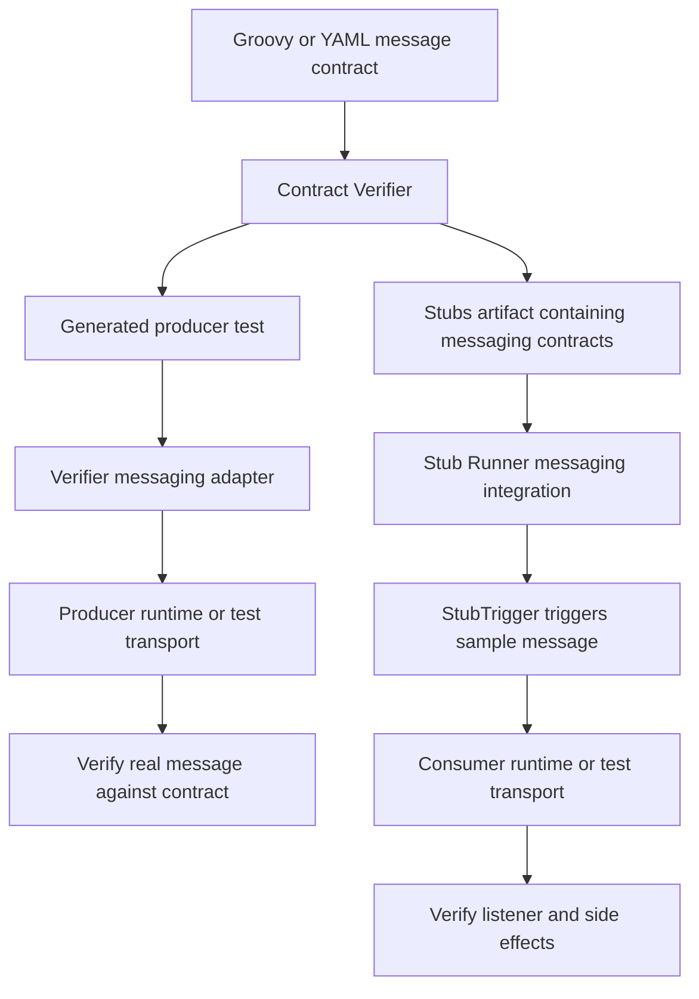
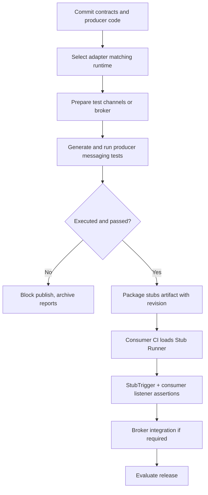

# Additional Messaging Adapters and Usage Conditions

## 1. Why Does Messaging Contract Testing Need an Adapter?

In **Spring Cloud Contract**, producers and consumers can agree on communication not only over HTTP, but also through a **message broker**, queue, topic, or channel. Contracts written in **Groovy/YAML DSL** describe input messages, trigger actions, output messages, destinations, headers, bodies, and matchers. Contract Verifier generates **producer tests**; on the consumer side, **Stub Runner** can emit sample messages to test listeners without booting the real producer.

With HTTP, generated tests know how to send requests via an HTTP client and assert status/body. With messaging, "sending" or "receiving" a message must bind to an actual runtime:

- Spring Integration handles `MessageChannel`s.
- Spring Cloud Stream handles bindings, functions, and binders.
- Apache Camel routes via endpoint URIs and routes.
- Spring JMS uses JMS broker destinations.
- Certain version combinations also integrate Spring AMQP or Spring Kafka.
- An application using an internal transport or unsupported technology may require a **custom adapter**.

A **messaging adapter** here is the bridge between the send/receive commands Contract Verifier or Stub Runner needs to execute and the real or simulated transport mechanism in the test environment. Adding contract DSL **does not automatically turn every topic/queue into a working destination**.

**Lesson objectives:** select an adapter matching your runtime and test scope, configure producer/consumer environments properly, detect adapter conflicts on the classpath, distinguish test binders from real brokers, and build a CI workflow that catches incompatible message changes.

## 2. Distinguishing Four Components Often Collectively Called "Adapters"

| Component | Function | Example | Does Not Guarantee Alone |
| --- | --- | --- | --- |
| **Messaging runtime** | Runs the app, routes messages | Spring Cloud Stream, Spring Integration, Camel | Contract has been verified |
| **Verifier transport adapter** | Lets generated producer tests send/receive messages | `MessageVerifierSender` / `MessageVerifierReceiver` and implementations | Consumer handles it properly |
| **Stub Runner messaging integration** | Loads contracts/stubs and emits sample messages to consumer | `StubTrigger` coordinating with binder/channel/broker | Real producer actually emitted the event |
| **Broker or test binder** | Transports messages in test environment | In-memory binder, ActiveMQ/Artemis, RabbitMQ, Kafka test broker | Payload schema, semantics, and compatibility |



These two branches have distinct responsibilities. **Producer tests** protect the promise about messages emitted by the implementation. **Consumer tests** protect how listeners handle contract-compliant messages. Running only one branch cannot prove end-to-end communication compatibility.

## 3. Adapter Selection Matrix by Technology and Goal

| System in Use | Adapter/Integration to Consider | Minimum Requirements | Key Limitations |
| --- | --- | --- | --- |
| **Spring Integration** | Spring Integration channel/message adapter | Appropriate `MessageChannel`, observable channels in test context | Does not test an out-of-process broker if only using in-memory channels |
| **Spring Cloud Stream** | Stream adapter + **test binder** or real binder | Function/binding registered, `destination` mapped properly, version-compatible test binder | Test binder does not prove production Kafka/RabbitMQ routing |
| **Apache Camel** | Camel route/endpoint adapter | Camel context started, endpoint URI has corresponding component | Route tests alone do not verify real brokers or transactions |
| **Spring JMS** | JMS adapter + running test broker | `ConnectionFactory`, destination, listener, and suitable timeouts | Can depend on a broker, not a pure in-memory channel |
| **Spring AMQP / RabbitMQ** | Version-specific SCC adapter or via Stream/Camel | Valid exchange/queue/binding routing, suitable mock/real connection config | Availability and auto-config behavior vary across versions |
| **Spring Kafka** | Version-specific SCC adapter or via Stream | Topics, consumer groups, serializers, test broker, and offset isolation | Ordering/acks cannot be inferred from contracts alone |
| **Custom/unsupported transport** | Implement verifier sender/receiver or use generic adapter | Know how to send, receive, handle timeouts, headers, destinations, and lifecycle | You own wiring, isolation, and consumer stub firing |

**Important version note:** The list of integrations in current Spring Cloud Contract messaging docs may include **Camel, Integration, Stream, JMS**. Docs for other branches also describe **AMQP and Kafka**; some Stub Runner properties still reference those adapters. Do not conclude "guaranteed support" or "completely removed" for a specific combination based solely on a summary table. Verify **the exact Spring Cloud Contract, Spring Boot, messaging framework, and dependencies in your project** before choosing an adapter.

### Quick Decision Process

1. Which abstraction does the application use to send/receive messages: Stream functions, Integration channels, Camel routes, `JmsTemplate`, `RabbitTemplate`, or `KafkaTemplate`?
2. Do producer tests need fast **payload/header** verification, or full **serialization, broker routing, and acknowledgements**?
3. Will consumer tests receive stubs via a **test binder/channel** or a broker started in CI?
4. Is the corresponding adapter present and actually auto-configured in the SCC version you use?
5. Are multiple abstractions on the classpath causing the wrong adapter to intercept messages or misresolve destinations?
6. At which layer will non-contract requirements like retries, idempotency, partitioning/ordering, and transactions be verified?

Choosing the right adapter is about choosing an **observable test boundary**, not picking the technology with the longest feature list.

## 4. A Reference Contract for Comparing Adapters

Suppose `payment-service` completes a payment and emits `PaymentCompleted`. Consumer `notification-service` needs to process it:

```text
Logical destination: payments.completed
Header eventType: PaymentCompleted
Header contentType: application/json
Body: {"paymentId":"pay-900","orderId":"ord-42","status":"COMPLETED"}
```

An illustrative Groovy contract:

```groovy
import org.springframework.cloud.contract.spec.Contract

Contract.make {
    description 'Emit PaymentCompleted after payment'
    label 'payment_completed'

    input {
        triggeredBy('completePayment()')
    }

    outputMessage {
        sentTo('payments.completed')
        headers {
            header('eventType', 'PaymentCompleted')
            messagingContentType(applicationJson())
        }
        body([
            paymentId: 'pay-900',
            orderId  : 'ord-42',
            status   : 'COMPLETED'
        ])
    }
}
```

Semantics to preserve when switching adapters:

- **Trigger:** the producer test triggers `completePayment()` on the real application in the test context.
- **Destination:** the test adapter must resolve `payments.completed` to the right observation point.
- **Headers:** `eventType` and content type are metadata the consumer depends on.
- **Body:** scenario fields and values do not change type or name.
- **Label:** `payment_completed` lets the consumer trigger the corresponding stub message.

**Note:** The string `payments.completed` is a **logical destination** in the contract. With Stream/Integration, the adapter may look up the binding/channel destination first and then the channel name; with Camel, the destination may be a component-prefixed URI; with JMS, it is the broker destination name. Therefore, **do not copy the same destination string across every runtime and assume routing appears automatically**.

### Equivalent YAML DSL by Intent

```yaml
description: Emit PaymentCompleted after payment
label: payment_completed
input:
  triggeredBy: completePayment
outputMessage:
  sentTo: payments.completed
  headers:
    eventType: PaymentCompleted
    contentType: application/json
  body:
    paymentId: "pay-900"
    orderId: "ord-42"
    status: "COMPLETED"
```

Groovy and YAML express the **same scenario**; do not leave both versions in the contract directory scanned by the plugin unless you intend to generate two separate contracts. When converting formats, verify generated producer tests and message stubs against the specific adapter—do not stop at confirming YAML parses cleanly.

## 5. Common Requirements for Generated Producer Messaging Tests

In Spring Cloud Contract, producer messaging setups typically need:

1. A contract with `input` (like `triggeredBy` or `messageFrom`) and a matching `outputMessage`.
2. Contract Verifier plugin generating tests and configured to use the right **base class**.
3. Test context initializing the producer, channels/bindings/routes, and verifier adapter.
4. Base class or test setup providing the trigger method, fixture data, and output observation capability.
5. Generated tests actually compiling and running; reports must not show "0 contract tests" or unintended skips.

Example Spring Boot base class **skeleton**:

```java
// Illustrates base class responsibilities; imports/package depend on SCC version.
@SpringBootTest
@AutoConfigureMessageVerifier
public abstract class MessagingContractBase {

    @Autowired
    PaymentApplicationService paymentService;

    public void completePayment() {
        // Fixture pay-900 must be in the proper state.
        // Trigger business code; DO NOT inject a sample message directly into the verifier.
        paymentService.complete("pay-900");
    }
}
```

`PaymentApplicationService` is an illustrative application type, not a built-in Spring Cloud Contract API. **`@AutoConfigureMessageVerifier`** is the key annotation when using integrated messaging configuration; choose the dependency, package import, and test framework matching your version. If consumer tests use `@AutoConfigureStubRunner`, Stub Runner's messaging auto-config can be pulled into that context via the corresponding integration.

Do not write a base class that fabricates a message matching the contract body and pushes it straight into the test channel, as the test would pass without verifying the producer's real event-emitting path.

## 6. Spring Integration Adapter: When Using Channels and Message Flows

**Spring Integration** fits when an application structures communication with `MessageChannel`s, gateways, transformers, routers, or service activators. When a producer sends to a channel, the testing adapter needs to **observe messages** along the appropriate path.

### Usage Conditions

- Spring Integration dependency and compatible SCC integration on the test classpath.
- Channel/binding referenced by `sentTo(...)` exists or resolves properly.
- Messages from business code actually flow through that channel in the test context.
- The receiving channel is observable without losing messages before assertions run.
- Fixtures and message listeners are isolated between tests.

An illustrative flow:

```text
PaymentApplicationService
      |
      v
  output Channel ---> real consumer in production
      |
      v
  test bridge/channel ---> verifier receives message in test
```

Spring Integration can use a **`QueueChannel`** or bridge to a dedicated channel so tests can receive messages. In Spring Cloud Contract's XML documentation examples, a `bridge` forwards output to a test queue channel; Java DSL setups may differ. Avoid forcing one capture approach onto every flow, as a synchronous `DirectChannel` may have multiple handlers and adding a test subscriber can alter execution flow.

### Typical Failure Modes

| Symptom | Possible Cause |
| --- | --- |
| Verifier times out on receive | Channel not registered, wrong name, or output sent to another channel |
| Test receives a different message | Shared channel/queue holds stale messages or another listener consumed yours |
| One message processed twice | Test bridge or flow unintentionally altered fan-out |
| Producer test passes yet real broker fails | Test ran only on in-memory channels without testing the broker adapter |

**Guarantee scope:** This test proves the producer emits valid data through a Spring Integration channel. It **does not prove** an external AMQP/Kafka broker received, persisted, or delivered the message.

## 7. Spring Cloud Stream Adapter: Functions, Bindings, and Test Binder

**Spring Cloud Stream** is a common choice when business code interacts with messages via bindings/functions rather than calling Kafka or RabbitMQ clients directly. A message contract with `sentTo('payments.completed')` must resolve through Stream's binding/destination configuration.

### Consumer-Side Binding Example

A notification app using Spring Cloud Function may define:

```java
@Bean
Consumer<PaymentCompleted> onPaymentCompleted() {
    return event -> notificationService.enqueue(event.orderId());
}
```

And sample configuration:

```yaml
spring:
  cloud:
    function:
      definition: onPaymentCompleted
    stream:
      bindings:
        onPaymentCompleted-in-0:
          destination: payments.completed
          group: notification-service
```

The binding name `onPaymentCompleted-in-0` results from Spring Cloud Stream's functional model here. `PaymentCompleted`, `notificationService`, and DTOs are illustrative application types. The consumer needs compatible serializers/converters and configuration so real payloads deserialize to `PaymentCompleted`.

### Test Binder and Usage Conditions

With many modern Spring Cloud Stream versions, projects can add the test dependency:

```groovy
// build.gradle: test dependency; check against your project's BOM.
testImplementation 'org.springframework.cloud:spring-cloud-stream-test-binder'
```

An `@Import(TestChannelBinderConfiguration.class)` or suitable test binder auto-configuration lets send/receive flows run **without a real broker**, keeping contract and consumer tests fast and stable. However, class packages, bean/function wiring, test binder versions, and test context registration must be checked against your Spring Cloud Stream branch. Older guides may use the `test-binder` classifier on another dependency.

**Decision point:** Stub Runner must deliver messages to the consumer binding's exact destination; the producer verifier must observe the right output binding. If `sentTo` resolves to a channel name different from the destination, `StubTrigger` may succeed yet the listener receives nothing.

### When Not to Rely Solely on the Test Binder

The test binder does not fully simulate:

- Kafka partition keys, offsets, consumer group rebalances, and retention.
- RabbitMQ exchanges, queue bindings, routing keys, publisher confirms, and dead-lettering.
- Real serialization over the network and schema registries.
- Broker disconnects, real retries, acknowledgements, and redelivery.

When these characteristics matter, add **broker integration tests** (e.g., test containers or an isolated test broker) alongside contract tests. Do not delete the test binder just because it is "not a real broker"; the two layers serve different purposes.

## 8. Apache Camel Adapter: Endpoint URIs Are Part of Routing

**Apache Camel** fits when producers/consumers use routes and endpoint components such as JMS, AMQP, or transports wired through Camel. The key detail is that `sentTo(...)` can be interpreted as a **Camel endpoint URI**, not merely an abstract queue name.

An example contract tailored for Camel might use:

```groovy
outputMessage {
    sentTo('jms:queue:payments.completed')
    body([
        paymentId: 'pay-900',
        status: 'COMPLETED'
    ])
    headers {
        header('eventType', 'PaymentCompleted')
    }
}
```

The URI in this example only works when the Camel context has the **`jms` component** and an appropriate connection factory/destination. To test a pure in-memory route, Camel test components like `direct:` or `seda:` can be used where appropriate. However, replacing a production endpoint with `mock:` in a test only proves **the mock endpoint was called**, not that the real transport is compatible.

### Usage Conditions

1. The Camel context and routes under test must be initialized.
2. The URI's component must be installed, avoiding `NoSuchEndpointException`.
3. Message headers and bodies are converted properly before/after the route.
4. If a route alters destinations based on headers, contracts protect those required headers.
5. Test lifecycle prevents exchanges from prior tests from lingering in routes or queues.

**Migration caution:** The same contract DSL might require changing destinations from channel names to Camel URIs. That is **test adapter/transport configuration**—do not unilaterally change a public logical destination that consumers rely on without a compatibility agreement.

## 9. Spring JMS Adapter: Requires a Suitable Broker Environment

**Spring JMS** sends/receives messages over JMS connections and destinations. Per Spring Cloud Contract's messaging documentation, Stub Runner's JMS integration **assumes a running JMS broker**. This differs from an in-memory test binder: adding the `spring-jms` dependency does not automatically spin up a working queue.

Minimum requirements:

- A `ConnectionFactory` connected to a test broker (or an embedded broker supported by your current library versions).
- `sentTo` destination pointing to the right logical queue/topic per JMS config.
- Message converters properly handling bytes/text/objects and content types.
- `JmsTemplate`, listener containers, and acknowledgements/transactions configured as needed.
- Brokers and queues purged or namespaced per test so tests do not read stale data.

Example consumer listener:

```java
@JmsListener(destination = "payments.completed")
public void handlePayment(String json) {
    // Parse JSON and execute event consumption business logic.
}
```

This is an illustrative listener snippet requiring JMS dependencies, a broker, and annotation imports in the project. If the system uses queues between producer and consumer, you must verify **messages are routed to the right queue**, not merely that the producer called `JmsTemplate.convertAndSend(...)`.

### Risks in JMS Testing

| Symptom | Question to Check |
| --- | --- |
| Connection refused | Is the test broker running with the right host/port/auth? |
| Message never arrives | Is the destination a queue or topic, and is the name exact? |
| Test receives an event from a previous run | Was the queue purged or isolated per test? |
| Producer test times out | Did a listener consume/ack before the verifier observed the message? |
| Local vs. CI mismatch | Are embedded broker, transaction, converter, and concurrency configs identical? |

A JMS consumer stub test verifies the **listener against a simulated message**; it does not prove the producer committed its DB before sending or guarantee duplicate-free transactions.

## 10. Spring AMQP and Spring Kafka: Separating SCC Adapters from Broker Tests

Spring AMQP and Spring Kafka are common microservice choices. However, **direct support in Spring Cloud Contract depends on version**; documentation across Spring Cloud Contract branches does not always list the exact same integrations. Furthermore, an app using Kafka or RabbitMQ via **Spring Cloud Stream** can choose the Stream adapter instead of a direct Kafka/AMQP adapter.

### 10.1. Spring AMQP with RabbitMQ

A message producer may use `RabbitTemplate`, and consumers `@RabbitListener`. Unlike abstract queues, RabbitMQ routes based on **exchanges, routing keys, and bindings**.

```text
Producer --publish--> Exchange
                       | routing key + binding
                       v
                     Queue --> @RabbitListener
```

So the consumer receives the right message when Stub Runner fires:

1. Determine whether `sentTo` represents an exchange or a logical destination in your active adapter.
2. Verify the queue and its binding to that exchange are declared in the test context/broker.
3. Verify routing keys and message headers if the consumer relies on them.
4. If the adapter uses a mocked connection factory, understand there is no guarantee a real broker received or acked the message.
5. To verify real exchange routing, run integration tests against a RabbitMQ test broker.

Some SCC versions use `spring.cloud.contract.stubrunner.amqp.enabled` to enable AMQP integration and configure mocked or real connections. **Read the configuration reference for the version pinned in your build**; do not treat properties as a guarantee that every Spring AMQP + SCC combination works out of the box.

### 10.2. Spring Kafka

A producer can emit records with `KafkaTemplate`, and consumers can use `@KafkaListener` or Stream functions/bindings. Contracts can verify event payloads and headers, while Kafka also has critical properties **beyond basic DSL**:

- Does the topic exist and does the producer have publish permissions?
- Are serializers/deserializers or schema registries compatible?
- Do partition keys guarantee **per-partition** ordering as required?
- Are consumer groups and offsets isolated per test?
- Does the consumer handle redeliveries, retries, or duplicates?

With direct Kafka integration in SCC versions that support it, verify `spring.cloud.contract.stubrunner.kafka.enabled` and any initializers/test broker components per that branch's guide. If the app uses Stream, contract testing can use the **Stream test binder**, paired with dedicated Kafka integration tests for partitions, offsets, and serialization.

### 10.3. Choosing the Right Level of Fidelity

| Test Type | What Runs? | What It Proves | What It Does Not Prove |
| --- | --- | --- | --- |
| Contract + test binder | Messages flow through in-memory abstraction | App emits/reads payloads, headers, logical destinations per test | Production broker routing and delivery |
| Contract + AMQP/Kafka adapter with test broker | Test broker/transport participates in flow | Can catch additional destination, serialization, and config errors | Production cluster failover, retention/throughput |
| Integration test with container/broker | Real producer/consumer, production-like broker | Routing, retries, acks, and converters in the test setup | Full network conditions, scale, and production cluster behavior |
| E2E/resilience test | Multiple services, brokers, and DBs | Cross-service business flows under specific fault conditions | Cannot replace fast per-PR contract tests |

Do not drop producer contract tests just because you run Kafka/RabbitMQ containers: a healthy broker still will not catch a renamed field if tests do not assert schemas.

## 11. When Do You Need to Write a Custom Messaging Adapter?

A system might use a protocol outside built-in integrations, an internal message bus, or a specialized wrapper. In that case, there are two paths:

1. **Keep contracts at a shared abstraction layer:** use Spring Integration/Stream/Camel if the app already goes through that layer and it accurately reflects the consumer interface.
2. **Write a custom verifier adapter:** implement sending messages from generated tests and receiving emitted outputs, plus matching consumer stub delivery if needed.

In modern Spring Cloud Contract branches, docs mention these interfaces:

- `org.springframework.cloud.contract.verifier.messaging.MessageVerifierSender` — bridge to **send** messages to a destination.
- `org.springframework.cloud.contract.verifier.messaging.MessageVerifierReceiver` — bridge to **receive** messages from a destination, potentially taking timeouts/contracts.
- `MessageVerifier` or `ContractVerifierMessageExchange` — supporting abstractions in specific versions/test scenarios.

**Version note:** Interfaces and method signatures change across Spring Cloud Contract branches. Do not grab a snippet off the internet written for another version and copy it verbatim. Inspect the API/Javadoc of the **actual dependency in your project**, verify Spring injects the right beans into generated tests, and ensure no competing beans conflict.

### Minimum Responsibilities of a Custom Adapter

A proper adapter must:

1. **Resolve destinations:** map logical `sentTo`/`messageFrom` values to the channel, topic, queue, or endpoint under test.
2. **Preserve structure on send:** keep payload bytes/objects, content types, custom headers, and correlation IDs intact.
3. **Receive deterministically:** apply clear timeouts, match only the relevant messages, and avoid consuming messages from other tests.
4. **Convert types accurately:** avoid turning a JSON object into an escaped JSON string or coercing numbers into strings.
5. **Manage lifecycle and cleanup:** register listeners before triggering, close consumers/sessions, and purge/namespace test destinations as needed.
6. **Observe the real implementation:** capture outputs emitted by real business code rather than copying contract bodies into a fake buffer.

**Pseudocode** illustrating the adapter boundary, **not a verbatim compilable Java interface**:

```text
send(message, logicalDestination, contract):
    physicalDestination = resolver.resolve(logicalDestination)
    transport.publish(
        physicalDestination,
        converter.toWire(message.payload),
        message.headers
    )

receive(logicalDestination, timeout, contract):
    physicalDestination = resolver.resolve(logicalDestination)
    raw = transport.poll(physicalDestination, timeout)
    return converter.toContractMessage(raw.payload, raw.headers)
```

Use unit/integration tests to validate the adapter itself before letting generated contract tests rely on it. For example, test UTF-8 payloads, JSON numbers/strings, required headers, missing messages, two events with different correlation IDs, and timeouts.

### Note on Stub Runner JUnit Extensions

If you use standalone `StubRunnerRule` or `StubRunnerExtension` instead of Spring Boot's `@AutoConfigureStubRunner`, some versions require **passing `MessageVerifierSender` and `MessageVerifierReceiver` to the builder** to emit messaging stubs. Otherwise, HTTP stubs may still work while triggering a message fails for lack of a sender. Check the rule/extension API for your exact version; a consumer test is not "messaging-ready" merely because Stub Runner downloaded the artifact.

## 12. Multiple Adapters on the Classpath: Avoiding Conflicting Auto-Configuration

A real producer/consumer may simultaneously have Spring Integration, Spring Cloud Stream, Spring JMS, and Spring AMQP present. Having multiple adapters on the classpath increases the risk of:

- Two beans providing send/receive capabilities so Spring cannot pick a single candidate.
- Stub Runner routing stub messages through Stream while the listener is registered directly on AMQP.
- Destination `payments.completed` resolving as a channel name instead of an exchange or queue.
- Both a test binder and a real broker initializing while assertions watch the wrong place.
- Tests passing via an in-memory adapter while deployment uses a completely different broker config.

In SCC versions that provide adapter enable/disable properties, you can **disable unneeded integrations** so only the intended transport path remains active.

Example configuration directing AMQP selection for a consumer test with Stream and Integration on the classpath:

```yaml
spring:
  cloud:
    contract:
      stubrunner:
        stream:
          enabled: false
        integration:
          enabled: false
        amqp:
          enabled: true
```

This example does not itself create a broker, queues, exchanges/bindings, converters, or listeners. If JMS/Kafka/Camel are also present, review their adapter status and enable/disable them **using the config properties that actually exist in your version**. Do not rely on "defaults" from another version to guess which adapter gets picked.

### Pre-Run Verification Matrix

| Check | Expected Signal |
| --- | --- |
| Dependencies | Spring Boot, SCC, and messaging framework versions are compatible |
| Beans in test context | Only the intended adapter is registered as sender/receiver |
| Destination | Matches the name/URI used by both contract and runtime |
| Listener readiness | Consumer/broker subscriber is registered before `StubTrigger` fires |
| Payload/headers | Converters do not alter formats or strip required headers |
| Test state | No stale messages; consumer groups/queues isolated |
| Test report | Generated producer tests ran; consumer assertions actually executed |

Do not alter a contract's `sentTo(...)` just to "hit an adapter" unless consumers also agree to that interface change. Usually you need to fix **binding/adapter configuration**, not the business promise in the contract.

## 13. Consumer Tests: Stub Runner, StubTrigger, and Real Adapters

Unlike HTTP, messaging stubs typically need **contract definitions retained** inside the stubs artifact so Stub Runner's messaging integration can build routes and emit messages. A contract with `label 'payment_completed'` lets consumers trigger that message.

Spring Boot consumer skeleton example:

```java
import org.junit.jupiter.api.Test;
import org.springframework.beans.factory.annotation.Autowired;
import org.springframework.boot.test.context.SpringBootTest;
import org.springframework.cloud.contract.stubrunner.StubRunnerProperties;
import org.springframework.cloud.contract.stubrunner.StubTrigger;
import org.springframework.cloud.contract.stubrunner.spring.AutoConfigureStubRunner;

import static org.assertj.core.api.Assertions.assertThat;

@SpringBootTest
@AutoConfigureStubRunner(
    ids = "com.example:payment-service:1.2.0:stubs",
    stubsMode = StubRunnerProperties.StubsMode.LOCAL
)
class PaymentEventConsumerTest {

    @Autowired
    StubTrigger stubTrigger;

    @Test
    void shouldHandlePaymentCompleted() {
        boolean triggered = stubTrigger.trigger("payment_completed");
        assertThat(triggered).isTrue();

        // Add conditional waiting assertions:
        // notificationRepository has a notification request for ord-42.
        // Asserting triggered=true alone DOES NOT prove the listener handled it properly.
    }
}
```

`@AutoConfigureStubRunner` configures downloading/loading stubs in the Spring Boot test context. With `LOCAL`, the artifact must already be installed in the local Maven repository; remote CI runners typically need another mode/repository. **Whether the message reaches the consumer listener** still depends on the right adapter, destination, binding/broker, and listener readiness.

If a consumer test only calls `stubTrigger.trigger(...)` without checking application state afterward, it only confirms it **requested stub emission**, not consumer behavior. Verify side effects using Awaitility or a bounded wait rather than an arbitrary `Thread.sleep`.

### Triggering by Artifact and Label

When multiple producer stubs are loaded, labels like `payment_completed` can collide across artifacts. The `StubTrigger` API supports triggering by label alone or by **artifact/ivy notation + label**. Example by intent:

```java
// When multiple artifacts share the same label, specify the stub source explicitly.
stubTrigger.trigger("com.example:payment-service", "payment_completed");
```

**Do not trigger all labels** when a test only wants to test one event: firing multiple concurrent messages can break assertions as the consumer processes out-of-scope events. Check your SCC version's supported API overloads and artifact coordinate formats.

### Separating Stub Responses from Real Brokers

A consumer can pass with the Stream test binder yet fail on RabbitMQ due to a wrong exchange/binding. That **does not invalidate** contract testing: contract tests verify the listener handles a valid message; broker integration tests verify real topology and serialization. Both must pass if the system requires both.

## 14. Choosing Scope Across Three Testing Layers

A system should avoid two extremes: claiming production compatibility from mocks/in-memory tests alone, or running a full production-like broker environment for every unit test, making feedback slow and flaky.

| Layer | Runtime/Adapter | Focus | Fit in CI |
| --- | --- | --- | --- |
| **Fast — contract** | Spring Integration channels, Stream test binder, Camel in-memory endpoints | Producer output, payload, headers, logical destination; consumer handling sample events | Every PR, run frequently |
| **Medium — broker integration** | JMS, RabbitMQ, Kafka test broker/container | Converters, real destinations, subscriptions, routing, acks/retries in test environment | Major PRs, nightly, or pre-release |
| **Broad — E2E/resilience** | Multiple services, DB/outbox/broker/gateway | Cross-system business invariants, timeouts, duplicates, partitions, recovery | Release gate or scheduled suite |

Depending on architecture, the "contract" layer may run alongside a test broker, and the "integration" layer may cover a single module. This layering represents **evidence scope**, not a rigid tool mandate.

### Invariants Not Automatically Covered by Adapters

- **Delivery:** an adapter sending a message in tests does not prove a production broker will always deliver it.
- **At-least-once / duplicates:** test the consumer processing the same `eventId` multiple times if business rules require idempotency.
- **Ordering:** test ordering across related messages, partition keys, and consumer rebalances if critical.
- **Transactions/outbox:** test DB commits, rollbacks, and event publishing consistency per policy.
- **Schema evolution:** verify serializer/deserializer compatibility and schema registry rules if used.
- **Security/ACLs:** test binders do not prove publish/subscribe permissions on production brokers.

A contract can confirm `eventType = PaymentCompleted`, but cannot deduce whether the payment committed or was recorded twice.

## 15. Diagnostic Matrix When Messaging Adapters Fail

| Symptom | Layer to Inspect | How to Verify |
| --- | --- | --- |
| No generated messaging tests | Plugin/DSL | Contract path, YAML/Groovy schema, input/output, and codegen task |
| Tests run but time out on receive | Adapter/route/binder | Destination, sender/receiver beans, listener readiness |
| Bean ambiguity on context startup | Auto-configuration | Competing frameworks on classpath; adapter enabled flags |
| Stub Runner loads artifact yet `trigger` returns false | Contracts/stubs | Label, classifier, version, and messaging contracts inside JAR |
| `trigger` returns true yet listener never runs | Consumer transport | Binding/destination, selected adapter, queue/topic, and subscriber |
| Payload reads as string instead of object | Converter/serializer | Content type, raw bytes, object mapper, schema |
| `eventType` header disappears | Binder/mapper | Message header mapping/filtering, transport differences |
| Kafka consumer does not read events | Broker test | Topic, consumer group, offsets, partitions, ACLs |
| RabbitMQ listener receives nothing | AMQP routing | Exchange, routing key, binding to queue |
| JMS test fails only in full suite | Shared broker/queue | Purging, isolated destinations, competing listeners |
| Local passes, CI fails | Environment | Broker readiness, dependency versions, test binder, concurrency |
| Consumer stub passes, producer test fails | Producer behavior | Implementation changed a field/header/destination |
| Producer test passes, consumer stub fails | Stub transport | Artifact coordinates, label, route, consumer converter, and test setup |

### Self-Testing with a Known Message

When suspecting adapter routing issues, use a known message:

```json
{
  "paymentId": "pay-900",
  "orderId": "ord-42",
  "status": "COMPLETED"
}
```

Then observe step-by-step:

1. Does the contract source have `sentTo('payments.completed')` and the right headers?
2. Does the generated producer test use the right destination and matchers?
3. Does business code emit the event after `completePayment()`?
4. Are the sender/receiver adapter beans in the test context, selected for the right framework?
5. Did the message reach the listened test channel, endpoint, or broker?
6. Did consumer Stub Runner load the right artifact and `payment_completed` label?
7. Did the consumer listener process it and produce the right side effect?

This separates **producer contract failures**, **adapter configuration issues**, **broker errors**, and **consumer bugs**. Never loosen matchers to `.*` or disable generated tests to mask routing bugs.

## 16. Integrating Messaging Adapters into CI



For a Maven producer configured with Contract Verifier, a typical check command is:

```bash
./mvnw clean verify
```

For Gradle, inspect the tasks registered by the plugin before running:

```bash
./gradlew tasks --all
./gradlew clean check
```

**Do not assume** every plugin version hooks generated messaging tests into the same lifecycle or task. Inspect actual reports: how many contracts were discovered, how many generated tests ran, whether any were skipped, and which adapter was activated.

### Useful CI Diagnostic Logs

- Spring Cloud Contract version, Spring Boot version, messaging runtime/binder version.
- Selected adapter or sender/receiver implementation names; disabled adapters.
- Logical destinations, binder mappings, and active test broker details (without logging credentials).
- Contract names and `label`s; tests actually executed.
- Expected/actual payload types and key headers, with sensitive data redacted.
- Stubs artifact coordinates, classifier/version, source commit.
- Consumer listener assertion outcomes and broker integration results if applicable.

Never print broker passwords, tokens, or full payloads containing personal data into public CI artifacts.

### Required Release Gates

1. Contract sources are discovered and processed—no accidental 0-test runs.
2. Producer tests execute the real business path (within defined scope) and observe the expected message.
3. Stubs artifacts are published only after producer verification passes.
4. Consumer CI downloads the right artifact, triggers the right label, and verifies real side effects.
5. Broker/DB invariants outside the contract have dedicated integration tests if required by business rules.

## 17. Practice Exercise: Choosing an Adapter When Both Stream and Direct RabbitMQ Are Present

### Context

A payment system has two components:

- `payment-service` uses Spring AMQP directly to publish `PaymentCompleted` to RabbitMQ.
- `notification-service` uses `@RabbitListener` to receive messages and create notification requests.

Due to shared dependencies, the consumer's test classpath also contains **Spring Cloud Stream and Spring Integration**. The team observes that `StubRunner` downloaded the stubs JAR and `StubTrigger.trigger("payment_completed")` did not throw an error, yet `@RabbitListener` never received the message.

The producer contract has logical destination `payments.completed`, header `eventType = PaymentCompleted`, and a JSON body containing `paymentId`, `orderId`, and `status`. The consumer needs to protect schema and behavior, while CI also needs a real broker test layer to verify routing.

### Task A. Choosing Adapter and Scope

1. Explain why choosing **Spring AMQP** for the consumer-side stub can make more sense than the Stream test binder when the listener is a direct `@RabbitListener`.
2. Confirm whether your current SCC version includes the corresponding AMQP integration, and which auto-configs must be enabled/disabled.
3. Check how logical `sentTo` will be interpreted as **exchange/binding/queue** in that adapter.
4. List what can be verified with a mocked connection factory and what strictly requires a RabbitMQ test broker.

### Task B. Minimum Configuration

A sample guiding configuration:

```yaml
spring:
  cloud:
    contract:
      stubrunner:
        ids: com.example:payment-service:1.2.0:stubs
        stubs-mode: LOCAL
        stream:
          enabled: false
        integration:
          enabled: false
        amqp:
          enabled: true
```

Explanation:

- `ids` selects the artifact containing messaging contracts/stubs; the version must be one verified by the producer.
- `stream.enabled: false` and `integration.enabled: false` stop those two adapters from intercepting the test path when only AMQP is needed.
- `amqp.enabled: true` requests AMQP integration **if supported by your version and dependencies**.
- This config **does not** define the broker, exchanges/queues/bindings, converters, consumer listeners, or connection credentials; those must be supplied by the project.

Do not copy this config into a project using only the Stream test binder and expect it to work: adapter selection must follow the code/runtime the real consumer uses.

### Task C. Verifying Behavior

1. Producer tests run `completePayment()` and observe `PaymentCompleted` on the appropriate adapter.
2. Intentionally change header `eventType` to `PaymentFailed`: generated producer tests must catch it if the contract enforces equality.
3. Load the stubs artifact in the consumer and call `trigger("payment_completed")`; verify a **notification request** is created for `ord-42`.
4. Intentionally change the binding destination or remove a queue binding: observe which tests fail and why.
5. Run against a real RabbitMQ test broker to verify messages route to the queue registered by the listener.
6. Trigger the same event twice: if the consumer commits to idempotency, assert no duplicate notifications are created.

### Expected Outcome Matrix

| Experiment | Expected Result | What It Proves |
| --- | --- | --- |
| Producer emits right event/headers/body | Producer contract test passes | Implementation satisfies contract in test |
| Producer changes `eventType` | Producer contract test fails | Headers are meaningful commitments |
| Stub Trigger returns true yet listener never runs | Consumer test with assertions **must fail** | Triggering does not replace handler verification |
| Wrong adapter selected | Missing message or auto-config failure | Runtime/destination resolution must match |
| AMQP mock connection used | Can verify simulated listener/routing | Does not verify real broker |
| RabbitMQ test broker runs with right bindings | Consumer integration test passes | Topology and converters in test environment are valid |
| Exchange/queue binding removed | Broker integration test should fail | Real routing error, not just schema |
| Duplicate event handled | Passes/fails per idempotency policy | Business invariant beyond a single trigger |

### Task D. What If the Producer Moves to Kafka?

Compare two paths:

- Producer/consumer migrate fully to **Spring Cloud Stream**: use the Stream adapter in contract tests, and Kafka binder + test broker at the integration stage.
- Producer/consumer call **Spring Kafka** directly: check support in your SCC version or build a suitable verifier adapter, alongside a Kafka test broker to verify topics, serializers, consumer groups, and offsets.

In either case, **do not arbitrarily change `eventType`, `orderId`, or payload semantics** if legacy consumers still depend on them. If logical destinations change due to transport migration, determine whether it is an internal architecture/binding change or a public interface change seen by consumers, and plan compatibility accordingly.

## 18. Messaging Adapter Selection Checklist

- [ ] Identified which runtime actually sends/receives messages: Stream, Integration, Camel, JMS, AMQP, Kafka, or custom transport.
- [ ] Checked the exact Spring Cloud Contract version and supported adapters/frameworks rather than assuming from another branch's docs.
- [ ] Groovy/YAML contracts specify `input`/`outputMessage`, destination, headers, body, and suitable matchers.
- [ ] Generated tests' base class is configured with `@AutoConfigureMessageVerifier` or equivalent integration.
- [ ] Trigger actions invoke real business code; verifier receives output from the selected adapter.
- [ ] If using Stream, functions/bindings and test binder match the version; in-memory limits are understood.
- [ ] If using Integration, channels are observable and not unexpectedly drained by other listeners.
- [ ] If using Camel, endpoint URIs have components/routes actually present in the test context.
- [ ] If using JMS, broker/connection factory/destination and cleanup are properly configured.
- [ ] If using AMQP/Kafka, adapter support is verified for your version; topology, serializers, and broker tests exist as needed.
- [ ] When multiple frameworks share the classpath, only desired integrations are enabled and injected beans are verified.
- [ ] If writing a custom adapter, tested send/receive, converters, headers, destinations, timeouts, and isolation.
- [ ] Consumers use Stub Runner/`StubTrigger` with the right artifact/version/label and assert **side effects**, not just that trigger returned true.
- [ ] CI blocks publishing if generated producer tests did not run or failed; contracts/stubs share the same revision.
- [ ] Delivery, retry, duplicate, ordering, transaction, and security requirements are tested in dedicated broker/DB/E2E layers.

## 19. Version Reference Documentation

Useful official references when configuring real projects:

- [Spring Cloud Contract — Messaging](https://docs.spring.io/spring-cloud-contract/reference/project-features-messaging.html): DSL, adapters, generated producer tests, and consumer stubs.
- [Spring Cloud Contract — Configuration Properties](https://docs.spring.io/spring-cloud-contract/reference/configprops.html): properties enabling/disabling Stub Runner integrations.
- [Spring Cloud Contract — Stub Runner JUnit](https://docs.spring.io/spring-cloud-contract/reference/project-features-stubrunner/stub-runner-junit.html): Rule/Extension setup and verifier sender/receiver requirements for messaging.
- [Spring Integration — Reference](https://docs.spring.io/spring-integration/reference/): channels and adapters/gateways.

**Note:** `reference` URLs may point to a newer stable release than the one your project uses. Before copying dependencies, annotations, properties, or interface implementations, switch to the **documentation for the exact version pinned in your build** and run a smoke test with a small contract.

**Remember:** Additional messaging adapters let Spring Cloud Contract connect contract DSL to how real applications send and receive events. **Choose the adapter based on your runtime, version, and what needs to be proven**; configure destinations, test contexts, and lifecycles accurately; verify generated producer tests and consumer Stub Triggers separately. Choosing the right adapter does not replace broker, DB, or transaction testing—but it catches incompatible changes in headers, payloads, and messaging flows early.
