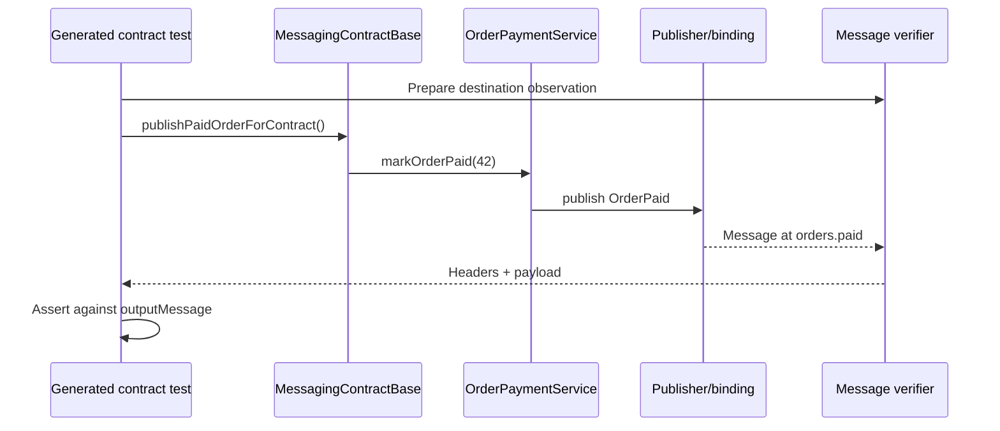
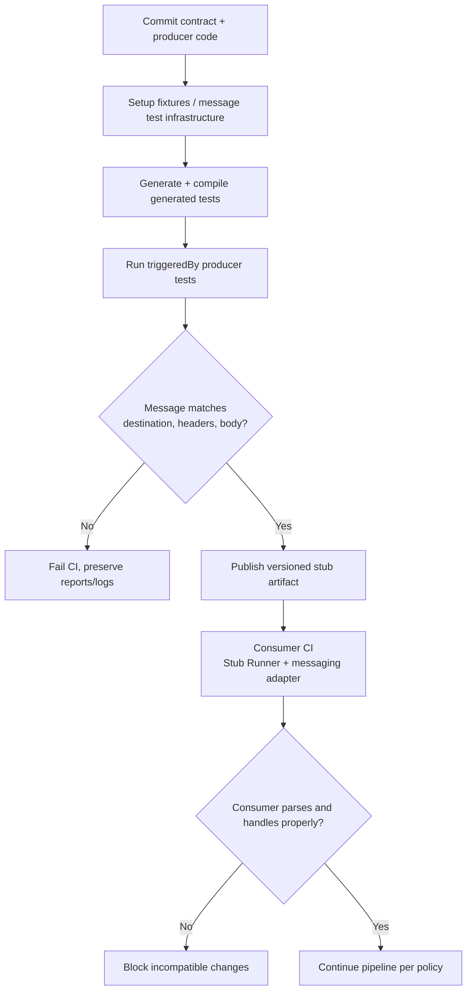

# Preparing Base Tests for Message-Triggering Invocations

## 1. Lesson Objectives

In **Spring Cloud Contract**, a messaging contract describes more than *what an emitted message looks like*. To verify the **real producer**, the generated test must also have a way to **trigger the application to emit the message**. For event-emitting flows initiated by a business operation, the Groovy DSL supports `input { triggeredBy('methodName()') }`: the generated test calls that method and then verifies the output message against `outputMessage`.

A common misconception is that **`triggeredBy` does not automatically generate that method in the application**. The development team must implement the referenced method in the **base test** or a location callable by generated tests, while configuring the application, message verifier, binder/transport, and fixtures sufficiently so the event is actually emitted.

This lesson belongs to the **Messaging Contract Testing** chapter of the **Spring Cloud Contract** module. After studying it, you will be able to:

1. Distinguish `triggeredBy` contracts from `messageFrom` contracts.
2. Write Groovy/YAML contracts for an outbound event with a specific destination, headers, and body.
3. Prepare a **base test** with a Spring context, trigger method, fixtures, wait bounds, and state cleanup.
4. Distinguish calling the **real business flow** from manually sending a message from test code just to "pass" assertions.
5. Verify generated tests are **generated, compiled, executed, and passing**, then publish stubs and use **Stub Runner**/consumer messaging integration in CI.

**Scope:** examples focus on a Spring application emitting `OrderPaid` after an order has been paid. Business classes like `OrderPaymentService` or `OrderFixture` are **illustrative application components**, not built-in Spring Cloud Contract APIs.

## 2. Two Ways to Initiate a Messaging Contract

### 2.1. Producer Triggered by a Java Invocation

Scenario: the application already has a business command `markOrderPaid(42)`; when executed, it must emit an event:

```text
Base test
    |
    | publishPaidOrderForContract()
    v
OrderPaymentService  --->  Event Publisher  --->  orders.paid
                                                 |
                                                 v
                                          OrderPaid message
```

The contract will use:

```groovy
input {
    triggeredBy('publishPaidOrderForContract()')
}

outputMessage {
    sentTo('orders.paid')
    body(orderId: 42, state: 'PAID')
}
```

Verifier generates the test and calls `publishPaidOrderForContract()`, inherited from the base class. The test infrastructure must capture the emitted message at the expected destination to assert body/headers.

### 2.2. Producer Triggered by an Incoming Message

Another case: `inventory-service` receives an `OrderCreated` message and emits `InventoryReservationRequested`. Here the input should be described using `messageFrom`, `messageBody`, and `messageHeaders`:

```groovy
input {
    messageFrom('orders.created')
    messageBody(orderId: 42)
}
outputMessage {
    sentTo('inventory.reservation.requested')
    body(orderId: 42)
}
```

Do not use `triggeredBy` as a casual substitute for `messageFrom`: doing so may skip the listener, deserialization, and inbound routing the contract is meant to test.

| Characteristic | `triggeredBy(...)` | `messageFrom(...)` |
|---|---|---|
| Trigger source | Method call from generated test | An inbound message |
| Base test must provide | Callable method triggering real business logic | Test transport/listener, fixtures, message verifier |
| Primary verification | Producer emits an event after an action | Producer processes an input message and emits output |
| Example | Payment succeeds → `OrderPaid` | `OrderCreated` → `ReservationRequested` |
| What it does not prove alone | HTTP listeners, DB, or triggers outside test scope | All broker, retry, and duplicate failures in production |

## 3. Designing the Contract for the `OrderPaid` Event

Suppose the public event contains:

```json
{
  "eventId": "EVT-42",
  "orderId": 42,
  "state": "PAID",
  "amount": 120000,
  "currency": "VND"
}
```

Headers:

```text
eventType: OrderPaid
contentType: application/json
correlationId: CORR-42
```

Logical destination: `orders.paid`. In an app using Spring Cloud Stream, the internal binding name might be `orderPaid-out-0`, mapped to destination `orders.paid`. **Binding names and destinations are not necessarily identical**; the message verifier must be configured to match how the app actually publishes.

Commitments to verify:

| Element | Sample Value | What the Consumer Relies On |
|---|---|---|
| Destination | `orders.paid` | Consumer subscribes to the right event stream |
| `eventType` | `OrderPaid` | Routing/dispatching by event type |
| `orderId` | `42` as a number | Locating the right order |
| `state` | `PAID` | Executing the paid branch |
| `amount` | `120000` as a number | Processing the amount with the right type |
| `currency` | `VND` | Avoiding currency unit confusion |
| `eventId` | `EVT-42` in sample | Tracing/deduplication per contract |
| `correlationId` | `CORR-42` | Correlating steps across the flow |

The sample event is designed to be **deterministic** for learning clarity. If `eventId`/`correlationId` are dynamically generated in production, use appropriate **response/output matchers** while keeping concrete sample values for stubs.

## 4. Groovy DSL: `triggeredBy` and `outputMessage`

Example file `src/test/resources/contracts/orders/order-paid-event.groovy`:

```groovy
import org.springframework.cloud.contract.spec.Contract

Contract.make {
    description 'Order payment emits the OrderPaid event'
    label 'order_paid_event'

    input {
        triggeredBy('publishPaidOrderForContract()')
    }

    outputMessage {
        sentTo('orders.paid')

        headers {
            header('eventType', 'OrderPaid')
            header('contentType', 'application/json')
            header('correlationId', 'CORR-42')
        }

        body(
            eventId: 'EVT-42',
            orderId: 42,
            state: 'PAID',
            amount: 120000,
            currency: 'VND'
        )
    }
}
```

Analysis:

- `input.triggeredBy(...)` instructs the generated test to perform a **Java method call** matching the exact provided signature; it does **not** push an inbound message onto a broker.
- `outputMessage.sentTo(...)` specifies the output destination/channel the verifier must observe.
- `headers` sets expectations on **message headers**, not HTTP response headers.
- `body(...)` describes the output message payload, including ensuring `orderId`/`amount` are numbers.
- `label` identifies the scenario and may be used to trigger the message stub in supported integrations; it is **not the trigger method name**.

**A key lesson:** the contract does not dictate whether the app uses Spring Cloud Stream, Spring Integration, RabbitMQ, or Kafka. It describes the interface. The runtime/test adapter mechanism is chosen based on your transport and library versions.

### 4.1. Counterexample: Missing Trigger Method

If the DSL states:

```groovy
input {
    triggeredBy('publishPaidOrderForContract()')
}
```

yet the generated test cannot find a method with that name/signature, the test may **fail to compile**. If the method exists but fails to call the business branch that emits the message, the generated test may run and **time out waiting for output**. Both are setup/trigger-flow failures and must be distinguished from the producer emitting the wrong payload.

### 4.2. Equivalent YAML DSL

With the YAML DSL supported by your project's Spring Cloud Contract version, you can express:

```yaml
description: Order payment emits the OrderPaid event
label: order_paid_event
input:
  triggeredBy: publishPaidOrderForContract()
outputMessage:
  sentTo: orders.paid
  headers:
    eventType: OrderPaid
    contentType: application/json
    correlationId: CORR-42
  body:
    eventId: EVT-42
    orderId: 42
    state: PAID
    amount: 120000
    currency: VND
```

This example carries the **same meaning as Groovy**; do not keep both files in the same active contract set. YAML mappings/sequences and matcher syntax follow different rules from Groovy closures; when using dynamic matchers, verify the exact YAML form supported by your Verifier version.

## 5. Base Tests Bridge the Contract and Producer Code

Verifier does not know which class implements order payment. It only has the invocation name `publishPaidOrderForContract()`. The **base test** is responsible for wiring that name to an executable flow inside the Spring context.



The exact ordering of capture/subscribe steps in generated code can vary by adapter; the diagram depicts **roles and data flow**, not verbatim generated source.

### 5.1. JUnit 5 Base Class Example

Suppose the application uses Spring Boot, the message transport integrates with Spring Cloud Contract Verifier, and two project components exist:

- `OrderPaymentService`: contains the **real business flow** to pay an order and emit `OrderPaid`.
- `OrderFixture`: prepares/cleans up test orders.

Example:

```java
package com.example.orders.contract;

import com.example.orders.OrderApplication;
import com.example.orders.service.OrderPaymentService;
import com.example.orders.testutil.OrderFixture;
import org.junit.jupiter.api.AfterEach;
import org.junit.jupiter.api.BeforeEach;
import org.springframework.beans.factory.annotation.Autowired;
import org.springframework.boot.test.context.SpringBootTest;
import org.springframework.cloud.contract.verifier.messaging.boot.AutoConfigureMessageVerifier;

@SpringBootTest(classes = OrderApplication.class)
@AutoConfigureMessageVerifier
public abstract class MessagingContractBase {

    @Autowired
    private OrderPaymentService orderPaymentService;

    @Autowired
    private OrderFixture orderFixture;

    @BeforeEach
    public void prepareState() {
        // Project fixture, not a Spring Cloud Contract API.
        orderFixture.resetAndCreateReadyOrder(42L, 120000L, "VND");
    }

    // Signature matches triggeredBy('publishPaidOrderForContract()') exactly.
    public void publishPaidOrderForContract() {
        orderPaymentService.markOrderPaid(42L, "CORR-42");
    }

    @AfterEach
    public void cleanupState() {
        orderFixture.removeContractOrder(42L);
    }
}
```

**Conditions that must be satisfied:**

1. `@AutoConfigureMessageVerifier` configures message verification when the corresponding integration is active and matching dependencies are present. This annotation **does not auto-configure every broker**, nor does it replace a test binder or transport adapter.
2. `OrderApplication`, `OrderPaymentService`, and `OrderFixture` are **illustrative project classes**; replace them with your producer's real classes. `markOrderPaid(...)` must invoke **real** processing and event emission, not directly craft a fake message to bypass logic.
3. The base class must be **declared to the generator** so generated tests extend it. Creating a class named `MessagingContractBase` alone is not enough.
4. The trigger method should be **`public`**, have the exact signature, and be independent of test ordering; package-private/protected methods can fail if generated tests live in a different package.
5. `@BeforeEach`/`@AfterEach` belong to JUnit 5. The plugin must be configured with a compatible test framework; JUnit 4 uses different lifecycle annotations.
6. If you want a fixed `eventId=EVT-42`, the fixture or publisher must produce that ID; if real IDs are dynamic, use matchers instead of brittle hardcoding.
7. Cleanup must protect databases, caches, mocks, and message channels from cross-test pollution, even when assertions fail.

### 5.2. Why Not Write Fake Logic Directly in the Trigger?

An example you should NOT use as producer verification:

```java
public void publishPaidOrderForContract() {
    // Anti-pattern: emit the matching payload solely to make the generated test pass.
    messageChannel.send(
        MessageBuilder.withPayload(
            new OrderPaid("EVT-42", 42L, "PAID"))
        .build());
}
```

If production code **actually** calls `OrderPaymentService.markOrderPaid` while the test constructs `OrderPaid` directly, the test only proves the message channel works—**not that production business logic emits the right event**. Better practice is for the trigger to invoke the real application entry point while fixtures/mocks control only necessary external dependencies.

If the application exposes a standalone publisher as the public API under protection, calling the real publisher directly may be reasonable; the choice depends on the **agreed contract scope**. Either way, clearly document which production code path is actually exercised.

## 6. Wiring the Base Test to Generated Tests

### 6.1. Maven Verifier Plugin

Sample configuration snippet for the producer module:

```xml
<plugin>
    <groupId>org.springframework.cloud</groupId>
    <artifactId>spring-cloud-contract-maven-plugin</artifactId>
    <version>REPLACE_WITH_COMPATIBLE_VERSION</version>
    <extensions>true</extensions>
    <configuration>
        <baseClassForTests>
            com.example.orders.contract.MessagingContractBase
        </baseClassForTests>
        <testFramework>JUNIT5</testFramework>
    </configuration>
</plugin>
```

This XML snippet illustrates only **base class and JUnit wiring**; the project still needs dependencies, transport integration, Maven lifecycle bindings, and a plugin version compatible with Spring Boot/Spring Cloud. Replace `REPLACE_WITH_COMPATIBLE_VERSION` before using in a real build.

In some projects, HTTP contracts and messaging contracts need different base tests. If a single `baseClassForTests` setting applies globally, design the base class to serve both or configure base class mappings per the plugin's package conventions. Never edit generated class names by hand.

### 6.2. Gradle and Test Tasks

With Gradle, the Spring Cloud Contract plugin also needs the base class and test framework. Exact syntax varies by plugin version and project setup; check the **extension used in your actual project** rather than copying Maven settings verbatim to Gradle.

Core invariants remain:

- Generated tests are placed in the test source set or equivalent configuration.
- `MessagingContractBase` is on the test classpath.
- A matching JUnit engine executes the generated tests.
- A message verifier/binder/test transport exists to send/receive messages.
- Test reports confirm **which generated tests actually ran**, not merely that the generate task succeeded.

## 7. Preparing Transport: Test Binder, Message Verifier, and Destination

`triggeredBy` calls a Java method, yet the verifier must also **observe the output message**. The test setup must attach to the channel/destination the application actually publishes to. Different strategies apply:

| Application Architecture | Common Test Strategy | What to Check |
|---|---|---|
| Spring Cloud Stream functional/`StreamBridge` | Stack-matched test binder paired with message verifier | Binding name → logical destination, content-type |
| Spring Integration channels | `MessageChannel`-compatible message verifier | Bean/channel name accuracy, subscriber/capture |
| Real Kafka/RabbitMQ via test container | Integration test with isolated broker and matching adapter | Topic/queue, offset/group, serializer, cleanup |
| Custom producer without built-in adapter | Self-capturing integration test or custom supported adapter | Whether generated tests actually receive output |

**Never assume `@AutoConfigureMessageVerifier` alone is enough** for any broker. Compatible dependencies and configuration for your project's framework versions are required.

### 7.1. Naming Example with Spring Cloud Stream

Suppose the app uses a binding named `orderPaid-out-0` and publishes via `StreamBridge`:

```java
import org.springframework.cloud.stream.function.StreamBridge;
import org.springframework.messaging.Message;
import org.springframework.messaging.support.MessageBuilder;

public class OrderPaidPublisher {
    private final StreamBridge streamBridge;

    public OrderPaidPublisher(StreamBridge streamBridge) {
        this.streamBridge = streamBridge;
    }

    public void publish(OrderPaidEvent event, String correlationId) {
        Message<OrderPaidEvent> message = MessageBuilder
            .withPayload(event)
            .setHeader("eventType", "OrderPaid")
            .setHeader("correlationId", correlationId)
            .build();

        boolean accepted = streamBridge.send("orderPaid-out-0", message);
        if (!accepted) {
            throw new IllegalStateException("Output message not accepted");
        }
    }
}
```

`OrderPaidEvent` is an application DTO. Binding example:

```yaml
spring:
  cloud:
    stream:
      bindings:
        orderPaid-out-0:
          destination: orders.paid
          contentType: application/json
```

Here:

- `orderPaid-out-0` is the **binding name** passed by code to `StreamBridge.send(...)`.
- `orders.paid` is the configured **destination**.
- `outputMessage.sentTo('orders.paid')` in the contract refers to the **expected logical destination**; some message verifiers/test binders locate output by channel/binding name. Verify or configure the exact mapping for your **version and adapter**. Do not arbitrarily rename `sentTo` just because another name looks more like a Kafka topic.
- `contentType` may be expressed as a header or applied automatically by the transport/converter. Inspect the **actual header seen** by the verifier before locking exact equality into the contract.

### 7.2. Test Binder Dependency

For Spring Cloud Stream in supported stacks, test dependencies can include `spring-cloud-stream-test-binder` aligned with a compatible BOM/version:

```xml
<dependency>
    <groupId>org.springframework.cloud</groupId>
    <artifactId>spring-cloud-stream-test-binder</artifactId>
    <scope>test</scope>
</dependency>
```

Depending on the Spring Cloud Stream version, you may need to import `TestChannelBinderConfiguration` or an equivalent test binder configuration; do not assume a starter enables it automatically in every project. For Spring Cloud Contract's message verifier, matching verifier/messaging dependencies are also required. Select dependencies from your **project's compatibility matrix**, avoiding mismatched Spring Cloud Stream and Spring Cloud Contract versions.

The test binder is great for testing messaging logic **without a production broker**, yet it **does not fully replace Kafka/RabbitMQ integration tests**: partitions, offsets, acks, retries, DLQs, and delivery semantics still depend on a real broker.

## 8. Controlling Fixtures and State Before Triggering

The generated test calls `publishPaidOrderForContract()` inside a Spring context. For deterministic output, initial state must fit the business rules:

```text
Before test:
  Order 42 exists, state = PENDING
  Amount = 120000, currency = VND
  Expected Correlation ID = CORR-42
  No stale OrderPaid in output capture
  No duplicate payment event for Order 42

Trigger:
  markOrderPaid(42, "CORR-42")

After trigger:
  Order 42 transitions to state = PAID
  One OrderPaid matching agreed schema/correlation is emitted
```

If the producer is mocked to always emit a sample message, tests can pass without proving real behavior. Conversely, if the test database already contains order `42` in `PAID` state, `markOrderPaid` may reject double payment or emit nothing, causing the test to time out.

### 8.1. Preparing via Mocks

Mock an external dependency (such as a payment gateway) to control outcomes, **never mock the entire producer event flow**. Conceptual example:

```java
@BeforeEach
void setup() {
    // Example project-owned method name.
    orderFixture.resetAndCreateReadyOrder(42L, 120000L, "VND");

    // Stub only the external gateway to return payment success.
    when(paymentGateway.capturePayment(42L))
        .thenReturn(PaymentResult.success("PAY-42"));
}
```

In a real project, `paymentGateway` might be a `@MockitoBean`, spy, or boundary test double, and the framework should reset stubs/invocations between tests. Do not treat `PaymentResult` in the example as a Spring Cloud Contract class.

### 8.2. Preparing via Database

When verifying real repositories/transactions/outboxes, use a dedicated test database with controlled seeding/cleanup. A contract may require order `42` to be `PENDING` before the trigger; never rely on another test to create it.

If using `@Transactional` in tests, remember a test transaction **does not automatically wrap** asynchronous publishers, brokers, outboxes committed in separate transactions, or already-emitted messages. Data cleanup and message capture isolation are independent concerns.

## 9. Cleanup: Preventing Stale Messages from Polluting New Tests

Common sources of cross-test contamination:

| Resource | Leaked State | How to Isolate |
|---|---|---|
| Database | Order `42` already `PAID` from prior test | Appropriate seed/rollback or isolated DB/schema |
| Message capture | Old events left in test queue | Scope-appropriate drain/reset, unique correlation IDs |
| Stream binding/test binder | Output queue holds stale messages | Recreate/clear test binder per lifecycle |
| Kafka group/offset | Current test consumes another test's messages | Isolated topic/group/namespace per job |
| Mock gateway | Prior stubs/call counts remain | Reset via framework test lifecycle |
| Cache/singleton | Stale orders/flags alter trigger | Evict cache keys or isolate test scope |
| Clock/UUID generator | Varying values mismatch samples | Inject clock/ID generator or use matchers |

Place cleanup in `@AfterEach` or equivalent teardown and **do not swallow exceptions**. Intentionally use isolated test environments; never purge topics or databases shared with other applications. Under parallel execution, post-test cleanup **cannot prevent race conditions** when two tests publish/consume on the same channel simultaneously.

### 9.1. Correlation IDs and Request IDs

If multiple tests share a destination, a scenario-specific correlation ID helps distinguish outputs. However, do not rely solely on `correlationId=CORR-42` if another test also uses that ID; use isolated namespaces/instances or clean capture buffers. When IDs are dynamic, contracts can assert **format** while test transport safely selects the matching message.

## 10. Dynamic Fields: Using Matchers Without Weakening the Contract

In an output message, an event ID might be a generated UUID. Do not force the producer to return `EVT-42` if business rules allow varying values.

Groovy example:

```groovy
outputMessage {
    sentTo('orders.paid')
    headers {
        header('eventType', 'OrderPaid')
    }
    body(
        eventId: $(
            consumer('7a48d8e3-2f69-44c4-a93b-6d40517e8e63'),
            producer(regex(uuid()))
        ),
        orderId: 42,
        state: 'PAID',
        currency: 'VND'
    )
}
```

This snippet is an **`outputMessage` excerpt** only. For **output/response**, the consumer side supplies the stub sample value, while the producer side defines the matcher used when the generated test compares the real message. If your system uses an ID format other than UUID, swap in the matching regex.

Do not turn `state: 'PAID'` into `regex('.*')`: a producer emitting `FAILED` on a successful transaction would slip past undetected. Likewise, do not drop the JSON number type check on `amount` if consumers depend on numeric typing.

## 11. When Generated Tests Fail: Separating Build, Trigger, and Output Errors

| Symptom | Likely Cause | Check First |
|---|---|---|
| Generated Java **does not compile** | `publishPaidOrderForContract()` missing/inaccessible; wrong base class FQN | Inspect generated source, method signature, plugin mapping |
| Generated test runs then **times out** | Trigger did not emit event, listener/binder unready, or wrong destination | Trigger logs, output wiring, capture |
| No message found at `orders.paid` | `orderPaid-out-0` binding unmapped or verifier listening on wrong channel | Bindings/destinations/adapter |
| Message arrives but headers mismatch | `correlationId` not propagated, converter alters headers | Actual headers after transport |
| Body has wrong `amount`/`currency` | Mapper/serializer bug, bad fixture | Serialized payload and fixture data |
| Passes solo, fails in full suite | Stale events, shared queue, DB/cache leaks | Isolation and cleanup |
| Build succeeds with **0 tests** | Generator did not run, wrong JUnit engine, tests excluded | Reports and task graph |
| Tests **skipped** | `skipTests`, `@Disabled`, wrong profile | Runner flags and reports |
| Stubs built yet producer broken | Checked mappings only, skipped producer tests | Run generated producer verification |
| Consumer misses stub event | Stub Runner lacks messaging integration/trigger | Test binder/adapter and label |

### 11.1. Fix the Right Layer

- If the method is missing: fix the **base class or inheritance config**, do not delete `triggeredBy` just to compile.
- If the method runs yet emits no event: inspect the **business flow and test transport**, do not crank timeouts to infinity.
- If the event emits with the wrong body: compare expected vs. actual and fixtures before altering the contract.
- If consumer stub tests pass: you still need **producer tests** to verify the real application.

## 12. Generating Tests Does Not Mean Tests Ran

A reliable messaging pipeline distinguishes:

1. Contract files are **discovered** by the plugin.
2. Generated tests are **generated** with the right trigger call.
3. Generated tests **compile** against the base class on classpath.
4. JUnit/TestNG **discovers and executes** generated classes.
5. **The real producer emits a message**, the verifier receives the expected output, and assertions pass.

Common build commands (illustrative, **not execution output from this lesson**):

```bash
# Maven producer module, when verifier is wired into the lifecycle.
mvn clean verify

# Gradle wrapper, when the plugin and test task are configured.
./gradlew clean test
```

Do not stop at seeing `BUILD SUCCESS`. Surefire/Failsafe or Gradle Test reports must list the generated test names, show **executed > 0**, zero skips, `failures=0`, and `errors=0`. Tests can be generated yet never executed due to missing engines, exclude filters, or `-DskipTests`.

### 12.1. Testing Intentional Mutations

In an isolated test environment:

- Change the event's `state` to `PENDING`; a contract expecting `PAID` must fail.
- Drop the `eventType` header; if required by the contract, assertions must fail.
- Publish to the wrong destination; the test must fail to receive output or report the wrong destination.
- Remove the publisher call from the service; the test must fail with missing output rather than passing.
- Point the trigger to a mock publisher emitting a fixed payload; audit whether tests are bypassing real business logic.

Revert code after each experiment. The goal is to **prove tests catch regressions**, not to bend contracts to accommodate producer bugs.

## 13. Consumer-Side Stub Runner: An Independent Verification

Spring Cloud Contract can package stubs from contracts for consumers. For messaging, **unlike HTTP WireMock**, you must configure compatible trigger/adapter mechanics and binders so consumers receive sample messages.

`label 'order_paid_event'` selects/triggers the message stub in integrations supporting label-based triggering. It **does not replace** `publishPaidOrderForContract()` in producer generated tests.

Example `notification-service` consumer needs to handle:

```json
{
  "eventId": "EVT-42",
  "orderId": 42,
  "state": "PAID",
  "amount": 120000,
  "currency": "VND"
}
```

Consumer tests can verify the message deserializes into a DTO, the handler routes by `eventType`, and notifications are persisted to the test database. Exercise the **real consumer client/listener**, not merely that Stub Runner started cleanly.

**Limitation:** Stub Runner can emit a sample message without running the producer's `OrderPaymentService` at all. Thus, passing consumer tests **do not prove** the producer emits valid events; separate generated producer verification is mandatory.

## 14. CI: Ensuring Both Producer and Consumer Are Verified



Minimum CI checklist:

- **Versions:** use Spring Boot, Spring Cloud Contract, and messaging binders from compatible BOM/versions.
- **Setup:** deterministic fixtures, clean output capture, zero dependence on production Kafka/RabbitMQ.
- **Execution:** generated tests **actually execute**, without skips, asserting destination/body/headers.
- **Failure gate:** block publishing if producer tests fail, time out, or run 0 tests.
- **Artifacts:** stubs are explicitly versioned; consumer tests consume the exact target version.
- **Consumer:** tests exercise real listeners/handlers, parsing payloads and executing critical business branches.
- **Compatibility:** review changes to topic names, headers, JSON fields, data types, event types, or status semantics.

Contract tests do not replace all broker integration tests: retries, DLQs, partition ordering, idempotency, and exactly-once semantics may require dedicated tests on the appropriate transport.

## 15. Practice Exercise: Implementing a Base Test for `triggeredBy`

**Context:** `order-service` emits `OrderPaid` after payment; `notification-service` is the consumer. Currently the contract specifies `triggeredBy('publishPaidOrderForContract()')`, but generated tests **fail to compile** due to a missing base class, or run and time out.

**Tasks:**

1. Write the Groovy contract from section 4 with a clear trigger name `publishPaidOrderForContract()`.
2. Create `MessagingContractBase` in the producer's test source set with the proper package and `public void publishPaidOrderForContract()`.
3. Configure the Verifier plugin to point to the base test's fully qualified class name and select the matching JUnit/test mode.
4. Boot the Spring context in the base test; add `@AutoConfigureMessageVerifier` and message test infrastructure/binder compatible with the app's transport.
5. Seed fixture order `42` in **ready-to-pay** state with amount `120000` and currency `VND` before each test.
6. Have the trigger method call the **real business flow** `markOrderPaid(...)`, without sending a fake payload directly from the test.
7. Verify the mapping between binding name `orderPaid-out-0` and destination `orders.paid` so the verifier can observe output.
8. Add cleanup for orders, mock gateways, message capture, and correlation state. Run generated tests individually and in the full suite to catch leaks.
9. Inspect generated tests and test reports: verify the trigger method call, message capture, and assertions executed/passed.
10. Temporarily change `state=PAID` to `PENDING` and drop `correlationId` in the producer; tests must fail when matchers guard those fields.
11. Restore the producer. Package/publish a versioned stub, configure Stub Runner/messaging adapter on the consumer, and verify the listener handles the sample event.
12. Add producer verification and consumer tests to CI, blocking publishing when generated tests do not execute or fail.

### 15.1. Self-Check

| Question | Answer |
|---|---|
| Does `triggeredBy` auto-generate the method in the base test? | **No**; you must implement a method callable by generated tests |
| Should the trigger method just call `MessageChannel.send(...)` with a fake message? | **No**, if the contract is meant to verify production business flows |
| Does `@AutoConfigureMessageVerifier` create a production Kafka broker? | **No**; a suitable test adapter/binder/transport is required |
| Is `sentTo('orders.paid')` always equal to binding name `orderPaid-out-0`? | **No**; mapping configuration must be verified |
| Why is `@BeforeEach` important? | Ensures order/clock/mocks are in the right state before each trigger |
| Why do tests time out even though the method exists? | Event not emitted, wrong destination, verifier not capturing, or async failure |
| Does a passing Stub Runner consumer test prove the real producer emits valid messages? | **No**; generated producer tests must also run |
| When output IDs are dynamic, should you pin an exact ID or use a matcher? | Appropriate format matcher on producer side, concrete sample on consumer side |

## 16. Review Checklist for Trigger-Invocation Base Tests

- [ ] Contract uses `triggeredBy(...)` for a business action triggering an outbound event, not confused with `messageFrom(...)`.
- [ ] Trigger method exists, is `public`, and matches the exact signature string in the contract.
- [ ] Generated tests actually extend the base class in the right package/configuration.
- [ ] Trigger calls the appropriate production entry point rather than emitting a fake message to pass tests.
- [ ] Spring context, `@AutoConfigureMessageVerifier`, and transport adapter/test binder have compatible configuration.
- [ ] Binding names/logical destinations align across publisher code, config, and `outputMessage.sentTo(...)`.
- [ ] Fixtures, mocks, clock, ID generators, and transaction states are prepared deterministically.
- [ ] Output capture/queues are isolated; cleanup is safe even on assertion failure and parallel runs.
- [ ] Headers (event type/correlation/content type), JSON payloads, and critical data types are all verified.
- [ ] Matchers are relaxed only for genuinely dynamic data; critical business values remain strictly checked.
- [ ] Generated tests are generated, compiled, discovered, executed, and passing; reports show more than just build success.
- [ ] Stub Runner messaging integration is configured with the right stub version; consumer tests run the real listener.
- [ ] CI blocks publishing if producer verification fails/skips and reviews breaking changes to destinations/schemas/headers.

**Remember:** `triggeredBy` is the **hook connecting a messaging contract to a project-provided trigger method**. A proper base test prepares state, invokes the real business flow, observes the message at the right destination, and cleans up resources afterward. Only when generated producer verification, versioned stubs, and consumer tests via Stub Runner work together does the team have reliable evidence that events match the interface consumers depend on.
