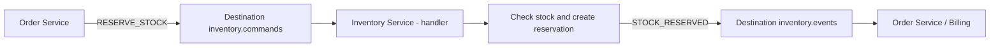
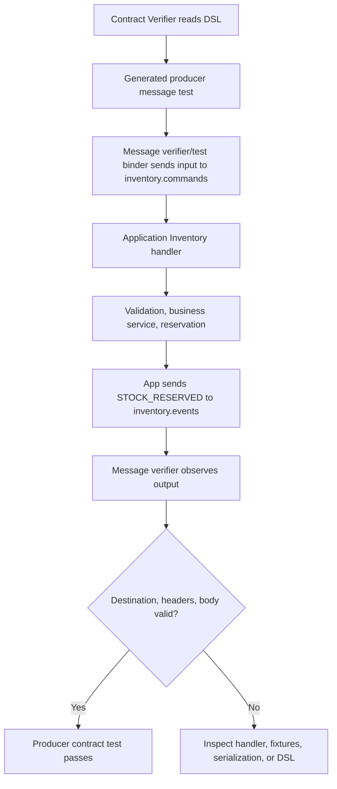
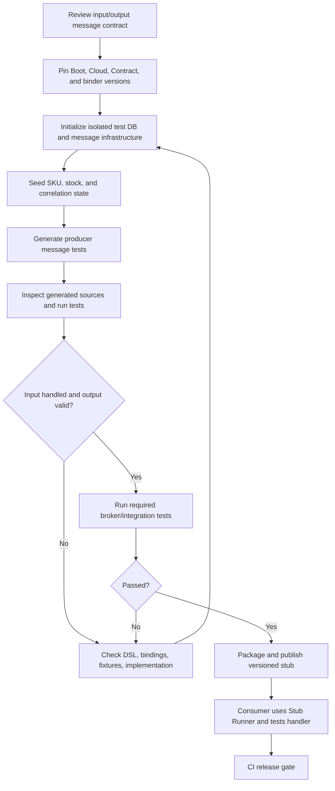

# Simulating Inputs and Verifying Output Messages

In an event-driven microservices architecture, two services do not necessarily communicate via HTTP request–response. **Order Service** can send a `RESERVE_STOCK` reservation command to a message destination; **Inventory Service** processes the command, updates state, and emits a `STOCK_RESERVED` event to another destination. If the producer renames `orderId`, changes `quantity` from a number to a string, sends to the wrong destination, or alters `eventType`, the consumer can break even though no HTTP endpoint changed.

In **Spring Cloud Contract**, messaging contracts help producers and consumers agree on **input messages, output messages, and properties that must remain stable**. Contract Verifier can use this description to **simulate the input message**, trigger the producer's handler, and verify the output message; stubs built from contracts let consumers use **Stub Runner** to test their own integrations. To work, the project needs a **message verifier, binder/channel, or test broker** integration compatible with your Spring Cloud Contract version and messaging system.

This lesson belongs to the **Messaging Contract Testing** chapter of the **SPRING_CLOUD_CONTRACT** track. It focuses on the **input-to-output message contract** model: simulating an incoming event or command into the application, observing processing behavior, and verifying the message the application emits. It also distinguishes what Contract Verifier checks from other responsibilities such as broker delivery, retries, idempotency, and end-to-end flows.

## 1. From HTTP Request–Response to Message Input–Output

For HTTP, contracts typically specify:

```text
Client -- GET /api/orders/42 --> Producer
Client <-- 200 + JSON -------- Producer
```

For messaging, the pattern can look like:



Key differences:

- An input message is **not an HTTP request**; it has a destination, payload, and metadata/headers.
- An output message is **not an HTTP response on the same connection**; it may arrive later, run on a different thread, and be sent to a different destination.
- A message has no HTTP status `200`, `404`, or `409`. Failures can be represented by error events, exceptions, retries, dead-letter routing, or internal state.
- Producer tests must observe messages **produced by the real application**, rather than calling a function and comparing against JSON hardcoded in the test.
- Ordering, delivery guarantees, and latency belong to broker/transport configuration; a valid contract body alone does not prove those properties.

For the running example, **Inventory Service** is the *producer under verification* because it publishes the behavior of processing a message and emitting `STOCK_RESERVED`. Yet in the data flow, Inventory is both a **consumer of the incoming command** and a **producer of the outgoing event**. State both perspectives clearly so you do not confuse who is being tested.

## 2. What a Message Contract Must Clarify

A good message contract must provide enough detail for both teams to understand **trigger conditions** and **observation conditions**.

| Element | Example | Why It Matters |
|---|---|---|
| Input destination | `inventory.commands` | Message must arrive where the handler listens |
| Input message type | `RESERVE_STOCK` | Handler selects the right processing branch |
| Correlation key | `commandId=CMD-42` | Links commands to events or logs |
| Input business data | `orderId=ORDER-42`, `sku=SKU-42`, `quantity=2` | Defines the payload the handler accepts |
| Content type/headers | `application/json`, `schemaVersion=1` | Consumer deserializes and routes accurately |
| Output destination | `inventory.events` | Other services subscribe to the right event stream |
| Output event type | `STOCK_RESERVED` | Consumer recognizes the success outcome |
| Output data | `orderId`, `reservationId`, `quantity` | Consumer builds downstream state |
| Error behavior | `STOCK_REJECTED`, retries, or dead-letter | Must be defined explicitly per policy |
| Delivery/ordering | At-least-once, partition keys… | Requires extra integration tests when committed |

Both destinations can be **logical destinations**, mapped by the binder to physical topics/queues. For example, Spring Cloud Stream might use binding names `reserveStock-in-0` and `reserveStock-out-0`, which are **not automatically equal** to `inventory.commands` and `inventory.events`.

### 2.1. Input Conditions and Output Outcomes

The lesson uses this fixture:

| Value | Input | Output |
|---|---|---|
| `commandId` | `CMD-42` | May appear in `correlationId` |
| `commandType` | `RESERVE_STOCK` | Does not have to repeat the exact name |
| `orderId` | `ORDER-42` | `ORDER-42` |
| `sku` | `SKU-42` | `SKU-42` |
| `quantity` | `2` | `2` |
| `reservationId` | Not present yet | `RES-42` in fixture |
| `eventType` | Not present yet | `STOCK_RESERVED` |

Assume Inventory has **5 units of SKU-42** available, so reserving **2 units** succeeds. Producer tests must seed that data before sending the command. If stock is only 1, the handler might emit a rejection event instead of `STOCK_RESERVED`; the test fails due to a bad fixture, not necessarily a broken contract.

## 3. Groovy DSL Structure for Input-to-Output

In Spring Cloud Contract Groovy DSL, the pattern typically looks like:

```groovy
import org.springframework.cloud.contract.spec.Contract

Contract.make {
    name 'inventory_reserve_stock_emits_reserved_v1'
    label 'inventory_reserve_stock_v1'

    input {
        messageFrom('inventory.commands')
        messageBody(
            commandId: 'CMD-42',
            commandType: 'RESERVE_STOCK',
            orderId: 'ORDER-42',
            sku: 'SKU-42',
            quantity: 2
        )
        messageHeaders {
            header('contentType', 'application/json')
            header('schemaVersion', '1')
        }
    }

    outputMessage {
        sentTo('inventory.events')
        headers {
            header('contentType', 'application/json')
            header('eventType', 'STOCK_RESERVED')
        }
        body(
            eventType: 'STOCK_RESERVED',
            correlationId: 'CMD-42',
            reservationId: 'RES-42',
            orderId: 'ORDER-42',
            sku: 'SKU-42',
            quantity: 2
        )
    }
}
```

**Important note:** this snippet describes a message contract using standard DSL; exact header/content-type syntax and test generation behavior **must be verified in your pinned Spring Cloud Contract version**. Some binders convert content types into `MimeType` objects or apply payload converters, so header values observed in the message verifier must be compared in a way supported by that version.

Read the contract top-to-bottom:

1. `name` identifies the contract and aids tracing generated tests.
2. `label` identifies the scenario for supported message stub-triggering mechanisms.
3. `input.messageFrom('inventory.commands')` states where the simulated input message is sent.
4. `input.messageBody(...)` is the payload the handler must accept.
5. `input.messageHeaders` describes metadata sent to the handler.
6. `outputMessage.sentTo('inventory.events')` is where the output message is awaited.
7. `outputMessage.headers` and `outputMessage.body` are the conditions the producer must satisfy.

Unlike **emit-only contracts**, this form **does not need** `triggeredBy(...)` when sending the input message to the handler is itself the trigger. `triggeredBy` is typically used when the producer emits an event after an internal operation invoked by the test. Do not arbitrarily combine `messageFrom` and `triggeredBy` without understanding execution order and supported DSL scenarios.

### 3.1. Input in JSON Wire Form

The contract above describes the logical payload:

```json
{
  "commandId": "CMD-42",
  "commandType": "RESERVE_STOCK",
  "orderId": "ORDER-42",
  "sku": "SKU-42",
  "quantity": 2
}
```

Output message:

```json
{
  "eventType": "STOCK_RESERVED",
  "correlationId": "CMD-42",
  "reservationId": "RES-42",
  "orderId": "ORDER-42",
  "sku": "SKU-42",
  "quantity": 2
}
```

Do not confuse **DSL data objects** with actual bytes on the wire. Systems may serialize via JSON, Avro, or Protobuf; `quantity` typing, media types, header encoding, and schema versions must be verified at the appropriate layer. A message contract test may run over an in-memory test binder without proving final wire format on real Kafka/RabbitMQ.

## 4. Equivalent YAML DSL

In Spring Cloud Contract versions supporting **YAML messaging contracts**, the same behavior can be expressed as:

```yaml
name: inventory_reserve_stock_emits_reserved_v1
label: inventory_reserve_stock_v1
description: Inventory processes reservation command and emits STOCK_RESERVED
input:
  messageFrom: inventory.commands
  messageBody:
    commandId: CMD-42
    commandType: RESERVE_STOCK
    orderId: ORDER-42
    sku: SKU-42
    quantity: 2
  messageHeaders:
    contentType: application/json
    schemaVersion: '1'
outputMessage:
  sentTo: inventory.events
  headers:
    contentType: application/json
    eventType: STOCK_RESERVED
  body:
    eventType: STOCK_RESERVED
    correlationId: CMD-42
    reservationId: RES-42
    orderId: ORDER-42
    sku: SKU-42
    quantity: 2
```

**YAML alone does not guarantee Verifier recognizes the DSL.** Confirm:

- The plugin scans the right directory and `.yml`/`.yaml` extensions.
- The `input.messageFrom`, `input.messageBody`, `input.messageHeaders`, and `outputMessage` structure is supported by **that version's schema**.
- `schemaVersion: '1'` is a **string** because of the quotes; if the serializer/handler expects a number, align the type.
- `quantity: 2` is a number in YAML, whereas `quantity: '2'` is a string.
- Generated mappings and assertions actually check the declared fields.

**Do not enable both Groovy and equivalent YAML for the same scenario** if that generates duplicate tests/stubs. Pick one primary source and treat the other as a conversion example or representation check.

## 5. Who Sends the Input Message in Producer Verification?

When generated tests use the input-to-output model, there must be a mechanism to feed the payload into the application.



The goal is not for a hand-written test to **fabricate** `STOCK_RESERVED`. The generated test simply **triggers the input**, then observes the output produced by the **real producer implementation**.

Components typically required:

- **`MessageVerifier`** or matching integration to send input and receive output.
- **Spring Cloud Stream test binder, Spring Integration channel**, or test broker supported by the plugin version.
- **Application context** containing the listener/consumer function and publisher function.
- **Fixtures** pre-populating SKU/stock/reservation state matching the scenario.
- **Timeout/await** so tests do not conclude prematurely during asynchronous processing.

If you mock the entire handler to return a canned output, the test may pass yet stop verifying the logic consumers rely on. Mock only out-of-scope boundaries—never replace the producer implementation under verification with a fake.

## 6. Spring Cloud Stream Functional Bean Setup: Example

A modern Spring Cloud Stream app can use functional style to consume commands and emit events:

```java
import java.util.function.Function;
import org.springframework.context.annotation.Bean;
import org.springframework.context.annotation.Configuration;

@Configuration
class InventoryMessagingConfiguration {

    @Bean
    Function<ReserveStockCommand, StockReservedEvent> reserveStock(
            InventoryService inventoryService) {

        return command -> inventoryService.reserve(
            command.commandId(),
            command.orderId(),
            command.sku(),
            command.quantity()
        );
    }
}
```

In this example:

- `ReserveStockCommand`, `StockReservedEvent`, and `InventoryService` are **project-defined code**.
- `Function<I,O>` expresses processing one input and returning one output at the application level.
- How the binder converts broker data into the command, and the event out to the destination, depends on actual message conversion/binding configuration.
- The scenario assumes success; insufficient stock requires designing an error event or another handling mechanism.

Sample Spring Cloud Stream configuration:

```yaml
spring:
  cloud:
    function:
      definition: reserveStock
    stream:
      bindings:
        reserveStock-in-0:
          destination: inventory.commands
          content-type: application/json
        reserveStock-out-0:
          destination: inventory.events
          content-type: application/json
```

Name distinction table:

| Name | Role |
|---|---|
| `reserveStock` | Functional bean name |
| `reserveStock-in-0` | Function's logical input binding |
| `reserveStock-out-0` | Function's logical output binding |
| `inventory.commands` | Destination bound as input |
| `inventory.events` | Destination bound as output |

**Do not equate binding names with physical destinations.** If Contract Verifier uses logical destination names to locate channels, the mapping must match the running verifier/binder version. This sample config is a starting point to experiment with, not a complete configuration for every Spring Cloud Stream version.

### 6.1. If the Producer Does Not Use `Function<I,O>`

Many projects consume input via `Consumer<Command>` and emit output via `StreamBridge` or another publisher. That still fits **input-to-output message contracts** as long as the real app emits the contract-compliant output message.

Contract DSL does not depend on whether code is implemented via `Function`, `Consumer + StreamBridge`, a Spring Integration flow, or `@KafkaListener`; however, **test infrastructure must feed messages to the right entry point** and observe output at the right channel/destination.

## 7. Base Test Class for Message Verification

Generated producer tests usually need a **base test class** to boot the application context and prepare fixtures. Unlike HTTP, configuring `MockMvc` alone is not enough for message testing.

Example structure:

```java
import org.junit.jupiter.api.BeforeEach;
import org.springframework.beans.factory.annotation.Autowired;
import org.springframework.boot.test.context.SpringBootTest;

@SpringBootTest
public abstract class InventoryMessageContractBase {

    @Autowired
    InventoryContractFixtures fixtures;

    @BeforeEach
    protected void prepareState() {
        fixtures.resetReservations();
        fixtures.setAvailableStock("SKU-42", 5);
        fixtures.ensureReservationAbsent("CMD-42");
    }
}
```

`InventoryContractFixtures` is a helper **implemented by the producer team**. This example base class **does not yet configure a message verifier or binder**; the project must add the annotations/configuration/dependencies required by that version of Spring Cloud Contract and the messaging system.

Some Spring Cloud Contract integrations with Spring messaging provide annotations such as `@AutoConfigureMessageVerifier` to enable message verification. **Package names, starters/dependencies, binder support, and auto-configuration depend on version**; do not copy an annotation without checking what kind of verifier generated code invokes.

### 7.1. What Must a Valid Base Test Satisfy?

1. The Spring context contains the real handler and publisher.
2. The test binder/channel/broker is ready before sending the message.
3. Fixtures have `SKU-42` with sufficient stock and no existing reservation `CMD-42`.
4. The generated test sends input with properly encoded payload.
5. The handler completes processing, or the test uses a bounded-timeout wait mechanism.
6. The message verifier observes the right destination `inventory.events`.
7. Assertions verify **the application's** output, not a pre-built test message.
8. Setup/cleanup prevents message tests from interfering with one another.

If the plugin fails to generate a valid test, inspect generated sources, base class mappings, and messaging infrastructure before modifying business logic.

## 8. Simulating Input Does Not Mean Bypassing Real Processing

In contract tests, "simulated" typically refers to **the external message source generated by the test** instead of another live microservice sending it. Inventory Service should still run its handler, validation, and business service within the chosen scope.

| Layer | Can Be Replaced by a Test Double? | Consequence |
|---|---|---|
| External input-sending service | Yes: generated test sends sample message | No need to boot Order Service |
| External broker | Yes: test binder/in-memory channel | Fast, but does not prove all transport properties |
| Inventory message handler | **Should not**, if this is the implementation under verification | Mocking the handler can yield false greens |
| Inventory business service | Consider scope; avoid mocking all core logic | Mocking business logic leaves only the adapter verified |
| Database/repository | Can intentionally mock or use a test DB | Choose test fidelity and supplement with integration tests |
| Output publisher/adapter | Use verifier/test binder to **observe** messages | Never replace output with a hardcoded test message |

A contract where "input hits the real handler and produces the right output message" is far more valuable than a test where "both input and output are crafted by the test itself and compared".

### 8.1. Test Binder vs. Real Broker Differences

A test binder may suffice to verify **input-to-output logic**: deserializing payload, invoking the handler, and observing output. However, a real broker can add or alter:

- Headers and content types.
- Partition keys, offsets, message IDs.
- Per-partition ordering, retries, or redelivery.
- Avro/Protobuf serialization with a schema registry.
- Transactions/acknowledgements and dead-letter routing.

If consumers depend on those properties, add **integration tests with the corresponding broker** (such as Kafka/RabbitMQ) in a managed environment. Do not conclude a contract test using an in-memory binder verifies all production transport behaviors.

## 9. Verifying Headers and Correlated Data

The message body matters, yet it is not the entire contract.

For example, the input has `commandId=CMD-42` and the output has `correlationId=CMD-42`. This expresses a **relationship between the request message and the output event**. Consumers may use the correlation ID to track workflows.

Using two independent regex matchers—for example, both matching `[A-Z0-9-]+`—allows a test to pass even if the output carries a correlation ID **unrelated** to the input. When the relationship is a business requirement, you should:

1. Use deterministic fixtures to assert the exact output such as `CMD-42`.
2. Or use dynamic variable/matcher features of your **DSL version** if available.
3. Add an integration assertion checking correlation when the generator cannot fully express it.

Similarly, `schemaVersion`, `contentType`, and `eventType` headers can determine whether consumers can parse the message. Do not drop all headers just because the JSON body looks right.

### 9.1. Fixed Values vs. Dynamic Data

| Field | Strategy |
|---|---|
| `commandType=RESERVE_STOCK` | Exact match |
| `eventType=STOCK_RESERVED` | Exact match |
| `sku=SKU-42` in this scenario | Fixed fixture and exact match |
| `quantity=2` | Preserve numeric type and business value |
| Generated `reservationId` | Fixed test ID generator or strict format matcher |
| `createdAt` | Fixed clock or suitable time matcher |
| `correlationId` | Verify correlation with input, not just regex |
| `schemaVersion` | String/number matching agreed format |

If a contract hardcodes a random UUID from a previous run, tests will flake falsely. If a `.*` matcher accepts any `eventType`, tests will miss compatibility breaks. Choose matchers based on **commitments**, not the urge to make tests pass.

## 10. Asynchrony: Waiting for Output Without Flaky Tests

A message handler may run a DB query and emit an event on another thread/scheduler. Generated tests may run ahead before the event appears if message infrastructure is not configured to wait properly.

Common issues:

| Symptom | Possibility | Action |
|---|---|---|
| No output event seen | Wrong binder or handler not subscribed | Check bindings/consumer function |
| Event emitted yet test times out | Wrong destination or too-short timeout | Check destination and processing latency |
| Occasionally receives another event | Broker retains stale messages | Correlation IDs and isolation |
| Output alternates `quantity=2` and `quantity=1` | Fixture mutated by another test | Reset/isolate DB |
| Input sent cleanly yet handler deserialization fails | Wrong JSON content type/schema | Check converters and payload bytes |
| Output lands at wrong destination | Incorrect binding mapping | Reconcile logical binding and real topic |
| Test passes even when logic didn't run | Test reads a pre-built message | Verify actual source of output |

**Avoid `Thread.sleep(1000)` as your primary solution.** Wait on observable conditions with a reasonable timeout; inspect message payload/destination. When using a message verifier with polling/receive mechanics, understand the verifier's own timeouts and selection criteria.

For input-to-output contracts, distinguish **message never created** from **message created but not yet observed**. Message trace/correlation logs and handler state are key.

### 10.1. Parallel Test Execution

If two contract tests simultaneously send `CMD-42` to a shared queue/broker:

- The handler may treat the second message as a duplicate.
- Test A may consume the output produced by Test B.
- Test B may see no output because Test A already read it.
- Test A's fixture may reset the reservation while Test B is processing.

Use isolated databases/schemas, broker destinations, consumer groups, or correlation scopes per test/job when needed. If contracts pin `CMD-42`, test infrastructure must ensure concurrent runs stay isolated; never implicitly share state across the whole suite.

## 11. Simulating Failure Inputs and Error Output Messages

The happy path emits `STOCK_RESERVED`. Yet if Inventory lacks stock, the application may emit `STOCK_REJECTED`.

Assume SKU `SKU-EMPTY` has 0 stock. Separate contract:

```groovy
import org.springframework.cloud.contract.spec.Contract

Contract.make {
    name 'inventory_reserve_stock_rejected_v1'
    label 'inventory_stock_rejected_v1'

    input {
        messageFrom('inventory.commands')
        messageBody(
            commandId: 'CMD-REJECT-42',
            commandType: 'RESERVE_STOCK',
            orderId: 'ORDER-43',
            sku: 'SKU-EMPTY',
            quantity: 2
        )
    }

    outputMessage {
        sentTo('inventory.events')
        body(
            eventType: 'STOCK_REJECTED',
            correlationId: 'CMD-REJECT-42',
            orderId: 'ORDER-43',
            reason: 'INSUFFICIENT_STOCK'
        )
    }
}
```

These are two **scenarios with distinct inputs**, not two mappings matching the same arbitrary message. Generated producer tests must run with separate fixtures and no ordering dependency.

If the real system does not emit `STOCK_REJECTED` and instead sends to a dead-letter queue, retries, or logs an internal error, **do not invent a fake event** to make contracts look like request–response. Describe the actual published mechanism and add appropriate integration tests for retries/dead-lettering.

### 11.1. No HTTP Statuses in Message Contracts

Do not use `response.status=409` to represent a stock reservation failure when communication is purely messaging-based. HTTP `409` only makes sense in an HTTP contract. For messaging, the API might use:

- A failure event `STOCK_REJECTED` with a stable `reason`.
- An error channel or dead-letter destination.
- An exception triggering broker retries and eventual dead-letter routing.
- A failed reservation state in the database.

Consumers handling errors need contracts or integration tests that **reflect the real messaging protocol**, not inferred HTTP codes.

## 12. How Do Consumers Use Stub Runner to Test Messages?

After producer verification passes, messaging contracts can be packaged into a **stub artifact**. Consumers of Inventory events (such as Order Service) can use **Stub Runner** with compatible messaging infrastructure to receive sample events.

In some versions, Stub Runner provides `StubTrigger`, allowing messages to be triggered by `label`:

```java
import org.junit.jupiter.api.Test;
import org.springframework.beans.factory.annotation.Autowired;
import org.springframework.cloud.contract.stubrunner.StubTrigger;

class InventoryEventConsumerTest {

    @Autowired
    StubTrigger stubTrigger;

    @Test
    void handlesStockReserved() {
        stubTrigger.trigger("inventory_reserve_stock_v1");

        // Wait for Order Service's handler to process the stub message.
        // Assert consumer state/side effects.
    }
}
```

This example describes **conceptual usage**. Running it for real requires a Spring Boot test context, Stub Runner configuration, the right artifact containing message stubs, and a matching adapter/binder. `StubTrigger` imports/APIs can vary across versions; consult the docs.

Special note for **input-to-output contracts**:

- `input.messageFrom` serves producer verification: feeding a message into Inventory to observe the event it emits.
- `outputMessage` is the event the consumer may want to **stub-trigger** to test its own handler.
- A typical consumer test **does not send `RESERVE_STOCK` through Stub Runner expecting it to emulate the full stateful Inventory handler and emit output** like a real microservice.
- If a test wants to exercise sending a command and receiving an event end-to-end, use version-appropriate simulation and/or inter-service integration tests; do not assume Stub Runner executes stateful workflows from a single contract.

### 12.1. Levels of Evidence

| Test | What Runs? | What It Proves |
|---|---|---|
| **Producer message contract test** | Real Inventory Service + test message infrastructure | Handler processes input and emits output per contract |
| **Consumer test with Stub Runner** | Real Order Service + message stub | Consumer receives/parses/handles sample event |
| **Sender integration test** | Real Order Service publisher + test binder | Sender produces `RESERVE_STOCK` with right destination/payload |
| **Broker integration test** | App + test Kafka/RabbitMQ | Conversion, routing, retries, acknowledgements within scope |
| **End-to-end** | Real services and real transport | Global workflow, correlation, and side effects |

**A green consumer stub test does not prove Inventory's implementation satisfies the contract.** Producer verification must still run before any published stub is treated as verified.

## 13. Checking Generated Tests and Mappings Before Declaring Success

After defining Groovy/YAML contracts:

1. Configure the Spring Cloud Contract Verifier plugin with versions matching Spring Boot/Spring Cloud.
2. Select compatible message test infrastructure.
3. Generate producer contract tests.
4. Open generated sources: does the test **send an input message**? Does it wait for/assert the **output message**?
5. Confirm generated tests extend the right base class with classpath/binder configured.
6. Run a single contract against clean fixture data.
7. Intentionally break output `eventType` or `quantity`: the test must fail.
8. Inspect the stub artifact and message labels after build.
9. Treat the artifact as verified only after producer tests actually execute and pass.

Spring Cloud Contract versions may differ in `MessageVerifier` usage, auto-configuration, handler/callback APIs, and YAML schemas. Never edit generated code by hand to make tests pass; fix the **DSL, plugin config, base class, or implementation**, then regenerate.

### 13.1. Spotting Generated Tests That Never Actually Check Output

Warning signs:

- The test simply builds a `Message<?>` from DSL and compares it to itself.
- Inventory's handler is never invoked.
- The test never awaits any message from `inventory.events`.
- The test does not assert `eventType` or `quantity`.
- Test reports do not list the corresponding input-to-output scenario.
- The plugin test-generation task is skipped or fails to scan the DSL directory.

If you spot these signs, do not conclude the contract was verified. Fix integration config or write **supplementary message integration tests** to cover the gap.

## 14. Message Headers and Schema Evolution

In multi-consumer systems, breaking changes can hide in headers or formats even when JSON looks identical.

Examples:

- `schemaVersion` changes from `'1'` to `'2'` before Billing supports it.
- Content-type header changes from JSON to Avro before consumers have a decoder.
- `eventType` changes to `STOCK_RESERVED_V2`.
- `quantity` changes from integer to string.
- `correlationId` is no longer linked to `commandId`.
- The producer stops sending a routing header consumers use to filter messages.

Control these changes with appropriate contracts. Where a field is allowed to grow, make matchers flexible enough; where consumers depend on exact values, keep assertions strict.

### 14.1. Schema Compatibility

| Change | Likely Impact |
|---|---|
| Adding an optional field consumers ignore | Usually compatible, depending on schema/parser |
| Removing a field consumers require | Breaking |
| Changing a field's data type | Highly breaking |
| Renaming an event type | Breaks event-type routing |
| Changing destination | Consumers may stop receiving messages |
| Switching from JSON to another format | Requires coordinated producer and consumer migration |
| Changing from event to command semantics | Can alter the entire workflow |

Spring Cloud Contract protects what DSL and tests explicitly describe. With Avro/Protobuf, pair it with **schema compatibility tooling**; a Groovy body map alone does not fully check a schema registry.

## 15. CI for Input-to-Output Message Contracts

A reliable pipeline:



**Checklist before publishing stubs:**

- [ ] Groovy/YAML files are read by the plugin and have corresponding generated producer tests.
- [ ] Generated tests actually feed input into the application's handler.
- [ ] Tests receive messages **emitted by the real producer** at the output destination.
- [ ] Headers, event type, payload, and correlation data are asserted.
- [ ] Fixtures have deterministic stock state; tests run independently.
- [ ] Test binder/broker contains no stale messages or state from other jobs.
- [ ] Async tests use bounded timeouts rather than hopeful `sleep`s.
- [ ] Failure or missing-data cases are tested per policy.
- [ ] No real tokens, PII, or sensitive messages appear in logs/artifacts.
- [ ] Consumer tests with Stub Runner use the right artifact/version.
- [ ] Producer verification/integration tests are never skipped in CI.

If using **preview stubs** so consumers can develop while the producer is unfinished, clearly distinguish them from **stubs from a verified producer build**. Only the latter provide evidence the implementation honors the contract.

## 16. Practice Exercise: Inventory Reserving Stock and Emitting Events

Context: Order Service sends `RESERVE_STOCK`; Inventory Service responds with `STOCK_RESERVED` or `STOCK_REJECTED`. Both teams use Spring Cloud Contract with a suitable message binder or test broker.

### Part A — Contract Design

1. Identify input destination `inventory.commands` and output `inventory.events`.
2. Choose command payload: `commandId=CMD-42`, `orderId=ORDER-42`, `sku=SKU-42`, `quantity=2`.
3. Agree output `STOCK_RESERVED` has `correlationId=CMD-42`, `reservationId=RES-42`.
4. Specify header values such as `contentType` and `schemaVersion` if used by consumers.
5. Write Groovy DSL or equivalent YAML, enabling only **one source** per scenario.

### Part B — Producer Preparation

1. Create a real functional bean or message handler for `RESERVE_STOCK`.
2. Map input/output bindings to the agreed destinations.
3. Configure message verifier/test binder matching your Spring Cloud Contract version.
4. Seed fixture `SKU-42` with 5 units and no reservation for `CMD-42`.
5. Isolate test DB/broker/groups so prior suites do not leak messages.

### Part C — Generating and Running Producer Tests

1. Generate contract tests and verify they are discovered.
2. Open generated sources; confirm input messages are sent and output asserted.
3. Run tests; verify `STOCK_RESERVED` arrives at the right destination with expected body/headers.
4. Intentionally change output `quantity` from 2 to 3: tests must fail.
5. Intentionally change `eventType`: tests must fail.
6. Revert code after the experiment.

### Part D — Failure Scenarios

1. Seed `SKU-EMPTY` with 0 stock.
2. Write a second contract for `STOCK_REJECTED` or the failure policy actually published by the system.
3. Verify distinct inputs distinguish scenarios; avoid overly broad matchers.
4. For retries/idempotency, add integration tests sending duplicate `commandId`s or inducing transient failures.
5. Verify dead-letter routing if business rules require it.

### Part E — Stub Runner and CI

1. Package the artifact from a verified producer build.
2. Have Order Service consumer tests receive sample `STOCK_RESERVED` messages by label via Stub Runner if supported by your version.
3. Assert the real handler updates order state based on `correlationId`.
4. Verify Order Service's sender emits `RESERVE_STOCK` with valid payload/binding via a dedicated test when needed.
5. Integrate producer verification, message integration tests, and consumer stub tests into CI with pinned artifact versions.

**Completion criteria:** feeding simulated input into the **real handler** produces contract-compliant output; generated tests assert destination/headers/body and fail on producer violations; fixtures stay isolated and tests are repeatable; consumers verify stub events without mistaking them for real producer proof.

## 17. Common Errors and How to Diagnose Them

| Symptom | Possible Cause | Troubleshooting Step |
|---|---|---|
| No producer message tests generated | File outside folder, missing plugin support, or invalid DSL | Check plugin/version, contract source directory |
| Cannot send input message | Verifier cannot find channel/destination | Check binding name, message verifier, and consumer bean |
| Input sent yet handler does not process | Not subscribed, converter error, or handler exception | Check Spring context, content type, logs |
| Handler runs yet output never appears | Wrong output publisher/binding or async work unfinished | Observe output destination, readiness, timeout |
| Output arrives at channel yet assertions fail | Schema, header, JSON type, or value mismatch | Compare actual data against contract |
| `correlationId` differs from `commandId` | Business logic passes wrong ID or matcher too loose | Check input–output correlation |
| Test stays green after breaking output | Generated test skips assertions or mocks too deep | Inspect generated source, run intentional mutations |
| Tests flake under parallel runs | Shared broker/DB/correlation ID | Isolate fixtures, channels/groups, or brokers |
| Stub Runner fails to trigger message | Label missing in artifact, wrong binder config | Check stub artifact, label, version |
| Consumer receives event yet never processes | Deserialization/handler subscription error | Use real client/handler and assert side effects |
| Changed event type goes undetected | Regex matcher too broad | Keep strict assertions on business fields |
| Fails only in CI | Dependency drift, unready test broker, dirty fixtures | Pin versions, readiness/cleanup/isolation |

An effective debugging workflow:

1. Verify Spring Boot/Cloud/Contract versions and messaging integrations.
2. Confirm the plugin picks up the right Groovy/YAML files.
3. Read generated sources to see **how input is sent** and **how output is asserted**.
4. Observe whether the handler received the input with right payload, headers, and destination.
5. Observe the real output message, avoiding confusion with test-constructed objects.
6. Check fixtures, correlation, and side effects.
7. Run tests individually and as a full suite to expose shared state.
8. Fix the right layer: DSL, plugin config, base class, binder, or implementation.
9. Regenerate tests and verify stubs/versions before publishing.

## 18. Self-Check Questions

1. **How do input-to-output message contracts differ from HTTP request–response?** Input and output messages can live on two destinations, run asynchronously, and do not use HTTP statuses.
2. **What does `messageFrom` mean?** Indicates the input message source/destination sent by the test to trigger the handler.
3. **What does `outputMessage.sentTo` mean?** Indicates the destination where the test expects the producer to emit the message.
4. **Is `triggeredBy` required for input-to-output scenarios?** No. Typically `messageFrom` already describes the trigger via the incoming message.
5. **Why is stock fixture data needed?** So the handler processes the input against a known state and emits the expected output.
6. **Is `Function<Command,Event>` Contract DSL or application code?** Application code; Contract Verifier must integrate to send input and observe output.
7. **Is binding name `reserveStock-in-0` equal to topic `inventory.commands`?** Not automatically. Binder configuration maps logical bindings to destinations.
8. **Do message tests verify all broker delivery guarantees?** Not every property. Broker integration tests are needed if those are part of commitments.
9. **Why is asserting the publisher method throws no exception insufficient?** Because it does not prove the message had the right destination/headers/body.
10. **If output IDs are dynamic UUIDs, how do you avoid flaky tests?** Fix the test generator or use a format matcher while verifying required correlation.
11. **Why do two regex matchers on `commandId` and `correlationId` fail to prove they are linked?** Because each regex only checks shape, not equality between the two values.
12. **Does Stub Runner automatically run Inventory's real handler when a consumer triggers a label?** No. Stubs serve simulated messages; separate producer verification is required.
13. **Can a test accidentally consume an event from a previous test?** Yes, if brokers/test channels and correlation IDs are shared.
14. **Should `Thread.sleep(1000)` be used to ensure events arrive?** Not as a primary strategy; wait on conditions with a bounded timeout.
15. **If the system emits no event on insufficient stock, should you invent `STOCK_REJECTED` for the contract?** No. Test the real retry/dead-letter/side-effect mechanism instead.
16. **When are idempotency tests needed?** When brokers may deliver duplicates or business rules require safe repeated handling without duplicate side effects.
17. **Does a green build with zero generated message tests prove the contract?** No. Inspect test generation and test reports.
18. **What must pass before a published stub is considered verified?** Generated producer tests run against the real implementation, assert valid input/output, and required integration tests pass.

## Conclusion

**Simulating inputs and verifying output messages** is central to verifying messaging microservices with Spring Cloud Contract. A good contract specifies **input destination, payload, headers, output destination, and the fields consumers rely on**. Contract Verifier must feed simulated messages into the **producer's real handler**, observe the actual emitted message, and match expectations, while the base test manages fixtures, binders/brokers, and asynchronous state. Combining **Groovy/YAML DSL**, **generated producer verification**, **Stub Runner for consumers**, supplementary broker/integration tests, and **CI release gates** lets teams catch incompatible message changes early without mistaking simulated stubs for proof of a working implementation.
