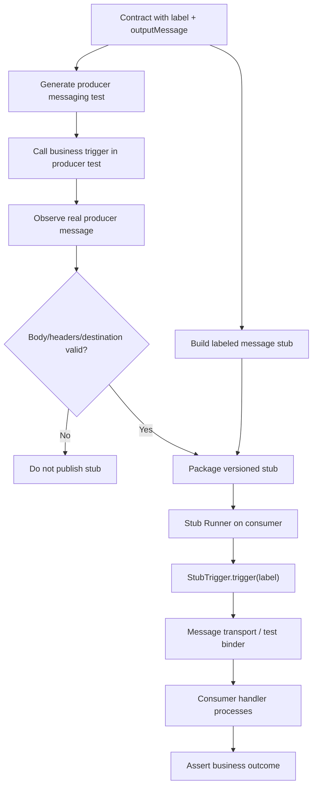
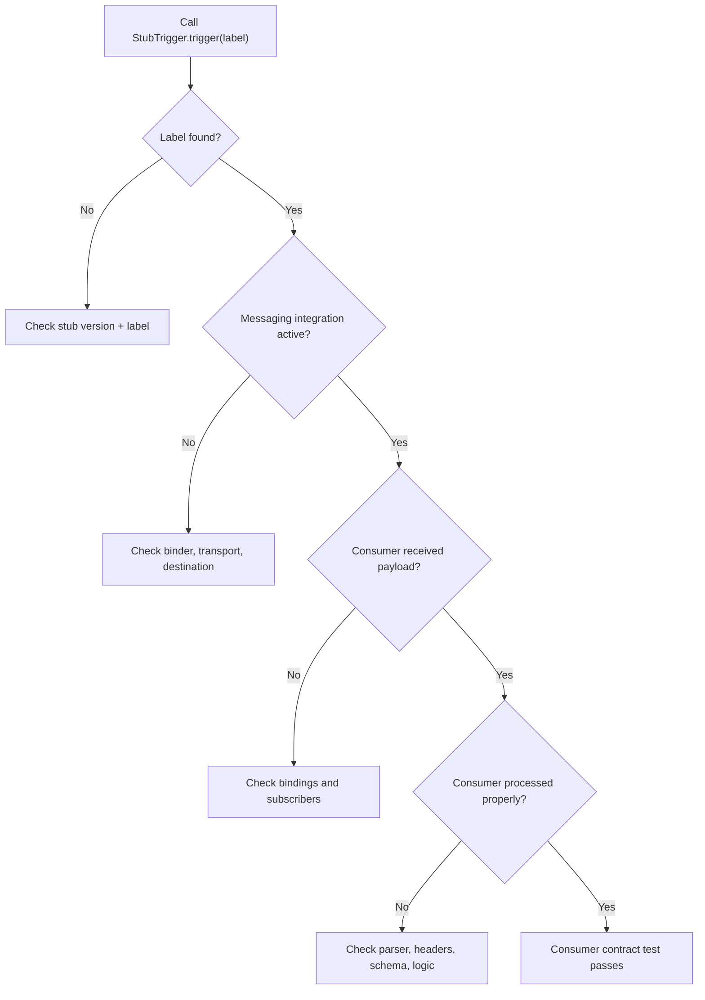

# Stub Runner Triggering Messages by Contract Label

## 1. Why Do Consumers Need to Trigger Messages from Stubs?

In **Spring Cloud Contract** (`SPRING_CLOUD_CONTRACT` module), producers and consumers agree on integration behavior via **Groovy/YAML DSL** for HTTP or messaging. Contract Verifier can generate tests to verify the real producer, package versioned stubs, and let consumers use stubs through **Stub Runner**. These steps can integrate into CI to catch incompatible API or event changes.

With HTTP, the consumer actively sends requests to a stub server and receives responses. With **messaging**, the producer may emit an event at any point, without necessarily receiving an HTTP call from the consumer. When the consumer needs to test logic handling an event like `ORDER_CREATED`, it needs a way to **ask the stub to emit a sample message** so the consumer's own handler receives input data.

Spring Cloud Contract supports **contract labels** (`label`) and the **`StubTrigger`** API for this scenario:

- The contract describes the message the producer must emit, along with a `label` identifying the scenario.
- Producer tests execute real producer behavior and verify the message's destination, body, and headers.
- Stubs are built from verified contracts and packaged with a version.
- Consumer tests call `StubTrigger.trigger("label")` to ask Stub Runner to emit the corresponding message through the configured messaging integration.
- Consumer tests wait and verify **consumer behavior**, such as updating a read model or recording an order.

**Crucial point:** triggering a stub successfully **does not mean** the consumer processed the message properly. The test is only meaningful when it also asserts actual outcomes after the handler runs.

### Lesson Objectives

After this lesson, you will be able to:

1. Place `label` properly in Groovy/YAML messaging contracts.
2. Distinguish `label`, `name`, `input.triggeredBy(...)`, `outputMessage.sentTo(...)`, and event names inside bodies/headers.
3. Package message stubs, pick the right artifact/version, and configure Stub Runner on the consumer side.
4. Invoke `StubTrigger.trigger(label)` and verify asynchronous event processing in consumers.
5. Diagnose cases where the trigger misses a label, messages do not arrive, or consumers receive yet fail to decode them.
6. Design success/failure branches and CI pipelines that do not rely on false-positive results.

## 2. Two Separate Testing Flows: Producer and Consumer

A single contract can serve as the source for both **producer verification** and **consumer stub tests**, yet the two flows execute differently.



**Producer flow:** sends a request or invokes a method causing the application to emit an event; tests verify the message produced by the **real producer**. This test needs a base class, fixtures, and a matching message verifier/transport.

**Consumer flow:** the real producer **does not need to run**. Stub Runner emits a message representing a contract verified by the producer. Tests verify whether the consumer reads and processes the event properly.

Both results complement each other:

| Evidence | What It Confirms | What It Does Not Prove Alone |
| --- | --- | --- |
| Producer test passes | Given chosen fixtures and triggers, the producer emits a contract-compliant message | That the consumer will handle the message |
| `StubTrigger.trigger(label)` returns success | Stub has a scenario for that label and requested firing via the active integration | That the consumer handler completed |
| Consumer test asserts read model updated | Consumer handles the sample message from the stub | That the current producer is still valid if producer verification is skipped |
| Real broker integration passes | Test environment transport/serializer configuration works | That all retry, ordering, and delivery policies hold in production |

Do not confuse **HTTP WireMock stubs** with **messaging stubs**. An HTTP stub server can serve requests/responses, yet does not inherently know how to push events into Kafka, RabbitMQ, JMS, or Spring Cloud Stream without the appropriate integration.

## 3. What Is a Contract Label?

In Groovy DSL, `label` is declared at the **contract top level**, alongside `name`, `input`, and `outputMessage`:

```groovy
import org.springframework.cloud.contract.spec.Contract

Contract.make {
    name 'order_created_event'
    label 'order_created'

    input {
        triggeredBy('publishOrderCreated()')
    }

    outputMessage {
        sentTo('orders.events')
        body([
            eventType: 'ORDER_CREATED',
            orderId  : 'ord-1001'
        ])
        headers {
            header('eventType', 'ORDER_CREATED')
            messagingContentType(applicationJson())
        }
    }
}
```

Here:

- `name 'order_created_event'`: identifier of the contract scenario, useful for authors and generated tests.
- `label 'order_created'`: **scenario label** consumer tests use to trigger the stub.
- `triggeredBy('publishOrderCreated()')`: method name implemented by the **producer test base** to cause the event during producer verification.
- `sentTo('orders.events')`: output destination to verify and used to emit stub messages in matching integrations.
- `body(...)`: payload the consumer receives.
- `headers { ... }`: critical metadata such as event type and content type.

These values may look semantically related, yet **they are not interchangeable**:

| Value | Where Does It Live? | Who Uses It? |
| --- | --- | --- |
| `order_created_event` | Contract `name` | Generator, logs, human readers |
| `order_created` | Contract `label` | `StubTrigger` on the consumer |
| `publishOrderCreated()` | `input.triggeredBy` | Generated **producer** test calling helper |
| `orders.events` | `outputMessage.sentTo` | Message verifier/transport and consumer binding |
| `ORDER_CREATED` | `body.eventType` or `headers.eventType` | Consumer logic |

**Do not call** `stubTrigger.trigger("publishOrderCreated()")` when the declared label is `order_created`. `StubTrigger` looks up the **label**, not the trigger method name in the base class.

### 3.1. Traceable Label Naming

For a producer emitting multiple message types:

| Scenario | `name` | Suggested `label` |
| --- | --- | --- |
| Order creation | `order_created_event` | `order_created` |
| Order cancellation | `order_cancelled_event` | `order_cancelled` |
| Out-of-stock reservation | `inventory_reservation_rejected` | `reservation_rejected` |
| Payment succeeded | `payment_succeeded_event` | `payment_succeeded` |
| Payment failed | `payment_failed_event` | `payment_failed` |

Labels should be stable, descriptive, independent of random data, and **free of unintended collisions** across stubs loaded simultaneously. In large applications, domain prefixes like `orders.order_created` can follow team conventions, provided producer and consumer agree on the exact label string.

Avoid `label 'event_1'` or embedding fixed order IDs in labels; that makes tests harder to understand and maintain.

## 4. YAML DSL: Equivalent Label and Message

The contract above can be written in YAML:

```yaml
name: order_created_event
label: order_created
description: Emit event after order creation succeeds
input:
  triggeredBy: publishOrderCreated()
outputMessage:
  sentTo: orders.events
  body:
    eventType: ORDER_CREATED
    orderId: ord-1001
  headers:
    eventType: ORDER_CREATED
    contentType: application/json
```

This is an **alternative representation** for the same Groovy contract. In a real project, pick one DSL format per scenario and avoid placing duplicate files under the directory scanned by the plugin.

In YAML, `label` still sits at the **top level** of the contract, not nested inside `input` or `outputMessage.headers`. The `eventType` header in `outputMessage.headers` is **message metadata**, whereas `label` is **stub-control metadata**; consumers do not receive a message header named `label` merely because the contract has this field.

**Remember:** a label is not a topic/queue name. Changing `label: order_created` to `label: created_order` does not change destination `orders.events`; conversely, changing the destination does not automatically update label names in consumer tests.

## 5. Producer Verification Must Run Before Trusting Stubs

For consumers to trust that sample `ORDER_CREATED` represents the producer, the producer must be verified against that contract.

### 5.1. Base Class with Trigger Method

Suppose the producer emits an event when creating an order. The test base class might look like:

```java
package com.example.orders.contract;

import org.springframework.beans.factory.annotation.Autowired;
import org.springframework.boot.test.context.SpringBootTest;
import org.springframework.cloud.contract.verifier.messaging.boot.AutoConfigureMessageVerifier;

@SpringBootTest
@AutoConfigureMessageVerifier
public abstract class OrdersMessagingContractBase {

    @Autowired
    private OrderEventTestDriver eventTestDriver;

    public void publishOrderCreated() {
        eventTestDriver.createOrderAndPublish("ord-1001", "SKU-001", 2);
    }
}
```

`OrderEventTestDriver` and `createOrderAndPublish(...)` are **illustrative components implemented by the producer team**, not default framework APIs. The project must configure a message verifier, message binder, or test transport matching the technology in use.

Generated producer tests must exercise **real application** behavior, such as a service that actually creates an order and emits the event. If `eventTestDriver` merely crafts the exact JSON and pushes it straight into the verifier without going through producer code, tests may pass without verifying the behavior published by the contract.

### 5.2. Fixture Data Must Exercise the Right Branch

Example:

```text
Contract: order_created_event
Trigger: publishOrderCreated()
Precondition:
  - SKU-001 exists and is in stock
  - Order ord-1001 can be created
  - Event store/transport is in a clean state
Expected:
  - One ORDER_CREATED event
  - Destination orders.events
  - Body.orderId = ord-1001
  - Content-Type matches application/json
```

These conditions ensure the test **does not accidentally take a failure branch** due to out-of-stock items or stale data. If message emission is asynchronous, producer tests need a tool-appropriate waiting mechanism with a clear timeout.

### 5.3. Boundaries of Producer Tests

A passing test proves the producer emits a contract-matching message in the **prepared scenario**. It does not prove alone:

- Events are delivered exactly once.
- Every consumer receives events across network outages.
- Kafka partition keys, broker retention, or JMS selectors are configured properly.
- Duplicate deliveries will not cause duplicate processing.
- Schemas across all versions are compatible.

Those aspects require supplementary integration, schema, and resilience tests when required by the product.

## 6. Creating and Selecting the Right Message Stub Artifact

When producer verification passes, contracts can be packaged into a **stub artifact** tied to the producer's version. Example Maven coordinates:

```text
com.example:orders-producer:1.4.2:stubs
```

Components:

- `com.example`: group ID.
- `orders-producer`: producer's artifact ID.
- `1.4.2`: published version.
- `stubs`: classifier commonly used for stub-containing artifacts.

A consumer test can select this stub via `@AutoConfigureStubRunner`. This is a **stub from the producer's contracts**, not a copy of the producer service running on the same port.

### 6.1. Three Common Modes

| Stubs mode | Stub source | Suitable scenario | Requirement |
| --- | --- | --- | --- |
| `CLASSPATH` | Artifact/stubs present on test classpath | Tests packaging fixtures/stubs directly | Classpath must include the right stub source |
| `LOCAL` | Local Maven repository | Local dev and testing after installing artifact | Target version must exist in local repository |
| `REMOTE` | Configured Maven repository | CI or teams consuming published releases | Repository, access permissions, right version |

This chooses **where stubs are fetched**, not whether messages travel over Kafka, RabbitMQ, Spring Cloud Stream, or another transport. For messaging, you must also configure the **messaging integration** so Stub Runner can deliver messages to the consumer handler.

For reproducible builds, pin versions such as `1.4.2`. Avoid pointing tests continuously to latest or shifting `SNAPSHOT` builds unless intentionally testing bleeding-edge integration.

### 6.2. Checking the Artifact Before Running Consumer Tests

During diagnosis, verify:

1. The producer build actually scanned the contract file containing `label`.
2. The messaging stub-generation step ran and the artifact contains the expected contracts/scenarios.
3. Artifact coordinates requested by the consumer match the verified producer version.
4. The consumer is not accidentally downloading an old stub lacking the new label.
5. All messaging plugins and dependencies have compatible versions.

**A test can start Stub Runner cleanly yet lack the needed label**, for instance if an old artifact does not contain the new contract. Therefore, assert the label when triggering and do not treat Spring context startup as sufficient proof.

## 7. Configuring Stub Runner in Consumer Tests

With Spring Boot/JUnit 5, consumers typically include `spring-cloud-starter-contract-stub-runner` in test scope alongside the application's messaging libraries.

Condensed Maven dependency snippet:

```xml
<dependency>
  <groupId>org.springframework.cloud</groupId>
  <artifactId>spring-cloud-starter-contract-stub-runner</artifactId>
  <scope>test</scope>
</dependency>
```

The project must manage compatible versions with Spring Boot and Spring Cloud Contract, e.g., via matching dependency management. Adding this dependency alone **does not auto-configure message transport**.

### 7.1. Test Triggering by Label

An illustrative **consumer** test:

```java
package com.example.inventory.contract;

import java.time.Duration;
import org.junit.jupiter.api.Test;
import org.springframework.beans.factory.annotation.Autowired;
import org.springframework.boot.test.context.SpringBootTest;
import org.springframework.cloud.contract.stubrunner.StubRunnerProperties;
import org.springframework.cloud.contract.stubrunner.StubTrigger;
import org.springframework.cloud.contract.stubrunner.spring.AutoConfigureStubRunner;

import static org.assertj.core.api.Assertions.assertThat;
import static org.awaitility.Awaitility.await;

@SpringBootTest
@AutoConfigureStubRunner(
    ids = "com.example:orders-producer:1.4.2:stubs",
    stubsMode = StubRunnerProperties.StubsMode.LOCAL
)
class OrderCreatedConsumerContractTest {

    @Autowired
    private StubTrigger stubTrigger;

    @Autowired
    private InventoryReadModelRepository readModel;

    @Test
    void consumesOrderCreatedEvent() {
        boolean triggered = stubTrigger.trigger("order_created");
        assertThat(triggered).isTrue();

        await().atMost(Duration.ofSeconds(5))
               .untilAsserted(() ->
                   assertThat(readModel.hasOrder("ord-1001")).isTrue()
               );
    }
}
```

**Requirements to run the example:**

- `InventoryReadModelRepository` and `hasOrder(...)` are **hypothetical consumer application APIs**, not built-in Spring Cloud Contract classes.
- The project needs the **Awaitility** dependency if using `await()` as shown.
- The consumer has a real handler/subscriber and a way to receive `orders.events` events through the configured transport/test binder.
- Stub artifact `com.example:orders-producer:1.4.2:stubs` must be installed in the local Maven repository when using `LOCAL`.
- The test database or read model must be reset so `ord-1001` does not already exist from a prior run. If it already exists, the final assertion can pass **before the handler processes the new message**.

The core of the test is two distinct assertions:

1. `triggered == true`: Stub Runner **received the request to trigger a label**.
2. `readModel.hasOrder("ord-1001") == true`: consumer logic **processed the message**, provided initial fixtures did not already have that record.

Do not write only:

```java
assertThat(stubTrigger.trigger("order_created")).isTrue();
```

and conclude consumer integration succeeded. Returning `true` does not confirm the message handler parsed properly, persisted data accurately, or finished processing.

### 7.2. Why Wait on Conditions Instead of `Thread.sleep`?

Messages can be processed asynchronously. A test using:

```java
stubTrigger.trigger("order_created");
Thread.sleep(1000);
assertThat(readModel.hasOrder("ord-1001")).isTrue();
```

has two flaws: one second can be too short on slow CI runners, yet wasteful when the consumer finishes fast. Waiting **on a condition** up to a bounded timeout produces clearer results. Even so, timeouts should reflect test infrastructure characteristics; never inflate them indefinitely just to mask binding or handler bugs.

### 7.3. Initializing State Before Triggering

A reliable sequence:

```text
Before test:
  - Initialize Spring context and message bindings
  - Clear read model / inbox / cache for this case
  - Register consumer handler
  - Verify the right stub version is loaded

During test:
  - StubTrigger.trigger("order_created")
  - Wait for event to be processed by consumer
  - Assert orderId, quantity, new status

After test:
  - Clean test data and leftover messages
  - Ensure next case does not read stale events
```

If the binder operates asynchronously, ensure the consumer **registered its subscriber before triggering**; otherwise, the message may be emitted while the test handler is not yet ready.

## 8. Delivering the Stub Message to the Right Consumer Handler

`StubTrigger` only asks Stub Runner to fire the **message stub**. It does not create network connections, queues, Kafka topics, or function bindings across every technology on its own.

Suppose the Inventory application uses Spring Cloud Stream with a function:

```java
import java.util.function.Consumer;
import org.springframework.context.annotation.Bean;
import org.springframework.context.annotation.Configuration;
import org.springframework.messaging.Message;

@Configuration
class InventoryMessageConfiguration {

    @Bean
    Consumer<Message<String>> orderCreated(InventoryEventHandler handler) {
        return message -> handler.handle(
            message.getPayload(),
            message.getHeaders()
        );
    }
}
```

`InventoryEventHandler` is a **consumer component** that must have real parsing/business logic. In a functional Spring Cloud Stream setup, you can map the binding to the destination:

```yaml
spring:
  cloud:
    function:
      definition: orderCreated
    stream:
      bindings:
        orderCreated-in-0:
          destination: orders.events
```

**Example limitation:** this illustrates *consumer binding configuration*, not a complete configuration guaranteeing Stub Runner integration works. You also need a binder/test binder, message converters, and libraries compatible with your project's Spring Cloud Stream/Spring Cloud Contract versions. If the producer contract uses a **logical destination** while the binder names the topic differently, configure the matching mapping.

Specifically, do not confuse:

- `orders.events`: logical message destination.
- `order_created`: **label** the test uses to trigger.
- `orderCreated-in-0`: **consumer binding** name following the example's function convention.
- `ORDER_CREATED`: **event type** in the body or header.

These four names serve four different purposes. Firing the right `label` while binding to the wrong destination still prevents the handler from receiving messages.

### 8.1. Choosing the Right Messaging Integration

| Environment | Viable Test Approach | Limitations |
| --- | --- | --- |
| Spring Cloud Stream with test binder | Feed message into configured test channel/binder | Does not prove external broker behavior |
| Spring Integration test channel | Send/receive through matching channel | Must reflect converters and flows under test |
| Real RabbitMQ/Kafka/JMS in integration tests | Verify real infrastructure, routing, and serialization | Requires broker, network setup, cleanup, and timeouts |
| HTTP stub mappings only | Insufficient to trigger messaging events by label | Requires messaging stub integration |

Some features are supported only in specific versions/binders. During implementation, prioritize verifying the capabilities of the **Spring Cloud Contract and messaging framework versions your project uses**; do not treat all broker tools as identical.

## 9. Contract Labels in Message-In -> Message-Out Scenarios

Not every event is emitted via `input.triggeredBy(...)`. A producer may **receive an input message** and emit an output message. For example, Inventory Service receives `ORDER_CREATED` and emits `INVENTORY_RESERVED`.

```groovy
import org.springframework.cloud.contract.spec.Contract

Contract.make {
    name 'inventory_reserved_event'
    label 'inventory_reserved'

    input {
        messageFrom('orders.events')
        messageBody([
            orderId  : 'ord-1001',
            productId: 'SKU-001',
            quantity : 2
        ])
        messageHeaders {
            header('eventType', 'ORDER_CREATED')
        }
    }

    outputMessage {
        sentTo('inventory.reservations')
        body([
            orderId: 'ord-1001',
            result : 'RESERVED'
        ])
        headers {
            header('eventType', 'INVENTORY_RESERVED')
            messagingContentType(applicationJson())
        }
    }
}
```

**Producer side**: the generated test sends the input message per `messageFrom`/`messageBody`/`messageHeaders`, then observes output from real Inventory code.

**Consumer side**: for a message stub with `label 'inventory_reserved'`, tests of the service consuming `INVENTORY_RESERVED` can use `StubTrigger.trigger("inventory_reserved")` when supported by Stub Runner/messaging integration. **Do not assume this trigger re-executes the producer's entire input -> processing flow.** Stubs typically emit the **described output**, without running real Inventory Service code.

If a consumer needs to test **sending an input message** and waiting for a reply event over a broker, that may require **two-way interaction testing** with request/reply or routing setup. Pick a stub integration supporting that mechanism and verify explicitly; calling a single label does not prove the entire protocol works.

### 9.1. Equivalent YAML DSL

```yaml
name: inventory_reserved_event
label: inventory_reserved
input:
  messageFrom: orders.events
  messageBody:
    orderId: ord-1001
    productId: SKU-001
    quantity: 2
  messageHeaders:
    eventType: ORDER_CREATED
outputMessage:
  sentTo: inventory.reservations
  body:
    orderId: ord-1001
    result: RESERVED
  headers:
    eventType: INVENTORY_RESERVED
    contentType: application/json
```

In both DSLs, `label` stays at the **contract level** and can be used to trigger the stub scenario. If a consumer must handle both `RESERVED` and `REJECTED`, define separate contracts with distinct labels and fixtures.

## 10. Managing Multiple Labels and Multiple Producers

A consumer may depend on two producers:

- `orders-producer` emits `order_created`.
- `payments-producer` emits `payment_succeeded`.

When stubs from both producers are loaded simultaneously, calling `stubTrigger.trigger("order_created")` must identify the right scenario. Ideally every label is **descriptive and free of accidental collisions** across active stubs.

In Stub Runner, `StubTrigger` across versions usually offers triggering by **label** as well as overloads targeting a specific stub identifier. When distinguishing two producers that both have a `created` label, consult your version's API and specify the artifact identifier; **never assume a colliding label string always picks the right producer**.

### 10.1. Label Conventions Across Multiple Teams

| Producer | Scenario | Suggested Label |
| --- | --- | --- |
| Orders | Order created successfully | `orders.order_created` |
| Orders | Order cancelled | `orders.order_cancelled` |
| Payments | Payment succeeded | `payments.payment_succeeded` |
| Payments | Payment failed | `payments.payment_failed` |
| Inventory | Stock reserved | `inventory.reserved` |
| Inventory | Reservation rejected | `inventory.rejected` |

This is a **suggested naming convention**, not mandatory framework syntax. If you rename a label already used by consumer tests, update contracts and affected tests together; labels are part of the **stub testing interface** even though they do not necessarily appear on the message wire.

### 10.2. Labels Can Change Across Versions

Suppose producer v1.4.2 has `label = order_created`, yet v1.5.0 renames it to `orders.order_created`. A consumer test calling:

```java
stubTrigger.trigger("order_created");
```

against stub v1.5.0 may fail to find the matching scenario. Although event body/schema did not change, **the integration test depended on the old label name**. Keep labels stable or coordinate changes alongside consumer test updates, and verify stub artifact versions.

## 11. Designing Proper Assertions for Asynchronous Consumers

### 11.1. Verifying a Concrete Business Outcome

An Inventory consumer receives `ORDER_CREATED` and stores a reservation request. Assertions should check:

- An entry exists with `orderId = ord-1001`.
- `productId = SKU-001` and `quantity = 2` are recorded accurately.
- Initial status is `PENDING` or the agreed value.
- No unrelated records were modified.

Conceptual snippet:

```java
assertThat(stubTrigger.trigger("order_created")).isTrue();

await().atMost(Duration.ofSeconds(5))
       .untilAsserted(() -> {
           var entry = readModel.findByOrderId("ord-1001");
           assertThat(entry).isPresent();
           assertThat(entry.get().getProductId()).isEqualTo("SKU-001");
           assertThat(entry.get().getQuantity()).isEqualTo(2);
       });
```

This is an **addition to the configured test** from section 7, not a standalone Java class. `readModel.findByOrderId(...)` and entity APIs are **illustrative assumptions**.

### 11.2. Checking Before Triggering

If the read model already contains `ord-1001`, post-trigger assertions could pass even when the consumer handler is broken. Before triggering, assert:

```java
assertThat(readModel.findByOrderId("ord-1001")).isEmpty();
assertThat(stubTrigger.trigger("order_created")).isTrue();
```

Or generate a test-specific fixture ID. What you want to protect is **the state transition caused by the new event**, not merely the presence of sample data.

### 11.3. Receiving One Event Does Not Prove Idempotency

Stubs normally emit one message per trigger call. To test duplicate-handling behavior, you can call:

```java
assertThat(stubTrigger.trigger("order_created")).isTrue();
assertThat(stubTrigger.trigger("order_created")).isTrue();
```

Then assert the read model neither creates duplicate entries nor deducts stock twice if **that is a consumer commitment**. However, this test only checks application logic when receiving the same payload twice; it **does not prove** all delivery/retry/idempotency policies of an external broker.

### 11.4. Testing Error Handling and Dead-Lettering

For malformed schemas, wrong content types, or unknown event types, define the consumer's strategy:

- Ignore messages with unsupported types?
- Log errors and route to a dead-letter queue?
- Retry on infrastructure failures?
- Emit a failure response event?

Do not assume Stub Runner will emit malformed messages automatically just because a valid label exists. Create appropriate failure contracts/scenarios if the producer actually emits such messages, or write dedicated tests injecting invalid payloads into the consumer to verify defensive handling.

## 12. Common Errors When `StubTrigger` Fails to Work

| Symptom | Possible Cause | Troubleshooting Step |
| --- | --- | --- |
| `trigger("order_created")` returns `false` | Label does not exist in loaded stubs | Check `label` in source contract and actual artifact/version |
| Stub Runner starts yet emits no message | HTTP stubs only or missing messaging integration | Inspect messaging support, binder/transport, and generated stubs |
| Label triggers yet consumer receives nothing | Wrong destination/binding, handler not registered | Compare `sentTo`, consumer binding, subscriber state |
| Consumer receives message yet fails to parse | Content type, serializer, schema, or payload type mismatch | Inspect actual headers/payload and converter config |
| Producer verification fails yet consumer stub test passes | Stub simulates stale contract while real producer drifted | Run producer tests before publishing; use exact stub version |
| Event arrives yet assertion times out | Slow/broken handler, wrong read model, too-short timeout | Check handler logs, DB errors, and conditional wait |
| Passes solo yet fails in full suite | Stale messages/data, parallel tests, shared broker queue | Clean fixtures, isolate consumer groups/channels, or serialize tests |
| Right label fires yet event comes from wrong producer | Duplicate label or multiple stub artifacts loaded | Use unique labels or artifact-scoped trigger API |
| `LOCAL` stub not found | Artifact not installed in local Maven repo | Install/publish right build; check coordinates and `stubs` classifier |
| `REMOTE` mode fails to download | Wrong repository URL/credentials/version | Check Maven repo config and secure credentials |
| Message lacks `eventType` header | Producer only placed eventType in body | Agree on header/body placement and check contract |
| Test reports green without processing assertions | Only asserted return value of `trigger` | Add assertions on consumer business outcomes |

### 12.1. Diagnostic Order



When diagnosing, do not immediately change the body or label if the real issue is the consumer never subscribed to a channel. Conversely, do not crank timeouts to infinity when `trigger(...)` already returned `false`: that signals checking stub labels/artifacts first.

### 12.2. Sample Traceability Log

```text
consumerCase=consumesOrderCreatedEvent
stubCoordinate=com.example:orders-producer:1.4.2:stubs
contractLabel=order_created
expectedDestination=orders.events
triggerResult=true
consumerHandler=InventoryOrderCreatedHandler
expectedOrderId=ord-1001
observedReadModelUpdated=true
```

This is an **illustrative log**, not an automatic framework output format. Never print repository tokens, broker credentials, or real personal data in CI logs.

## 13. Producer and Consumer Deployed Across Multiple Versions

When a producer introduces a new event or changes a schema, verify at least two sides:

| Component | What to Confirm |
| --- | --- |
| New producer | Generated producer tests pass with new contract body, headers, and destination |
| New stub | Has right label, sample payload, and matching artifact version |
| Old consumer | Can still parse and handle the new event without breaking? |
| New consumer | Can handle old producer's stubs during overlapping rollouts? |
| Broker/transport | Converters, destinations, routing, and required policies remain compatible? |

For example, the producer adds `currency: 'VND'` to the event body. An old consumer may ignore unknown fields, while a strict DTO/deserializer might reject the payload. **A passing producer test does not automatically prove every consumer is compatible.**

Conversely, if the producer renames a stub label from `order_created` to `orders.order_created`, consumer tests may fail to trigger even though wire data did not change. That is a **test-interface change** requiring coordination and versioning.

## 14. Integrating Label-Based Triggering into CI

A sensible pipeline can look like:

```text
Producer:
  1. Review Groovy/YAML contracts and labels
  2. Generate producer messaging tests
  3. Prepare fixtures, business triggers, and verifier
  4. Run producer verification
  5. Package versioned stubs, publish on pass

Consumer:
  6. Fetch matching stub version from LOCAL/REMOTE/CLASSPATH
  7. Boot consumer handler and messaging test integration
  8. Clean read model and stale messages
  9. Call StubTrigger.trigger(label)
 10. Wait conditionally and assert business outcomes
 11. Record pass/fail, label, and version in reports
```

In producer CI, confirm **contracts were discovered** and **generated tests actually executed**. In consumer CI, confirm **the right label is present** and **the handler processed the message**, not merely that the Spring context started.

Checks should be separated by layer:

| CI Stage | Evidence to Retain | Does Not Replace |
| --- | --- | --- |
| Contract parsing | Contract has valid `label` and message | Producer verification |
| Producer verification | Real producer message matches contract | Consumer handler tests |
| Stub packaging | Versioned artifact contains event stubs | Compatibility tests for all consumers |
| Consumer stub test | Handler processes sample message properly | Broker integration/security tests |
| Broker integration | Routing, serializers, and transport in real environment | Testing every production failure mode |

To avoid flakiness:

- Pin stub versions; never silently track latest.
- Isolate read models, subscriptions, and test consumer groups during parallel runs.
- Use bounded timeouts and clear wait conditions.
- Ensure subscribers/binders are ready **before** triggering.
- Trace labels, artifacts, and message schemas in logs.
- Block publishing if producer verification fails.

## 15. Practice Exercise: Inventory Consumer Handling Two Events

### 15.1. Business Requirements

Inventory Service consumes events from Orders Producer. For an order:

- `ORDER_CREATED` requests reserving stock for `ord-1001`, `SKU-001`, quantity `2`.
- `ORDER_CANCELLED` requests releasing reserved stock for `ord-1001`.

The producer publishes two contracts:

| Contract | Label | Destination | Event type | Body |
| --- | --- | --- | --- | --- |
| Order created | `order_created` | `orders.events` | `ORDER_CREATED` | `orderId`, `productId`, `quantity` |
| Order cancelled | `order_cancelled` | `orders.events` | `ORDER_CANCELLED` | `orderId` |

The consumer must verify **two distinct behaviors**, not merely that messages arrive.

### 15.2. Groovy Contract for Order Cancellation Event

```groovy
import org.springframework.cloud.contract.spec.Contract

Contract.make {
    name 'order_cancelled_event'
    label 'order_cancelled'

    input {
        triggeredBy('publishOrderCancelled()')
    }

    outputMessage {
        sentTo('orders.events')
        body([
            eventType: 'ORDER_CANCELLED',
            orderId  : 'ord-1001'
        ])
        headers {
            header('eventType', 'ORDER_CANCELLED')
            messagingContentType(applicationJson())
        }
    }
}
```

`publishOrderCancelled()` is a **helper implemented by the producer test base**. The producer system must seed a fixture for a cancellable order; the helper must never send a fake message directly to bypass verification.

### 15.3. Consumer Test Simulating Both Events

```java
@Test
void processesCreateThenCancel() {
    assertThat(stubTrigger.trigger("order_created")).isTrue();
    await().atMost(Duration.ofSeconds(5))
           .untilAsserted(() ->
               assertThat(readModel.isReserved("ord-1001")).isTrue()
           );

    assertThat(stubTrigger.trigger("order_cancelled")).isTrue();
    await().atMost(Duration.ofSeconds(5))
           .untilAsserted(() ->
               assertThat(readModel.isReserved("ord-1001")).isFalse()
           );
}
```

This is a **snippet inside a test already configured** with `StubTrigger`, `readModel`, and Awaitility, not a standalone class. Initial fixtures must ensure the order is not yet reserved, and the consumer handler must actually listen on `orders.events`.

### 15.4. Extended Exercises

1. Write the YAML DSL for `order_cancelled_event` matching the `label`, `input`, and `outputMessage` above.
2. Verify whether the consumer distinguishes `eventType` in headers vs. body per project conventions.
3. Intentionally change the label in the consumer test to `order_cancel` and observe the trigger result.
4. Intentionally change `sentTo` to a destination with no subscriber and explain why the trigger can succeed yet the final assertion fails.
5. Make the consumer handle `order_cancelled` twice and design an idempotency assertion.
6. Add a contract for `ORDER_REJECTED` with a new label; verify the consumer takes a distinct handling branch.
7. Switch to `REMOTE` stubs in CI, confirming the repository and artifact version fetched.
8. Propose an integration test using a real broker/serializer to check headers, content types, and routing not covered by the test binder.

### 15.5. Self-Check Questions

**Question 1.** How does `label 'order_created'` differ from `triggeredBy('publishOrderCreated()')`?

**Answer:** The label identifies the **stub** scenario for consumers to trigger; `triggeredBy` specifies the method the **producer test** calls to make the real producer emit a message.

**Question 2.** Is `StubTrigger.trigger(label)` returning `true` enough to conclude the consumer processed it properly?

**Answer:** No. You must verify the handler processed it and updated business outcomes.

**Question 3.** Does changing the destination name while keeping the label make Stub Runner route to the old topic automatically?

**Answer:** No. Destination and label serve different roles; transport wiring must match `sentTo`.

**Question 4.** If a consumer uses Stub Runner `LOCAL` mode, yet the artifact only exists in a remote repository, what happens?

**Answer:** The consumer cannot find the matching stub in the local Maven repository. You must install the artifact locally or switch to remote mode with proper configuration.

**Question 5.** Why must tests reset the read model before triggering?

**Answer:** To avoid assertions passing due to leftover data from an earlier test rather than the effect of the new message.

## 16. Checklist When Using Stub Runner for Messaging

- [ ] Every triggerable scenario has a clear `label` agreed upon by producer and consumer.
- [ ] `name`, `label`, `triggeredBy`, `sentTo`, and body/header event types are clearly distinguished.
- [ ] Producer test base has a real trigger and matching message verifier/binder.
- [ ] Producer verification ran with proper fixtures before publishing stubs.
- [ ] Stub artifact has proper classifier/version and contains the target contracts.
- [ ] `@AutoConfigureStubRunner` loads from the right source (`CLASSPATH`/`LOCAL`/`REMOTE`).
- [ ] Consumer handlers and messaging integration are ready before triggering.
- [ ] `StubTrigger.trigger(label)` return value is checked; label errors are never ignored.
- [ ] Consumer tests assert business outcomes after receiving the message.
- [ ] Async tests wait conditionally with bounded timeouts and isolated state.
- [ ] Separate contract scenarios exist for distinct events the consumer handles differently.
- [ ] Stubs are never treated as full proof of broker, serializer, retry, and delivery semantics.
- [ ] CI logs labels, stub versions, test counts, and blocks publishing when producer verification fails.

### References

- [Spring Cloud Contract — Messaging](https://docs.spring.io/spring-cloud-contract/reference/project-features-messaging.html): describing `input`/`outputMessage`, labels, producer verification, and message stubs.
- [Spring Cloud Contract — Stub Runner](https://docs.spring.io/spring-cloud-contract/reference/project-features-stubrunner/stub-runner-core.html): selecting stub artifacts, running stubs, and triggering mechanics.

**Remember:** `label` is the bridge between a messaging contract and consumer tests. `StubTrigger.trigger(label)` asks Stub Runner to emit the **sample** message the producer committed to; whether the consumer receives, decodes, and processes it must be asserted separately. Combining producer verification, versioned stubs, messaging integration, and asynchronous checks catches incompatible changes early without needing to boot the real producer in every consumer test.
