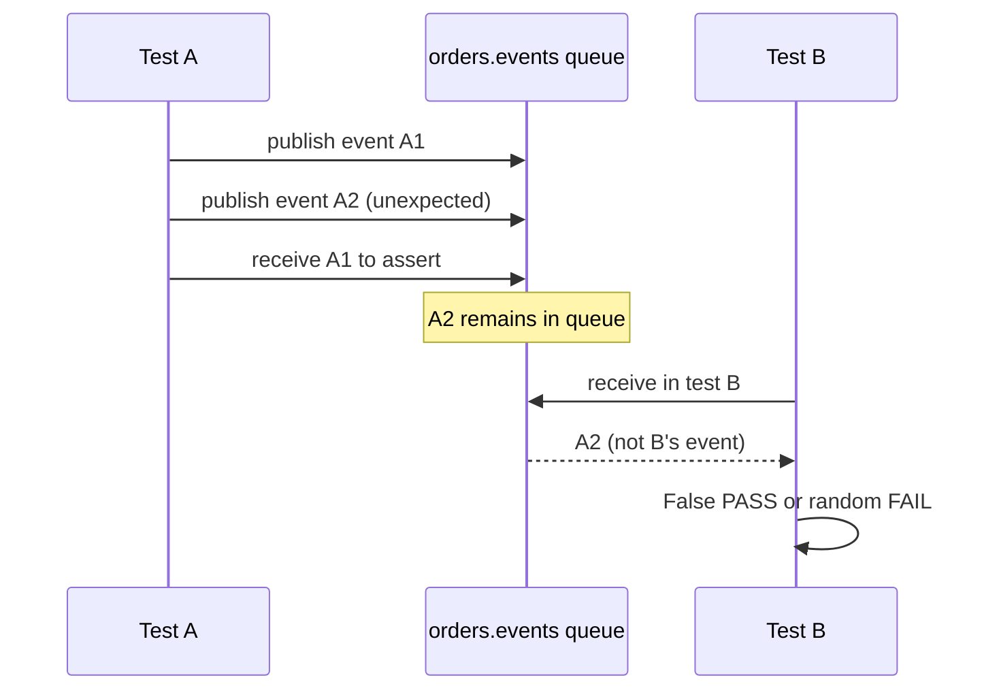
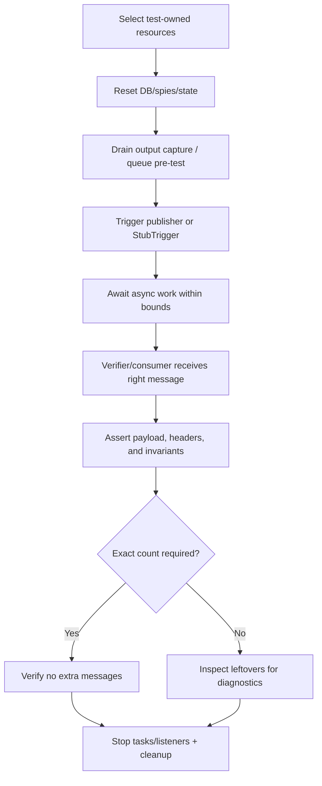
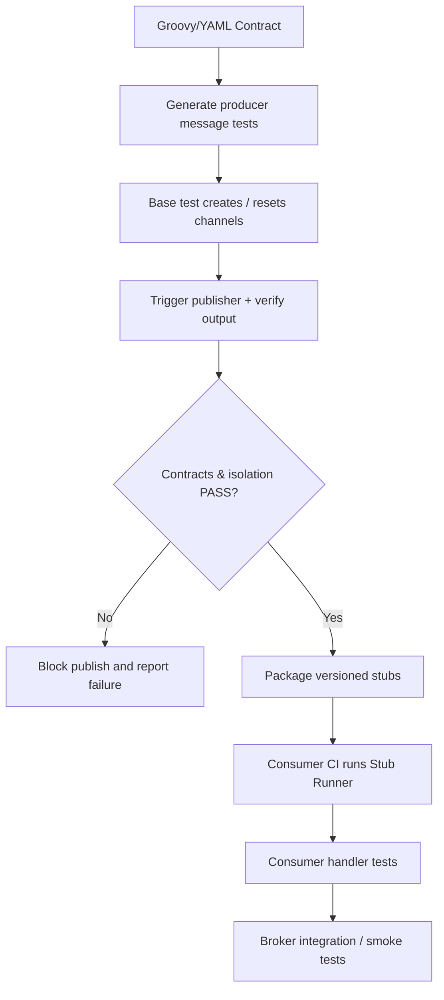

# Cleaning Channels or Queues so Tests Do Not Interfere With Each Other

> **Chapter:** Messaging Contract Testing  
> **Module:** Spring Cloud Contract (`SPRING_CLOUD_CONTRACT`) — contract testing between producer and consumer using Groovy/YAML DSL for HTTP and messaging, generating producer verification tests, publishing stubs, using Stub Runner, and governing compatibility via CI.

## Learning Objectives

After this lesson, you will be able to:

1. Identify **leftover messages from previous tests** and other shared state that cause messaging contract tests to pass falsely, fail intermittently, or depend on execution order.
2. Explain the differences between **test state isolation**, **draining queues**, **awaiting async processing**, and **verifying no extra messages exist**.
3. Write a JUnit 5 base test for Spring Cloud Contract with `@BeforeEach`/`@AfterEach` draining a **test-dedicated** `PollableChannel`, using `receive(0)` to avoid blocking indefinitely.
4. Distinguish strategies for `QueueChannel`, `DirectChannel`, `PublishSubscribeChannel`, the Spring Cloud Stream test binder, and brokers like Kafka/JMS/RabbitMQ.
5. Keep generated producer tests genuinely checking the publisher and emitted messages, rather than consuming the wrong message or hiding duplicate emissions.
6. Design consumer tests using Stub Runner/`StubTrigger` with isolated state, correlation IDs, and bounded wait conditions.
7. Apply isolation rules in CI when running multiple contracts, parallel tests, and retries.

## 1. Scenario: Test B "PASSES" Thanks to Test A's Message

Suppose `order-service` (producer) emits an `OrderAccepted` message to `orders.events`. Service `billing-service` (consumer) receives the event to initiate invoicing.

Both sides' contract commits to the payload:

```json
{
  "eventType": "OrderAccepted",
  "orderId": "ORD-1001",
  "amount": 240000,
  "currency": "VND"
}
```

A producer suite has two tests:

- **Test A:** triggers acceptance of order `ORD-1001` and verifies the `OrderAccepted` event.
- **Test B:** tests another interaction that also uses the `orders.events` channel.

If Test A produces **two messages** yet Verifier only receives one to assert, the second message stays in the queue. Test B starts and reads that leftover message before its own result is even emitted.

Consequences can include:

- Test B **falsely PASSES** if the leftover payload happens to match Contract B.
- Test B **FAILS flakily** if the leftover payload differs from what B expects.
- Each test passes when run alone, yet the full suite fails.
- Reordering tests or enabling parallel execution makes the failure appear or disappear.



**Leftover messages are shared state.** Unlike a REST request that typically does not leave a payload sitting in a queue for the next test to read, queue-backed channels retain messages until a consumer actually consumes them.

Draining queues reduces this risk, yet **draining at the wrong time is even more dangerous**: it can delete an in-flight test's message or erase evidence that the producer emitted duplicate events.

## 2. Isolation Is the Goal; Draining Queues Is Only One Technique

A trustworthy messaging test requires these properties:

| Property | Meaning |
| --- | --- |
| **Order independence** | Running A then B or B then A yields the same result |
| **Repeatability** | Running multiple times on the same code and fixtures yields the same verdict |
| **True provenance** | The asserted message was actually emitted by the current test's trigger |
| **Zero leakage** | Old messages, consumer state, subscriptions, or tasks do not affect later tests |
| **No accidental deletion** | Cleanup mutates only test-owned resources, never active tests or shared environments |
| **Clear failure signal** | Duplicate emissions, wrong destinations, or bad payloads must fail the relevant test rather than being swept away by cleanup |

A sound strategy usually combines:

1. **Dedicated resources:** test queues/destinations/topics, consumer groups, contexts, fixtures.
2. **Pre-test reset:** clearing old messages when the test **exclusively owns** the queue.
3. **Post-test checks:** detecting unexpected messages when contracts require exact counts.
4. **Awaiting completion:** preventing late messages from arriving after the test has finished.
5. **Correlation:** attaching scenario IDs to messages when multiple flows share a destination.
6. **Resource shutdown:** stopping listeners, executors, and test brokers/contexts at the right point.

**Do not treat "drain after every test" as sufficient:** if an asynchronous publisher is still running, it can emit a message after cleanup finishes.

## 3. Distinguishing Message Channel Types

Not every channel has a "queue" to drain.

| Mechanism | Receive Model | Can Drain with `receive(0)`? | Key Thing to Remember |
| --- | --- | --- | --- |
| Spring Integration `QueueChannel` | Pull/poll | **Yes**, if test owns the queue | Messages remain until received; `receive(0)` does not block |
| Spring Messaging `PollableChannel` | Pull/poll | **Yes**, if implementation supports it | `receive(0)` both **reads** and **removes** from queue |
| Spring Integration `DirectChannel` | Dispatches directly to subscriber | **No** | No internal queue to poll; reset subscriber/test state |
| `PublishSubscribeChannel` | Broadcasts to subscribers | **No** | Does not implement `PollableChannel`; needs a dedicated capture |
| `ExecutorChannel` or async channel | Handler runs on executor | **Not this way** | Await tasks, unsubscribe/isolate executor |
| Spring Cloud Stream **test binder** | `OutputDestination.receive(...)` | **Yes on test binder's output capture** | Drain only test-owned destinations; avoid racing with Verifier's receive |
| Kafka topic | Consumer reads by offset | **Not** via `PollableChannel` | Isolate topic/group/offsets; never delete shared topics |
| JMS/RabbitMQ queue | Broker stores/acks messages | **Not** via generic Spring Integration API | Create dedicated queues, purge carefully, or isolate broker |

This distinction leads to the first rule: **identify the actual implementation holding messages before writing cleanup code**.

### 3.1. QueueChannel and receive(0)

In Spring Integration, `QueueChannel` is a point-to-point channel storing messages in a queue. `PollableChannel.receive(long timeout)` with `timeout = 0` checks for a message **immediately**, returning `null` if none is available.

```java
Message<?> message = channel.receive(0);
```

Never call `receive()` without a timeout in a cleanup loop: it can **block forever** when the queue is empty.

### 3.2. QueueChannel Is Not PublishSubscribeChannel

With `PublishSubscribeChannel`, messages are dispatched to subscribers. There is no `receive(0)` because it is not a `PollableChannel`. To observe messages for tests, attach a **test subscriber** that records events into its own `BlockingQueue`, then clear that capture queue between tests.

Do not write one `QueueChannel` drain loop and apply it blindly to every messaging integration.

## 4. Example Contract: Producer Emits OrderAccepted

Place a Groovy contract in the producer's `src/test/resources/contracts/order_accepted.groovy`:

```groovy
org.springframework.cloud.contract.spec.Contract.make {
    name 'order_accepted'
    label 'order_accepted'

    input {
        triggeredBy('publishOrderAccepted()')
    }

    outputMessage {
        sentTo('orders.events')
        headers {
            messagingContentType(applicationJson())
        }
        body(
            eventType: 'OrderAccepted',
            orderId: 'ORD-1001',
            amount: 240000,
            currency: 'VND'
        )
    }
}
```

Meaning:

- The generated producer test calls `publishOrderAccepted()` on the base class.
- Verifier must receive the message emitted to `orders.events`.
- The test verifies the agreed headers and body.
- `label` allows consumer Stub Runner to trigger the message stub by name.

Behaviorally equivalent YAML version:

```yaml
name: order_accepted
label: order_accepted

input:
  triggeredBy: publishOrderAccepted()

outputMessage:
  sentTo: orders.events
  headers:
    contentType: application/json
  body:
    eventType: OrderAccepted
    orderId: ORD-1001
    amount: 240000
    currency: VND
```

Choose **one DSL** per scenario during builds; keeping both YAML and Groovy in the same contract directory can generate duplicate tests/stubs.

**Queue cleanup is not a contract field.** It belongs to test infrastructure, typically inside the base test extended by generated tests. Never put a broker purge action inside `outputMessage` just to make producer verification "green".

## 5. Dedicated Test Channel for the Spring Integration Example

A **test-only** configuration (for instance `ContractMessageChannels.java` in test sources):

```java
package com.example.orders;

import org.springframework.boot.test.context.TestConfiguration;
import org.springframework.context.annotation.Bean;
import org.springframework.integration.channel.QueueChannel;
import org.springframework.messaging.PollableChannel;

@TestConfiguration(proxyBeanMethods = false)
public class ContractMessageChannels {

    @Bean("orders.events")
    public PollableChannel orderEvents() {
        return new QueueChannel(32);
    }
}
```

Key points:

- `orders.events` is the **test bean/channel name**, matching the contract destination.
- `QueueChannel(32)` creates a bounded queue so unexpected messages do not accumulate indefinitely.
- When tests run, the publisher must send **into this exact channel bean**. If production already defines a bean with the same name, avoid duplicate registration; use a controlled test profile/override or matching app configuration.
- Do not assume `@Bean("orders.events")` creates a Kafka topic or RabbitMQ exchange in production.

With Spring Integration on the test classpath, Spring Cloud Contract includes verifier integration to locate destinations/channels. Configure the right binder/adapter if the project includes multiple messaging libraries.

### 5.1. Real Publisher — Not a Mock Crafting Sample Messages

Example publisher using the registered `MessageChannel`:

```java
package com.example.orders;

import org.springframework.beans.factory.annotation.Qualifier;
import org.springframework.messaging.MessageChannel;
import org.springframework.messaging.MessageHeaders;
import org.springframework.messaging.support.MessageBuilder;
import org.springframework.stereotype.Service;
import org.springframework.util.MimeTypeUtils;

@Service
public class OrderEventPublisher {

    private final MessageChannel output;

    public OrderEventPublisher(
            @Qualifier("orders.events") MessageChannel output) {
        this.output = output;
    }

    public void publishOrderAccepted() {
        String json = """
            {
              "eventType": "OrderAccepted",
              "orderId": "ORD-1001",
              "amount": 240000,
              "currency": "VND"
            }
            """;

        output.send(
            MessageBuilder.withPayload(json)
                .setHeader(
                    MessageHeaders.CONTENT_TYPE,
                    MimeTypeUtils.APPLICATION_JSON
                )
                .build()
        );
    }
}
```

This is an **illustrative publisher explaining message flow**, without order-persistence logic. Contract tests must invoke the **real publisher** to verify whether code emits events matching the agreement. If generated tests merely push a sample JSON into a queue and assert it themselves, they do not verify the producer.

If your project uses `StreamBridge`, `KafkaTemplate`, or a real JMS adapter, test setup/binders will differ. Do not drop in a fake `QueueChannel` expecting it to replace a Kafka topic without an adapter bridging them.

### 5.2. Payload and Headers Must Be Compatible

The contract expects a JSON body. The publisher above sends a JSON string with header `contentType: application/json`. Depending on the Verifier integration, the payload may be read as a string, `byte[]`, or object/Map; inspect **generated tests and actual messages** if serializers differ.

Once a message is drained from the queue, it is **no longer there for Verifier to assert**. Therefore, cleanup logic in the base test must execute at the right moment.

## 6. Base Test: Cleaning Before and After Each Producer Contract Test

On the producer, the Contract Verifier plugin is configured with `baseClassForTests = com.example.orders.ContractTestBase`. This class is where state reset logic belongs.

```java
package com.example.orders;

import org.junit.jupiter.api.AfterEach;
import org.junit.jupiter.api.BeforeEach;
import org.springframework.beans.factory.annotation.Autowired;
import org.springframework.beans.factory.annotation.Qualifier;
import org.springframework.boot.test.context.SpringBootTest;
import org.springframework.context.annotation.Import;
import org.springframework.messaging.Message;
import org.springframework.messaging.PollableChannel;
import org.springframework.cloud.contract.verifier.messaging.boot.AutoConfigureMessageVerifier;

@SpringBootTest
@AutoConfigureMessageVerifier
@Import(ContractMessageChannels.class)
public abstract class ContractTestBase {

    @Autowired
    @Qualifier("orders.events")
    protected PollableChannel events;

    @Autowired
    protected OrderEventPublisher publisher;

    @BeforeEach
    protected void clearBeforeContract() {
        drainOwnedQueue(events);
    }

    protected void publishOrderAccepted() {
        publisher.publishOrderAccepted();
    }

    @AfterEach
    protected void clearAfterContract() {
        drainOwnedQueue(events);
    }

    protected static int drainOwnedQueue(PollableChannel channel) {
        int removed = 0;
        Message<?> message;
        while ((message = channel.receive(0)) != null) {
            removed++;
            if (removed > 10_000) {
                throw new IllegalStateException(
                    "Queue is continuously receiving messages; stop the publisher before draining"
                );
            }
        }
        return removed;
    }
}
```

This is a template for a **dedicated in-memory queue owned by the suite**. To run it, the project needs a Spring Boot application class, Spring Integration, matching test dependencies, and configuration so the publisher actually sends to `orders.events`; projects with multiple producer beans/bindings must adapt setup.

### 6.1. Lifecycle Explanation

| Phase | Action | Why |
| --- | --- | --- |
| `@BeforeEach` | Drain leftover messages from the test-owned output queue | New test will not receive stale events |
| Contract trigger | Call `publishOrderAccepted()` | Invokes the real publisher |
| Generated assertion | Verifier receives and checks the right message | Guards producer behavior |
| `@AfterEach` | Drain any remaining messages | Leaves no residual state for the next test |
| Context teardown when needed | Stop subscribers/executors/brokers | Prevents tasks from writing after cleanup |

**Pre-test draining** matters because Spring's test framework can cache `ApplicationContext` across tests. A singleton channel can outlive multiple test methods even when each test gets a fresh JUnit instance.

**Post-test draining** limits leaks when assertions fail early or a producer emits multiple events. However, **never use cleanup to hide duplicates**: if contracts or business rules require exactly one message, add a dedicated assertion checking no extra messages exist—see section 7.

### 6.2. Why Must `receive(0)` Stay Outside the Main Assertion Path?

Because `receive(0)` **consumes** the message. If the base test calls it **after the trigger yet before the generated verifier**, Verifier will have no event left to read and will time out.

Correct order:

```text
DRAIN → PREPARE FIXTURES → TRIGGER → VERIFIER RECEIVE/ASSERT → DRAIN LEFTOVERS
```

Do not call another `receive(0)` inside an `assertThat` helper if that helper could steal the message the generated test is waiting for. Custom checks must be clear about who owns the message receive.

### 6.3. Why Put a Bound on the Drain Loop?

When a background producer keeps emitting messages, the queue never empties; `while (receive(0) != null)` would spin abnormally long. Bounding the drain count **does not fix the root cause**, yet it fails fast instead of hanging forever. Fix the root cause by stopping background schedulers/consumers or isolating destinations.

An empty queue at the instant `receive(0) == null` **does not guarantee** another message will not arrive **right afterward**.

## 7. Do Not Use Cleanup to Mask Duplicate Emissions

Consider a bug where the publisher sends **two messages** instead of one:

```java
publisher.publishOrderAccepted();
publisher.publishOrderAccepted(); // bug: duplicate emission
```

A standard generated messaging contract test may verify only **one matching output message**. If `@AfterEach` silently drains the second message, the suite stays green even though business rules demand exactly one event.

There are two distinct verification levels:

1. **Content contract:** the received message has the right destination, headers, and body.
2. **Cardinality invariant:** in this scenario the publisher must produce **one** event (or a fixed count).

If the second invariant matters, add a dedicated test or explicit extension asserting that condition.

### 7.1. Checking for Extra Messages When the Publisher Is Synchronous

When you are certain the publisher finishes synchronously, the generated verifier already read the single expected message, and **no competing consumer exists**, you can assert after the test:

```java
@AfterEach
protected void assertNoUnexpectedOutputThenClean() {
    try {
        Message<?> extra = events.receive(0);
        assertNull(
            extra,
            "Producer emitted an unexpected extra message outside contract"
        );
    } finally {
        drainOwnedQueue(events);
    }
}
```

This is a **replacement variant for `clearAfterContract()`**—do not keep both hooks active by default. Requires static import `org.junit.jupiter.api.Assertions.assertNull`.

**Applicable conditions:**

- The specific test expects **exactly one** message and the verifier already received the primary message.
- No messages are still in flight from an unfinished async task.
- `events` is a **test-owned** queue not consumed by another listener.
- If a contract permits multiple messages, design assertions for that count rather than forcing all scenarios to one.

If the generated test fails before receiving the primary output, the `@AfterEach` assertion may report a leftover message too, logging two failures. That is normal; prioritize inspecting the **root failure** and never alter contracts just to silence the secondary check.

### 7.2. Separating Cardinality Tests from Contracts When Needed

A dedicated integration/unit test can do:

```java
@Test
void publishMotLanChiPhatMotMessage() {
    drainOwnedQueue(events);

    publisher.publishOrderAccepted();

    Message<?> first = events.receive(1_000);
    assertNotNull(first);
    assertNull(events.receive(0), "Must not emit a second message");
}
```

The snippet assumes full assertion imports and a synchronous publisher. With asynchronous publishers, checking the queue immediately after the first event may miss a late duplicate: wait for the publisher to signal completion or observe a bounded window per business guarantees.

## 8. Asynchronous Publishers: Pre/Post Cleanup Is Not Enough

A subtle bug:

```text
Test A: start async publish
Test A: assertions end / teardown drains queue
Test B: setup drains queue
A's async task: publishes late to queue
Test B: receives A's message → false FAIL/PASS
```

If the publisher sends via `@Async`, a scheduler, a Reactor pipeline, or an executor-backed listener, you must **synchronize lifecycle**.

### 8.1. Handling Strategies in Priority Order

1. **Await publisher completion** via `Future/CompletableFuture`, task handles, or application signals before ending the test.
2. **Isolate destinations per test** when infrastructure allows and attach scenario-specific correlation IDs.
3. **Disable unrelated background tasks** in the test profile; prevent production schedulers from injecting messages mid-test.
4. **Use bounded waits** for expected output instead of arbitrary `Thread.sleep`.
5. Use `@DirtiesContext` only when Spring context state is hard to reset safely; it carries higher runtime cost.

Conceptual example with `CompletableFuture`:

```java
CompletableFuture<Void> completion =
    publisher.publishAcceptedAsync("ORD-1001");

completion.join(); // Wait until publisher signals completion.
```

This is **illustrative API design**, since `OrderEventPublisher` in section 5 has a different synchronous method. If your software actually returns a future on publish, tests should await it properly. `join()` also needs a timeout strategy so CI does not hang if a task stalls; consider `get(timeout, TimeUnit.SECONDS)` with timeout handling.

### 8.2. Bounded Waiting Is Not Fixed Sleeping

Avoid relying on:

```java
Thread.sleep(3_000); // Hope the message has arrived.
```

This slows the suite down, remains flaky under heavy CI load, and never verifies the right event.

When writing consumer tests or manual messaging tests, use Awaitility:

```java
await().atMost(Duration.ofSeconds(5))
    .untilAsserted(() ->
        assertEquals("READY", stateStore.status("ORD-1001"))
    );
```

`stateStore` is a probe/fixture observing state updated by the **real handler**; it requires Awaitility or an equivalent polling library. For generated producer tests, Verifier has its own receive/timeout mechanics, so do not attach a competing consumer reading the same queue just to wait.

## 9. Correlation IDs: Distinguishing the Current Test's Message

In asynchronous suites or when multiple producers share a destination, **correlation** helps verify event provenance.

You can include a `testRunId` or `correlationId` in **headers/payload** when compatible with contracts and app logic:

```json
{
  "eventType": "OrderAccepted",
  "orderId": "ORD-1001",
  "correlationId": "run-B-0007",
  "amount": 240000
}
```

When the test receives a message, it accepts only events belonging to the current scenario and flags/logs unexpected ones. However:

- **Do not arbitrarily add `correlationId` to a public contract** if the real API does not commit to that field. Use test-specific headers or fixtures when the app permits.
- Merely **skipping** messages with mismatched correlations can hide leaks; log and treat leftovers as an isolation signal.
- IDs only solve **identification**; they do not clear backlogs or stop stale schedulers.
- If parallel tests share one queue, one consumer can pull another test's message before checking correlation. **Filtering after consumption does not replace queue isolation.**

Prefer isolated queues/destinations whenever concurrent consumers exist, using correlation as an **extra safety layer**.

## 10. Spring Cloud Stream Test Binder: Draining the Right Output Capture

If your project uses the Spring Cloud Stream functional model, the test binder provides `InputDestination` and `OutputDestination` for **in-memory** communication testing without a real broker.

Example standalone test (do not run concurrently with generated Contract Verifier reading the same message):

```java
@Autowired
OutputDestination outputDestination;

@BeforeEach
void clearStreamOutput() {
    while (outputDestination.receive(0, "orders.events") != null) {
        // Drain all pending messages in the test binder's output capture.
    }
}
```

`receive(0, destinationName)` reads a message from the output destination with a zero timeout. The name `orders.events` works only if the application binding actually maps to that destination; a function might use a binding name like `orders-out-0` instead.

### 10.1. Conditions for This Snippet to Work

- You enabled the **Spring Cloud Stream test binder** matching your project version (e.g., test dependency `spring-cloud-stream-test-binder`).
- `OutputDestination` is the **output capture of the running suite**.
- The test owns that destination, with no generated verifier or other test reading concurrently during cleanup.
- No events are still being processed asynchronously at cleanup time.
- You specified the right output **binding name/destination name**; the wrong name drains the wrong target or misses messages.

**Never run both Verifier receive and `OutputDestination.receive` in parallel for the same message.** They are competing consumers—one can steal the event first and cause the other to time out.

### 10.2. InputDestination Is Not an Output Queue

`InputDestination.send(...)` is used to **feed messages into consumers/functions** in the test binder. `OutputDestination.receive(...)` is used to **read outputs**. If a consumer stores state in a repository/test spy, you must **reset that state too**, not just drain output.

Example test of a consumer function reading `PaymentCaptured` and emitting `OrderPaid`:

```java
inputDestination.send(
    MessageBuilder.withPayload(inputJson.getBytes(StandardCharsets.UTF_8))
        .build(),
    "payments.events"
);

Message<byte[]> output =
    outputDestination.receive(5_000, "orders.events");

assertNotNull(output);
```

This is an illustrative snippet requiring function/binding config, imports, and matching assertions. Waiting up to 5 seconds when **receiving expected output** differs from `receive(0)` used to **drain leftover messages**.

## 11. For DirectChannel and PublishSubscribeChannel: Reset Subscribers, Not Channel Draining

### 11.1. DirectChannel

`DirectChannel` dispatches messages straight to the chosen handler and retains no internal backlog like `QueueChannel`. If a test fails due to stale state, the cause usually lies in:

- A singleton handler/service holding data from a prior run.
- Test spies/mocks with unreset invocation history.
- In-memory repositories retaining old events/records.
- Unfinished asynchronous tasks.
- A subscriber registered twice.

The fix is to **reset handler/test-probe state** or spin up a fresh context/fixture—not searching for a nonexistent `receive(0)` method.

### 11.2. PublishSubscribeChannel

`PublishSubscribeChannel` broadcasts messages to subscribers; a test subscriber can record messages into its own capture queue:

```java
private final BlockingQueue<Message<?>> observed =
    new LinkedBlockingQueue<>();

private final MessageHandler probe = observed::offer;

// In setup, register probe on the appropriate PublishSubscribeChannel.
// In teardown, unregister probe.
// Before a new test, observed.clear() if the capture queue belongs to the test.
```

This is **architectural pseudocode**: actual subscribe/unsubscribe methods and channel types must be configured accurately. The `observed` queue is solely a **test probe**, not the production publisher's queue.

Without unsubscribing, each test may attach another subscriber; sending one message invokes multiple handlers, duplicating assertions or leaking memory. Manage **subscriber registration lifecycles** alongside data cleanup.

## 12. Real Brokers or Embedded Brokers: Prioritize Resource Isolation

When using Kafka, JMS, or RabbitMQ in integration tests, "cleaning queues" differs from in-memory channels.

| Infrastructure | Cross-Test Contamination Source | Preferred Strategy |
| --- | --- | --- |
| Kafka | Old topic logs, reused offsets/groups, unassigned consumers | Dedicated topics/destinations, isolated group IDs where appropriate, controlled offsets |
| RabbitMQ | Durable queues holding messages, unacked/requeued items, stale bindings/subscribers | Dedicated test queues, delete/purge **only test-owned queues**, await consumer stop |
| JMS | Queues retaining messages, redeliveries, durable subscriptions | Dedicated queues and broker/fixture reset; never purge shared queues |
| Testcontainers broker | Container kept alive too long, state from prior classes | Suite-scoped namespaces/topics/queues, ordered lifecycle and cleanup |
| Embedded/in-memory broker | Lingering contexts/consumers or test ordering | Context resets when needed, isolated fixtures, and stopped tasks |

**Never purge or delete production or shared-environment queues/topics just for test cleanup.** Destructive cleanup is permissible only on resources exclusively owned and accurately identified by the test suite.

### 12.1. Kafka: A New Group Does Not Mean an Empty Topic

Kafka persists a **log on the topic**, and each consumer group tracks its own offsets. Creating a new consumer group on an old topic with `auto.offset.reset=earliest` can replay **every event from earlier tests**.

Using `latest`, on the other hand, can cause a new consumer to miss an event sent **before partition assignment completed**. No single property fixes all timing issues.

Reliable practices:

1. Prefer a **dedicated test topic** per class/suite/case when cost permits.
2. Use a **dedicated consumer group** when tests share infrastructure.
3. Complete assignment/seek to the intended offset **before sending** the test event.
4. Use correlation IDs/record keys to verify event provenance rather than merely counting events.
5. Close consumers and shut down test containers/brokers cleanly per lifecycle.

Spring Kafka docs recommend using **distinct topics per test** with embedded Kafka to prevent cross-talk. `@DirtiesContext` can help with certain context/embedded-broker lifecycle issues, yet recreating contexts is expensive and does not automatically delete external Kafka topics outside the JVM.

### 12.2. RabbitMQ and JMS: ACK/Redelivery Can Resurface "Old Messages"

If a test receives a message without ACKing it (or rolls back a transaction), the broker can **redeliver** it to a subsequent consumer. Another test's drain operation might swallow that message and make results unpredictable.

Use dedicated test queues/destinations and clarify:

- ACK/commit/rollback mechanics.
- Whether listener containers stopped completely before purging.
- Whether DLQs, retries/backoffs, or redeliveries are active.
- Whether queues are durable/auto-delete or reused across suites.

Purging a broker **is not the same as `PollableChannel.receive(0)`**; it mutates broker infrastructure and can drop messages meant for other consumers if unisolated.

## 13. Consumer Tests with Stub Runner: Avoid Stale Listener State

On the consumer side, Stub Runner can trigger sample events by `label` from published contracts.

Example assuming `OrderEventHandler` updates a test-observable `TestOrderState`:

```java
@SpringBootTest
@AutoConfigureStubRunner(
    ids = "com.example:order-service:1.0.0:stubs",
    stubsMode = StubRunnerProperties.StubsMode.LOCAL
)
class BillingEventContractTest {

    @Autowired
    StubTrigger stubTrigger;

    @Autowired
    TestOrderState testOrderState;

    @BeforeEach
    void resetState() {
        testOrderState.reset();
    }

    @Test
    void billingNhanOrderAccepted() {
        assertTrue(stubTrigger.trigger("order_accepted"));

        await().atMost(Duration.ofSeconds(5))
            .untilAsserted(() ->
                assertEquals(
                    "READY_TO_BILL",
                    testOrderState.getStatus("ORD-1001")
                )
            );
    }
}
```

This is an **illustrative** test requiring imports, Stub Runner dependencies, binders/adapters, and real `TestOrderState`/handler classes. `@AutoConfigureStubRunner` only loads stubs; delivering messages to the listener requires **properly configured messaging integration**.

### 13.1. Why `trigger() == true` Alone Is Insufficient

`stubTrigger.trigger("order_accepted")` reports that the stub fired an event for that label. It **does not prove** the consumer's handler:

- Received the event on the right binding.
- Decoded JSON/headers successfully.
- Updated business data.
- Avoided duplicate processing or reading stale state from an earlier test.

Therefore, assert **observable outcomes after the handler runs**, within a bounded timeout.

### 13.2. Reset Consumer State Before Each Test

If `TestOrderState` is a singleton bean or in-memory repository, a prior test may have left `ORD-1001` in `READY_TO_BILL`. A new test that never receives the message would still see that status and **falsely PASS**.

Reset observable state before tests, and ensure listeners/tasks finish after tests. For hard-to-reset state, consider separate contexts or distinct `orderId`s per test if contracts/stubs permit. Avoid reusing `ORD-1001` across asynchronous tests without state isolation.

## 14. Should You Use @DirtiesContext?

`@DirtiesContext` instructs Spring Test to mark the context dirty and evict it from cache at the declared scope. It helps when a test mutates singleton state, subscriptions, or configuration that cannot be reset cleanly.

Example applied to a class with complex integration setup:

```java
@DirtiesContext(classMode = DirtiesContext.ClassMode.AFTER_CLASS)
class MessagingIntegrationTest {
    // ...
}
```

Understand the trade-offs:

- **Pros:** reduces state leakage across classes sharing a Spring context.
- **Cons:** recreating contexts/brokers can substantially increase CI runtime.
- **Limitation:** if queues/topics live on an **external broker** that stays up, closing the Spring context **does not delete messages on the broker**.
- **Scope:** `AFTER_CLASS` clears the context after the whole class, **not** between two test methods in the same class sharing state. `AFTER_EACH_TEST_METHOD` isolates more strictly at high cost.

Prefer resetting fixtures or owning dedicated test channels; reserve `@DirtiesContext` for context-caching or lifecycle issues, not as a "fix-all button for flaky tests".

## 15. Parallel Execution: When Must It Be Disabled?

Two tests running in parallel on the **same `QueueChannel`** can collide like this:

```text
Test A: beforeEach drain
Test B: beforeEach drain
Test A: publish A
Test B: publish B
Verifier A: receive B
Verifier B: receive A
```

**No cleanup order can fix two consumers racing on the same queue.**

Solutions by situation:

- Give each test its own **context/channel**.
- Give each test a separately named/isolated destination.
- For broker-based integration tests, use test-owned topics/queues and consumer groups.
- If separation is impossible, guard shared-queue tests with a **resource lock** or disable parallel execution for that group.

JUnit 5 can declare a resource lock on a test class when needed:

```java
@ResourceLock(value = "orders.events")
class OrderMessagingContractTests {
    // Tests are coordinated via a resource lock when
    // JUnit Jupiter supports it and parallel execution is configured accordingly.
}
```

This is a **suggestion for hand-written test classes**. For classes **generated by Contract Verifier**, annotations may need to live on the base class or plugin-configured test template; verify actual inheritance and runner behavior. When unsure if tests can be locked reliably, disabling parallel execution for the messaging test module is the safer choice.

## 16. Standard Per-Test Workflow



Adapt the sequence to your tooling; generated Verifier tests typically **perform trigger/receive/assert themselves**, so the base class should handle only fixtures/cleanup. Never insert a second receiver between generated test steps.

### 16.1. Pre-Test Checklist

- Are queues/output captures genuinely owned by the test?
- Do any singleton mocks/listeners/services retain state from a previous run?
- Can background schedulers or async publishers emit messages on their own?
- Are two consumers reading from the same queue?
- Does `sentTo` in the contract match the active runtime configuration?
- Do any other contracts emit the same message/label?
- Does the test await the right output rather than sleeping a fixed duration?
- When a test passes, is the received message guaranteed to come from the current trigger?

### 16.2. Post-Test Checklist

- Did the generated verifier receive and assert the primary message?
- Were any extra messages left behind, and does their presence indicate a business bug?
- Have all async tasks/listeners stopped or completed?
- Has consumer/test-probe state been reset?
- Were shared queues spared unauthorized purges?
- Do solo runs and full-suite runs produce identical outcomes?

## 17. Bringing Isolation into CI

Example producer pipeline:



With Maven configured for the plugin, a typical step is:

```bash
mvn clean verify
```

Only after producer verification **is generated and genuinely PASSES** should matching stub artifacts be installed/published:

```bash
mvn clean install
```

Never run `-DskipTests` and claim stubs are verified. In CI, you should:

1. Check the actual count of executed generated tests—never accept an unexpected "0 tests".
2. Archive test reports and logs on timeouts or payload mismatches.
3. Re-run the suite in **reversed or randomized order** on test branches to expose state leaks.
4. Loop sensitive messaging test groups repeatedly to catch systematic flakiness.
5. Never parallelize tests sharing resources until isolation is guaranteed.
6. Version stubs explicitly so consumers do not pull stale event schemas.
7. For broker integration, create/delete **CI-job-owned resources**, leaving other environments untouched.

**Flaky tests must never be "solved" solely with retries.** Retries can turn a pipeline green while hiding races or test contamination; use logs and repeat runs to eliminate root causes.

## 18. Diagnosing Common Symptoms

| Symptom | Possible Cause | Resolution |
| --- | --- | --- |
| Test B PASSES without a proper trigger | B consumed leftover message from A | Drain test-owned queue pre-test, add correlation / isolated channels |
| Fails only in full suite | Shared context/queue/subscriber | Check test order, teardown, and Spring context cache |
| Fails after adding `@BeforeEach` | Cleanup runs too late and steals primary message | Drain before trigger; eliminate competing receivers |
| Intermittent timeouts | Late async publisher, wrong destination | Await task/right binding, bounded timeouts, isolate |
| Messages vanish in parallel runs | Two verifiers polling the same queue | Use dedicated destinations or run sequentially |
| Queue grows continuously | Extra messages, unread consumer, subscription leak | Assert counts, stop tasks, fix publisher |
| Producer emits two events yet test passes | Verifier consumes one, `@AfterEach` silently drains the spare | Add duplicate/cardinality checks |
| `receive()` hangs the build | Unbounded poll on empty queue | Use `receive(0)` for cleanup, bounded timeout for expected messages |
| `PublishSubscribeChannel` lacks `receive` | Not a `PollableChannel` | Use a test subscriber/capture queue |
| Stream binder test reads stale event | `OutputDestination` retains message or wrong binding name | Drain the exact test-owned output capture |
| Kafka consumer replays old events | New group with `earliest` on shared topic | Dedicated topic, control seek/offset/correlation |
| Kafka consumer misses events | `latest` offset when event sent before assignment | Finish partition assignment before publishing |
| RabbitMQ/JMS redelivers event | Unacked/redelivery or old durable queue | Dedicated test queue, manage ACKs and listener lifecycle |
| Consumer test passes falsely | Test listener state unreset | Reset repository/probe pre-test, assert new event outcome |
| `@DirtiesContext` leaves backlog | Messages live outside JVM on broker | Isolate broker resources instead of only resetting context |

## 19. Practice Exercises

**Exercise 1 — Order-dependent bug tracing.** Test A emits two messages and Verifier consumes one; Test B fails to trigger properly yet still receives a message. Draw the timeline and explain why Test B's `@BeforeEach` drain lowers risk yet **does not prove Producer A emitted exactly one event**.

**Exercise 2 — Writing a drain helper.** Given a test-dedicated `PollableChannel`, write `drainOwnedQueue` using `receive(0)` until it returns `null`. Why can `receive()` without a timeout hang the suite?

**Exercise 3 — Base test.** Create `ContractTestBase` using `@SpringBootTest`, `@AutoConfigureMessageVerifier`, `@Import` for `QueueChannel` config, and `@BeforeEach` cleanup. Implement `publishOrderAccepted()` so generated contract tests invoke the real publisher.

**Exercise 4 — Duplicate event experiment.** Modify the publisher to intentionally emit two `OrderAccepted` events while keeping the contract specifying one output. Write an extra test or hook proving the extra event is caught instead of silently wiped by `@AfterEach`.

**Exercise 5 — Stream test binder.** Given a function with input destination `payments.events` and output `orders.events`, write code to reset `OutputDestination`, send input via `InputDestination`, and receive output with a timeout. Why should a manual receive never run simultaneously with the generated Verifier?

**Exercise 6 — Async race.** Test A finishes teardown, yet an `@Async` publisher still sends an event into the queue just as Test B starts. Propose two **verifiable** solutions better than increasing `Thread.sleep`.

**Exercise 7 — Kafka isolation.** Two tests share a topic, each using a new group with `auto.offset.reset=earliest`. Why does it still read old events? Design suitable isolated topics/groups/offsets.

**Exercise 8 — Stub Runner consumer.** After `stubTrigger.trigger("order_accepted")`, verify `billing-service`'s handler actually transitions the order to `READY_TO_BILL`. Explain how to reset consumer state so the next run cannot falsely PASS.

**Exercise 9 — CI checklist.** Draft a pre-publish checklist for a messaging stub module: generated tests, isolation, message counts, timeouts, test-owned broker resources, and artifact versioning.

### Solution Hints

1. Draining before B removes A's leftover message, yet cannot prove A emitted the right count; check duplicates in A.
2. Loop `while (channel.receive(0) != null)`; `receive()` without timeout can wait forever on an empty queue.
3. The test base must wire the right channel and trigger method without crafting sample messages in place of the real publisher.
4. Assert no remaining message after generated receive, or test publisher cardinality separately when synchronous; await completion for async flows.
5. Use `OutputDestination.receive(0, name)` to drain beforehand, then `InputDestination.send` and `OutputDestination.receive(timeout, name)` in a dedicated test; competing receivers steal Verifier's output.
6. Await completion futures/acks or isolate destinations per test + correlation; avoid guesswork sleeps.
7. A new Kafka group with `earliest` still reads topic history. Use dedicated test topics and wait for offset/assignment before publishing.
8. Reset state before triggering; use bounded waiting to confirm the real handler updates outcomes.
9. Producer tests execute and PASS, zero state leaks, never publish with skipped tests, cleanup touches only test-owned resources, consumers pin stub versions.

## 20. Key Takeaways

**Cleaning channels/queues in messaging contract tests** is about more than deleting leftover messages. The goal is that **every test verifies the exact event it triggered**, free from order dependencies, cached context state, background tasks, or broker data from other tests.

With a **test-dedicated Spring Integration `QueueChannel`**, use `PollableChannel.receive(0)` in `@BeforeEach` and `@AfterEach` of the base test, avoiding draining when the generated Verifier expects to receive a message. With `DirectChannel` and `PublishSubscribeChannel`, reset subscribers/state instead of calling `receive`. With the **Spring Cloud Stream test binder**, drain the right output capture. With **Kafka/JMS/RabbitMQ**, favor test-owned topics/queues/consumer groups and explicit lifecycles instead of reckless purges.

To avoid hiding critical defects, **verify no duplicate/extra messages when business rules require it**, await asynchronous publishers, reset consumer state, and confirm generated producer tests truly execute in CI. Stubs are published after producer verification and exercised on consumers with Stub Runner; broker integration/E2E tests continue protecting properties beyond contract scope.

## References

- [Spring Cloud Contract — Messaging](https://docs.spring.io/spring-cloud-contract/reference/project-features-messaging.html) — `input`, `outputMessage`, `triggeredBy`, `@AutoConfigureMessageVerifier`, StubTrigger, and integrations.
- [Spring Integration — Message Channel Implementations](https://docs.spring.io/spring-integration/reference/channel/implementations.html) — differences between `QueueChannel`, `DirectChannel`, and `PublishSubscribeChannel`, and polling with timeouts.
- [Spring Integration — Configuring Message Channels](https://docs.spring.io/spring-integration/reference/channel/configuration.html) — configuring `QueueChannel` and capacity bounds.
- [Spring Cloud Stream — Producing and Consuming Messages](https://docs.spring.io/spring-cloud-stream/reference/spring-cloud-stream/producing-and-consuming-messages.html) — test binder's `InputDestination` and `OutputDestination`.
- [Spring Kafka — Testing Applications](https://docs.spring.io/spring-kafka/reference/testing.html) — embedded brokers, consumer groups, offsets, and topic isolation recommendations against cross-talk.
- [Spring Cloud Contract — Stub Runner Core](https://docs.spring.io/spring-cloud-contract/reference/project-features-stubrunner/stub-runner-core.html) — consumer tests and stub artifact versions.
- [JUnit 5 — User Guide](https://docs.junit.org/current/user-guide/) — `@BeforeEach`/`@AfterEach` lifecycles, parallel execution, and resource locks.
