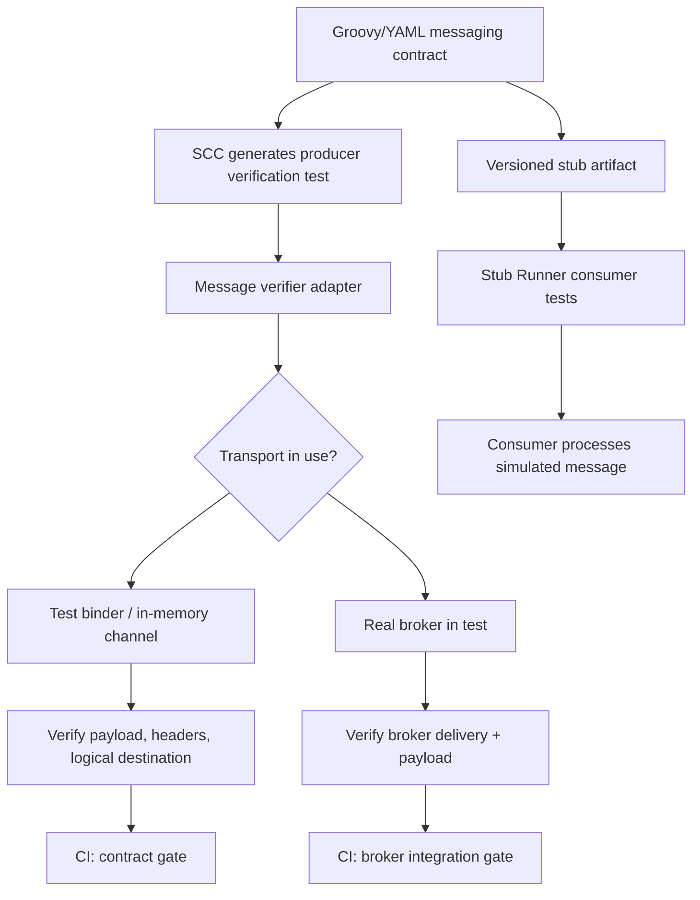
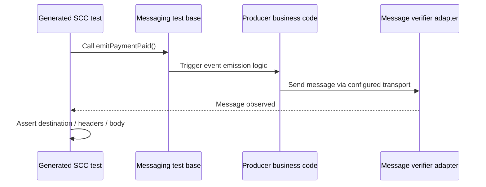
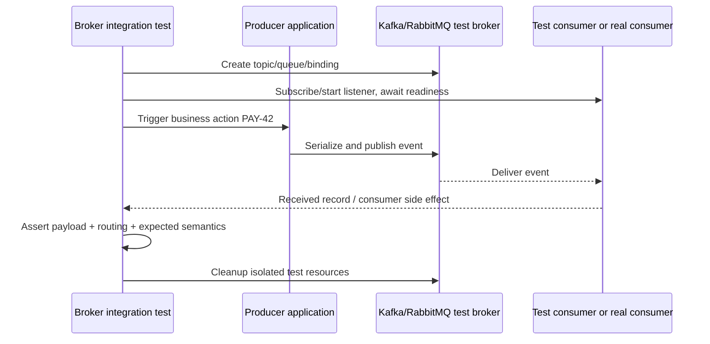
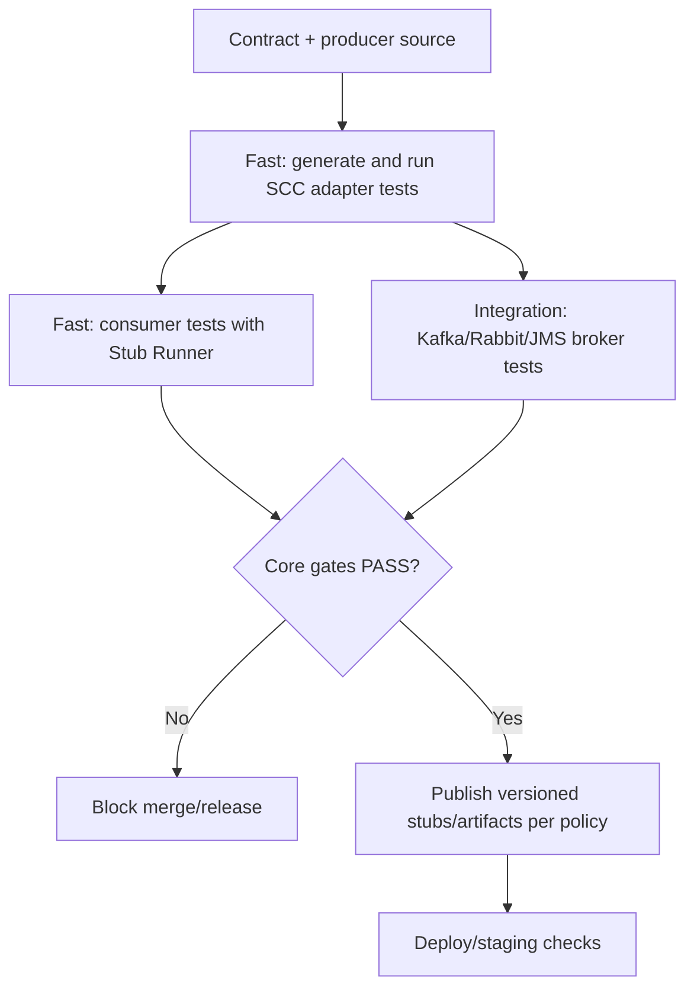

# Distinguishing Adapter-Based Testing from Real Broker Testing

## 1. Two Tests Both "Receive a Message" Yet Prove Two Different Things

In an event-driven architecture, a **producer** emits messages such as `PaymentPaid`, while a **consumer** receives and processes them. Both sides must agree on **destination**, payload format, headers, event version, and business semantics. With **Spring Cloud Contract (SCC)**, teams can describe messaging interactions using **Groovy/YAML DSL**, generate **producer verification tests**, create stubs for consumers to test with **Stub Runner**, and integrate those steps into **CI** to catch incompatible changes.

The catch is that a test that "sent and received a message" may have run through an **in-memory adapter or test binder**, or through a **real Kafka/RabbitMQ/JMS broker started in the test environment**. Those two kinds of evidence are not identical.

Suppose the producer emits:

```json
{
  "paymentId": "PAY-42",
  "orderId": "ORD-7",
  "amount": 150000,
  "currency": "VND",
  "state": "PAID"
}
```

A producer contract test receiving valid JSON at a simulated destination is valuable evidence of **message structure and invoking the emission channel**. Yet it does not prove the message will route through a real exchange/topic, serialize into valid wire bytes over the network, be handled properly by a consumer group, or land in a dead-letter queue when the consumer fails.

**Lesson objectives:**

1. Accurately understand the terms **messaging adapter**, **test binder**, and **real broker** in Spring Cloud Contract.
2. Know what messaging contracts verify on the producer and consumer sides.
3. Write Groovy/YAML DSL for an event and prepare a base test with `@AutoConfigureMessageVerifier`.
4. Choose adapter/test-binder testing to catch payload, header, and function-processing bugs quickly.
5. Choose real-broker testing when you need to protect routing, serialization, consumer groups, acknowledgements, retries, DLQs, partitions, or transactions.
6. Design a CI pipeline separating test layers rather than mistaking green stub tests for proof of a valid production broker.

> **Core distinction:** "Having a contract-compliant message" does not mean "the broker and delivery infrastructure uphold all operational guarantees".

## 2. Adapter, Test Binder, and Real Broker Are Three Distinct Concepts

### 2.1. An Adapter in Spring Cloud Contract Is an Integration Point

SCC defines interfaces like `MessageVerifierSender` and `MessageVerifierReceiver` to connect generated verification tests to send/receive mechanisms. Documented integrations include **Spring Integration, Spring Cloud Stream, Apache Camel, and Spring JMS**. You can supply a custom adapter/integration when your project needs another technology.

`@AutoConfigureMessageVerifier` on the **base class** helps configure messaging verification matching the integration/test classpath. The actual message path depends on **which adapter is selected, which beans/configurations are active, and how the test environment is constructed**.

**Do not conclude:** "Having `@AutoConfigureMessageVerifier` guarantees no broker is used." That annotation does not guarantee every exchange stays in memory.

### 2.2. A Test Binder Is a Brokerless In-JVM Environment

**Spring Cloud Stream test binder** provides an in-JVM test mechanism (built on Spring Integration) allowing components to communicate through simulated bindings without starting Kafka or RabbitMQ. You can use `InputDestination` and `OutputDestination` in tests to send/receive messages at the binder boundary.

It is an excellent choice for fast, repeatable, network-independent tests. Yet a test binder **does not replicate the full behavior of real Kafka/RabbitMQ**.

Other tools also offer brokerless modes—for example, Spring AMQP's `TestRabbitTemplate` can invoke listeners directly in tests. However, that is not a "miniature RabbitMQ broker": real broker routing and ack/requeue paths may not run.

### 2.3. What Is a Real Broker in Tests?

A "real broker" is a message broker instance started or provisioned specifically for tests, such as:

- A **Kafka broker** for integration testing, with topics, partitions, consumer groups, and offsets.
- A **RabbitMQ broker** for integration testing, with exchanges, queues, bindings, acknowledgements, and dead-letter routing.
- A **JMS broker** configured for the test environment, with queues/topics and real JMS clients.

It can run in **Testcontainers**, controlled shared containers, or isolated test infrastructure. "Real" here means communicating through a **real broker implementation/protocol**—**it does not mean using production**.

A dedicated CI broker still does not mean production is fully verified: versions, cluster topology, ACLs, TLS, replication, network policies, and production traffic may differ.

## 3. Diagram of Both Testing Paths



**Key point to grasp:** This diagram does not say SCC always has two built-in modes named "ADAPTER" and "BROKER". These are **two ways of arranging the test environment** around adapters and the application. When switching transports, generated tests and message contracts can be partially reused, yet bean initialization, destinations, test infrastructure, and operational assertions differ.

## 4. Evidence Matrix: What Requires a Broker?

| Question | In-JVM Adapter/Test Binder | Real Broker in Tests |
|---|---|---|
| Does JSON message have agreed fields and types? | **Good** when path runs proper serialization/validation | **Good** when sending and re-reading payload via real client |
| Are `eventType` and `contentType` headers valid? | Verifiable at the abstraction | Verifies actual headers if client/binder converts accurately |
| Does app call the right logical destination? | Can verify binding/destination logic | Verifies real topic/exchange/queue/binding |
| Does consumer function transform data properly? | **Good** for fast checks | Verifiable in integrated environment |
| JSON serializer/deserializer per real broker client? | **Not guaranteed** | Verifiable when tests use real serializers |
| Kafka partition keys, consumer groups, offset commits? | Not fully simulated | **Requires broker** with proper config |
| Rabbit exchange routing, ack/nack/requeue, DLQ? | Not fully simulated | **Requires broker** with matching queue/exchange/binding |
| Redelivery after failure and retry policies? | App logic testable separately | Needs integration tests to verify broker path |
| Ordering across multiple partitions/consumers? | Not guaranteed | Verifiable per specific setup, does not prove all loads |
| Transactions/outbox and DB–broker consistency? | Insufficient | Needs DB integration and fault scenarios |
| Throughput, lag, backpressure, failover? | Not representative | Targeted broker/load/chaos tests |
| All guarantees of a production cluster? | No | **Still no** if topology and conditions differ |

Not every use case needs a real broker for **every contract**. Usually, use adapters/test binders as a **fast feedback loop**, and add broker integration tests targeting **critical delivery risks**.

## 5. Sample Messaging Contract: A Payment Event

Suppose producer `billing-service` must emit a `PaymentPaid` event to logical destination `payments.events`. Consumer `notification-service` needs `paymentId`, `orderId`, `amount`, `currency`, `state`, and a header identifying the event type.

### 5.1. YAML DSL

Illustrative file `payment-paid.yml`:

```yaml
description: "Emit event when payment completes"
label: payment_paid
input:
  triggeredBy: emitPaymentPaid()
outputMessage:
  sentTo: payments.events
  headers:
    contentType: application/json
    eventType: PAYMENT_PAID
  body:
    paymentId: "PAY-42"
    orderId: "ORD-7"
    amount: 150000
    currency: "VND"
    state: "PAID"
```

This YAML follows the messaging DSL structure documented by Spring Cloud Contract:

- `label`: tag the consumer can use to **trigger the stub message**.
- `input.triggeredBy`: method name **provided by the test base/producer test fixture**, invoked by generated tests to trigger message emission.
- `outputMessage.sentTo`: logical destination the SCC adapter must observe.
- `outputMessage.headers` and `body`: data the consumer depends on, verified by producer verification.

**Note:** `sentTo: payments.events` is an illustrative name. With **Spring Cloud Stream/Integration**, SCC may resolve destinations or channel/binding names; with Camel/JMS, string meaning can differ. Reconcile **actual binder/adapter and broker mappings**. A valid destination string in a contract does not create a physical topic, exchange, or queue on its own.

### 5.2. Same Intent in Groovy DSL

```groovy
import org.springframework.cloud.contract.spec.Contract

Contract.make {
    description('Emit event when payment completes')
    label('payment_paid')

    input {
        triggeredBy('emitPaymentPaid()')
    }

    outputMessage {
        sentTo('payments.events')
        headers {
            header('contentType', 'application/json')
            header('eventType', 'PAYMENT_PAID')
        }
        body(
            paymentId: 'PAY-42',
            orderId: 'ORD-7',
            amount: 150000,
            currency: 'VND',
            state: 'PAID'
        )
    }
}
```

Both examples are **two ways to express the same scenario**, not a request to keep duplicate contracts. When dynamic fields like `eventId`/timestamps are needed, use two-sided values or matchers supported by your DSL and SCC version to avoid pinning random values.

### 5.3. Contracts Do Not Define Full Broker Semantics

The contract above **does not declare**:

- How many partitions, replication factor, or retention a Kafka topic has.
- RabbitMQ exchange types, durable queues, binding keys, and DLX.
- `notification-service` consumer groups, offsets, or acknowledgement modes.
- Retry counts, backoffs, DLQs, duplicate delivery, or transactional outboxes.
- Production ACLs/TLS or schema registries.

If these properties matter, test or enforce them via dedicated configuration/tests. Never invent arbitrary YAML keys expecting SCC to turn them into broker policies.

## 6. How Does Producer Verification via Adapter Work?

For contracts with `input.triggeredBy` and `outputMessage`, generated producer tests conceptually execute:

1. Initialize the **Spring test context** and message verifier integration.
2. Call `emitPaymentPaid()` in the base test.
3. Wait for the adapter to observe the message at the right destination.
4. Match payload and headers against the contract.
5. Fail if no matching message arrives or assertions mismatch.



**A message contract can be verified using simulated transport** without booting Kafka/RabbitMQ. This is a benefit: fast CI with fewer infrastructure dependencies. Yet **never call it a broker test** when the transport is an in-memory binder.

### 6.1. Base Test with `@AutoConfigureMessageVerifier`

Guiding example for JUnit 5 and Spring Boot:

```java
@SpringBootTest
@AutoConfigureMessageVerifier
public abstract class MessagingContractBase {

    @Autowired
    private PaymentContractFixture fixture;

    @Autowired
    private PaymentApplicationService paymentService;

    @BeforeEach
    void prepareData() {
        fixture.paymentCanBeMarkedPaid("PAY-42", "ORD-7", 150000L);
    }

    public void emitPaymentPaid() {
        paymentService.markPaidAndPublish("PAY-42");
    }
}
```

**This is an illustrative skeleton**, not a verbatim compilable class: it needs imports, test configuration, and project-supplied `PaymentContractFixture` and `PaymentApplicationService` beans. `emitPaymentPaid()` should invoke the **real business path** the producer uses to emit events. Do not replace it with direct `verifier.send(...)` calls just to manufacture a compliant message; doing so skips the publisher under verification.

SCC needs the plugin to link the base class via `baseClassForTests` or equivalent mappings, a valid test runner, and matching integrations/dependencies on the test classpath. `@AutoConfigureMessageVerifier` configures the **send/receive messaging bridge**; to know whether it uses a broker or memory, inspect the active adapter/beans/test binder.

### 6.2. Do Not Confuse the Trigger Method with Production APIs

The `emitPaymentPaid()` method in the test base is a **test hook** to start the scenario. It is not an endpoint called by consumers. Data set up in `@BeforeEach` is a **fixture**, not part of the contract payload. Whether the generated test receives the message also depends on destination mappings and receivers; when a test fails, check fixtures, trigger, serializer, adapter, and assertions in turn.

## 7. Spring Cloud Stream Test Binder: Brokerless Example

If the producer uses **Spring Cloud Stream**, you can add `spring-cloud-stream-test-binder` in test scope. Spring Cloud Stream docs describe an in-JVM test binder allowing send/receive via `InputDestination` and `OutputDestination` without real Kafka/RabbitMQ.

Maven test dependency:

```xml
<dependency>
    <groupId>org.springframework.cloud</groupId>
    <artifactId>spring-cloud-stream-test-binder</artifactId>
    <scope>test</scope>
</dependency>
```

Gradle Groovy DSL:

```groovy
dependencies {
    testImplementation 'org.springframework.cloud:spring-cloud-stream-test-binder'
}
```

Alongside that, producer contract tests need `spring-cloud-starter-contract-verifier` and a compatible SCC build plugin version. Adding the test binder **does not replace** the test-generation plugin or `@AutoConfigureMessageVerifier` when generated messaging tests require them.

### 7.1. Testing Functions via InputDestination/OutputDestination

Suppose an app has a function uppercasing strings, solely to illustrate the test binder path:

```java
@SpringBootTest
@Import(TestChannelBinderConfiguration.class)
class UppercaseStreamTest {

    @Autowired
    private InputDestination input;

    @Autowired
    private OutputDestination output;

    @Test
    void transformsMessage() {
        input.send(new GenericMessage<>("paid".getBytes(UTF_8)));
        Message<byte[]> message = output.receive(5000);

        assertNotNull(message);
        assertEquals("PAID", new String(message.getPayload(), UTF_8));
    }

    @SpringBootApplication
    static class TestApp {
        @Bean
        Function<String, String> uppercase() {
            return String::toUpperCase;
        }
    }
}
```

This snippet is a **Spring Cloud Stream test binder example** requiring imports/JUnit/Boot config, function bindings, and matching versions to run; it is not a generated SCC test. It shows the app receiving a message via a simulated binding and emitting an observable message. **Zero network hops to a real broker** occur here.

When an app has multiple bindings, specify the logical destination or binding name in `send/receive` and configure `spring.cloud.stream.bindings.*.destination`. Never test only the default binding and assume production topics are configured properly.

### 7.2. Binder Names vs. Destinations Are Easy to Confuse

For example, the Spring Cloud Stream function `uppercase` defaults to binding names `uppercase-in-0` and `uppercase-out-0`, whereas the actual destination might be mapped to `payment-events`. The test binder checks **logic tied to bindings**, yet **does not verify that physical Kafka/RabbitMQ has the right topic/queue/exchange**.

Across different Spring Cloud Stream versions, activating the test binder may use `@Import(TestChannelBinderConfiguration.class)` or helpers like `@EnableTestBinder`. Follow **version-matched documentation**; do not stitch old and new examples together assuming they work automatically.

## 8. Consumer Side: Stub Runner and Trigger Calls

When a contract has `label: payment_paid`, consumers can use **Stub Runner**'s messaging integration to trigger simulated events. A conceptual example:

```java
@SpringBootTest
@AutoConfigureStubRunner(
    ids = "com.example:billing-service:+:stubs",
    stubsMode = StubRunnerProperties.StubsMode.LOCAL
)
class NotificationConsumerContractTest {

    @Autowired
    StubTrigger stubTrigger;

    @Test
    void processesPaymentPaidEvent() {
        stubTrigger.trigger("payment_paid");

        // Wait for consumer to process message and verify expected impact
        // via bounded assertion/awaiting and isolated fixtures.
    }
}
```

**Note:** This is an example skeleton depending on the right stub artifact group/artifact/version, annotations/imports, and your project's messaging integration. `com.example:billing-service:+:stubs` is an illustrative coordinate; pin a concrete version for reproducible CI. Tests must **assert consumer outcomes**, not merely call `trigger()` and return.

Some Stub Runner integrations (such as JMS) **may require a running broker**, while the Stream test binder can run in memory. Therefore, **never claim all consumer messaging stubs run purely in memory**. Read the documentation for your chosen integration and observe the actual transmission path.

### 8.1. A Green Consumer Test Does Not Prove a New Producer Emits Properly

If consumer tests use stubs containing `paymentId: PAY-42` yet a new producer renamed the field to `id`, consumer tests can still pass. Only **producer verification** running on the new producer code against the matching contract version can catch that drift. Conversely, green producer verification via an adapter still does not prove production broker routing or that real consumers receive it in a live deployment.

## 9. Why Are Adapter Tests Still Immensely Valuable?

Adapters/test binders shine when you need **fast feedback on every commit**:

- Verify event-emitting code creates valid payloads, headers, enums, and data types.
- Verify consumer functions parse data, invoke the right services, and handle error/empty branches.
- Isolate broker networking, reducing Docker dependencies and startup time.
- Use repeatable fixtures to catch regressions in application logic.
- Test numerous negative cases without provisioning complex topics/queues and listeners.

Still, **call each piece of evidence by its true name**:

- **"Adapter contract test PASS"**: payload/destination abstraction contracts passed on the configured adapter path.
- **"Broker integration test PASS"**: the app sent/received messages through a test broker under specific settings.
- **"Production works properly"**: still requires observability/deployment checks or corresponding verification layers, never inferred solely from those two PASS lines.

A fast, sharply scoped test run frequently is more valuable than a "production-like" test that is flaky and rarely executed. Good designs keep both **broad adapter tests** and **focused broker tests**.


## 10. When Do You Need to Run a Real Broker?

The useful question is not "Are broker tests stronger than test binder tests?", but **which physical-transport risks need protection**. Several scenarios make broker tests essential:

1. **Routing:** Kafka topics and groups, or Rabbit exchanges, routing keys, and queue bindings must match deployment configuration.
2. **Serialization:** wire bytes must be compatible with serializers/deserializers, type headers, and published schemas.
3. **Acknowledgements:** on consumer success or failure, offsets/acks/requeues must follow policy.
4. **Retries and DLQ/DLT:** failing messages are retried a bounded number of times, then routed to the right error destination.
5. **Ordering/partitioning:** events for the same aggregate keep order within broker guarantees; partition keys work.
6. **Durability and restarts:** persisted messages are re-read across differing client/broker lifecycles; test conditions that actually matter.
7. **Outbox/idempotency:** publishers, databases, and brokers do not lose, corrupt, or duplicate transactions against policy.
8. **Security and topology:** producers/consumers can connect with TLS/ACL configurations and matching test topologies.

A **Kafka/RabbitMQ container** running in CI provides a real broker yet can still use a simple topology (single node) and minimal resources. Therefore, broker test results prove behavior **for that specific test setup**, not availability/replication/failover of a multi-node production cluster.

### 10.1. Choosing Test Depth via a Risk Matrix

| If this bug happens... | Can adapter/test binder catch it? | Should you add a broker test? |
|---|---|---|
| Producer renames `paymentId` to `id` | Yes, when contract asserts field | Not required solely for schema errors |
| Consumer parses `amount` string instead of number | Yes, if test data is strict enough | Yes if actual conversion relies on broker serializer |
| Wrong Kafka topic in production binding | Possibly not | **Yes** |
| Rabbit routing key mismatches binding | Usually not simulated realistically | **Yes** |
| Misconfigured Kafka consumer group misses events | Not guaranteed | **Yes** |
| Listener fails yet queue never requeues/DLQs | Insufficient | **Yes** |
| One event processed twice after retry | Can test idempotency logic | Should have broker + DB integration for E2E path |
| Producer emits valid payload yet hits TLS/ACL error | No | Needs matching deployment/security test |
| Eventual consistency or slow async processing | Incomplete | Depends on SLA and consumer impact |

**Selection standard:** if a property depends on **real Kafka/Rabbit/JMS broker behavior or real binder configuration**, at least one corresponding test must traverse the broker. Never mock everything and conclude that property was verified.

## 11. Kafka Integration Testing: Verifying Both Real Bindings and Clients

With **Kafka**, data goes to a topic; **partitions**, **keys**, **offsets**, **consumer groups**, and serializer settings directly govern delivery behavior.

### 11.1. Minimum Integration Scenario

A broker integration test can verify:

1. Start an isolated Kafka instance in the test environment.
2. Create topic `payments.events` with the appropriate partition count.
3. Run the producer with the **real Kafka binder/Kafka client**, not the test binder.
4. Trigger business logic `markPaidAndPublish("PAY-42")`.
5. Use a real test Kafka consumer to subscribe to the topic with an isolated consumer group.
6. Poll for a record with a bounded timeout.
7. Assert **topic**, **key**, **headers**, and deserialized payload.
8. Clean up consumers/brokers and test data.

This tests the **real emission path**. To also test `notification-service`, run the real consumer in the test context or a separate app, then assert consumer-side effects (such as notification records in the test database).

### 11.2. Testcontainers Skeleton — Mind Portability

Testcontainers and Spring Boot versions differ in container/module APIs. The template below is **directional pseudocode**, not an immediately compilable standalone class:

```java
@Testcontainers
@SpringBootTest
class PaymentKafkaIntegrationTest {

    @Container
    static final KafkaContainer kafka =
        createKafkaContainerWithCompatibleImage();

    @DynamicPropertySource
    static void kafkaProperties(DynamicPropertyRegistry registry) {
        registry.add(
            "spring.kafka.bootstrap-servers",
            kafka::getBootstrapServers
        );
    }

    @Test
    void paymentPaidIsPublishedToRealKafka() {
        // 1. Prepare payment PAY-42 and dedicated test topic.
        // 2. Trigger producer business logic to emit event.
        // 3. Create test KafkaConsumer with bootstrap servers from container.
        // 4. Subscribe to topic and wait for record with bounded timeout.
        // 5. Assert key, headers, and deserialized payload.
        // 6. Clean up group/consumer and test data.
    }
}
```

**Note:** `createKafkaContainerWithCompatibleImage()` is a **placeholder**: replace it with the constructor/API from your compatible Testcontainers Kafka module, an approved image, and exact imports. If the app uses the **Spring Cloud Stream Kafka binder**, injecting `spring.kafka.bootstrap-servers` alone may not suffice: ensure **binder config uses the container's bootstrap servers**, such as version-appropriate `spring.cloud.stream.kafka.binder.brokers` properties. Do not assume every transport reads the same property.

In Spring Boot versions supporting `@ServiceConnection`, you can leverage version-matched connection details; even then, verify real bindings and **do not let the test binder override the Kafka binder**.

### 11.3. Offsets, Partitions, and Ordering

Kafka preserves order **within each partition**. Do not write tests requiring total global ordering across multiple partitions and treat that as a standard Kafka guarantee. If consumers require event ordering per `paymentId`, intentionally set the partition key, send at least two events for the same key, and assert consumption order **under the configured setup**.

A Kafka test receiving one event **does not prove** retries, rebalances, or partition reassignments work properly. Those scenarios need dedicated tests.

## 12. RabbitMQ Integration Testing: Exchanges, Queues, Acks, and DLQs

With **RabbitMQ**, the path is typically:

```text
Producer → exchange → routing-key binding → queue → consumer
```

Test binders or brokerless `TestRabbitTemplate` can verify listener/controller logic yet may skip real exchanges/bindings. Broker integration tests require a running RabbitMQ instance and meaningful exchange/queue/binding configuration.

### 12.1. Routing Scenarios

Suppose the publisher sends `PaymentPaid` with routing key `payment.paid`. The test should:

- Provision test-dedicated exchanges and queues with the right binding keys.
- Boot publisher/consumer with real AMQP configuration.
- Emit the event from the **producer's business path**.
- Assert the message reaches the right queue with expected payload and properties.
- Send a message with an unmatched routing key to test routing rules if required.
- Clean up resources/queues or use isolated namespaces after the test.

Merely injecting a mocked `RabbitTemplate` and asserting `convertAndSend("payments", "...", payload)` was called proves **code invoked the template**, not that the broker routes properly.

### 12.2. Acknowledgements, Requeues, and Dead-Lettering

In RabbitMQ, listener container `AUTO`/`MANUAL`/`NONE` modes drive different ack mechanics. Broker tests must clearly state **which mode the app uses** and expected outcomes on error:

| Scenario | What to Verify on the Broker |
|---|---|
| Consumer succeeds | Message is acked per policy without unexpected redelivery |
| Consumer throws transient error | Retried/requeued the expected count with appropriate backoff |
| Consumer throws unrecoverable error | Message reaches configured DLQ/error destination |
| Consumer crashes before ack | Broker redelivers per real semantics |
| Message lacks required field | Not lost silently; rejected/DLQed/recorded deterministically |

**Caution:** not every RabbitMQ setup has a DLQ by default. You must intentionally configure dead-letter exchanges/queues and reject/requeue policies; if test brokers omit them, you cannot claim the system protects against poison messages.

### 12.3. Spring AMQP Brokerless Tests Are Also an Option

`TestRabbitTemplate` can invoke registered listeners directly on the test thread (in cases supported by Spring AMQP). It tests **listener logic** without a broker, yet its routing has limits and **does not replace** testing real exchange/queue bindings, networking, or acks/requeues.

Pick the tool matching what must be proved: **listener handles valid payloads** can be brokerless; **bindings and DLQs genuinely work** requires a RabbitMQ test.

## 13. JMS and Other Adapters: Never Lump Everything as "In-Memory"

Spring Cloud Contract also integrates with **Spring JMS** and **Apache Camel**, beyond Spring Cloud Stream/Integration. How adapters send and receive depends on the framework. SCC docs explicitly note that **Stub Runner's Spring JMS messaging integration assumes a running JMS broker**.

Therefore, these three statements are not equivalent:

- **Using an SCC `MessageVerifier` adapter:** describes the abstraction, not the transport.
- **Using Spring Cloud Stream test binder:** usually requires no network broker due to its in-JVM environment.
- **Using SCC Stub Runner with JMS:** may require a real broker depending on integration/configuration.

To determine whether a test truly traverses a broker, inspect **connection URLs/broker endpoints, bean classes/binder types, destination declarations, and send/receive logs**. Seeing `@AutoConfigureMessageVerifier`, `@AutoConfigureStubRunner`, or the words `integration test` in a class name is not enough.

## 14. Designing a Broker Integration Test with Clear Evidence

Follow the **Arrange – Act – Observe – Assert – Cleanup** pattern:

### Arrange

Start the broker and provision test resources with isolated names/namespaces; configure the producer with a real binder; seed fixture `PAY-42`. If old consumer groups/offsets or queues hold stale data, reset them or create fresh groups/topics/queues.

### Act

Invoke a **business action** like `paymentService.markPaidAndPublish("PAY-42")`. Never call a test adapter directly to send a contract-matching payload yourself and claim the producer emitted properly.

### Observe

Use an independent broker client/test listener to receive the message. Wait using **bounded poll/await**; avoid `Thread.sleep` to "hope the message arrived". Ensure consumers subscribed and became ready **before** emitting events, especially with Kafka `auto.offset.reset=latest` or transient events.

### Assert

Compare:

- Real **destination/topic/queue**.
- **Payload** after serialization/deserialization, including numeric/boolean/string types.
- **Headers/properties** used by consumers.
- **Key/routing key/partition** when required.
- **Consumer processing outcomes** and side effects if the integration test runs the real consumer.
- **Retries/acks/DLQ** when the test targets those semantics.

### Cleanup

Close consumers, brokers/containers, and resources; clean test DBs/offsets/groups per policy without touching shared systems. Under parallel CI, isolate resource namespaces per job/test.



The difference from an **adapter test** is that **a real broker implementation and network protocol are part of the test execution path**, not just a simulated message channel.

## 15. Retries, Poison Messages, and Idempotency: Contracts Do Not Protect These Alone

A schema-valid message can still break systems when consumers fail or restart.

### 15.1. Retries Can Cause Duplicate Side Effects

Suppose the consumer receives `PaymentPaid` and records "notification email sent". If the consumer finishes work yet crashes before the broker commits ack/offset, the event may be redelivered. If logic is not idempotent, the user receives two emails.

A green `PaymentPaid` contract test **does not prove** this is safe. Broker integration tests must simulate failures at the appropriate point, resend or let the broker redeliver, and assert consumer/deduplication state. Note policy differences across Kafka, Rabbit, and JMS.

### 15.2. Poison Messages Need Designed Outcomes

A payload that fails deserialization or violates schemas may fail forever. Define requirements:

- How many retries occur?
- What backoff applies?
- Does it finally land in a DLQ/DLT or separate table for investigation?
- Which alerts/metrics report the failing event?
- Are message loss and consumer group/queue head-of-line blocking prevented?

When these are critical business/operational requirements, write **broker integration tests** for them. Never assume Spring Cloud Contract auto-generates DLQ contracts simply because `outputMessage.body` holds a valid payload.

### 15.3. "Exactly Once" Does Not Appear Automatically

Exactly-once depends on transactions/brokers/clients/configuration within defined boundaries; **it is never inferred from using Kafka or a single green test**. For external side effects (emails, HTTP calls, separate databases), you typically need **idempotency keys, deduplication, transactional outbox/inbox, or suitable consistency mechanisms**—and tests for them.

## 16. Consequences of Serialization and Schema Evolution

In-JVM test adapters may pass a `Message<PaymentPaid>` or Java object directly, potentially bypassing the serializer Kafka/Rabbit clients use in production.

Example:

```java
record PaymentPaid(
    String paymentId,
    String orderId,
    long amount,
    String currency,
    String state
) {}
```

If an in-memory test sends this object directly, it can miss wire-format bugs like:

```json
{
  "paymentId": "PAY-42",
  "orderId": "ORD-7",
  "amount": "150000",
  "currency": "VND",
  "state": "PAID"
}
```

In the JSON above, `amount` changed from a **number** to a **string**. If the consumer requires a number, the type mismatch can break deserialization.

**Practical strategy:**

1. Use **SCC contracts** to constrain the fields consumers truly require.
2. Use **adapter tests** to cover event production/reading logic with rich fixtures.
3. Use **broker integration tests** to read **raw bytes or payloads deserialized by real serializers**, checking schemas, headers, and routing.
4. When using Avro/Protobuf/schema registries, enforce **compatibility rules and subjects/versions** with dedicated CI checks/tests; JSON YAML bodies alone do not cover schema registries.

Do not rely on the `contentType` name alone without checking whether the binder actually converts types and encodes payloads as intended.

## 17. Isolation and Stability of Broker Tests

Broker integration tests usually have more flakiness factors than adapter tests:

| Issue | Consequence | Mitigation |
|---|---|---|
| Topics/queues/groups reused across tests | Reads stale events, wrong offsets | Create per-test/job namespaces and resources |
| Consumer subscribes after publish | Misses records per offset policy | Await assignment/readiness before emitting |
| Hardcoded broker ports | Collisions across CI jobs | Use dynamic container ports/connection details |
| Fixed `Thread.sleep` | Slow or insufficient under CI load | Poll/await with bounded timeouts |
| Test binder left on classpath/active | "Kafka test" secretly runs in memory | Verify real binder beans and broker addresses |
| Retries/DLQ unconfigured | Tests cannot prove failure paths | Provision full exchanges/topics/queues and policies |
| Unreset DB data | Consumer side effects vary across runs | Independent fixtures and cleanup |
| Parallel tests share topics | Messages cross between tests | Isolated resource/group names, coordinated parallelism |
| Unclosed consumers/containers | Resource leaks affecting later suites | Lifecycle/framework cleanup |
| Single broker node extrapolated to HA cluster | Overclaimed evidence | Add targeted topology/failover tests when needed |

**Caution when testing Kafka:** if a consumer test reads from `latest`, it can miss records emitted before subscriptions become ready. If using `earliest`, it must avoid reading stale records. Decide based on test goals and topic/group isolation—never tweak offset settings arbitrarily just to make tests pass.

## 18. Integrating Both Testing Layers into CI

An effective pipeline separates stages:



### 18.1. Fast Loop

- SCC generates producer verification tests and runs them with the matching adapter/test binder.
- Consumer tests use Stub Runner to verify client logic against agreed payloads/headers.
- Test validation/serialization logic independently with rich negative cases and repeatable fixtures.
- No broker startup needed when tests only verify content and logical routing at the abstraction layer.

### 18.2. Integration Loop

- Start an isolated real broker with Testcontainers or an equivalent test environment.
- Enable the **real binder/client**, ensuring the test binder does not override it.
- Run routing, serialization, consumer group/ack, retry/DLQ, and idempotency cases matching prioritized risks.
- Run with controlled timeouts, logs, and cleanup; failures must fail the job.
- Separate expensive load, cluster failover, or security deployment tests into appropriate stages—never skip them silently if they are release criteria.

### 18.3. Binding Versions Together to Prevent False Evidence

A producer test passing on commit A while stubs are published from commit B, or consumer tests fetching an unpinned "latest" stub, undermines compatibility conclusions. CI should record:

- **Contract revision** and producer commit.
- **Generated producer tests** executed and test reports.
- **Broker config/topology** used in integration tests.
- **Stub artifact version** published.
- **Consumer version** executing corresponding tests.

When an intentional API/message change is proposed, review it with consumers, manage versions and migration plans—never just edit contracts to pass while ignoring active consumers.

## 19. Practice Exercise: Choosing the Right Test Path for an Invoice Event

### 19.1. Context

Producer `invoice-service` emits `InvoiceIssued` to logical destination `invoices.events` after creating an invoice. Consumer `email-service` receives the event to send email. Proposed interface:

```json
{
  "invoiceId": "INV-501",
  "customerId": "CUS-7",
  "amount": 99000,
  "currency": "VND",
  "state": "ISSUED"
}
```

Operational requirements: use Kafka; every event for the same `invoiceId` must share a partition key; on transient consumer errors, apply bounded retries; on unrecoverable errors, messages must reach a dead-letter topic; duplicate event delivery must not send duplicate emails.

### 19.2. Questions

1. Write a **YAML message contract** for `InvoiceIssued` with `label`, `input.triggeredBy`, `outputMessage.sentTo`, headers, and body.
2. In the producer base test, describe `@AutoConfigureMessageVerifier` and which business path the trigger method must call.
3. Design **one adapter/test-binder test** for the publisher or consumer function; state clearly which fields and logic it protects.
4. Design **one Kafka integration test** checking topic, partition key, and bytes/headers of emitted events.
5. Design **one retry/DLT test**: consumer throws an unrecoverable error; the record must arrive at the configured error destination.
6. Design **one idempotency test**: the same event is delivered twice yet triggers only one email request.
7. Explain why passing consumer Stub Runner tests and producer contract tests still is not enough to declare production Kafka broker setup valid.
8. Propose two separate CI gates: **fast contract gate** and **broker integration gate**.

### 19.3. YAML Hint

```yaml
description: "Emit event when invoice is created successfully"
label: invoice_issued
input:
  triggeredBy: emitInvoiceIssued()
outputMessage:
  sentTo: invoices.events
  headers:
    contentType: application/json
    eventType: INVOICE_ISSUED
  body:
    invoiceId: "INV-501"
    customerId: "CUS-7"
    amount: 99000
    currency: "VND"
    state: "ISSUED"
```

The contract describes **payload, headers, and logical destination**. It does not establish Kafka partition keys, consumer groups, DLTs, or retry policies. Those are configured and tested separately with the real Kafka binder/client.

### 19.4. Evidence Classification Hint

| Item | Adapter/SCC | Kafka Broker Test |
|---|---|---|
| `invoiceId`, `amount` right types and values | **Yes** via message contract | Can re-verify via wire serialization |
| `eventType` header | **Yes** at adapter | Yes via Kafka headers |
| `invoices.events` logical destination | Yes per adapter mapping | Verifies physical topic |
| Partition key equals `invoiceId` | Not guaranteed | **Must inspect record key and partition** |
| Consumer group receives record | Not guaranteed | **Requires real consumer** |
| Retry/DLT | Not guaranteed | **Requires policy and broker test** |
| No duplicate emails sent | Insufficient | **Idempotency/side-effect integration test** |

**A strong answer specifies** whether tests use a real broker or test binder, artifact versions, and assertion types. Never accept "tests passed so everything works" without tracing the message path.

## 20. Pitfalls to Avoid

| Mistake | Consequence | Fix |
|---|---|---|
| Treating `@AutoConfigureMessageVerifier` as a brokerless guarantee | Misunderstands test scope | Inspect actual adapter, beans, and transport |
| Treating test binder as real Kafka/RabbitMQ | Misses routing, partitions, acks/DLQ | Write broker integration tests |
| Mocking publisher only to assert `send()` was called | Skips serializers and broker | Test message contracts + broker per risk |
| `triggeredBy` base test crafts matching JSON instead of producer | Passes even when producer logic is broken | Trigger through real business path |
| Valid logical destination assumed to mean valid physical topic | Binder mappings can still be wrong | Verify config and real topics/queues |
| Running Stub Runner and claiming new producer emits properly | Stubs may be stale | Run generated producer tests on exact commit |
| Assuming Stub Runner is always brokerless | Integrations like JMS need a broker | Check specific integration/version docs |
| Receiving one record taken as proof retry/DLQ works | Never tested failures or redelivery | Write failure tests with broker |
| Using `Thread.sleep` before reading queue | Flaky under CI load | Await/poll with bounded timeouts |
| Sharing Kafka topics/groups across tests | Cross-talk or wrong offsets | Dedicated namespaces and cleanup |
| Test binder accidentally overrides real Kafka binder | "Broker test" secretly runs in memory | Check binder beans, bootstrap servers, and network |
| Updating schemas then editing contracts just to pass | Old consumers may break | Review versions/migrations and run consumer tests |
| Extrapolating single-node broker test to HA cluster | Overstated claims | Add targeted topology/failover tests when needed |

## 21. Pre-Merge and Pre-Release Checklist

- [ ] Agreed on message contract: destination, headers, payload, data types, enums, and version.
- [ ] SCC plugin generates and executes producer messaging verification tests.
- [ ] Base test configures `@AutoConfigureMessageVerifier` and triggers the **real producer path**.
- [ ] Adapter/test binder is properly configured and identified—never mistaken for a real broker.
- [ ] Stub Runner consumer tests assert **consumer-side impacts**, not merely label triggering.
- [ ] When using Stub Runner with JMS/Camel/Stream, verified transport/broker requirements of that integration.
- [ ] Broker-dependent risks have integration tests using real binders/clients.
- [ ] Kafka tests check topics/keys/headers/serialization and consumer groups when needed.
- [ ] Rabbit tests check exchanges/bindings/acks/requeues/DLQs when needed.
- [ ] Retries, DLT/DLQ, and idempotency have appropriate failure/side-effect tests.
- [ ] Broker resources/topics/queues/groups and test DBs are isolated, cleaned up, and timeout-bounded.
- [ ] Production brokers are never used to practice creating or deleting data.
- [ ] CI verifies generated tests genuinely execute and fail on drift.
- [ ] Producer/stub artifacts and consumer tests have clear versioning and traceability.
- [ ] Cluster failover, security, and load/latency are claimed as protected only when matching tests exist.

## 22. Key Takeaways and References

**An adapter is the abstraction connecting tests to messaging; a test binder is a way to run messaging inside the JVM; a real broker is delivery infrastructure placed on an integration test's execution path.** They are related, not synonymous.

In Spring Cloud Contract, **Groovy/YAML DSL + MessageVerifier + generated producer tests** safeguard payloads, headers, and logical destinations. **Stub Runner** lets consumers test receiving and handling simulated messages. **Spring Cloud Stream test binder** enables fast function/binding tests without a broker. To prove routing, network serialization, consumer groups, ack/requeue, retry/DLQ, or idempotency, you need **Kafka/Rabbit/JMS integration tests** with suitable brokers, databases, and clients.

The best test layer is one that provides **just enough evidence for the risk being managed**, runs repeatedly in CI, and traces cleanly by version. Never equate every green test with production guarantees.

**Official references to cross-check against your project's Spring Boot/Cloud/SCC versions:**

- [Spring Cloud Contract — Messaging DSL, integrations, MessageVerifier, Stub Runner](https://docs.spring.io/spring-cloud-contract/reference/project-features-messaging.html).
- [Spring Cloud Contract — YAML Schema for input/outputMessage](https://docs.spring.io/spring-cloud-contract/reference/yml-schema.html).
- [Spring Cloud Stream — Testing Applications and Test Binder](https://docs.spring.io/spring-cloud-stream/reference/spring-cloud-stream/spring_integration_test_binder.html).
- [Spring Cloud Stream — Reference Documentation](https://docs.spring.io/spring-cloud-stream/reference/spring-cloud-stream.html).
- [Spring for Apache Kafka — Testing Applications](https://docs.spring.io/spring-kafka/reference/testing.html).
- [Spring AMQP — Testing Support](https://docs.spring.io/spring-amqp/reference/testing.html).
