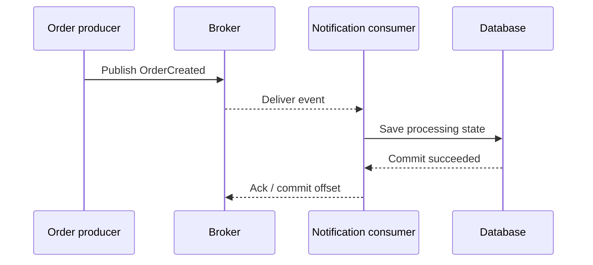
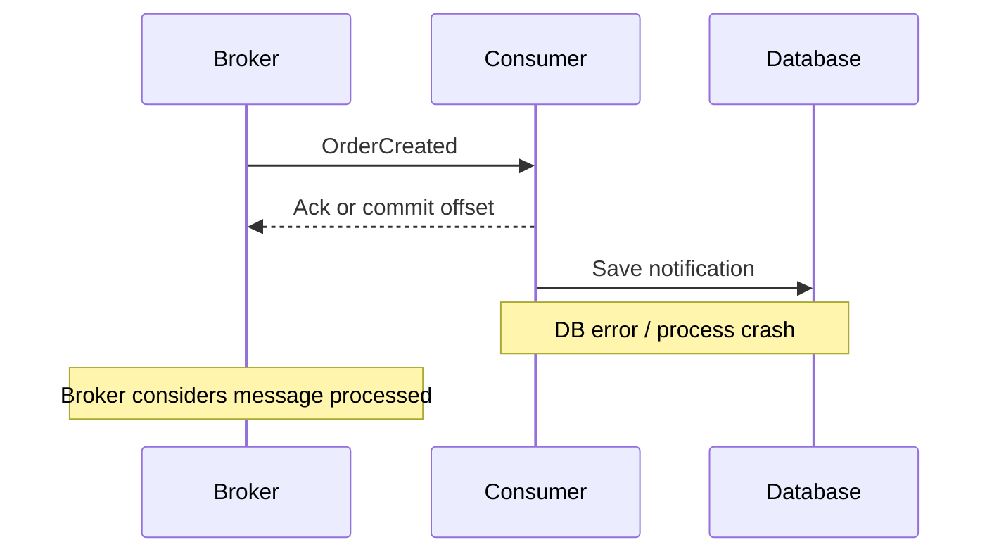
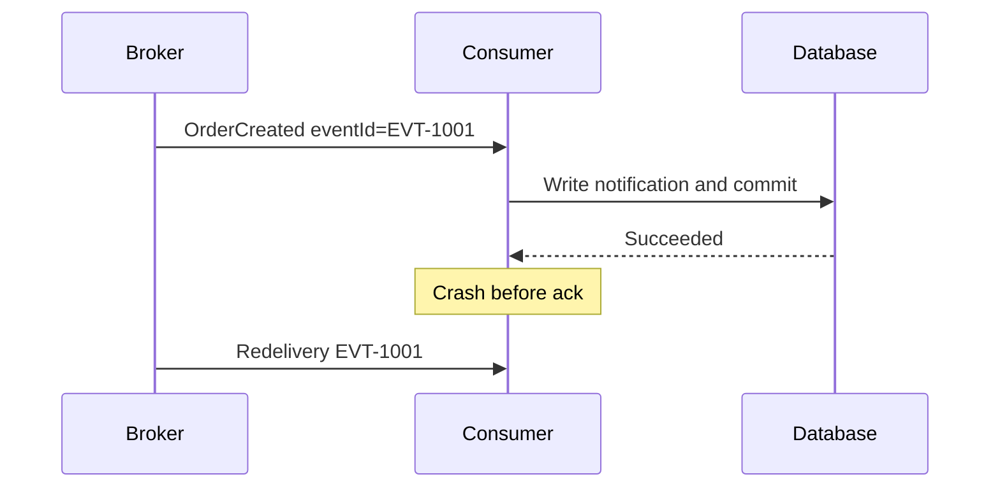
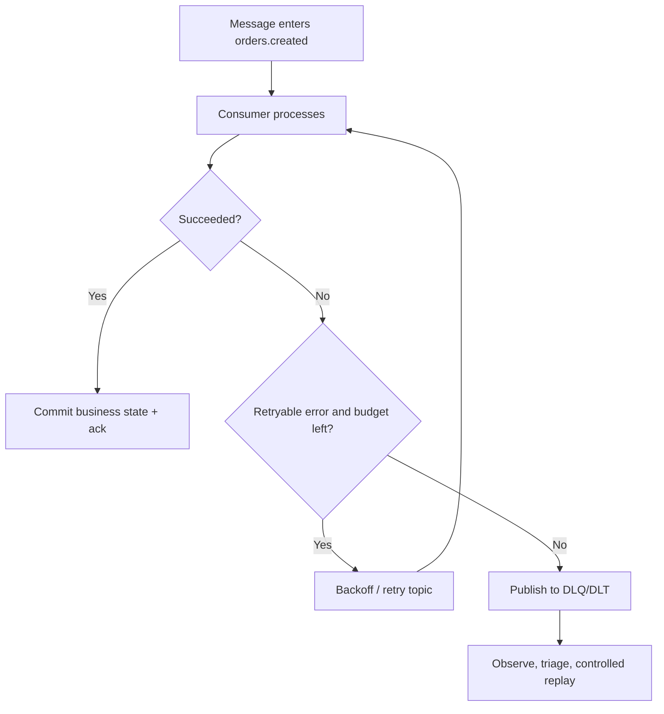
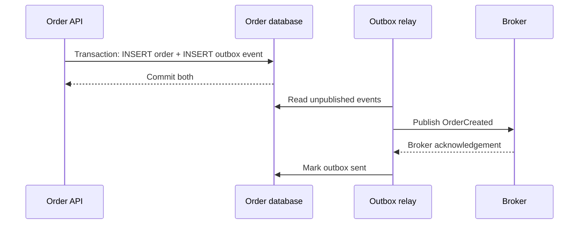
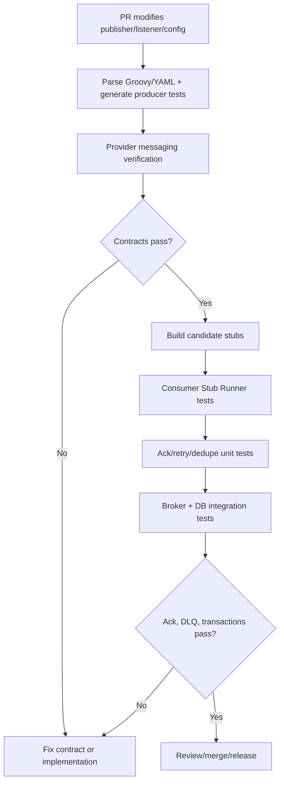

# When to Add Ack, Retry, DLQ, and Transaction Tests in Spring Cloud Contract

In an event-driven system, a **structurally valid** message can still lead to wrong outcomes: the consumer receives the event yet fails to persist data, the broker redelivers a message causing an order to be processed twice, a failing message never reaches the dead-letter queue (DLQ), or a database transaction commits without the message ever being emitted. These bugs occur **after or around** message send/receive, not solely inside the payload.

**Spring Cloud Contract (SCC)** lets **producers** and **consumers** declare contracts in Groovy/YAML DSL, generate **provider verification tests**, and publish stubs for **Stub Runner**. For messaging, contracts typically guard **destination, headers, payload, and emission behavior in a single scenario**. However, contracts do not verify all **acknowledgement (ack), retry, dead-letter (DLQ), and transactional consistency** behaviors of the broker and application.

This lesson in the **Messaging Contract Testing** chapter helps determine **when to add testing layers beyond message contracts**, how to design reproducible cases, and how to wire them into CI. Examples use `order-producer` emitting `OrderCreated` and `notification-consumer` handling the event to record notification delivery state.

## 1. Goal: Knowing Exactly What Has Been Verified

After this lesson, you should be able to distinguish:

1. **Messaging contract testing**: verifying schema, headers, destination, and payload for a scenario.
2. **Ack/nack**: verifying when a consumer tells the broker processing succeeded, failed, or needs redelivery.
3. **Retry/redelivery**: verifying attempt counts, delays, error classification, and stopping conditions.
4. **DLQ/DLT**: verifying unprocessable messages move to an error channel with diagnostic info without creating infinite loops.
5. **Idempotency**: verifying reprocessing the same event creates no duplicate side effects.
6. **Transactions**: verifying consistency between databases, consumer offsets/acks, and event emission, even across process crashes.
7. **Tooling limits**: knowing when Stub Runner/test binders suffice and when a real broker is needed in integration tests.

**Key signal:** if requirements include phrases like **"after commit"**, **"ack only when"**, **"retry three times"**, **"route to DLQ"**, **"no duplicate sends"**, or **"no lost events"**, a contract verifying only body/headers is **insufficient**.

## 2. Viewing the Full Lifecycle of a Message

Suppose the producer creates an order and emits `OrderCreated`:



This diagram shows the **ideal happy path**. In practice, failures can happen at multiple points:

| Failure Point | Scenario | Risk |
| --- | --- | --- |
| Before publish | DB creates order cleanly yet process dies before publishing | Event is lost |
| After publish, before recording outcome | Producer does not know if broker received message | Republishing causes duplicates |
| Inside consumer before DB write | Consumer throws exception | Broker may redeliver or lose message depending on ack policy |
| After DB write, before ack | DB committed, consumer crashes | Message redelivered and side effects may repeat |
| After ack, before DB commit | Consumer reports success too early | Message can be lost even though data was not saved |
| During retry | Poison message fails every time | Blocks partition/queue or enters retry loop |
| During DLQ routing | Retries exhausted yet DLQ transfer fails | Message never reaches error handling |

You must verify not only that `body.eventId` is valid, but also the **correctness of each state transition** across components.

### 2.1. Three Concepts Never to Equate

- **Publish succeeded**: the producer or client library received transport confirmation. This does not mean the consumer processed it.
- **Delivery succeeded**: the broker delivered the message to a consumer or listener. This does not mean the database committed.
- **Business processing succeeded**: the consumer completed required side effects. This does not automatically mean the broker received an ack.

A message contract protects the event content emitted by the producer; **never treat a valid body as proof that all three steps succeeded**.

## 3. What Can Messaging Contracts Verify?

A basic Groovy contract:

```groovy
import org.springframework.cloud.contract.spec.Contract

Contract.make {
    description 'Emit OrderCreated v1 when order creation succeeds'
    label 'order_created_v1'

    input {
        triggeredBy('publishOrderCreated()')
    }

    outputMessage {
        sentTo('orders.created')
        headers {
            messagingContentType(applicationJson())
            header('X-Event-Version', '1')
        }
        body(
            eventId: 'EVT-1001',
            eventType: 'OrderCreated',
            schemaVersion: 1,
            orderId: 'ORD-1001',
            totalMinor: 125000,
            currency: 'VND'
        )
    }
}
```

This contract describes:

- `input.triggeredBy`: method in the provider test base triggering producer emission.
- `outputMessage.sentTo`: logical destination expected by the contract.
- `outputMessage.headers`: message headers the consumer relies on.
- `outputMessage.body`: sample data and event constraints.
- `label`: identifier for consumers to trigger the stub via `StubTrigger`.

Corresponding YAML example:

```yaml
description: "Emit OrderCreated v1 when order creation succeeds"
label: order_created_v1
input:
  triggeredBy: publishOrderCreated()
outputMessage:
  sentTo: orders.created
  headers:
    contentType: application/json
    X-Event-Version: "1"
  body:
    eventId: EVT-1001
    eventType: OrderCreated
    schemaVersion: 1
    orderId: ORD-1001
    totalMinor: 125000
    currency: VND
```

Both files are **two representations of the same scenario**; do not let builds scan both when they duplicate behavior. For your specific SCC version, verify syntax, messaging adapters, and actual generated tests before treating examples as complete configurations.

### 3.1. Contracts Suffice for Structure, Not Delivery Semantics

| Requirement | Standard Message Contract | What Else Is Needed? |
| --- | --- | --- |
| Payload has `eventType: OrderCreated` | Yes | Provider verification |
| `X-Event-Version` header is right | Yes | Provider verification with matching message adapter |
| Message sent to `orders.created` | Yes, at adapter-observed destination | Broker test if physical routing matters |
| Consumer parses sample event | Can use Stub Runner | Consumer listener assertions |
| Consumer acks only after DB commit | No | Ack/commit integration test |
| Transient errors are redelivered | No | Broker/listener retry test |
| Permanent errors go to DLQ after limit | No | DLQ integration test |
| Same `eventId` never creates duplicate side effects | No | Idempotency test |
| DB commit and event publish stay aligned | No | Outbox/transaction integration test |
| End-to-end exactly-once | No | Consistency design plus scoped tests |

**A sample message is a data commitment, not a complete temporal workflow.**

## 4. When Should You Add Ack or Nack Tests?

**Ack** is the consumer confirming a message was handled per transport rules. **Nack**, requeue, reject, or skipping offset commits mean different things depending on broker, listener container, and retry policy.

Examples:

| Ecosystem | Common Mechanisms | What to Verify |
| --- | --- | --- |
| RabbitMQ (AMQP) | `basicAck`, `basicNack`, `basicReject`; requeue or DLX | Ack right delivery tag; requeue or dead-letter as intended |
| Apache Kafka | Consumer offset commits, manual acknowledgement in Spring Kafka | Offset commits only at the right moment; retry/DLT behaves properly |
| JMS | Client acknowledgement, transactions, or container-managed ack | Session/transaction confirmed only after successful processing |
| Cloud queues like SQS | Delete message/visibility timeout/redrive | Message deleted on success, visible again on failure |

There is no unified `ack()` API across all brokers. Never copy RabbitMQ nack code to Kafka; **Kafka does not share AMQP's ack/requeue protocol**.

### 4.1. When Acking Too Early



When ack/commit happens before business side effects, messages can be **effectively lost** if the DB fails afterward. A proper test induces failure at this point and verifies redelivery/recovery per design.

### 4.2. When Acking After Commit



Writing to DB before acking lowers lost-work risk yet opens the door to **duplicate processing** if a crash occurs between commit and ack. Thus, under **at-least-once** delivery, design consumers to be **idempotent**, rather than merely placing ack after DB commit.

**Key conclusion:** moving the ack call does not turn the whole workflow into exactly-once.

## 5. Testing Ack in Spring Listeners: What Must Be Observed?

Spring Kafka example with **manual acknowledgement**. The snippet assumes `manualAckKafkaListenerContainerFactory` is configured in manual ack mode matching your Spring Kafka version:

```java
import org.springframework.kafka.annotation.KafkaListener;
import org.springframework.kafka.support.Acknowledgment;
import org.springframework.stereotype.Component;

@Component
public class OrderCreatedListener {

    private final NotificationHandler handler;

    public OrderCreatedListener(NotificationHandler handler) {
        this.handler = handler;
    }

    @KafkaListener(
        topics = "orders.created",
        containerFactory = "manualAckKafkaListenerContainerFactory"
    )
    public void receive(String payload, Acknowledgment acknowledgment) {
        handler.handle(payload);
        acknowledgment.acknowledge();
    }
}
```

`NotificationHandler` is an application-defined service. The example places acknowledgement **after** `handler.handle`. However, if `handler.handle` runs async transactions or merely schedules work and returns, line ordering **does not prove** business processing committed. Ensure the method returns only after required transactional duties complete.

Never treat the code above as guaranteeing immediate broker commits. Actual offset write timing depends on ack mode, transactions, listener containers, and consumer settings.

### 5.1. Minimum Ack Test Matrix

| Scenario | Outcome to Verify |
| --- | --- |
| Handler succeeds and commits DB | Message is acknowledged/offset advances per policy |
| Handler throws before DB write | Not marked successful; retry/error handler runs |
| Handler writes DB then process crashes before ack | Message may redeliver; dedupe guards side effects |
| Handler blocks too long | Timeouts/rebalances/visibility handled per design |
| Unparseable message | Does not stall forever; clear error/DLQ path |
| Consumer restarts | Offset/delivery state resumes as configured |

At the unit level, you can use a fake acknowledgement to verify the listener calls or skips `acknowledge()` when the handler succeeds/fails. Yet that unit test **does not prove the broker committed offsets accurately**: real verification requires integration tests with a Kafka broker or representative transport.

### 5.2. Unit Test Example for Ack Ordering

The code below uses test doubles to verify listener branching. Assumes `NotificationHandler` is an application interface that can be mocked:

```java
import static org.junit.jupiter.api.Assertions.assertThrows;
import static org.mockito.Mockito.*;

import org.junit.jupiter.api.Test;
import org.springframework.kafka.support.Acknowledgment;

class OrderCreatedListenerTest {

    @Test
    void acknowledgesOnlyAfterHandlerSuccess() {
        NotificationHandler handler = mock(NotificationHandler.class);
        Acknowledgment acknowledgment = mock(Acknowledgment.class);
        OrderCreatedListener listener = new OrderCreatedListener(handler);

        listener.receive("{\"eventId\":\"EVT-1001\"}", acknowledgment);

        var inOrder = inOrder(handler, acknowledgment);
        inOrder.verify(handler).handle(anyString());
        inOrder.verify(acknowledgment).acknowledge();
    }

    @Test
    void doesNotAcknowledgeWhenHandlerFails() {
        NotificationHandler handler = mock(NotificationHandler.class);
        Acknowledgment acknowledgment = mock(Acknowledgment.class);
        doThrow(new IllegalStateException("db unavailable"))
            .when(handler).handle(anyString());

        OrderCreatedListener listener = new OrderCreatedListener(handler);

        assertThrows(IllegalStateException.class,
            () -> listener.receive("{}", acknowledgment));

        verify(acknowledgment, never()).acknowledge();
    }
}
```

This is a **code-branch test**, not a full simulation of Spring Kafka container error handling. Exceptions in `@KafkaListener` may also be caught, retried, or sent to a DLT by the container's error handler. Container/broker-level tests are needed for those conclusions.

## 6. When Should You Add Retry or Redelivery Tests?

Retries require verification whenever **transient failures** occur (DB disconnects, downstream HTTP 503s, broker unavailability) or requirements dictate routing elsewhere after N failures.

Two main forms:

1. **Blocking retry:** the listener/container holds the message or pauses the worker and retries before continuing.
2. **Non-blocking retry:** routes the message to a retry topic/queue for later processing, optionally with delays or scheduled delivery depending on broker/framework.

Do not assume every system uses these exact two forms or every framework API handles them identically. What must be verified is **observable behavior**: attempt counts, delays within allowed bounds, stopping criteria, and side effects.

### 6.1. Retries Must Classify Errors

| Error | Example | Typically Sensible Policy |
| --- | --- | --- |
| Transient network/downstream error | Timeout, dependency 503 | Bounded retries with backoff |
| Recoverable database deadlock | Transient transaction conflict | Conditional retry plus idempotency |
| Malformed JSON payload | Unparseable JSON | Usually do not retry endlessly; send to DLQ and investigate |
| Unsupported schema version | Event v3 while consumer knows v1 | Classify as non-retryable |
| Missing required field | Absent `orderId` | DLQ or error handling per policy |
| Permanent business error | Order rejected | Do not loop endlessly on same input |
| Broker rebalance/restart | Consumer interrupted mid-flight | Recover from offset, verify idempotency |

A schema-checking contract helps prevent payload errors, yet **cannot simulate all runtime failures** or listener retry policies.

### 6.2. Attempts, Backoff, and Deadlines

Example policy of **three total attempts**, consisting of the initial try plus up to two retries:

```text
Attempt 1: process immediately -> transient error
Delay 1: 200 ms
Attempt 2: retry -> transient error
Delay 2: 400 ms
Attempt 3: retry -> error
Budget exhausted -> route to DLQ or terminal error per policy
```

Illustrative exponential backoff formula:

```text
delay_n = min(initialDelay * 2^(n-1), maxDelay)
```

With jitter, delays vary within an allowed window to prevent thousands of consumers from retrying in lockstep. In tests, **inject clocks/schedulers** or use virtual time if supported; avoid sleeping through entire real-time backoffs with long `Thread.sleep` calls that slow CI and cause flakiness.

Clearly agree whether **"max attempts = 3" means three total tries or three retries after the first try**. Config property names differ across Kafka/Rabbit/listener frameworks; assertions must reflect the decided operational contract rather than guessing from variable names.

### 6.3. Testing Retries via Controlled Failures

An integration test can script handler outcomes:

```text
EventId = EVT-1001
Attempt 1 -> transient error
Attempt 2 -> transient error
Attempt 3 -> success

Assertions:
- Handler invoked exactly 3 times per policy.
- After success, no further retries occur.
- Business side effect persisted exactly once.
- No message sent to DLQ.
- Final ack/offset matches policy.
```

For permanently failing messages:

```text
Attempt 1 -> IllegalArgumentException: invalid schema
Expected:
- Zero retries, or only retries per published policy.
- Zero side effects persisted.
- Message routed to DLQ or error channel.
- Error cause recorded cleanly without leaking sensitive data.
```

**Do not merely count handler invocations.** Simultaneously check DB row counts, emitted secondary events, offsets/acks, and DLQ contents—multiple handler runs can leave corrupt side effects even when retry policies stop on time.

## 7. What Are DLQ/DLT and When Must They Be Tested?

A **dead-letter queue (DLQ)** or **dead-letter topic (DLT)** holds messages the main flow could not complete per policy. Some brokers route messages directly; other frameworks use a recoverer to republish to a dedicated topic/queue.

A common flow:



Not every broker shares the exact `publish DLQ -> ack original` order; that ordering is a critical decision tied to acknowledgements and transactions. **If DLQ publishing fails after the original was marked succeeded, the message can be lost.** Tests must cover this failure path when systems require zero event loss.

### 7.1. DLQ Requirements to Turn into Tests

| Requirement | Key Assertion |
| --- | --- |
| Move to DLQ only after budget exhausted | Attempt count and error classification rules |
| Correct routing | DLQ topic/queue configured accurately |
| Retain diagnostic context | Original or redacted payload, IDs, reason, timestamp, source |
| Preserve trace context | Event ID/correlation ID preserved or clearly mapped |
| Prevent infinite loops | DLQ messages do not automatically feed straight back to source |
| No message loss if DLQ publish fails | Verify retry/recovery and safe ordering of original ack |
| Controlled replay path | Bounded replay, deduplication, audit trail |
| No sensitive data leaks | Error messages/logs/DLQ omit unnecessary secrets or PII |

**A DLQ is not automatic permanent safe storage.** Retention, access controls, alerting, triage, replay, and deletion policies all require separate operational design.

### 7.2. Do Not Equate DLT with Broker-Native DLQ

- **Kafka:** dead letters are typically represented as a **dead-letter topic** populated by a consumer error handler/recoverer; the app/framework usually publishes to it.
- **RabbitMQ:** dead-letter exchanges (DLX) route rejected/expired messages to another queue per broker config.
- **SQS:** redrive policies based on receive count/visibility timeout move messages to a DLQ.

These mechanisms differ in ack timing, header metadata, ordering, and retry behavior. **Tests must match your exact broker and configuration.**

## 8. Does a Message Contract for Error Data Protect the DLQ?

You can write a contract for an **error message actively emitted by the application to an error topic**, if that is a public system event.

Example:

```groovy
import org.springframework.cloud.contract.spec.Contract

Contract.make {
    description 'Emit OrderProcessingFailed event with error details'
    label 'order_processing_failed_v1'

    input {
        triggeredBy('publishOrderProcessingFailure()')
    }

    outputMessage {
        sentTo('orders.processing.failed')
        headers {
            messagingContentType(applicationJson())
        }
        body(
            eventId: 'EVT-1001',
            originalEventType: 'OrderCreated',
            errorCode: 'NOTIFICATION_DELIVERY_FAILED',
            retryExhausted: true
        )
    }
}
```

This contract guards **the schema and destination of an application-emitted failure message**. It **does not prove** a failing message from `orders.created` went through two retries, was moved by the broker into a native DLQ, or that the consumer acked the original at the right time.

In particular, if DLQ routing is handled by the broker itself (not actively published by app code), you need **broker integration tests** to observe real routing. Do not confuse a contract for a business event `OrderProcessingFailed` with middleware DLX/DLT configuration.

### 8.1. Useful Metadata for Triage

A dead-letter record might need:

```json
{
  "eventId": "EVT-1001",
  "sourceDestination": "orders.created",
  "failureCategory": "NON_RETRYABLE",
  "attempts": 3,
  "occurredAt": "2026-11-24T03:15:30.123Z"
}
```

This is an **illustrative application-chosen schema**, not a standard Kafka/RabbitMQ/SQS DLQ format. On real brokers, metadata may live in headers/attributes rather than a JSON body. If DLQ consumers rely on these fields, describe them in their own contract and test compatibility.

Avoid storing full stack traces, credentials, personal data, or raw payloads when security policies forbid it; pick minimal diagnostic fields.

## 9. Transactions: Why Is "DB Commit and Publish" Hard to Guarantee?

A common producer bug:

```java
public void createOrder(CreateOrderRequest request) {
    orderRepository.save(toEntity(request));
    eventPublisher.publishOrderCreated(request);
}
```

Even with `@Transactional` for the database, publishing to a broker usually belongs to **a separate transactional system**. Outcomes include:

1. DB commits yet publish fails → **lost event**.
2. Publish succeeds then DB rolls back → consumers see an event for a nonexistent order.
3. Publish succeeds yet producer misses ack → republishing can create **duplicate events**.

Putting `@Transactional` on a method **does not create an atomic transaction spanning JDBC and Kafka/RabbitMQ**. Understand transaction managers, connections, propagation, and real broker/client limits.

### 9.1. Transactional Outbox

A common way to bridge the gap between **persisting data and recording intent to emit an event** is the **transactional outbox**:



Both `order` and `outbox event` rows are written **inside the same database transaction**, reducing the risk of "order committed with no record to publish". Still, the relay can crash **after publishing, before marking sent**, so the broker may receive **the same event multiple times**. Hence outbox patterns typically pair with **consumer idempotency**.

### 9.2. Outbox Tests Must Cover Crash Points

| Failure Point | Expected Correct Outcome |
| --- | --- |
| DB transaction rolls back | Neither new order nor corresponding outbox row exists |
| DB transaction commits | Both order and outbox event are saved |
| Broker temporarily unavailable | Outbox row remains for publish retry |
| Relay crashes before publish | Event is not lost; another relay can continue |
| Relay crashes after publish before mark sent | May republish; stable `eventId` enables dedupe |
| Consumer receives duplicate event | Creates no duplicate notification/billing side effects |
| Outbox event is poisoned | Bounded retries/alerts/triage, never silent infinite stalling |

A producer message contract only checks **an event payload published in one scenario**; it does not verify **atomicity of two DB writes** or relay crash recovery.

## 10. Consumer Transactions: Ack and DB Are Not Easily One Step

On the consumer side, operations usually follow:

```text
1. Receive OrderCreated from broker
2. Check whether eventId was already processed
3. Write notification and processed-event marker
4. Commit database
5. Ack message / commit offset
```

If step 4 succeeds yet step 5 fails, the message may arrive again. Never rely on "hope it delivers only once" for correctness.

### 10.1. Idempotent Consumer with an Event Key

One strategy:

- Every message carries an `eventId` stable across all redeliveries.
- The database enforces a **unique constraint** on `consumerName + eventId` or equivalent business key.
- Within the same transaction, the consumer inserts the processed marker and executes the business side effect.
- On receiving `eventId` again, the consumer detects the duplicate and creates no new side effect.
- After confirming DB state per design, the consumer can ack the message.

Logical model:

```sql
-- Schema pseudocode: exact syntax depends on database.
CREATE TABLE processed_message (
    consumer_name VARCHAR(100) NOT NULL,
    event_id VARCHAR(100) NOT NULL,
    processed_at TIMESTAMP NOT NULL,
    PRIMARY KEY (consumer_name, event_id)
);
```

Crucial: a detached **check-then-insert** without a unique constraint/transaction remains vulnerable to race conditions when two workers receive the same event. Idempotency is not just `if (exists) return`; concurrency control at the storage layer or an equivalent mechanism is required.

### 10.2. Testing Consumer Idempotency

```text
Given: same message eventId = EVT-1001
When: consumer receives it twice (including concurrently if supported)
Then:
- processed-message marker has 1 row for this consumer
- notification created exactly once
- no duplicate email or irreversible side effect sent twice
- each delivery finishes per ack policy
```

If side effects call external services (sending email, charging cards), a local database transaction **cannot roll back** external actions. Design idempotency keys on downstream services, outboxes for side effects, or dedicated compensation flows. Tests must cover the exact guarantee the system promises.

## 11. Exactly-Once: Define Scope Before Verifying

Some platforms support "exactly-once processing" within a **narrow scope**. For instance, Kafka transactions can coordinate consuming and producing within Kafka under proper configuration. However, you **cannot extrapolate** from that to arbitrary database writes or external HTTP calls also being exactly-once.

| Guarantee Level | Characteristics | What Must Be Tested |
| --- | --- | --- |
| At-most-once | Avoids duplicates, may drop messages on failure | No duplicate handling; evaluate loss risk |
| At-least-once | Avoids loss, messages may redeliver | Dedupe/idempotency works |
| Exactly-once within broker/stream scope | Platform transaction/offset mechanics | Guarantee scope, crashes/rebalances, producer settings |
| Exactly-once business side effect | Each business obligation occurs once despite redelivery | Transactional idempotent design and crash-window tests |

Do not write `exactlyOnce: true` in docs and treat it as a built-in Spring Cloud Contract property. SCC is not a transaction-semantics engine for Kafka/Rabbit/databases.

### 11.1. Injecting Faults at the Exact Boundaries

Inject faults at these boundaries:

1. Before database commit.
2. After database commit yet before ack/offset commit.
3. Before broker publish.
4. After broker publish yet before producer receives acknowledgement.
5. When DLQ publishing fails.
6. During consumer restarts/rebalances.

Every fault test must assert **data, side-effect counts, message state, and recovery**, not merely that no exception escaped.

## 12. Writing Supplementary Tests Layer by Layer

A test program can be organized into four layers:

### 12.1. Layer A — Contracts: Schema and Destination

Use Groovy/YAML DSL to verify the producer emits messages with:

- `eventType`, `schemaVersion`, `orderId`, `eventId`.
- Headers like `contentType`, correlation IDs if consumers need them.
- Destination `orders.created`.
- Rule-based matchers for dynamic fields.

Generated provider tests run with a compatible test binder/message verifier. Consumers use Stub Runner to emit sample events and assert listeners handle the **data contract**.

### 12.2. Layer B — Unit Tests: Policies and Listener Branches

Mock repositories/services/acknowledgements to check:

- Ack is called only when the handler succeeds.
- Failing handlers are never marked succeeded.
- Retryable and non-retryable errors are classified accurately.
- Retry budgets are counted accurately (including the initial attempt).
- Idempotency logic returns cleanly before hitting downstream boundaries.

These tests are fast and cover many boundary values, yet **do not prove real broker behavior**.

### 12.3. Layer C — Integration with Broker and Database

Use a **real broker in the test environment** (e.g., Kafka or RabbitMQ via Testcontainers), a matching test database, and listener containers with representative configuration. Verify:

- Sending real messages to queues/topics.
- Waiting for listeners and observing the DB.
- Inducing dependency errors to verify redelivery/retries.
- Checking DLQ/DLT receives the message after exhausting attempts.
- Restarting consumers or brokers in controlled fault tests.
- Sending duplicate `eventId`s to test unique constraints/idempotency.
- Reading actual message headers after serialization/deserialization.

You do not need a production broker for integration tests, yet you must use **the same broker type and critical configuration** your system relies on.

### 12.4. Layer D — End-to-End and Operations

For high-risk flows, test across production-like environments:

- IAM/ACLs, partitions, retention, routing, networking.
- DLQ replay, alerts, and dashboards.
- Broker failovers, consumer rebalances, and disaster recovery.
- Observing lag/queue depth and retry counts.

These tests are slower, resource-heavy, and require tight environment control; not every case must run on every commit. Pick high-value scenarios for scheduled CI or pre-release gates.

## 13. Example Broker Integration Test Skeleton

To avoid tying this lesson to one framework version, below is **pseudocode** for at-least-once and DLQ scenarios. Replace operations with real Kafka/Rabbit/Testcontainers APIs:

```text
setup:
  startBrokerContainer()
  startDatabaseContainer()
  startConsumerWithProductionLikeRetrySettings()
  clearTopicOrQueueState()

test "transient failure then success":
  setNotificationRepositoryToFail(times = 2)
  publish("orders.created", eventId = "EVT-1001")
  awaitUntil(notificationCount("EVT-1001") == 1)
  assert handlerAttemptCount("EVT-1001") == 3
  assert dlqCount("EVT-1001") == 0
  assert processedMarkerCount("EVT-1001") == 1

test "permanent failure to DLQ":
  setHandlerToReject("UNSUPPORTED_SCHEMA")
  publish("orders.created", eventId = "EVT-1002")
  awaitUntil(dlqContains("EVT-1002"))
  assert notificationCount("EVT-1002") == 0
  assert retryCountWithinPolicy("EVT-1002")
  assert originalMessageNotStuck()

test "duplicate after commit before ack":
  publish("orders.created", eventId = "EVT-1003")
  injectCrashAfterDatabaseCommitBeforeAck()
  restartConsumer()
  awaitUntil(processedMarkerCount("EVT-1003") == 1)
  assert notificationCount("EVT-1003") == 1
```

Functions like `startBrokerContainer()`, `awaitUntil`, and `injectCrashAfterDatabaseCommitBeforeAck()` are **illustrative names**, not built-in SCC APIs. Tests must implement their own fixtures and fault-injection hooks.

### 13.1. Waiting for Outcomes Properly

Message handlers are typically asynchronous, so tests must never assert the DB immediately after publishing and fail simply because the consumer has not caught up.

Prioritize:

- **Awaitility** or bounded-deadline await helpers for observable state.
- A unique `eventId` per test.
- Cleaning data/topics or using isolated namespaces so tests never pick up prior runs' messages.
- Avoiding long `Thread.sleep` calls as the main synchronization strategy.
- Asserting not just "eventually has a record", but also **no duplicate records** and no stray DLQ entries.

For retry delays, fake clocks/schedulers work well in policy unit tests; broker integration tests should verify **reasonable delay ranges and stopping conditions** rather than exact millisecond precision.

## 14. What Do Contract + Stub Runner Support When Testing Listeners?

On the consumer side, Stub Runner can trigger packaged sample messages:

```java
import org.springframework.beans.factory.annotation.Autowired;
import org.springframework.cloud.contract.stubrunner.StubTrigger;

class NotificationConsumerContractTest {

    @Autowired
    private StubTrigger trigger;

    void publishExample() {
        trigger.trigger("order_created_v1");
    }
}
```

This snippet illustrates **how to invoke the trigger**; a complete test needs `@AutoConfigureStubRunner`, matching test binder/transport, the consumer listener, and assertions on post-receipt outcomes. Stub artifact coordinates must match the candidate producer version.

### 14.1. What a Consumer Test Can Prove

- The listener is wired to the right test destination.
- DTOs/deserializers understand the sample payload.
- The consumer uses `eventId`, `orderId`, and `totalMinor` with the right types.
- Notification state is created with contract-compliant values.
- Certain error-handling branches can be simulated via fake dependencies.

### 14.2. What It Does Not Prove Alone

- That a real broker redelivers messages with expected delays.
- That acks/offsets commit at the right moment.
- That DLQ routing, TTL, retention, and broker-native headers work.
- That database commits and broker publishes are atomic.
- That consumers prevent duplicates across crashes and restarts.
- That message ordering, partitioning, or rebalances behave properly.

**Stub Runner does not replace broker integration tests**; it focuses on the producer/consumer interface, avoiding the need to boot real producers in consumer tests.

## 15. Protecting Transactions/Outboxes with Dedicated Tests

Producer pseudocode using a transactional outbox:

```java
// Java/Spring pseudocode: Repository and entity are project-defined.
@Transactional
public OrderId createOrder(CreateOrderCommand command) {
    Order order = orders.save(Order.from(command));

    OutboxEvent event = OutboxEvent.orderCreated(
        stableEventIdFor(order),
        order.id()
    );
    outbox.save(event);

    return order.id();
}
```

This method persists both order and outbox in the same database transaction, **without publishing directly here**. A relay handles publishing post-commit:

```text
Relay scans pending outbox
  -> publish eventId=EVT-1001
  -> receive broker acknowledgement
  -> mark event as sent
```

Tests must prove:

| Test | Assertion |
| --- | --- |
| Transaction rollback | Neither order nor outbox event exists |
| Transaction commit | Both order and outbox event appear together |
| Publish times out | Outbox is not marked sent prematurely |
| Relay crashes after publish | Republishes with same `eventId`; consumer dedupes |
| Concurrent relays | Claiming/locking prevents uncontrolled duplicate publishing |
| Poison outbox event | Bounded retries, alerts, and triage exist |
| Post-incident replay | Produces no duplicate side effects beyond commitments |

**An outbox does not eliminate all duplicate events.** It binds "an event must be emitted" to the database transaction, yet relays/brokers still have failure points that cause replays. Consumers must handle duplicates safely.

## 16. Common Mistakes When Expanding Message Contract Tests

| Misconception | Why It Is Wrong | Fix |
| --- | --- | --- |
| "Contract passes means ack is right" | Contracts mainly check output/input messages | Test listener acks and broker commits |
| "Broker delivers once so dedupe is unneeded" | At-least-once can redeliver | Unique keys/`eventId` and idempotency tests |
| "Calling `StubTrigger` tests DLQ" | Stubs emit sample messages, not real DLQ mechanics | Test broker redrive/DLT |
| "`@Transactional` covers both DB and broker" | Two resources usually have separate transaction boundaries | Outbox, transaction design, and fault tests |
| "Retry 3 times means 3 extra tries after first" | Easy to confuse total attempts with retries | Document convention clearly and assert counts |
| "Unparseable JSON should retry continuously" | Poison messages do not self-heal | Classify non-retryable and route to DLQ |
| "Message in DLQ means we're done" | Replay, retention, and observability are still required | Operational tests and triage workflows |
| "Ack after DB commit guarantees exactly-once" | Crash before ack causes redelivery | Idempotent consumer |
| "Test binder equals real broker" | Metadata, transactions, and acks differ | Integration tests with real broker |
| "Schema-valid message means transaction is valid" | Schemas say nothing about DB commit timing | Test outbox and rollbacks |
| "Right retry count is enough" | Side effects may duplicate across attempts | Assert DB/business side effects |
| "One unit test catches rebalances/restarts" | No runtime broker/offsets involved | Fault-injection/integration tests |
| "One DLQ schema works as native DLQ everywhere" | Kafka/Rabbit/SQS mechanisms differ | Target tests to your real adapter |

Debugging approach when tests fail: identify **first** whether the fault is a bad contract/payload, broken listener logic, wrong broker routing, broken retry policy, or transaction/idempotency bug; then fix at the right testing layer instead of loosening matchers to turn tests green.

## 17. Designing CI with Intentional Quality Gates

A sensible pipeline:



For a Maven project configured with `spring-cloud-contract-maven-plugin` and a message verifier:

```bash
mvn clean verify
```

This command **does not automatically run** every test type in the diagram unless they are wired into the build/pipeline. Confirm generated tests are actually produced and executed, candidate artifacts are published with right versions, and broker integration tests are never skipped.

### 17.1. Intentional Fault Suite to Verify CI Reliability

| Intentional Bug | Test That Must Catch It |
| --- | --- |
| Change `eventType: OrderCreated` to `OrderCancelled` | Provider contract test |
| Drop `eventId` or change its type | Contract/schema test |
| Consumer acks before processing | Listener test; broker fault integration |
| Handler throws exception yet still acks | Ack/error-handling test |
| Retries exceed configured limit | Retry policy unit/integration test |
| Invalid message never reaches DLQ | Broker DLQ integration |
| DLQ publish fails yet original is lost | Broker/error-recovery integration |
| Consumer handles same `eventId` twice and sends two notifications | Idempotency integration |
| DB commits without outbox event | Transaction rollback/commit test |
| Relay crashes post-publish creating duplicate effect | Outbox + consumer dedupe test |
| Consumer changes schema while using old stub version | CI artifact/version check |

**Not every test must run on every PR at the same resource cost.** Unit tests and provider/consumer contract tests can usually run continuously; slower broker fault tests can run on a schedule or pre-release. Still, the highest risks must have proper gates reviewed before release.

### 17.2. Operational Telemetry Is Also Part of Evidence

Useful metrics:

- Consumer lag/queue depth.
- Retry rates and attempt counts by error category.
- DLQ/DLT message count and oldest message age.
- Duplicate events detected and skipped.
- Outbox pending backlog and commit-to-publish latency.
- Deserialization errors and unsupported schema versions.
- Crash/rebalance counts and listener recovery time.

Metrics do not replace tests, yet they expose bad behavior that surfaces only under real load or topologies.

## 18. Practice Exercise: Building a Test Suite from Contract to Transactions

Set up `order-producer` emitting `OrderCreated`, `notification-consumer` handling the event, a database, and a Kafka or RabbitMQ test broker. Implement:

1. **Contract:** Write `order-created-v1.groovy` or equivalent YAML with `label`, `sentTo`, `contentType`, `eventId`, `schemaVersion`, and payload. Run generated producer tests.
2. **Stub Runner:** Emit the sample event via `StubTrigger`, then assert the consumer listener deserializes and persists the notification accurately.
3. **Ack success:** Configure listener ack/commit per policy and verify when the handler succeeds.
4. **Ack failure:** Have the handler throw before DB commit; verify the unit test skips ack and broker integration recovers properly.
5. **Transient retry:** Fail the first two attempts and succeed on the third; assert attempt count, single side effect, and zero DLQ entries.
6. **Poison message:** Send an unsupported schema; verify non-retryable classification and routing to DLQ/DLT instead of infinite looping.
7. **DLQ routing:** Check destination, diagnostic payload/headers, and handling when DLQ publishing fails.
8. **Duplicates:** Send the same `eventId` twice, then concurrently; verify unique constraints/processed markers and no duplicate side effects.
9. **Outbox:** Save order and outbox record in one DB transaction; test rollbacks, publish retries, and crash windows.
10. **Consumer restart:** Crash after DB commit, before ack; restart consumer and confirm the message may redeliver yet processes idempotently.
11. **Exactly-once scope:** Document the exact guarantee boundaries of your solution, especially with external DB or HTTP side effects outside the broker.
12. **CI:** Wire contract verification, candidate stubs, retry/ack unit tests, and selected broker/DB integration tests into the pipeline. Inject at least three faults to confirm the right tests fail.

Self-assessment rubric:

| Competency | Evidence of Mastery |
| --- | --- |
| Understands contract scope | Clearly separates payload/headers/destination from ack/retry/transactions |
| Ack/nack | Has tests for success, failure, and crash windows |
| Retries | Asserts attempts, backoff, stopping rules, and side effects |
| DLQ | Failing messages reach the right destination without loops, keeping triage data |
| Idempotency | Duplicate event delivery creates no duplicate side effects |
| Transactions/outbox | Commit/rollback and relay crashes yield deterministic outcomes |
| Consumer Stub Runner | Listener handles sample events from candidate artifacts |
| Broker integration | Uses representative broker/adapter and verifies delivery semantics |
| CI | Breaking changes and recovery bugs are caught at the right layer |

## 19. Summary: Add More Tests When Behavior Extends Beyond One Message

**Spring Cloud Contract is great for verifying producer/consumer agreement on message structure and content.** Yet if your goals include **zero lost messages, zero duplicate processing, bounded retries, DLQs, and consistent transactions**, expand your testing program beyond static message contracts.

Follow a concise decision rule:

- **Payload/headers/destination changed?** → Provider verification and consumer tests with Stub Runner.
- **Ack timing or offset commit changed?** → Listener tests and broker integration.
- **Retry/backoff/recoverer changed?** → Policy tests plus redelivery integration.
- **DLQ/DLT routing or replay changed?** → Broker DLQ tests, triage tests, and operational telemetry.
- **DB transaction or publish ordering changed?** → Outbox/transaction fault tests and idempotency.
- **Claiming exactly-once?** → Define technical scope explicitly and prove it with matching crash/replay tests.

Combining **Groovy/YAML DSL, generated provider tests, Stub Runner, broker/DB integration, and CI** aligned to actual risks catches incompatible API changes early while safeguarding what matters even more: every event is processed accurately by business logic, even when systems fail.
