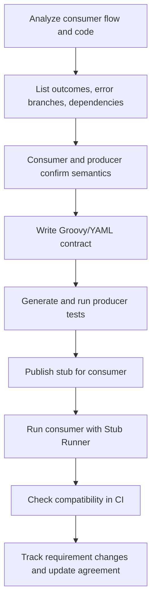

# Identifying Actual Consumer Needs Before Writing a Contract

In **contract design** with **Spring Cloud Contract**, the first step is not choosing between Groovy or YAML syntax or describing an existing endpoint. The first step is identifying **which behavior the consumer actually needs** to complete a business flow. A contract is only valuable when it accurately describes what the consumer depends on and what the producer commits to providing.

Spring Cloud Contract supports defining HTTP or messaging behavior, generating tests on the producer side, packaging stubs for the consumer to run with Stub Runner, and detecting incompatible changes in CI. However, those tools verify an **already written agreement**; they do not automatically detect whether the agreement solves the consumer's actual problem.

After this lesson, you can:

- Distinguish the consumer's business requirements from the list of fields and endpoints the producer currently exposes.
- Gather evidence from processing flows, API call code, and error scenarios to identify the behavior that needs to be guaranteed.
- Translate needs into verifiable scenarios that define the contract boundaries.
- Prepare a clear set of criteria before writing Groovy/YAML contracts and testing with Spring Cloud Contract.

## 1. The Consumer Needs a Business Outcome, Not Just an HTTP Response

A **producer** is a service that provides a capability; a **consumer** is a service or application that uses that capability. A consumer may call multiple APIs, but not all data returned by the producer is a dependency that must be protected by a contract.

For example, the `OrderService` development team tells the `InventoryService` team: “We need an API to check if a product is in stock”. If they immediately create a contract for `GET /inventory/{sku}` returning `availableQuantity`, the two teams may end up with a contract that is technically valid yet wrong from a business perspective.

Asking further about the ordering flow reveals the core requirement: when a customer clicks **Place Order**, `OrderService` needs to **reserve two units of stock for a period of time** to prevent two orders from consuming the same inventory. Reading the current quantity does not guarantee that, because inventory can change immediately after the response.

Because of this difference, the solution to discuss may shift from “reading inventory” to “creating a stock reservation request”. This is why needs must be clarified before locking in paths, methods, data fields, or status codes.

| Initial statement | Clarifying question | Actual need that may be uncovered |
| --- | --- | --- |
| “Need to know if it is in stock” | To display it or to confirm an order? | If confirming an order, atomic stock reservation may be needed |
| “Need pricing information” | Display price or price with promotions applied at checkout? | Need total amount and the rules applied at order confirmation time |
| “Need payment status” | How does the consumer handle success, failure, and pending states? | Need state transition rules and update events |
| “Need a fast response” | How slow does it have to be before the business flow fails? Does the consumer retry? | Need time budgets, timeouts, and retry policies; some requirements fall outside the contract |

**Principle:** only commit to the behaviors the consumer must rely on to work properly; do not copy the producer's entire internal model into the contract.

## 2. Finding Needs from Evidence and Stakeholders

You should meet with both the person responsible for the business flow and the developer directly writing the consumer. The person who understands the process explains **why** the data is needed; the implementer points out **which parts of the code actually depend** on the response.

Useful sources of information include:

1. **Business flow:** what action triggers the call; what the successful outcome for the user is; what data the next step requires.
2. **Consumer code:** HTTP clients, DTOs, `if` branches, error handling, timeouts, retries, and the fields actually read in practice. Existing code is evidence of dependencies, though it is not automatically the right requirement for a new design.
3. **Cross-team discussions:** semantics of each field, error codes, access permissions, data preconditions, and what the producer can actually guarantee.
4. **Incidents and operations:** past errors that broke the flow, previous API changes, anomalous data, and typical latency.
5. **Business documentation:** reservation policies, expiration conditions, promotion rules, caller permissions. Verify documentation against running behavior if they conflict.

For each piece of information, clearly record the **confirmation source** and the **decision maker**. Distinguish what both parties have agreed upon from assumptions that still need verification; unconfirmed assumptions should not appear as guarantees in the contract.

### Consumer interview question set

| Question group | What to find out |
| --- | --- |
| Context | Who or what job makes the call? At what point in the process is it called? |
| Input | What identifiers does the consumer already know? Which fields are required, and what are the units of measurement? |
| Success | What decision does the consumer need to make from the response? Which fields are used immediately? |
| Business errors | When out of stock, expired, or given an invalid request, what will the consumer do? |
| System errors | On timeout, network error, or `5xx`, does the consumer retry? Is there a risk of creating duplicate transactions? |
| State | Does the API only read data or create/update state? Is there concurrent processing? |
| Compatibility | Which consumer versions are deployed? Which fields or behaviors cannot change abruptly? |
| Non-functional | At which layer should authentication, authorization, latency, rate limiting, and observability be handled? |

The goal of the conversation is to find **verifiable processing branches**, not to ask the consumer to list as many fields as possible.

## 3. Moving from a Business Flow to a Set of Scenarios

Suppose the two teams confirm the following example:

> When a buyer confirms order `ORD-2048` consisting of 2 units of `SKU-001` at warehouse `WH-HCM-01`, `OrderService` sends a stock reservation request to `InventoryService`. If sufficient stock is available, the producer creates a reservation with an identifier and an expiration timestamp; if stock is insufficient, the consumer must know that it cannot proceed with finalizing the order.

This is a **design example for learning**; the paths and status codes below are a proposed option and only become an official contract after both teams confirm them.

### Identifying inputs and outputs

| Expected information | What does the consumer use it for? | Points to confirm |
| --- | --- | --- |
| `sku` (request) | Select the item to reserve | Format and existence rules for the SKU |
| `warehouseId` (request) | Select the warehouse fulfilling the order | Does the consumer specify the warehouse or does the producer select it? |
| `quantity` (request) | Quantity to reserve | Positive integer; unit and maximum limit |
| `Idempotency-Key` (header) | Safe retry after timeout | Scope, TTL, and how reusing a key with different content is handled |
| `reservationId` (response) | Reference when confirming/canceling a reservation | Is it system-wide unique, and how long does it remain valid? |
| `status` (response) | Know the reservation outcome | Valid values, meaning, and state transitions |
| `expiresAt` (response) | Determine the payment processing deadline | UTC/ISO 8601 format and policy upon expiration |

The `availableQuantity` field is not included just because the producer happens to have it: if the consumer only needs to know whether the reservation succeeded or failed, exposing instantaneous stock counts can introduce an unnecessary dependency.

### Writing scenarios by observable behavior

You can use **Given – When – Then** phrasing before choosing Groovy or YAML:

**Scenario A — successful reservation**

- **Given:** SKU exists; warehouse has sufficient stock; `OrderService` is authorized to place a reservation.
- **When:** the consumer sends a request to reserve 2 units with a valid idempotency key.
- **Then:** the producer confirms 2 units are reserved, returning `reservationId` and `expiresAt`; the consumer can proceed to the payment step.

**Scenario B — insufficient stock**

- **Given:** the warehouse only has 1 unit available to reserve.
- **When:** the consumer requests to reserve 2 units.
- **Then:** the producer returns the agreed business error (for example `409 Conflict` with code `INSUFFICIENT_STOCK`); the consumer reports that the order cannot proceed and does not assume the stock was reserved.

**Scenario C — invalid input data**

- **Given:** the consumer sends `quantity = 0`.
- **When:** the producer receives the request.
- **Then:** the producer returns the agreed invalid-input response (for example `400 Bad Request`); the consumer fixes the input instead of automatically retrying indefinitely.

**Scenario D — timeout after sending the request**

- **Given:** the consumer does not yet know whether the producer reserved the stock.
- **When:** a timeout occurs and the consumer resends the same request with the same `Idempotency-Key`.
- **Then:** whether the behavior creates a duplicate, returns the previous result, or returns an error must be clearly defined by both teams. If guaranteeing deduplication, additional integration/state-level tests are needed, because a single request-response interaction does not prove idempotency.

To avoid writing an overly broad contract, classify scenarios as: **mandatory for the consumer to function**, **important for operations**, or **out of scope for the current integration**. A field might be mandatory for application A but unnecessary for application B; when there are multiple consumers, clearly agree on who depends on which behavior.

## 4. Building a Verifiable Requirements Matrix

The matrix below bridges business discussions and concrete contracts. It helps verify why each clause exists and how to detect when the producer changes.

| ID | Consumer need | Expected producer behavior | Verification method |
| --- | --- | --- | --- |
| R1 | Finalize order when stock reservation succeeds | `POST /api/v1/reservations` returns `201` with `reservationId`, `status`, `expiresAt` | Spring Cloud Contract for the success response |
| R2 | Stop order finalization when stock is insufficient | Returns `409` and error code `INSUFFICIENT_STOCK` | Dedicated contract for the business error |
| R3 | Reject invalid quantities | Returns `400` for `quantity <= 0` | Contract for input validation constraint |
| R4 | Retry after a network error without reserving stock twice | Handles the same idempotency key per the agreed policy | Contract for the observable response **and** multi-call integration tests |
| R5 | Users cannot finalize an order using an expired reservation | Agree on expiration timestamp and expired-state handling | Contract for time/status fields; separate timing and workflow tests |

**Note:** `201`, `409`, `400`, endpoint names, and error codes here are **hypothetical example conventions**, not default behaviors that Spring Cloud Contract forces the producer to follow. What needs agreement is their meaning to the consumer.

Only after both sides agree on R1–R5 should you choose technical details such as field names, JSON schema, headers, data types, paths, or HTTP methods. If a requirement still has multiple interpretations, add data examples and counterexamples before implementing the DSL.

## 5. Drafting a Contract from a Confirmed Requirement

After agreeing on R1, you can use the Spring Cloud Contract Groovy DSL to describe **one** HTTP interaction. Illustrative example:

```groovy
import org.springframework.cloud.contract.spec.Contract

Contract.make {
    name 'reserve_stock_success'
    description 'OrderService reserves 2 units to proceed with checkout'

    request {
        method 'POST'
        url '/api/v1/reservations'
        headers {
            contentType(applicationJson())
            header('Idempotency-Key', 'ord-2048')
        }
        body([
            sku        : 'SKU-001',
            warehouseId: 'WH-HCM-01',
            quantity   : 2
        ])
    }

    response {
        status 201
        headers {
            contentType(applicationJson())
        }
        body([
            reservationId: 'res-789',
            status       : 'HELD',
            expiresAt    : '2026-11-24T04:15:00Z'
        ])
    }
}
```

The example uses fixed values for brevity. In a real system, dynamic values like `reservationId` or `expiresAt` may need **matchers** so tests do not depend on a hardcoded value; how you choose matchers should reflect the producer's actual guarantees. Scenarios R2 and R3 should live in separate contracts with their own inputs and responses.

From the consumer's perspective, every part of the contract needs a reason:

- **`POST` and URL:** create a stock reservation request, rather than merely reading inventory counts.
- **`sku`, `warehouseId`, `quantity`:** precisely identify the stock to reserve.
- **`Idempotency-Key`:** supports the agreed retry policy; the presence of the header alone does not prove the system prevents duplicates.
- **`201`:** informs the consumer that the producer accepted and successfully created the reservation.
- **`reservationId`, `status`, `expiresAt`:** data the consumer actually needs for the next step and expiration handling.

If the consumer does not use a field and no downstream requirement depends on it, consider removing it from the commitment scope. Conversely, if a field determines a processing branch, clearly specify nullability, data type, units, the meaning of `null`, and valid values.

### A contract does not cover every system property

Spring Cloud Contract is particularly effective for verifying the **shape and observable behavior** of HTTP or messaging communication. It does not replace full testing of inventory contention, transactions, access control, performance, time-based retries, or cross-service workflows.

For instance, a stub returning `201` does not prove that InventoryService actually locks enough stock when 100 requests arrive concurrently. That guarantee must be verified with appropriate integration/concurrency tests and the producer's transaction design.

If the communication is event-driven rather than HTTP, the questions still start from the consumer: which event triggers processing, which fields are mandatory, what the event means, and how duplicates or out-of-order events are handled. Only then should you express the messaging interaction in the corresponding DSL.

## 6. Aligning with the Producer and Integrating into the Testing Pipeline

Before committing a contract to the repository, the consumer and producer should review each scenario together and answer three questions:

1. **What guarantee does the consumer need?** For example: `status = HELD` truly means two units have been reserved, not merely that the request was received.
2. **Can the producer fulfill it reliably?** Especially for business errors, final states, timestamps, and dynamic fields.
3. **Which changes would break the consumer?** For example: changing `409` to `200` with an error body, removing `reservationId`, changing time units, or renaming status values.

Recommended workflow:



When the producer runs tests generated from the contract, a change that no longer satisfies the agreed behavior can fail the tests. The consumer uses stubs to develop and test API-calling branches even before the real producer is ready. Combining these steps in CI helps detect mismatches between both sides early, though only for behaviors **already described and tested**.

When there are multiple consumers, do not assume a single contract represents every user of the API. You need to know which consumer versions are active, which commitments are still in use, and how to modify or deprecate them. For breaking changes, discuss a migration or versioning strategy before replacing the old contract.

## 7. Common Mistakes

| Mistake | Consequence | How to address |
| --- | --- | --- |
| Starting from the producer's Swagger/endpoints | The contract describes what exists, missing the real purpose | Trace the business action and consumer processing branches |
| Requiring the entire response object | Coupling to unused fields; minor changes easily break the contract | Only include fields that must be committed; separate non-essential extension data |
| Including only `2xx` cases | Consumer doesn't know how to handle out-of-stock, bad input, or system errors | Capture failure paths and the consumer's decisions as well |
| Equating an HTTP response with business correctness | Stub tests are all green yet duplicate orders or overselling still occur | Add state, integration, and concurrency tests |
| Using example data without confirming semantics | Two teams interpret `status` or expiration timestamps differently | Document meaning, type, units, valid values, and counterexamples |
| Using fixed timestamps/IDs as business assertions | Brittle tests or enforcing incidental details | Use appropriate matchers for dynamic values; test the properties to guarantee |
| Treating SLA/timeouts as the entire HTTP contract | Specialized operational testing is missed | Define non-functional targets and test them with appropriate tools |

## 8. Checklist Before You Start Writing Groovy/YAML

Only move on to writing the contract when you can clearly answer the following points:

- [ ] Know **which consumer**, version, or flow depends on the API.
- [ ] Have a description of the business step that triggers the call and the outcome the consumer needs.
- [ ] Distinguished fields **mandatory for the consumer** from information the producer happens to have.
- [ ] Have at least one success scenario and error scenarios directly tied to consumer decisions.
- [ ] Agreed on the method/endpoint or message type, format, status codes, fields, and semantics.
- [ ] Clarified nullability, dynamic data, time units, retry handling, and idempotency if applicable.
- [ ] Know what can be verified with contracts and what requires integration, security, performance, or concurrency tests.
- [ ] The producer agrees to the commitment; someone on the consumer side confirms the required behaviors.
- [ ] Have a plan to bring contracts, producer tests, stubs, and compatibility checks into CI.

### Practice exercise

A `NotificationService` team asks `UserService` to “send every user profile change” so it can send a welcome email. Do not rush to create a `UserUpdated` event containing the entire user profile. Do three things:

1. Ask **which exact business event** requires the consumer to send an email: new registration, account activation, or email address change?
2. Draft three scenarios: sending the email successfully, receiving a duplicate event, and missing contact details. For each scenario, identify the minimum data the consumer needs to decide how to process it.
3. Create a table of **consumer need → producer commitment → verification method**, then review it with the producer team before creating a message contract.

If after the exercise you can explain **why each field, state, and scenario needs to exist**, you have solid input for the next step: writing a Spring Cloud Contract agreement that is meaningful to both the producer and the consumer.
