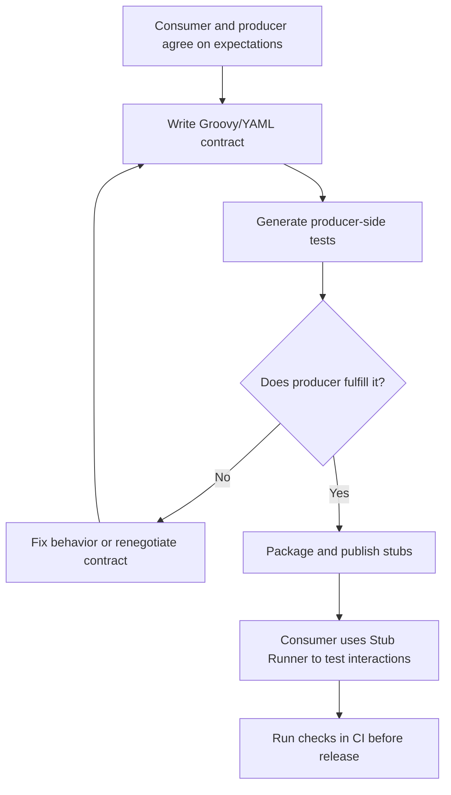

# Choosing the HTTP or Messaging Boundary to Verify

## 1. Why Must You Choose the Right Contract Boundary?

In a microservices system, a small change in service A can break service B even when both still compile and pass unit tests. For example, the `Order Service` API changes `orderId` to `id`, or `Payment Service` renames the event `PaymentAuthorized` to `PaymentApproved`. These changes lie **at the communication boundary between services**, not inside an individual Java method.

**Spring Cloud Contract** helps the producer (the party providing an API or publishing messages) and the consumer (the party calling an API or receiving messages) agree on expectations through verifiable contracts. You can define HTTP or messaging behavior using the Groovy/YAML DSL, generate tests on the producer side, produce stubs for the consumer, and integrate those steps into CI. However, before writing any DSL, you need to determine **which interactions are actually worth formalizing as contracts**.

> A **contract boundary** is the point where a component's observable behavior becomes a commitment to another component: an HTTP request/response, or a message sent/received over a channel. A contract describes what external parties are entitled to rely on, not how the producer implements it internally.

After this lesson, you can:

- Distinguish synchronous HTTP boundaries from asynchronous messaging boundaries.
- Select high-value interactions for contract tests based on actual consumers, risk level, and independent deployability.
- Identify which fields, statuses, headers, formats, and event semantics to constrain, avoiding testing implementation details.
- Draft a practical set of contracts, knowing what Spring Cloud Contract can verify and what requires other types of tests.

## 2. View the System by Communication Paths, Not Service Count

Suppose an e-commerce system has the following components:

```mermaid
flowchart LR
    UI[Client Application] -->|HTTP POST /api/orders| ORD[Order Service]
    ORD -->|HTTP POST /api/payments| PAY[Payment Service]
    PAY -->|PaymentAuthorized event| BUS[(Message broker)]
    BUS -->|Receives PaymentAuthorized| ORD
    BUS -->|Receives PaymentAuthorized| NOTI[Notification Service]
    ORD -->|HTTP GET /api/orders/{id}| UI
```

Each arrow is a **candidate** for a contract. Not all of them need the same type or the same number of contract tests:

| Communication | Boundary type | Verifiable expectations |
| --- | --- | --- |
| Client application calls `POST /api/orders` | HTTP request/response | Method, path, input payload, status codes, and response structure |
| Order Service calls `POST /api/payments` | HTTP request/response | Payload Order Service must send and the response it actually processes |
| Payment Service emits `PaymentAuthorized` | Outbound messaging | Destination name, headers, and event payload that subscribers depend on |
| Order Service receives `PaymentAuthorized` | Inbound messaging | Accepted message structure and observable reaction of the service |
| Payment Service calls `PaymentRepository` | Internal to one service | Usually suited for unit/integration tests, no cross-service contract test needed |

Key point: **the actual communication style determines the contract type**. Do not choose HTTP just because a service has a REST controller; and do not choose messaging just because the system uses Kafka or RabbitMQ. Start from how the producer and consumer interact.

### Who is the producer, and who is the consumer?

The two roles must be identified **per interaction**, rather than fixed permanently to an application:

- For HTTP, the producer is the service exposing the endpoint; the consumer is the service/client calling that endpoint.
- For events, the producer is the component publishing the message; the consumer is the component subscribing to and consuming the message.
- One service can be an HTTP consumer in one interaction while acting as a messaging producer in another.

For example, `Order Service` consumes the HTTP API of `Payment Service` while also consuming the `PaymentAuthorized` event. These are **two distinct contracts**, even though both relate to payments.

## 3. When to Choose an HTTP Contract?

Choose HTTP when a consumer **actively sends a request** and relies on the producer's response over HTTP. The following elements typically belong in the contract scope:

| Component | Design questions |
| --- | --- |
| Method and URL | Does the consumer rely on `GET /api/orders/{id}` or `POST /api/orders`? Which path variables and query parameters are mandatory? |
| Request | Which body, headers, media type, authentication criteria, or identifiers affect interoperability? |
| Response | Which HTTP status, `Content-Type`, body, and data types are used by the consumer? |
| Error cases | How does the consumer react to `400`, `404`, `409`, or specific business errors? |
| Business semantics | What does `status: PAID` mean? Does the consumer branch its logic based on that value? |

For example: an order details screen needs to display the order ID, status, and total amount. The minimal boundary could be `GET /api/orders/{id}` returning `200` with `orderId`, `status`, `totalAmount`, plus a `404` response when the order does not exist. If the UI does not use `internalNote`, do not include it in the contract merely because the current JSON has that field.

**Not every value needs to be hardcoded.** For random IDs, creation timestamps, or varying data, use appropriate matchers when implementing the contract. Fixing an unimportant value causes false failures when the producer makes valid changes.

### HTTP contract example in Groovy DSL

Here is an illustrative contract provided by `Order Service`. The consumer depends on looking up a paid order:

```groovy
import org.springframework.cloud.contract.spec.Contract

Contract.make {
    description 'Returns the order fields currently used by the consumer'

    request {
        method 'GET'
        url '/api/orders/ORD-123'
        headers {
            accept(applicationJson())
        }
    }

    response {
        status OK()
        headers {
            contentType(applicationJson())
        }
        body(
            orderId: 'ORD-123',
            status: 'PAID',
            totalAmount: 250000
        )
    }
}
```

The contract illustrates a **typical happy path**: a valid request and a `200` response. In a real project, you need to agree with the consumer on field names, data types, currency units, and the semantics of `totalAmount`. This contract also does not yet describe the case where the order does not exist; if the consumer relies on an error code for routing or UI flow, that is a second contract worth writing.

A similar example in **YAML DSL** for the error branch:

```yaml
description: Returns an error when the order is not found
request:
  method: GET
  url: /api/orders/ORD-404
  headers:
    Accept: application/json
response:
  status: 404
  headers:
    Content-Type: application/json
  body:
    code: ORDER_NOT_FOUND
    message: Order not found
```

From a design perspective, the durable value here is not the message string `Order not found`, but the **error code and status that the consumer uses for handling**. If the wording of `message` is not a public commitment, you can omit that field from expectations or assert it more flexibly when implementing the DSL.

## 4. When to Choose a Messaging Contract?

Choose messaging when a component **publishes or receives messages via a broker/event channel**, and another component relies on the format or meaning of that message. The consumer typically does not receive an immediate response to a call; the outcome may arrive later, be redelivered, or be processed asynchronously.

A message contract typically needs to answer:

- **Which event?** For example `PaymentAuthorized`, `PaymentFailed`, or `OrderCancelled`. Do they carry distinct business meanings?
- **Where is it sent?** Which destination, topic, exchange, queue, or logical channel is part of the agreed interface?
- **Which payload fields are stable?** Are `eventType`, `orderId`, `paymentId`, `amount`, `currency`, `schemaVersion` required by subscribers?
- **Which headers/metadata matter?** `contentType`, correlation ID, event ID, version, key, or event type.
- **What is the emission trigger?** Emitted after payment confirmation, or immediately upon receiving a request? Will the consumer interpret the event as a fact that already happened or a request to process?

For example, `Notification Service` listens to `PaymentAuthorized` to send a receipt. If the producer silently renames `orderId` to `purchaseId`, the consumer may fail to associate the event with the right order. This is a **change at the messaging boundary** that should be caught early.

### Message contract example in Groovy DSL

On the `Payment Service` producer side, an illustrative contract for an outbound event:

```groovy
import org.springframework.cloud.contract.spec.Contract

Contract.make {
    description 'Emits a message after payment is authorized'
    label 'paymentAuthorized'

    input {
        triggeredBy('publishPaymentAuthorized()')
    }

    outputMessage {
        sentTo('payments.authorized')
        headers {
            header('contentType', 'application/json')
        }
        body(
            eventType: 'PaymentAuthorized',
            orderId: 'ORD-123',
            paymentId: 'PAY-456',
            currency: 'VND',
            amount: 250000
        )
    }
}
```

`triggeredBy('publishPaymentAuthorized()')` describes how the generated test instructs the producer to trigger the behavior, so **the base class for generated tests must provide a matching method**. `sentTo('payments.authorized')` represents the destination according to the application's messaging integration configuration. You need to wire the contract to the project's actual binder/message verifier; the DSL file alone is not enough to prove a message was sent over a real broker.

This example intentionally selects fields that subscribers actually use. In a system with multiple subscribers, you may need to add `eventId`, `occurredAt`, `schemaVersion`, or metadata used for deduplication, as agreed among the parties. The destination name must also reflect the real interface rather than reusing a sample topic name blindly.

### Publishing vs. receiving messages are two verification angles

For an event flow, distinguish between:

1. **Verifying that the producer emits the message:** When the business action occurs, does the producer publish to the right destination with the exact structure the consumer expects?
2. **Verifying the receiving service:** When a valid message is fed into the input channel, does the receiving service accept it and produce observable behavior?

Spring Cloud Contract supports describing input messages in the DSL (such as `messageFrom`, `messageBody`, `messageHeaders`) and corresponding output messages. However, not every handler produces an output message; if the result is a database change, add appropriate state assertions or integration tests. Do not invent a fake `outputMessage` just to force a contract onto a handler that only writes data.

## 5. Five-Step Process to Select Contract Test Scope

### Step 1 — List interactions across deployment boundaries

Map out calls or message flows between components that can be released/deployed independently. For each interaction, note the **consumer**, **producer**, **protocol**, **business behavior**, and **observable dependencies**. Internal calls within the same service are not the priority target for consumer-driven contract tests.

### Step 2 — Ask what the consumer actually depends on

Do not copy an entire OpenAPI spec or full current JSON response into one contract. Ask:

- Does the consumer read this field, and for what purpose?
- Which values cause the consumer to take a different business branch?
- If the data type, field name, or status changes, will the consumer fail or keep working?
- Could existing contracts detect that change on the producer side before deployment?

For example, `Order Service` only uses `paymentId` and `status` from the Payment API result. If the producer adds a `riskScore` field, adding that field can be completely compatible; forcing the consumer to rigidly match the entire JSON limits the API's ability to evolve.

### Step 3 — Classify as synchronous or asynchronous

| Signal | Start with |
| --- | --- |
| Client calls an endpoint and needs status/body immediately | HTTP contract |
| Client calls an endpoint to enqueue work, then receives a completion event | At least one HTTP contract for command acceptance **and** a messaging contract for the related event, if a consumer depends on it |
| A service emits a business event consumed by multiple subscribers | Outbound messaging contract |
| A service processes a command/event from a broker | Inbound messaging contract or handler integration test, depending on observable behavior |
| Changes to timeouts, throughput, ordering, or latency | Performance/resilience/integration tests; data contracts alone are insufficient |

A single business journey may span both HTTP and messaging. **Do not force the entire journey into a single contract type.** Verify each boundary with the appropriate test type.

### Step 4 — Select scenarios with high compatibility risk

Prioritize interactions with multiple consumers, separate deployment teams, frequent changes, hard-to-spot failures, or major business impact. Start with a representative **happy path**, then select error branches or variants where the consumer behaves differently.

| Candidate | Risk if changed | Example priority | Reason |
| --- | --- | --- | --- |
| `POST /api/payments` creates payment | High | High | Wrong amount/status types can break the ordering flow |
| `PaymentAuthorized` contains `orderId` | High | High | Multiple subscribers correlate the event to the right order |
| `GET /api/orders/{id}` returns `404` | Medium–high | High if consumer explicitly handles `404` | Consumer may display a “not found” state |
| `GET /health` for liveness probe | Context-dependent | Low if covered by other monitors | Primarily an operational check with few cross-service business rules |
| Internal method name `calculateFee()` | Low for external consumers | No contract needed | Not a cross-service interface |

The priorities above are **illustrative only**. If a health endpoint is actually used by an external system under a published agreement, it must still be treated as a managed interface.

### Step 5 — Write small, clear contracts with clear ownership

Each contract should have an easily explained purpose: “when consumer does X, producer commits to Y”. Record the service owning the contract, which consumers need it, the API/event version, and how tests run in CI. If you cannot point to a consumer or explain how a field is used, revisit why that field is being constrained.

## 6. Choosing Contract Granularity: Catch Bugs Without Locking Implementation

Focus on the **wire interface** and semantics that affect the consumer:

| Constrain when the consumer depends on it | Usually do not constrain via contract tests |
| --- | --- |
| HTTP method, path, required query params | Controller method names, internal class/service names |
| Status, media type, business headers | Repository call order, database table names |
| JSON field names/types and critical status values | Key ordering in JSON objects when the consumer does not depend on it |
| Event destination, payload, headers, and version | Thread pool configuration and handler implementation details |
| Error branches the consumer must handle | Display-only message wording when there is no fixed commitment |

Several design decisions should be aligned early:

- **Required vs. optional:** Distinguish fields always present, fields that may be absent, and fields that accept `null`. Can your consumer tolerate missing data?
- **Units and types:** Is `amount: 250000` an integer in VND, a percentage, or a decimal? Does `occurredAt` use ISO 8601 or epoch? Does changing data type break the parser?
- **Enums/statuses:** Will the consumer handle new statuses? Renaming `PAID` to `COMPLETED` can be a breaking change even if the meaning is similar.
- **Identifiers:** Where are `orderId`, `eventId`, and correlation ID used? Matchers should validate required format rather than hardcoding a random ID.
- **Extensibility:** A producer adding a new field is usually compatible with consumers that ignore unknown fields; deleting or renaming an in-use field is usually incompatible. Verify your consumer's deserializer behavior in practice before concluding.

In Spring Cloud Contract, the DSL supports matchers and declaring different values for the producer vs. consumer sides. They are useful for dynamic data, but **overly broad matchers** (such as accepting any string for a business status) allow consumer-breaking changes to slip through tests. Conversely, hardcoding every timestamp or ID makes tests brittle due to random data.

## 7. What Contracts Do Not Guarantee Automatically

Contract tests answer the question: **does the producer still provide the agreed behavior/interface?** They do not automatically replace every system test:

- **HTTP:** Contract tests do not automatically prove authorization, timeouts, rate limits, tracing, performance, proxy redirects, or end-to-end service chains. If these properties are critical commitments, use appropriate security, integration, or performance tests.
- **Messaging:** Verifying payload/destination does not prove messages are always delivered once, globally ordered, never lost during broker failures, or handled idempotently. You need broker integration tests, retry/DLQ tests, and redelivery tests.
- **Deep business semantics:** A structurally valid body with an incorrect monetary calculation can still pass a format-only contract. Unit/domain tests must verify calculation rules.
- **Schema evolution:** A valid schema does not guarantee every consumer supports every version. Define a compatibility policy and test critical consumers.

Especially with message brokers, contract tests excel at catching **format compatibility issues and agreed send/receive behavior**. Actual delivery guarantees must be verified through other tests.

## 8. Practice Scenario: Where Does Renaming a Field Break?

`Payment Service` currently provides two channels:

1. HTTP `POST /api/payments` returns `paymentId` and `status` to `Order Service`.
2. After confirmation, it emits `PaymentAuthorized` containing `paymentId`, `orderId`, and `amount`; both `Order Service` and `Notification Service` subscribe.

The Payment team wants to rename `paymentId` to `transactionId` in both the HTTP response and the event. They claim the database still stores the transaction accurately, so the change is “safe”. Analyze it by boundary:

| Change | Potentially affected consumer | What the contract should detect |
| --- | --- | --- |
| HTTP response drops `paymentId` | Order Service if reading the old field | Producer test for `POST /api/payments` no longer satisfies the committed field |
| Event drops `paymentId` | Order/Notification subscribers if needed to correlate payment | Producer message test no longer satisfies the committed payload |
| Database renames column while JSON/event remain unchanged | No direct impact on external consumers | Does not necessarily fail contract tests; unit/integration tests cover internal correctness |
| Event adds `transactionId` while keeping `paymentId` | Existing consumers usually keep working if tolerant of extra fields | Confirm compatibility rules and verify with consumer tests |

A cautious evolution strategy is **adding the new field, keeping the old field during a transition period, updating consumers, and measuring usage before removal**. For explicitly versioned events, you can publish a new version or coordinate a migration under a compatibility policy accepted by all sides. Merely incrementing `schemaVersion` does not automatically teach old consumers how to understand a new payload.

### Contract selection table for the scenario

| ID | Producer → Consumer | Boundary | Key scenario | Verification target |
| --- | --- | --- | --- | --- |
| C1 | Payment → Order | HTTP | Payment accepted | `POST /api/payments` returns `201`/`200` per actual API, `paymentId` and `status` have expected types |
| C2 | Payment → Order | HTTP | Rejected due to invalid data | Status and error code handled by Order |
| C3 | Payment → Order, Notification | Messaging | Payment authorized | `PaymentAuthorized`, destination, `orderId`, `paymentId`, amount and currency unit |
| C4 | Payment → Notification | Messaging | Adding new metadata fields | Existing consumer can still read the committed fields |

Do not assume either `201` or `200` is automatically right: **pick one status matching the API behavior agreed by the teams**, then put that status into the contract. Likewise, destinations and event splits must reflect the real implementation rather than copying examples mechanically.

## 9. Integrating Chosen Boundaries into the Verification Pipeline

After selecting the contracts, a typical Spring Cloud Contract implementation flow looks like this:



At the HTTP boundary, stubs allow the consumer to test how it sends requests and processes responses without running the real producer. At the messaging boundary, how stubs and messages are tested depends on the project's integration mechanism. Stub Runner helps consume published stubs, but it **does not replace** broker integration testing and distributed behavior testing.

When integrating into CI, prioritize this order:

1. **Producer CI:** Generate and run generated tests from existing contracts; fail the pipeline if the producer breaks a commitment.
2. **Versioned stub publishing:** Publish artifacts only for producer builds that passed tests; clearly manage stub versions and resolution repositories.
3. **Consumer CI:** Use stubs via Stub Runner to verify the consumer's HTTP client or message flow across selected scenarios.
4. **Complementary tests:** Run broker integration, resilience, security, and end-to-end tests for risks that contract tests do not cover.

If a producer's contract is modified, assess the impact on **all known consumers** before approving. A green consumer test only proves the expectations that test actually asserts.

## 10. Common Mistakes When Selecting Boundaries

| Mistake | Consequence | How to fix |
| --- | --- | --- |
| Writing contracts for every internal function | Many tests, little protection for cross-service compatibility | Only bring external service interactions into contract scope |
| Writing only HTTP contracts in an event-driven flow | Misses breaking changes in message payloads | Create contracts for both HTTP and messaging when consumers depend on both |
| Contracts locking the entire response like a snapshot | Even harmless new fields cause failures | Keep only fields/values the consumer uses, choose appropriate matchers |
| Testing only `200` and skipping error branches | Consumer can break on `404` or new error codes | Add error branches that genuinely alter handling logic |
| Checking payload while ignoring destination | Message has valid data but is sent to the wrong channel | Include destination in the contract when it is a public commitment |
| Using contracts to replace broker integration tests | Fails to catch retry, DLQ, duplicate, or partition bugs | Test delivery semantics and duplicate handling at the integration layer |
| Not identifying owners and consumers | Easy to change an API without knowing who depends on it | Maintain a producer–consumer matrix and review changes by impact |

## 11. Self-Practice Exercise

A ticket booking system has three interactions:

- The web application calls `POST /api/bookings`; on success, the API returns `bookingId` and `status: PENDING`.
- `Booking Service` publishes `BookingConfirmed` to topic `booking.confirmed`; `Email Service` uses `bookingId` and `customerEmail` to send the ticket.
- `Booking Service` updates the `bookings` table using an internal repository.

**Tasks:**

1. Identify which interactions are HTTP, messaging, and internal boundaries.
2. Propose at least two contracts and three mandatory fields/properties for each contract.
3. If `customerEmail` is removed from the event while still present in the database, which contract should fail? Why?
4. A `BookingConfirmed` message is delivered twice by the broker and Email Service sends two emails. Is a payload contract test enough to catch that bug? What additional tests are needed?

<details>
<summary>Suggested answers</summary>

1. `POST /api/bookings` is HTTP; `BookingConfirmed` is messaging; the repository call stays inside the service and does not need a cross-service contract.
2. The HTTP contract should verify `POST` and the exact path, the request schema sent by the web app, success status, and `bookingId`/`status`. The messaging contract should verify destination `booking.confirmed`, event type, `bookingId`, `customerEmail`, and required metadata.
3. The messaging contract provided by the producer must fail if `customerEmail` is a field required and relied upon by Email Service. Having that column in the database does not guarantee the consumer receives the field.
4. No. You need integration tests with the broker and verification of Email Service's idempotency/deduplication, for example based on a stable `eventId`.

</details>

## 12. Pre-DSL Checklist

For each planned contract, verify:

- [ ] Correctly identified the producer, consumer, and independent deployment boundary.
- [ ] Chose HTTP when there is a request/response, and messaging when there is an actual message flow.
- [ ] Have a clear business scenario that the consumer depends on.
- [ ] Constrained only necessary method/path/status/headers/body or destination/message fields.
- [ ] Selected error branches and dynamic values based on real impact, without copying the entire implementation.
- [ ] Agreed on status meanings, measurement units, time formats, required/optional fields, and versioning policy.
- [ ] Know where generated producer tests and consumer stub tests will run in CI.
- [ ] Identified risks outside contract test scope so complementary tests exist.

**Remember:** Choose contract boundaries from **real consumer dependencies**. HTTP protects request/response commitments; messaging protects commitments about messages and communication channels. A good set of contracts is specific enough to prevent breaking changes, yet focused enough for services to evolve independently.
