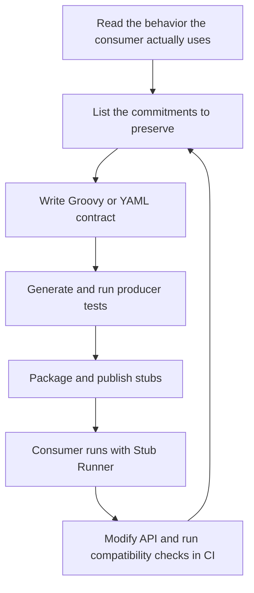

# Minimal Contracts and the Risk of Over-Constraining Data

## 1. Why Are Contracts with More Fields Not Necessarily Better?

In **Spring Cloud Contract**, a contract describes the behaviors a producer must guarantee so a consumer can communicate safely: HTTP method and path, required input data, status codes, headers, and response characteristics; for asynchronous systems, a contract can describe messages published or received. From Groovy/YAML DSL, the tool can generate tests for the producer and stubs for independent consumer testing.

A **minimal contract** is one that constrains only what the consumer actually needs and the business invariants that must hold. “Minimal” here refers to the **number of commitments**, not the number of DSL lines or laxness of tests.

For example, an order tracking screen only needs `orderId` and `status` to display “Confirmed”. The current API might also return creation timestamp, warehouse code, and operational attributes. Putting all of those fields into the contract means that if the producer changes timestamp formatting or warehouse selection logic, contract tests can fail even though the consumer screen keeps working normally.

A good contract balances two sides:

- **Strict enough** to catch changes that break behavior the consumer relies on—for example, `status` changing from a string to an object, HTTP `200` becoming `204`, or a required field disappearing.
- **Narrow enough** not to turn implementation details, incidental sample data, or unused fields into long-term compatibility promises.

The goal of this lesson is to recognize unnecessary constraints, design a minimal HTTP contract using the Spring Cloud Contract DSL, and verify that the contract still catches genuinely incompatible API changes.

## 2. Distinguishing Actual Responses from the Interface to Commit To

Suppose producer `order-service` exposes endpoint `GET /api/orders/{id}`. An actual response might look like:

```json
{
  "orderId": 42,
  "status": "CONFIRMED",
  "createdAt": "2026-11-24T03:00:00Z",
  "warehouseId": "WH-07",
  "internalRiskScore": 0.12,
  "tracking": {
    "traceId": "trace-abc-123"
  }
}
```

The consumer in this example only does:

```java
String label(OrderSummary summary) {
    return switch (summary.status()) {
        case "CONFIRMED" -> "Confirmed";
        case "PENDING" -> "Processing";
        default -> "Other status";
    };
}
```

In this flow, `orderId` lets the consumer correlate data with the requested order, and `status` determines the display label. No logic depends on `createdAt`, `warehouseId`, `internalRiskScore`, or `tracking.traceId`.

| Element | Does the consumer rely on it? | Design decision |
| --- | --- | --- |
| `GET /api/orders/42` and HTTP `200` | Yes | Commit to the request and success status |
| `Content-Type: application/json` | Yes, to read JSON | Commit to the appropriate media type |
| `orderId` is number `42` | Yes, to match the queried order | Assert the value or correlation with the request ID |
| `status` is string `CONFIRMED` in this scenario | Yes | Assert the exact value for the scenario |
| `createdAt` | No | Do not lock to a specific value or format in this contract |
| `warehouseId`, `internalRiskScore`, `tracking.traceId` | No | Exclude from verification assertions |

This **does not mean** the extra fields must be removed from the producer's response. They can continue to exist to serve other consumers. The contract here merely records the slice of behavior that this specific consumer is entitled to expect.

### Signs of an over-constrained contract

A contract deserves review when it pins down any of the following despite the consumer not using them:

1. **The entire JSON object:** copying a response sample verbatim into the contract and treating every field as mandatory by default.
2. **Volatile values:** millisecond-precision timestamps, trace IDs, randomly generated UUIDs, or database-returned ordering.
3. **Internal data:** table names, processing warehouse codes, operational scores, or logging-only metadata.
4. **Overly rigid list structures:** enforcing exact element count, element order, or specific positions when the consumer only needs a keyed set of items.
5. **Technology-coupled representation:** forcing headers or JSON strings to match byte-for-byte when the business requirement only needs semantic equivalence.

The consequence is **compatibility false alarms**: the producer changes an unrelated detail and the contract pipeline turns red. Teams easily lose trust in the tests, have to update multiple stubs simultaneously, or pointlessly delay API improvements. Conversely, stripping out genuinely required assertions will cause the contract to miss consumer-breaking bugs.

## 3. Designing a Minimal Contract with Groovy DSL

From the identified consumption behavior, we constrain only the `GET` request, the successful JSON response, and the two fields the consumer reads.

Example of a **producer** file `src/test/resources/contracts/orders/order-confirmed.groovy`:

```groovy
import org.springframework.cloud.contract.spec.Contract

Contract.make {
    description 'Consumer needs the ID and status of order 42'

    request {
        method GET()
        url '/api/orders/42'
        headers {
            accept(applicationJson())
        }
    }

    response {
        status OK()
        headers {
            contentType(applicationJson())
        }
        body([
            orderId: 42,
            status : 'CONFIRMED'
        ])
        bodyMatchers {
            jsonPath('$.orderId', byEquality())
            jsonPath('$.status', byEquality())
        }
    }
}
```

Meaning of the assertions:

- `method` and `url` indicate the behavior the consumer will invoke. The value `42` is fixed data **for this test scenario**, not a claim that every order has ID `42`.
- `status OK()` and `contentType(applicationJson())` protect how the consumer interprets the response.
- `body` declares the scenario's sample data while also providing the content for the stub used by the consumer.
- Both `byEquality()` matchers express the exact values to verify in the scenario. They place no assertions on `createdAt`, `warehouseId`, or `tracking.traceId`.

Do not replace every check with a `.*` regex just to make tests pass easily: if `status` drives a processing branch, changing `CONFIRMED` to an arbitrary string can break behavior. Likewise, do not check the ID merely as “a number” if the consumer requires the response to match the requested ID. In a scenario requesting `/42`, asserting `orderId` equals `42` expresses that exact relationship.

### Writing the same idea in YAML DSL

For projects configured to load YAML contracts, the same scenario can be expressed as:

```yaml
description: Consumer needs the ID and status of order 42
request:
  method: GET
  url: /api/orders/42
  headers:
    Accept: application/json
response:
  status: 200
  headers:
    Content-Type: application/json
  body:
    orderId: 42
    status: CONFIRMED
  matchers:
    body:
      - path: $.orderId
        type: by_equality
      - path: $.status
        type: by_equality
```

These are **two alternative representations** for one scenario, not two contracts to place side by side in the test folder. Pick the format your project uses and verify that your Spring Cloud Contract version and plugin recognize that DSL type.

> **Note on tolerating additional fields:** Declaring only two fields in the DSL expresses minimal contract intent, but actual JSON matching strictness depends on the DSL, matchers, and test-generator version. Inspect the generated producer test code and run a case where the producer returns extra metadata to verify the comparison permits the intended extensibility. Never assume simply omitting a field from the sample causes all comparison modes to ignore it.

## 4. Choosing Matchers by Business Semantics

Matchers are tools for expressing **what must remain stable**, not a way to make all fluctuating data pass indiscriminately.

| Consumer requirement | Appropriate check | What to avoid |
| --- | --- | --- |
| Must receive `CONFIRMED` status for the confirmation scenario | Exact equality comparison (`byEquality`) | Regex matching any string |
| Only needs a numeric order ID, independent of a fixed ID | Type or numeric pattern check when correlation to the request isn't required | Locking a random value into the contract |
| Needs accurate monetary amount and currency unit | Constrain amount, data type, and currency code per business rules | Checking only that an amount exists while ignoring currency |
| Needs statuses within an allowed set | Constrain the set of statuses handled by the consumer | Accepting unknown values the consumer cannot handle |
| Needs `items` and processes each item regardless of order | Check critical fields per item; avoid locking order unless meaningful | Hard-matching the entire array and sample ordering |
| Needs to distinguish `null`, missing field, and present value | Write separate cases matching API rules | Treating all three states as automatically equivalent |

**Volatile data is not always ignored.** For instance, if the consumer uses `createdAt` for sorting, the presence, type, and timestamp convention of that field are part of the contract to protect. You can avoid locking a **specific timestamp value** while still checking that it is a valid datetime string in the agreed format.

Furthermore, an example value in a stub and a constraint on the producer serve two different purposes. The stub needs concrete data for the consumer to execute against; the matcher describes what the producer must uphold. When using dynamic values, numeric patterns, or Spring Cloud Contract consumer/producer matchers, be clear about which side gets a fixed sample and which side may vary; do not let randomly generated data make tests flaky.

## 5. When Over-Simplification Is Also Dangerous

Suppose the consumer has this logic:

```java
if (response.statusCode() == 404) {
    showOrderNotFound();
}
```

If the “order not found” flow is a behavior the consumer genuinely uses, writing a contract only for HTTP `200` is **insufficient**. Add another contract for requesting a non-existent ID and receiving `404`, along with the error structure if the consumer reads it. Similarly, if the consumer sends `Authorization`, `Content-Type`, or a request body with required fields, include those exact requirements in the contract.

Distinguish three levels:

- **Mandatory:** fields or conditions without which the consumer cannot achieve its goal—for example `status`, HTTP status, or meaningful null rules.
- **Optional but meaningful:** the consumer handles the field when present, and also handles its absence safely. The contract may need separate scenarios to prove both cases.
- **Irrelevant to this consumer:** present only because the current response includes it; should not become a compatibility constraint for that consumer.

Never use “minimal” as an excuse to skip checking authorization, sensitive data handling, pricing rules, or API errors when they are part of the behavior to guarantee. The same principle applies to messaging contracts: an event consumer may need `eventType`, `orderId`, and an idempotency key, without necessarily needing log timestamps or every piece of message metadata.

## 6. Which API Changes Should Fail the Contract?

Consider the sample contract where the consumer only needs `orderId` and `status`:

| Producer change | Compatibility expectation | Reason |
| --- | --- | --- |
| Add `estimatedDeliveryAt` to JSON | Should be allowed | Current consumer does not depend on the new field |
| Change `internalRiskScore` value | Should be allowed | Internal detail outside contract scope |
| Change `status` to `{ "code": "CONFIRMED" }` | Must detect | Consumer reads `status` as a string |
| Remove `orderId` | Must detect | Consumer loses the correlation key to the request |
| Return HTTP `204` instead of `200` with no body | Must detect | Consumer expects JSON containing data |
| Reorder JSON fields | Should be allowed | Key order in a JSON object carries no meaning for the consumer |
| Rename `status` to `state` | Must detect | The field the consumer reads disappeared |

“Should be allowed” is a **design goal**. Verify in practice with generated tests to ensure matching implements that goal accurately. If tests fail when a field is added, inspect how the response structure is asserted or check the JSON comparison mode; if tests still pass when `status` changes type, add or tighten matchers.

A contract is a **relationship between a producer and a specific consumer need**, not a complete copy of the storage schema. Another consumer might need `createdAt`, in which case that consumer's contract must protect it. Do not automatically force all consumers to share one maximally detailed contract.

## 7. Workflow in Spring Cloud Contract and CI



1. **Verify consumption needs.** Read the consumer's response-handling code, mappers, and error branches. Find the fields actually used, their types, empty/null rules, and business scenarios. Do not infer every need from JSON samples in API docs.
2. **Write one contract per meaningful behavior.** Choose clear requests and expectations. If the consumer distinguishes multiple cases, write separate scenarios for each important distinction.
3. **Generate producer tests.** In a project configured with the Spring Cloud Contract plugin, `mvn verify` or the equivalent Gradle task checks that the producer satisfies the contracts. Inspect generated tests when you need to confirm JSON matching and matchers.
4. **Produce and publish stubs.** Stubs are generated from valid contracts and packaged according to project configuration. The consumer uses **Stub Runner** to run integration tests against simulated responses without running the real producer alongside.
5. **Put both sides into CI.** The producer pipeline catches behavioral changes that violate contracts; the consumer pipeline runs against the matching stub version to prove consumption logic. Version stubs carefully so a consumer knows which contract version it tests against.
6. **Test both safe and breaking changes.** Add a metadata field the consumer doesn't use: compatibility tests should keep passing. Change the type of `status` or drop a required field: tests must fail. This is how you detect contracts that are too strict or too loose.

Stub publishing and CI integration depend on Maven/Gradle configuration, artifact repositories, and project versioning policies; writing a DSL file alone does not automatically publish stubs.

## 8. Practice Exercise

An API returns:

```json
{
  "paymentId": "pay-981",
  "state": "SETTLED",
  "amount": 250000,
  "currency": "VND",
  "processorTrace": "tr-55b",
  "settledAt": "2026-11-24T09:00:00+07:00"
}
```

The consumer only allows downloading a receipt when `state = SETTLED`, displays `amount` together with `currency`, and does not use `processorTrace` or `settledAt`.

**Task:** Design the contract for the successful payment scenario, stating which fields must be retained and which do not need constraints. Then suppose the producer changes `processorTrace` to another value and changes `amount` from a number to a string; predict which change must cause tests to fail.

**Suggested answer:** Keep the relevant request path/method, HTTP status and media type if the consumer relies on them, plus `paymentId` (if used as an identifier), `state`, `amount`, and `currency`. No need to lock `processorTrace` or `settledAt` in this contract. Changing the trace must be allowed; changing the type of `amount` must be caught because the consumer uses it numerically for display and calculation. If the consumer does not actually read `paymentId`, do not treat it as mandatory merely because the current response includes it.

## 9. Questions for Self-Reviewing a Contract

- If this field is removed from the response, will **this specific consumer** actually break?
- If the meaning stays the same while the sample value changes, will the test fail over an incidental detail?
- Does the contract check truly critical rules like HTTP status, data types, valid statuses, and nullability?
- Would a new field, different JSON key order, or new internal metadata turn tests red against our compatibility goal?
- Does the stub provide enough data for the consumer to test its business flow, and do producer tests protect that exact data?
- Have you inspected the generated test code and tried at least one compatible change plus one breaking change?

When you can answer these questions, the team will have contracts that are **small in scope yet strong in meaning**: Spring Cloud Contract focuses on protecting the commitments consumers need, while giving the producer room to change implementation details outside the contract.
