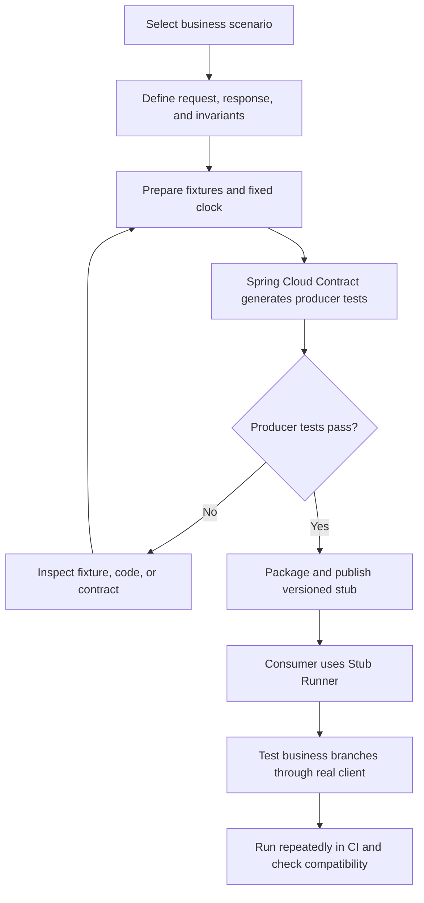

# Keeping Test Data Deterministic and Business-Meaningful

## 1. Test Data Is Part of Contract Design

In a microservices architecture, the producer exposes HTTP APIs or publishes messages, while the consumer relies on those committed behaviors to fulfill business workflows. **Spring Cloud Contract** lets you describe those behaviors using **Groovy DSL or YAML DSL**, generate producer verification tests, package stubs for consumers to test via **Stub Runner**, and integrate verification into CI to catch incompatible API changes.

When writing contracts, data choices directly affect test quality. Look at two responses:

```json
{"id":"1","status":"OK","value":123}
```

and:

```json
{
  "paymentId": "PAY-0001",
  "orderId": "ORD-1001",
  "status": "PAID",
  "amount": 250000,
  "currency": "VND",
  "paidAt": "2026-01-15T09:00:00Z"
}
```

Both can serve as test data, but the second response lets a reader understand *which order was paid, for what amount, and in what status*. It helps the development team catch a change that could break business logic—for instance, if the consumer only allows shipping when `status = PAID`.

Two criteria must go hand in hand:

- **Deterministic:** when run under the same controlled conditions, tests yield the same result; data, time, background state, and stub versions do not change unexpectedly.
- **Business-meaningful:** values reflect a realistic use case, cross-field consistency, and rules the consumer depends on, rather than arbitrary numbers or strings just to make tests pass.

**Deterministic does not mean every production response always contains one identical string.** If the system generates dynamic transaction IDs, the contract can still check a *valid format*, while the stub uses a stable sample ID and business invariants are checked by complementary tests.

### Learning outcomes

After this lesson, you can choose contract datasets with clear intent, distinguish values needing exact equality from values needing matchers, configure stable fixtures and clocks for producer verification, design useful consumer stubs, and reduce random test failures in CI.

## 2. Designing from a Concrete Business Scenario

Suppose `checkout-service` needs to verify a payment transaction before confirming an order, and `payment-service` is the producer of the endpoint:

```http
GET /api/payments/PAY-0001
Accept: application/json
```

The Checkout team cares about these decisions:

1. If payment is **`PAID`**, the order can move to the next processing step.
2. If payment is **`PENDING`**, the order must not ship yet.
3. If the payment ID does not exist, the consumer must handle the not-found case rather than assuming it is paid.

Do not start by generating completely random values and writing assertions to match them. Pick **one representative dataset per business branch** and be able to explain why the expected result is right.

| Scenario | Critical data | Expectation and meaning |
| --- | --- | --- |
| Paid | `PAY-0001`, `ORD-1001`, `PAID`, `250000 VND` | Checkout proceeds to process order `ORD-1001`. |
| Pending | `PAY-0002`, `ORD-1002`, `PENDING`, `99000 VND` | Checkout must wait; must not treat `PENDING` as `PAID`. |
| Not found | `PAY-9999` | API responds per error contract, e.g. `404` if both sides agreed. |
| Invalid data | Negative `amount` or missing `currency` in a payment creation request | API rejects per agreed validation rules; must not be treated as a valid transaction. |

The codes above are **purposeful synthetic data**, containing no real customer information. Monetary amounts are understood as integer values per the example API's convention; real systems must document units and rounding rules clearly. A useful contract needs agreement on representing money and timestamps, because unit mismatches can be more severe than JSON syntax errors.

### Name files so readers see the intent

Prefer names like `payment_status_paid.yml`, `payment_status_pending.yml`, `payment_not_found.yml` over `case1.yml` or `test3.yml`. With behavior-descriptive names, when CI reports a failing contract, whoever modifies the API immediately sees which rule was affected.

## 3. A YAML Contract with Stable Data

Example HTTP contract for a completed payment scenario:

```yaml
description: Retrieve a paid payment transaction to confirm an order
name: payment_status_paid
request:
  method: GET
  url: /api/payments/PAY-0001
  headers:
    Accept: application/json
response:
  status: 200
  headers:
    Content-Type: application/json
  body:
    paymentId: PAY-0001
    orderId: ORD-1001
    status: PAID
    amount: 250000
    currency: VND
    paidAt: "2026-01-15T09:00:00Z"
```

This contract encodes a series of explicit decisions:

- **Request ID and response ID match:** the request asks for `PAY-0001`, and the response refers to `PAY-0001`. This catches bugs where the wrong transaction is returned.
- **Status `PAID` is core data:** the consumer uses it to decide whether to process the order, so it must be checked explicitly.
- **`amount` and `currency` go together:** `250000` without a unit is ambiguous; switching `VND` to `USD` can severely impact business logic.
- **`paidAt` has a deterministic instant and timezone:** using ISO 8601 format with `Z` (UTC) suffix avoids values tied to the test runner's system clock.

With Spring Cloud Contract, this YAML file can be used to generate **producer verification tests** and stubs. When producer tests run, the application must have suitable data state so `GET PAY-0001` returns the information in the contract. **A contract definition does not automatically create records in the producer's database**; fixture setup is the test suite's responsibility.

### Separate distinct behaviors into clear scenarios

Another contract for an incomplete payment:

```yaml
description: Retrieve a pending payment transaction
name: payment_status_pending
request:
  method: GET
  url: /api/payments/PAY-0002
response:
  status: 200
  headers:
    Content-Type: application/json
  body:
    paymentId: PAY-0002
    orderId: ORD-1002
    status: PENDING
    amount: 99000
    currency: VND
```

In this illustrative model, a `PENDING` transaction does not yet have `paidAt`. If the **absence** of `paidAt` is a mandatory business requirement, verify it explicitly with matchers/complementary tests: simply omitting `paidAt` from the JSON example **does not automatically guarantee** the real response will omit that field. If the API chooses to return `paidAt: null` instead of omitting the key, document and test that exact commitment.

Likewise, returning `404` for a non-existent payment is **a design choice to agree upon**, not an implicit rule for all APIs. Contract testing only verifies decisions agreed upon by producer and consumer.

## 4. Equivalent Representation in Groovy DSL

Spring Cloud Contract also supports Groovy DSL. Example for the same `PAY-0001` scenario:

```groovy
import org.springframework.cloud.contract.spec.Contract

Contract.make {
    name 'payment_status_paid'
    description 'Retrieve a paid payment transaction to confirm an order'

    request {
        method 'GET'
        url '/api/payments/PAY-0001'
    }

    response {
        status 200
        headers {
            contentType(applicationJson())
        }
        body([
            paymentId: 'PAY-0001',
            orderId: 'ORD-1001',
            status: 'PAID',
            amount: 250000,
            currency: 'VND',
            paidAt: '2026-01-15T09:00:00Z'
        ])
    }
}
```

YAML and Groovy here are **two ways to express the same scenario**. In a project, choose a single representation as the source of truth to avoid accidentally generating two duplicate tests from two contract files.

Fixed values work well when a test needs to assert **a concrete relationship**: `PAY-0001` belongs to `ORD-1001`, status `PAID`, currency `VND`. However, if the producer genuinely generates a new ID on every request, forcing every ID to equal one constant can fail tests even when the API works properly.

## 5. When to Use Exact Values vs. Matchers?

A **matcher** describes a valid set of values rather than forcing character-for-character equality. However, the broader the matcher, the harder it is for tests to catch business bugs. Classify accordingly:

| Field | Usually suitable strategy | Reason |
| --- | --- | --- |
| `status` | Exact match `PAID` or `PENDING` | Determines business branching. |
| `currency` | Exact match `VND` | Prevents currency-unit mix-ups. |
| `amount` of a fixed fixture | Exact match `250000` | Ensures accurate transaction value for the scenario. |
| `paymentId` already present in URL | Prefer matching the exact requested ID | Maintains consistency between request and response. |
| Newly generated `transactionId` | Matcher constraining format and length | Avoids breaking tests on dynamic IDs while still catching malformed values. |
| System-generated `createdAt` | Fix the clock or verify format/reasonable time range | Avoids run-time clock dependency while still validating time semantics. |
| Element order in a list | Assert exact order if the API promises sorting; otherwise compare order-independently | Avoids testing properties the API does not guarantee. |

For instance, Groovy DSL supports different values for consumer (stub) and producer (verification). A **newly generated `transactionId`** field can be expressed along these lines:

```groovy
body([
    transactionId: $(consumer('TX-1001'),
                     producer(regex('TX-[0-9]{4}'))),
    status: 'PAID'
])
```

In the **response section** of the contract, `consumer('TX-1001')` gives the stub a concrete, stable value to return, while `producer(regex(...))` allows the producer test to accept any properly formatted transaction code. Exact syntax for dynamic values depends on the DSL and version in use; the snippet above illustrates the pattern in Spring Cloud Contract Groovy DSL.

Keep in mind: regex `TX-[0-9]{4}` still allows `TX-9999`, so it is **not enough to prove the code belongs to the right order or payment**. If cross-field correlation rules are essential, verify the relationship with deterministic values, appropriate matchers, or complementary business tests. Do not replace everything with `.*`, `anyNumber()`, or `anyNonBlankString()` just to keep tests green.

### Determinism lies in outcomes, not necessarily every byte

Distinguish two levels:

- **Concrete stub data:** when the consumer sends the same request matching a contract, the stub returns a stable sample response so consumer tests are repeatable.
- **Producer verification conditions:** responses can be checked with matchers to accept dynamic IDs while still protecting critical properties (format, data type, status, business relationships).

If tests use matchers, producer values may vary between runs, yet **the pass/fail verdict must be stable** when behavior is right and the environment is controlled. That is the goal of deterministic testing.

## 6. Eliminating Unnecessary Sources of Randomness

Causes of *flaky tests* usually lie not in the DSL itself, but in surrounding data and environment.

### 6.1. System clock, timezone, and locale

**Avoid:** generating `paidAt` directly from `Instant.now()` inside fixtures, then comparing against an unrelated hardcoded timestamp. Tests can also break when CI runs in a different timezone from a developer's machine.

**Prefer:** setting a fixed instant during tests, ideally by injecting `Clock` into time-producing logic:

```java
import java.time.Clock;
import java.time.Instant;
import java.time.ZoneOffset;

Clock testClock = Clock.fixed(
    Instant.parse("2026-01-15T09:00:00Z"),
    ZoneOffset.UTC
);
```

In a Spring application, the test suite can provide a fixed `Clock` bean to components that read time. If business logic genuinely needs to compare against “today” (e.g., overdue invoices), compute deadlines from `testClock`, not from the test machine's wall clock. Specify timezones explicitly for date/time data; control locale and string formatting for decimals.

### 6.2. Random IDs, sequences, and leftover data

**Avoid:** using `UUID.randomUUID()` for input IDs while expecting a fixed ID in stubs; relying on database auto-increment values polluted by earlier tests.

**Prefer:** using stable, clearly named codes (`PAY-0001`, `ORD-1001`) for fixtures; resetting state or isolating data per test. If IDs must be generated dynamically in production, apply appropriate matchers and test uniqueness/correlation separately.

### 6.3. Execution order and asynchrony

Do not write tests assuming which element appears first if the API does not commit to ordering. Do not assume an event is processed immediately after publishing if the system has asynchronous latency. Use explicit synchronization points/completion conditions, reasonable timeouts, and exact dataset checks instead of fixed `Thread.sleep(...)`.

### 6.4. External service and system dependencies

Contract tests should not depend on a live API, real customer accounts, or third-party payment gateways. Those systems can be slow, mutate data, or behave outside your control. When producer verification needs infrastructure data, use a test profile, internal fixtures, mock adapters, or a controlled integration environment depending on the desired verification level.

## 7. Preparing Fixtures for Producer Verification

Spring Cloud Contract Verifier **generates tests from contracts**; the generated tests need a way to boot the application and set up appropriate state. For the `GET /api/payments/PAY-0001` example, if the producer uses a database, fixtures must seed that transaction before the request executes.

*Illustrative* example of seeding data in the test layer (`Payment` type, repository, and constructors depend on the project):

```java
@BeforeEach
void prepareFixture() {
    paymentRepository.deleteAll();
    paymentRepository.save(
        new Payment(
            "PAY-0001",
            "ORD-1001",
            PaymentStatus.PAID,
            new BigDecimal("250000"),
            "VND",
            Instant.parse("2026-01-15T09:00:00Z")
        )
    );
}
```

This is **not** copy-pasteable production-ready code; the project needs real imports, models, repositories, transactions, and test configuration. In Spring Cloud Contract, the base test class configured for the generator can prepare fixtures before generated tests run. The purpose of the example is to show **data must exist at the right time** and **must not depend on state from other tests**.

A good fixture should satisfy:

1. **Sufficient yet minimal:** seed only the records, relationships, and permissions needed to verify the scenario.
2. **Consistent:** `PAY-0001` belongs to `ORD-1001`, amount `250000`, status `PAID` in both fixture and contract.
3. **Isolated:** re-running or running in parallel does not cause tests to interfere with one another. If using `deleteAll()`, do so only in a **dedicated test database**, never on a shared database.
4. **Order-independent:** each test sets up the state it needs instead of relying on an earlier test “accidentally” creating records.
5. **Clear time source:** all dates and times have a consistent anchor and timezone.

If your repository/test suite uses transaction rollback, per-test isolated databases, or fixture builders, follow the existing convention. For HTTP tests running across threads/processes outside the test's transaction, verify how data is committed and visible; test-method rollback **does not always isolate** changes crossing HTTP boundaries.

## 8. Stub Data Must Help Consumers Verify Real Behavior

Stub Runner lets the consumer run against responses generated from producer contracts. Stub-side values should be **fixed, easy to understand, and distinct enough across scenarios**:

```text
PAY-0001 -> HTTP 200, status=PAID,    orderId=ORD-1001
PAY-0002 -> HTTP 200, status=PENDING, orderId=ORD-1002
PAY-9999 -> HTTP 404 (if defined by contract)
```

Then a consumer test can verify the rule:

```java
// Illustrative code: CheckoutService is configured to call the payment stub.
assertThat(checkoutService.canConfirmOrder("ORD-1001")).isTrue();
assertThat(checkoutService.canConfirmOrder("ORD-1002")).isFalse();
```

In this example, `CheckoutService`'s client must send the right payment ID associated with each order. Do not merely test “the stub returns HTTP 200” and conclude the consumer works; exercise **the real consumer code path** and assert the business decision.

If both fixtures returned `PAID`, the test would fail to prove that Checkout rejects unpaid orders. If IDs between URL and response were inconsistent, tests could mask data-mapping bugs. If a stub returned the exact same generic response for every request, the consumer could pass tests even while calling the wrong resource.

### Pin stub versions in CI

After producer verification passes, the producer publishes a versioned stub artifact. The consumer uses Stub Runner to fetch the appropriate stub (from a local Maven repository or configured artifact repository). For reproducible CI results, **pin a specific stub version**, avoiding dependence on a “latest” snapshot that changes after every build. When testing compatibility against a newer release, do so via an intentional job or configuration.

Illustrative artifact coordinates example:

```text
com.example:payment-service:1.4.2:stubs
```

Group ID, artifact ID, classifier, and version must match how the producer actually packages stubs. Contracts and stubs used in consumer tests must correspond to the same version verified by the producer.

## 9. Meaningful Data for Message Contracts

Contracts do not apply only to HTTP. With Kafka/RabbitMQ or other messaging transports, event data must accurately describe **business state transitions** while avoiding sources of variation that make tests hard to repeat.

Example event for an inventory-processing consumer:

```json
{
  "eventId": "EVT-RESERVED-0001",
  "eventType": "InventoryReserved",
  "occurredAt": "2026-01-15T09:03:00Z",
  "orderId": "ORD-1001",
  "sku": "SKU-001",
  "quantity": 2,
  "reservationId": "RES-0001"
}
```

The `orderId`, `sku`, and `quantity` fields carry business relationships: exactly which item and quantity were reserved for the order. An event with `quantity: 0` may be invalid data or a special case depending on system rules; do not choose it arbitrarily without stating its meaning.

When writing messaging contracts:

- Use `eventType` and payloads representing real events; specify required fields, formats, and data types.
- Keep `eventId`, `correlationId`, or `orderId` consistent between triggers and expected messages; use matchers only for values that genuinely vary.
- Use fixed timestamps in stubs or control the clock during producer tests.
- Explicitly define behavior for redelivered events, duplicate handling, and missing critical fields if the consumer relies on them.
- Do not assume ordering across multiple messages unless the transport and contract guarantee it.

Spring Cloud Contract provides DSL and verification mechanisms for messaging, though integration configuration depends on the technology and infrastructure used. An HTTP stub returning JSON **cannot replace** verifying that messages are sent to the right destination, with the right headers, or triggered properly in a messaging system.

## 10. Both Overly Generic Data and Overly Rigid Data Are Harmful

Contract design requires finding constraints strong enough to protect the consumer without turning internal implementation details into API requirements.

| Practice | Problem | How to improve |
| --- | --- | --- |
| `status` matches any string | Fails to catch producer switching `PAID` to an unknown value. | Assert the status enum or exact value per scenario. |
| Every `id` is `1` | Hard to verify links among payment, order, and reservation. | Use sample IDs distinguishing resources and keep them consistent. |
| Generating random amounts on every run | Hard to reproduce bugs or verify if amounts are valid. | Pick meaningful fixed amounts; add boundary cases when business rules require them. |
| Asserting `createdAt` equals production nanoseconds | Fragile even when data is valid. | Control `Clock` or use bounded time matchers. |
| Including only happy-path scenarios | Consumer may mishandle `PENDING`, `404`, or validation errors. | Add scenarios covering all important business branches. |
| Asserting array order not promised by API | Tests break when DB query strategy changes. | Assert collection elements; assert order only if committed. |
| Using real personal data from production | Security risk, hard to share, and unstable. | Use synthetic/anonymized data containing no sensitive info. |

A common situation: the API adds an `internalTrace` field that does not affect the consumer. If the contract forces the response to match a structure with zero extra fields, tests can fail even though the API stays compatible. Conversely, if the consumer truly depends on a field's **absence** (e.g., never exposing `cardNumber`), describe and assert that requirement explicitly. Matcher strictness should flow from business commitments and data safety.

## 11. Verifying Determinism Locally and in CI

A practical workflow:



When tests become flaky, ask in order:

1. Are the request and background data set up **identically** on every run?
2. Did the response change due to **business logic**, or only due to timestamps, IDs, or record ordering?
3. Which fields does the consumer actually use, and which are just implementation details?
4. Do producer tests call into a stable test fixture, or an external dependent environment?
5. Is Stub Runner fetching **the exact right stub version**?
6. Do consumer tests actually exercise business-logic code, or only compare sample JSON?
7. Are other tests running in parallel overwriting records or mutating state?

In CI, run producer verification before publishing stubs; when a consumer must support an API version, run consumer tests against the pinned stub artifact. When adding a field or changing a data type, review **contracts of consumers using that field**, not just the latest producer test. You can re-run a test multiple times to investigate flakiness, but re-runs do not replace fixing root causes like shared state or uncontrolled clocks.

## 12. Practice Exercise: Designing Test Data for a Payment Flow

You own the contracts between `checkout-service` (consumer) and `payment-service` (producer). The API returns payment outcomes; Checkout only confirms an order when payment succeeds.

**Tasks:**

1. Write a contract for `PAY-0001` with `PAID`, `250000 VND`, `ORD-1001`, and a fixed UTC timestamp; ensure IDs in request and response are consistent.
2. Write a contract for `PAY-0002` with `PENDING` and `ORD-1002`. Explicitly specify whether `paidAt` should be absent, `null`, or follow another rule.
3. Describe the non-existent `PAY-9999` scenario; choose the status code and error payload based on API commitments.
4. Identify two properties that need **exact** assertions and one property that can use a **matcher**, with reasoning.
5. Describe how to set up fixtures before producer tests and how the consumer uses Stub Runner to test both “confirm” and “do not confirm” branches.
6. Suppose one CI run returns `2026-01-15T09:00:00Z` and another returns the current time: explain why it is unstable and propose fixing it with `Clock` or an appropriate matcher.

**Self-assessment:** your answer meets expectations when each contract has clear business intent, correlation IDs make sense, time and background data are controlled, stubs exercise real consumer code, and every matcher has a concrete justification. Never just widen a regex or randomize data to make tests green.

## 13. Takeaways and Guiding Principles

**Good contract data is data that catches business bugs reproducibly.**

- Choose data from **business rules**: `PAID`, `PENDING`, not-found, invalid values, and boundary cases the consumer must handle.
- Use **stable and consistent** sample values across requests, responses, fixtures, and stubs; never use real PII.
- Exact-match fields that drive business decisions; use matchers only when the producer has a valid reason to return dynamic values.
- Control clocks, background data, ordering, shared state, and stub versions so tests do not depend on random environmental conditions.
- Remember that Spring Cloud Contract verifies documented commitments: **contracts do not automatically build database fixtures, understand every business invariant on their own, or replace other application tests**.

### Further reading

- [Spring Cloud Contract Reference](https://docs.spring.io/spring-cloud-contract/reference/): official documentation on DSL, producer test generation, and stub publishing.
- [Spring Cloud Contract — Stub Runner](https://docs.spring.io/spring-cloud-contract/reference/project-features-stubrunner.html): how consumers use producer stubs.
- [Java `Clock`](https://docs.oracle.com/en/java/javase/21/docs/api/java.base/java/time/Clock.html): creating fixed clocks and injecting clocks for time-based testing.
