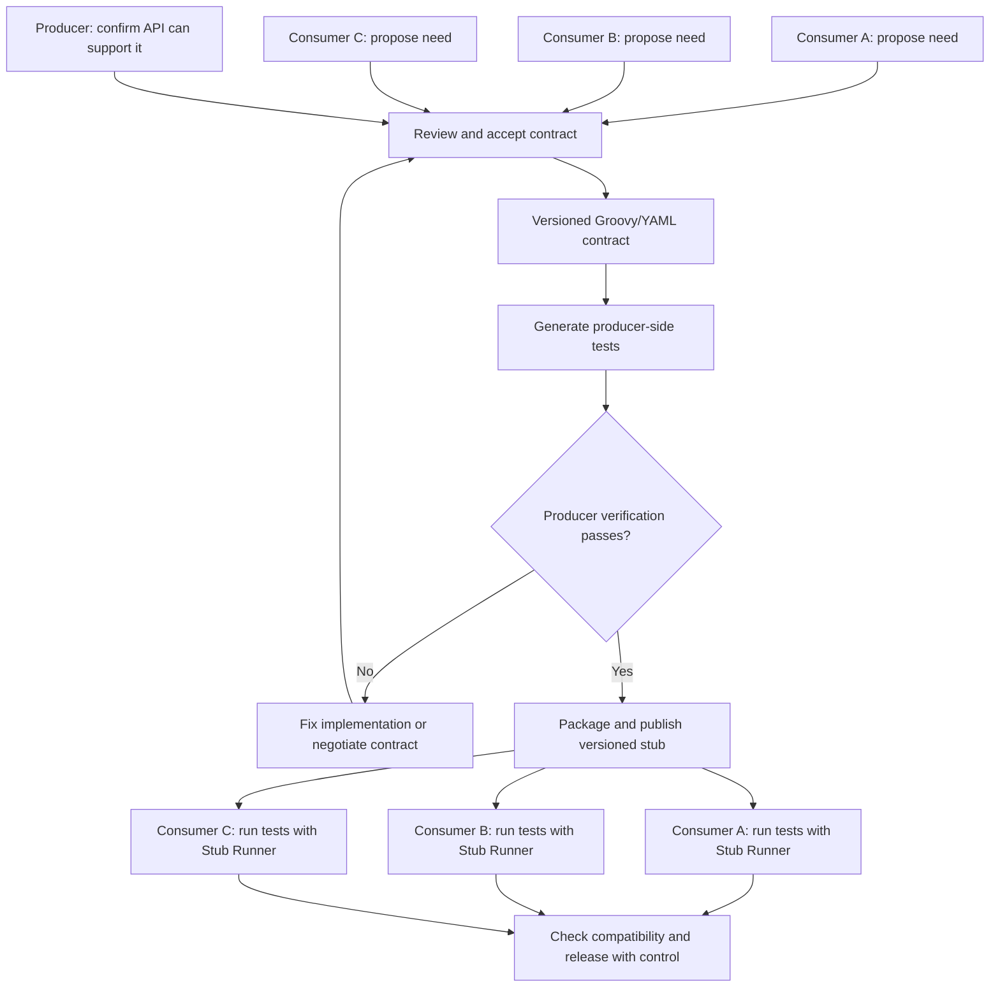

# Scope of Responsibility for the Producer and Each Consumer

> **Chapter:** Contract Design  
> **Technology:** Spring Cloud Contract (`SPRING_CLOUD_CONTRACT`)  
> **Focus:** Clarifying who proposes, who confirms, who verifies, and who is accountable when multiple consumers share an API or message type.

## Learning Objectives

After this lesson, you can:

1. Explain the difference between the producer's **API ownership**, each consumer's **communication needs**, and an **agreement accepted by both sides**.
2. List the responsibilities of the producer and each consumer across contract design, producer test generation, stub publishing, and running Stub Runner.
3. Design contracts for multiple consumers so each consumer is protected against incompatible changes without locking the producer into unnecessary details.
4. Handle conflicting requirements, API changes, backward compatibility, and contract/stub versioning in CI.
5. Apply the same principles to both HTTP and asynchronous messaging.

## 1. Why Must Responsibilities Be Divided?

One API can serve multiple applications, yet **each consumer uses only a slice of the API's behavior**. When the producer changes a field, one consumer may be completely unaffected while another consumer breaks.

Consider an inventory management system:

- **`inventory-service`:** producer providing stock information and reservation operations.
- **`checkout-service`:** consumer needing to know whether a product can be sold.
- **`fulfillment-service`:** consumer needing to create stock reservations and receive confirmation codes.
- **`reporting-service`:** consumer reading stock quantities to build reports.

For example, the producer returns:

```http
GET /api/stock/SKU-001 HTTP/1.1
Accept: application/json
```

```json
{
  "sku": "SKU-001",
  "available": true,
  "quantity": 8,
  "warehouse": "HCM-01"
}
```

Each consumer has its own needs:

| Consumer | Dependent data/behavior | Risk on change |
| --- | --- | --- |
| `checkout-service` | Boolean `available`, status code when SKU is not found | Checkout may wrongly reject or accept orders |
| `reporting-service` | Integer `quantity`, `sku` for reconciliation | Reports fail to parse data or miscalculate |
| `fulfillment-service` | `POST /api/reservations`, request format, and confirmation response | Cannot reserve stock or mishandles duplicate requests |

If someone claims "the producer owns the API so it can change anything it wants", they are ignoring consumers relying on published behavior. Conversely, if a consumer claims "I need every internal field to stay unchanged", they can lock down the producer's design without business justification.

**The right understanding:** the producer is responsible for **implementing and upholding the committed interface**; each consumer is responsible for **accurately stating its needs and proving it uses that interface correctly**. A contract is a verified agreement between two parties, not a document written by one side that takes effect automatically.

## 2. Three Layers of Responsibility to Distinguish

### 2.1. The producer owns implementation and published commitments

The producer owns the code, internal data models, storage mechanisms, and implementation of endpoints or message publishing. The producer decides how to execute as long as observable outcomes still satisfy all supported contracts.

For instance, `inventory-service` can switch from PostgreSQL to Redis or change its stock calculation algorithm without informing consumers, **provided** the API behavior consumers rely on remains intact.

### 2.2. Each consumer owns its needs and usage

The consumer knows best which fields, statuses, events, and error branches it needs and how it handles responses.

For example, `checkout-service` has the right to propose: "I need `available` as a boolean". The consumer has no right to demand the producer keep the database table name `stock_items`, because that is an implementation detail outside the interface.

### 2.3. Contracts are accepted by both sides

A contract represents the intersection between **what the consumer needs** and **what the producer commits to provide**:

- The consumer proposes observable behavior and illustrative examples.
- The producer reviews validity, feasibility, and conflicts with other contracts.
- Once accepted, the contract becomes a **versioned test input**.
- Producer tests verify that the implementation honors the contract; stubs generated from verified contracts enable consumers to develop and test independently.

Contracts may be opened as pull requests by consumers, authored by the producer from agreed requirements, or managed in a dedicated contract repository. **Where the file lives does not itself determine who is responsible for its contents.**

## 3. Specific Responsibilities of the Producer

### 3.1. Clarify the published API boundary

The producer must define what constitutes the public interface consumers can rely on:

- HTTP method, path, query parameters, headers, media types, and request body.
- HTTP statuses, response headers, body structure, data types, and field semantics.
- Behavior across committed scenarios: success, not found, invalid input, conflict, business rejection.
- For messaging: destination, event type, payload, headers, and committed emission conditions.
- Versioning rules, deprecation policies, and compatibility windows if the system has such policies.

The producer **does not** need to expose database schemas, internal classes, or per-function call paths just because a consumer wants to verify a response.

### 3.2. Review contracts before accepting them

The producer should not immediately merge a contract just because a consumer proposed it. Evaluate:

1. Does the request/response describe behavior the API genuinely supports or intends to add?
2. Which data is stable, and which is sample data needing matchers?
3. Does another contract impose conflicting requirements on the same request?
4. Does this change break existing consumers or deployed application versions?
5. Does the contract check exactly what the consumer needs without imposing internal data?

For example: if `reporting-service` requests a `warehouse` field while the producer only exposes system-wide total stock, the two teams must agree to extend the API, split endpoints, or adjust requirements. A consumer adding a field to YAML on its own cannot be treated as proof that the producer supports that field.

### 3.3. Generate and run tests against the real producer implementation

In Spring Cloud Contract, Groovy/YAML contracts are used to **generate tests on the producer side**. Depending on project configuration, generated tests may run via MockMvc, WebTestClient, RestAssured, or messaging verification mechanisms.

The producer is responsible for:

- Configuring the plugin, dependency versions, and base test classes.
- Creating fixtures/data states stable enough to run contract tests.
- Ensuring generated tests execute against the actual controllers or message-publishing flows.
- Putting contract verification into the producer's CI, failing the build when mandatory contracts are violated.
- Never changing expected responses alongside code changes merely to rubber-stamp an incompatible change.

**Generated tests alone are not a guarantee.** Guarantees only hold once tests have run and passed against the corresponding producer version and key scenarios are covered in the contracts.

### 3.4. Publish traceable stubs

The producer (or a pipeline owned by the producer) packages and publishes stub artifacts after verification, typically as a JAR with classifier `stubs` in the organization's Maven/Gradle artifact repository.

The producer must make clear:

- Which service, version, and commit/build produced the artifact.
- Which contract set the stubs correspond to and whether they passed producer verification.
- How consumers resolve stubs using stable coordinates/versions.
- Retention policies for older versions so consumers running older versions can continue testing.

Never publish unverified stubs as "proof that the producer is definitely compatible".

### 3.5. Control API changes and communicate impact

Before removing a field, changing a type, or altering statuses or semantics, the producer must check:

- Which accepted contracts currently rely on that behavior?
- Which consumers are still running older versions?
- Can the change be backward-compatible, or must it introduce a new endpoint, media type, or API version?
- Can an expand-first, migrate-consumers-next, remove-old-last rollout be applied?

The producer controls its own code release schedule, yet cannot assume every consumer upgrades simultaneously.

## 4. Responsibilities of **Each** Consumer

Each consumer is an independent participant. `checkout-service`'s requirements do not automatically represent `reporting-service`; green tests in checkout do not prove reporting works.

### 4.1. Identify the dependencies it actually uses

The consumer should specify:

- Which endpoints/messages are called/received, and with what valid inputs.
- Which fields/headers/statuses actually drive business logic.
- Data types, requiredness, null/absence semantics, and important error conditions.
- Which response/message branches must be described so the application behaves correctly.

For instance, `checkout-service` needs to know `available` is boolean and how `404` is handled. If it does not use `warehouse`, checkout should not require hardcoding `HCM-01` just to make tests pass.

A consumer may still observe fields outside its business needs, but **do not turn an entire response snapshot into a mandatory constraint** unnecessarily.

### 4.2. Propose executable and reviewable contracts

The consumer provides example requests and expected responses, prioritizing cases that reflect business decisions.

For example, "when the SKU does not exist, return `404` with error code `STOCK_NOT_FOUND`" is clearer than "the API should report errors properly".

The consumer must discuss with the producer when behavior is not yet agreed; never treat a draft contract as an already-supported commitment.

### 4.3. Test its own code against verified stubs

With Spring Cloud Contract Stub Runner, a consumer can download published stub artifacts and start stub services inside its tests.

The consumer is responsible for:

- Selecting the stub version matching the API version it will target.
- Configuring its HTTP client/message consumer to point to the stub in the test environment.
- Verifying its code builds valid requests, parses responses accurately, and translates them into proper business behavior.
- Testing committed error cases as well, such as out-of-stock, `404`, `409`, or malformed message conditions if corresponding contracts exist.
- Avoiding tests that merely assert the stub server returns sample JSON; assert **the consumer's behavior** after receiving the response.

Stub Runner does not replace producer verification, nor does it prove the API works in production.

### 4.4. Own everything outside the contract

The consumer remains responsible for network errors, timeouts, retries, circuit breakers, idempotency, data mapping, business rules, security, and observability according to application requirements.

A contract describing only `200`/`404` does not guarantee the producer is always online, has low latency, or never delivers duplicate messages. Those properties require separate tests or operational mechanisms when they are system requirements.

### 4.5. Do not impose one consumer's needs onto other consumers

When `reporting-service` needs `quantity` while `checkout-service` only needs `available`:

- Reporting adds reporting's requirements through the review process.
- Checkout does not have to modify its tests if the API still satisfies checkout's accepted interface.
- The producer must verify **all** supported contracts, not only the contract of the most recently edited consumer.
- Teams may merge contracts sharing the same behavior, provided traceability of which consumer depends on what is preserved.

You do not necessarily need a separate stub JAR per consumer. A single stub bundle can be published from multiple contracts, or partitioned per consumer when the project is configured for it and needs it. The key governance units are **active commitments** and **protected consumers**.

## 5. Role Responsibility Matrix for Contracts

| Activity | Producer | Each consumer | Expected outcome |
| --- | --- | --- | --- |
| Identify caller-side business needs | Discuss feasibility | **Propose and own describing needs** | Required requests/responses are clearly stated |
| Define API capabilities and semantics | **Decide, publish, and explain** | Review against needs | API has consistent semantics |
| Write or edit draft contracts | Co-author/review | Co-author/review; often initiates in CDC | Contract expresses verifiable behavior |
| Accept contract into supported interface | **Confirm it can and will satisfy it** | **Confirm this is what it needs** | Two-way commitment |
| Run generated contract tests | **Execute and fix producer on violation** | Give feedback on example quality | Evidence producer complies |
| Publish versioned stubs | **Producer pipeline owns publishing** | Select and consume versions | Stubs are traceable to contract/build |
| Run consumer tests with Stub Runner | Assist with contract/stub gaps | **Execute and fix consumer on incompatibility** | Evidence consumer handles committed interface |
| Evaluate breaking changes | **Analyze and propose migration strategy** | **Confirm impact and own upgrade plan** | Active consumers do not break |
| End-to-end / deployment tests | Collaborate | Collaborate | Catch config, infrastructure, and live-flow bugs |

**CDC (consumer-driven contracts)** emphasizes that consumers initiate expectations. That does not transfer ownership of the producer's implementation to consumers. A contract is trustworthy only when the producer acknowledges and verifies it.

## 6. Designing Contracts with Multiple Consumers

### 6.1. Separate responsibilities by scenario used

An illustrative layout inside the producer's repository:

```text
inventory-service/
└── src/test/resources/contracts/
    ├── checkout-service/
    │   └── stock_available.yml
    └── fulfillment-service/
        └── create_reservation.yml
```

Subdirectories help humans see who proposed/uses each contract. How **stubs are packaged and filtered per consumer** depends on your Spring Cloud Contract/Stub Runner configuration; directory names alone do not guarantee a consumer only receives its own stubs.

Teams can also use an independent contracts repository where consumers submit pull requests, which the producer pulls in during builds. That model requires clear synchronization, review, and versioning workflows.

### 6.2. HTTP contract serving checkout

`checkout-service` needs to know if an SKU can be sold. A simple contract using YAML DSL:

```yaml
description: "Checkout can check whether stock is available for sale"
name: checkout_stock_available
request:
  method: GET
  url: /api/stock/SKU-001
  headers:
    Accept: application/json
response:
  status: 200
  headers:
    Content-Type: application/json
  body:
    sku: SKU-001
    available: true
    quantity: 8
    warehouse: HCM-01
```

Placed at `src/test/resources/contracts/checkout-service/stock_available.yml`. The response example describes what the producer returns for the test's SKU fixture. **It does not mean checkout must assert all four fields.** The contract reflects the endpoint's response; the consumer may rely only on `sku` and `available`. If `quantity`/`warehouse` are dynamic values, add matchers in the DSL or place them in controlled test scenarios; avoid hardcoding sample values that are not commitments.

After agreeing on essential cases, checkout should propose separate contracts for `404` or out-of-stock responses if those cases drive business flows.

### 6.3. HTTP contract serving fulfillment

`fulfillment-service` uses a different capability: reserving stock for an order.

```yaml
description: "Fulfillment creates a stock reservation successfully"
name: fulfillment_create_reservation
request:
  method: POST
  url: /api/reservations
  headers:
    Content-Type: application/json
  body:
    orderId: ORD-1001
    sku: SKU-001
    quantity: 2
response:
  status: 201
  headers:
    Content-Type: application/json
  body:
    reservationId: RSV-1001
    status: CONFIRMED
```

Placed at `src/test/resources/contracts/fulfillment-service/create_reservation.yml`.

These contracts are independent in requests and expectations. Checkout only needs to GET stock; fulfillment needs to POST reservations. The producer can alter internal reservation algorithms as long as the committed responses remain accurate.

The examples above use fixed values for ease of learning. In real systems, order codes, reservation IDs, and stock counts often vary: use matchers, test-controlled values, or appropriate mapping rules to verify what consumers actually need. Do not treat `RSV-1001` as a code every production call must return.

### 6.4. If two consumers share **the exact same endpoint**

Suppose checkout uses `available` and reporting uses `quantity` on the same `GET /api/stock/SKU-001`. Two design approaches are common:

1. **One shared contract:** the producer commits to a response containing parts needed by both consumers; consumers test their own logic against the same stub.
2. **Multiple contracts by scenario/consumer:** keep needs separate, while ensuring all contracts can be satisfied simultaneously by one producer implementation and stub mappings do not collide.

Avoid writing **two contracts with identical requests yet contradictory responses** (for instance, one asserting `available: true` and another asserting `available: false` for the exact same data state). The producer cannot guarantee both answers for the same condition; Stub Runner/WireMock may also match the wrong mapping without distinguishing rules.

If responses differ by actual state, describe **input conditions / fixture state**, distinct requests/headers, or appropriate matchers; never use a consumer's name as an artificial condition to explain two conflicting responses.

## 7. How Does a Contract Lifecycle Flow Across Parties?



The diagram shows **responsibilities and logical verification order**. Depending on development strategy, teams may use draft stubs for early development, but should never treat drafts lacking producer verification as proof of the real API.

### Step 1 — Consumer states need, producer responds

The consumer opens a proposal containing request, response, data semantics, and error cases. The producer confirms feasibility and checks existing related commitments.

### Step 2 — Both sides accept the contract

The contract is stored in a repository following team workflow, code-reviewed, and tied to a business change. Distinguish **draft contracts**, **accepted contracts**, and **contracts currently supported in production**.

### Step 3 — Producer runs generated tests

Spring Cloud Contract generates tests from the DSL, and the producer configures test setup so tests actually invoke the corresponding controllers/messaging flows. If the API returns the wrong type or status, tests must fail.

### Step 4 — Producer publishes stubs

After verification passes, the producer packages the stub artifact and provides coordinates/version. Artifacts should be traceable to commits and verification pipelines so consumers do not accidentally use hand-crafted stubs.

### Step 5 — Each consumer tests its own code

Each consumer configures Stub Runner, calls through its real HTTP client, and asserts business behavior. Consumer A's tests do not substitute for Consumer B's tests.

### Step 6 — CI blocks incompatible changes

Producer CI checks all contracts still supported. Consumer CI checks the target stub/API version the consumer intends to use. For changes that could break running versions, pipelines need additional checks for compatibility with older consumers or a migration plan.

## 8. Stub Runner: Who Does What?

Consumers use published stubs so they do not have to boot the real producer on every test cycle. Example:

```java
@SpringBootTest(properties = {
    "inventory.base-url=http://localhost:8090"
})
@AutoConfigureStubRunner(
    ids = "com.example:inventory-service:1.4.0:stubs:8090",
    stubsMode = StubRunnerProperties.StubsMode.LOCAL
)
class CheckoutContractIT {

    @Autowired CheckoutService checkout;

    @Test
    void checkoutChoPhepDatHangKhiConTonKho() {
        assertThat(checkout.canCheckout("SKU-001", 2)).isTrue();
    }
}
```

This is an illustrative snippet using JUnit, AssertJ, Spring Boot, and Spring Cloud Contract; imports and business classes are supplied by the application. `inventory.base-url` is a **hypothetical property** used in the example, which checkout's HTTP client must read properly. Projects often choose dynamic ports when running tests in parallel.

Meaning of the distinct responsibilities:

- **Producer:** ensures artifact `com.example:inventory-service:1.4.0:stubs` reflects contracts the producer **has passed verification for**, and defines compatible versions.
- **Checkout:** points its client at the stub, sends production-like requests, and verifies it processes responses accurately. Checkout does not assume stubs imply a healthy production environment.
- **Fulfillment and reporting:** have their own tests and expectations; they can share the same verified artifact while still running their own test suites.

In `LOCAL` mode, Stub Runner resolves artifacts from the local Maven repository; CI environments can use the corresponding remote-repository mode with proper credentials. This sample code does not replace the dependencies, stub-generation plugins, build scripts, and publishing configs required in a real project.

## 9. Handling Conflicts Among Multiple Consumers

### Conflict A — Two consumers want different formats

`checkout-service` wants boolean `available`, while a legacy consumer expects string `"Y"`/`"N"` for `available`.

**What should the producer do?** Check which contracts are currently active. If both are supported, never switch types silently. Keep the old format in API v1 and introduce API v2, use media type versioning, or add a new endpoint with clear semantics. When to retire v1 depends on the consumer migration plan.

**What should consumers do?** State system constraints, confirm version support, and test migration against target-version stubs. Never force another consumer to switch simultaneously unless an aligned plan exists.

### Conflict B — A consumer wants internal details in the contract

`reporting-service` proposes requiring `inventoryTableName` in the response.

**What should the producer do?** Ask what the consumer actually needs: per-warehouse breakdown, adjustment history, or stock category? Provide stable business fields/endpoints instead of exposing internal table names.

**What should the consumer do?** Express the business problem and choose a reviewed interface rather than coupling to implementation.

### Conflict C — A contract locks dynamic data

A consumer demands `reservationId` always equal `RSV-1001`.

**What should the producer do?** Discuss whether that is merely an illustrative fixture or a guaranteed constant. If IDs are dynamic, use matchers checking structure/type or controlled test fixtures; keep contracts realistic.

**What should the consumer do?** Test receiving valid IDs and propagating them through business logic, rather than hardcoding one sample stub value.

### Conflict D — Producer wants to remove a field unused by a newer consumer

The producer notices a newer consumer does not use `quantity` and plans to drop it, yet legacy reporting still reads that field.

**What should the producer do?** Review all supported contracts, not just the latest consumer. Keep `quantity` in the supported version or create a migration strategy.

**What should each consumer do?** Proactively maintain/communicate contracts reflecting active dependencies, execute upgrade plans, and confirm minimum operable versions.

## 10. Who Is Accountable When a Contract Test Fails?

Do not blame every red test on the producer or consumer purely based on the test name. Look at the **type of evidence**:

| CI signal | Initial interpretation | Accountable party to lead resolution |
| --- | --- | --- |
| Producer generated test fails after producer edits a response | Producer implementation drifted from an accepted contract | **Producer**; consult consumer if the contract needs updating |
| Consumer test against right stub version fails deserializing response | Consumer client mishandles committed data or picked wrong version | **Consumer**; producer assists checking contract/artifact |
| Consumer requests a field not yet accepted by producer | Contract is in proposed state, not a supported capability yet | **Both sides** negotiate and agree on scope |
| Stub tests pass yet staging fails with DNS/TLS error | Contracts do not verify networking/deployment config | **Relevant config/infrastructure team** |
| Two stubs match the same request and return different responses | Contract design or mappings lack distinguishing criteria | **Both sides** fix definitions; producer re-verifies and republishes |
| Legacy consumer breaks after an API change despite green new contract tests | Pipeline missed legacy commitments or dropped support too early | **Producer leads restoring compatibility**, coordinates consumer migration |

Either side can uncover a bug. Lead accountability indicates where changes are needed to restore commitments, not assigning personal blame.

## 11. Scope of Responsibility in Messaging Contract Testing

This lesson does not apply only to HTTP. For a producer emitting `StockReserved`:

```json
{
  "eventType": "StockReserved",
  "orderId": "ORD-1001",
  "sku": "SKU-001",
  "reservedQuantity": 2
}
```

Suppose:

- `inventory-service` is the **message producer**.
- `shipping-service` only begins fulfillment upon a successful stock reservation event.
- `analytics-service` aggregates reserved quantities by SKU.

**Producer is responsible for:** emitting messages with committed destinations/headers/payloads and semantics, generating/running appropriate verification from messaging contracts, and maintaining compatibility for consumers on older schemas.

**`shipping-service` is responsible for:** specifying needed status and order ID fields, processing messages accurately, avoiding reliance on uncontracted fields, and testing duplicate handling/idempotency if required by business logic.

**`analytics-service` is responsible for:** specifying its dependency on numeric `reservedQuantity`, converting and aggregating accurately, and managing schema evolution for its active version.

Spring Cloud Contract supports DSL for messaging contracts, though contents and setup differ from HTTP (such as triggers, input/output messages, destinations, matchers). Verifying message structure **does not automatically prove** a real broker works, consumer groups are properly configured, or the system guarantees ordering/deduplication; integration/E2E tests and appropriate operational mechanisms are required.

## 12. Designing CI to Protect the Producer and Each Consumer

A reference pipeline:

| Stage | Responsibility | Passing criteria |
| --- | --- | --- |
| Contract review | Producer with relevant consumers | Needs and feasibility agreed; no conflicts with supported contracts |
| Producer unit/integration | Producer | Logic, web layer, persistence, and dependencies behave properly within test scope |
| Producer contract verification | Producer | Generated tests from all active contracts pass on the new build |
| Publish stubs | Producer pipeline | Publish traceable artifacts only after verification passes |
| Consumer contract/integration | **Each consumer** | Client and business logic handle target stubs/API properly |
| Backward compatibility check | Producer coordinating with active consumers | Previously committed behaviors still requiring support remain satisfied |
| Critical E2E | Relevant teams | Live flows, configuration, and deployment integration work |

Example pipeline layout:

```text
Producer PR:
  review contract changes
      -> build + unit/integration
      -> generate contract tests
      -> run provider contract verification
      -> fail PR if a supported contract is violated

Producer release:
  verified build
      -> package stub JAR with version
      -> publish artifact + traceability metadata

Consumer PR:
  resolve target version verified stubs
      -> run Stub Runner
      -> run consumer integration/contract tests
      -> fail PR if consumer fails to handle contract

Deployment:
  check compatibility with running consumers
      -> limited end-to-end smoke checks
```

Never allow modifying every consumer's expectations at once purely to turn CI green after a producer API edit. Changing an active contract requires compatibility review and a migration plan.

## 13. Choosing Versioning and Safe Upgrade Strategies

### 13.1. Contracts, stubs, and producer builds must be traceable

A specific stub version lets a consumer reproduce tests. However, a stub version alone does not express full compatibility of the running producer. You must know which producer release passed which contracts.

If a consumer pins stub v1.4.0 forever, tests reflect **v1.4.0**; they will not automatically warn when a later producer v1.6.0 breaks the API. Therefore, the producer must run verification against older still-active contracts or maintain an agreed compatibility check mechanism.

### 13.2. Expand first, contract later

Suppose you want to replace `available: boolean` with a richer structure:

1. **Add** `availabilityStatus` alongside the still-supported `available`.
2. Update contracts to describe the new behavior while retaining old contracts during transition.
3. Publish verified stubs; each consumer upgrades when ready and runs its own tests.
4. Monitor whether consumers in production have actually dropped their dependency on `available`.
5. **Only after the old commitment expires per policy**, remove `available` or move to a new API version.

This is a compatibility strategy. Not every additive change is automatically safe: a consumer might reject unknown fields, schema validators might require an exact shape, or semantics of the new field might alter business behavior.

### 13.3. A consumer inventory is critical governance metadata

A producer cannot fully assess impact without knowing who calls its API or consumes its messages. Maintain at least a list of active consumers, API versions in use, owners, and upgrade plans. Contracts alongside telemetry, dependency inventories, or consumer registries provide complementary evidence; **never assume every real-world consumer already has a contract in the repo**.

## 14. Contract Design Checklist for Multiple Consumers

Before putting contracts into CI, verify these questions:

- **Consumer:** Who will use this behavior? Which scenario makes it important?
- **Producer:** Does the API/message genuinely support and allow verifying this behavior?
- **Content:** Are essential fields, statuses, and error cases described?
- **Constraint level:** Are dynamic IDs, timestamps, or useless internal details hardcoded?
- **Conflicts:** Is there another contract with the same request yet opposing expectations lacking distinguishing conditions?
- **Verification:** Do generated tests actually run on the producer, or are files merely generated?
- **Stubs:** Which artifact is published, and does it carry a version and producer verification trail?
- **Consumer:** Does each consumer test its code against the right stub?
- **Compatibility:** Do consumers still on older versions continue receiving support per policy?
- **Operations:** Are out-of-contract risks (network, broker, security, timeouts, retries) covered by dedicated tests/mechanisms?

There is no need to turn all these questions into one giant contract. The goal is **a small, clear, verifiable set of agreements** updated alongside real needs.

## 15. Practice Exercises

### Exercise 1 — Identify ownership

Given the scenario:

- `checkout-service` needs `available`.
- `reporting-service` needs `quantity`.
- `inventory-service` wants to change `quantity` from an integer to the string `"8"`.

Answer:

1. Who must evaluate the impact of the change before merging?
2. Which consumer's contract is most likely to break?
3. Who needs to execute producer verification? Who needs to execute consumer tests?
4. If reporting cannot upgrade immediately, propose a compatible path forward.

**Hint:** The producer evaluates all commitments; reporting is directly impacted; the producer runs generated tests and reporting runs tests with stubs; you can keep integer in the existing version and introduce the new representation in a different field or API version.

### Exercise 2 — Review a contract before accepting it

A consumer submits a request: "Responses for every order must have `reservationId = RSV-1001` and `warehouse = HCM-01`, regardless of which warehouse fulfills the order."

Identify which part is a test fixture, which could be a reasonable commitment, and how to fix the contract so dynamic data is not hardcoded. Explain why a consumer placing values in a YAML file is not enough to compel the producer to accept it.

**Hint:** Distinguish sample data from business rules; use matchers or controlled-state fixtures. Proposals must be reviewed by the producer to become a shared commitment.

### Exercise 3 — Design CI

Sketch a pipeline covering producer PR, producer release, consumer PR, and a compatibility check for consumers still running older versions. Mark who owns each step and which scenarios must block release.

**Completion criteria:** The pipeline expresses the flow `contract → generated provider test → verified stub → Stub Runner → consumer test` and does not equate green consumer tests with proof that a new producer is compatible.

## References

- [Spring Cloud Contract Reference Documentation](https://docs.spring.io/spring-cloud-contract/reference/).
- [Spring Cloud Contract — Contract DSL](https://docs.spring.io/spring-cloud-contract/reference/project-features-contract.html).
- [Spring Cloud Contract — Consumer Driven Contracts](https://docs.spring.io/spring-cloud-contract/reference/).
- [Spring Cloud Contract — Stub Runner](https://docs.spring.io/spring-cloud-contract/reference/project-features-stubrunner/stub-runner-core.html).
