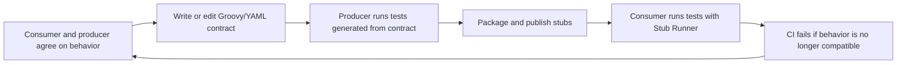

# Criteria for Evaluating a Long-Term Maintainable Contract

## 1. Why Can a Contract Passing Today Still Be Hard to Maintain?

In **Spring Cloud Contract**, a contract describes the behavior a service provides to its callers: which HTTP requests are accepted, which responses are returned, or which messages are published/received. From contracts written in **Groovy DSL or YAML DSL**, the tool can generate **producer**-side tests and build **stubs** so the **consumer** can test without needing to run the real producer.

A contract can be syntactically valid and generate passing tests yet still become costly as the API evolves. For example, if a contract forces `createdAt` to always equal a specific instant, tests may fail every time data changes even though functionality serving the consumer is completely fine. Conversely, if a contract only checks HTTP `200` while ignoring fields the consumer actually uses, an integration-breaking change can slip past CI.

A **long-term maintainable contract** is one that protects critical consumer expectations, accurately reflects producer commitments, and stays stable enough for both sides to change internal implementations without constantly fixing tests. Contract quality is judged by *its ability to detect meaningful compatibility bugs* relative to *update and operational cost*.

## 2. Core Criteria

| Criterion | Signs of meeting expectations | Signs needing review |
|---|---|---|
| **Clear consumer need** | Knows which consumer uses this behavior, which fields, and for what decision | Added a contract solely because the endpoint exists, unclear who needs it |
| **Protects observable behavior** | Verifies method, path, status, payload, and key business rules | Depends on Java class names, table names, call order, or internal structure |
| **Strict enough without over-constraining** | Checks fixed values when values matter; uses matchers for varying data | Exact-matches timestamps, random IDs, irrelevant headers, or entire JSON unnecessarily |
| **Clear semantics and error cases** | Distinguishes valid/invalid, error codes, required fields, data types, and business states | Checks only the happy path or uses overly broad matchers |
| **Easy to understand and modify** | One purpose per contract, easy-to-find name/description; minimal, conventional fixtures | One file covering too many behaviors, duplicated data, and magic values |
| **Stable and reproducible** | Generated tests and stubs yield identical results with controllable data | Depends on wall clock, external network, test run order, or shared state |
| **Has a compatibility strategy** | Evaluates impact on active consumers; has deprecation/versioning path when needed | Deletes/renames fields or extends enums without impact review |
| **Enforced on both sides** | Producer verifies contracts, consumer runs against right stub version, CI fails on drift | Contracts stored like static docs; tests/stubs never run in pipelines |
| **Has ownership and traceability** | Has reviewers, tied to business needs and release versions | Unclear who maintains it; unclear whom to notify on failure |
| **Safe and environment-independent** | Synthetic fixtures containing no real keys or personal data; runs consistently locally and in CI | Hardcodes real tokens, production URLs, or sensitive data |

Not every contract needs to express every possible endpoint scenario. A small set of contracts **representing the commitments consumers rely on** is usually far more durable than a suite recording every incidental response detail present at test-creation time.

## 3. Scoping Commitments Accurately

Before writing DSL, answer four questions:

1. **Who is the consumer?** For example, the checkout page needs to know an order was paid successfully to show the invoice download button.
2. **What does the consumer rely on?** `state`, `id`, HTTP status codes, and conventions when an order does not exist can be real commitments; an internal debug field is not.
3. **What must stay stable?** Field names and types, status meanings, error conventions, data formats, and idempotency if the API promises it.
4. **What is allowed to change?** Creation timestamps, request IDs, JSON property ordering, storage details, internal algorithms, or additional fields that do not affect the consumer.

A contract does not need to mirror an entire OpenAPI document. OpenAPI is useful for describing a broad API surface; a Spring Cloud Contract typically focuses on **one verifiable scenario** with concrete input/output data. Both artifacts complement each other: API docs help discover conventions, while contract tests verify that committed behaviors still work.

### Example: an intentional HTTP contract

Suppose the order service exposes `GET /v1/orders/42`. The consumer needs `id`, `state`, `totalAmount`, and `currency` to display a paid order. The following YAML contract describes one scenario with fixed test data:

```yaml
description: "Return minimal details of a paid order"
request:
  method: GET
  url: /v1/orders/42
  headers:
    Accept: application/json
response:
  status: 200
  headers:
    Content-Type: application/json
  body:
    id: 42
    state: PAID
    totalAmount: 120000
    currency: VND
```

This is an example of one **scenario**, not a rule that every order has ID `42`, total `120000`, or status `PAID`. The producer must arrange corresponding test data so generated tests can execute. The stub returns the sample response so the consumer can test `PAID`-state logic without depending on a running producer.

If `state` is only allowed to take values from a published set, the contract must preserve the semantics of that set. Do not replace it with `.*`, because an invalid string like `UNKNOWN_INTERNAL` would still pass. Conversely, for randomly generated `requestId` or dynamic `generatedAt`, you can use **body matchers** in Spring Cloud Contract (such as validating UUID/ISO-8601 format) paired with a **concrete value for the stub side**. With Groovy DSL, Spring Cloud Contract supports expressions specifying distinct consumer and producer values; with YAML DSL, you can configure `matchers` for the body. Pick patterns tight enough to express the committed format rather than loosening every field.

### Example of a brittle contract and how to improve it

A fragile contract might require the response to simultaneously contain `serverBuild: "481"`, `generatedAt: "2026-11-24T01:00:00Z"`, every minor header, and all debug fields. Whenever the build number changes or the current time shifts, tests turn red even though the consumer never uses those values.

How to improve it:

- **Keep exact** whatever is a commitment: HTTP `200`, `id`, `state`, currency type, and business values fixed in fixtures.
- **Use bounded matchers** for dynamic data if the consumer needs to parse their format: valid UUID, standard timestamp, non-negative number, non-empty string when required.
- **Exclude from the contract** internal observability attributes that are not part of the committed interface.
- **Split distinct scenarios** into separate contracts: order not found, access denied, invalid input data.

The goal is reducing false failures from harmless changes while still failing whenever the producer breaks behavior the consumer needs.

## 4. Assessing Compatibility When the API Changes

Sustainable contracts must be evaluated in the context of **deployed consumer versions**. A change that looks “valid” to the producer may still break older consumers.

| Planned change | Risk | Questions to check |
|---|---|---|
| Delete or rename `state` to `orderStatus` | Usually a breaking change | Do legacy consumers still read `state`? Do we need an alias or API version? |
| Change `totalAmount` type from number to string | Breaking for consumers expecting a number | Do consumer parsing, comparisons, and validation still work? |
| Change HTTP `404` to `200` with an error body | Semantic breaking change | Does the consumer handle not-found errors distinctly? |
| Add a *required* field in requests | Usually breaking for older consumers | Are requests from deployed consumers still accepted? |
| Add an *optional* field in JSON responses | Usually compatible, depends on consumer | Does the consumer have a strict parser/schema rejecting unknown fields? |
| Add a new value to `state` | Potentially breaking | Does the consumer handle unknown values or use a closed `switch`? |
| Change the meaning of `PAID` | Breaking even with unchanged schema | Can consumers still trust `PAID` means payment completed? |
| Reorder keys in a JSON object | Normally non-breaking | Is anything accidentally comparing JSON as raw strings? |

**Evaluation rule:** if a change prevents an existing consumer from sending valid requests, parsing/understanding responses properly, or making right business decisions, treat it as a compatibility risk even if the producer still returns `2xx`.

For potentially breaking changes, the safe process is usually: inventory active consumers → add new behavior or version while preserving old behavior → test in parallel → announce deprecation and migration deadline → remove old behavior only after confirming relevant consumers migrated. Never treat bumping a version number alone as solving the problem; consumers still need a clear migration path.

## 5. Designing DSL and Test Data for Maintainability

### 5.1. One contract, one explainable behavior

For instance, maintain separate contracts for:

- `GET /v1/orders/42` returning a paid order (`200`, `PAID`).
- `GET /v1/orders/9999` when not found (`404`, stable error code if committed).
- `POST /v1/orders` with invalid data (`400`, error structure meaningful to the consumer).

Splitting scenarios pinpoints root causes when tests fail, avoids editing unrelated expectations in one file, and lets consumers use only the stubs they need.

### 5.2. Distinguish fixed values from varying values

| Data type | Appropriate check | Reason |
|---|---|---|
| `state: PAID` in a completed-payment fixture | Exact value `PAID` | Status drives business decisions |
| `currency: VND` in a VND-pricing fixture | Exact value `VND` | Currency unit affects display/calculation |
| Randomly generated identifier | Format matcher, plus correlation constraints if needed | ID varies per run |
| Processing-time timestamp | ISO-8601 matcher or time-range check when genuinely needed | Should not hardcode system clock |
| List with published ordering rules | Assert meaningful order | Consumer relies on order |
| List without committed ordering | Assert contents by set/properties | Avoid failures over meaningless ordering |

Matchers can also be too broad. For instance, an “any string” matcher on `currency` does not guarantee valid currency codes; an “any number” matcher on `totalAmount` fails to catch negative amounts if business rules forbid them. Document domain rules explicitly and apply matchers that mirror those rules.

### 5.3. Reproducible fixture data

Producer tests generated by Spring Cloud Contract require a **preparable state**. When using ID `42`, you can seed the sample entity via test configuration, mock dependency layers, or initialize a test-dedicated database. Never let tests rely on a record “luckily sitting around” in a shared environment. Prevent fixture collisions across parallel tests and avoid execution-order dependencies.

For APIs with side effects like order creation, design preconditions and cleanup so re-running the same scenario consistently yields the right outcome. If behavior involves asynchrony, define clear completion conditions instead of making fixed `sleep` durations part of API assertions.

### 5.4. Messaging also needs sustainable contracts

For event-driven communication, consumers may depend on event type name, `orderId`, `state`, schema version, and emission timing semantics. When designing messaging contracts in Spring Cloud Contract, verify the payload and meaningful headers (such as event type or correlation ID) alongside the send/receive mechanism in use. Never assert processing order, delivery counts, or exactly-once delivery unless the infrastructure and business design commit to them.

For example, an `OrderPaid` event may commit to valid `orderId` and `state = PAID`, while emission timestamp can be format-checked. Broker debug fields and delivery IDs should only be included if the consumer truly depends on them.

## 6. Verifying Maintainability Across Producer, Stubs, and CI

A nicely written contract that isn't run regularly quickly loses value. With Spring Cloud Contract, the ideal verification flow includes:



**On the producer side:** place contracts in Spring Cloud Contract's configured location, typically `src/test/resources/contracts`, configure the plugin along with an appropriate base class/test setup, and run the project's test cycle. Generated tests compare producer behavior against expectations recorded in the DSL. In a properly configured Maven project, the build can generate and package stubs under the `stubs` classifier for publishing alongside the producer artifact version.

**On the consumer side:** use **Stub Runner** to download/run stubs for the producer version under test; run consumer integration/contract tests against predictable responses. Consumer tests must have assertions on their own application behavior: Stub Runner returning JSON only proves the stub works, not that the consumer screen or logic handles that JSON properly.

**In CI:** check at least three points: producer tests generated from contracts pass; stubs are built and published with the right version/repository; consumer tests pass against the corresponding stubs. When a contract changes, pipelines should immediately detect drift between the two sides before deployment. Use traceable stub versions for reproducible results; only use dynamic versions like `+` if you understand the trade-offs and have artifact governance rules.

Example check that must catch breakage: a developer renames `state` to `orderStatus`. If the old contract is still verified by the producer, producer tests report missing `state` when live behavior stops honoring the contract. If the developer updates the contract to `orderStatus` while the consumer hasn't changed yet, consumer tests against the new stub must show the consumer can no longer parse the response. **Running only one side leaves a verification gap.**

Spring Cloud Contract helps verify scenarios **that have been specified and executed**; it does not automatically guarantee every real consumer is compatible, nor does it replace end-to-end, security, or load testing. Therefore, coverage should be chosen based on critical business commitments and actual system changes.

## 7. Pre-Acceptance Contract Review Checklist

Use this checklist when creating a new contract or reviewing a contract-change pull request:

- [ ] Clearly describes the consumer, business scenario, and why the scenario needs protection.
- [ ] Method/path or message type, statuses, required fields, and error conventions are documented well enough for consumer use.
- [ ] Assertions stick to public behavior without locking unrelated internal details.
- [ ] Invariant values use exact matches; dynamic data uses sufficiently strict matchers and stubs have valid examples.
- [ ] Error/boundary scenarios match risk, rather than just a token happy path.
- [ ] Fixtures are deterministic, test data setup is clear, and tests repeat independently locally and in CI.
- [ ] Impact on existing consumers is assessed, especially when changing fields, types, error codes, or enum semantics.
- [ ] Generated producer tests actually run; stubs are packaged/published; consumer tests with Stub Runner.
- [ ] Naming, descriptions, file structure are easy to navigate; ownership and failure-handling procedures are clear.
- [ ] No real tokens, live accounts, personal data, or production addresses appear in fixtures.

You can use a simple internal scoring scale for **the 10 criteria in Section 2's table**: `0` if unmet, `1` if partial, `2` if met with evidence; maximum `20` points. This is an **internal governance suggestion, not a built-in metric or requirement of Spring Cloud Contract**. Never use a high total score to excuse a critical flaw such as contracts not running in CI or a known breaking change without a migration plan.

## 8. Practice Scenario: Changing a Contract While Preserving Legacy Consumers

**Context:** a consumer reads `GET /v1/orders/{id}` and enables invoice download when `state = PAID`. The producer wants to rename the field to `paymentStatus` and add `paidAt`.

1. **Identify existing commitments.** `state` is actively used by the consumer, so deleting it immediately breaks integration. `paidAt` is new data; clarify whether it is required or optional info.
2. **Propose a compatible change.** During the transition period, the producer continues returning `state` and may add `paymentStatus` and `paidAt` as appropriate. Verify whether the consumer's parser tolerates new fields.
3. **Keep old contracts and add scenarios for new capabilities.** Producer tests must keep proving responses honor the old commitment. New contracts protect the semantics of the new data future consumers will rely on.
4. **Publish stubs with traceable versions.** Existing consumers run tests against stubs reflecting transition behavior; new consumers test against the new fields.
5. **Retire the old field under control.** Only after confirming consumers have migrated and compatibility policy permits it may the producer remove `state` (typically via API versioning or a coordinated rollout).

**Self-assessment question:** If the producer still returns `200`, but changes the value `PAID` to `COMPLETED` in `state`, should the contract fail? **Yes**, when the consumer committed to relying on `PAID` to allow invoice download. That is an observable semantic/value change, not a harmless internal refactor.

## 9. Practical Conclusion

When reviewing a Spring Cloud Contract, prioritize the question: **“If this behavior changes, will the consumer break in a way tests ought to catch?”** If yes, the contract must assert it tightly enough. If not, consider omitting that detail or using an appropriate matcher to cut maintenance overhead. Combining clear commitment scope, stable fixtures, producer-generated tests, versioned stubs, and consumer tests in CI keeps contracts valuable across many API evolutions.
