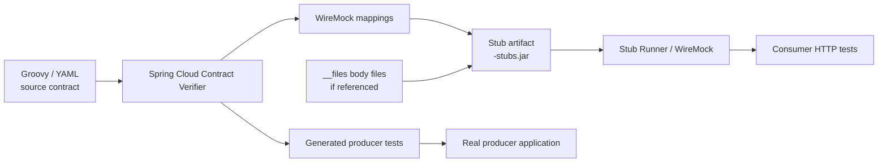
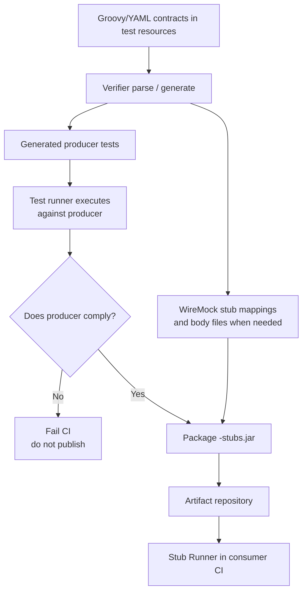
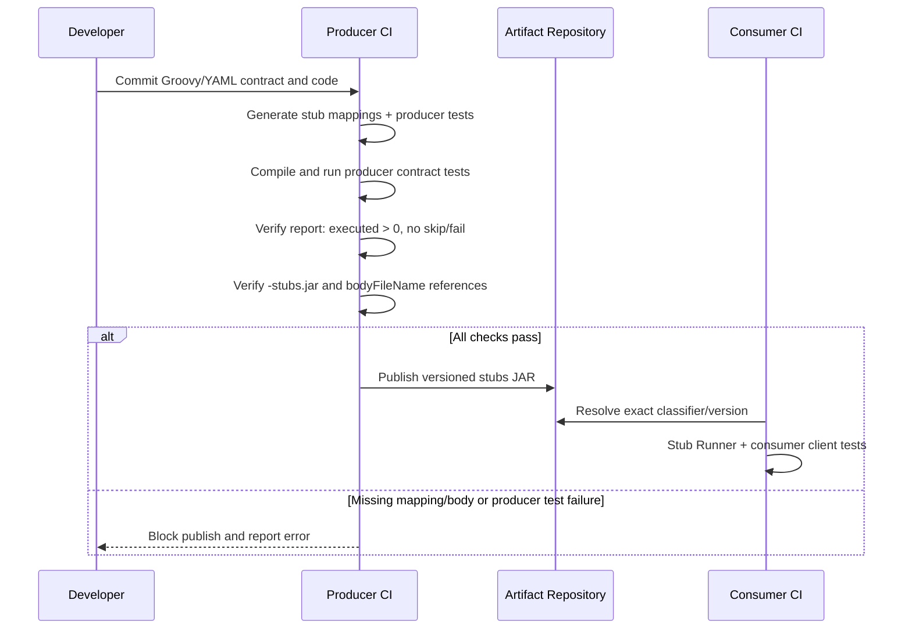

# WireMock Mappings and Body Files in Stub Packages

## 1. Why understand what is inside a stub?

In **Spring Cloud Contract**, producer and consumer teams agree on HTTP or messaging behavior through contracts written in **Groovy DSL** or **YAML DSL**. Spring Cloud Contract Verifier uses the contract to generate **producer tests** and, for HTTP, **WireMock stub mappings** that simulate the API. The producer can package and publish stubs as an artifact; the consumer uses **Stub Runner** to run the stubs in tests, while CI checks for incompatible API changes.

A common mistake is treating `-stubs.jar` as a "black box": the file is produced, yet consumers still encounter `404`s, wrong JSON types, empty response bodies, or unmatched requests. Once you understand **mappings**, **body files**, and **stub package structure**, you can determine:

- Which requests WireMock accepts.
- Which HTTP status, headers, and body are returned.
- Whether the body is stored **directly inside the mapping** or **in a file referenced by the mapping**.
- How Stub Runner locates mappings inside the downloaded artifact.
- Why a stub package can be syntactically valid yet fail to reflect the real producer if verification was skipped.

**Goal:** read and analyze `mappings/*.json`, `__files/*`, and `-stubs.jar` artifacts; verify inline bodies, `bodyFileName`, paths, encoding, and a reproducible packaging/publishing workflow.

## 2. Three concepts to keep separate

| Component | Role | Example |
|---|---|---|
| **Source contract** | Defines the agreed behavior between both sides; input to Verifier | `get-order.groovy`, `get-order.yml` |
| **WireMock mapping** | Rules for matching an HTTP request and defining the response | `mappings/get-order.json` |
| **Response body file** | Response data separated from the mapping, referenced via `bodyFileName` | `__files/orders/order-42.json` |
| **Stub artifact** | Package containing stub resources for versioned distribution | `order-service-1.2.3-stubs.jar` |
| **Stub Runner** | Loads and serves stubs for consumer tests | WireMock HTTP server on a test port |

Not every mapping has a body file. WireMock can use **`body` or `jsonBody` directly inside the mapping**, or **`bodyFileName`** pointing to a file under `__files`. A Spring Cloud Contract with a JSON response **does not guarantee** across all versions and configurations that the generator will always create `__files/*.json`. Always **inspect the actual generated artifact** instead of guessing from the DSL.



Both branches start from the contract but serve different roles: **producer tests** verify the real application; **stubs** let consumers execute against simulated data. Generating or running a stub **does not by itself prove the real producer satisfies the contract**.

## 3. Sample HTTP contract: returning a paid order

Suppose `order-service` publishes:

```http
GET /api/orders/42
Accept: application/json
```

The response must be:

```http
HTTP/1.1 200 OK
Content-Type: application/json

{
  "id": 42,
  "state": "PAID",
  "currency": "VND",
  "items": [
    {"sku": "BOOK-101", "quantity": 2}
  ]
}
```

### 3.1. Groovy DSL

```groovy
import org.springframework.cloud.contract.spec.Contract

Contract.make {
    description 'Return a paid order'

    request {
        method GET()
        url '/api/orders/42'
        headers {
            header 'Accept', 'application/json'
        }
    }

    response {
        status OK()
        headers {
            contentType(applicationJson())
        }
        body(
            id: 42,
            state: 'PAID',
            currency: 'VND',
            items: [
                [sku: 'BOOK-101', quantity: 2]
            ]
        )
    }
}
```

### 3.2. YAML DSL

```yaml
description: Return a paid order
request:
  method: GET
  url: /api/orders/42
  headers:
    Accept: application/json
response:
  status: 200
  headers:
    Content-Type: application/json
  body:
    id: 42
    state: PAID
    currency: VND
    items:
      - sku: BOOK-101
        quantity: 2
```

These two snippets are **two ways to describe the same scenario**, not a requirement to place duplicate copies in the contracts folder. When Verifier converts the contract into an HTTP stub, WireMock needs a rule that recognizes `GET /api/orders/42` and a sample response with numeric `id`, `state` equal to `PAID`, and `items` as a JSON array.

## 4. Structure of a WireMock mapping

A **WireMock stub mapping** is a JSON document with two main blocks:

- `request`: HTTP method, URL, headers, query parameters, and body patterns to match.
- `response`: status, headers, body or body filename; occasionally delays, faults, or other response settings.

Illustrative mapping using an **inline body**:

```json
{
  "request": {
    "method": "GET",
    "urlPath": "/api/orders/42",
    "headers": {
      "Accept": {"equalTo": "application/json"}
    }
  },
  "response": {
    "status": 200,
    "headers": {
      "Content-Type": "application/json"
    },
    "jsonBody": {
      "id": 42,
      "state": "PAID",
      "currency": "VND",
      "items": [
        {"sku": "BOOK-101", "quantity": 2}
      ]
    }
  }
}
```

This is an **illustrative valid WireMock mapping**, not a guarantee that the generator in every Spring Cloud Contract version emits JSON with these exact fields and formatting. A generator may use `body` as a JSON string instead of `jsonBody`; what matters is the **HTTP result** and matching requirements.

### 4.1. Request matching must have the right strictness

Common fields:

| Field in `request` | Purpose | Notes |
|---|---|---|
| `method` | Matches `GET`, `POST`, `PUT`... | `GET` differs from `POST` |
| `url` | Matches the full URL per the chosen matcher | Can depend on query string and ordering |
| `urlPath` | Matches path without query string | Combine with `queryParameters` when needed |
| `urlPathPattern` | Regex for URL path | Overly broad regexes easily match the wrong endpoint |
| `queryParameters` | Rules for each query parameter | Distinguish missing/empty/multi-value as required |
| `headers` | Matches request headers | Constrains only headers the consumer must send |
| `bodyPatterns` | Matches request body (JSON, regex...) | Uses `equalToJson` or JSONPath per conditions |

If a mapping requires `GET /api/orders/42`, a `GET /api/orders/43` request should **not** receive the response for `42`. However, if the contract allows dynamic IDs, the request matcher can be broader; ensure the **sample response** and consumer test logic still make sense for the accepted ID range.

### 4.2. Query parameters separated from URL path

Example API `GET /api/orders?state=PAID`:

```json
{
  "request": {
    "method": "GET",
    "urlPath": "/api/orders",
    "queryParameters": {
      "state": {"equalTo": "PAID"}
    }
  },
  "response": {
    "status": 200,
    "headers": {"Content-Type": "application/json"},
    "jsonBody": [
      {"id": 42, "state": "PAID"}
    ]
  }
}
```

`urlPath` does not check the `state` parameter by itself. Omitting `queryParameters` in this example lets both `state=PAID` and `state=CANCELLED` match the mapping, creating a **false positive** in consumer tests. Conversely, not every query needs to be hardcoded: only constrain parameters that are part of committed behavior.

### 4.3. JSON request bodies using `bodyPatterns`

A mapping accepting a POST with a JSON body may use:

```json
{
  "request": {
    "method": "POST",
    "urlPath": "/api/orders",
    "headers": {
      "Content-Type": {"contains": "application/json"}
    },
    "bodyPatterns": [
      {
        "equalToJson": "{\"customerId\":\"CUS-42\",\"quantity\":2}"
      }
    ]
  },
  "response": {
    "status": 201,
    "headers": {"Content-Type": "application/json"},
    "jsonBody": {"id": 42, "state": "CREATED"}
  }
}
```

Depending on the WireMock version, `equalToJson` syntax and options for extra elements/fields can vary. When inspecting a **generated** mapping, read the actual JSON and verify that valid requests match while materially wrong requests **do not match**. Do not assume every JSON mapping option maps one-to-one to a specific Groovy/YAML matcher.

## 5. Inline response bodies: `body` and `jsonBody`

In a WireMock mapping, the body can be placed **directly inside `response`**:

### 5.1. `body` as a string

```json
{
  "request": {"method": "GET", "urlPath": "/api/ping"},
  "response": {
    "status": 200,
    "headers": {"Content-Type": "application/json"},
    "body": "{\"status\":\"OK\",\"count\":2}"
  }
}
```

Here `response.body` is a **JSON string containing JSON text**. WireMock sends that string as the HTTP response body. To include double quotes inside the content, the mapping file uses `\"` per the **mapping's** JSON syntax, not because the business value contains backslashes.

### 5.2. `jsonBody` as a JSON structure

```json
{
  "request": {"method": "GET", "urlPath": "/api/ping"},
  "response": {
    "status": 200,
    "headers": {"Content-Type": "application/json"},
    "jsonBody": {
      "status": "OK",
      "count": 2
    }
  }
}
```

`jsonBody` is easier to read because the value is written as an object/array rather than an escaped string. On the wire it can carry the same logical content as `body` in the previous section, though **bytes, whitespace, or key ordering** may vary by serializer. Consumer tests should compare JSON after parsing when appropriate for the contract, avoiding brittle byte-for-byte assertions.

### 5.3. When should you use a body file?

Splitting the body into a separate file is helpful when:

- The response is long with deeply nested arrays/objects.
- Multiple scenarios need clear JSON fixtures for review.
- The body is plain text, HTML, XML, or a binary payload that is hard to read when escaped inside a mapping.
- You want to separate **request matching** conditions from **sample response** data.

However, splitting into files creates a dependency: a mapping with `bodyFileName` must point to an existing file in the stub package. Copying only the mapping while forgetting the body file can break the stub or cause errors when serving the response.

## 6. `bodyFileName`: linking mappings to `__files`

WireMock uses the convention **`mappings/`** for mapping JSONs and **`__files/`** for response files inside a **file root**. When a mapping uses `response.bodyFileName`, its value is typically a **relative path from `__files/`**.

Example mapping at `mappings/get-order-42.json`:

```json
{
  "request": {
    "method": "GET",
    "urlPath": "/api/orders/42"
  },
  "response": {
    "status": 200,
    "headers": {
      "Content-Type": "application/json; charset=utf-8"
    },
    "bodyFileName": "orders/order-42.json"
  }
}
```

Corresponding body file at `__files/orders/order-42.json`:

```json
{
  "id": 42,
  "state": "PAID",
  "currency": "VND",
  "items": [
    {
      "sku": "BOOK-101",
      "quantity": 2
    }
  ]
}
```

Key relationship:

```text
WireMock file root/
├── mappings/
│   └── get-order-42.json
└── __files/
    └── orders/
        └── order-42.json

In mapping: "bodyFileName": "orders/order-42.json"
                                |
                                v
Resolves to: __files/orders/order-42.json
```

Do **not** write `"bodyFileName": "__files/orders/order-42.json"` if WireMock's file root is configured per this convention: WireMock will prepend `__files` again, producing an invalid path. Also never point to an absolute path on the contract author's machine like `C:\Users\dev\order-42.json`; consumer CI will not have that file.

Inside the packaged artifact, **the file root may sit nested under `META-INF`** rather than at the root of the JAR. Wherever it sits, `mappings/` and `__files/` must be arranged according to how your version's Stub Runner/WireMock loader resolves them.

### 6.1. Every body file is a dependency of its mapping

| Mapping reference | File that must exist | Expected outcome |
|---|---|---|
| `bodyFileName: orders/order-42.json` | `__files/orders/order-42.json` | HTTP `200`, order JSON body |
| `bodyFileName: errors/not-found.json` | `__files/errors/not-found.json` | HTTP `404`, error body |
| `bodyFileName: empty/orders.json` | `__files/empty/orders.json` | HTTP `200`, `[]` body |

If a body file is renamed without updating the mapping, consumer tests can fail even though the contract source did not change. Therefore, **packaging checks must verify reference integrity**.

### 6.2. Body files do not automatically add Content-Type

Having a `.json` extension on a body file is **not enough** to guarantee the response carries `Content-Type: application/json`. The mapping or response configuration must explicitly set the proper header. Consumers often choose how to deserialize based on `Content-Type`, so contracts should verify both the header and JSON body when clients rely on them.

## 7. Structure of a `-stubs.jar` package

A common layout when Spring Cloud Contract packages stubs places resources under a metadata path containing **group**, **artifact**, and **version**:

```text
order-service-1.2.3-stubs.jar
└── META-INF/
    └── com.example/
        └── order-service/
            └── 1.2.3/
                ├── mappings/
                │   ├── get-order-42.json
                │   └── get-order-9999.json
                ├── __files/
                │   ├── orders/
                │   │   └── order-42.json
                │   └── errors/
                │       └── not-found.json
                └── contracts/
                    └── ...          # if packaged together
```

This diagram illustrates **a layout to understand file relationships**, not a claim that every plugin/version emits this exact directory tree. Mappings with inline responses do not need `__files`; contract placement, metadata paths, and actual filenames can differ by plugin, artifact assembly rules, or version.

**The most reliable way to verify is to inspect the JAR produced by your own build**:

```bash
# Illustrative command; replace filename with the actual artifact.
jar tf target/order-service-1.2.3-stubs.jar
```

Look for:

1. Are the expected `mappings` resources present?
2. Does `__files` exist when mappings use `bodyFileName`?
3. Are the paths inside the JAR consistent with the Stub Runner loader?
4. Are there duplicate mappings matching the same request and returning unintentionally different responses?
5. Does the version inside the artifact layout match the published artifact version?

### 7.1. Stub JAR vs. executable application JAR

The two artifacts serve different purposes:

| Artifact | Contents | How it is run |
|---|---|---|
| `order-service-1.2.3.jar` | Producer code/services, config, dependencies depending on packaging | Runs the producer application |
| `order-service-1.2.3-stubs.jar` | WireMock mappings, body files, and packaged contract resources | Loaded and served by Stub Runner/loader for simulation |

The stub artifact **does not need the producer's database or business services**. Consumer tests should not need to boot the real producer application just to receive sample responses from an HTTP stub.

### 7.2. Classifier and version

In the Maven ecosystem, stub JARs typically use the **`stubs`** classifier:

```text
groupId:    com.example
artifactId: order-service
version:    1.2.3
classifier: stubs
type:       jar
```

When the consumer downloads the artifact, **group, artifact, version, and classifier** must match. If the consumer pulls `1.2.2` after the producer published `1.2.3`, tests can pass against the stale stub and miss contract changes.

## 8. How Spring Cloud Contract creates mappings and stub artifacts

A typical producer-side workflow:



Source contracts can be converted by Verifier into:

- **Generated test sources**: send requests to the producer and assert responses.
- **Stub JSON mappings**: let WireMock match requests and return sample bodies.
- **Response body files**: when required or when the pipeline is designed to use them.
- **Stub JAR**: packages resources for versioned consumer consumption.

Depending on the version and build plugin, **generating stubs**, **testing**, and **packaging stubs** use different tasks/goals/lifecycles. Never infer that **successful packaging** means **producer tests ran and passed**. CI must inspect actual test reports.

### 8.1. Maven

For a Maven project configured with the Spring Cloud Contract plugin, a common workflow is:

```bash
# In the producer module with the plugin/runner configured.
mvn clean verify

# Install artifacts into the local Maven repository, including the stub artifact
# if the lifecycle/project is configured to create and attach that artifact.
mvn clean install
```

These commands are **illustrative**, not commands executed in this lesson. Inspect the POM to check that the plugin is bound to the lifecycle, where generated tests go, and that the stub classifier is configured properly. `mvn install` can return `BUILD SUCCESS` even when tests are skipped by configuration; CI must block such false verification.

### 8.2. Gradle

With Gradle, the Spring Cloud Contract plugin can provide tasks to generate tests/stubs and produce a `stubs` classifier artifact. Task names, source sets, publication configuration, and output paths **depend on the plugin version and build script**. For example:

```bash
./gradlew clean test
```

This command proves producer verification only if the contract-test generation task is wired into the task graph, the runner executes generated tests, and the report shows passing results. To publish stubs, configure and run the appropriate **publication task/package**—do not assume `test` publishes artifacts automatically.

## 9. Inspecting mappings and bodies inside the JAR with archive tools

When a consumer reports HTTP `404` from Stub Runner, inspect the exact artifact and resources before modifying contracts.

### 9.1. Listing contents

```bash
jar tf target/order-service-1.2.3-stubs.jar
```

This lists entry names in the JAR without executing any application. Inspect paths **inside the archive** rather than looking only at `target/stubs` on disk; during packaging, a file might be omitted from the artifact.

### 9.2. Inspecting a specific mapping

If `unzip` is available, you can print a single entry to the terminal:

```bash
unzip -p target/order-service-1.2.3-stubs.jar \
  META-INF/com.example/order-service/1.2.3/mappings/get-order-42.json
```

Check `request.method`, `request.urlPath` or `url`, `request.headers`, `response.status`, `response.headers`, and `response.bodyFileName`. The entry path shown is an **example**—replace it with the actual name from `jar tf`.

If the mapping uses `bodyFileName: orders/order-42.json`, verify that file as well:

```bash
unzip -p target/order-service-1.2.3-stubs.jar \
  META-INF/com.example/order-service/1.2.3/__files/orders/order-42.json
```

These examples require the corresponding command-line tools; on Windows you can use a ZIP/JAR manager or suitable archive inspection utility. **You do not need to extract the entire artifact just to verify one specific mapping**.

### 9.3. Inspect the downloaded artifact, not just the local one

Sometimes `target/stubs` or the local JAR is accurate, yet the published artifact is missing files or the consumer is resolving another version. When investigating CI failures:

1. Record the full **coordinates** Stub Runner is resolving.
2. Fetch the JAR with that exact version/classifier **from the repository used by the consumer**.
3. List mappings and body files inside that JAR.
4. Compare against the artifact published by producer CI.
5. Only then re-check request matching or the consumer HTTP client.

Never edit a published JAR directly and treat it as a contract update. **The source of truth is the contract and a reproducible build process**; fix the source, re-test, and publish a new version.

## 10. How does Stub Runner load a stub package?

In consumer tests, **Stub Runner** resolves artifacts with the `stubs` classifier, locates mapping resources, and starts an HTTP stub server—usually powered by WireMock. Example Spring Boot test:

```java
import org.junit.jupiter.api.Test;
import org.springframework.boot.test.context.SpringBootTest;
import org.springframework.cloud.contract.stubrunner.spring.AutoConfigureStubRunner;
import org.springframework.cloud.contract.stubrunner.spring.StubRunnerPort;
import org.springframework.cloud.contract.stubrunner.StubRunnerProperties;

@SpringBootTest
@AutoConfigureStubRunner(
    ids = "com.example:order-service:1.2.3:stubs:8090",
    stubsMode = StubRunnerProperties.StubsMode.LOCAL
)
class OrderClientContractTest {

    @StubRunnerPort("com.example:order-service")
    int stubPort;

    @Test
    void shouldReadPaidOrder() {
        // Configure HTTP client to call localhost:stubPort,
        // then assert Order DTO has id=42, state=PAID.
    }
}
```

This is a **configuration example**, not a complete test with assertions. The project needs the appropriate `spring-cloud-starter-contract-stub-runner` dependency, a concrete HTTP client, and test assertions. `LOCAL` reads artifacts installed in the local Maven repository; for CI resolving from a remote artifact repository, configure the appropriate stubs mode/repository and access credentials.

**Do not assume Stub Runner always uses port 8090**. The port can be explicit or dynamically assigned; the consumer client must use the actual address provided to the test. Never hardcode test ports in production configuration.

### 10.1. Which requests will match a mapping?

Suppose Stub Runner has started the WireMock mapping `GET /api/orders/42`. When the consumer calls:

```http
GET /api/orders/42
Accept: application/json
```

WireMock can return the sample status/headers/body. When calling `GET /api/orders/43`, if no mapping matches, WireMock typically returns the **stub server's 404 response**. Distinguish:

- **404 from a stub mapping intentionally simulating a business error**: includes an error body and contract-defined `ORDER_NOT_FOUND`.
- **404 from failing to match any mapping**: does not prove the real producer handles `/43` as documented.

Both cases return HTTP `404`, yet carry different meanings. Consumer tests should assert **the error body/code and scenario** to avoid mistaking an unmatched-stub 404 for a valid business response.

### 10.2. Mismatches between consumer requests and mappings

Check in this order:

1. Is the method right: `GET` or `POST`?
2. Does the path have the exact slashes, prefix, version, and encoding?
3. Are query parameters present with the right values?
4. Are required headers sent by the HTTP client?
5. For JSON requests, does the body have the types and structure required by `bodyPatterns`?
6. Is another mapping matching the same request with higher priority?

Never delete all request matchers just to turn tests green. Overly broad mappings can mask broken consumer requests that the real producer will reject.

## 11. Body files with Unicode characters, newlines, and non-JSON payloads

### 11.1. Vietnamese JSON

A body file can contain Unicode directly:

```json
{
  "id": 42,
  "customerName": "Nguyễn Ánh",
  "note": "Cà phê & trà"
}
```

Use **UTF-8** consistently across source resources, packaging, and HTTP responses. Accented characters may be escaped by a JSON serializer as `\uXXXX`; consumers should compare values **after parsing** rather than relying on a specific escape representation.

### 11.2. Newlines and quotation marks

In a JSON file:

```json
{
  "message": "Lan said: \"Hello!\"\nSecond line."
}
```

`\"` represents a double quote and `\n` represents a newline inside a JSON string. This does not store **a literal backslash followed by n** in the parsed value. With inline mappings using `response.body`, **two levels of escaping** can occur (a JSON mapping containing a JSON string). Splitting into a body file is usually easier to review in this scenario.

### 11.3. Text, XML, and binary

WireMock body files do not have to end in `.json`. For example:

```text
__files/
├── emails/welcome.html
├── reports/sample.xml
└── downloads/example.pdf
```

The corresponding mapping can use `bodyFileName` and set the appropriate `Content-Type` (`text/html`, `application/xml`, `application/pdf`...). For binary payloads, bytes must be preserved intact through packaging; never embed binary content directly inside a JSON string without proper encoding. If the producer uses content encoding (such as gzip), specify and test the HTTP policy explicitly rather than relying on file extensions alone.

## 12. Do not assume every response body is a separate file

In Spring Cloud Contract, a body written in Groovy/YAML is represented by the generator in a specific WireMock response format. **The storage format is a generator/version detail**, whereas the HTTP contract is what the consumer observes.

| Storage form | When inspecting the artifact | Common mistake |
|---|---|---|
| Inline `response.body` | Read the escaped JSON string inside the mapping | Assuming every body must have a `__files` entry |
| Inline `response.jsonBody` | Read the JSON structure inside the mapping | Making brittle byte/whitespace comparisons |
| `response.bodyFileName` | Look up the relative path under `__files` | Forgetting to package the file or misstating the path |
| Absent body | Check statuses like `204` or bodyless APIs | Adding `{}`/`[]` when the contract does not commit to one |

**For HTTP 204 No Content**, never insert a fake JSON body just for "convenient consumer testing": by HTTP semantics, a `204` response has no message body. If an API committed to `200 + []` for an empty list, switching to `204` can break consumers.

Do not assume JSON responses can freely interchange `[]`, `{}`, `null`, and an absent body. Those shapes must be protected by contracts and appropriate assertions.

## 13. Common stub packaging errors

| Symptom | Possible cause | How to check |
|---|---|---|
| Mapping has `bodyFileName` yet body never appears | File was omitted from the JAR or misnamed | Run `jar tf` on the exact artifact and check `__files` |
| Stub returns `404` even though endpoint seems defined | Request fails to match mapping; wrong stub version | Check method/path/query/headers/`bodyPatterns` |
| Stub returns `200` with empty JSON | Body file missing/altered, or wrong response config | Inspect the mapping and actual body |
| Wrong `Content-Type` | Mapping is missing or has the wrong response header | Check `response.headers` and HTTP headers |
| Consumer receives a JSON string instead of an object | Body was escaped/serialized twice | Check `body` vs. `jsonBody` and inspect actual parsing |
| Garbled Unicode | Resource file or response charset mismatch | Verify UTF-8 and response header |
| `GET /42` and `GET /43` return the same response | Overly broad URL regex matcher or static stub | Tighten matcher per contract/case |
| Stub passes locally but fails in CI | Different artifact version, missing body, repo access issue | Compare local JAR with published JAR |
| Consumer cannot find artifact | Wrong `stubs` classifier, group/artifact/version/repository | Verify coordinates and repository permissions |
| Stub is right yet real producer returns something else | Producer tests were skipped or never executed | Inspect generated test reports |
| Two mappings match the same request | Duplicate contracts or unexpected priority settings | Review mapping list and priorities |
| 404 test is "green" yet wrong per API | No mapping matched; WireMock returned default 404 | Assert the business error's code/body |

### 13.1. Outside-in investigation order

When a consumer test fails:

1. Identify **which artifact**, version, and port Stub Runner is serving.
2. Verify the actual request sent by the HTTP client (method, URL, query, headers, body).
3. Compare that request against the mapping inside **the JAR actually in use**.
4. If the mapping uses `bodyFileName`, check the file inside `__files` along with its contents/encoding.
5. Inspect the actual response: status, `Content-Type`, JSON types, and required fields.
6. If the stub matches while the real producer differs, return to generated producer tests and CI gates.

Never modify body files inside Stub Runner's local cache as a long-term fix; doing so makes consumer tests rely on data that cannot be traced back to source contracts.

## 14. CI: package only after producer verification passes



**Practical quality gates:**

- Source contracts are discovered, not placed in the wrong module or folder.
- Generated producer tests **actually ran and passed**, not merely generated/compiled; no silent `skipTests`.
- The stub package contains all expected mappings and all body files referenced by those mappings.
- No duplicate mappings or overly broad regexes create unintended ambiguity.
- Consumers download the exact version/classifier/repository and run tests using **the application's real HTTP client**.
- Consumer tests cover both success responses and important errors (validation, not found, conflict).
- CI retains test reports and artifact versions for traceability.

**Never publish an artifact just because `jar` or a packaging task succeeded.** That only checks archive packaging, not whether the producer complies with the contract.

## 15. Lab: tracking down a missing body file

**Context:** the checkout team uses the `order-service` stub to test the checkout UI. Stub Runner resolves the artifact, yet `GET /api/orders/42` does not return the expected JSON. The producer team knows the Groovy contract specifies `200 + PAID`.

**Goal:** read the mapping, determine whether a body file exists, fix the root cause at the source, and re-verify before releasing a new artifact.

### 15.1. Exercise data

Illustrative mapping:

```json
{
  "request": {
    "method": "GET",
    "urlPath": "/api/orders/42"
  },
  "response": {
    "status": 200,
    "headers": {
      "Content-Type": "application/json"
    },
    "bodyFileName": "orders/order-42.json"
  }
}
```

In the JAR currently in use, the relevant entries are only:

```text
META-INF/com.example/order-service/1.2.3/mappings/get-order-42.json
META-INF/com.example/order-service/1.2.3/__files/orders/order-43.json
```

**Diagnosis:** the mapping references `orders/order-42.json`, but the package only contains `order-43.json`. The two names do not match; WireMock cannot locate the body file at the declared path.

### 15.2. Lab steps

1. Read the `GET /api/orders/42` contract and verify the committed body, status, and `Content-Type`.
2. Use `jar tf` to inspect **the published JAR**, not just the local build directory.
3. Read the mapping in `mappings/` and note the exact `bodyFileName` value.
4. Compare the relative path against the `__files/` root; spot the mismatch between `order-42.json` and `order-43.json`.
5. Fix the contract/fixture source or packaging config causing the missing/misnamed file. **Never patch a published JAR directly**.
6. Run a clean build where producer contract verification actually executes and passes.
7. Inspect mappings and bodies inside **the new JAR** and confirm a matching request returns JSON with `id=42`, `state=PAID`.
8. Publish the new version and configure consumer CI to pull the exact `stubs` classifier and version.
9. Run consumer tests via Stub Runner; assert HTTP `200`, `Content-Type`, data types, and `state=PAID`.
10. Intentionally request `GET /api/orders/43`; verify it does not mistakenly receive the response for `42` when the contract forbids it.

### 15.3. Self-check questions

| Question | Answer |
|---|---|
| Must every mapping have a file in `__files`? | **No**, responses can be inline |
| Where does `bodyFileName: orders/order-42.json` point? | Typically `__files/orders/order-42.json` under the WireMock file root |
| Should `__files/` be included in `bodyFileName`? | Usually **no**, because WireMock already resolves beneath its file root |
| Is a `.json` body file enough to set `Content-Type`? | **No**; the response header still must be configured properly |
| Does a generated stub JAR prove producer tests passed? | **No** |
| Does a consumer receiving 404 guarantee business error `ORDER_NOT_FOUND`? | **No**, it could be an unmatched stub |
| Should you inspect a local artifact instead of the JAR consumer CI uses? | **No**; inspect the exact artifact/version resolved |
| Can changing `[]` to `null` break consumers? | **Yes**, because JSON types and semantics differ |

## 16. Checklist for reviewing WireMock mappings and body files

- [ ] Groovy/YAML contract accurately defines request, status, headers, JSON types, and body.
- [ ] Confirmed whether the mapping uses `body`, `jsonBody`, or `bodyFileName`; never assume all bodies are external files.
- [ ] Request matchers enforce the right method, URL path, query parameters, headers, and body patterns.
- [ ] When `bodyFileName` is used, the relative path points to an existing file inside `__files` under the proper file root.
- [ ] Body files are packaged inside the **actual JAR**, not merely present on the build machine's disk.
- [ ] Body contents preserve UTF-8, escaping, JSON types, `null` values, and empty lists as needed.
- [ ] Response has the proper status and `Content-Type`; never infer from file extension.
- [ ] Checked for duplicate mappings, priorities, overly broad matchers, and inconsistent sample responses.
- [ ] Artifact carries the exact group, artifact, version, and `stubs` classifier resolved by the consumer.
- [ ] Consumer tests use Stub Runner and the real HTTP client, asserting both business bodies and error schemas.
- [ ] Generated producer tests execute and pass in CI; not merely generated or stubbed.
- [ ] CI inspects package contents and blocks publishing if body files are missing or producer verification fails.
- [ ] When contracts change, publish a new traceable artifact rather than patching old JARs in cache.

**Remember:** In Spring Cloud Contract HTTP stubs, **WireMock mappings determine which requests match and what responses are returned**, while **body files** store payloads when mappings use `bodyFileName`. Checking the relationship between `mappings/`, `__files/`, and `-stubs.jar` keeps consumer tests reproducible; running generated producer tests and Stub Runner in CI provides the evidence needed to catch incompatible API changes.
