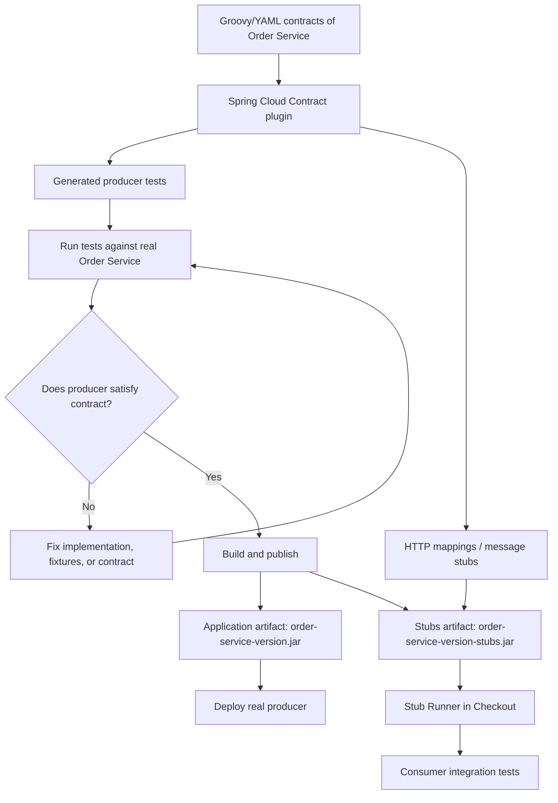
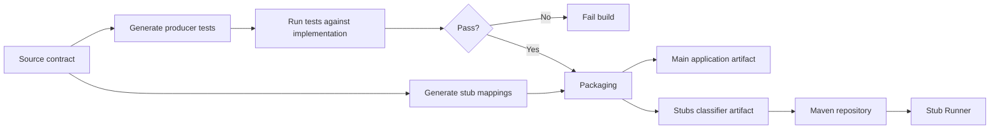
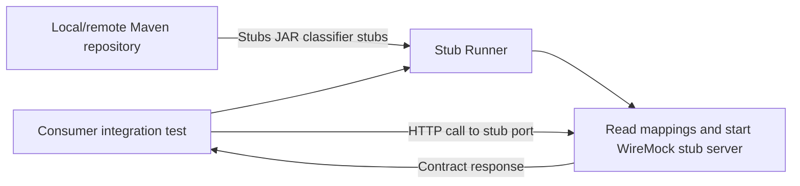
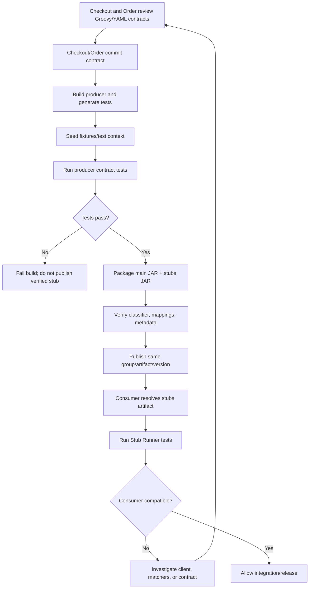

# Distinguishing the Application Artifact from the Stubs Artifact

In contract testing between **producer** and **consumer**, a service typically produces **two artifacts with different purposes**:

1. **The application artifact** contains the code and resources needed to run or distribute the producer.
2. **The stubs artifact** contains descriptions of simulated interactions derived from contracts, allowing consumers to test without starting the real producer.

Without distinguishing them clearly, teams easily grab the wrong JAR file, declare invalid Maven coordinates, try to launch a stubs artifact like an application, or publish stubs not yet verified by the producer. When that happens, **Stub Runner cannot find mappings**, consumers test against the wrong version, or CI stays green even though the API changed incompatibly.

This lesson belongs to the **Stub Generation and Packaging** chapter of **SPRING_CLOUD_CONTRACT**. It focuses on how Spring Cloud Contract Verifier generates producer tests and stubs from **Groovy/YAML DSL**, how Maven/Gradle packages both artifacts, how **Stub Runner** resolves `stubs` artifacts, and how to structure CI so a stub package is traceable to a **producer build that passed contract testing**.

## 1. Two artifacts built for two different audiences

Suppose we have producer **Order Service** and consumer **Checkout Service**.



The crucial point is that **the two JARs are used in two different places**:

- **Application JAR** runs the real service in a deployment environment or distributes it to other systems.
- **Stubs JAR** serves as **simulated data** for Stub Runner/WireMock or messaging stub infrastructure. It is **not** a stripped-down runnable substitute for Order Service.

A producer build can create both, yet they do not share the same purpose, contents, or usage criteria.

### 1.1. Quick comparison table

| Criterion | Application artifact | Stubs artifact |
|---|---|---|
| Purpose | Run or distribute the producer implementation | Simulate behavior defined by contracts |
| Consumer / audience | Deployment infrastructure, runtime, live apps | Consumer integration tests, Stub Runner |
| Primary contents | Bytecode, resources, metadata, packaged dependencies per build config | Request/response mappings, contracts, metadata needed for stubs |
| Contains real controllers/services/repositories? | Yes, inside the producer application | **No need**, and normally contains no runnable implementation |
| Opens an HTTP port when executing the JAR? | Possibly, if it is an executable Spring Boot JAR and launched | **Does not open ports on its own**; Stub Runner loads stubs and starts a mock server |
| Interacts with the producer database? | Possibly, depending on runtime config | Does not query the producer's database |
| Can return HTTP responses? | Yes, handled by application code | Yes, via WireMock/Stub Runner based on mappings |
| Verifies business logic at runtime? | Runs real logic | Serves sample responses / configured matcher rules |
| Used for production deployment? | Yes, after passing release processes | No |
| Can be published under the same version? | Yes | Yes, usually distinguished by the `stubs` classifier |

**Note:** an "application" JAR may be an ordinary library JAR or an executable `bootJar`, depending on how the producer is built. Not every main JAR can be run directly with `java -jar`. Conversely, a stubs JAR with the `stubs` classifier **must never be treated as an application**.

## 2. Maven coordinates: groupId, artifactId, version, and classifier

In the Maven ecosystem, an artifact is not identified solely by a filename. Key components include:

- **`groupId`:** publishing group/organization, e.g., `com.example`.
- **`artifactId`:** module name, e.g., `order-service`.
- **`version`:** build version, e.g., `1.4.0`.
- **`type/extension`:** artifact format, usually `jar`.
- **`classifier`:** differentiates variants sharing the same group, artifact, and version, e.g., `stubs`.

A producer can publish:

| Component | Main artifact | Stubs artifact |
|---|---|---|
| `groupId` | `com.example` | `com.example` |
| `artifactId` | `order-service` | `order-service` |
| `version` | `1.4.0` | `1.4.0` |
| `extension` | `jar` | `jar` |
| `classifier` | None | `stubs` |
| Typical Maven filename | `order-service-1.4.0.jar` | `order-service-1.4.0-stubs.jar` |

Both files share `groupId:artifactId:version` yet **differ in classifier**. Thus they are **two distinct artifacts** within the same module/version.

### 2.1. Coordinates used by Stub Runner

A common Stub Runner declaration example:

```text
com.example:order-service:1.4.0:stubs:8085
```

In **Stub Runner's `ids` syntax**, the string above typically means:

```text
groupId  : artifactId   : version : classifier : stubPort
com.example : order-service : 1.4.0 : stubs : 8085
```

**Do not confuse Stub Runner's `ids` syntax with a full Maven dependency XML declaration.** In Maven, `classifier` sits in its own element; in Stub Runner `ids`, the final field `8085` is **the stub server port**, not a packaging type. Field ordering and syntax variants should be verified against the **exact Spring Cloud Contract Stub Runner version** pinned by your project.

Extended Maven coordinates can follow different conventions across tools; avoid assuming every five-part string shares the exact same semantics as `ids`.

### 2.2. Why not declare the main JAR when stubs are needed?

If Checkout asks for:

```text
com.example:order-service:1.4.0
```

in a place expecting a `stubs` artifact, the resolver may download the **main JAR** or fail to find stub mappings as expected. The main JAR generally lacks the stub metadata layout expected by Stub Runner.

When configuring a consumer test, verify explicitly that it downloads **`order-service-1.4.0-stubs.jar`**, not **`order-service-1.4.0.jar`**, unless the project uses a custom packaging strategy verified separately.

## 3. Lifecycle from contract to two artifacts

Spring Cloud Contract does not infer producer behavior from source code. Instead, teams write **contracts**, and the plugin generates what is needed for both test directions.



The distinct stages:

1. **Contract definition:** write Groovy/YAML describing requests, responses, matchers, or messages.
2. **Generate producer tests:** the plugin generates tests from contracts.
3. **Generate stub mappings:** the plugin creates HTTP stub definitions or message stubs as supported.
4. **Producer verification:** generated tests run against the implementation with an appropriate base class and fixtures.
5. **Packaging:** the build tool produces the main artifact and stubs artifact when configured accordingly.
6. **Publishing:** artifacts are installed to local Maven or deployed to a shared repository.
7. **Consumer verification:** Stub Runner fetches the exact stubs JAR; consumer tests invoke the real client and assert outcomes.

**Guarantee condition:** merely generating or packaging a stubs JAR **does not mean** producer tests passed. If a pipeline uses `skipTests`, skips test tasks, or runs only generation phases, it can still emit stubs describing behavior the producer does not implement. Release gates must check that producer tests **actually ran and passed**.

## 4. How is an HTTP contract packaged into a stub?

Suppose Checkout asks Order Service to read an order:

```http
GET /api/orders/ORDER-42
Accept: application/json
```

and expects:

```http
HTTP/1.1 200 OK
Content-Type: application/json

{"id":"ORDER-42","status":"PAID","totalAmount":125000}
```

Groovy DSL:

```groovy
import org.springframework.cloud.contract.spec.Contract

Contract.make {
    name 'checkout_get_paid_order_200'
    description 'Checkout reads a paid order'

    request {
        method GET()
        url '/api/orders/ORDER-42'
        headers {
            header 'Accept', 'application/json'
        }
    }

    response {
        status OK()
        headers {
            contentType(applicationJson())
        }
        body(
            id: 'ORDER-42',
            status: 'PAID',
            totalAmount: 125000
        )
    }
}
```

Equivalent YAML DSL:

```yaml
name: checkout_get_paid_order_200
description: Checkout reads a paid order
request:
  method: GET
  url: /api/orders/ORDER-42
  headers:
    Accept: application/json
response:
  status: 200
  headers:
    Content-Type: application/json
  body:
    id: ORDER-42
    status: PAID
    totalAmount: 125000
```

**Pick only one as the primary source** for this scenario in your build's contract set. Loading both can generate duplicate tests/mappings or complicate traceability.

### 4.1. An HTTP stub mapping is data, not a controller

From the contract, Spring Cloud Contract can generate a **WireMock mapping** specifying:

- Request method is `GET`.
- URL is `/api/orders/ORDER-42`.
- `Accept` header if required by the contract.
- Response status `200`.
- `Content-Type: application/json` header.
- Sample JSON body.

A simplified WireMock mapping carrying the equivalent meaning might look like:

```json
{
  "request": {
    "method": "GET",
    "url": "/api/orders/ORDER-42"
  },
  "response": {
    "status": 200,
    "headers": {
      "Content-Type": "application/json"
    },
    "jsonBody": {
      "id": "ORDER-42",
      "status": "PAID",
      "totalAmount": 125000
    }
  }
}
```

This is an **illustrative example of WireMock structure**, **not** a byte-for-byte guarantee of actual generated files. The plugin may use matchers, `bodyFileName`, regex expressions, or different JSON layouts depending on DSL, WireMock version, and build config. This condensed example also omits the `Accept` header condition; when inspecting real output, verify that the plugin generates matchers for declared headers.

Such a mapping enables Stub Runner to return `200` on matching requests, yet **never runs `OrderController` or queries a database**. That is the exact difference between the stubs artifact and the main artifact.

### 4.2. Overly broad matchers make stubs "falsely green"

If a contract uses regexes accepting any URL or any `Authorization` token, the stub may return `200` for requests the real producer would reject. Therefore:

- Generated producer tests must run against the real implementation.
- Mappings must be inspected to confirm generated matchers are accurate.
- Consumer tests must call through **the consumer's real HTTP client**, not merely hit stub URLs with another test client.
- Behaviors outside contract scope must be tested separately (security, persistence, transactions, etc.).

Having a stubs JAR **present** is a technical prerequisite, not a substitute for verifying contract quality.

## 5. What is inside a stubs JAR?

A **common layout** of a stubs artifact packaged by Spring Cloud Contract under Maven metadata:

```text
order-service-1.4.0-stubs.jar
└── META-INF/
    └── com.example/
        └── order-service/
            └── 1.4.0/
                ├── contracts/
                │   └── checkout/
                │       └── get_paid_order_200.groovy
                └── mappings/
                    └── checkout/
                        └── checkout_get_paid_order_200.json
```

**Warning:** this is an **illustrative diagram** of organizing `META-INF/<group>/<artifact>/<version>/contracts` and `mappings`, **not a mandatory path identical across all versions/plugins**. Filenames, subfolders, body file locations, and metadata can differ by Maven/Gradle configuration and version.

Data types that may appear:

| Data type | Meaning |
|---|---|
| **Source contracts** | Groovy/YAML DSL describing the producer's commitments |
| **HTTP stub mappings** | WireMock request matching and response definitions |
| **Body files** | Large response payloads placed in separate files referenced by mappings |
| **Message contract metadata** | Data supporting message stub triggering when messaging is configured |
| **JAR manifest/Maven metadata** | Packaging details and artifact identification |

A stubs JAR normally **does not need** `BOOT-INF/classes`, runtime dependencies, controller/service implementations, or the Spring Boot executable launcher.

### 5.1. How does the main JAR differ structurally?

For a **Spring Boot executable JAR**, the structure typically looks like:

```text
order-service-1.4.0.jar
├── META-INF/
├── BOOT-INF/
│   ├── classes/
│   │   └── com/example/order/...
│   └── lib/
│       └── dependency-jars...
└── org/springframework/boot/loader/...
```

The actual layout varies by Spring Boot version and packaging style. If the producer packages an **ordinary library JAR** instead of an executable Boot JAR, the layout differs and may lack `BOOT-INF`. What matters is not memorizing launcher paths, but **knowing which artifact serves runtime execution and which serves stubbing**.

### 5.2. Inspecting JAR contents with standard tools

On a machine with a JDK, you can list entries inside each JAR:

```bash
jar tf target/order-service-1.4.0-stubs.jar
jar tf target/order-service-1.4.0.jar
```

These are **reference commands for learners to run in their own projects**, not outputs executed during this lesson. Depending on Maven or Gradle, artifacts may sit in `target/` or `build/libs/` and need not match these exact filenames.

Look for:

1. Does the stubs filename carry the `-stubs.jar` classifier?
2. Are `contracts` and `mappings` directories present inside matching plugin config?
3. Is there a mapping for `checkout_get_paid_order_200`?
4. Are the request matchers and JSON body accurate?
5. Does the main artifact contain the application classes needed to run?
6. Can both files be traced back to **the same producer build/version**?

**Never copy stubs manually into the main JAR** to work around a missing artifact: that blurs the boundary between deployment and testing while the root cause may be unconfigured packaging or a repository rejecting classifiers.

## 6. Maven: generating and packaging stubs in the lifecycle

With Maven, the Spring Cloud Contract Maven plugin participates in test and stub generation when properly configured.

**Condensed** plugin snippet:

```xml
<plugin>
    <groupId>org.springframework.cloud</groupId>
    <artifactId>spring-cloud-contract-maven-plugin</artifactId>
    <version>APPROPRIATE_VERSION</version>
    <extensions>true</extensions>
    <configuration>
        <baseClassForTests>
            com.example.order.contract.OrderContractTestBase
        </baseClassForTests>
    </configuration>
</plugin>
```

`APPROPRIATE_VERSION` is a **placeholder** and must be replaced with a valid plugin version or project-managed Maven property. Pin compatible Spring Boot/Spring Cloud/Contract versions and appropriate producer test dependencies. `OrderContractTestBase` is a producer-written class to run HTTP tests with fixtures.

Common Maven Wrapper commands for verification:

```bash
./mvnw clean test
./mvnw clean package
./mvnw clean verify
./mvnw clean install
```

Distinguish what each does:

| Command/phase | Primary goal | What to observe |
|---|---|---|
| `test` | Compile/run producer tests per configured lifecycle | Are generated contract tests present in reports? |
| `package` | Package application and attached artifacts per plugin/packaging | Are both main JAR and stubs JAR created? |
| `verify` | Execute lifecycle checks through `verify` | Did test execution and additional verifications pass? |
| `install` | Install build artifacts into local Maven repository | Are main JAR, stubs classifier, and POM right? |

**Note:** these commands are **standalone invocations**; you do not need to run all four every time. For example, `./mvnw clean verify` already executes earlier lifecycle phases per Maven config. `./mvnw clean install` goes further by installing locally. Exact outcomes depend on plugin executions, test configuration, and module packaging.

When using Maven Wrapper on Windows PowerShell, the command is typically `.\mvnw.cmd clean verify`.

### 6.1. Verifying that the build produced both JARs

After packaging, **typical** paths are:

```text
target/
├── order-service-1.4.0.jar
└── order-service-1.4.0-stubs.jar
```

Do not treat this diagram as universal across every project: Spring Boot repackaging, multi-project modules, custom `finalName`s, or attached artifacts produced by separate steps may differ.

If only the application JAR appears:

1. Check whether the Spring Cloud Contract Maven plugin is enabled.
2. Check the contracts directory and DSL format.
3. Check the packaging goals/phases supported by your project's plugin version.
4. Inspect build logs, generated mappings, test output, and `stubs` classifier attachment.
5. Do not immediately blame consumer dependencies for missing stubs when the producer never built the artifact.

If `-stubs.jar` exists yet **contains no mappings**, distinguish: empty/wrong contract directory, plugin not recognizing the DSL, or customized packaging path. Simply renaming the main JAR to `-stubs.jar` **never creates valid stubs**.

### 6.2. What is in the Maven local repository?

After a successful `install`, the local Maven repository layout is **usually**:

```text
~/.m2/repository/com/example/order-service/1.4.0/
├── order-service-1.4.0.pom
├── order-service-1.4.0.jar
└── order-service-1.4.0-stubs.jar
```

Metadata storage, checksums, and auxiliary files can vary by Maven version/configuration. What matters is that **consumer tests using `StubsMode.LOCAL` can resolve the `stubs` classifier at the declared coordinates**.

On Windows, the local Maven repository usually resides under the user profile directory, though `settings.xml` can customize it. Never hardcode user-home paths when builds run across heterogeneous CI agents.

## 7. Gradle: distinguishing `jar`, `bootJar`, and the `stubs` artifact

In Gradle, the Spring Boot plugin can produce **`bootJar`** for runnable applications. The Java plugin provides the `jar` task for ordinary JARs. The Spring Cloud Contract Gradle plugin generates tests/stubs and produces an archive with the `stubs` classifier using tasks/extensions supported by its version.

Conceptual **Groovy build script** snippet:

```groovy
plugins {
    id 'java'
    id 'org.springframework.boot' version 'VERSION_BOOT'
    id 'org.springframework.cloud.contract' version 'VERSION_CONTRACT'
}

contracts {
    baseClassForTests =
        'com.example.order.contract.OrderContractTestBase'
}

// Dependencies managed by the project's compatible BOM/versions.
// Publishing must be configured to upload main/stubs to a remote repository.
```

Versions in the example are **placeholders**. Plugin management syntax, extension APIs, and stubs archive generation depend on plugin version and project structure. Do not copy this as a complete build file without repositories, dependencies, source sets, and the proper release train.

Reference commands:

```bash
./gradlew tasks --all
./gradlew clean test
./gradlew clean build
./gradlew publishToMavenLocal
```

The last command only works as desired if the project configures the **Maven Publish plugin and a publication**; `publishToMavenLocal` does not automatically guarantee the stubs artifact is attached.

### 7.1. Distinguishing the three Gradle output types

| Common output/task | Contents | Purpose |
|---|---|---|
| `jar` | Ordinary Java JAR | Distributes library/app; may not be self-executable |
| `bootJar` | Executable Spring Boot JAR | Runs the application |
| Stubs archive / `stubs` classifier | Mappings and contracts | Serves Stub Runner |

A Gradle project can produce multiple archives under `build/libs/`, yet **not all are published automatically**. In multi-project builds, verify **which subproject owns the contracts and stubs archive**.

### 7.2. Publications must include the right classifier

If consumers fetch stubs from a remote Maven repository, the publication must include **both the main artifact and stubs artifact** per project rules. Do not merely apply `maven-publish` and assume attached classifiers are uploaded automatically.

When inspecting Gradle outputs/publications, check:

1. Producer `group`, `name/artifactId`, and `version`.
2. Tasks generating mappings and packaging stubs actually ran.
3. The stubs artifact carries **classifier `stubs`** and extension `jar`.
4. The Maven publication attaches the stubs archive.
5. Consumers can resolve `com.example:order-service:1.4.0:stubs` in the repository.
6. Version and contents originate from **the same commit/build**.

Because Gradle plugin task names and internals can vary, **inspect the actual task graph and artifact publications** rather than hardcoding a task name that might not exist in your version.

## 8. Stub Runner works with the stubs artifact, not the application artifact

When a consumer uses Stub Runner, the conceptual flow is:



**There is no step that boots the producer application JAR** in this model. Stub Runner loads mapping data from the stubs artifact to simulate the API. For messaging, a binder/message trigger compatible with your version is also needed; a stubs JAR does not turn itself into a broker.

### 8.1. Example consumer test using Stub Runner

Assuming Checkout is a Spring Boot application:

```java
import org.springframework.boot.test.context.SpringBootTest;
import org.springframework.cloud.contract.stubrunner.spring.AutoConfigureStubRunner;
import org.springframework.cloud.contract.stubrunner.spring.StubRunnerProperties;

@SpringBootTest(
    properties = "clients.order-service.url=http://localhost:8085"
)
@AutoConfigureStubRunner(
    ids = "com.example:order-service:1.4.0:stubs:8085",
    stubsMode = StubRunnerProperties.StubsMode.LOCAL
)
class CheckoutOrderClientContractTest {
    // Add @Test, inject Checkout's real client.
    // Call getOrder("ORDER-42") and assert status/body are parsed properly.
}
```

This is a **configuration pattern**, not a complete JUnit test. `clients.order-service.url` is an **illustrative property defined by the Checkout application itself**; Spring Cloud Contract does not recognize this property name automatically.

Prerequisites to run:

- `order-service-1.4.0-stubs.jar` is installed in the local Maven repository.
- Compatible Stub Runner and Spring Boot Test dependencies.
- Port `8085` is free; switch to a dynamic port for parallel runs.
- Checkout's real client reads the URL from the property and calls Stub Runner.
- The consumer test asserts on returned data.

A test that only hits WireMock directly with a separate test client can miss bugs in Checkout's **`OrderClient` adapter**. Always test through the real client.

### 8.2. Artifact resolution modes

| Stub Runner mode | Where stubs come from | Things to watch |
|---|---|---|
| `LOCAL` | Local Maven repository | Producer must `install` stubs first or provide matching local data |
| `REMOTE` | Configured remote repository | URL, credentials, snapshot/release policies, and access permissions |
| `CLASSPATH` | Stubs on test classpath as supported by version | Needs no remote repo, but requires proper resource layout |

Exact enum names and configuration properties must match **your Spring Cloud Contract version**. Some setups use a download cache; when hitting stale data, inspect versions and caches rather than assuming the server loaded the newest build.

**Never hardcode repository credentials in test source code or DSL.** Use CI secret management and Maven/Gradle settings, and mask secrets in logs.

## 9. Why must artifact versions be pinned?

Suppose Order Service publishes version `1.4.0`. Consumer Checkout can select:

```text
com.example:order-service:1.4.0:stubs:8085
```

If the producer later updates the contract in `1.5.0`, Checkout tests pinned to `1.4.0` continue running against **the old interface**. That is valid when verifying compatibility with that chosen version, but it **does not prove** consumer compatibility with `1.5.0`.

Therefore, adopt a clear strategy:

- **Immutable releases:** once `1.4.0` is published, never overwrite the artifact under the same version.
- **Development snapshots:** `1.5.0-SNAPSHOT` can shift across builds; for reproducibility, record the commit/build ID or use unique per-build versions.
- **Consumer compatibility pipeline:** test consumers against **the target stub version** or supported version matrix.
- **Promotion:** only promote stubs from preview/test to verified release once producer contract tests pass.

### 9.1. Changing the classifier vs. changing the version

Two different changes:

| Change | Consequence |
|---|---|
| `1.4.0` → `1.5.0`, classifier stays `stubs` | Uses the contract/stub set of the new version |
| Classifier `stubs` → no classifier | May download the **main artifact**, losing stubs |
| ArtifactId `order-service` → `orders-api` | Consumer must update repository coordinates |
| Extension `jar` → another format | Tooling must support that format |
| Stub server port `8085` → `8086` | Changes where the consumer sends requests; does **not** change artifact version |

In Stub Runner's `ids`, **the trailing port is not part of Maven artifact identity**. Never publish a new artifact version just because a consumer test changed ports.

## 10. Testing HTTP stubs: request matchers must be distinct enough

A stubs artifact can hold many mappings:

| Contract | Request | Simulated response |
|---|---|---|
| `get_paid_order_200` | `GET /api/orders/ORDER-42` | `200`, `status=PAID` |
| `get_missing_order_404` | `GET /api/orders/ORDER-MISSING` | `404`, `ORDER_NOT_FOUND` |
| `cancel_shipped_order_409` | `POST /api/orders/ORDER-SHIPPED/cancel` | `409`, `ORDER_CANNOT_CANCEL` |
| `get_order_unauthorized_401` | Request with invalid auth per matcher | `401` if published in contract |

If two mappings share the **same method/path/header/body matchers** yet return different responses, Stub Runner/WireMock may choose an unintended mapping. A stubs artifact **does not know the producer's database state** to decide between `200` and `409`.

Solutions:

1. Use distinct fixtures/requests for different cases.
2. Write strict enough matchers for paths, headers, and bodies.
3. Inspect generated WireMock mappings in the stubs JAR.
4. Exercise consumer tests against each expected request and error body.
5. For stateful workflows, use integration tests or explicitly configured/reset stateful stubs per version; never rely on test execution order.

### 10.1. "Stub returned `404`" is not necessarily a business error

When a request matches no mapping, WireMock commonly returns a **default `404`**. That differs from the `404 ORDER_NOT_FOUND` published in the producer's contract.

A consumer test checking error handling must assert the **response body/header/code** of the expected stub mapping, not just status `404`. Checking status alone can give a "false green" when the client sent the wrong URL or missed a header and matched nothing.

## 11. Message stubs also live in the stubs artifact, with their own limits

Spring Cloud Contract does not only generate HTTP stubs. For message contracts, the artifact can contain the data required to trigger **message stubs** for consumers when the environment is properly integrated.

Example emit-only message contract:

```groovy
import org.springframework.cloud.contract.spec.Contract

Contract.make {
    name 'billing_order_paid_event_v1'
    label 'billing_order_paid_v1'

    input {
        triggeredBy('publishOrderPaid()')
    }

    outputMessage {
        sentTo('orders.events')
        body(
            eventType: 'ORDER_PAID',
            orderId: 'ORDER-42',
            totalAmount: 125000
        )
    }
}
```

Producer verification needs `publishOrderPaid()` hooked in the base class plus a message verifier/binder to verify **the event the real producer emits**. The consumer can use Stub Runner and a mechanism like `StubTrigger` (if supported by its version) to receive simulated events.

**However, a stubs JAR is not a Kafka/RabbitMQ broker.** It lacks delivery guarantees, partitions/offsets, transactions, and real broker retry behavior. If the consumer relies on those properties, run broker integration tests.

### 11.1. Can one artifact hold both HTTP and message contracts?

Yes, if the plugin/packaging supports both contract types in the same module and the project is configured accordingly. Still:

- HTTP mappings require a WireMock stub server.
- Message stubs require matching messaging infrastructure/triggers.
- Having `-stubs.jar` does not mean every message contract can be triggered by Stub Runner.
- Some input-only contracts have no output message to emit, so do not assume an automatic response stub exists.
- Message labels should be stable and unique, unlike event IDs which may be dynamic.

Verify archive outputs and generated tests against your **Spring Cloud Contract version** rather than guessing from filenames.

## 12. Do not confuse the main artifact with the API contract version

The same producer version can include:

- Main JAR containing endpoint implementations.
- Stubs JAR containing interactions described in contracts.
- POM metadata listing dependencies.
- Even additional attached archives such as `sources` or `javadoc` if configured by the build.

Having both JARs does not mean **the entire public API** has contracts. The stubs JAR normally covers only **scenarios** written in contract sources. If a new endpoint lacks a contract, Stub Runner cannot automatically infer and serve it from the implementation JAR.

### 12.1. Distinguishing three version concepts

| Concept | Example | Purpose |
|---|---|---|
| **Producer artifact version** | `1.4.0` | Identifies a build of Order Service and matching stubs |
| **API/schema version** | Header `X-Api-Version: 2` or `eventVersion: 2` | Governs external data interface |
| **Contract case version/name** | `billing_order_paid_v1` | Lets consumers know which scenario is triggered/tested |

They may relate, yet **are not the same thing**. Producer `1.4.0` can still serve API v2. Stubs `1.4.0` carry contracts describing API v2, which does not mean every route bumps version alongside the artifact.

When making breaking changes, teams must follow their agreed API versioning/migration strategy while updating contracts and stub artifacts.

## 13. Stub Runner tests the consumer; producer tests check the producer

A common misconception is treating a passing consumer test against a stubs JAR as proof that the producer application works properly. In reality:

| Test | Target executed | Valid conclusion |
|---|---|---|
| **Generated producer contract test** | Order Service implementation with fixtures | Producer satisfies the checked contracts |
| **Consumer test via Stub Runner** | Checkout's HTTP/message client and simulated stub | Consumer calls/parses/handles described interactions properly |
| **Producer integration/security test** | Implementation, DB, security, broker as needed | Properties beyond contract scope |
| **End-to-end test** | Real services + infrastructure | Cross-service workflows operate properly |

Producer contract tests can fail due to a misconfigured base class, missing fixtures, bypassed security filters, or implementation drift. In that case, **never publish stubs as a verified release**.

Consumer tests using Stub Runner can fail because the stubs artifact is missing, mappings fail to match, consumer base URLs are wrong, request headers are omitted, or client deserialization breaks. None of those automatically prove a bug in the producer implementation.

Classify failures accurately to avoid fixing the wrong side.

## 14. CI: package both, publish under control

A reference pipeline for Order Service:



A production pipeline may add security scans, release approvals, image packaging, or staging deploys. Those steps **do not replace** the two core checks: **producer verification before publication** and **consumer verification after fetching the exact stubs artifact**.

### 14.1. Release gate checklist

- [ ] Contracts live in the right location and are discovered by the plugin.
- [ ] Generated producer tests match the expected count.
- [ ] Tests **actually run** and all pass against the implementation.
- [ ] Fixtures are independent and contain no production data.
- [ ] Main JAR or Boot JAR is built for the right module/version.
- [ ] Stubs JAR carries **classifier `stubs`**, not a renamed main JAR.
- [ ] Stubs JAR contains the expected mappings/contracts.
- [ ] POM/publication properly attaches the stubs artifact.
- [ ] Local/remote Maven repository serves the exact coordinates/version.
- [ ] Stub Runner fetches the artifact cleanly and starts mappings without errors.
- [ ] Consumer tests exercise the real client across published success and error cases.
- [ ] Stub versions are traceable to producer commits/builds.
- [ ] No secrets, real tokens, or customer data appear in stub resources.

Never mark **"contract verified"** just because the plugin completed stub generation. Packaging `COMPLETED` and **producer contract tests PASS** are two independent signals that must both be observed.

## 15. When producer and consumer use different repositories

In some organizations, producer and consumer do not share source code or build servers. Here, **the stubs artifact is the distributable contract**.

Example workflow:

1. Producer Order Service builds and publishes `com.example:order-service:1.4.0:stubs` to the artifact repository.
2. Consumer Checkout configures tests to resolve those exact coordinates.
3. Stub Runner downloads the JAR into Checkout's test environment.
4. Checkout calls the stub via its real client and verifies described responses/behaviors.
5. When the producer prepares `1.5.0`, the consumer pipeline runs against `1.5.0` stubs to assess compatibility.
6. If it fails, both teams discuss contracts or adjust clients before deploying the new producer.

**Remember:** consumers do not need to download Order Service's main application JAR. They only need the **stubs JAR and test dependencies**. Never add runtime dependencies to the main producer artifact just to help Stub Runner run.

### 15.1. Repository management approaches

| Repository | Usually fits | Risks to manage |
|---|---|---|
| **Maven local** | Developer working on producer and consumer on one machine | Stale stubs if not re-installed |
| **Internal Maven repository** | CI and multiple teams sharing artifacts | Permissions, credentials, immutability, snapshot policy |
| **CI artifact cache** | Speeding up repeated pipeline runs | Bad cache keys serving stale versions/artifacts |
| **Classpath test fixtures** | Small tests or repo-less environments | Not universal across all dependencies/stub modes |

Do not upload a JAR to an arbitrary HTTP URL and expect Stub Runner `REMOTE` to resolve Maven coordinates without a proper repository layout. Use a repository compatible with the resolver supported by your Stub Runner version.

## 16. Diagnosing missing stubs artifacts or wrong loaded files

| Symptom | Possible cause | What to check |
|---|---|---|
| Only `order-service-1.4.0.jar` exists | Stubs packaging is not enabled | Plugin config, contract sources, build lifecycle |
| `-stubs.jar` exists yet `mappings` is empty | DSL unrecognized or wrong packaging path | Build logs and JAR contents |
| Stub Runner reports artifact not found | Not `install`ed/`publish`ed, wrong GAV/classifier | Local/remote repository and `stubs` coordinates |
| Maven resolves main JAR but not stubs | Publication uploaded only the main artifact | Check attached classifiers in repository |
| Stub Runner starts yet all requests return `404` | Mappings not loaded or client requests mismatch | Mapping contents, URL/path/headers, server port |
| Consumer test receives stale response bodies | Stale stub version/cache or repository serving earlier build | Actual JAR file, version, cache |
| Two mappings match the same request | Overly broad matchers or duplicate contracts | Request matchers and scenario names |
| Producer build is green yet stub does not reflect API | Generated producer tests were skipped or DSL missed | Test count and test reports |
| `java -jar *-stubs.jar` fails to launch | Stubs JAR is not an executable app | Load it using Stub Runner |
| `java -jar order-service.jar` runs yet Stub Runner gets no responses | Only the main application artifact is present | Publish the `stubs` classifier |
| Gradle publish succeeds yet `-stubs.jar` is missing | Publication did not attach the stubs archive | Check Maven publication/artifacts |
| Consumer misses message stub | Missing binder/`StubTrigger` or mismatched label | Check messaging config and artifact contents |
| CI fails only in parallel runs | Colliding static stub ports or shared cache/resources | Use dynamic ports and isolate jobs |

### 16.1. Least-effort debugging sequence

1. **Verify version:** is the consumer requesting the exact `groupId:artifactId:version:stubs`?
2. **Verify artifact existence:** does `-stubs.jar` at that version exist in the local/remote repo?
3. **Inspect the JAR:** are mappings/contracts present under the right internal paths?
4. **Inspect Stub Runner:** did the server start, which mappings did it load, and on what port?
5. **Inspect the consumer request:** do method, URL, path, query, headers, and body match the mapping?
6. **Inspect stub responses:** is this a mapping response or a default unmatched `404`?
7. **Inspect producer tests:** was this stub version actually verified against the implementation?
8. **Inspect publication/cache:** could an older build be cached under a snapshot or cache key?
9. **Re-run the consumer test** against the verified artifact.

Never start by editing producer controllers if Stub Runner has not even located the stubs JAR. That is usually a packaging or artifact resolution error, not a runtime API bug.

## 17. Security risks when publishing stubs JARs

Although a stubs JAR **does not execute producer implementation code**, it can contain **sample JSON bodies and headers** inside contracts/mappings. If developers accidentally place sensitive data into contracts, that data is distributed with the artifact.

Examples to avoid:

- Real access tokens or refresh tokens in `Authorization` headers.
- Real customer emails, addresses, account numbers, or personal details.
- API keys, passwords, private keys, or repository credentials.
- Production message payloads containing confidential business data.
- Response bodies holding internal admin data never meant for consumers.

Good practices:

1. Use synthetic fixture data containing zero real PII.
2. Use placeholder tokens meaningful only in a test profile.
3. Restrict repository read access as required.
4. Scan artifacts prior to publishing if required by organization policy.
5. Mask secrets in build logs and HTTP request dumps.
6. If real credentials were ever published, follow key revocation/rotation procedures—never merely delete the JAR and call it done.

A stubs JAR is a **data distribution unit**, so manage access policies seriously even though it is not executable.

## 18. Lab: separating Order Service's main JAR and stubs JAR

Context: the team uses Spring Boot producer `order-service`, consumer `checkout-service`, a compatible Spring Cloud Contract Maven/Gradle plugin, and Stub Runner.

### Stage 1 — write contracts

1. Create `GET /api/orders/ORDER-42` returning `200` with `id/status/totalAmount`.
2. Create `GET /api/orders/ORDER-MISSING` returning `404` with body `code=ORDER_NOT_FOUND`.
3. Choose either Groovy or YAML DSL without duplicating the same scenario.
4. Seed producer fixtures for both the existing order and the missing order.

### Stage 2 — producer verification

1. Configure the Contract Verifier plugin with an appropriate base test class for the HTTP test mode.
2. Generate producer tests and verify both `200` and `404` scenarios exist.
3. Run the tests against the producer implementation.
4. Temporarily change `totalAmount` from a number to a string to confirm the test catches type regressions if protected by contract assertions.
5. Restore the implementation and re-run tests until passing.

### Stage 3 — package and inspect

1. Build the producer per the configured lifecycle.
2. Verify both **the main application artifact** and **the `stubs` classifier artifact** exist.
3. Run `jar tf` to inspect JAR layout, mappings/contracts, and scenario names.
4. Compare `groupId/artifactId/version/classifier` across both artifacts.
5. For Gradle, confirm the publication attaches the stubs archive; for Maven, confirm the attached `stubs` classifier.
6. Install into the local Maven repository or publish to an authorized test repository.

### Stage 4 — consumer with Stub Runner

1. Configure Checkout to resolve `com.example:order-service:1.4.0:stubs:8085` (update version to match your build).
2. Use `LOCAL` if installed locally; use `REMOTE` when a repository is configured properly.
3. Have Checkout's real HTTP client call `GET /api/orders/ORDER-42` against the stub.
4. Verify `200` response and proper JSON deserialization.
5. Test the `404` scenario and assert body `ORDER_NOT_FOUND` rather than status alone.
6. Intentionally omit the `stubs` classifier, observe resolution or mapping failures, then restore it.

### Stage 5 — CI and release

1. Add generation, producer tests, and packaging steps into CI.
2. Block publishing if producer tests fail or the stubs JAR lacks mappings.
3. Tag main and stubs artifacts with the same version/commit.
4. Configure the consumer pipeline to consume the exact published stub version.
5. Never overwrite released artifacts and never include sensitive data in stubs.
6. Record build/commit metadata and artifact coordinates for reproducibility.

**Completion criteria:** learners can point out which JAR runs the producer and which feeds Stub Runner; verify classifier/metadata/contents; run consumer tests against the right stubs version; and present passing producer verification evidence before treating stubs as verified.

## 19. Self-check questions

1. **How do the application JAR and stubs JAR differ in purpose?** One runs the implementation; the other supplies mappings/contracts for consumer stubbing.
2. **Is a stubs JAR a Spring Boot app launched with `java -jar`?** Usually not. Stub Runner loads the JAR and starts a simulation server.
3. **What does the `stubs` classifier signify?** It distinguishes the stubs artifact from the main artifact sharing the same `groupId`, `artifactId`, and `version`.
4. **What does `com.example:order-service:1.4.0:stubs:8085` mean in Stub Runner `ids`?** Producer GAV, `stubs` classifier, and stub server port.
5. **Is port `8085` part of the Maven artifact version?** No. It is the port serving the mock server.
6. **Why can't you simply rename the main JAR to `-stubs.jar`?** Because the main JAR does not automatically contain stub mappings or contract metadata.
7. **What can a stubs JAR contain?** Contract sources, WireMock mappings, response body files, and message stub metadata depending on version/config.
8. **Where are producer tests generated from?** From Groovy/YAML DSL by the Contract Verifier plugin.
9. **Does producing a stubs artifact mean producer tests passed?** No. You must inspect test execution and release gates.
10. **Does Stub Runner run the real producer implementation?** No. It simulates behavior using mappings from the stubs artifact.
11. **Why might a consumer test get `404` even when the producer has the endpoint?** Because the request missed the stub mapping or Stub Runner did not load it; it may be a default `404`.
12. **How do Maven `LOCAL` and `REMOTE` differ?** One reads from the local Maven repository; the other resolves from a configured remote repository.
13. **Is Gradle `bootJar` the same as the stubs archive?** No. `bootJar` is typically an executable application JAR, whereas the stubs archive is for consumer testing.
14. **Why pin stub versions?** So consumers test against a deterministic contract set and produce reproducible results.
15. **Should you overwrite a published `1.4.0-stubs.jar` release?** No; immutable releases preserve traceability and prevent consumers from getting altered content under the same version.
16. **Do message contracts inside a stubs JAR create a Kafka broker automatically?** No. You need the corresponding message stub triggering/binder mechanism.
17. **Does a passing consumer stub test prove the producer implementation is right?** Not yet; generated producer contract tests must run against the implementation.
18. **Can a stubs JAR leak sensitive information?** Yes, if contracts or fixtures contain tokens or PII; use synthetic test data and restrict repository access.
19. **What if a consumer needs `1.5.0` stubs but is pinned to `1.4.0`?** Passing against the old version does not prove compatibility with the new one; update the target version.
20. **What must CI check before publishing?** Producer tests ran and passed, the JAR has the right classifier/mappings, publication carries exact coordinates, and artifacts are traceable.

## Conclusion

**The application artifact and the stubs artifact may originate from the same producer build, yet they serve completely different purposes.** The main artifact contains the implementation to run Order Service; the stubs artifact usually carries the `stubs` classifier and holds **contracts and mappings** so Stub Runner can simulate producer behavior for Checkout. Correctly identifying **groupId, artifactId, version, classifier, extension, and stub server port**, inspecting JAR layout, pinning versions, and distinguishing `LOCAL/REMOTE/CLASSPATH` prevent artifact resolution errors and mismatches. When **generated producer contract tests** actually pass before publishing and **consumer integration tests** run against the exact stubs JAR in CI, both teams catch incompatible API changes early without deploying the real producer for every test cycle.
