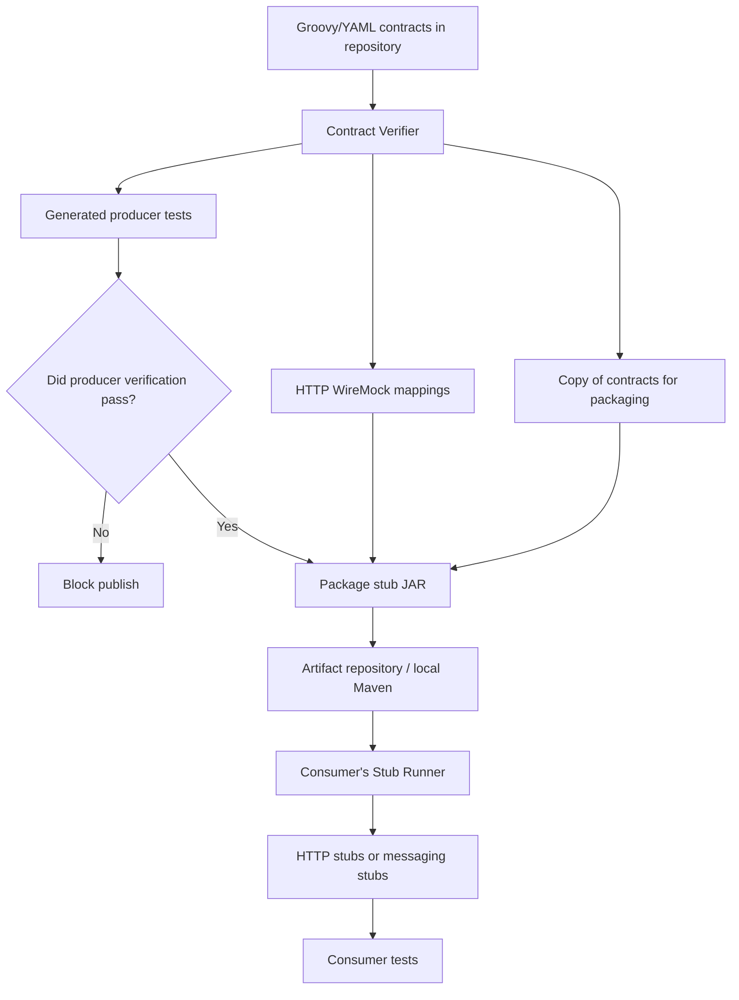
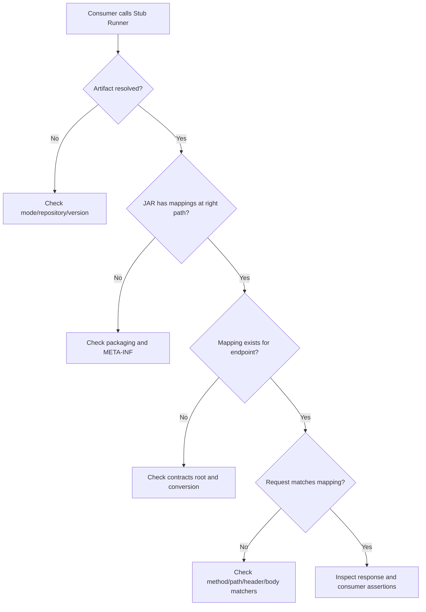
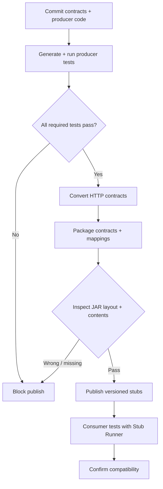

# Organizing Contracts and Mappings Directories Inside Artifacts

## 1. Why is the stub artifact's directory structure part of the integration contract?

In **Spring Cloud Contract** (module `SPRING_CLOUD_CONTRACT`), producers and consumers verify compatibility based on HTTP or messaging contracts written in **Groovy/YAML DSL**. Contract Verifier can generate producer-side tests; the same set of contracts is converted into stubs, packaged, and published with versions. Consumers use **Stub Runner** to download the right artifact and test their own logic in CI without starting the real producer.

A common headache occurs when the producer passes tests and even produces a `.jar` file, yet **the consumer cannot find the stubs**. The culprit may not be the HTTP contract itself: the JAR might be missing the `mappings` folder, missing `contracts`, using wrong group/artifact/version coordinates, or placing files in locations Stub Runner does not scan.

This lesson focuses on the question: **Where does a contract travel from the source directory into the stub artifact, and what must Stub Runner see to use it?**

After this lesson, you will be able to:

1. Distinguish source `contracts`, converted `mappings`, and the packaged **stub JAR**.
2. Organize contracts by business domain/consumer while keeping traceability clear.
3. Explain the common layout `META-INF/<groupId>/<artifactId>/<version>/contracts` and `.../mappings`.
4. Recognize how **HTTP WireMock** mappings differ from data needed for **messaging stubs**.
5. Build the artifact with Maven/Gradle workflows, inspect JAR contents, and verify expected files.
6. Publish clearly versioned artifacts, configure Stub Runner on the consumer, and diagnose missing-mapping errors.
7. Design CI checks to prevent publishing an empty, incomplete, or unverified stub artifact.

> **Scope:** paths shown in this lesson are **illustrative layouts following Spring Cloud Contract conventions**. Exact build output paths, mapping JSON filenames, task/goal names, and layout details may vary by plugin version or custom configuration. Inspect the **actual JAR contents** rather than guessing solely from an example directory tree.

## 2. Three data forms not to confuse

| Concept | What is it? | Created by | Used by |
| --- | --- | --- | --- |
| **Source contracts** | `.groovy`, `.yml`, or `.yaml` files describing behavior | Agreed by producer/consumer, committed to repository | Contract Verifier, generator, code review, and certain messaging stub workflows |
| **HTTP mappings** | JSON files in **WireMock stub mapping** format | Spring Cloud Contract converter generated from HTTP contracts | WireMock/Stub Runner to match HTTP requests and return HTTP responses |
| **Stub artifact** | JAR holding contracts, mappings, and required resources in a recognizable layout | Maven/Gradle packaging step | Consumer tests, Stub Runner, artifact repository |

**Contracts are the source specification**, whereas **mappings are the executable representation of HTTP stubs**. Never hand-edit generated mapping JSON files and treat them as a long-term source of truth: the next generator run can overwrite your changes. When API requirements change, edit the source contract and regenerate.

### 2.1. Flow from contract to consumer



**These two directories do not play the same role:** for HTTP, JSON mappings are loaded by WireMock to serve stub endpoints. For messaging, contract data such as `label`, `outputMessage`, and related conversion details still matter; **do not assume every message generates a corresponding HTTP WireMock mapping JSON**.

## 3. How should the source contracts directory be organized?

With Maven, Spring Cloud Contract commonly reads from `src/test/resources/contracts` under default settings. Example of a multi-channel producer:

```text
orders-producer/
  pom.xml
  src/
    test/
      resources/
        contracts/
          http/
            orders/
              get_order_success.groovy
              get_order_not_found.groovy
              create_order_success.yml
              create_order_invalid_quantity.yml
            customers/
              get_customer_success.groovy
          messaging/
            orders/
              order_created_event.groovy
              order_cancelled_event.yml
```

Levels like `http/orders` and `messaging/orders` are **team conventions**, not DSL mandates. They help:

- Identify the protocol and business domain.
- Trace back to a contract from test logs or mappings.
- Keep success and failure branches close together.
- Map contract groups to appropriate base test classes.
- Reduce filename collision risks within a group.

### 3.1. Maven and Gradle can have different contracts roots

| Build | Example contracts root | Things to note |
| --- | --- | --- |
| Maven | `src/test/resources/contracts` | Can be overridden via plugin settings like `contractsDirectory` |
| Gradle | `src/contractTest/resources/contracts` in common Gradle plugin setups | Can be overridden via `contractsDslDir` |
| Standalone contracts repository | Directory inside a JAR or Git repository | Requires configuring dependency, path, and mode so the producer fetches the right contracts |

Do not assume Gradle projects share Maven's exact directory structure. When you want the same layout across both build tools, **configure the contracts root explicitly** and verify the plugin scanned all files.

### 3.2. Naming files after interaction branches

| Good name | Behavior reflected |
| --- | --- |
| `get_order_success.groovy` | `GET` returns `200` |
| `get_order_not_found.groovy` | `GET` returns `404 ORDER_NOT_FOUND` |
| `create_order_invalid_quantity.yml` | `POST` returns validation error |
| `order_created_event.groovy` | Producer emits order-created event |

Avoid naming contracts `test1.groovy`, `test2.groovy`. Also avoid **two contracts with overlapping request conditions** returning different responses: putting them in separate files organizes source code, but does not by itself help Stub Runner distinguish branches.

### 3.3. Organizing directories by consumer when useful

One producer may serve multiple consumers, each caring about different behaviors. You can organize directories by consumer group, for example:

```text
contracts/
  shopping-web/
    get_order_success.groovy
    create_order_success.groovy
  backoffice/
    get_order_not_found.groovy
    cancel_order_success.groovy
```

This helps trace which team a change impacts. Still, if contracts in different folders share the **same method/path/header/body matchers** yet return different responses, mappings can still overlap. **Directories are not HTTP matching conditions**.

## 4. How does an HTTP contract become a mapping?

Suppose `http/orders/get_order_success.groovy` contains:

```groovy
import org.springframework.cloud.contract.spec.Contract

Contract.make {
    name 'get_order_success'
    description 'Read an existing order'

    request {
        method GET()
        url '/api/orders/ord-1001'
    }

    response {
        status 200
        headers {
            contentType(applicationJson())
        }
        body([
            id    : 'ord-1001',
            status: 'CREATED'
        ])
    }
}
```

The converter parses the DSL and generates an HTTP mapping telling WireMock **which request matches** and **which response to return**. Example JSON representation with equivalent meaning:

```json
{
  "request": {
    "method": "GET",
    "url": "/api/orders/ord-1001"
  },
  "response": {
    "status": 200,
    "headers": {
      "Content-Type": "application/json"
    },
    "jsonBody": {
      "id": "ord-1001",
      "status": "CREATED"
    }
  }
}
```

This is a **behaviorally equivalent WireMock mapping for explanation**, not a promise that generated JSON across every version always uses the exact `jsonBody` property, field order, or filename. In real output, the plugin may pick `body`, different matchers, metadata, and JSON formatting; always inspect the generated mapping.

### 4.1. Source contracts vs. runtime mapping JSON

| Section | Groovy contract | Runtime mapping |
| --- | --- | --- |
| Method | `method GET()` | `"method": "GET"` |
| URL | `url '/api/orders/ord-1001'` | `"url": "/api/orders/ord-1001"` |
| Response status | `status 200` | `"status": 200` |
| Header | `contentType(applicationJson())` | `Content-Type: application/json` |
| JSON body | Groovy map/list | JSON/string representing the body |
| Dynamic matchers | `consumer/producer` or `bodyMatchers` | Consumer-side WireMock matchers |

If a contract specifies a regex or JSONPath matcher in `request`, the converter must emit **the request acceptance condition** in WireMock syntax. Having a mapping use a regex does not mean the generated producer test sends the literal regex string as real HTTP data.

### 4.2. Why inspect the real mapping?

Suppose we have two files:

```text
get_order_success.groovy    -> GET /api/orders/ord-1001 -> 200
get_order_not_found.groovy  -> GET /api/orders/ord-missing -> 404
```

When the converter produces mappings, verify they have **distinct request conditions**. If the `200` mapping uses an overly broad regex `/api/orders/.*`, it may capture IDs meant for the `404` branch. WireMock does not query the producer's database to determine order status.

**Inspecting mappings helps catch:** inverted request matchers, overly broad path regexes, missing header constraints, mistyped body matchers, and overlapping scenarios.

## 5. Common internal structure of a stub JAR

Given coordinates:

```text
groupId    = com.example
artifactId = orders-producer
version    = 1.4.2
classifier = stubs
```

An artifact organized according to the common convention:

```text
orders-producer-1.4.2-stubs.jar
└── META-INF/
    └── com.example/
        └── orders-producer/
            └── 1.4.2/
                ├── contracts/
                │   ├── http/
                │   │   └── orders/
                │   │       ├── get_order_success.groovy
                │   │       ├── get_order_not_found.groovy
                │   │       └── create_order_success.yml
                │   └── messaging/
                │       └── orders/
                │           └── order_created_event.groovy
                └── mappings/
                    └── http/
                        └── orders/
                            ├── get_order_success.json
                            ├── get_order_not_found.json
                            └── create_order_success.json
```

**Crucial notes:**

- `com.example` is **the `groupId` rendered as a single directory segment** in this layout. It is not required to expand into `com/example` like a Java package. Never alter the layout expected by the plugin/Stub Runner.
- `orders-producer` is the `artifactId`, and `1.4.2` is the `version`. This triplet must match the artifact requested by the consumer.
- Filenames like `get_order_success.json` in the diagram only **illustrate mapping grouping**. The generator may use different filenames, identifiers, or folder structures.
- The `contracts` directory holds Groovy/YAML sources; `mappings` holds **HTTP mappings**. For a message `order_created_event`, do not expect an HTTP WireMock JSON file named `order_created_event.json`.
- A real JAR may also contain `META-INF/MANIFEST.MF` or other resources. The goal here is distinguishing **the `contracts` area** from **the `mappings` area** recognized by Stub Runner.

### 5.1. Why does the `META-INF` structure matter?

Stub Runner must locate the right stub set by **groupId, artifactId, and version**. When running in **CLASSPATH** mode, its scanner checks conventional locations such as:

```text
/META-INF/com.example/orders-producer/<version>/...
/contracts/com.example/orders-producer/<version>/...
/mappings/com.example/orders-producer/<version>/...
```

These are **possible scan locations**, not a requirement that every JAR duplicate all three layouts simultaneously. The `META-INF` layout above is a typical structure documented by Spring Cloud Contract. When fetching from a Maven repository, Stub Runner unpacks the artifact and locates contents per config/version.

Never package like this:

```text
orders-producer-1.4.2-stubs.jar
└── my-workspace/
    └── src/test/resources/contracts/
        └── get_order_success.groovy
```

and assume Stub Runner will find it. That is just a **workspace source path**, not a stub artifact layout recognized by tooling.

### 5.2. Both contracts and mappings must stay paired with the version

Suppose producer `1.5.0` updates the API to add a `currency` field:

- The new source contract includes `currency`.
- Generated producer tests of the new build verify the real response.
- The new stub mapping returns `currency` when consumers use artifact `1.5.0`.
- Artifact `1.4.2` still holds the old contract/mapping.

**Never** publish two different contents under the same release coordinates `com.example:orders-producer:1.4.2:stubs`. Overwriting destroys reproducibility in consumer tests and causes one machine to read stale cached artifacts while another fetches new content.

## 6. Source contracts and HTTP mappings are not identical copies

For HTTP, one contract can turn into one or more mappings depending on structure and plugin. View this as a **transformation process**, not simply renaming `.groovy` to `.json`.

A mapping can include:

- `request.method`, `url`, or `urlPath`.
- Header, query parameter, cookie, and body matchers.
- JSONPath/regex rules or corresponding match predicates.
- `response.status`, headers, and body.
- Fields used to distinguish or prioritize mappings if generated by the plugin.

Example contract request with a matcher:

```groovy
request {
    method GET()
    urlPath($(consumer(regex('/api/items/SKU-[0-9]{3}/format')),
               producer('/api/items/SKU-001/format')))
}
response {
    status 200
    body([valid: true])
}
```

In the HTTP mapping, **consumers** can send `/api/items/SKU-002/format` if the path matches the regex; the generated producer test only hits the sample path `/api/items/SKU-001/format`. This is a **format validation** API where every validly formatted ID is assumed to share the same behavior. Do not use a similar regex for `GET /api/orders/{id}` when some IDs return `200` and others return `404`.

If the converter drops a matcher or flips sides, the mapping can become too broad or too narrow even while the producer test passes for a single sample. **Inspecting the actual mapping** verifies what consumers actually exercise.

## 7. How are messaging contracts packaged differently?

Suppose we have contract `messaging/orders/order_created_event.groovy`:

```groovy
import org.springframework.cloud.contract.spec.Contract

Contract.make {
    name 'order_created_event'
    label 'order_created'

    input {
        triggeredBy('publishOrderCreated()')
    }

    outputMessage {
        sentTo('orders.events')
        body([
            eventType: 'ORDER_CREATED',
            orderId  : 'ord-1001'
        ])
        headers {
            header('eventType', 'ORDER_CREATED')
            messagingContentType(applicationJson())
        }
    }
}
```

For message stubs, fields like `label`, `outputMessage.sentTo`, `body`, and `headers` are used by Stub Runner/messaging integrations to emit sample messages. It **does not necessarily generate an HTTP WireMock mapping** for an event contract.

| Aspect | HTTP stubs | Messaging stubs |
| --- | --- | --- |
| Typical runtime | WireMock HTTP server | Appropriate message integration/binder/verifier |
| Primary representation | JSON `mappings` | Contract/message definition and related metadata |
| How consumers trigger | Send HTTP requests matching a mapping | Call `StubTrigger.trigger(label)` when contract has a label and integration supports it |
| Output to consumer | HTTP status, headers, body | Destination, message body, headers/content type |
| Prerequisite to run | HTTP stub mappings loaded | Messaging support configured, consumer has binding/subscriber |

Hence, an artifact can contain **both contracts and mappings**, yet **the number of HTTP mapping JSON files does not necessarily equal the total number of HTTP + messaging contracts**. Counting JSON files in `mappings` and concluding "a message contract is missing" can be wrong. Inspect contract types and how Stub Runner runs.

### 7.1. Packaging source contracts for messaging

Do not strip the JAR down to only `mappings/*.json` if consumers need to trigger events by label. Doing so removes message definitions and metadata required by messaging stubs. Verify that your version's artifact includes message contract data in the structure the plugin expects.

With YAML DSL, preserve YAML files as well—not just `.groovy` files. When using custom packaging filters, verify file patterns include `*.yml`/`*.yaml` if the repository uses them.

## 8. Maven: converting, generating stubs, and packaging

In Maven projects using `spring-cloud-contract-maven-plugin`, key goals are:

| Goal | Purpose |
| --- | --- |
| `spring-cloud-contract:generateTests` | Generate producer tests from contracts |
| `spring-cloud-contract:convert` | Convert contracts into HTTP stub mappings |
| `spring-cloud-contract:generateStubs` | Package the stub JAR from converted outputs; requires `convert` beforehand |
| `mvn verify` | Run producer lifecycle per config, including compilation and appropriate test execution |
| `mvn install` / `deploy` | Install artifacts into local Maven repo or publish per repository configuration |

Example condensed `pom.xml` snippet:

```xml
<build>
  <plugins>
    <plugin>
      <groupId>org.springframework.cloud</groupId>
      <artifactId>spring-cloud-contract-maven-plugin</artifactId>
      <version>APPROPRIATE_VERSION</version>
      <extensions>true</extensions>
      <configuration>
        <baseClassForTests>
          com.example.orders.contract.OrdersContractBase
        </baseClassForTests>
      </configuration>
    </plugin>
  </plugins>
</build>
```

`APPROPRIATE_VERSION` is a **placeholder** to replace with a Spring Cloud Contract version compatible with your project. This is not yet a complete `pom.xml`; you still need test dependencies, base classes, repositories, and required lifecycle bindings.

### 8.1. Example Maven commands

In a project with the plugin and Maven Wrapper configured:

```bash
# Generate/read producer tests
./mvnw -B spring-cloud-contract:generateTests

# Convert contracts to HTTP mappings then package stubs
./mvnw -B spring-cloud-contract:convert spring-cloud-contract:generateStubs

# Run producer test lifecycle before publishing
./mvnw -B clean verify

# Install producer/stubs into local Maven repository when build succeeds
./mvnw -B install
```

These commands are **guides**, not commands executed in this lesson. If the plugin is bound to the lifecycle, some goals already execute during `verify` or `install`; avoid redundant invocations in CI. Inspect actual build configuration and logs. Never run only `generateStubs` and publish **without running producer verification**.

### 8.2. Where are Maven outputs typically located?

In typical setups, the plugin creates intermediate directories:

```text
target/
  generated-test-sources/
    contracts/
      ... generated producer tests ...
  stubs/
    META-INF/
      com.example/
        orders-producer/
          1.4.2/
            contracts/
            mappings/
  orders-producer-1.4.2-stubs.jar
```

These are **commonly observed paths**, not a guarantee that every Maven build uses these exact directories. Output paths depend on plugin version, `stubsDirectory` configuration, and packaging options. Check build logs or plugin parameters to verify actual locations.

**Typical mistake:** developers see `target/stubs/.../mappings/*.json` and assume the artifact is already published. Not necessarily! That may only be the **staging directory**. Verify the created JAR file, classifier/version, and `install` or `deploy` execution.

## 9. Gradle: `generateClientStubs` and `verifierStubsJar`

With the **Spring Cloud Contract Gradle plugin**, the mechanism is similar, though task names and contracts roots can differ from Maven. Common tasks include:

| Task | Purpose |
| --- | --- |
| `generateContractTests` | Generate producer tests |
| `contractTest` | Execute producer contract tests |
| `generateClientStubs` | Generate stubs/mappings for consumers |
| `copyContracts` | Copy contracts into the artifact staging directory |
| `verifierStubsJar` | Package the stub JAR per plugin configuration |

Condensed `build.gradle` example assuming the project explicitly adopts Maven's contracts root:

```groovy
plugins {
    id 'java'
    id 'maven-publish'
    id 'org.springframework.cloud.contract' version 'APPROPRIATE_VERSION'
}

contracts {
    contractsDslDir = file('src/test/resources/contracts')
    baseClassForTests = 'com.example.orders.contract.OrdersContractBase'
}

publishing {
    publications {
        mavenJava(MavenPublication) {
            from components.java
            artifact verifierStubsJar
        }
    }
}
```

`APPROPRIATE_VERSION` is a placeholder. Verify plugin version, Gradle/Java compatibility, and that `verifierStubsJar` is created by the plugin in your version. Adding `artifact verifierStubsJar` to the publication is an **important configuration** in modern Gradle plugin versions: never assume the plugin publishes every stub JAR automatically without declaring a proper publication.

### 9.1. Example Gradle steps

```bash
./gradlew generateContractTests
./gradlew contractTest
./gradlew verifierStubsJar
./gradlew publishToMavenLocal
```

This sequence shows each step's purpose. Real pipelines must **halt if `contractTest` fails**, ensure `verifierStubsJar` contains generated contracts/mappings, and publish only when producer verification passes. Actual task dependencies vary by plugin and build script; verify via outputs/build graph.

### 9.2. Gradle commonly uses its own contracts root

In typical Gradle plugin setups, `contractsDslDir` may default to:

```text
src/contractTest/resources/contracts/
```

The `build.gradle` example above explicitly switches it to `src/test/resources/contracts`. If left unconfigured while placing files at Maven's path, the build may find zero contracts. That is a **contracts root error**, not a DSL error.

## 10. Inspecting inside the JAR instead of just the filename

An `orders-producer-1.4.2-stubs.jar` file can exist yet still be packaged incorrectly. To verify, use the JDK's `jar` tool:

```bash
jar tf target/orders-producer-1.4.2-stubs.jar
```

Or `unzip -l` on systems that provide it:

```bash
unzip -l target/orders-producer-1.4.2-stubs.jar
```

**Example entries you should see** (mapping names here are illustrative):

```text
META-INF/MANIFEST.MF
META-INF/com.example/orders-producer/1.4.2/contracts/http/orders/get_order_success.groovy
META-INF/com.example/orders-producer/1.4.2/contracts/http/orders/get_order_not_found.groovy
META-INF/com.example/orders-producer/1.4.2/contracts/messaging/orders/order_created_event.groovy
META-INF/com.example/orders-producer/1.4.2/mappings/http/orders/get_order_success.json
META-INF/com.example/orders-producer/1.4.2/mappings/http/orders/get_order_not_found.json
```

Do not merely check that `META-INF/` appears; verify:

1. Exact **`groupId`** and **`artifactId`**.
2. **`version`** matches the selected artifact.
3. The `contracts` folder contains the required source contracts.
4. The `mappings` folder contains HTTP mappings for expected endpoints.
5. JSON files contain accurate request matchers/responses, not mappings from an earlier version.
6. Messaging contracts with `label` are present when consumers use `StubTrigger`.
7. Any auxiliary files referenced by mappings are also included in the artifact at the location the stub runtime looks up.

### 10.1. Inspecting mappings by request/response

For `GET /api/orders/ord-1001`, the mapping must specify:

```text
request.method = GET
request.url    = /api/orders/ord-1001
response.status = 200
response.Content-Type = application/json
response.body.id = ord-1001
response.body.status = CREATED
```

If the mapping only specifies `request.url = /api/orders/.*` with no other constraints, it might accidentally match the `404` branch too. If the mapping lacks `Content-Type` while the consumer relies on that header to select a JSON deserializer, consumer tests can behave differently from the real producer.

**Never hand-edit JSON mappings inside the JAR** to fix errors. Fix the source contract or converter configuration, re-run producer verification, and package a newly versioned artifact.

### 10.2. Why avoid counting files alone?

There is no universal rule that "each contract generates one JSON file" across every HTTP/messaging style, plugin version, and configuration. Reasons include:

- Message contracts do not necessarily correspond to HTTP JSON mappings.
- A single source file can contain multiple contract definitions depending on DSL structure.
- The converter may generate different filenames or nested directory layouts.
- The plugin may filter certain files by configuration.

Therefore, verify **every scenario that needs protection**, not merely `.groovy`, `.yml`, or `.json` file counts.

## 11. Consumer fetching the stub artifact via Stub Runner

A consumer can configure Stub Runner to use artifact:

```text
com.example:orders-producer:1.4.2:stubs
```

These coordinates contain **groupId, artifactId, version, classifier**. For HTTP stubs, you can append a port when declaring `ids`:

```java
import org.junit.jupiter.api.Test;
import org.springframework.boot.test.context.SpringBootTest;
import org.springframework.cloud.contract.stubrunner.StubRunnerProperties;
import org.springframework.cloud.contract.stubrunner.spring.AutoConfigureStubRunner;

@SpringBootTest
@AutoConfigureStubRunner(
    ids = "com.example:orders-producer:1.4.2:stubs:8090",
    stubsMode = StubRunnerProperties.StubsMode.LOCAL
)
class OrdersConsumerContractTest {

    @Test
    void consumesGetOrderStub() {
        // Call consumer's HTTP client against the stub base URL on port 8090.
        // Assert consumer data and behavior after receiving sample JSON.
    }
}
```

This is an **illustrative skeleton**, not runnable standalone: the project needs the `spring-cloud-starter-contract-stub-runner` dependency, HTTP client config pointing to the stub, test assertions, and the artifact installed in the local Maven repository. For CI fetching stubs from a remote repository, use `REMOTE` with `repositoryRoot` and secure authentication.

### 11.1. Stub resolution modes

| Mode | Source used | Notes |
| --- | --- | --- |
| `CLASSPATH` | Scans stubs present on the classpath | Requires proper layout packaging and placing the artifact in test dependencies |
| `LOCAL` | Local Maven repository, typically `.m2` | Artifact/version must be installed into local repo |
| `REMOTE` | Maven-compatible repository like Nexus/Artifactory | Requires matching URL, permissions, and version |

These modes **only control how Stub Runner finds the artifact**. They do not alter HTTP matcher conditions or make message events emit automatically without messaging support.

### 11.2. Classpath fails to find mappings

If the JAR contains mappings yet Stub Runner **does not pick them up**, check:

- Is the artifact actually on the test classpath?
- Do `groupId/artifactId/version` in the `META-INF` path match?
- Are mapping JSON files packaged under a scanned location?
- Did the classifier change during publishing? Is the consumer requesting the exact classifier?
- Is another JAR of the same artifact winning due to dependency conflict?

In `LOCAL`/`REMOTE` modes, also check the resolved version; stub `1.4.1` will not contain mappings added in `1.4.2`.

## 12. Structural changes that can make contracts "disappear"

| Change | Resulting problem | What to check |
| --- | --- | --- |
| Moving `src/test/resources/contracts` elsewhere | Plugin skips contracts unless config is updated | `contractsDirectory`/`contractsDslDir` |
| Renaming `http/orders` directory | Generated test packages/base class mappings may shift | Contracts root, regex base class mappings |
| Changing `groupId` in POM | Artifact gets different coordinates/paths | `META-INF` path and Stub Runner IDs |
| Changing `artifactId` at publish time | Consumer fetches wrong artifact | Dependency coordinates and repository |
| Bumping version while publishing stale mappings | Stub fails to reflect new contract | Compare sources and generated mappings inside JAR |
| Packaging only `mappings` | Messaging contracts/labels may be lost | Check `contracts` and messaging scenarios |
| Packaging only `contracts` | HTTP Stub Runner has no mappings to serve requests | Check HTTP JSON mappings |
| Including only `*.groovy` when copying | Omits YAML contracts | Include `*.yml`, `*.yaml` as needed |
| Generating JSON mappings then hand-editing them | Drifts from DSL and producer tests | Regenerate from source contracts |
| Packaging with an extra nested folder level | Stub Runner scans the wrong path | Check entry names via `jar tf` |
| Publishing before producer verification | Stubs may represent behavior the producer no longer meets | Gate publishing on test results |

### 12.1. Signs of a green build with an empty artifact

A dangerous case:

```text
Build SUCCESS
No contracts found
Generated tests: 0
Mappings: 0
Stub JAR created
```

This is an **illustrative log**. If the contracts root path is wrong or generation is skipped, a pipeline can stay green without verifying any behavior; an existing JAR file proves nothing about usable stubs.

The Maven plugin offers options like `failOnNoContracts` in certain goals/versions to fail when no contracts are found. Even with that enabled, inspect **the list of expected scenarios** and artifact contents; an artifact holding one unrelated contract still leaves critical APIs unprotected.

## 13. Diagnosing when Stub Runner does not serve the right mapping

Investigate in order, from **artifact** to **behavior**:

1. **Right coordinates?** `groupId`, `artifactId`, `version`, `classifier`, and port/test config.
2. **Artifact resolved?** Does `CLASSPATH`/`LOCAL`/`REMOTE` mode point to a valid source?
3. **Right layout?** Does `META-INF/<groupId>/<artifactId>/<version>/mappings` contain HTTP JSON mappings?
4. **Right set?** Is the mapping for the target endpoint present?
5. **Right request matcher?** Do method, URL, headers, query, cookies, and body match the real request?
6. **Right response?** Do status, headers, and body hold the latest values?
7. **Consumer handles it?** Does the client parse and handle the response properly?



**Never equate** a WireMock `404` from **no matching mapping** with a `404 ORDER_NOT_FOUND` from a **business contract**. Both share the same HTTP status yet carry different bodies/headers; consumer tests should assert the exact details published by the API.

### 13.1. Messaging contract case where label is not found

If a consumer test calls `StubTrigger.trigger('order_created')` yet no scenario is found:

- Verify the JAR contains the `order_created_event` message contract with `label 'order_created'`.
- Verify the right stub version was loaded.
- Verify Stub Runner has the proper messaging integration to trigger messages.
- Do not look for a WireMock file `order_created_event.json` and conclude the message contract is missing; messaging does not necessarily emit HTTP mappings of that form.

## 14. Packaged properly yet still requiring compatibility tests

Suppose the producer adds a `currency` field to the response of `GET /api/orders/ord-1001`:

1. Update the source contract in `contracts/http/orders/...`.
2. Generate and run producer tests, ensuring the real producer returns the new field.
3. Generate the new HTTP mapping and package it into a **new versioned** JAR.
4. Consumer A runs Stub Runner with the new version, confirming old DTOs tolerate the extra property.
5. Consumer B runs Stub Runner with the new version, confirming display/calculation logic uses `currency` properly.
6. During multi-version rollouts, test the new consumer against the old producer if that pairing can occur.

**An artifact with the right directory layout only enables loading stubs.** It does not prove existing consumers remain compatible with the new schema/body. Run consumer tests against the exact candidate artifact slated for release.

## 15. CI: inspect contracts, mappings, and JAR before publishing

A pipeline can enforce the following quality gates:

| Stage | Evidence required | What is not enough |
| --- | --- | --- |
| Contract discovery | List of expected contracts scanned | Contracts folder merely exists |
| Test generation | Generated producer tests for critical scenarios | Generator exits 0 with zero tests |
| Producer test execution | Tests ran and assertions passed | Tests merely compiled |
| HTTP conversion | Mapping JSON has valid requests/responses | Merely checking JSON count |
| JAR packaging | `META-INF/.../contracts`, `.../mappings` at right coordinates | `-stubs.jar` exists without inspecting contents |
| Publish | Artifact version stored immutably with provenance | Overwriting an old release |
| Consumer tests | Stub Runner pulls right version and client handles properly | Spring context merely boots |



### 15.1. Checking artifact quality in CI

Instead of merely checking whether a JAR file exists, CI can require:

- No expected contract was skipped.
- Required HTTP contracts have generated and packaged mappings.
- All required messaging contracts remain present inside the artifact.
- No sensitive source files, tokens, secret keys, or real user data exist.
- Versions in paths, artifact filenames, and publication metadata stay consistent.
- Producer tests pass before publishing is unlocked.
- Consumer contract tests run against the **exact version** about to be deployed.

In some workflows, Gradle/Maven attaches artifacts to publications automatically. Inspect **publication configuration** and actual repository artifacts rather than assuming `publish` always includes the `stubs` classifier.

## 16. Practice exercise: from contracts to stub JAR

### 16.1. Context

Producer `inventory-producer` exposes two HTTP APIs and one event:

| Scenario | Contract file | Outcome |
| --- | --- | --- |
| Check product in stock | `http/products/get_product_success.groovy` | `GET /api/products/SKU-001 -> 200` |
| Check missing product | `http/products/get_product_not_found.yml` | `GET /api/products/SKU-MISSING -> 404` |
| Inventory reserved | `messaging/inventory/inventory_reserved_event.groovy` | Event `INVENTORY_RESERVED` to `inventory.events` |

The team plans to publish:

```text
com.example:inventory-producer:2.1.0:stubs
```

### 16.2. Practice steps

1. Create the three contracts under the appropriate contracts root for Maven or Gradle.
2. Explicitly write the `200` and `404 PRODUCT_NOT_FOUND` branches, avoiding a single URL regex matching both cases.
3. For the event, add `label 'inventory_reserved'` and `outputMessage` with `sentTo`, body, and headers.
4. Generate producer tests, seed fixtures for existing `SKU-001` and absent `SKU-MISSING`, and run producer verification.
5. Convert HTTP contracts into mappings and package the stub artifact.
6. Use `jar tf` or an equivalent tool to list JAR entries.
7. Confirm **two HTTP mappings** for the two HTTP branches and **one messaging contract** carrying the label, rather than blindly expecting three JSON mappings.
8. Install/publish the stub at coordinates `com.example:inventory-producer:2.1.0:stubs`.
9. Have the consumer HTTP test use Stub Runner to return `200` and `404` with the right bodies, and the consumer message test use `StubTrigger.trigger('inventory_reserved')` once messaging integration is configured.
10. Intentionally move the YAML file outside the contracts root and observe the output change; restore it, regenerate, and re-verify.

### 16.3. Expected JAR tree (illustrative)

```text
META-INF/
  com.example/
    inventory-producer/
      2.1.0/
        contracts/
          http/products/
            get_product_success.groovy
            get_product_not_found.yml
          messaging/inventory/
            inventory_reserved_event.groovy
        mappings/
          http/products/
            get_product_success.json
            get_product_not_found.json
```

Exact JSON filenames are determined by the generator. What matters is having **HTTP mappings representing both branches** while **preserving the message contract** in a layout readable by your project's Stub Runner version.

### 16.4. Self-check questions

**Question 1.** Is a stub JAR containing only `contracts/*.groovy` and no `mappings` enough for HTTP Stub Runner?

**Answer:** Usually no. With HTTP WireMock, Stub Runner needs loadable HTTP mappings; source contract files do not replace the conversion step inside the artifact.

**Question 2.** Why might a messaging contract not appear as a `.json` file under `mappings`?

**Answer:** Messaging stubs work via message definitions/transports and contract labels; they are not necessarily represented as HTTP WireMock JSON mappings.

**Question 3.** What can changing `groupId` from `com.example` to `com.acme` affect?

**Answer:** Artifact coordinates and the layout looked up inside the JAR change; consumers must use the right IDs/dependencies and artifacts must package files where Stub Runner scans.

**Question 4.** Does having `target/stubs/.../mappings/get_product_success.json` prove `-stubs.jar` was published?

**Answer:** No. That may only be intermediate staging output. Verify the packaged JAR and that it was installed/published to the target repository.

**Question 5.** Does a consumer test passing against `inventory-producer:2.0.0:stubs` prove compatibility with the new `2.1.0` release?

**Answer:** No. Consumers must run against the stub artifact of the exact change, or have separate compatibility evidence.

## 17. Final checklist before releasing a stub artifact

- [ ] Contracts root is configured accurately for Maven/Gradle.
- [ ] Each contract file has a meaningful name and folder without unintended overwrites or duplicates.
- [ ] Producer tests are generated **and executed**, not just source output.
- [ ] HTTP mappings generated by the converter preserve method, URL, headers, body, and status.
- [ ] HTTP success/failure scenarios have no overlapping matchers.
- [ ] Required messaging contracts, including `label` and `outputMessage`, remain inside the artifact.
- [ ] Stub JAR uses `META-INF/<groupId>/<artifactId>/<version>/contracts` and `mappings` per plugin conventions.
- [ ] JAR filename, `stubs` classifier, and publication coordinates match the consumer.
- [ ] Opened and inspected actual JAR contents rather than checking only filename or staging folder.
- [ ] Both YAML and Groovy files are covered by packaging patterns.
- [ ] No credentials or sensitive data exist in contracts, mappings, or artifacts.
- [ ] CI blocks publishing if contracts or critical mappings are missing or producer verification fails.
- [ ] Consumer tests use Stub Runner at the right version and assert real client behavior.
- [ ] Release artifacts are never overwritten; results remain reproducible for the same coordinates.

### References

- [Spring Cloud Contract — Stub Runner Core](https://docs.spring.io/spring-cloud-contract/reference/project-features-stubrunner/stub-runner-core.html): classpath structure, `META-INF`, contracts, and mappings inside stub JARs.
- [Spring Cloud Contract — Maven Project](https://docs.spring.io/spring-cloud-contract/reference/maven-project.html): contract paths, test generation goals, and plugin configuration.
- [Spring Cloud Contract Maven Plugin — Goals](https://docs.spring.io/spring-cloud-contract/docs/current/spring-cloud-contract-maven-plugin/plugin-info.html): `convert`, `generateStubs`, `generateTests`.
- [Spring Cloud Contract — Gradle Project](https://docs.spring.io/spring-cloud-contract/reference/gradle-project.html): `contractsDslDir`, `generateClientStubs`, `copyContracts`, `verifierStubsJar`, and publications.

**Remember:** **`contracts` are the source of commitment**, **`mappings` are the HTTP stub representation for runtime request matching**, and **the stub JAR** is the versioned distribution package by `groupId`/`artifactId`/`version` for consumers. For Stub Runner to locate and run them cleanly, package the exact paths, data types, and versions; for stubs to be trustworthy, generate and run producer verification before publishing, then verify consumers against that exact artifact.
