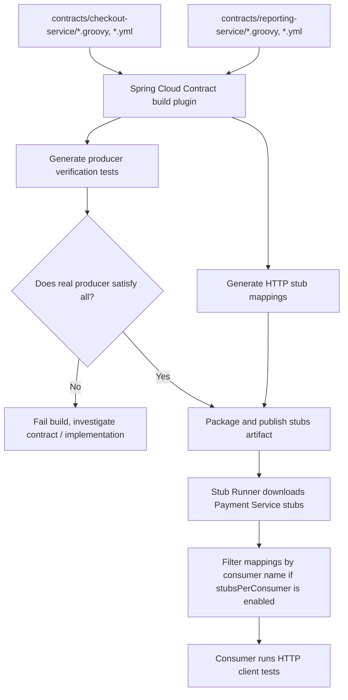
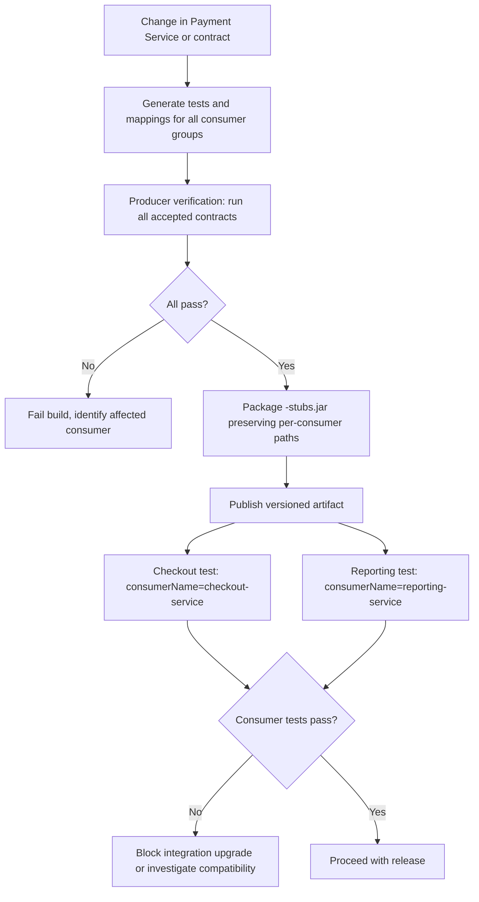

# Assigning Contracts to Specific Consumers

## 1. Why does a producer need to know which contract belongs to which consumer?

In a multi-service architecture, one **producer** often exposes HTTP APIs or messages to several **consumers**. For example, `Payment Service` supplies data to:

- `Checkout Service`: needs payment status to complete an order.
- `Reporting Service`: needs payment amount and currency to build reports.
- `Notification Service`: needs a payment-completed event to send notifications.

If all contracts and stubs sit together in a single flat folder, the team struggles to answer: **Which consumer depends on which field or behavior?** When an endpoint changes, assessing compatibility becomes difficult. Moreover, if multiple consumers have consumer-specific contracts loaded together into one stub server, identical or overlapping HTTP mappings can produce unpredictable outcomes.

**Spring Cloud Contract** supports organizing contracts under **consumer-named directories**. When stubs are generated and packaged, that directory structure can be preserved so **Stub Runner** selects only stubs belonging to the consuming application. The key feature is **`stubsPerConsumer`** (configured via `spring.cloud.contract.stubrunner.stubs-per-consumer`).

This lesson belongs to the **Stub Generation and Packaging** chapter and helps you:

1. Distinguish the roles of producer, consumer, contracts, and stub artifacts.
2. Organize contract files by consumer and understand **consumer name**.
3. Use `stubsPerConsumer`, `consumerName`, and `spring.application.name` properly.
4. Understand how contracts become producer tests and how mappings are packaged inside `-stubs.jar`.
5. Verify producer–consumer compatibility and avoid conflicting mappings.
6. Apply versioning, change reviews, and CI for consumer-driven contracts.

## 2. What does it mean for a contract to belong to a consumer?

A **consumer-driven contract** records what a specific consumer actually needs from a producer. When organized by directory:

```text
Payment Service (producer)
├── Checkout Service contracts
├── Reporting Service contracts
└── Notification Service contracts
```

Each group describes interactions important to that consumer. For instance, `Checkout Service` needs `GET /api/payments/42` returning status; `Reporting Service` needs a reporting endpoint; `Notification Service` needs the `PaymentCompleted` event.

**Assigning a consumer** is a way of **categorizing ownership of integration requirements**, not an authentication, authorization, or data-protection mechanism. A directory named `checkout-service` does **not** prove live network requests come from Checkout Service. Authentication and authorization must be handled separately at the application or infrastructure layer.

### 2.1. Three identifiers not to confuse

| Identifier | Example | Role |
| --- | --- | --- |
| **Producer artifact** | `com.example:payment-service:1.0.0` | Identifies the providing service and the stub artifact version |
| **Consumer name** | `checkout-service` | Selects the stub group meant for the consuming application |
| **Contract file name** | `payment_paid.groovy` | Distinguishes a specific communication scenario |

The consumer name does not replace the producer's `groupId`/`artifactId`. Conversely, `ids = "com.example:payment-service:..."` only identifies **which producer's stubs to download**, not who the current consumer is.

## 3. Organizing contracts in the producer repository

A clean layout:

```text
payment-service/
└── src/
    └── test/
        └── resources/
            └── contracts/
                ├── checkout-service/
                │   ├── payment_paid.groovy
                │   └── payment_not_found.yml
                ├── reporting-service/
                │   ├── payment_report.groovy
                │   └── daily_summary.yml
                └── notification-service/
                    └── payment_completed.groovy
```

**The consumer-named directory directly under `contracts`** is the most important element for stubs-per-consumer mode. You can subdivide further by business area:

```text
contracts/
  checkout-service/
    payments/
      payment_paid.groovy
      payment_not_found.yml
  reporting-service/
    daily/
      daily_summary.yml
```

Subfolders are internal organization; keep **a stable path segment identifying the consumer**, and verify packaging does not strip this directory level.

### 3.1. Intentional naming conventions

Standardize on clear rules:

- Use the exact same consumer name such as `checkout-service` across the contracts folder, application config, and tests.
- Do not mix `checkout`, `checkout-api`, and `CheckoutService` without an explicit mapping convention.
- Avoid generic directory names like `service` or `client` that are hard to distinguish when filtering paths.
- Do not name folders after an owning team if **the team name differs from the consumer application name**.
- When renaming a consumer, treat it as a stub configuration change impacting CI.

**Note on filtering logic:** Stub Runner traverses stub paths and picks mappings whose folder branch matches the consumer name. Never treat this as an ACL mechanism or rely on a filename accidentally containing a substring resembling the consumer. Verify which mappings are actually registered during test runs.

## 4. Two contract examples for two different consumers

### 4.1. Contract for `checkout-service`

File `contracts/checkout-service/payment_paid.groovy`:

```groovy
import org.springframework.cloud.contract.spec.Contract

Contract.make {
    description 'Checkout views completed payment status'

    request {
        method GET()
        url '/api/payments/42'
    }

    response {
        status OK()
        headers {
            contentType(applicationJson())
        }
        body(
            paymentId: 42,
            status: 'PAID'
        )
    }
}
```

The consumer needs to know whether payment has completed. Therefore the contract focuses on `paymentId`, `status`, HTTP status, and media type.

### 4.2. Contract for `reporting-service`

File `contracts/reporting-service/payment_report.groovy`:

```groovy
import org.springframework.cloud.contract.spec.Contract

Contract.make {
    description 'Reporting fetches payment report data'

    request {
        method GET()
        url '/api/payments/42/report'
    }

    response {
        status OK()
        headers {
            contentType(applicationJson())
        }
        body(
            paymentId: 42,
            amount: 125000,
            currency: 'VND'
        )
    }
}
```

Reporting cares about amount and currency. The two examples use **different HTTP paths** so interactions stay distinct, yet both are verified by the producer as obligations of `Payment Service`.

### 4.3. A consumer can also use YAML DSL

File `contracts/checkout-service/payment_not_found.yml`:

```yaml
description: Checkout receives 404 when payment does not exist
request:
  method: GET
  url: /api/payments/999
response:
  status: 404
  headers:
    Content-Type: application/json
  body:
    code: PAYMENT_NOT_FOUND
```

Having both Groovy and YAML DSL inside one consumer folder does not alter the consumer name. **File location** identifies the group; **DSL content** describes the interaction the producer must satisfy.

## 5. Flow from contract directories to the stub JAR

In a producer using Spring Cloud Contract, the overall flow is:



There are **two outcomes** to keep separate:

1. **Producer tests**: generated by Verifier from contracts to test the real implementation. The producer must still satisfy **all accepted contracts**, even if each consumer later uses only a subset of stubs.
2. **Stub mappings**: generated to simulate interactions for consumers. When filtering on the consumer side, Stub Runner registers only mappings belonging to **that consumer group** if configured properly.

`stubsPerConsumer` is primarily **an option when Stub Runner loads stubs**, not an instruction meaning "the producer only tests one consumer's contracts" or "each consumer automatically gets its own producer version".

## 6. Packaging structure inside `-stubs.jar`

Normally the plugin generates and packages contracts alongside stub mappings into an artifact with **`stubs` classifier**. For producer `com.example:payment-service:1.0.0`, the illustrative filename looks like:

```text
payment-service-1.0.0-stubs.jar
```

The logical structure inside the JAR can look like:

```text
META-INF/
  com.example/
    payment-service/
      1.0.0/
        contracts/
          checkout-service/
            payment_paid.groovy
            payment_not_found.yml
          reporting-service/
            payment_report.groovy
        mappings/
          checkout-service/
            payment_paid.json
            payment_not_found.json
          reporting-service/
            payment_report.json
```

**This is an illustrative layout diagram**, not a guarantee of exact JSON mapping filenames generated by the plugin. Filenames, subfolders, and layout details may differ by version, config, or contract source, yet what is essential for stubs-per-consumer is that **mappings retain a path branch identifying the consumer**.

| Logical path | Meaning |
| --- | --- |
| `META-INF/com.example/payment-service/1.0.0/` | Producer artifact namespace: group, artifact, version |
| `contracts/checkout-service/` | Contracts associated with Checkout Service |
| `mappings/checkout-service/` | HTTP stub mappings for Checkout Service |
| `contracts/reporting-service/` | Contracts associated with Reporting Service |
| `mappings/reporting-service/` | HTTP stub mappings for Reporting Service |

If a custom packaging configuration **flattens all mappings into a single folder**, consumer group info can be lost and filtering stops working as intended. Whenever customizing Maven Assembly or Gradle Jar tasks, inspect the actual artifact layout.

### 6.1. GAV, classifier, and consumer name

Do not confuse:

```text
com.example : payment-service : 1.0.0 : stubs
  groupId       artifactId     version  classifier
```

with:

```text
consumerName = checkout-service
```

Stub Runner **downloads the producer artifact** using Maven coordinates, then **filters mappings inside the artifact** by consumer name. There is no need to turn every consumer into a separate producer `artifactId` if you only want to select a stub group within the same JAR.

## 7. Enabling `stubsPerConsumer` on the consumer side

`stubs-per-consumer` is **not enabled by default**. When disabled, Stub Runner typically registers all available mappings for that producer; this can cause mappings with identical HTTP requests to collide or consumers to hit unrelated stubs.

### 7.1. Configuring via Spring Boot properties

Example for `Checkout Service`:

```yaml
spring:
  application:
    name: checkout-service
  cloud:
    contract:
      stubrunner:
        ids:
          - "com.example:payment-service:1.0.0:stubs:8090"
        stubs-mode: LOCAL
        stubs-per-consumer: true
```

Meaning:

- `spring.application.name: checkout-service`: application name used as the consumer name when not overridden.
- `ids`: `Payment Service`'s stub artifact; this example fixes WireMock port `8090` for readability.
- `stubs-mode: LOCAL`: searches for stubs only in local sources per Stub Runner rules; the matching artifact must be installed in the local Maven repository before running.
- `stubs-per-consumer: true`: registers only mappings belonging to the current consumer.

These properties must take effect in the consumer's **test context**. If the project uses multiple profiles or overrides properties via environment variables, verify the configuration actually loaded by Spring Boot.

### 7.2. Overriding the consumer name

`spring.application.name` does not always match the contracts directory name. For example, the main app might be named `checkout-api`, while the existing contracts group is named `checkout-service`.

Instead of renaming the production app, the consumer can override it:

```yaml
spring:
  application:
    name: checkout-api
  cloud:
    contract:
      stubrunner:
        consumer-name: checkout-service
        stubs-per-consumer: true
```

`consumer-name` is a setting used to **select the stub group**. It does not alter `spring.application.name`, nor does it change the artifact name or the app's network authentication identity.

### 7.3. Configuring via `@AutoConfigureStubRunner`

Example consumer test using Spring Boot:

```java
import org.junit.jupiter.api.Test;
import org.springframework.boot.test.context.SpringBootTest;
import org.springframework.cloud.contract.stubrunner.spring.AutoConfigureStubRunner;
import org.springframework.cloud.contract.stubrunner.spring.StubRunnerProperties;

@SpringBootTest
@AutoConfigureStubRunner(
    ids = "com.example:payment-service:1.0.0:stubs:8090",
    stubsMode = StubRunnerProperties.StubsMode.LOCAL,
    stubsPerConsumer = true,
    consumerName = "checkout-service"
)
class CheckoutPaymentClientContractTest {

    @Test
    void readsPaymentStatusFromStub() {
        // Call Checkout Service's real HTTP client against stub port 8090.
        // Verify JSON status = PAID and consumer DTO mapping.
    }
}
```

This test is a **skeleton**; you still need HTTP client URL configuration, the Stub Runner dependency, and assertions. Creating only the test class and annotation is insufficient to verify consumer logic if the test body never executes the HTTP client.

`consumerName` in the annotation can be omitted if `spring.application.name` already matches. Setting it explicitly keeps tests stable even if the app name outside tests changes.

## 8. Verifying that only the right stub group is registered

Do not stop once the test starts. Verify filtering rules with both **positive and negative** cases:

| Consumer running tests | Mappings that should exist | Mappings that should be absent when filtered |
| --- | --- | --- |
| `checkout-service` | `/api/payments/42`, `/api/payments/999` | `/api/payments/42/report` belonging only to `reporting-service` |
| `reporting-service` | `/api/payments/42/report` | Scenarios meant solely for Checkout |
| `notification-service` | Message/HTTP stubs belonging to that group | Interactions belonging to other consumers |

**Practical verification steps:**

1. Inspect the effective consumer name configuration.
2. Ensure the stub artifact is fetched at the right version.
3. Inspect which mappings Stub Runner registered (via diagnostic logs or mapping export options per version).
4. Send requests belonging to the consumer and verify expected responses.
5. Send requests belonging solely to another consumer and verify they are **not mistakenly matched by another group's mapping**.

When a request matches no mapping, WireMock may return an error/default response depending on config; never treat a specific WireMock status code as a producer API business contract. What you want to prove is that **out-of-group mappings are neither registered nor used**.

### 8.1. Distinguishing missing stubs from producer `404` responses

If the stub server returns HTTP `404`, two completely different causes are possible:

- **Intentional contract:** the request matched `payment_not_found.yml` and the stub returned `404` with `code: PAYMENT_NOT_FOUND`.
- **Unmatched stub:** no mapping matched the request because the consumer name is wrong, URL/headers differ, or the artifact does not contain that interaction yet.

Inspect response body/headers and WireMock match logs before concluding the producer returned a business error.

## 9. Same endpoint, different responses expected by different consumers

One motivation for stubs-per-consumer is **avoiding simultaneous registration of multiple consumer-specific stubs** that could match the same request.

Suppose two teams both test:

```http
GET /api/payments/42
```

Yet each team defines a different stub response. If all mappings register on the same WireMock server, ordering or priority can cause tests to receive unexpected responses. With stubs-per-consumer enabled, each consumer sees only mappings defined by its own group.

**Crucial limitation:** A real producer **cannot magically return two contradictory responses for the exact same HTTP request**. Separating mappings only isolates mock data inside consumer tests; it does not change producer behavior or automatically "identify the consumer".

There are three better design approaches:

1. **One shared response** satisfying both consumers' needs (containing enough fields for all groups under compatibility policies).
2. **Published request differentiation**, such as distinct paths, queries, or `Accept` media types, so the producer knows which variant to serve.
3. **Explicit API versioning** when two interfaces truly cannot stay compatible.

Never resolve business conflicts merely by toggling `stubsPerConsumer` while ignoring whether producer verification can actually pass **all contracts**.

### 9.1. Example differentiating requests by media type

Consumer A might request:

```http
GET /api/payments/42
Accept: application/vnd.example.payment.checkout+json
```

Consumer B requests:

```http
GET /api/payments/42
Accept: application/vnd.example.payment.reporting+json
```

If the producer **genuinely implements content negotiation** and publishes these two media types, returning different responses is valid because the requests differ. Never invent a fake `X-Consumer-Name` header just to make WireMock pick a mapping and treat it as authentication or good contract design if the producer does not actually use that header.

## 10. Consumer ownership does not mean the producer tests only one consumer

Files under `checkout-service`, `reporting-service`, and `notification-service` are **all commitments of Payment Service** once accepted into the producer's contract sources.

In producer CI:

- Generated tests must verify declared interactions for **all consumers with accepted contracts**.
- If a change removes `status` and breaks Checkout, the producer build must surface the incompatible change.
- If a change breaks Reporting's report payload, tests in the Reporting group must fail too.
- Consumer tests with `stubsPerConsumer` do not verify current producer code by themselves; they only exercise packaged stub artifacts.

Thus, a major benefit of grouping contracts by consumer is **change-impact traceability**. When a producer wants to drop a field or endpoint, it can see which consumer contract groups protect it and coordinate with those consumers.

### 10.1. Consumer-owned contracts still require review

A practical consumer-driven contract workflow:

1. The consumer describes a needed interaction and submits a contract change.
2. The producer confirms the API can fulfill it; if not, both teams agree on a plan.
3. The producer runs generated contract tests. If tests fail, the implementation or contract is adjusted properly.
4. Once verification passes, the producer publishes the stub artifact.
5. The consumer tests against the verified stub and upgrades its integration by version.

Putting a contract in a consumer folder does not automatically grant the consumer permission to alter the producer API without review. **Technical agreement and implementation ownership** still require collaboration between both teams.

## 11. Generating and packaging stubs in Maven

A producer Maven plugin snippet might look like:

```xml
<plugin>
    <groupId>org.springframework.cloud</groupId>
    <artifactId>spring-cloud-contract-maven-plugin</artifactId>
    <version>${spring-cloud-contract.version}</version>
    <extensions>true</extensions>
    <configuration>
        <testFramework>JUNIT5</testFramework>
        <testMode>MOCKMVC</testMode>
        <baseClassForTests>com.example.payment.contract.PaymentContractBase</baseClassForTests>
    </configuration>
</plugin>
```

In `pom.xml`, `${spring-cloud-contract.version}` must be explicitly defined and compatible with Spring Cloud Contract Verifier/Stub Runner dependencies. A BOM manages **dependency versions**, not necessarily every Maven plugin version.

When contracts reside under default or configured paths, the plugin generates tests and stub mappings, then packages the `stubs` classifier artifact during the appropriate lifecycle phase. Inspect your project's actual plugin config and goals; never assume a contract file produces a JAR automatically unless the plugin is wired into the build.

Illustrative commands to run in a **real project**:

```bash
./mvnw clean verify
./mvnw install
```

`verify` must execute producer contract tests, while `install` places artifacts into the local Maven repository when the build is properly configured. These commands are for practical guidance and **were not executed while writing this lesson**.

## 12. Packaging in Gradle and publishing artifacts

With the Spring Cloud Contract Gradle plugin, projects use tasks to generate and package stubs. In modern versions, `verifierStubsJar` can be added to a Maven publication:

```groovy
plugins {
    id 'maven-publish'
    // Spring Cloud Contract Gradle plugin must be applied
    // with a version compatible with Spring Boot / Spring Cloud.
}

publishing {
    publications {
        maven(MavenPublication) {
            // Other project artifacts configured as needed.
            artifact verifierStubsJar
        }
    }
}
```

This is an **example snippet**, not a complete `build.gradle`. The producer still needs dependencies, the Spring Cloud Contract plugin, test base configuration, and repository info.

**Never assume "packaging per consumer" requires building a separate JAR for every consumer.** In the standard model, the producer publishes **one** stub artifact holding multiple mapping groups; Stub Runner filters the right group when a consumer loads it. Separate artifacts are an alternative operational choice, not a requirement of `stubsPerConsumer`.

### 12.1. Preserving directory structure when customizing packaging

If you customize Jar/Assembly packaging, check that:

- The artifact keeps `META-INF/<groupId>/<artifactId>/<version>/...` per Stub Runner conventions.
- Both `contracts` and `mappings` exist as needed by your project's stub resolution method.
- Mappings reside in branches matching the consumer names.
- Downloaded artifact classifier, version, `groupId`, and `artifactId` match consumer tests.
- No mappings from another consumer get mixed into a consumer's branch through manual copying.

Do not merely check that `payment-service-1.0.0-stubs.jar` exists. The JAR can **omit the exact mappings** Stub Runner needs even though the archive built cleanly.

## 13. When contracts live in a shared repository, where does the consumer go?

Not every organization stores contracts inside the producer's source repository. Another model is a shared repository holding contracts for multiple producers.

Example:

```text
contracts-repository/
└── src/
    └── main/
        └── resources/
            └── contracts/
                ├── payment-service/
                │   ├── checkout-service/
                │   │   └── payment_paid.groovy
                │   └── reporting-service/
                │       └── payment_report.groovy
                └── order-service/
                    └── inventory-service/
                        └── order_created.groovy
```

Here **two identifier levels** are required:

1. **Producer**: `payment-service` or `order-service`, so builds find the right group of contracts for the providing service.
2. **Consumer**: `checkout-service`, `reporting-service`, `inventory-service`, to categorize integration needs and filter stubs.

Depending on storage mode (Maven artifact, Git/SCM, or custom repository), plugin settings such as `contractsPath`, `contractsMode`, `contractsRepositoryUrl`, artifact group, and paths must be tuned to **the repository model**. Never copy `src/test/resources/contracts` straight from a producer repo setup to a shared repository setup if actual paths differ.

**Invariant rule:** Once contracts are fetched for a producer, the consumer group layout must remain recognizable so stub generation/packaging supports `stubsPerConsumer`.

## 14. How do HTTP stubs and messaging stubs differ when scoped by consumer?

For example, `Notification Service` needs a payment-completed event. The contract sits at:

```text
contracts/notification-service/payment_completed.groovy
```

A simple Groovy contract:

```groovy
import org.springframework.cloud.contract.spec.Contract

Contract.make {
    description 'Notification receives payment completed event'
    label 'payment_completed'

    input {
        triggeredBy('completePaymentAndPublish()')
    }

    outputMessage {
        sentTo('payments.completed')
        body(
            eventType: 'PaymentCompleted',
            paymentId: 42,
            status: 'PAID'
        )
        headers {
            header('eventType', 'PaymentCompleted')
        }
    }
}
```

Producer verification requires a test base class with a `completePaymentAndPublish()` method that actually triggers the publisher alongside a configured message verifier/binder. On the consumer side, Stub Runner works with `StubTrigger`/bindings as supported to receive sample events.

Key points:

- For **HTTP**, stubs-per-consumer filters WireMock request/response mappings by consumer directory.
- For **messaging**, triggering, labels, and binder/transport integration also depend on Stub Runner config and framework version.
- Never assume enabling `stubsPerConsumer` for HTTP automatically validates Kafka/RabbitMQ ACLs, retries, or consumer handling.

For real message brokers, grouping contracts by consumer aids schema traceability, yet **topic subscription permissions and live routing** still must be managed in infrastructure.

## 15. Versioning: managing consumer-specific contracts over time

A stub artifact carries the **producer's** version:

```text
com.example:payment-service:1.0.0:stubs
```

A consumer can run integration tests against `1.0.0` while the producer's development branch evolves. Pin versions explicitly in CI; avoid defaulting to `+` or `latest` when reproducible builds are needed.

| Change | What to check |
| --- | --- |
| Producer adds an optional response field | Does the consumer ignore unknown fields; are assertions overly strict? |
| Producer deletes `status` | Does the `checkout-service` contract break? |
| Reporting needs a new endpoint | Add a contract under `reporting-service`, verify implementation |
| Consumer renames its application | Update consumer name or override so mappings are not lost |
| Incompatible API change | Coordinate versioning/migration with affected consumers |
| Upgrading Spring Cloud Contract version | Check DSL syntax, plugin, mappings, and Stub Runner filtering |

A message's `schemaVersion`, the producer artifact version, and **consumer name** are three independent concepts. Never change the consumer name on each release when the goal is merely bumping Payment Service's version.

## 16. CI testing across multiple consumers

A sample pipeline:



Worthwhile quality controls:

1. **Verify contract completeness:** every critical consumer group has contract files and corresponding tests.
2. **Run producer contract tests before publishing stubs:** never treat generated stubs as proof that the producer satisfies the API.
3. **Inspect the artifact:** confirm `contracts` and `mappings` exist in proper paths without losing consumer branches.
4. **Run at least one test per consumer name:** verify in-group mappings load and out-of-group mappings are excluded.
5. **Check executed test counts:** green CI when all generated tests were skipped offers zero protection.
6. **Pin artifact versions:** each consumer runs against a recorded stub version to avoid uncontrolled drift.
7. **Guard compatibility changes:** review contracts with affected consumers and plan migrations for breaking changes.

If there are dozens of consumers, you can build a per-consumer CI matrix; yet still ensure **every accepted producer contract is verified** inside the producer's pipeline.

## 17. Common errors

| Symptom | Possible cause | Resolution |
| --- | --- | --- |
| Checkout test downloads JAR yet finds no matching stub | Consumer name differs from directory name | Check `spring.application.name`, `consumer-name`, and mapping paths |
| Stub Runner registers every mapping | `stubs-per-consumer` not enabled | Set `true` and verify the property is active |
| Test receives another consumer's response | Conflicting mappings, misfiltering, or lost artifact structure | Inspect registered mappings and JAR layout |
| HTTP request fails to match stub | URL, method, query, headers, or body differ | Inspect WireMock diagnostics/near-misses |
| Stub `404` confused with business error | Unclear which mapping matched | Inspect body/headers/logs and matching mapping |
| Producer test passes yet consumer fails | Consumer picks wrong version/stub or client uses different interface | Check artifact version, actual request, and consumer name |
| Consumer test passes yet producer is incompatible | Running against stale stub or skipped producer tests | Run producer verification against current code/version |
| `-stubs.jar` exists yet filtering fails | Custom packaging flattened mappings directory | Preserve `mappings/<consumer>/...` layout |
| Same HTTP request has contradictory expected responses | Contracts do not reflect a single unified API | Design shared response, differentiating request condition, or API version |
| Renaming consumer folder breaks CI | Group name mismatches runtime consumer name | Align names or configure explicit override |

### 17.1. Never "fix" errors by disabling filtering

When a consumer cannot find a mapping, setting `stubsPerConsumer = false` may make one test temporarily green while dumping every other mapping into the stub server and hiding misconfiguration. Find the root cause: consumer name, source contracts, artifact version, or mapping path.

### 17.2. Never "fix" errors by arbitrarily altering stub responses

When a consumer fails to handle a sample response, distinguish:

- Stub fixture has unrealistic values even though the API remains compatible.
- Consumer fails to handle the agreed schema.
- Real producer changed the API and the contract must be renegotiated.

Never edit a contract just to make tests pass if doing so drops a commitment consumers depend on.

## 18. Exercise: grouping for three consumers

Suppose `Shipping Service` is the producer for:

- `storefront-service`: calls `GET /api/shipments/12` and needs `status`.
- `warehouse-service`: calls `GET /api/shipments/12/labels` and needs a list of labels.
- `analytics-service`: calls `GET /api/shipments/12/metrics` and needs estimated delivery time.

### Tasks

1. Propose a `src/test/resources/contracts` structure with clear grouping.
2. Write a YAML contract for `storefront-service` returning `200` and `{"shipmentId":12,"status":"IN_TRANSIT"}`.
3. Write a Stub Runner test configuration for `warehouse-service` with `stubsPerConsumer=true`.
4. Explain why `ids` must point to **Shipping Service** rather than `warehouse-service`.
5. If `analytics-service` uses `spring.application.name=analytics-api`, how do you make Stub Runner load the `analytics-service` group?
6. If the producer removes `status`, how do you know which consumer is at risk?

### Suggested structure

```text
src/test/resources/contracts/
  storefront-service/
    get_shipment.yml
  warehouse-service/
    get_labels.groovy
  analytics-service/
    get_metrics.yml
```

### Suggested YAML contract

```yaml
description: Storefront views shipment status
request:
  method: GET
  url: /api/shipments/12
response:
  status: 200
  headers:
    Content-Type: application/json
  body:
    shipmentId: 12
    status: IN_TRANSIT
```

### Suggested Stub Runner config

```java
@SpringBootTest
@AutoConfigureStubRunner(
    ids = "com.example:shipping-service:1.0.0:stubs:8091",
    stubsMode = StubRunnerProperties.StubsMode.LOCAL,
    stubsPerConsumer = true,
    consumerName = "warehouse-service"
)
class WarehouseShippingClientTest {
    // Call real client and verify labels content.
}
```

This is an **illustrative code skeleton**. A real test needs imports and HTTP client setup pointing to Stub Runner. `ids` points to the producer's artifact because the producer publishes stubs; `consumerName` picks the group folder to use. For Analytics, set `spring.cloud.contract.stubrunner.consumer-name=analytics-service` without renaming the production app. When the producer removes `status`, the generated test under `storefront-service` reveals which obligation broke—provided that assertion is declared and the test actually executes.

## 19. Checklist before merging or releasing

- Does every critical consumer have a stable, distinct directory name?
- Are consumer folders preserved in both contract sources and the stub artifact's `mappings` structure?
- Do `ids` point to the right producer artifact and `stubs` classifier with a reproducible version?
- Is `stubsPerConsumer` enabled in consumer tests that require stub filtering?
- Does `consumerName` or `spring.application.name` match the directory name exactly?
- Are mappings sharing method/URL checked against conflicts and contradictory behavior?
- Does producer CI run all accepted contracts rather than only one consumer's contracts?
- Do consumer tests verify both in-group mappings and exclusion of other groups?
- Does CI publish stubs only after producer verification passes, recording artifact versions?
- When removing/modifying fields or endpoints, are affected consumers identified with a compatibility plan?

**Official references:**

- [Spring Cloud Contract — Consumer-Driven Contracts: Stubs Per Consumer](https://docs.spring.io/spring-cloud-contract/reference/project-features-stubrunner/stub-runner-stubs-per-consumer.html).
- [Spring Cloud Contract — Stub Runner Core](https://docs.spring.io/spring-cloud-contract/reference/project-features-stubrunner/stub-runner-core.html).
- [Spring Cloud Contract — Publishing Stubs as JARs](https://docs.spring.io/spring-cloud-contract/reference/project-features-stubrunner/stub-runner-publishing-stubs-as-jars.html).
- [Spring Cloud Contract — Gradle Project](https://docs.spring.io/spring-cloud-contract/reference/gradle-project.html).

**Remember:** In Spring Cloud Contract, **assigning contracts to specific consumers is primarily done by organizing folders by consumer name**. The producer must still verify every committed contract and publish its versioned stub artifact. Consumers enable `stubsPerConsumer` and use `spring.application.name` or `consumerName` so Stub Runner registers only the right mapping group. This isolates stubs, aids dependency traceability, and reduces collisions—yet **never permits a producer to break HTTP commitments or ignore remaining consumers**.
