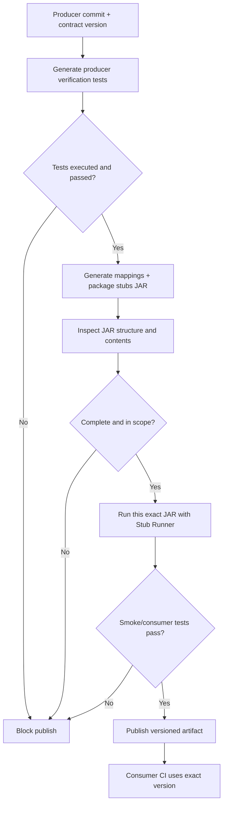

# Inspecting Stub Package Contents Before Publishing

## 1. Why a green build is not enough to publish a stub

A system has `checkout-service` (consumer) calling `payment-service` (producer) to look up or create payments. Both teams describe HTTP behavior via **Spring Cloud Contract** using **Groovy/YAML DSL**. Spring Cloud Contract Verifier generates tests to verify the producer; then the build packages **stubs** for Checkout to use via **Stub Runner** and runs these steps in CI.

The problem is that a succeeding build command **does not automatically guarantee the stub package contains the verified behaviors**. Some examples:

- The contract for `PAY-1001` requires returning `PAID`, yet the artifact about to be published still holds an old mapping returning `PENDING`.
- The `.jar` file has the right name yet contains zero HTTP mappings due to misconfigured contract sources or filters.
- The package has a mapping using `bodyFileName` yet omits the corresponding body file; the stub only fails when called by the consumer.
- The producer verified the HTTP group, yet the published package includes a messaging contract marked `inProgress` with no producer verification.
- The artifact sits under the wrong `groupId/artifactId/version`, preventing Stub Runner from finding mappings even though the JAR exists.
- Stub payloads contain real emails, tokens, or payment details that must never be distributed to other consumers.

Therefore, before **publishing** stubs to a Maven repository, Artifactory/Nexus, or SCM repository, inspect **the actual contents of the final artifact**, not merely filenames or JAR-creation status.

**Lesson objectives:**

1. Distinguish source contracts, generated producer tests, generated mappings, stub JARs, and published artifacts.
2. Recognize the stub package structure used by Spring Cloud Contract / Stub Runner.
3. Inspect request matchers, HTTP responses, body files, messaging contracts, and metadata/versions inside the JAR.
4. Use Stub Runner to run **the exact JAR intended for publication**, execute smoke/consumer tests, and check invalid-request handling.
5. Configure CI release gates to block missing, wrong, stale, unverified, or sensitive-data-bearing packages.

## 2. Distinguishing the five outputs of the workflow

| Component | Contents | Where it is used |
| --- | --- | --- |
| **Source contracts** | Groovy/YAML DSL defining HTTP or messaging. | Producer repo or shared contract repo. |
| **Generated producer tests** | Tests generated by Verifier from contracts. | Executed against real producer code to verify committed behavior. |
| **Generated stubs/mappings** | Definitions understood by stub runtimes, typically **WireMock JSON mappings** for HTTP. | Input for packaging stubs. |
| **Stub artifact** | JAR with `classifier=stubs` or another archive format holding stub definitions. | Loaded or scanned by Stub Runner to simulate the producer for consumers. |
| **Published artifact** | Artifact stored in a repository with fixed coordinates/version and access control. | Selected by consumer CI for testing. |

One contract source can generate one or more test/stub components depending on DSL and version; **never assume one contract file = one test method = one mapping JSON**. In particular, messaging contracts are used by Stub Runner to trigger messages; not every behavior turns into an ordinary HTTP mapping.

What must be guaranteed is **traceability**:



**Never publish from a hand-edited temporary mappings directory**, and then hand a different JAR to consumers. What is inspected prior to publishing must be the exact same bytes being published, or you must verify post-publish artifact content matches identically.

## 3. Common standard stub JAR layout

Per Spring Cloud Contract Stub Runner documentation, a layout scannable from the classpath is:

```text
payment-service-1.4.2-stubs.jar
└── META-INF/
    └── com.example/
        └── payment-service/
            └── 1.4.2/
                ├── contracts/
                │   ├── http/
                │   │   ├── get-paid-payment.groovy
                │   │   └── create-payment.yml
                │   └── messaging/
                │       └── payment-captured.groovy
                └── mappings/
                    └── http/
                        ├── get-paid-payment.json
                        └── create-payment.json
```

This is an **illustrative tree**, not the structure of a real generated JAR. Filenames, sub-branches, and whether both Groovy and YAML are kept depend on packaging setup. General meaning:

- `META-INF/com.example/payment-service/1.4.2/` binds definitions to **groupId**, **artifactId**, and **version**.
- `contracts/` holds source contracts (useful for messaging and lookup). Keep the exact contract revision verified by the producer.
- `mappings/` holds HTTP stub definitions converted from the DSL.
- When mappings reference bodies or external resources, the artifact must hold those resources where **the runtime actually reads them**.

The example path keeps dots in `com.example` matching Stub Runner's `META-INF/<groupId>/<artifactId>/<version>` structure examples; do not convert it to `com/example` if your loader expects a directory named `com.example`. With custom loading setups, Gradle/Maven plugins may emit different layouts; **verify against your Spring Cloud Contract version and Stub Runner mechanism**.

Cross-check against artifact coordinates:

```text
groupId    = com.example
artifactId = payment-service
version    = 1.4.2
classifier = stubs
type       = jar

Example Maven filename:
payment-service-1.4.2-stubs.jar

Example Stub Runner ID:
com.example:payment-service:1.4.2:stubs
```

If an artifact is mistakenly published with `classifier=sources` or a different version, consumers may fail to fetch **the right stub**. Conversely, having the right JAR filename does not prove its contents sit in a scannable layout.

## 4. From HTTP contract to mapping in the package

Consider Checkout looking up a payment:

```http
GET /api/payments/PAY-1001 HTTP/1.1
Accept: application/json
```

Producer commits to:

```json
{
  "paymentId": "PAY-1001",
  "orderId": "ORD-2001",
  "status": "PAID",
  "amount": 250000,
  "currency": "VND"
}
```

### 4.1. Source Groovy contract

```groovy
import org.springframework.cloud.contract.spec.Contract

Contract.make {
    name 'get_paid_payment'

    request {
        method 'GET'
        urlPath '/api/payments/PAY-1001'
        headers {
            header 'Accept': 'application/json'
        }
    }

    response {
        status 200
        headers {
            contentType(applicationJson())
        }
        body([
            paymentId: 'PAY-1001',
            orderId: 'ORD-2001',
            status: 'PAID',
            amount: 250000,
            currency: 'VND'
        ])
    }
}
```

### 4.2. What might the mapping JSON look like?

An **illustrative** WireMock mapping example simplified to highlight structure; do not treat it as byte-for-byte output across all generator versions:

```json
{
  "request": {
    "method": "GET",
    "urlPath": "/api/payments/PAY-1001",
    "headers": {
      "Accept": {
        "equalTo": "application/json"
      }
    }
  },
  "response": {
    "status": 200,
    "headers": {
      "Content-Type": "application/json"
    },
    "jsonBody": {
      "paymentId": "PAY-1001",
      "orderId": "ORD-2001",
      "status": "PAID",
      "amount": 250000,
      "currency": "VND"
    }
  }
}
```

Generated mappings can represent bodies with `body`, `jsonBody`, `base64Body`, `bodyFileName`, or other variants depending on conversion and content type. **Do not force CI to accept only one serialization form** if they are semantically equivalent. What is mandatory is that WireMock/Stub Runner loads it and responds accurately.

A reviewer should verify:

1. `request.method` is `GET`, not accidentally `POST`.
2. `request.urlPath` is accurate; no staging host or port is baked into the mapping.
3. Header and query matchers are strict enough to distinguish semantically different requests.
4. `response.status` is `200` and `Content-Type` is JSON.
5. The body contains `paymentId`, `orderId`, `status`, `amount`, and `currency` with the right types and business values.
6. The mapping does not accidentally match every path/ID via a `.*` regex.

### Watch out for query parameters and matchers

Another contract for listing transactions requires:

```text
GET /api/payments?status=PAID&limit=20
```

When using `urlPath('/api/payments')` and `queryParameters` in Groovy DSL, the generated mapping must reflect conditions on `status` and `limit`. If the mapping leaves only `"urlPath": "/api/payments"` without query constraints, the stub can return `PAID` data even for `status=PENDING` requests, masking consumer bugs.

Similarly, regexes for dynamic IDs can be valid, yet need clear bounds. `PAY-[0-9]{4}` differs from `.*`. If the stub accepts many `orderId`s while its body always returns `ORD-2001`, verify whether **request echoing** or separate scenarios are needed; a syntactically valid mapping JSON can still be wrong semantically.

## 5. Inspecting the JAR with JDK tools

With a JDK installed, `jar tf` lists JAR entry names **without extracting**. In the Maven example, the artifact has an assumed name:

```bash
./mvnw -B clean verify

jar tf target/payment-service-1.4.2-stubs.jar
```

The first command assumes the project configures the Maven plugin and lifecycle to generate/run producer tests and build the JAR; the second JAR path must be **replaced with the actual build output**—never guess filenames if `classifier`, `finalName`, or plugins are customized. Check `target/` to confirm the exact file.

When listing, look for entries matching the layout:

```text
META-INF/com.example/payment-service/1.4.2/contracts/...
META-INF/com.example/payment-service/1.4.2/mappings/...
```

Never run only `jar tf` and conclude "the JAR is good". That only checks **the file listing** and does not verify:

- Whether JSON inside mappings is valid.
- Whether mappings match the agreed requests/responses.
- Whether referenced body files can be found when stubs run.
- Whether messaging contracts have the right labels/destinations.
- Whether the artifact came from a producer commit that passed verification.

### Inspecting contents without modifying the original JAR

One option is extracting **into a clean temporary inspection directory** and opening mappings/contracts:

```bash
mkdir stub-inspection
cd stub-inspection
jar xf ../target/payment-service-1.4.2-stubs.jar

# Then inspect files inside META-INF/.../mappings/
# and META-INF/.../contracts/ with an editor or JSON tool.
```

These commands illustrate a Unix-compatible shell; in PowerShell, create the folder with `New-Item -ItemType Directory` and run `jar xf` with the corresponding path. **Never extract over the project's source tree** or delete unrelated directories on name collisions. In pipelines, create a dedicated temporary workspace, clean it up with the build lifecycle, and inspect only entries belonging to the candidate artifact.

For untrusted JARs, never execute embedded code; inspect unusual entry names, `../` traversal paths, or policy-violating contents. A JAR is a ZIP archive: for programmatic checks, use `java.util.zip.ZipFile` to read directly without extracting.

## 6. Automated checks over JAR entry listings

A simple gate can use Java to verify **at least one HTTP mapping exists** and paths fall under the expected namespace. Condensed example:

```java
import java.nio.file.Path;
import java.util.zip.ZipFile;

public class StubJarStructureCheck {
    public static void main(String[] args) throws Exception {
        Path jar = Path.of(args[0]);
        String prefix =
            "META-INF/com.example/payment-service/1.4.2/";

        try (ZipFile zip = new ZipFile(jar.toFile())) {
            long mappingCount = zip.stream()
                .filter(e -> !e.isDirectory())
                .filter(e -> e.getName().startsWith(
                    prefix + "mappings/"))
                .filter(e -> e.getName().endsWith(".json"))
                .count();

            if (mappingCount == 0) {
                throw new IllegalStateException(
                    "Stub JAR has no HTTP mapping"
                );
            }

            System.out.println("HTTP mappings: " + mappingCount);
        }
    }
}
```

This is **illustrative code**, not a utility pre-installed in the repository. It assumes the producer **must have HTTP mappings**; do not apply this criterion to reject an artifact containing **only messaging contracts**. Input `args[0]` is the path to the JAR to inspect; real CI must validate arguments, metadata, and I/O errors.

A more reliable gate needs an **expected scope manifest** from build config or release policy (e.g., requiring `get_paid_payment`, `create_payment`, `payment_captured_event`). Avoid relying on a hardcoded count when contracts evolve:

- When adding a reviewed contract, update expectations in a controlled change.
- When removing a contract still used by a consumer, the release gate must detect the scope reduction.
- Do not require mapping JSON count to equal contract file count in every situation; rely on **the expected behavior inventory** and generator outputs.

## 7. Inspecting HTTP mappings semantically

Beyond valid JSON syntax, each mapping must be checked behaviorally. Checklist:

| Item | Correct | Risk when wrong |
| --- | --- | --- |
| Method | `GET /api/payments/{id}` or `POST /api/payments` matching API. | Stub accepts wrong request method or misses endpoint. |
| URL path | Right path without hardcoding CI hostnames. | Consumer calling real relative path fails to match. |
| Query parameters | Conditions present for business-significant queries. | `status=PENDING` receives `PAID`'s response. |
| Headers | `Content-Type`, `Accept`, version headers if actually committed. | Client sends wrong MIME yet stub succeeds. |
| Request body | `orderId`, `amount`, `currency`, and properly scoped matchers. | Stub accepts bad data while consumer tests stay green. |
| Response status | Distinguishes `200`, `201`, `204`, `400`, `409`, `503` per API. | Consumer takes the wrong branch. |
| Response body | Right fields, types, and business status codes. | Client fails parsing or mishandles transactions. |
| Response headers | `Content-Type`, `Location`, `Retry-After` if agreed. | Consumer lacks info needed to continue workflow. |
| Dynamic values | Stub uses stable samples; producer matchers are strict enough. | Stub holds sloppy regexes or tests miss bugs. |

**Negative test example:** the stub for `GET /api/payments/PAY-1001` must return the right response when the consumer calls `PAY-1001`, yet must not accidentally return the same data for `PAY-9999` if no contract authorizes it.

If WireMock returns `404` because **no mapping exists**, that is the **stub server's** response, not automatic proof that the real producer commits to `404 PAYMENT_NOT_FOUND`. To test producer business error behavior, write a separate `404` contract verified against real producer code.

### Matchers too broad or too strict

A mapping with `"urlPathPattern": ".*"` can match many unintended endpoints. A mapping requiring an exact request ID header `REQ-ABC12345` when consumers are allowed to generate other IDs is overly strict. When reviewing artifacts, compare value pairs:

- **Consumer-side request:** condition the stub accepts; may be a valid regex.
- **Producer-side request:** concrete value sent by generated producer tests.
- **Consumer-side response:** sample data returned by the stub; should be stable.
- **Producer-side response:** assertion checked by generated producer tests against the real response.

This is Spring Cloud Contract's two-sided value rule. When converting DSL to mappings, consumer-side values must be reflected accurately in the stub; looking solely at producer tests does not guarantee mappings are right.

## 8. Body files and accompanying resources

Contracts sometimes use external JSON files or binary payloads:

```groovy
response {
    status 200
    headers {
        contentType(applicationJson())
    }
    body(file("payment-response.json"))
}
```

Or in another case:

```groovy
response {
    status 200
    headers {
        contentType(applicationOctetStream())
    }
    body(fileAsBytes("receipt.pdf"))
}
```

Paths in **Groovy DSL** are relative to the contract file. The generator may inline contents directly into mappings (text/JSON/Base64) or place them in separate resources depending on body type and config. **Never claim every `file(...)` generates `bodyFileName`**, nor assume every mapping is independent of external files.

When a WireMock mapping contains:

```json
{
  "response": {
    "status": 200,
    "bodyFileName": "payloads/payment-response.json"
  }
}
```

the runtime must locate that body file relative to **WireMock's file root** or the resolver configured by Stub Runner. In standalone WireMock, `bodyFileName` typically resolves under `__files` of the file root; with stub JARs and Spring Cloud Contract, layouts/loaders may be customized. Verify the file **actually sits inside the artifact where the loader reads it**. If missing, the JAR may still be a valid ZIP archive while the stub fails to respond.

### Checks for binary payloads

For PDFs, images, or `application/octet-stream`:

1. `Content-Type` header must match the API.
2. Data must remain raw bytes; never accidentally convert a PDF into a UTF-8 or JSON string.
3. Stub runtime must return the expected byte length/hash if committed.
4. Fixture files must contain zero real customer data, passwords, or confidential internal documents.
5. If payloads carry varying metadata (timestamps, UUIDs), specify which bytes are fixed and which properties may vary.

When verifying body files, **never use `grep` for a few keywords in place of byte comparison** if binary integrity is the goal. Compute checksums on the sample file and the response bytes returned by Stub Runner to verify integrity.

## 9. Messaging contracts must also be inspected

The producer may emit `PaymentCaptured` to destination `payments.captured`, and Fulfillment uses Stub Runner to test consumption.

Groovy example:

```groovy
import org.springframework.cloud.contract.spec.Contract

Contract.make {
    name 'payment_captured_event'
    label 'payment_captured_1001'

    input {
        triggeredBy('emitPaymentCaptured()')
    }

    outputMessage {
        sentTo('payments.captured')
        body([
            eventId: 'EVT-1001',
            eventType: 'PaymentCaptured',
            paymentId: 'PAY-1001',
            orderId: 'ORD-2001',
            amount: 250000,
            currency: 'VND'
        ])
        headers {
            messagingContentType(applicationJson())
        }
    }
}
```

Before publishing, verify:

- The messaging contract is defined and its `label` matches what Stub Runner uses when triggering messages.
- `sentTo('payments.captured')` matches the destination the consumer binds to.
- Payload schema has exact `eventType`, `paymentId`, `orderId`, `amount`, and `currency`.
- The contract ran **producer verification** against real code via the appropriate Spring Cloud Stream/messaging verifier; not just an unverified stub.
- If the producer uses `Supplier`, `Function`, `Consumer`, or `StreamBridge`, the test binder/adapter is configured for your **supported version**.

A stub package with only HTTP mappings **does not prove** messaging contracts were packaged and can trigger. Conversely, an artifact with only messaging contracts may have **zero HTTP mappings** yet remain completely valid for its purpose.

### Contracts marked `inProgress`

Spring Cloud Contract supports `inProgress()` (Groovy) or equivalent flags when supported by the version. Such a contract **can generate stubs without generating producer verification tests**. The package still has "all files" yet offers zero proof the producer implements the behavior.

For official release channels, enforce a policy blocking unverified contracts or clearly publishing them solely as experimental development stubs. **Never call an `inProgress` stub a verified stub** just because the JAR packaged cleanly.

## 10. Maven: building packages and inspecting before publish

With the Spring Cloud Contract Maven plugin, the typical flow is:

```text
Read Groovy/YAML DSL
   -> generateTests
   -> run producer verification tests
   -> convert/generate stubs
   -> create stubs JAR with stubs classifier
   -> inspect artifact
   -> publish
```

Exact Maven plugin goals and ordering depend on version/lifecycle, though official docs show `generateStubs` bound by default to `package`, using contract outputs already converted. Depending on plugin setup, `convert` may be needed before JAR creation.

Example producer build **in a fully configured project**:

```bash
./mvnw -B clean verify
jar tf target/payment-service-1.4.2-stubs.jar
```

Never add `-DskipTests` and declare the JAR verified. Check:

- Did Maven Surefire/Failsafe execute tests generated from contracts?
- Did producer tests pass without being skipped?
- Was the plugin not configured with `skip=true`, `jarSkip=true`, or filters resulting in zero contracts?
- Was the new JAR built from a clean workspace rather than leftover artifacts from an earlier build?
- Does the artifact have the expected classifier and version?

If contracts/stubs are missing due to misconfiguration, use fail-fast guards like `failOnNoContracts` **per available plugin goal and version**. Never ignore missing mappings when the pipeline is meant to package a real HTTP API producer.

### Never confuse the application JAR with the stub JAR

`payment-service-1.4.2.jar` is usually the application artifact containing classes/runtime to launch the producer. `payment-service-1.4.2-stubs.jar` is the test artifact with the `stubs` classifier holding contracts/mappings. Consumers typically **do not need to run the producer JAR**; Stub Runner uses the stub JAR to simulate communication.

Two artifacts sharing a version **do not share contents or purpose**. Always verify the right artifact is fetched from the repository.

## 11. Gradle: `verifierStubsJar` and publishing

In the Spring Cloud Contract Gradle plugin, documentation describes `generateClientStubs` and JAR task `verifierStubsJar`. With `maven-publish`, include the stub artifact in the appropriate publication.

Groovy DSL **configuration fragment only**:

```groovy
plugins {
    id 'java'
    id 'maven-publish'
    id 'org.springframework.cloud.contract' version 'REPLACE_WITH_COMPATIBLE_VERSION'
}

publishing {
    publications {
        maven(MavenPublication) {
            from components.java
            artifact verifierStubsJar
        }
    }
}
```

The project still needs `group`/`version`, dependencies, repositories, Spring Cloud BOM, and compatible plugins. Plugin versions vary in task APIs and how `verifierStubsJar` is declared, so check documentation for your **exact version**. In certain versions, internal stub publications were superseded by declaring `artifact verifierStubsJar` in a user-managed publication.

Example commands on a project with Gradle Wrapper:

```bash
./gradlew clean contractTest verifierStubsJar
```

`contractTest` must actually execute generated tests in that setup. After building, locate the actual JAR path under `build/libs/` or the plugin-configured folder and run `jar tf`. **Do not run `publish` until artifact inspection and consumer smoke tests pass.**

In CI, if `verifierStubsJar` runs separately without depending on test tasks, establish a **release gate** ensuring tests passed on the exact same commit before publishing. Never assume every packaging task automatically executes full producer verification.

## 12. Running the exact candidate artifact with Stub Runner

Checking files inside the JAR is not enough. A stronger validation uses **the exact packaged artifact** to start Stub Runner in a test environment and send HTTP requests / trigger messages like a real consumer.

Example Spring Boot consumer test:

```java
@SpringBootTest(properties = {
    "payment.base-url=http://localhost:6565"
})
@AutoConfigureStubRunner(
    ids = "com.example:payment-service:1.4.2:stubs:6565",
    stubsMode = StubRunnerProperties.StubsMode.LOCAL
)
class PaymentStubSmokeTest {

    @Autowired
    PaymentClient client;

    @Test
    void returnsPaymentFromPackagedStub() {
        PaymentView payment = client.getPayment("PAY-1001");

        assertThat(payment.paymentId()).isEqualTo("PAY-1001");
        assertThat(payment.orderId()).isEqualTo("ORD-2001");
        assertThat(payment.status()).isEqualTo("PAID");
        assertThat(payment.currency()).isEqualTo("VND");
    }
}
```

This is an **illustrative test**, needing imports/dependencies, `PaymentClient`, `PaymentView`, and real configuration. It tests the candidate JAR only if `com.example:payment-service:1.4.2:stubs` in the local Maven repository **is the exact artifact just built**. If the local repository holds an older build under the same version, the test can falsely pass.

**Safeguards to verify the exact artifact bytes:**

1. Use a unique version per candidate, or install the newly built artifact into an **isolated local repository** dedicated to the smoke test.
2. Check the artifact path/coordinates resolved by Stub Runner.
3. Compute the JAR checksum prior to testing and match it against the artifact passed to publish.
4. If your setup loads stubs from a local directory/file via a dedicated downloader, point to the exact path and verify behavior per your Stub Runner version.
5. Avoid `+` or `latest` versions in release smoke tests, as they can accidentally pull a different artifact.

### Test more than the happy path

A minimal smoke suite:

| Action | Expectation |
| --- | --- |
| Call `GET /api/payments/PAY-1001` | HTTP 200, body has `PAID`, right order/currency. |
| Send wrong ID to a stub meant only for `PAY-1001` | Does not match the success mapping if the contract rejects that ID. |
| Call `POST /api/payments` with valid creation body | Receives `201` and committed sample payment ID. |
| Swap `currency=VND` for `USD` in a strict request | Fails to match that success contract unless a USD contract exists. |
| Send request triggering `409` business error | Receives exact status and `error.code` if producer has that error contract. |
| Read binary body | Accurate `Content-Type` and byte contents when covered by contracts. |
| Trigger `payment_captured_1001` | Consumer receives event at the right destination if messaging contract exists. |

**Important note:** if a request fails to match and WireMock returns `404`, that is **no matching mapping**, not proof that the real producer returns a `PAYMENT_NOT_FOUND` JSON error. To assert business errors, define a contract specifically for that `404` behavior and verify it against the producer.

### Observing loaded mappings

For WireMock-based HTTP stubs, an admin endpoint typically exists:

```http
GET /__admin/mappings HTTP/1.1
Host: localhost:6565
```

In a **controlled test environment**, listing registered mappings confirms Stub Runner read mappings from the JAR rather than launching an empty HTTP server. The admin endpoint belongs to WireMock, not `payment-service`'s business API, and must never be exposed publicly on the internet.

## 13. Special packaging scenarios

### 13.1. Stubs per consumer

A producer may maintain separate contracts for Checkout and Reporting. With **stubs-per-consumer**, contract/mapping layouts can contain consumer-named folders. When publishing or running tests, specify the right **`consumerName`** / selection path per your Stub Runner configuration.

Avoid:

- Checkout downloading a package containing only Reporting contracts.
- A combined package accidentally allowing two consumers' mappings to match the same request with different responses.
- Deleting an old contract because its original maintainer moved on while external consumers still depend on it.

Before publishing, inventory **supported consumers** and their contracts. If an artifact is intentionally scoped to a single consumer, document that scope clearly in coordinates and release notes.

### 13.2. Source contracts outside the producer repository

In a shared contract-repository model, the producer downloads a versioned contract artifact before generating tests/stubs. Record provenance during packaging:

```text
Producer commit       : abc1234 (example)
Contract artifact     : com.example.contracts:payment-contracts:1.4.2
Selected contract set : still-supported http + messaging
Generated stub version: 1.4.2
```

This is illustrative metadata, not real project data. If the producer tests against contract version A yet packages from contract version B, the stub package no longer proves compatibility for the tested code.

### 13.3. Stubs from REST Docs or hand-written mappings

Not all mappings originate directly from Groovy/YAML DSL. Some teams use Spring REST Docs or hand-written WireMock mappings. In such cases, **do not assume Groovy/YAML contract count equals mapping count**. Still, you must prove mappings came from passing provider tests and live in a layout loadable by Stub Runner.

### 13.4. One artifact with both HTTP and messaging

HTTP mappings serve the stub server, whereas messaging typically requires contract definitions for Stub Runner to configure triggers/destinations. Thus an artifact holding both `mappings/` and `contracts/` does not imply a one-to-one pairing of entries across both directories. Inspect both flows by **supported scenarios** instead of merely counting `.json` files.

## 14. Preventing publication of unverified stubs

A major risk is **`in-progress` contracts**: they generate stubs so consumers can develop early, without generating producer tests. Another risk is skipped producer verification tests, or CI running only an HTTP subset while publishing a bundle that also contains messaging.

Verify:

| Control | What it catches |
| --- | --- |
| Count of selected source contracts | Wrong include/exclude/filter or contracts dropped from build. |
| Generated test inventory | Contracts generating no producer tests, `inProgress`, or skipped plugin. |
| Test report executed/passed/skipped | Green builds where zero tests ran or tests were skipped. |
| Generated mappings and contract files | Empty packages or missing committed scenarios. |
| Source commit and contract version | Mappings/stubs out of sync with verified code. |
| Smoke test from exact JAR | Layout/load failures, missing body files, wrong matchers, stale stubs. |
| Security contents | Tokens, PII, or unauthorized resources. |

At **release gates**, enforce:

1. Every contract **advertised as supported** has passing producer verification, or an approved, explicitly scoped exception.
2. No critical contract is marked `ignored()`/`inProgress()`, and no generated tests are skipped outside approved exceptions.
3. The stub package contains all expected HTTP/messaging behavior from **the same source/version**.
4. Smoke tests execute against **the exact candidate artifact** prior to publishing.
5. Only immutable versioned artifacts enter release repositories; never overwrite a release already consumed by downstream services.

A fast pull-request build might verify only impacted contracts for early feedback. However, **official release artifacts must pass a full gate** covering the entire committed product scope.

## 15. Scanning for sensitive data inside stubs

Stub JARs are typically distributed more widely than the producer repository: many consumer teams, CI runners, and artifact repositories download them. Example payloads must **never contain secrets or real customer data**.

Places to scan:

- JSON bodies inside `mappings/*.json`.
- JSON/YAML/Groovy files under `contracts/`, including fields unused at runtime.
- External/binary body files, images, PDFs, or test data fixtures.
- Headers in mappings, such as `Authorization`, `Cookie`, and API keys.
- Paths, URLs, internal hostnames, or real endpoints if sensitive.

Example to eliminate:

```json
{
  "request": {
    "headers": {
      "Authorization": {
        "equalTo": "Bearer REAL_SECRET_TOKEN"
      }
    }
  }
}
```

Never place real secrets into fixtures and merely mask them in logs: once inside the JAR, anyone with artifact download access can extract them. Replace with synthetic tokens unusable against live systems; use fake data like `PAY-1001` and `ORD-2001` instead of production account IDs. If a real secret was ever published, execute incident response / key revocation and rotation per organizational policy—never merely remove it in the next release.

## 16. CI checklist before publishing

You can use a gate table with explicit pass criteria:

| Gate | Question | Pass condition |
| --- | --- | --- |
| **G1 — Source** | Are producer commit and contract source version locked? | Deterministic sources; no implicit `latest` pulls. |
| **G2 — Producer verification** | Did generated tests run against the real producer? | Test report shows executed tests; all required contracts pass. |
| **G3 — Package** | Does JAR match group/artifact/version/classifier and layout? | Artifact exists with valid metadata and namespace entries. |
| **G4 — Coverage** | Are mappings/contracts complete for committed scenarios? | Behavior inventory matches sources and policy; no missing groups. |
| **G5 — Semantics** | Are method, path, matchers, status, headers, and body right? | Mappings/contracts reviewed and automatically checked where feasible. |
| **G6 — Resources** | Are body files and referenced resources locatable? | Zero missing body files; binaries preserved intact. |
| **G7 — Security** | Are tokens, PII, live data, or sensitive endpoints present? | Zero unauthorized data allowed in package. |
| **G8 — Runtime** | Does Stub Runner load the candidate JAR and pass tests? | HTTP + messaging smoke tests pass per scope. |
| **G9 — Publish identity** | Does the published artifact match tested bytes/version? | Checksums/coordinates match; immutable version. |

Example **CI pseudocode** (not verbatim runnable GitHub Actions/GitLab/Jenkins YAML):

```yaml
pipeline:
  producer-verify:
    command: "./mvnw -B clean verify"
    require_executed_contract_tests: true

  inspect-candidate-stub:
    needs: producer-verify
    checks:
      - expected_coordinates_and_classifier
      - jar_layout_and_required_contracts
      - mapping_semantics_and_body_resources
      - no_unverified_or_in_progress_contracts
      - no_secrets_or_private_test_data

  smoke-with-stub-runner:
    needs: inspect-candidate-stub
    artifact: same_candidate_jar
    checks:
      - positive_request_and_response
      - negative_request_nonmatch
      - messaging_trigger_if_supported

  publish:
    needs: smoke-with-stub-runner
    artifact: same_candidate_jar
    require_matching_checksum: true
```

**Bottom line:** `publish` must run only after verification and inspection gates; if any condition fails, halt the workflow. To save CI time, you can run parts of inspection early in parallel, then converge results before publishing.

### Recording release evidence

A short record helps trace consumer failures:

```text
Producer                    com.example:payment-service
Producer source commit      abc1234 (illustrative)
Contract source/version     payment-contracts:1.4.2
Stub coordinates            com.example:payment-service:1.4.2:stubs
Artifact checksum           SHA-256 of candidate JAR
Verifier executed           count of tests executed/passed
Included behavior list      committed HTTP + messaging
Stub Runner smoke           PASS
Published artifact checksum matches candidate
```

There is no need to stuff the entire log inside the JAR, yet CI/release records must enable tracing back to producer evidence and artifacts. Coordinates/versions provide logical identity; **checksums prove the actual bytes match**.

## 17. Real-world failures to diagnose

| Symptom | Possible cause | Resolution |
| --- | --- | --- |
| `jar tf` shows manifest only, no mappings | `convert`/`generate` did not run, wrong filter, wrong source, or plugin skipped. | Check generator pipeline and `failOnNoContracts`. |
| JAR contains mappings yet Stub Runner reports none found | Wrong `META-INF/groupId/artifactId/version`, classifier, or download mode. | Compare entries against coordinates used. |
| Consumer receives wrong body even though new contract is right | Using stale stub JAR, local repo cache, or overwritten version. | Pin unique versions and compare checksums. |
| HTTP stub 500 when serving a file | Mapping uses `bodyFileName` yet file root wasn't packaged properly. | Check referenced resource and run smoke test from JAR. |
| Stub accepts too many requests | Overly broad matchers or missing query/header/body constraints. | Review mapping JSON and run negative tests. |
| Stub rejects valid requests | Overly strict matchers or URL/headers differ from consumer usage. | Compare contract, generated mapping, and real client HTTP requests. |
| HTTP mappings exist yet event fails to trigger | Missing messaging contract/label or wrong destination. | Inspect `contracts/`, label, Stream bindings, and message verifier. |
| Artifact includes `inProgress` contracts | Stubs generated before producer verification. | Tag preview channel or block official release. |
| Build green with 0 tests | Plugin/test runner skipped generated tests or tests excluded. | Guard executed test count and inspect reports. |
| Release drops v1 APIs | Filter kept only new contracts, forgetting legacy consumers. | Inventory all still-supported contracts. |
| Artifact leaks tokens | Secret hardcoded in fixtures/mappings. | Block publish, trigger incident handling, replace fixture data. |

## 18. Practice exercise: inspecting a JAR before publishing

A `payment-service` application has these contracts:

```text
contracts/
├── http/
│   ├── get-paid-payment.groovy
│   ├── create-payment.yml
│   └── payment-not-found.groovy
├── messaging/
│   └── payment-captured.groovy
└── draft/
    └── refund-payment-v2.groovy
```

API rules:

- `GET /api/payments/PAY-1001` returns `200` with `status=PAID`, `currency=VND`.
- `POST /api/payments` returns `201` with new transaction body when input is valid.
- `GET /api/payments/PAY-9999` returns `404` with `error.code=PAYMENT_NOT_FOUND`.
- Messaging emits `PaymentCaptured` to `payments.captured` with `paymentId=PAY-1001` and `orderId=ORD-2001`.
- Contract `refund-payment-v2` is still `inProgress`, not yet implemented by the producer.

CI builds candidate artifact `com.example:payment-service:1.4.2:stubs`. Six issues surface during review: (A) missing `payment-not-found` mapping; (B) `GET /api/payments` has URL matcher `.*`; (C) response has `currency=USD`; (D) PDF body is referenced yet unpackaged; (E) `inProgress` `refund-payment-v2` entered the official JAR; (F) test runner reports 0 generated tests executed.

**Tasks:**

1. Sketch the expected JAR directory tree under `META-INF/com.example/payment-service/1.4.2/`, distinguishing `contracts/` and `mappings/`.
2. Write the `jar tf` command to list entries and explain how to inspect JSON mappings **without modifying the original JAR**.
3. Create a checklist table for method, path, headers, status, and body across the three HTTP scenarios.
4. For each defect A–F, identify which gate must fail, why the JAR could still build cleanly, and what fix is needed.
5. For the messaging contract, verify `label` and `sentTo('payments.captured')`, then describe running Stub Runner and triggering the event.
6. Create a positive smoke test for `PAY-1001` and a negative test calling `PAY-9999`. Distinguish WireMock "no mapping matched" from **business contract returning 404**.
7. Prove the smoke-tested candidate artifact is **byte-identical** to the published artifact via unique version/checksum.
8. Propose a policy for `inProgress` contracts: publish on a preview channel with warnings or block completely from official releases?
9. Explain why checking "at least one mapping JSON exists" is insufficient when the artifact also covers messaging and legacy APIs.
10. Design a `verify → inspect → smoke → publish` CI job flow where no job publishes if producer verification has not passed.

**Self-assessment:** strong answers distinguish source contracts, generated tests, executed tests, mappings, stub JARs, and published artifacts; verify **real contents** of the JAR rather than filenames alone; and prevent stubs unverified by the producer from reaching consumers under an official release label.

## 19. Takeaways

- **A stub JAR is a communication artifact**, not self-sufficient proof that the producer is correct; trust it only with complete, passing producer verification.
- Stub Runner layouts typically use `META-INF/<groupId>/<artifactId>/<version>/contracts/` and `mappings/`; check coordinates, classifiers, and real JAR entries.
- Inspect **request matchers, status, headers, body, `bodyFileName`/resources**, plus messaging `label` and destinations; file counts cannot substitute for semantic checks.
- Use `jar tf` to check structure, then **run the exact candidate JAR via Stub Runner** to verify runtime behavior; beware stale artifacts in the local repository.
- `inProgress` contracts can generate stubs without generating producer verification tests; enforce policies to block or separate preview channels.
- Scan for security issues so tokens, PII, receipts, or sensitive resources are never published as sample data.
- CI must enforce a **source → producer verification → package inspection → runtime smoke → publish** release gate, recording versions and checksums so consumer stub runs stay reproducible.

### References

- [Spring Cloud Contract — Publishing Stubs as JARs](https://docs.spring.io/spring-cloud-contract/reference/project-features-stubrunner/stub-runner-publishing-stubs-as-jars.html): Maven/Gradle packaging workflow and options.
- [Spring Cloud Contract — Stub Runner Core](https://docs.spring.io/spring-cloud-contract/reference/project-features-stubrunner/stub-runner-core.html): classpath structure, `META-INF`, `contracts`, `mappings`, and running stubs.
- [Spring Cloud Contract — Maven Project](https://docs.spring.io/spring-cloud-contract/reference/maven-project.html): Maven plugin, producer test generation, and stub artifacts.
- [Spring Cloud Contract — Gradle Project](https://docs.spring.io/spring-cloud-contract/reference/gradle-project.html): `generateClientStubs`, `verifierStubsJar`, `contractTest`, and publications.
- [Spring Cloud Contract — HTTP Contracts](https://docs.spring.io/spring-cloud-contract/reference/project-features-contract/http.html): methods, URLs, request/response bodies, and matchers.
- [Spring Cloud Contract — Messaging](https://docs.spring.io/spring-cloud-contract/reference/project-features-messaging.html): `label`, `triggeredBy`, `outputMessage.sentTo`, and messaging stubs.
- [Spring Cloud Contract — WireMock Integration](https://docs.spring.io/spring-cloud-contract/reference/project-features-wiremock.html): mappings, `bodyFileName`, and how WireMock reads external bodies.
