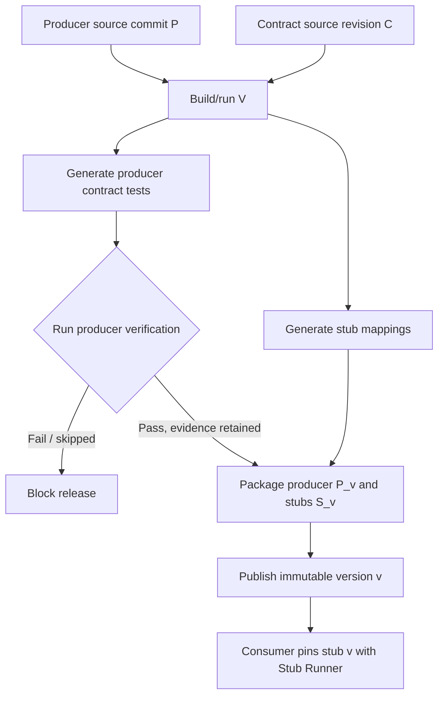
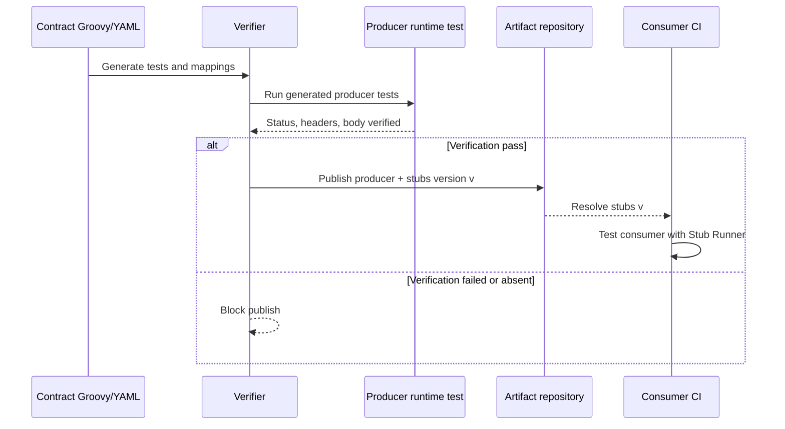

# Linking Stub Versions to Verified Producer Code

A consumer can pass all tests against **stubs** and get a green build, yet still fail when calling the live API. This happens, for example, when the stub simulates `201 Created` while the deployed producer version returns `200 OK`; or when the stub includes `reservationId` while the implementation renamed it to `holdId`. The root cause is not necessarily in the consumer test: **the stub and the producer code were not tied to the same verified build**.

This lesson belongs to the **Stub Generation and Packaging** chapter of the **SPRING_CLOUD_CONTRACT** module. Spring Cloud Contract lets teams describe HTTP or message behavior via **Groovy/YAML DSL**, generate producer verification tests, and package stubs for consumers to use with **Stub Runner**. We will dive into **version linkage across producer code, source contracts, executed tests, and stub artifacts**, how to apply it in Maven/Gradle, publishing through artifact repositories, and configuring CI to prevent incompatible API changes from slipping through.

After this lesson, you will be able to:

- Distinguish producer source commits, contract versions, and stub versions.
- Explain why **successful stub generation** does not mean **the producer satisfies the contract**.
- Build and inspect artifacts carrying the `stubs` classifier.
- Design a workflow guaranteeing published stubs come from **the exact commit that passed producer verification**.
- Manage SNAPSHOTs, immutable releases, semantic versioning, and contracts stored in a separate repository.
- Configure consumer tests to use **a deterministic stub version**, avoiding uncontrolled `+` or `latest`.
- Detect false-green pipelines caused by **0 generated tests**, skipped tests, or stubs packaged from stale outputs.
- Establish artifact traceability, rollback, and compatibility upgrade rules in CI/CD.

## 1. Two promises that must both hold true

Suppose `OrderService` (consumer) calls `InventoryService` (producer) to reserve stock:

```http
POST /api/v1/reservations HTTP/1.1
Content-Type: application/json

{"sku":"SKU-001","quantity":2}
```

Per the contract, the producer must return:

```http
HTTP/1.1 201 Created
Content-Type: application/json

{"reservationId":"RES-100","status":"HELD"}
```

There are **two distinct assertions**:

1. **Consumer-side stub assertion:** when the consumer sends a valid request, the stub returns the described response; the consumer handles that response properly.
2. **Producer verification:** when tests send the sample request to real producer code, the actual response satisfies the contract; generated tests ran and passed.

If you only do (1), you test the consumer against an **unverified promise**. If you only do (2), you know the producer satisfies the contract, yet not whether the consumer deserializes cleanly, handles error branches, or hits the right endpoint.

For reliable releases, **stubs must originate from the exact same contract set against which the released producer code was verified**.

## 2. Four things that must be traced together

| Element | Example | Question to answer |
| --- | --- | --- |
| **Producer code revision** | Git commit `f62c3ab` | Which producer code was tested and slated for deployment? |
| **Contract source revision** | Same commit or contract revision `c91b2d0` | Which contracts generated tests and stubs? |
| **Verification evidence** | CI run `build-8421`, producer contract tests pass | Which tests ran, with which fixtures and tool versions? |
| **Stub artifact** | `inventory-service-1.4.2-stubs.jar` | Which contracts produced this JAR, and did it come from the verified build? |

A version like `1.4.2` is helpful, yet **a version string alone is not proof**. If a pipeline permits overwriting artifacts under the same version, or builds stubs and the producer from two different commits, the filenames stay identical while their contents diverge.

### Binding diagram



**Invariant to protect:** `P_v` must be verified against `C_v`, and `S_v` must be generated from **that exact `C_v`**, through a traceable build/step chain. When contracts live outside the producer repository, explicitly record the independent revision `C_v` instead of assuming it equals the producer commit.

## 3. Stub JARs and artifact coordinates

In the standard Spring Cloud Contract workflow, stubs are packaged into a **separate JAR with the `stubs` classifier** alongside the producer's main JAR.

Example Maven coordinates:

```text
groupId    = com.example
artifactId = inventory-service
version    = 1.4.2
classifier = stubs
type       = jar
```

The two related artifacts:

```text
com.example:inventory-service:1.4.2          # Producer artifact
com.example:inventory-service:1.4.2:stubs    # Stub artifact

inventory-service-1.4.2.jar
inventory-service-1.4.2-stubs.jar
```

**Note:** coordinate notation differs across Maven dependencies, filenames, and Stub Runner `ids` syntax. In `@AutoConfigureStubRunner`, `group:artifact:version:classifier:port` is commonly used; the port number is a runtime stub parameter, **not part of Maven artifact coordinates**.

A stub JAR normally contains the **HTTP mappings** and **contract definitions** needed by Stub Runner/WireMock or messaging. Inside, its paths may resemble:

```text
META-INF/
  com.example/
    inventory-service/
      1.4.2/
        mappings/
          ... request/response stubs ...
        contracts/
          ... Groovy/YAML contract definitions ...
```

This layout is **illustrative per plugin conventions**. Inspect your project's actual JAR contents, as directory structure depends on plugin/configuration and contract types.

### Avoid confusing the producer artifact with the stubs artifact

Consumers should not pull the application JAR `inventory-service-1.4.2.jar` directly just to simulate communication. Stub Runner is designed to use the **stub artifact**; it does not need to run the producer's database or internal services to test consumers.

Conversely, **a stub JAR is not a deployable producer**: having a mapping return `201` does not prove the real controller currently returns `201`. Producer verification must run prior to publishing.

## 4. The same contract generates tests and stubs

Suppose the Groovy DSL source is:

```groovy
import org.springframework.cloud.contract.spec.Contract

Contract.make {
    name 'create_reservation_success'
    description 'OrderService needs to create a reservation before payment'

    request {
        method 'POST'
        url '/api/v1/reservations'
        headers {
            contentType(applicationJson())
        }
        body([
            sku     : 'SKU-001',
            quantity: 2
        ])
    }

    response {
        status 201
        headers {
            contentType(applicationJson())
        }
        body([
            reservationId: $(consumer('RES-100'),
                             producer(regex('RES-[0-9]+'))),
            status: 'HELD'
        ])
    }
}
```

In the response:

- `consumer('RES-100')` provides a **stable** ID returned by the stub.
- `producer(regex('RES-[0-9]+'))` specifies what generated tests assert on IDs produced by the real producer.
- `status = HELD` remains the scenario's concrete business value.

If the producer implementation changes `status` to `PENDING`, a properly executed producer test must catch the divergence. Yet a stub can still return `HELD` if packaged **without running or checking producer test results**. Therefore, "JAR built successfully" is never sufficient criteria to publish stubs.

### Why verify the producer before publishing?



The plugin does not enforce every release condition by itself. **CI/CD must actively enforce the gate**: if Verifier did not run, skipped tests, or failed, prevent the publish step from succeeding.

## 5. Maven workflow: from source to `*-stubs.jar`

For Maven producers, Spring Cloud Contract offers `spring-cloud-contract-maven-plugin` to generate producer tests and stubs. Typical configuration must be **paired with your project's POM, BOM, and version management**:

```xml
<build>
  <plugins>
    <plugin>
      <groupId>org.springframework.cloud</groupId>
      <artifactId>spring-cloud-contract-maven-plugin</artifactId>
      <version>VERSION_COMPATIBLE_WITH_PROJECT</version>
      <extensions>true</extensions>
      <configuration>
        <testFramework>JUNIT5</testFramework>
        <testMode>MOCKMVC</testMode>
        <baseClassForTests>
          com.example.inventory.ContractVerifierBase
        </baseClassForTests>
      </configuration>
    </plugin>
  </plugins>
</build>
```

`VERSION_COMPATIBLE_WITH_PROJECT` is a placeholder; never copy it into a real build without substituting a version compatible with your Spring Boot/Spring Cloud stack. `MOCKMVC` fits only **Spring MVC** producers; for WebFlux or messaging, adjust test mode and base class.

In a project with the proper plugin and test dependencies:

```bash
mvn -B -ntp clean verify
```

This runs Maven generation, test compilation, test execution, and `verify` per current configuration. Expected results:

1. The plugin discovers the right contract set.
2. Generated producer tests are created.
3. Tests compile and execute.
4. Tests pass.
5. Stub mappings and the stubs JAR are created/attached per configured plugin/lifecycle.

**Do not infer step 5 from the command alone.** Inspect build logs and outputs: some projects customize plugin executions, contract paths, or packaging. Nor does `mvn verify` **automatically upload JARs to an artifact repository**; publishing requires its own step and credentials.

### Inspect real outputs instead of guessing

Suppose Maven builds `target/inventory-service-1.4.2-stubs.jar`; you can list its contents:

```bash
jar tf target/inventory-service-1.4.2-stubs.jar
```

Verify the expected mappings/contracts exist rather than merely an empty ZIP/JAR file. For HTTP contracts, check actual URLs, methods, and response mappings; for message contracts, confirm labels and contract definitions are packaged for Stub Runner.

**Paths and filenames are examples only.** Projects may use different names, output folders, or packaging depending on plugins. Never write CI scripts that hardcode one imagined filename and silently ignore configuration changes.

## 6. Gradle workflow shares the goal with a different task graph

Spring Cloud Contract also supports a Gradle plugin. Instead of Maven lifecycle phases, Gradle uses **tasks** and **source sets**. A guiding snippet:

```groovy
plugins {
    id 'java'
    id 'org.springframework.cloud.contract' version 'VERSION_COMPATIBLE'
}

dependencies {
    testImplementation 'org.springframework.boot:spring-boot-starter-test'
    testImplementation 'org.springframework.cloud:spring-cloud-starter-contract-verifier'
}

contracts {
    baseClassForTests = 'com.example.inventory.ContractVerifierBase'
    testFramework = 'JUNIT5'
    testMode = 'MOCKMVC'
}
```

This is a **configuration fragment requiring version-specific adjustment**, not a complete `build.gradle`. Tasks generating contract tests, creating stubs, and publishing artifacts can differ across Gradle plugin versions.

In a configured project, exploratory commands:

```bash
./gradlew tasks --all
./gradlew clean check
```

On Windows use `gradlew.bat`. Ensure the contract-test generation task **is part of the task graph CI actually runs**, generated sources enter the compiled source set, and the test runner fails the build when assertions fail. For stub publishing, verify the publication carries the right **version/classifier** and originates from the exact same build inputs.

| Invariant | Maven | Gradle |
| --- | --- | --- |
| Versioned contract sources | Contract source directory | Contract source directory |
| Generate producer tests | Plugin goals/lifecycle | Generator tasks |
| Compile and run tests | Test compilation/Surefire or runner | `test`/`check` and runner |
| Generate and package stubs | Plugin packaging, attached artifact | Stub tasks/publication config |
| Publish | Deploy/plugin repository config | Publishing plugin/repository config |
| Block publish on test failure | Job gates and step dependencies | Task/job dependencies and CI gates |

What matters is not identical task names, but that **producer code is verified before corresponding stubs are published**.

## 7. Do not equate `clean verify` with complete verification evidence

A green build command can mask several configuration bugs:

| Scenario | Can the build stay green? | Risk |
| --- | --- | --- |
| Contracts placed in wrong directory | Yes | Generator reads zero contracts |
| Plugin not applied to producer module | Yes | No generated tests created |
| Test sources exist yet JUnit misses them | Yes | Zero tests executed |
| `skipTests` or filters exclude generated tests | Yes | Stubs packaged with no verification |
| Base class returns hardcoded mock responses matching contract | Yes | Real implementation under protection is never exercised |
| Build cache serves outputs from stale contracts | Possibly | Tests/stubs do not reflect new contracts |
| Producer test actually runs and fails | Should not | CI must block publishing |

**Three signals to distinguish**:

1. **Generated tests exist:** generated files/classes are present.
2. **Generated tests executed:** the test runner actually ran those classes.
3. **Producer behavior verified:** tests exercise the real producer path with proper fixtures and passing assertions.

A pipeline checking only signal 1 **is insufficient**. Inspect test reports (e.g., Surefire XML/HTML in Maven or Gradle test reports) and enforce checks catching zero or abnormally dropping contract test counts.

### Illustrative verification gate example

```bash
mvn -B -ntp clean verify

# Apply only if your real project outputs here:
test -d target/generated-test-sources/contracts
find target/generated-test-sources/contracts -type f -name '*.java' | grep -q .
```

File checks confirm only **generated code exists**, not that generated tests ran. In CI, combine this with JUnit report inspection, executed test counts, and fail/skip checks. Do not treat this illustrative snippet as a complete gate for every Maven project.

## 8. Fixtures and matchers must accurately represent producer code

In a success contract, producer tests may send `sku: SKU-001`, `quantity: 2` and expect `201`. If the test database lacks that SKU or is out of stock, the implementation may legitimately return `409`, causing the generated test to fail. That calls for **fixture preparation**, not removing assertions or disabling tests.

Principles:

- Tests need deterministic data before each run; never depend on test ordering.
- Dynamic IDs/timestamps should use producer-side matchers unless exact values are required.
- Critical statuses such as `200/201`, `400`, `404`, and `409` deserve distinct contracts and distinguishable fixtures.
- When producer business rules change, coordinate with consumers to decide whether contracts should change.
- When regenerating stubs, ensure success-case matchers **do not swallow** error requests.

**Conflict example:** the success stub has a regex matching every SKU, while the out-of-stock stub also matches an SKU inside that regex. Consumers may receive arbitrary results depending on mapping selection even though the real producer checks stock state. Design clear, non-overlapping matchers/stubs and inspect artifacts.

## 9. Contracts in the same repository vs. a separate repository

Two common organizational models:

| Model | Contract source | What must be linked |
| --- | --- | --- |
| **Contracts in producer repo** | Usually `src/test/resources/contracts` | Producer commit holding contracts + code; build and release version |
| **Contracts in external repo/artifact** | Standalone contracts repo or artifact | Producer source revision **and** contract revision/version used for verification |

In a monorepo or producer repo, linkage is relatively straightforward: the same commit holds implementation and contracts; CI verifies that commit and publishes unified producer/stub versions.

With an external contracts repo, producer CI must record **the exact revision** fetched. If each build pulls branch `main` or `latest`, the same producer commit can be tested against two different contract versions across runs.

### Example linkage matrix

| Producer release | Producer commit | Contract revision | Stub version |
| --- | --- | --- | --- |
| `1.4.1` | `a102b3c` | `contracts-2026-11-01` | `1.4.1` |
| `1.4.2` | `f62c3ab` | `contracts-2026-11-20` | `1.4.2` |
| `1.5.0` | `c90d11e` | `contracts-2026-12-05` | `1.5.0` |

These are **illustrative examples**, not real application releases. What matters is the **traceability invariant**: an investigator can pinpoint the exact contracts used to verify a producer release and build a stub artifact without guessing from timestamps.

When contracts are consumer-driven, review workflows must also clarify **which consumers accepted a change**. Never simply bump a stub version to mask a contract dropping a condition consumers depend on.

## 10. One version does not mean one build if overwriting is allowed

It is especially dangerous when pipelines allow two different builds to publish the same:

```text
com.example:inventory-service:1.4.2:stubs
```

Suppose build A runs on commit `f62c3ab` and passes; build B on commit `ff81aa0` edits only a stub mapping **without running producer tests**, then overwrites artifact `1.4.2`. Consumers still point to `1.4.2`, yet stub contents changed. Build A's passing trace no longer guarantees the current artifact represents that commit.

Rules for **stable release versions**:

1. **Never overwrite a published release artifact**.
2. Producer and stub artifacts of the same version must publish as **one traceably linked artifact set**.
3. If contracts or mappings need fixes, create a new release with a new version.
4. Store checksums/digests and build provenance to detect replaced artifacts.
5. Permit publishing only after **those exact build inputs** pass verification.

With `-SNAPSHOT`, repositories can allow content updates across uploads, often with unique snapshot timestamps. SNAPSHOTs help during development yet **are not immutable releases**: to reproduce a consumer test, record the exact resolved snapshot rather than just writing `1.4.3-SNAPSHOT`.

## 11. Selecting stub versions per environment

No single versioning rule fits every goal. Choose based on whether the consumer is testing **candidate producer code slated for release**, an active snapshot, or an already deployed producer.

| Environment / goal | Appropriate stub version | Risk to manage |
| --- | --- | --- |
| Local developer trying new changes | Local version or fixed snapshot | Local cache holding stale builds, unrefreshed metadata |
| Consumer pull request | Known release stub; optionally add candidate versions requiring compatibility | Candidate shifting before PR re-runs |
| Release-candidate integration CI | Stub artifact tied to exact producer candidate/build | Accidentally pulling stubs from another commit |
| Pre-deployment release test | Immutable version the producer release will ship | Testing one artifact while deploying another |
| Regression debugging | Version and checksum recorded in historical CI reports | Repository overwritten or snapshot purged |
| Production smoke test | Stubs can serve as expected-spec reference, yet calls must hit **live deployed producer** | Passing stub tests do not prove live production correctness |

### Understand the difference between release and deployment

Producer JAR `1.4.2` may be verified while the production cluster still runs `1.4.1`. When deploying a consumer, what matters is **which producer version actually serves requests in the target environment**.

Hence there are two distinct checks:

1. **Build compatibility:** consumer code works against stubs for producer version `1.4.2`.
2. **Deployment compatibility:** does the staging/production environment currently serve the producer version the consumer expects?

Stub Runner helps with step 1, while step 2 usually requires deployment metadata and controlled smoke/integration tests against live endpoints.

## 12. Consumers pinning stub versions in Stub Runner

Example of `OrderService` using Spring Cloud Contract Stub Runner against a stub installed in the local Maven repository:

```java
package com.example.order;

import io.restassured.RestAssured;
import org.junit.jupiter.api.Test;
import org.springframework.boot.test.context.SpringBootTest;
import org.springframework.cloud.contract.stubrunner.spring.AutoConfigureStubRunner;
import org.springframework.cloud.contract.stubrunner.spring.StubRunnerProperties;

import static org.hamcrest.Matchers.equalTo;

@SpringBootTest
@AutoConfigureStubRunner(
    ids = "com.example:inventory-service:1.4.2:stubs:8090",
    stubsMode = StubRunnerProperties.StubsMode.LOCAL
)
class ReservationConsumerContractTest {

    @Test
    void shouldReadReservationCreatedResponse() {
        RestAssured.given()
            .port(8090)
            .contentType("application/json")
            .body("{\"sku\":\"SKU-001\",\"quantity\":2}")
            .when()
            .post("/api/v1/reservations")
            .then()
            .statusCode(201)
            .body("status", equalTo("HELD"));
    }
}
```

This snippet is **an illustration requiring version-matched dependencies/config**, not a standalone project. It assumes `1.4.2:stubs` is in local Maven and port `8090` is free. If Stub Runner fails to resolve the JAR or the port is occupied, the test fails before exercising business code.

For real consumers, send requests through **the consumer's own client/service adapter** rather than having every test call RestAssured directly like a raw API smoke test. That verifies request serialization, response parsing, and consumer error handling. The example above focuses on **stub versioning and how it is served**.

### Why avoid dynamic versions in mandatory CI gates?

Example:

```java
// Illustrative anti-pattern when reproducible builds are required:
@AutoConfigureStubRunner(
    ids = "com.example:inventory-service:+:stubs:8090"
)
```

`+` asks Stub Runner to resolve the latest matching version. Running the same consumer commit at two different times can fetch **two different stub versions**. If a new producer introduces an incompatible change, consumer CI turns red even though consumer code did not change; conversely, a stale cached stub can keep CI green after the producer changed.

In release pipelines, **pin explicit versions** and log resolved coordinates. Using dynamic versions in a separate **latest-compatibility probe job** can be useful, yet never treat it as reproducible release evidence.

### LOCAL, REMOTE, and classpath

| Stub retrieval mode | When appropriate | What to verify |
| --- | --- | --- |
| `LOCAL` | Local Maven already has stub artifacts installed | Avoid stale local builds; check coordinates and checksum |
| `REMOTE` | CI resolves artifacts from an internal repository | `repositoryRoot`, credentials, read permissions, pinned version |
| Classpath mode | Project puts stubs directly on the test classpath | Explicit artifact and version selection; avoid transitive conflicts |

Enums, configuration properties, and annotations can change across Spring Cloud Contract versions; consult **documentation matching your actual dependencies**. Never confuse `repositoryRoot` (where artifacts live) with the HTTP address/port where the stub runs.

## 13. API compatibility and version increments

Not every producer change is breaking. Still, bumping versions without checking current consumers can break downstream services.

| Change | Common impact | Action required |
| --- | --- | --- |
| Add a JSON response field ignored by consumers | Often compatible, depending on schema strictness | Verify against active consumers |
| Rename `reservationId` to `holdId` | Likely breaking if consumers read the old field | Maintain compatibility or coordinate migration |
| Change `201` to `200` | Likely breaking if consumers check status | Compare contracts and test consumers |
| Remove `/api/v1/reservations` endpoint | Breaking for callers | Provide versioning/migration plan |
| Narrow accepted request matchers | Potentially breaking | Check current consumer traffic/contracts |
| Broaden ID format in a controlled way | Usually compatible, though risky for strict parsers | Test consumers against new sample data |
| Change AMQP routing key | Can stop messages from reaching queues | Verify broker contracts and topology |
| Add a new message event type | Compatible if consumers ignore unknown events | Check event handlers and consumer policies |

**Semantic Versioning** is a useful convention: bump major for breaking public API changes; minor for compatible features; patch for compatible fixes. However, Spring Cloud Contract **does not automatically infer major/minor versions from DSL**. Organizations need versioning policies and consumer impact assessment rules.

### Which direction do consumer-driven contracts evolve?

When a consumer asks for a new field, the producer can add it without breaking existing consumers. Yet when the producer wants to **remove** an old field, it must know whether any consumer still relies on it.

A common migration workflow:

1. Add support for the new field or endpoint **in parallel** with the old version.
2. Write/update contracts and producer tests covering both paths.
3. Publish the newly verified producer/stub version.
4. Consumers upgrade stub versions and update code on schedule.
5. Confirm no active consumer still depends on the old interface.
6. Only then remove the legacy path in an appropriate breaking release.

**Never alter a contract just to turn tests green without talking to consumers.** Deleting an assertion makes producer tests pass faster while stripping away the exact protection consumers rely on.

## 14. Designing CI/CD gates guaranteeing same-commit linkage

A release pipeline must guard against at least three risks:

- Contract tests are skipped while stubs still get packaged.
- Build A gets verified, yet build B from **a different commit or dependency set** gets published.
- Published artifacts get overwritten after consumers already started using them.

### Clear two-stage model

**Stage 1 — Verify**

1. Check out a **fixed commit**.
2. Lock dependencies, contract revision, and toolchain.
3. Generate producer tests and stub mappings.
4. Compile and run producer contract tests.
5. Confirm **expected tests** ran—not skipped or missing a module.
6. Run mandatory integration/security tests.
7. Verify the stub JAR holds expected mappings/contracts.
8. Archive test reports, checksums, and build metadata.

**Stage 2 — Publish**

1. Run only if the verify stage passed and release is authorized.
2. Publish **the exact verified artifacts**, or rebuild from **the exact same revision and pinned inputs** per defined policy.
3. Use a release version not yet present in the repository; never overwrite.
4. Publish producer and stub artifacts with explicit version linkage.
5. Record repository URL, checksum, Git commit, and CI run ID.
6. Consumer CI intentionally upgrades to the published stub version.

### Why verifying built artifacts beats rebuilding a moving branch?

Suppose the verify job ran on commit `f62c3ab`, yet the publish job checks out `main` the next day and builds commit `ff81aa0`. Even though both declare `project.version = 1.4.2`, **there is zero evidence** the prior build's tests verified the new artifact.

A sound pipeline uses immutable commit SHAs/tags and promotes artifacts across jobs within proper trust boundaries. If release policy requires rebuilding, ensure producer sources, contract revision, dependencies, toolchain, and build flags remain identical—and re-run all mandatory verification.

## 15. Illustrative CI workflow with Maven

Example **pull-request verification** job (without publishing):

```yaml
name: Verify producer and contract stubs

on:
  pull_request:
  push:
    branches: [main]

jobs:
  verify:
    runs-on: ubuntu-latest
    steps:
      - uses: actions/checkout@v4
      - uses: actions/setup-java@v4
        with:
          distribution: temurin
          java-version: '21'
          cache: maven

      - name: Generate, compile and run tests
        run: mvn -B -ntp clean verify

      - name: Check a stub JAR exists
        shell: bash
        run: |
          # Adjust filename pattern to match the actual artifact.
          artifact=$(find target -maxdepth 1 -type f -name '*-stubs.jar' -print -quit)
          test -n "$artifact"
          jar tf "$artifact" | grep -q 'mappings'

      - name: Retain test reports
        if: always()
        uses: actions/upload-artifact@v4
        with:
          name: producer-test-reports
          path: target/surefire-reports/
```

**This YAML is illustrative.** Adjust JDK, working directories for multi-module builds, JAR paths, plugins, and test commands to match your real project. For messaging-only contracts, stubs may lack a `mappings` folder like HTTP stubs; adjust artifact checks accordingly.

This job **is not yet a complete release gate**:

- It checks for a stub JAR, yet needs steps verifying **actual executed generated test counts**, skipped counts, and mandatory integration tests.
- It does not verify that all expected contracts were packaged.
- It omits publishing intentionally to prevent releasing artifacts from unvetted PRs.

### When adding the publish step

In a release job with publish permissions on a protected branch/tag, teams can run `mvn deploy` once all gates pass. Maven's deploy goal requires `distributionManagement`, server credentials, and repository config.

```bash
# Run on the exact release commit/tag, without skipping tests:
mvn -B -ntp clean deploy
```

This command can re-run test phases before deploying if the lifecycle is configured properly. **Never assume it enforces test count > 0**: checking executed test counts and artifact provenance must still gate releases.

Never pass `-DskipTests` or `-Dmaven.test.skip=true` to "optimize" an independent publish job unless you guarantee the artifact is **the exact verified output**. For Gradle, apply the same rule to publishing tasks and source revisions.

## 16. Artifact provenance evidence

A team can store per-release metadata:

```yaml
producer:
  coordinates: com.example:inventory-service:1.4.2
  gitCommit: f62c3ab
contract:
  revision: contracts-2026-11-20
verification:
  ciRun: build-8421
  generatedTests: 12
  executedTests: 12
  skippedTests: 0
  result: PASS
stubs:
  coordinates: com.example:inventory-service:1.4.2:stubs
  sha256: EXAMPLE_DIGEST_REPLACE_WITH_REAL_VALUE
```

This is **illustrative metadata**, not a standard schema emitted automatically by Spring Cloud Contract. Versions, test counts, and digests must come from real tools—never copy `12` or fake hashes into release manifests. Store it in CI artifacts, release manifests, or release management systems; it does not have to live inside the producer repository.

### Useful details to record

| Data | Purpose |
| --- | --- |
| Full Git commit SHA | Reproduce producer source code |
| Contract artifact/revision | Reproduce verified contract conditions |
| Build tool + plugin version | Explain differences in generated tests/stubs |
| JDK, Spring Boot/Cloud versions | Reproduce generator and runner environment |
| CI run URL/ID | Locate test logs, warnings, skip counts |
| Stub artifact coordinates | Let consumers pin the exact version |
| SHA-256 checksum | Detect altered JAR contents despite identical names |
| Test report summary | Prove executed test counts and pass status |

To verify checksums with standard tools:

```bash
sha256sum target/inventory-service-1.4.2-stubs.jar
```

In PowerShell, use `Get-FileHash` with `-Algorithm SHA256`. Checksums **verify content integrity**; they do not replace repository permissions, artifact signatures, or other supply-chain controls required by your organization.

## 17. Watch out for caches and stale builds

When builds use caches or local repositories, **stale generated outputs** can slip in silently.

Example:

1. A developer changes a contract from `status 201` to `status 200`.
2. The test-generation task fails to track the updated contract as an input, so cache returns stale output.
3. The build runs/passes on stale generated tests.
4. The stub JAR gets built from inconsistent sources/outputs.

Or a consumer requests stub `1.4.2`, yet local Maven already holds a `1.4.2` artifact installed earlier from an experimental commit.

Mitigations:

- Declare contract sources and generator configs as explicit build task inputs.
- Whenever suspecting stale outputs, run a **clean build** and inspect freshly generated tests/mappings.
- For snapshots, check resolved timestamps/build numbers or selectively clear caches when investigating.
- Disallow overwriting published versions in release repositories.
- Never manually upload a JAR whose originating commit is unknown.
- Scope Maven/Gradle caches cleanly per CI context and policy.

**Clean does not fix a broken build pipeline.** It only clears stale outputs; you still must inspect the lifecycle/task graph and executed test counts.

## 18. Rollback and supporting multiple consumer versions

Suppose the producer deployed `1.4.2`; consumer A uses the new contract while consumer B still expects `1.4.1`. If `1.4.2` drops a field B uses, consumer tests running only against `1.4.2-stubs` do not prove B remains supported.

Approach:

1. Maintain an inventory of consumers and their supported producer version ranges.
2. During migrations, retain necessary backward-compatible contract clauses.
3. Run consumer tests against the stub version **chosen for each environment**.
4. Run producer verification for legacy clauses that must stay supported.
5. Before rolling back the producer, confirm deployed consumers remain compatible with the rollback target.
6. Retain release artifacts needed for reproduction or rollback per retention policies.

Hypothetical compatibility matrix:

| Consumer | Tested against stub | Intended producer deploy | Decision |
| --- | --- | --- | --- |
| `OrderService 2.3` | `inventory-service:1.4.2:stubs` | `1.4.2` | Proceed if verification complete |
| `BillingService 1.8` | `inventory-service:1.4.1:stubs` | `1.4.2` | Verify backward compatibility or run additional tests |
| `LegacyApp 0.9` | `inventory-service:1.3.9:stubs` | `1.4.2` | Assess migration/breaking changes |

**Never assume a higher version is always compatible with lower ones.** Supporting multiple contracts depends on API policy, live consumers, and deprecation windows.

## 19. Diagnosing common version-linkage failures

| Symptom | Possible cause | How to verify |
| --- | --- | --- |
| Consumer stub returns `201`; production returns `200` | Producer unverified or environment runs another version | Compare deployed version, CI test logs, and contract revision |
| Stub artifact is version `1.4.2` yet returns old response | Artifact overwritten or stale local cache | Inspect checksum, timestamp, source commit, repo policy |
| Build green with zero generated tests | Plugin skipped contracts or tests skipped | Check generated test count and executed test count |
| `*-stubs.jar` exists without expected mappings | Wrong source path, plugin/packaging, or contract filter | List JAR contents and compare against contract sources |
| Maven `deploy` publishes without running tests | Skip flags or customized lifecycle | Inspect effective build, CI logs, Surefire/Gradle reports |
| Local Stub Runner passes; CI remote fails | Same coordinates resolve different artifacts locally vs. remotely | Compare SHA-256 and `repositoryRoot` config |
| Consumer using `+` fluctuates green/red | Resolved version shifted | Pin version and log resolved coordinates |
| External contract repo changes hurt reproducibility | Tracking branch/`latest` instead of fixed revision | Pin revision/hash and log in provenance |
| New producer code and old stubs deployed together | Build/CI jobs pulled inputs from different revisions | Bind commits and artifacts to the same release run |
| Stub test passes yet live workflow fails | Contract covers only one HTTP call or fixtures are unrealistic | Add multi-step integration tests |
| Two mappings match the same request with different statuses | Overly broad matchers or colliding scenarios | Inspect WireMock mappings and differentiate inputs |
| Producer rollback breaks new consumer | Consumer tested only against newer version | Test compatibility/rollback matrix |

## 20. Anti-patterns to avoid

**Anti-pattern 1: "Generate stubs and deploy right away."** The plugin can generate mappings from DSL even when the producer implementation violates contracts. Always enforce producer verification gates and inspect reports.

**Anti-pattern 2: "Edit stub responses to make consumer tests pass."** Hand-editing mappings without updating contracts/producers breaks single-source-of-truth linkage. If consumers expect something else, agree on the contract and re-run verification.

**Anti-pattern 3: "CI checks only that a JAR file exists."** An empty JAR or one with stale mappings still exists on disk. Inspect stub contents and executed test counts.

**Anti-pattern 4: "Publish the same version from multiple commits."** Releases lose reproducibility; consumers can resolve two payloads under one coordinate. Bump versions or enforce proper snapshot policies.

**Anti-pattern 5: "Consumers always pull `latest`."** Consumer builds become unstable over time. Pin versions at release gates and keep latest-compatibility probes in separate jobs if desired.

**Anti-pattern 6: "Verify on a PR, rebuild and publish from a moving `main`."** Tests and releases come from different commits. Lock SHAs/tags and track artifact provenance.

**Anti-pattern 7: "Contract tests passed, so the distributed system works."** Contract tests verify described interactions; they do not automatically guarantee idempotency, queue bindings, database transactions, retries, or load balancing. Add risk-appropriate tests.

## 21. Checklist before allowing a stub release

- [ ] Groovy/YAML contracts are versioned with clear consumer ownership.
- [ ] Producer commit and contract revision are recorded in the CI build.
- [ ] Spring Cloud Contract plugin version and source paths are valid.
- [ ] Generated producer tests are created **and** executed.
- [ ] No accidental skips, 0-test runs, or undiscovered test classes.
- [ ] Fixtures/datasets ensure tests exercise meaningful producer logic.
- [ ] Contract matchers are not overly broad and have no critical mapping collisions.
- [ ] Mandatory integration, security, and messaging tests passed.
- [ ] Stub JAR holds expected mappings/contracts, verified after packaging.
- [ ] Stub version and producer version are transparently linked; never publish from a different commit.
- [ ] Release artifacts are immutable; SNAPSHOT policies record exact resolved builds.
- [ ] Git SHA, build ID, test results, and checksums are retained for traceability.
- [ ] CI blocks publishing if verification or artifact inspection fails.
- [ ] Consumers use Stub Runner with **pinned versions** at release gates.
- [ ] Smoke/integration tests run against deployed producers when deployment verification is needed.
- [ ] Rollback plans and compatibility checks exist for consumers on older versions.
- [ ] Publish credentials reside in CI secrets, never inside contracts.

### Practice exercise

Suppose `InventoryService` prepares release `1.4.2` for `OrderService`. Components:

```text
Producer:     com.example:inventory-service:1.4.2
Stub:         com.example:inventory-service:1.4.2:stubs
Producer SHA: f62c3ab
Contract SHA: c91b2d0
Consumer:     com.example:order-service:2.3.0
```

The contract specifies `POST /api/v1/reservations` must return `201`, `status: HELD`, and a `reservationId` matching the pattern.

**Tasks:**

1. Diagram the flow from **Git commit → contract test generation → producer verification → stub packaging → repository → Stub Runner consumer test**.
2. Write a Groovy contract for the success scenario using a response matcher for dynamic `reservationId` and a concrete sample for the stub.
3. Configure the Contract Verifier plugin in Maven (or Gradle equivalent) and verify generated tests run.
4. Run `mvn -B -ntp clean verify` on the configured producer; record generated test count, executed test count, results, and stub JAR path.
5. Use `jar tf` to find the `POST /api/v1/reservations` mapping inside the artifact instead of checking file existence alone.
6. Intentionally change the implementation to return `200` instead of `201`. Prove the producer test fails and **stub publishing is blocked**.
7. Intentionally enable `skipTests` or break the contracts path. Add a CI gate catching the false-green build.
8. Configure a consumer `@AutoConfigureStubRunner` test pinned to `1.4.2:stubs`; contrast with `+` and explain the risks.
9. Publish a new stub release `1.4.3` instead of overwriting `1.4.2`. Archive Git commit, contract revision, test report, and checksum.
10. Simulate consumer A remaining on `1.4.1` while the producer prepares to deploy `1.4.3`; list commitments that must remain compatible.
11. Design a rollback procedure from producer `1.4.3` back to `1.4.2` without surprising consumers.
12. Explain when live-producer integration tests are required and why stub tests cannot replace them.

**Completion criteria:** you can pinpoint **which producer code was verified by which contract set**, **which stub artifact was generated from that contract set**, **which tests CI executed**, and **which exact stub version the consumer uses**. Whenever those links cannot be proven, a release is not ready to publish even if the JAR built cleanly.

## References

- [Spring Cloud Contract — Reference](https://docs.spring.io/spring-cloud-contract/reference/): producer verification, Groovy/YAML contracts, stub generation, and Stub Runner.
- [Spring Cloud Contract — HTTP Contracts](https://docs.spring.io/spring-cloud-contract/reference/project-features-contract/http.html): request/response DSL and matchers.
- [Apache Maven — Build Lifecycle](https://maven.apache.org/guides/introduction/introduction-to-the-lifecycle.html): generate, test, package, verify, install, and deploy phases.
- [Apache Maven Deploy Plugin](https://maven.apache.org/plugins/maven-deploy-plugin/): publishing artifacts to Maven repositories.
- [Gradle — Maven Publish Plugin](https://docs.gradle.org/current/userguide/publishing_maven.html): publishing tasks, versions, and Maven coordinates.
- [Semantic Versioning](https://semver.org/): distinguishing compatible changes from breaking changes by version convention.
