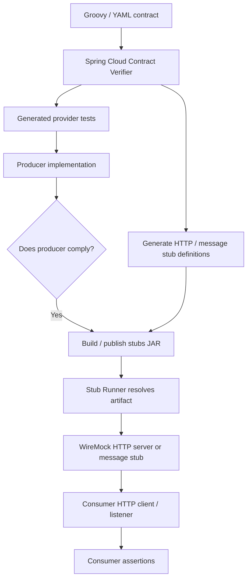
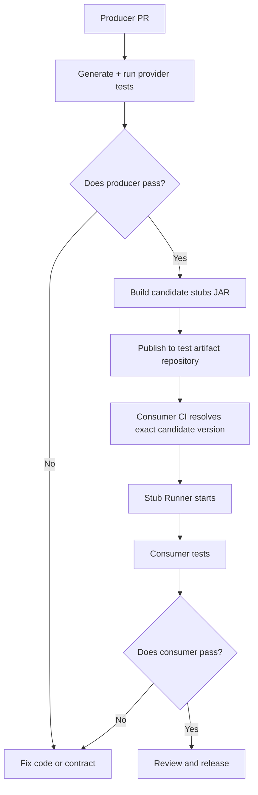

# The Role of Stub Runner in Consumer Testing with Spring Cloud Contract

In a microservices system, `checkout-consumer` might call `order-producer` over HTTP, while `notification-consumer` might receive `OrderCreated` events. To test the consumer, the team does not want to start the real producer, database, broker, and dependent services every time. However, if the consumer writes its own mocks unrelated to the producer's interface, tests may pass even when the two sides are no longer compatible.

**Spring Cloud Contract (SCC)** closes that gap using **contracts that can be used to generate both tests and stubs**. The producer defines HTTP or messaging behavior in **Groovy DSL/YAML DSL**; Contract Verifier generates tests to verify the producer implementation and produces stubs. **Stub Runner** helps the consumer **find, download, and start stubs published by the producer**, so that consumer clients/listeners can verify communication **without running the real producer application**.

This lesson in the **Stub Runner** chapter focuses on **the role of Stub Runner in consumer testing**: what problem it solves, where it retrieves artifacts from, how to configure HTTP and messaging, how to avoid testing against the wrong version, and its boundaries with producer verification or integration tests. The running example throughout is the `order-producer` and `checkout-consumer` applications.

## 1. The consumer's need: verifying the interface before real integration

Suppose the consumer sends:

```http
GET /api/orders/1001 HTTP/1.1
Accept: application/json
```

The producer commits to returning:

```http
HTTP/1.1 200 OK
Content-Type: application/json

{"id":1001,"status":"CREATED","currency":"VND"}
```

The consumer must handle both the **outgoing request** and the **incoming response** properly:

- Use the exact `GET` method, `/api/orders/1001` path, and required headers.
- Deserialize the JSON into a DTO with the right data types.
- Understand `CREATED` as a committed status.
- Use `currency` with the right semantics.
- Distinguish successful responses from `404`, `400`, and `503` if those branches belong to the contract.
- Apply application-specific timeouts, error handling, or retries when needed.

If the consumer builds a fake endpoint returning `{"status":"OK"}` while the producer has published `{"status":"CREATED"}`, consumer tests will fail to catch the real compatibility bug. If the real producer is started for every test run, the test suite may become coupled to databases, migrations, auth, network, and too much infrastructure.

**Stub Runner reduces runtime dependency on the producer while keeping the behavior source anchored to the producer's contract.** This is the key difference compared to the consumer inventing a mock response on its own.

## 2. Where does Stub Runner sit in the Spring Cloud Contract lifecycle?



Explanation of each role:

| Component | Responsibility | Evidence obtained |
| --- | --- | --- |
| Contract | Describes request/response or message input/output | A structured agreement |
| Contract Verifier | Processes DSL and generates tests/stubs | Generated tests and stub mappings |
| Provider verification | Calls real producer code according to the contract | Whether the producer satisfies the declared cases |
| Stubs JAR | Packages the generated mock behavior | An artifact with coordinates and version |
| Stub Runner | Downloads/reads the stubs JAR and starts stubs | Consumer has sample endpoints/messages to test against |
| WireMock | Matches HTTP requests and returns sample responses | Whether the consumer sends requests meeting the conditions |
| StubTrigger | Triggers message stubs by label | Whether the consumer listener receives/processes sample events |
| Consumer tests | Runs consumer code against stubs | Whether the consumer understands and uses the contract properly |

**The two checks complement each other:** provider verification verifies the side creating the contract; consumer tests via Stub Runner verify the side consuming the contract. Passing on one side cannot automatically prove the other side is right.

### 2.1. The question Stub Runner actually answers

> If the producer provides the exact behaviors it committed to, can the current consumer version interact with it?

Stub Runner does **not** directly answer "does the producer currently deployed in production actually honor the contract?". It runs a simulation generated from the contract, **not the production controller, database, or broker**.

## 3. Distinguishing stub, WireMock, and Stub Runner

**Stub:** describes one or more sample communication behaviors. For HTTP, a mapping contains request matching conditions and the response to return. For messaging, a stub contains sample event data and how to trigger it.

**WireMock:** a mock HTTP server tool that receives requests, selects a matching mapping, and returns the defined status, headers, and body.

**Stub Runner:** a Spring Cloud Contract component that helps **locate and run a producer's stub suite by artifact coordinates**, typically using WireMock for HTTP and integrating with messaging when configured.

Example of the intent of an HTTP mapping:

```text
Request:
  method: GET
  url: /api/orders/1001
  Accept: application/json

Response:
  status: 200
  Content-Type: application/json
  body: {"id":1001,"status":"CREATED","currency":"VND"}
```

This is a **logical description**, not an actual WireMock mapping file. A mapping generated by SCC has its own JSON structure depending on the version and matchers.

### 3.1. Why not just write WireMock directly on the consumer side?

You can write WireMock directly for an isolated test. However, if the producer renames the `status` field to `state` while the consumer keeps the old mock, the consumer test won't know the API changed.

With Stub Runner, the ideal source of stubs is **the artifact generated from the contract of the producer under test**. This reduces the risk of the consumer maintaining an out-of-sync "fake API." Correctness still depends on:

1. The producer verifying the contract via generated tests.
2. The stubs JAR being built from the right code/contract revision.
3. The consumer using the right candidate artifact.
4. The scenarios needing verification actually being described in the contract.

## 4. Producer writes an HTTP contract

Create the file `src/test/resources/contracts/http/get-order-created.groovy` in the producer project:

```groovy
import org.springframework.cloud.contract.spec.Contract

Contract.make {
    description 'GET existing order returns 200 and schema-compliant JSON'

    request {
        method GET()
        url '/api/orders/1001'
        headers {
            header('Accept', 'application/json')
        }
    }

    response {
        status OK()
        headers {
            contentType(applicationJson())
        }
        body(
            id: 1001,
            status: 'CREATED',
            currency: 'VND'
        )
    }
}
```

The contract states that upon receiving a matching request, the producer must return a 200 JSON response with the agreed data.

YAML file expressing the equivalent scenario:

```yaml
description: "GET existing order returns 200 and schema-compliant JSON"
request:
  method: GET
  url: /api/orders/1001
  headers:
    Accept: application/json
response:
  status: 200
  headers:
    Content-Type: application/json
  body:
    id: 1001
    status: CREATED
    currency: VND
```

**Choose either the Groovy or YAML version for the same scenario in an actual build.** If both are scanned, they can generate duplicate tests and stubs.

### 4.1. How does the contract relate to stub behavior?

| Declaration | What Stub Runner/WireMock simulates |
| --- | --- |
| `request.method` | Must receive the exact HTTP method |
| `request.url` or `urlPath` | Matches path and query according to the mapping |
| `request.headers` | Can enforce headers the consumer must send |
| `request.body` / matcher | Can validate request JSON/body |
| `response.status` | Returns status code to the consumer client |
| `response.headers` | Returns media type and metadata |
| `response.body` | Returns sample JSON or payload |

When the consumer calls the wrong URL, method, or body, the HTTP stub will **fail to match**, rather than fixing the request automatically. Thus, the test verifies both **the input produced by the consumer** and **the response processed by the consumer**.

## 5. Producer verification must precede trusting the stubs JAR

From the contract, SCC Contract Verifier can generate tests that call the real producer API. A common Maven configuration snippet:

```xml
<plugin>
    <groupId>org.springframework.cloud</groupId>
    <artifactId>spring-cloud-contract-maven-plugin</artifactId>
    <extensions>true</extensions>
    <configuration>
        <baseClassForTests>com.example.order.contract.OrderContractBase</baseClassForTests>
    </configuration>
</plugin>
```

This is an **illustrative** snippet, not a complete `pom.xml`. The project needs the Contract Verifier dependency, compatible Spring Boot/SCC versions, test base class, and appropriate HTTP test mode.

Example base test with MockMvc:

```java
import io.restassured.module.mockmvc.RestAssuredMockMvc;
import org.junit.jupiter.api.BeforeEach;
import org.springframework.beans.factory.annotation.Autowired;
import org.springframework.boot.test.autoconfigure.web.servlet.AutoConfigureMockMvc;
import org.springframework.boot.test.context.SpringBootTest;
import org.springframework.test.web.servlet.MockMvc;

@SpringBootTest
@AutoConfigureMockMvc
public abstract class OrderContractBase {
    @Autowired
    private MockMvc mockMvc;

    @BeforeEach
    public void setUp() {
        RestAssuredMockMvc.mockMvc(mockMvc);
    }
}
```

Once properly configured, you can run:

```bash
mvn clean verify
```

You need to verify that **generated provider tests are actually generated and executed**, rather than just looking at `BUILD SUCCESS`. If tests don't run or the base class calls the wrong controller, stubs may be generated from a contract that does not reflect the real implementation.

### 5.1. Why can't you rely solely on Stub Runner?

Suppose the contract still expects `status: CREATED`, but a developer changes the real producer to return `status: PAID`. Stub Runner can still return the sample `CREATED` from the contract, making consumer tests pass. **Provider verification** is the gate that catches this inconsistency.

### 5.2. What should be checked before publishing stubs?

- Contract files are located in the exact directory scanned by the plugin.
- The number of generated tests matches the number of critical scenarios.
- HTTP test setup executes the necessary producer logic.
- Critical filters/security are not disabled and then treated as real API testing.
- Response statuses, headers, bodies, and matchers are genuinely tested.
- Stubs are packaged **after** the appropriate producer verification passes.

If the API depends on a gateway, token service, database transactions, or the HTTP network layer, dedicated integration tests at that scope are still needed.

## 6. Stubs JAR is a versioned artifact, not a producer process

A common distribution format is a JAR with the `stubs` classifier in a Maven repository.

Example:

```text
groupId    = com.example
artifactId = order-producer
version    = 1.0.0
classifier = stubs
```

The file in the local Maven repository might have the path:

```text
~/.m2/repository/com/example/order-producer/1.0.0/
    order-producer-1.0.0-stubs.jar
```

After the producer is configured for packaging, run the illustrative command:

```bash
mvn clean install
```

This only works when the build actually packages the stubs JAR and installs the artifact into the local repository. Inspect the actual artifact rather than assuming every project is pre-configured.

### 6.1. Parts of artifact coordinates

| Field | Meaning |
| --- | --- |
| `groupId` | Group of the producer artifact |
| `artifactId` | Service publishing the stub |
| `version` | Specific build/contract version |
| `classifier` | `stubs` to select the simulation JAR instead of the application JAR |
| Repository | Where the Stub Runner client can resolve the artifact |

**Do not confuse stubs version with the API schema version in the payload.** A producer release `1.0.1` might still emit events with `schemaVersion=1`. Conversely, a payload change may require migration even when the artifact version bump is minor.

## 7. Consumer starts Stub Runner via annotation

Illustrative consumer test using a fixed port 8085:

```java
import static org.junit.jupiter.api.Assertions.assertEquals;

import org.junit.jupiter.api.Test;
import org.springframework.beans.factory.annotation.Autowired;
import org.springframework.boot.test.context.SpringBootTest;
import org.springframework.cloud.contract.stubrunner.spring.AutoConfigureStubRunner;
import org.springframework.cloud.contract.stubrunner.spring.StubRunnerProperties;

@SpringBootTest(properties = {
    "order.api.base-url=http://localhost:8085"
})
@AutoConfigureStubRunner(
    ids = "com.example:order-producer:1.0.0:stubs:8085",
    stubsMode = StubRunnerProperties.StubsMode.LOCAL
)
class OrderClientContractTest {

    @Autowired
    private OrderClient orderClient;

    @Test
    void readsOrder() {
        OrderDto order = orderClient.getOrder(1001L);

        assertEquals(1001L, order.id());
        assertEquals("CREATED", order.status());
        assertEquals("VND", order.currency());
    }
}
```

`OrderClient` and `OrderDto` are **application classes created by the team**, not types provided by Spring Cloud Contract. The test uses `spring-cloud-starter-contract-stub-runner` or a compatible dependency according to the project version.

Explanation:

- `@AutoConfigureStubRunner` instructs Stub Runner to resolve the specified stubs.
- `ids` in the example specifies `groupId:artifactId:version:classifier:port`.
- `StubsMode.LOCAL` looks up the artifact in the local Maven repository.
- `8085` is the HTTP stub port in this learning scenario.
- The `order.api.base-url` property lets the **consumer's real HTTP client** call the stub instead of the production environment.
- `orderClient.getOrder` tests the parsing/mapping logic in consumer code.

### 7.1. Example of a real consumer-side HTTP client

An implementation using Spring `RestClient` in supported versions:

```java
import org.springframework.beans.factory.annotation.Value;
import org.springframework.stereotype.Component;
import org.springframework.web.client.RestClient;

@Component
public class OrderClient {

    private final RestClient restClient;

    public OrderClient(
            @Value("${order.api.base-url}") String baseUrl) {
        this.restClient = RestClient.builder()
            .baseUrl(baseUrl)
            .build();
    }

    public OrderDto getOrder(long id) {
        return restClient.get()
            .uri("/api/orders/{id}", id)
            .header("Accept", "application/json")
            .retrieve()
            .body(OrderDto.class);
    }
}

record OrderDto(long id, String status, String currency) {}
```

Here `@Value("${order.api.base-url}")` reads the `order.api.base-url` property from Spring. With the practice stub URL, the real client sends an HTTP request to:

```text
GET http://localhost:8085/api/orders/1001
Accept: application/json
```

The stub then returns JSON, and `OrderClient` uses the consumer's real decoder to construct the DTO.

**The value of the test depends on using the real client.** If production code uses custom retry interceptors, headers, error decoders, and serializers, while the test uses a completely different fresh `RestTemplate`, bugs in those components may go undetected.

### 7.2. No need to run the producer

The test above only needs the stubs artifact, Stub Runner, and the consumer app context. It does not start `order-producer`, its database, or internal services of the producer. This independence makes consumer tests faster and more stable in multi-service systems.

## 8. Fixed port vs. dynamic port

Port `8085` is easy to follow in examples but prone to conflicts when multiple tests or CI jobs run in parallel. In real environments, you can let Stub Runner use a dynamic port and then **query it for the started stub URL**.

Example using `StubFinder`:

```java
import java.net.URL;
import org.springframework.beans.factory.annotation.Autowired;
import org.springframework.cloud.contract.stubrunner.StubFinder;

class StubUrlExample {

    @Autowired
    private StubFinder stubFinder;

    URL findOrderStubUrl() {
        return stubFinder.findStubUrl(
            "com.example", "order-producer");
    }
}
```

The exact API shape and port specification syntax can vary across Stub Runner versions. Check the version you use; the key point is **do not assume a fixed port when dynamic port allocation is enabled**.

For already-initialized consumer Spring beans, the stub URL must be injected into configuration **before the client is constructed**. Updating a Java field in a test after `OrderClient` already holds an immutable `baseUrl` will not make the client switch targets.

| Option | Pros | Risks or costs |
| --- | --- | --- |
| Fixed port | Easy to write examples, easy to observe requests | Collisions during parallel runs |
| Dynamic port | Reduces collisions | Requires URL injection/lookup at the right lifecycle phase |
| Standalone Stub Runner service | Multiple consumers can share a stub environment | Requires clear versioning/lifecycle/isolation |

## 9. LOCAL and REMOTE: how Stub Runner finds artifacts

Two common modes:

**LOCAL:** uses the local Maven repository. Useful when the producer has already been built/installed on the machine running consumer tests.

**REMOTE:** downloads from a configured Maven-compatible repository. Useful for multi-repository setups or cross-team CI.

Annotation example for local:

```java
@AutoConfigureStubRunner(
    ids = "com.example:order-producer:1.0.0:stubs:8085",
    stubsMode = StubRunnerProperties.StubsMode.LOCAL
)
```

Illustrative example using a remote repository:

```java
@AutoConfigureStubRunner(
    ids = "com.example:order-producer:1.0.0:stubs:8085",
    stubsMode = StubRunnerProperties.StubsMode.REMOTE,
    repositoryRoot = "https://repo.example.org/maven-releases"
)
```

The address `repo.example.org` is an example domain, not an existing repository. For private repositories, pass credentials via your CI environment's secure mechanism rather than hardcoding them in source or printing them in logs.

| Criterion | LOCAL | REMOTE |
| --- | --- | --- |
| Artifact source | `~/.m2` | Configured repository |
| When suitable | Local development, consecutive builds | Multi-repo CI, independent consumers |
| Common failures | Not installed yet, stale JAR left over | Wrong URL/credentials/version/permissions |
| What must be recorded | Exact version installed | Resolved version and repository |
| Risk of false tests | Stale local cache | Candidate version not published |

Some Stub Runner versions also support classpath mode. Available configuration options must be checked against the dependency version in use, rather than guessed by renaming modes.

### 9.1. Why pinning versions matters more than "using latest"

A consumer running against release stub `1.0.0` might pass, while producer candidate `1.1.0` renamed `status` to `state`. If consumer CI is not supplied with **candidate stubs of 1.1.0**, it will not catch that breaking change.

For release gates, pin and explicitly record the artifact's `groupId/artifactId/version/classifier`; avoid uncontrolled wildcards or dynamic versions.

## 10. Testing error responses, not just 200

Besides success contracts, the producer can have a contract for `GET /api/orders/9999`:

```groovy
import org.springframework.cloud.contract.spec.Contract

Contract.make {
    description 'Non-existent order returns 404 and error code'

    request {
        method GET()
        url '/api/orders/9999'
        headers {
            header('Accept', 'application/json')
        }
    }

    response {
        status NOT_FOUND()
        headers {
            contentType(applicationJson())
        }
        body(
            code: 'ORDER_NOT_FOUND',
            message: 'Order does not exist'
        )
    }
}
```

Consumer tests should verify that real consumer code maps HTTP 404 and `ORDER_NOT_FOUND` into a domain error or corresponding result. Simply asserting status 404 from WireMock using an ad-hoc HTTP client does not prove consumer logic is executed.

| Scenario | Stub response | What consumer tests should verify |
| --- | --- | --- |
| Read success | 200 + JSON | DTO and business logic |
| Resource creation | 201 + `Location` | Resource URI and data |
| Invalid input | 400 + error code | Validation error mapping |
| Unauthenticated | 401 | Auth handling, avoiding infinite retries |
| Unauthorized | 403 | Authorization failure handling |
| Not found | 404 | Domain not-found |
| Conflict | 409 | Business handling branch |
| Rate limit | 429 + `Retry-After` | Retry policy/stop condition if any |
| Temporarily unavailable | 503 | Fallback, error mapping, and bounded retry |

**A static 503 stub response does not automatically prove the right retry count or backoff.** Policies and stateful behavior must be tested separately if required.

## 11. Request matchers: avoiding stubs that are too rigid or too loose

If the consumer sends requests with dynamic values, a mapping matching only exact literals may not suffice. For example, a POST creating an order with a consumer-generated reference code:

```http
POST /api/orders HTTP/1.1
Content-Type: application/json

{"externalRef":"EXT-100001","quantity":2}
```

Groovy DSL supports matchers for request fields:

```groovy
import org.springframework.cloud.contract.spec.Contract

Contract.make {
    description 'Create order with pattern-compliant externalRef'

    request {
        method POST()
        url '/api/orders'
        headers {
            contentType(applicationJson())
        }
        body(
            externalRef: 'EXT-100001',
            quantity: 2
        )
        bodyMatchers {
            jsonPath('$.externalRef',
                byRegex('^EXT-[0-9]{6}$'))
        }
    }

    response {
        status CREATED()
        headers {
            contentType(applicationJson())
        }
        body(id: 1001, status: 'CREATED')
    }
}
```

Equivalent YAML:

```yaml
description: "Create order with pattern-compliant externalRef"
request:
  method: POST
  url: /api/orders
  headers:
    Content-Type: application/json
  body:
    externalRef: EXT-100001
    quantity: 2
  matchers:
    body:
      - path: $.externalRef
        type: by_regex
        value: '^EXT-[0-9]{6}$'
response:
  status: 201
  headers:
    Content-Type: application/json
  body:
    id: 1001
    status: CREATED
```

Distinguish the two directions:

- **Request matchers** help WireMock decide which incoming requests from the consumer match the pattern.
- **Generated provider tests** usually send a concrete sample request to verify the producer handles the scenario properly.
- **Response matchers** allow provider tests to accept dynamic output, while consumer stubs still return a sample response.

Do not put regex `.*` on every field just to make stubs match easily: doing so can mask invalid requests that have already broken the real interface. Inspect the generated WireMock mapping to ensure the tool interpreted the matcher as expected.

## 12. Messaging: Stub Runner emits message stubs by label

Beyond HTTP, Stub Runner can support **consumer messaging tests** when Spring Cloud Contract and a compatible transport/test binder are configured.

Example producer contract:

```groovy
import org.springframework.cloud.contract.spec.Contract

Contract.make {
    description 'When order is created, emit OrderCreated v1'
    label 'order_created_v1'

    input {
        triggeredBy('publishOrderCreated()')
    }

    outputMessage {
        sentTo('orders.created')
        headers {
            messagingContentType(applicationJson())
        }
        body(
            eventId: 'EVT-1001',
            eventType: 'OrderCreated',
            schemaVersion: 1,
            orderId: 'ORD-1001',
            status: 'CREATED'
        )
    }
}
```

In a consumer test:

```java
import org.springframework.beans.factory.annotation.Autowired;
import org.springframework.cloud.contract.stubrunner.StubTrigger;

class NotificationConsumerContractTest {

    @Autowired
    private StubTrigger trigger;

    void emitExampleEvent() {
        trigger.trigger("order_created_v1");
    }
}
```

This is an **illustrative trigger snippet**, not a complete JUnit test. A real test needs Stub Runner configuration, an appropriate message binder/transport, the consumer listener, and actual assertions on event processing.

### 12.1. Label differs from destination and artifact version

| Name | Example | Meaning |
| --- | --- | --- |
| Contract label | `order_created_v1` | Name used for `StubTrigger` |
| Message destination | `orders.created` | Where the message must be published |
| Event type | `OrderCreated` | Business data type |
| Stubs artifact version | `1.0.0` | Stub version under consumer test |

`trigger.trigger(...)` working does not automatically mean the listener received the message. For asynchronous processing, wait with a deadline and assert an observable side effect, avoiding long `Thread.sleep` calls.

### 12.2. Limitations with real brokers

Message stubs do not automatically verify Kafka offsets, RabbitMQ ack/nack, redelivery, DLQ/DLT, partition ordering, retention, or database transactions. Those aspects require dedicated listener/broker integration tests if critical to the product.

## 13. Limitations of Stub Runner

| Stub Runner helps test | Stub Runner does not prove by itself |
| --- | --- |
| Consumer sends the method, URL, headers/body described in the contract | Current real producer returns that response |
| Consumer parses the sample response | Any undescribed responses are compatible |
| Consumer maps sample errors correctly | Retry, backoff, and circuit breaker handle all cases properly |
| Consumer processes stub messages | Real broker performs redelivery, ack, and DLQ correctly |
| Consumer runs independently of producer runtime | Gateway, TLS, ingress, and deployment security filters are correct |
| Contract artifact shared between two teams | Provider verification ran if the pipeline skipped it |
| Testing multiple producers via separate artifacts | Distributed transactions/sagas across the whole system |

Some specific limitations:

**Does not run producer business logic.** WireMock returns simulated responses; it does not execute controllers, databases, authorization, or transactions.

**Does not verify security by itself.** Stubs can match an `Authorization` header or return 401/403, but do not verify JWT signatures, roles, or permissions on the producer system.

**Does not simulate stateful behavior by default.** Two contracts with identical requests and different responses do not form an ordered retry sequence. If you need `503 → 200` on the same URL, use WireMock scenarios or a stateful test double.

**Does not guarantee every API change is caught.** Only behaviors covered by contracts and corresponding assertions are protected.

**Does not guarantee the consumer calls the right server.** The client must receive its URL/binder from test configuration; if it still calls production, the test might not be using the stub at all.

## 14. Good consumer tests should invoke the real client and assert real outcomes

An Arrange–Act–Assert mindset:

**Arrange:** Stub Runner runs the right artifact version; the consumer is configured to point at the stub server; fixtures are clean and tests are isolated.

**Act:** Call `OrderClient` or the consumer use case that goes through the real HTTP client, not just `curl` against the stub.

**Assert:** Verify the DTO, status mapping, domain errors, side effects, or business outcomes the consumer actually commits to.

Example:

```text
Given:
  order-producer:1.0.0:stubs is started by Stub Runner
  GET /api/orders/1001 has a mapping returning 200 JSON

When:
  CheckoutService.loadOrder(1001) executes via OrderClient

Then:
  CheckoutService receives id=1001, status=CREATED, currency=VND
  No request is sent with the wrong path/header
```

If the project uses Feign, WebClient, RestClient, or RestTemplate with interceptors, use **the corresponding configuration in consumer tests**. Constructing a different client inside tests can bypass the exact code needing protection.

### 14.1. Using dynamic ports for parallel tests

In multi-job CI, fixed ports easily collide. When switching to dynamic ports, ensure the client receives the right URL before initialization. When needed, look up Stub Runner via `StubFinder` or property integration supported by your version.

### 14.2. Don't just check "no exception thrown"

A test that only calls `orderClient.getOrder(...)` without asserting the result can miss broken parsing logic. Check the fields the consumer actually uses as well as important error branches.

## 15. CI: producer candidate stubs must reach the right consumer



When two repositories are independent, you need a mechanism to trigger the consumer job or share the exact artifact version. You don't necessarily have to deploy the new producer for the consumer to verify compatibility; that is the key advantage of stubs.

### 15.1. What must CI verify?

- Provider verification generated and executed tests against the producer candidate.
- The stubs JAR is non-empty and contains the required mappings/message stubs.
- The artifact has its group/artifact/version/classifier recorded.
- Consumer runs **candidate stubs** rather than an outdated cached artifact.
- Real consumer HTTP client/listener points to the stub environment.
- Tests properly assert both happy paths and critical error paths.
- Incompatible contract changes fail the appropriate verification gate.
- Gateway, broker, auth, retry, or transaction risks are covered by other tests.

### 15.2. Breaking changes to test against

| Change | Expected signal |
| --- | --- |
| Delete an endpoint the consumer still calls | Stub fails to match, consumer test fails |
| Rename URL `/api/orders` to `/v2/orders` | Old client calls wrong path |
| Rename `status` to `state` | Consumer deserialization/mapping or assertion fails |
| Change ID from number to string | Consumer DTO is no longer compatible |
| Change error code `ORDER_NOT_FOUND` | Consumer error mapping must fail or be updated |
| Add a required request header | Consumer not sending the header is rejected by mapping |
| Change message v1 schema | Consumer listener must be tested with candidate event |
| Use old release artifact | Pipeline must catch version mismatch before concluding |

Some changes only make provider verification fail; others surface when the consumer uses the new contract. Therefore, **both gates** are needed, not just one test type.

## 16. Consumer depending on multiple producers

A consumer may call multiple services: `order-producer`, `inventory-producer`, and `payment-producer`. Stub Runner can manage multiple stub artifacts, but each HTTP client needs **the exact base URL of its corresponding producer**.

Watch out for:

1. Pin the version of each producer; do not use "latest" uncontrollably.
2. Use distinct ports or dynamic ports to avoid collisions.
3. Isolate namespaces/fixtures of mappings.
4. Never let one stub serve responses on behalf of another producer.
5. Also test cases where one dependency fails while another operates normally.
6. Do not treat multiple 200 stubs as proof of correct distributed transactions/sagas.

Stub Runner creates simulated dependencies at communication boundaries; it **does not orchestrate** multi-service workflows or provide business rollback/compensation.

## 17. Troubleshooting when Stub Runner misbehaves

| Symptom | Common cause | How to check |
| --- | --- | --- |
| Fails to download stubs JAR | Wrong group/artifact/version/classifier | Check coordinates and repository |
| LOCAL missing artifact | Producer not `install`ed or stale build | Check local Maven repository |
| REMOTE fails to resolve | Wrong URL, credentials, permissions | Check repository config |
| Port already in use | Fixed port collision across tests | Choose dynamic port or isolate job |
| Consumer calls real server | Base URL not overridden | Check target URL of test client |
| WireMock returns 404 | Request doesn't match URL/method/header/body | Inspect generated mapping and actual request |
| JSON parse error | DTO mismatches sample body, wrong media type | Compare response and serialization |
| Test passes only with old version | Candidate artifact not being used | Log exact resolved stub artifact |
| Messaging trigger misses listener | Wrong label/destination/test binder | Check `StubTrigger` and listener |
| Real producer returns differently from stub | Outdated contract or skipped provider tests | Run producer verification |
| Flaky tests | Shared port, shared state, race | Isolation, dynamic port, and clean fixtures |

Ordered debugging workflow:

```text
1. Identify the stubs artifact actually resolved.
2. Confirm the JAR contains mappings for the scenario under test.
3. Verify Stub Runner started the HTTP/message stub.
4. Inspect the URL/port and request sent by the real client.
5. Compare the request against WireMock mapping conditions.
6. Read the status/header/body returned by the stub.
7. Verify consumer mapping/error handling.
8. If producer implementation differs from stub, check provider tests.
```

Avoid changing mappings to `.*` wildcards right away when requests fail to match, as that can cause false green tests and hide interface bugs.

## 18. Common misconceptions

**"Stub Runner is the producer."** False: it runs a simulation artifact, not the producer implementation.

**"With Stub Runner, Contract Verifier is unnecessary."** False: provider tests verify that the implementation honors the contract.

**"If the producer passes, the consumer definitely passes."** No: the consumer might call the wrong URL, parse the DTO incorrectly, or fail to handle error codes.

**"One 200 stub response is enough."** No: error scenarios that the consumer must handle are also needed.

**"Any stub version is the same."** False: an old version can mask new breaking changes.

**"StubTrigger emitting a message means the broker works properly."** No: listener assertions and broker integration tests for ack/DLQ are still needed.

**"WireMock returning 503 proves retry works properly."** No: a static stub does not verify attempts/backoff/deadlines by itself.

**"Port 8085 is always free."** No: CI may run in parallel. Consider dynamic ports and proper injection.

**"If the stub doesn't match, just drop all headers and matchers."** No: check whether the consumer is sending wrong data or the contract is overly strict before relaxing conditions.

## 19. End-to-end practice following the contract lifecycle

Prepare a Spring Boot producer and consumer integrated with compatible Spring Cloud Contract versions. Perform the following exercises:

1. **Define contract:** Write Groovy or YAML for `GET /api/orders/1001` returning 200 JSON.
2. **Provider verification:** Run generated tests against the producer implementation; change response `CREATED` to `PAID` to observe test failure.
3. **Package stub:** Build/install artifact `com.example:order-producer:1.0.0:stubs` and inspect the mapping contents.
4. **Consumer setup:** Add `@AutoConfigureStubRunner` in LOCAL mode, pointing `OrderClient` to the HTTP stub.
5. **Happy path:** Assert `OrderDto` and consumer business outcomes.
6. **Error path:** Add a 404 contract and verify consumer error mapping.
7. **Request matcher:** Add a POST with `externalRef` regex; test valid and invalid requests through the stub.
8. **Dynamic port:** Look up the stub URL instead of hardcoding ports in parallel test suites.
9. **Messaging:** Write an `OrderCreated` contract, trigger via `StubTrigger`, and assert the real listener.
10. **Breaking change:** Change URL or field name in the candidate contract, rebuild stubs, and rerun consumer tests.
11. **REMOTE:** In a test environment with a repository, publish and resolve candidate stubs by exact version.
12. **CI:** Connect provider tests, candidate artifact, and consumer tests; record the verified revision/artifact.

Self-assessment table:

| Criterion | Evidence |
| --- | --- |
| Understand Stub Runner role | Distinguish Verifier, stubs JAR, WireMock, consumer test |
| Know stub source | Artifact generated from producer contract, clearly versioned |
| Verify producer | Generated provider tests actually execute |
| Configure consumer | Stub Runner resolves and starts the artifact |
| Use real client | Test invokes the application's actual `OrderClient` |
| Handle errors | Consumer has assertions for critical 4xx/5xx cases |
| Messaging | Distinguish label/destination and assert listener |
| Limitations | Do not confuse stubs with broker, gateway, security, or real producer |
| CI | Consumer uses candidate stubs and compatibility results are traceable |

## 20. Conclusion: when does Stub Runner create real value?

**Stub Runner turns a producer's stubs artifact into a simulated dependency so the consumer can verify its communication logic.** It allows the consumer to run independently with better reproducibility, but is only trustworthy when stubs are generated from a producer-verified contract and consumer tests actually run against **the right artifact/version**.

Before trusting a green test, check:

- **Source:** Does the stub come from the right producer candidate?
- **Producer:** Did generated provider tests of the same revision pass?
- **Consumer:** Is the real client/listener actually calling/receiving from Stub Runner?
- **Assertions:** Do tests verify the values and errors the consumer actually depends on?
- **Boundaries:** Are broker, gateway, auth, retry, and transactions tested at the appropriate layer?

Combining **Groovy/YAML DSL, Contract Verifier, stubs JAR, Stub Runner, and clearly versioned CI** helps catch incompatible API changes early without starting the entire ecosystem for every consumer test run.
