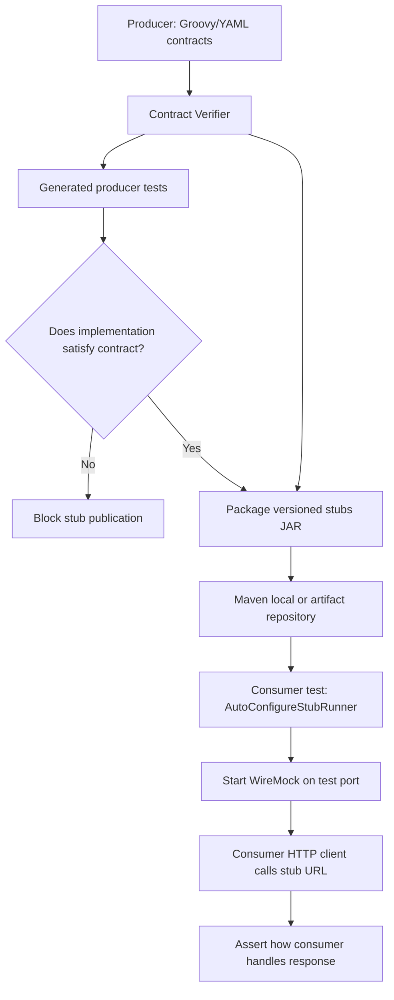
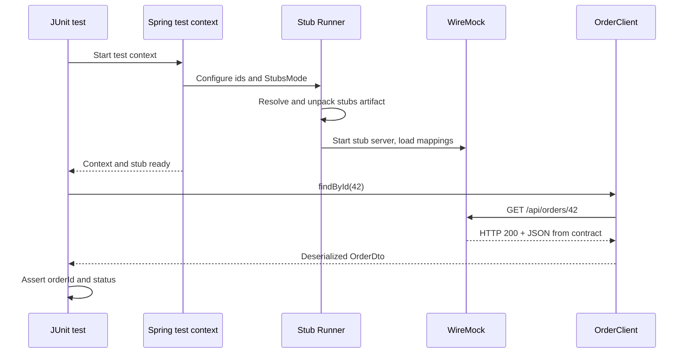
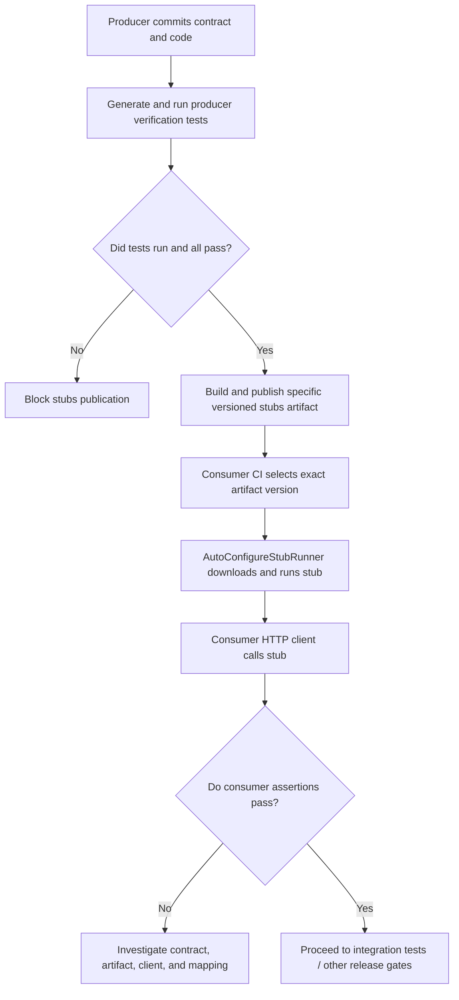

# Starting with @AutoConfigureStubRunner

## 1. Why does the consumer need to start stubs automatically?

In **Spring Cloud Contract**, a contract describes the HTTP or messaging behavior that a **producer** commits to for a **consumer**. Contracts can be written in Groovy/YAML DSL; the tool generates **producer verification tests** and a **stubs artifact**. The consumer uses those stubs to test its service-calling logic without starting the real producer. CI can detect incompatible APIs before release.

Suppose the `checkout-service` application needs to call `order-service`:

```http
GET /api/orders/42
Accept: application/json
```

And handle:

```http
HTTP/1.1 200 OK
Content-Type: application/json

{"orderId":42,"status":"CONFIRMED"}
```

The consumer could write a manual HTTP mock returning that exact JSON, but such a mock can easily **drift away from the contract that the producer is actually verifying**. `@AutoConfigureStubRunner` lets a Spring Boot test automatically **locate, download/load, start, and manage** the stubs published by the producer according to test configuration, typically serving HTTP via WireMock.

This is the core difference: **the consumer still makes HTTP calls through the application's real client**, only the target address is switched to the stub server; the contract and producer implementation are verified in a separate producer pipeline.

After this lesson, you will be able to:

1. Understand the role and lifecycle of `@AutoConfigureStubRunner` in a Spring Boot integration test.
2. Prepare a stubs JAR and declare `ids`, `stubsMode`, port, and repository properly.
3. Connect the **consumer's real HTTP client** to the stub and write meaningful assertions.
4. Choose `LOCAL`, `REMOTE`, or `CLASSPATH` depending on the environment.
5. Debug errors such as "cannot download stub", "starts up but client still calls the real service", "WireMock returns 404", and port conflicts.
6. Integrate consumer tests into CI without mistaking a passing stub test for a verified producer.

## 2. Execution flow from producer contract to consumer



| Side | What runs for real | Verification result |
| --- | --- | --- |
| **Producer** | Producer's controller/HTTP server or message publisher in the test environment | Implementation produces response/message matching the contract |
| **Stub Runner** | WireMock mapping or messaging stub from the artifact | Returns/emits sample data described by the contract |
| **Consumer** | Consumer's HTTP client, deserializer, and business logic | Consumer properly handles a valid or simulated error scenario |

**Stub Runner does not start the full `order-service`** and does not replace producer verification. It starts a simulation layer based on existing stubs. If the producer changes its API after an older artifact was published, a consumer test using the old stub may still pass. Therefore, producer test results and stubs JAR versions must be linked in CI.

## 3. Prerequisites before adding the annotation

For `@AutoConfigureStubRunner` to work meaningfully, the following conditions must be met:

- **Producer has contracts:** request/response, method, URL, headers, body, and matchers are defined, with at least one matching scenario.
- **Producer has generated and run generated tests:** not just DSL source files without knowing whether the implementation complies.
- **Stubs artifact is packaged:** for HTTP, typically a JAR with the `stubs` classifier containing WireMock mappings and required response files.
- **Artifact is locatable:** in the local Maven repository, a remote artifact repository, or the classpath depending on `StubsMode`.
- **Consumer has compatible test dependencies:** Spring Cloud Contract/Stub Runner versions compatible with the Spring Boot/Spring Cloud versions in use.
- **Consumer client can switch its base URL:** tests must point to the stub rather than calling the real producer or the wrong localhost port.
- **Test context has a clear lifecycle:** Stub Runner is initialized before consumer tests send requests, and resources and ports do not collide with other suites.

Illustrative artifact coordinates:

```text
groupId:    com.example
artifactId: order-service
version:    1.5.0
classifier: stubs
file:       order-service-1.5.0-stubs.jar
```

These are **sample coordinates**; `1.5.0` is not the Spring Cloud Contract version, but the **producer artifact version**. In a real project, producer and consumer must agree on the published/tested version. If the producer has not attached the stubs JAR to its Maven/Gradle publication, adding the Stub Runner dependency on the consumer **will not automatically create** that artifact.

### Creating stubs on the producer (Maven example)

With a producer **already configured** with `spring-cloud-contract-maven-plugin`, a test base class, and packaging/publishing permissions:

```bash
./mvnw clean verify
./mvnw install
```

The `install` command places the artifact into the local Maven repository; the stubs JAR is present only if the plugin is configured to attach/package it properly. Inspect the build output, test reports, and artifacts in the local repository. Do not assume `BUILD SUCCESS` always means generated contract tests ran or the stubs JAR exists. With Gradle, generate, verify, and publish tasks depend on the configured plugin/version and publications.

## 4. Adding the Stub Runner dependency for consumer tests

A Spring Boot consumer application typically declares the test starter:

```xml
<!-- pom.xml: place inside the consumer's dependencies -->
<dependency>
    <groupId>org.springframework.cloud</groupId>
    <artifactId>spring-cloud-starter-contract-stub-runner</artifactId>
    <scope>test</scope>
</dependency>
```

Or Gradle:

```groovy
dependencies {
    testImplementation 'org.springframework.cloud:spring-cloud-starter-contract-stub-runner'
}
```

These examples assume the project already manages **Spring Boot/Spring Cloud dependency versions** via a BOM or compatible versions. Do not arbitrarily mix older Spring Cloud Contract versions with newer Spring Boot versions; you may encounter auto-configuration, Java classpath, or test runtime errors before any stub starts. For applications not using Spring Boot, `StubRunnerExtension`, `StubRunnerRule`, or the corresponding API may be needed instead of `@AutoConfigureStubRunner`.

### Annotation belongs to the testing phase

`@AutoConfigureStubRunner` usually belongs on **consumer integration test classes**, not as an annotation to start stubs in production. Common imports:

```java
import org.springframework.cloud.contract.stubrunner.spring.AutoConfigureStubRunner;
import org.springframework.cloud.contract.stubrunner.StubRunnerProperties;
```

APIs and package names must be verified against the Spring Cloud Contract version used by the project. Never add Stub Runner to the production runtime just because tests need a mock server.

## 5. Minimal example: starting an HTTP stub via annotation

This is the central configuration of the lesson:

```java
import org.junit.jupiter.api.Test;
import org.springframework.beans.factory.annotation.Autowired;
import org.springframework.boot.test.context.SpringBootTest;
import org.springframework.cloud.contract.stubrunner.StubRunnerProperties;
import org.springframework.cloud.contract.stubrunner.spring.AutoConfigureStubRunner;

import static org.assertj.core.api.Assertions.assertThat;

@SpringBootTest(properties = {
    "clients.order.base-url=http://localhost:9090"
})
@AutoConfigureStubRunner(
    ids = "com.example:order-service:1.5.0:stubs:9090",
    stubsMode = StubRunnerProperties.StubsMode.LOCAL
)
class CheckoutOrderContractTest {

    @Autowired
    OrderClient orderClient;

    @Test
    void shouldUseOrderServiceStub() {
        OrderDto result = orderClient.findById(42);
        assertThat(result.orderId()).isEqualTo(42L);
        assertThat(result.status()).isEqualTo("CONFIRMED");
    }
}
```

This example assumes **the consumer application has an `OrderClient` bean and `OrderDto` DTO** as shown in the next section, along with a loaded contract for `GET /api/orders/42`. The test sends HTTP through the real client and verifies the deserialized data. Proper configuration and dependencies are required to execute; merely adding the annotation without a real client or stub artifact will not produce a meaningful test.

Annotation parts:

| Configuration | Role |
| --- | --- |
| `@SpringBootTest` | Initializes the consumer's Spring Boot application context |
| `@AutoConfigureStubRunner` | Adds auto-configuration to run/load stubs into the context |
| `ids` | Selects the stubs artifact and corresponding WireMock port |
| `stubsMode = LOCAL` | Looks up the artifact in the local Maven repository |
| `clients.order.base-url` | Example property defined by the consumer app to point the client to the stub |

**Note:** `clients.order.base-url` is not a mandatory Spring Cloud Contract property. It is a **hypothetical application setting** to illustrate replacing a real endpoint with a stub. If the HTTP client in your project uses a different property (e.g., `order.api.url`), you must set the exact property the client actually reads.

## 6. Making the test call for real: implementing a simple HTTP client

A valid annotation where the test calls nothing does not verify the contract. We must ensure **the consumer application's outbound HTTP path** actually uses `clients.order.base-url`.

Example of a small client using `RestTemplate`:

```java
package com.example.checkout;

import org.springframework.beans.factory.annotation.Value;
import org.springframework.boot.web.client.RestTemplateBuilder;
import org.springframework.stereotype.Component;
import org.springframework.web.client.RestTemplate;

@Component
public class OrderClient {
    private final RestTemplate restTemplate;

    public OrderClient(
            RestTemplateBuilder builder,
            @Value("${clients.order.base-url}") String baseUrl) {
        this.restTemplate = builder.rootUri(baseUrl).build();
    }

    public OrderDto findById(long id) {
        return restTemplate.getForObject(
            "/api/orders/{id}", OrderDto.class, id);
    }
}

record OrderDto(long orderId, String status) {}
```

This example targets Java versions supporting `record`; if your project uses an older Java version, replace the DTO with a class having appropriate constructors/getters for the JSON deserializer. `OrderClient` and `OrderDto` are illustrative code that must be placed in the proper package and component-scanning configuration of your project, **not built-in Spring Cloud Contract classes**.

In the test in section 5, the property `clients.order.base-url=http://localhost:9090` causes `RestTemplate` to call the WireMock server started by Stub Runner. When the JSON response contains `orderId = 42` and `status = CONFIRMED`, assertions prove the consumer reads both fields from the sample response properly.

### Testing the 404 error branch

If the producer has a separate contract for `GET /api/orders/999` returning:

```json
{
  "code": "ORDER_NOT_FOUND",
  "message": "Order does not exist"
}
```

then `RestTemplate` with default configuration will throw `HttpClientErrorException.NotFound`. The consumer test can read the response body and verify the error code, rather than treating every 404 as a single valid scenario:

```java
@Autowired
OrderClient orderClient;

@Autowired
ObjectMapper objectMapper;

@Test
void shouldHandleMissingOrder() throws Exception {
    HttpClientErrorException.NotFound exception = assertThrows(
        HttpClientErrorException.NotFound.class,
        () -> orderClient.findById(999)
    );
    JsonNode error =
        objectMapper.readTree(exception.getResponseBodyAsString());
    assertThat(error.path("code").asText())
        .isEqualTo("ORDER_NOT_FOUND");
}
```

The test snippet above requires JUnit/Jackson/Spring imports appropriate for the project and must be inside a class configured with `@SpringBootTest` and `@AutoConfigureStubRunner`. If the application's real client translates the exception into an `Optional`, sealed result, or another business exception, assert **that real client behavior** instead of creating a second test-only client.

**Key point:** WireMock can return a **default 404 when no mapping is found**, and that 404 will not necessarily contain the `ORDER_NOT_FOUND` JSON. Asserting only status 404 can produce a false pass. Check `Content-Type` and the body/error code the consumer actually relies on.

## 7. Understanding `ids` syntax: which artifact, which port?

With Stub Runner, a common format in `ids` is:

```text
groupId:artifactId:version:classifier:port
```

Example:

```text
com.example:order-service:1.5.0:stubs:9090
```

| Part | Value | Meaning |
| --- | --- | --- |
| `groupId` | `com.example` | Producer's Maven/Gradle group |
| `artifactId` | `order-service` | Artifact name |
| `version` | `1.5.0` | Published producer/stubs version |
| `classifier` | `stubs` | Selects the stubs artifact, not the executable application JAR |
| `port` | `9090` | Instructs Stub Runner to run the HTTP stub on this port |

Do not confuse `version` here with the Spring Cloud Contract version. A project can use Spring Cloud Contract 4.x while loading the `order-service` stubs JAR version `1.5.0` as long as the dependency set is compatible.

### Loading multiple producer stubs

A consumer may call multiple services:

```java
@AutoConfigureStubRunner(
    ids = {
        "com.example:order-service:1.5.0:stubs:9090",
        "com.example:inventory-service:2.1.0:stubs:9091"
    },
    stubsMode = StubRunnerProperties.StubsMode.LOCAL
)
```

In that case, **each HTTP client** must be configured to point to its corresponding port: the order client to `9090`, the inventory client to `9091`. If both use `localhost:9090`, one request might fail to match any mapping and return a false 404 or receive a response from the wrong source. Avoid assigning the same port to two different WireMock servers.

### When the port is omitted

Stub Runner supports **dynamic port** selection in appropriate configurations. This is a good choice when CI runs multiple jobs or parallel tests where fixed ports could be occupied. However, **the client must also receive the actual port after the stub starts**: if `9090` remains hardcoded, dynamic port allocation on the server is pointless.

With Stub Runner's Spring integration, you can check `@StubRunnerPort` or the stub URL lookup bean/API (`StubFinder`, depending on version). When using them, verify how the stub is identified in the annotation and when the port is retrieved from the test context; do not guess the URL before the stub initializes. For instance, rather than using one port project-wide, test setup can retrieve the port of `order-service` from Stub Runner and pass it to the HTTP client.

**Practical rule:** Start with a fixed port in labs to clearly observe requests. When moving into parallel test suites, switch to dynamic port allocation and configure clients using the address published by Stub Runner.

## 8. Three stub resolution modes: LOCAL, REMOTE, and CLASSPATH

`StubRunnerProperties.StubsMode` determines where Stub Runner looks for simulation data.

| Mode | Stub source | When to use | Risks |
| --- | --- | --- | --- |
| **LOCAL** | Local Maven repository of the test environment | Producer and consumer developed on the same machine; CI installs artifacts locally | Artifact not installed yet, stale, or wrong version |
| **REMOTE** | Configured artifact repository | Producer CI publishes, consumer downloads versioned artifacts independently | Wrong URL, permissions, missing artifact/version, network |
| **CLASSPATH** | Stub resources present on the test classpath | Self-contained test suites, demos, or pre-packaged cases | Easy to use outdated fixtures if revisions and sources aren't managed |

### 8.1. LOCAL: ideal for the first hands-on lab

Minimal workflow:

```text
Producer:
  write Groovy/YAML contract
  → run generated producer tests
  → package and install stubs artifact version 1.5.0

Consumer:
  @AutoConfigureStubRunner(ids=...:1.5.0:stubs:9090, LOCAL)
  → Stub Runner finds stubs artifact in local Maven repository
  → runs WireMock stub
  → consumer client calls localhost:9090
```

`LOCAL` **does not automatically trigger a producer build**. If `order-service-1.5.0-stubs.jar` is missing from the local repository, or the producer has new changes that weren't reinstalled, the consumer may use an old build or fail to resolve the stub.

### 8.2. REMOTE: suitable for multi-repository CI

Example annotation configuration when the project downloads from a compatible Maven repository:

```java
@AutoConfigureStubRunner(
    ids = "com.example:order-service:1.5.0:stubs:9090",
    stubsMode = StubRunnerProperties.StubsMode.REMOTE,
    repositoryRoot = "https://repo.example.org/maven-releases"
)
```

`repositoryRoot` is an example URL and must be replaced with the actual artifact repository address. Credentials/accounts should be supplied via environment variables or CI secret management mechanisms, never hardcoded in annotations or committed to the repository. For release pipelines, use a **fixed, verified version**, not a value that can silently change and cause today's test to download a different artifact than yesterday's.

If the repository lacks the `stubs` classifier or the consumer uses the wrong group/artifact/version, Stub Runner will not guess how to fix the coordinates. Read the artifact resolution logs and cross-check the producer's publication.

### 8.3. CLASSPATH: when stubs travel with the tests

`CLASSPATH` uses stub data already on the test classpath according to the structure supported by the running Stub Runner/plugin version. This can be an option for demos or test suites bundling their own fixtures.

However, **placing an arbitrary JSON file under `src/test/resources` may not be enough** for Stub Runner to recognize a valid artifact/mapping. Check the resource layout expected by your Stub Runner version and verify the mapping is actually loaded. If a team uses CLASSPATH to bypass producer publication, there must be a process to update fixtures alongside new contracts to prevent drift.

## 9. Configuring via annotation or properties?

`@AutoConfigureStubRunner` declares configuration directly on the test class, which is convenient when the test only needs one or two simulated services. For larger suites, configuration can be extracted to `application-test.yml` or test properties using the property names supported by your Stub Runner version.

Illustrative example for a test application profile:

```yaml
stubrunner:
  ids:
    - "com.example:order-service:1.5.0:stubs:9090"
  stubs-mode: LOCAL

clients:
  order:
    base-url: http://localhost:9090
```

The `stubrunner.ids` and `stubrunner.stubs-mode` property names in the example must be verified against your Spring Cloud Contract version's configuration, and the test must actually **enable Stub Runner auto-configuration**. Do not assume declaring YAML alone starts a stub server if the test does not use the corresponding annotation/extension/activation mechanism.

A useful configuration rule: **define the port and base URL in the same easily cross-referenced place**. Avoid `ids` pointing to 9090 while `clients.order.base-url` still points to 8080 in an old profile.

## 10. Startup lifecycle: from test context to request

In a `@SpringBootTest` annotated with `@AutoConfigureStubRunner`, conceptually the steps proceed as follows:



The diagram highlights that the consumer test **does not need to talk to the real producer**. What must be established at test execution time is that WireMock loaded the expected mapping and the client was configured with its exact address.

### Does setup order matter?

Yes. If an HTTP client locks in its base URL inside its constructor when the Spring context is created, yet you attempt to fetch a dynamic port **after** the client is initialized, the client may retain the old address. Choose a consistent strategy:

- **Fixed port in labs:** `ids` and the base URL property share a known port.
- **Dynamic port in CI:** integrate port retrieval from Stub Runner following the lifecycle and injection mechanism supported by your version; avoid assigning a value too late.
- **Client building requests dynamically:** if a mechanism exists to pass the URL per test, retrieve the port from the Stub Runner bean before sending.

Do not start an extra WireMock server on the same port manually if `@AutoConfigureStubRunner` already manages the stub server. Two mechanisms owning the same port/lifecycle often cause conflicts or mappings loaded into the wrong instance.

### Context caching and isolation

The Spring test context can be cached and reused across test classes. When classes have different stub configurations, verify that test contexts are separated properly, WireMock mappings/state are reset when needed, and fixtures do not introduce test-order dependencies.

If using stateful **WireMock scenarios**, one test might leave a scenario in `Paid`, causing a subsequent test expecting `Started` to receive a different response. Do not assume every test with `@AutoConfigureStubRunner` starts a fresh isolated server or automatically resets all application state. Reset/isolate according to the capabilities and test lifecycle configured.

## 11. Verifying that stubs are loaded and requests match

Once the test starts, you can call the stub with an HTTP client or manual command during a lab:

```bash
curl -i -H 'Accept: application/json' \
  http://localhost:9090/api/orders/42
```

Expect a **mapping generated from the contract** to match the request and return:

```http
HTTP/1.1 200 OK
Content-Type: application/json

{"orderId":42,"status":"CONFIRMED"}
```

This is an example output per the contract. If the producer/stub configuration returns additional headers or slightly different JSON formatting while keeping the schema intact, compare against what the consumer actually uses. JSON object key ordering and whitespace are not business constraints unless specified by the contract.

### Two types of 404 that look alike

| Situation | Why does it happen? | How to distinguish |
| --- | --- | --- |
| **Committed API 404** | Mapping for `GET /api/orders/999` intentionally returns `404 ORDER_NOT_FOUND` | Body/headers contain the business error code protected by the contract |
| **Unmatched stub 404** | No mapping matches the requested path/method/headers/body | Body may be WireMock default/diagnostic output; inspect mappings and request journal |

When testing `GET /api/orders/42` expecting 200 but receiving 404, inspect the **method, URL, query parameters, headers, and request body** that the HTTP client actually sends. If the contract requires `Accept: application/json` but the client omits it, the mapping may fail to match. If the client calls `/orders/42` instead of `/api/orders/42`, fix the path/client configuration accordingly; do not alter the contract arbitrarily.

### Headers and body can cause mismatches

A contract for `POST /api/orders` might require:

```http
POST /api/orders HTTP/1.1
Content-Type: application/json

{"customerId":"cust-123","quantity":2}
```

If the client sends `quantity` as string `"2"`, or sends the wrong Content-Type, the mapping may not match even though the URL is right. Inspect the **actual HTTP request**, not just the method called in code. In some modes, Stub Runner logs mappings and WireMock diagnostics can help compare the "closest match" with the request; how to view logs depends on version.

### Do not edit generated mappings directly

If the producer published a contract with `status`, but the consumer wants `state`, do not manually edit mappings inside the local JAR to make tests pass. The right place to fix it is usually:

1. Clarify the API agreement between producer and consumer.
2. Update the producer implementation or the agreed contract.
3. Rerun producer verification.
4. Package/publish a new artifact.
5. Have the consumer update the version and rerun tests.

Hand-edited, unversioned mappings defeat the purpose of "stubs generated from a shared contract source."

## 12. Troubleshooting common Stub Runner startup errors

| Symptom | Possible cause | How to check |
| --- | --- | --- |
| Test context fails creating Stub Runner | Incompatible Spring Boot/Spring Cloud Contract versions or missing auto-config bean | Inspect root cause, dependency tree, and BOM |
| `Cannot resolve stubs` / artifact not found | Wrong group/artifact/version/classifier or artifact not installed/published | Verify `ids`, local repository, or remote repository |
| `LOCAL` uses stale stub | Producer changed contract without reinstalling under a new build/version | Check timestamps, metadata, and artifact hashes; prefer bumping version |
| `REMOTE` returns 401/403 | Wrong repository credentials/permissions | Check secrets/permissions; do not log tokens |
| `REMOTE` returns 404 | Repository lacks the requested `stubs` version | Check publication and `repositoryRoot` |
| `Address already in use` | Port `9090` is already occupied by another test or real app | Choose another port or dynamic port, isolate tests |
| WireMock runs but consumer calls production | Client base URL/profile not overridden | Check final target endpoint of the HTTP client |
| WireMock returns 404 | Request does not match stub mapping | Compare path, method, query, headers, body, and artifact version |
| Consumer fails to decode JSON | Incompatible response schema/Content-Type, DTO, or deserializer | Compare actual body against contract |
| Test passes locally but fails in CI | `LOCAL` mode missing artifact, port conflict, or different profile | Pin version, use `REMOTE`/proper CI install, log port |
| Flaky tests | Shared WireMock scenario/request state, parallel tests, or stale fixtures | Reset/isolate server, control lifecycle |
| Green build but missing required scenarios | Generated stubs missing contract due to filter/source root or stale version | Check source files and count of actually loaded mappings |

### Outside-in debugging workflow template

1. **Artifact:** Does the stubs JAR exist with the right version and classifier?
2. **Startup:** Does the test context start Stub Runner cleanly?
3. **Port:** Which port is the stub server listening on? Which port does the consumer client target?
4. **Mapping:** Does the artifact contain a mapping for the request being tested?
5. **Request:** Do the actual method, path, query, headers, and body match the mapping?
6. **Response:** Do the served status/headers/body match the contract?
7. **Consumer:** Does the client deserialize and process the result using real application logic?

Following this order avoids changing consumer or producer code just for a wiring/packaging mistake.

## 13. Integrating into CI: which artifact counts as verified?

A pipeline might run consumer tests with Stub Runner without knowing whether that artifact still represents the current producer. To protect API compatibility, connect the two flows:



### Producer CI

The producer job should:

- Read the proper Groovy/YAML contracts source and generate tests/stubs.
- Verify **generated producer tests actually ran** and passed; a build success with `0 contract tests` does not qualify.
- Ensure the `stubs` artifact is built from **the exact same revision** being verified.
- Record artifact coordinates and source commit in build metadata.
- Only publish the version for consumer use after verification passes.

Producer Maven example (when the plugin is integrated into the lifecycle):

```bash
./mvnw -B clean verify
./mvnw -B deploy
```

`deploy` may trigger earlier lifecycle phases per Maven, yet CI must still verify test reports and artifact publication. If `deploy` does not attach the stubs artifact due to missing plugin configuration, `REMOTE` will fail to find `:stubs`. With Gradle, publish tasks and contract-test tasks must be wired according to project setup.

### Consumer CI

The consumer job should:

- Select a **pinned stub version**, avoiding snapshots that can silently mutate between runs.
- Configure `REMOTE` with an authorized repository, or `LOCAL` if the pipeline has a prior step installing the producer artifact.
- Use `@AutoConfigureStubRunner` together with the client's HTTP base URL in the test profile.
- Run integration tests through **the application's real client** and assert business successes/errors.
- Log the stubs version, port, number of executed tests, and exact resolved artifact.

If the pipeline only tests one success response while the consumer also depends on `404`, `409`, or `400` request validation, add those contract scenarios and consumer tests. Stub Runner **does not invent error scenarios that the producer did not describe**.

### Keeping secrets safe and network stable

When using a REMOTE repository, never place username/password or tokens inside `ids` or Java code. Use your CI secrets manager or secure Maven/Gradle credentials configuration. Proxy, TLS, internal network, and artifact caching configurations can differ from local; when debugging, log only artifact coordinates and HTTP status codes during download—never print authorization headers.

## 14. When do you need dynamic stubs or stateful scenarios?

`@AutoConfigureStubRunner` starts/loads **existing stubs**; it does not infer business workflows or producer data state. A default mapping simply returns a sample response whenever a request matches.

For example:

- `GET /api/orders/42` returns `200 CONFIRMED` on every call.
- `GET /api/orders/999` returns `404 ORDER_NOT_FOUND` on every call.

If the consumer needs to test **create order → view order → pay**, you may need WireMock scenarios or a stateful fake service. However, scenarios must be **explicitly declared and loaded**; merely placing multiple contracts with the same method/path in the stubs artifact does not teach WireMock business ordering.

### What Stub Runner does not prove

| Question | Can Stub Runner help? | What else is needed? |
| --- | --- | --- |
| Does the consumer parse responses per the contract? | **Yes** | Consumer integration test |
| Does the consumer handle `404`, `409` branches correctly? | **Yes**, if corresponding mappings exist | Assertions on client logic |
| Does the real producer currently return that response? | **No** | Generated producer tests |
| Is the order persisted to DB and read back properly? | **No** | Producer integration test with DB |
| Are payment transactions protected against double execution? | **No** | Idempotency/concurrency tests |
| Do production gateway/security/filters work properly? | Not automatically | Appropriate HTTP integration/E2E tests |
| Do retries, timeouts, and circuit breakers work during network faults? | Only with configured simulation | Fault-injection/resilience tests |

Running consumer tests with stubs is an **interface protection layer**, not a replacement for all business testing.

### Asynchronous messaging

Spring Cloud Contract also supports messaging stubs. In supported integrations, Stub Runner can work with `StubTrigger` to emit sample messages by contract `label`, provided a compatible **messaging adapter/binder** is configured and the consumer listener actually receives them. This differs from the WireMock HTTP flow:

```text
HTTP:
  client calls WireMock → WireMock returns status, headers, body

Messaging:
  test calls StubTrigger → adapter emits message → listener processes it
```

Do not assume simply adding `@AutoConfigureStubRunner` provisions and configures Kafka/RabbitMQ. If the application does not use messaging, no messaging adapter is needed for this HTTP lesson.

## 15. Hands-on exercise: from stubs JAR to green consumer tests

### Context

`order-service` exposes the API:

- `GET /api/orders/42` returns HTTP `200`, JSON `{"orderId":42,"status":"CONFIRMED"}`.
- `GET /api/orders/999` returns HTTP `404`, JSON with `code = ORDER_NOT_FOUND`.

`checkout-service` has `OrderClient` calling the API to display order status or a "not found" message. The goal is **not starting `order-service` during consumer tests**.

### Task A — Declare contracts on the producer side

A contract YAML for the success case:

```yaml
description: Order 42 is confirmed
request:
  method: GET
  url: /api/orders/42
  headers:
    Accept: application/json
response:
  status: 200
  headers:
    Content-Type: application/json
  body:
    orderId: 42
    status: "CONFIRMED"
```

Another YAML for the not-found case:

```yaml
description: Order 999 not found
request:
  method: GET
  url: /api/orders/999
response:
  status: 404
  headers:
    Content-Type: application/json
  body:
    code: "ORDER_NOT_FOUND"
    message: "Order does not exist"
```

Place them as **two separate contract files** inside the source root recognized by the plugin and verify generated producer tests actually run. Do not use an identical path for both 200 and 404 responses unless request conditions or state distinguish them.

### Task B — Build the artifact

On the producer, configure the Contract Verifier plugin and base class, seed necessary test data, run verification, and install/publish the stubs JAR. Verify the loaded artifact has classifier `stubs` and version `1.5.0` as in the example; actual versions must match the producer build.

### Task C — Start Stub Runner on the consumer

Add `@SpringBootTest` and `@AutoConfigureStubRunner` as in section 5:

```java
@SpringBootTest(properties =
    "clients.order.base-url=http://localhost:9090")
@AutoConfigureStubRunner(
    ids = "com.example:order-service:1.5.0:stubs:9090",
    stubsMode = StubRunnerProperties.StubsMode.LOCAL
)
```

In the test, inject the **real `OrderClient`** and verify:

1. Calling `findById(42)` yields an `OrderDto` with `orderId = 42` and `status = CONFIRMED`.
2. Calling `findById(999)` produces the error/client result containing code `ORDER_NOT_FOUND`.
3. Sending a request with the wrong path/missing required header (if constrained by contract) confirms the mapping does not accept it as a valid request.
4. Intentionally change the client property to `http://localhost:8080` to observe failure when not calling the stub (assuming no service runs on that port).
5. If there are multiple services, add an inventory stub on another port and verify each client selects the right server.

### Task D — Breaking change comparison

Have the real producer rename response field `status` to `state` **without updating the contract**. Generated producer tests must catch this because older consumers depend on `status`. If you only update the stub to return `state` and update the consumer accordingly, tests may pass, yet **that does not prove the current producer complies with the new contract**.

When making a real interface change, the producer and supported consumers must coordinate the transition, update contracts, build/verify the new stubs artifact, and run consumer tests against the new version. Never edit files in the local repository to hide changes.

### Expected outcomes

| Experiment | Expected outcome | Meaning |
| --- | --- | --- |
| Stub Runner loads `1.5.0:stubs` properly | Server ready at `9090` | Artifact/port correct |
| Consumer calls `GET /api/orders/42` | Reads `orderId=42`, `status=CONFIRMED` | Client understands sample response |
| Consumer calls `GET /api/orders/999` | Error handler receives `ORDER_NOT_FOUND` | Distinguishes business 404 |
| Client calls wrong base URL | Does not receive expected stub response | Proves URL override is effective |
| Producer renames `status` to `state` | Producer verification fails | Contract catches breaking change |
| Consumer uses old artifact despite producer changes | Consumer may still pass | Stale stub does not prove new producer |
| CI has 0 generated tests on producer | Release gate must block | Avoids leaving protection gaps |

## 16. Common misconceptions about test scope

### Misconception 1 — "Having the annotation means the producer has been tested"

`@AutoConfigureStubRunner` only helps **consumer tests load and use stubs**. It does not start the real producer, run generated producer tests, or check the producer's DB/broker state. For independently deployed services, keep separate producer verification and stubs publication pipelines.

### Misconception 2 — "Stub returns 200 so all production endpoints are right"

A stub mapping returns sample JSON from the contract. It has no database, service implementation, or real data. For example, a consumer test reading `ord-42` successfully only proves the client can handle **that example**; to test statuses like `PAID`, `CANCELLED`, or null/optional values, add appropriate contract scenarios and consumer tests.

### Misconception 3 — "Having a 404 stub means every error test passes accurately"

HTTP `404` alone is insufficient to distinguish a business error from **an unmatched request**. If the consumer relies on `ORDER_NOT_FOUND`, assert that code; if the error client only inspects HTTP status, review the clarity of the API contract and the branches the application relies on.

### Misconception 4 — "Any version works since the JSON looks the same"

An artifact `order-service:1.4.0:stubs` might lack error responses or new headers introduced in `1.5.0`. Selecting the right version and explicitly recording the artifact in CI are essential for test traceability. For consumer deployments supporting multiple producer versions, define a **compatibility matrix** rather than testing only the latest version.

### Misconception 5 — "Changing only the stub port makes the client follow automatically"

WireMock's port and the HTTP client's base URL are **two separate settings**. A client that captures its URL at bean creation time may keep calling the old address even if Stub Runner opens another port. When using dynamic ports, injection must rely on the test context lifecycle and be verified with real requests.

### Misconception 6 — "Passing consumer tests prove the server sends the same response in production"

Generated producer tests are only as reliable as the **configured producer test environment**. If dependencies are mocked or security/gateways are bypassed, those parts remain unverified. Stub Runner is yet another simulation layer. To verify transactions, persistence, authorization, retries, or cross-service behavior, properly scoped integration/E2E tests are required.

## 17. Checklist for starting and using @AutoConfigureStubRunner

- [ ] Groovy/YAML contracts exist covering all HTTP scenarios the consumer depends on.
- [ ] Producer generated tests were **generated and executed**, not accidentally skipped or running 0 tests.
- [ ] Stubs JAR has classifier `stubs` and is installed/published from a verified revision.
- [ ] Consumer has the Stub Runner dependency compatible with Spring Boot/Spring Cloud versions.
- [ ] `@AutoConfigureStubRunner` resides in an appropriate test context, never running in production.
- [ ] `ids` contains the exact group, artifact, version, classifier, and port matching the published artifact.
- [ ] `StubsMode.LOCAL`, `REMOTE`, or `CLASSPATH` is chosen based on where the artifact actually resides.
- [ ] If using `REMOTE`, `repositoryRoot` and credentials are configured securely.
- [ ] WireMock server started and loaded required mappings without port conflicts.
- [ ] The **consumer's real HTTP client** calls the right stub host/port/path.
- [ ] Tests contain assertions on responses and consumer logic, not merely verifying the annotation loads.
- [ ] Business errors are verified for both HTTP status and critical error codes/bodies.
- [ ] Request matchers for method, URL, query, headers, and body are preserved accurately.
- [ ] If using dynamic ports or multiple stubs, each client receives the URL of its respective server.
- [ ] If tests use scenario state, reset/isolation is verified to avoid interference during parallel runs.
- [ ] CI uses the exact stubs artifact version, archives test reports, and blocks release if producer verification fails.
- [ ] Guarantees outside the contract (DB, broker, security, concurrency, timeouts) have supplementary tests as needed.

**Remember:** `@AutoConfigureStubRunner` is a clean way to **start stubs in Spring Boot consumer tests** from contracts verified by the producer. For tests to be valuable, you must have **the right artifact version**, **WireMock running on the right port**, **the consumer client calling the right stub**, and **assertions genuinely verifying behavior**. Combining producer verification, Stub Runner consumer tests, and CI catches incompatible API changes without starting the entire producer in every consumer test.
