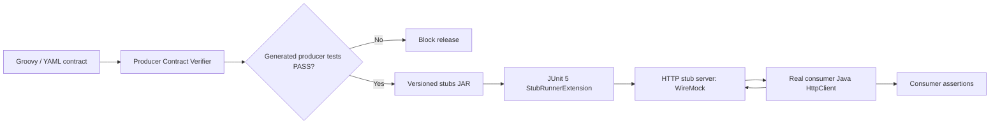
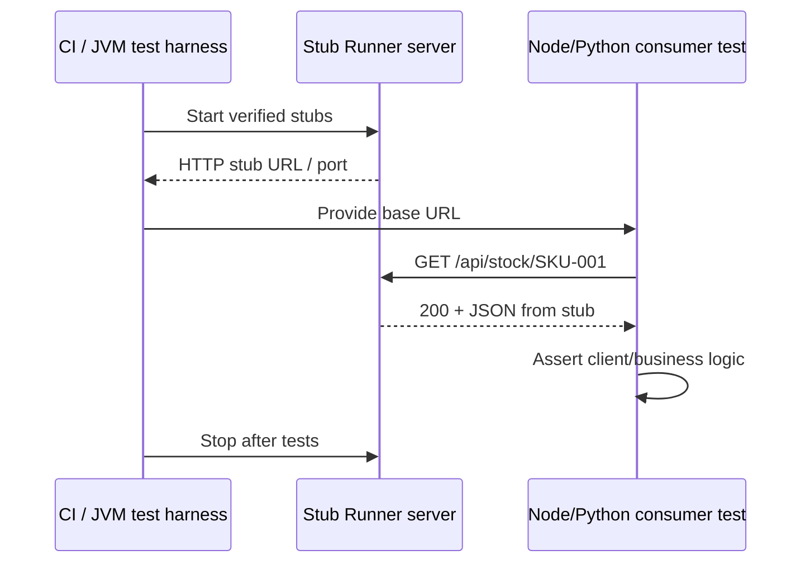
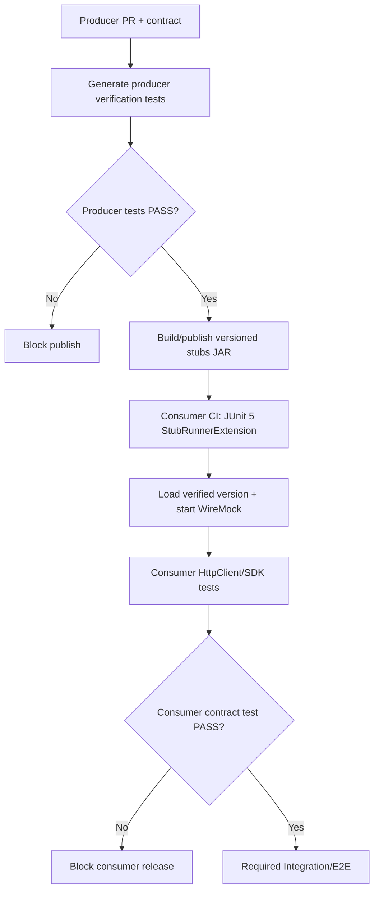

# StubRunnerExtension and Non-Spring Test Usage When Supported

> **Chapter:** Stub Runner  
> **Module:** Spring Cloud Contract (`SPRING_CLOUD_CONTRACT`) — contract testing between producer and consumer using Groovy/YAML DSL for HTTP or messaging, generating producer tests, publishing stubs, using Stub Runner, and integrating with CI to detect incompatible API changes.

## Learning objectives

After this lesson, you will be able to:

1. Explain what **StubRunnerExtension** does in JUnit 5 and how it differs from `@AutoConfigureStubRunner` and `StubRunnerRule`.
2. Distinguish between **not requiring a Spring ApplicationContext in the test** versus **not requiring Spring Cloud Contract libraries** or **running outside the JVM**.
3. Prepare a producer-verified stub JAR, declare Maven coordinates, and use `LOCAL` or `REMOTE` mode appropriately.
4. Write a JUnit 5 consumer test using **Java HttpClient** and `StubRunnerExtension`, without `@SpringBootTest` or Spring DI.
5. Look up the actual stub URL/port using `findStubUrl(...)` instead of hardcoding a fixed port.
6. Understand how stubs start and stop across the extension lifecycle, how to debug mappings, handle missing-artifact errors, and the limitations of messaging stubs.
7. Integrate the extension into a CI pipeline so consumer tests use the **exact stub version**, while producer verification still runs independently and is never skipped.

## 1. Why do you need a Stub Runner without Spring tests?

Imagine `checkout-service` calls `inventory-service`:

```http
GET /api/stock/SKU-001 HTTP/1.1
Accept: application/json
```

The producer `inventory-service` commits to returning:

```http
HTTP/1.1 200 OK
Content-Type: application/json

{
  "sku": "SKU-001",
  "available": true,
  "quantity": 4
}
```

The consumer could be:

- A Spring Boot application using `@SpringBootTest`.
- A Java library using `java.net.http.HttpClient`.
- Another JVM application **that does not start a Spring ApplicationContext in tests**.
- A non-JVM application, such as Node.js or Python, which can call an **HTTP stub server started by an external process**.

Not every consumer test needs to spin up a Spring Boot context, autowire `StubFinder`, or use `@AutoConfigureStubRunner`. For JUnit 5, Spring Cloud Contract provides `StubRunnerExtension` so tests can manage the stub lifecycle directly via a **JUnit extension**.

**Important terminology boundary:**

- **"Outside Spring tests"** here means the test **does not rely on Spring TestContext/`@SpringBootTest`** to start stubs.
- `StubRunnerExtension` **is still a Java/JUnit API belonging to Spring Cloud Contract**, with runtime library dependencies.
- A Node.js/Python program cannot directly attach a Java `@RegisterExtension`; if shared stubs are needed from those applications, start an **external Stub Runner server/Boot application or HTTP mock service** and call it over the network.
- The producer can be written in Spring or another framework; what the consumer side requires is a **compatible stub artifact**.

## 2. Where does StubRunnerExtension sit in the contract flow?

The producer defines requests/responses in DSL, runs Contract Verifier to ensure real code honors the contract, and publishes stubs. The consumer retrieves the published stubs and tests its client.



Roles must remain clearly separated:

| Component | Function | What it does not do by itself |
| --- | --- | --- |
| **Contract DSL** | Describes committed requests/responses or messages | Does not run producer code |
| **Contract Verifier** | Generates and runs producer verification tests | Does not automatically test every consumer client |
| **Stub JAR** | Packages generated contracts/mock mappings for reuse | Does not prove producer passes if tests were skipped |
| **StubRunnerExtension** | Downloads/unpacks stubs, starts the HTTP stub, and manages the JUnit 5 lifecycle | Needs no Spring context, yet **does not call the real producer** |
| **Consumer test** | Sends requests via the real client and checks response handling | Does not test connectivity to production upstream |
| **Integration/E2E tests** | Additionally protects infrastructure, service discovery, DB, broker, TLS | Does not replace fine-grained contract checks |

A green consumer test with stub version `1.0.0` only proves the consumer can handle **that version's contract**. Newer producer versions still require separate verification.

## 3. Comparing three ways to start Stub Runner

| Usage | Test framework | Needs Spring test context? | Lifecycle management |
| --- | --- | --- | --- |
| `@AutoConfigureStubRunner` | Spring Boot/Spring Test + JUnit | **Usually yes** | Spring test infrastructure |
| `StubRunnerExtension` + `@RegisterExtension` | **JUnit Jupiter (JUnit 5)** | **No** | JUnit extension |
| `StubRunnerRule` + `@Rule` / `@ClassRule` | JUnit 4 | **No** | JUnit rule |
| External Stub Runner server outside test JVM | Any HTTP client | **Not in consumer tests** | Separate process/container/service |

This lesson focuses on the **second row**.

`StubRunnerExtension` is a suitable choice when tests use Java/JUnit 5 and **do not need to spin up a Spring application context just to run WireMock stubs**. For example, when testing a Java SDK, a standalone client module, or code using `HttpClient` and custom DTOs.

It **does not mean** all Spring Cloud automatic integrations are present:

- Does not automatically autowire `@StubRunnerPort` into a plain POJO.
- Does not automatically rewrite the address of a manually instantiated `RestTemplate`/`WebClient`/Feign client.
- Does not create a Spring `DiscoveryClient` or application service discovery beans without the corresponding context.
- Does not provision a message binder/channel simply by adding the JUnit extension.

You must **retrieve the stub URL and pass it into the HTTP client under test**.

## 4. Preparing stubs from the producer side

Assume producer `inventory-producer` has Maven coordinates:

```text
groupId:    com.example
artifactId: inventory-producer
version:    1.0.0
classifier: stubs
```

A minimal YAML contract at `src/test/resources/contracts/stock_available.yml`:

```yaml
name: stock_available
request:
  method: GET
  url: /api/stock/SKU-001
  headers:
    Accept: application/json

response:
  status: 200
  headers:
    Content-Type: application/json
  body:
    sku: SKU-001
    available: true
    quantity: 4
```

The same scenario can be expressed in Groovy DSL:

```groovy
org.springframework.cloud.contract.spec.Contract.make {
    name 'stock_available'

    request {
        method 'GET'
        url '/api/stock/SKU-001'
        headers {
            header 'Accept': 'application/json'
        }
    }

    response {
        status 200
        headers {
            contentType(applicationJson())
        }
        body(
            sku: 'SKU-001',
            available: true,
            quantity: 4
        )
    }
}
```

**Keep only one of the two versions when running a build** if they represent the same scenario.

The producer must configure the Spring Cloud Contract Maven/Gradle plugin to generate tests and stubs. On the producer:

```bash
mvn clean verify
```

After generated producer tests **actually run and PASS**, install the artifact into local Maven so the consumer can run `LOCAL`:

```bash
mvn clean install
```

The artifact typically looks like:

```text
~/.m2/repository/com/example/inventory-producer/1.0.0/
  inventory-producer-1.0.0.pom
  inventory-producer-1.0.0.jar
  inventory-producer-1.0.0-stubs.jar
```

This is an illustrative path following the standard Maven local layout; in practice `maven.repo.local` may change the location. If `*-stubs.jar` is missing, inspect the plugin configuration and packaging output.

**Critical safeguard:** never use `-DskipTests` and then call the resulting artifact a **producer-verified stub**. Stub Runner does not re-verify producer code on the consumer side.

## 5. Dependencies in a JUnit 5 consumer project

On the consumer, you need the Stub Runner library and compatible JUnit Jupiter. Example `pom.xml` fragment:

```xml
<dependencies>
    <dependency>
        <groupId>org.springframework.cloud</groupId>
        <artifactId>spring-cloud-starter-contract-stub-runner</artifactId>
        <scope>test</scope>
    </dependency>

    <dependency>
        <groupId>org.junit.jupiter</groupId>
        <artifactId>junit-jupiter</artifactId>
        <scope>test</scope>
    </dependency>

    <!-- When InventoryClient is in src/main/java, Jackson is needed at compile scope -->
    <dependency>
        <groupId>com.fasterxml.jackson.core</groupId>
        <artifactId>jackson-databind</artifactId>
    </dependency>
</dependencies>
```

This is only a **fragment**; the project must manage dependency versions via a BOM, parent, or explicit compatible versions. Spring Cloud Contract 5.x corresponds to its matching Spring ecosystem; do not arbitrarily mix Boot/Cloud/Contract versions. If your BOM uses Jackson 3 instead of Jackson 2, adapt the JSON parser code/dependencies to your actual stack; tests themselves do not strictly require Jackson.

For JUnit Jupiter to discover `@RegisterExtension`, a compatible test runner is required (e.g., Maven Surefire supporting JUnit Platform). Run `mvn test` and check the report to ensure tests actually executed, rather than just seeing `BUILD SUCCESS`.

**There is no need to place `@SpringBootTest` or `@ExtendWith(SpringExtension.class)` on the test class below.** Spring Cloud Contract is still used as a **test library**; only the Spring application context is not started.

## 6. Core example: @RegisterExtension + pure Java HttpClient

JUnit 5 provides `@RegisterExtension` to register an extension within a test class. Spring Cloud Contract provides `StubRunnerExtension`; specific configuration uses a **fluent API**.

### 6.1. Extension pulling stubs from local Maven

```java
@RegisterExtension
static StubRunnerExtension stubs = new StubRunnerExtension()
    .downloadStub("com.example:inventory-producer:1.0.0:stubs")
    .stubsMode(StubRunnerProperties.StubsMode.LOCAL);
```

Explanation:

- `@RegisterExtension` is a **JUnit Jupiter** annotation, not Spring Boot.
- `static` creates a class-level extension; JUnit manages startup/shutdown along the class extension lifecycle.
- `downloadStub(...)` selects the artifact by group, artifact, version, and classifier.
- `LOCAL` resolves the artifact in local Maven already installed, needing no Nexus/Artifactory for offline testing.
- If the stub is not found, by default Stub Runner will **fail** instead of letting tests pass without mappings.

### 6.2. Finding the started stub URL

A common mistake is hardcoding `http://localhost:8090` and assuming the extension runs on that port.

In practice, Stub Runner may pick a random port within the configured range. Ask the extension:

```java
URL baseUrl = stubs.findStubUrl(
    "com.example", "inventory-producer"
);
```

`findStubUrl(...)` is an API of `StubFinder`, supported by `StubRunnerExtension`. It returns a URL such as `http://localhost:12345` for the running stub server or fails if not found.

You can also look it up by artifact ID alone when the name is unique:

```java
URL baseUrl = stubs.findStubUrl("inventory-producer");
```

If a suite runs multiple artifacts sharing the same `artifactId` across different groups, **use the two-argument `groupId, artifactId` form** to avoid picking the wrong stub.

### 6.3. Real Java HTTP client without a Spring context

Here is a small consumer class using Java 11+ `HttpClient`. During tests, the base URL is passed from the extension; in production, the base URL comes from application configuration.

```java
package com.example.checkout;

import java.net.URI;
import java.net.http.HttpClient;
import java.net.http.HttpRequest;
import java.net.http.HttpResponse;
import java.nio.charset.StandardCharsets;
import java.time.Duration;

import com.fasterxml.jackson.databind.JsonNode;
import com.fasterxml.jackson.databind.ObjectMapper;

public final class InventoryClient {

    private final HttpClient http = HttpClient.newHttpClient();
    private final ObjectMapper mapper = new ObjectMapper();
    private final URI baseUri;

    public InventoryClient(URI baseUri) {
        this.baseUri = baseUri;
    }

    public Stock getStock(String sku) throws Exception {
        // Minimal example using a SKU with no special characters.
        URI endpoint = baseUri.resolve("/api/stock/" + sku);

        HttpRequest request = HttpRequest.newBuilder(endpoint)
            .GET()
            .header("Accept", "application/json")
            .timeout(Duration.ofSeconds(5))
            .build();

        HttpResponse<String> response = http.send(
            request,
            HttpResponse.BodyHandlers.ofString(StandardCharsets.UTF_8)
        );

        if (response.statusCode() != 200) {
            throw new IllegalStateException(
                "Inventory API status: " + response.statusCode()
            );
        }

        JsonNode body = mapper.readTree(response.body());
        return new Stock(
            body.path("sku").asText(),
            body.path("available").asBoolean(),
            body.path("quantity").asInt()
        );
    }

    public record Stock(
        String sku, boolean available, int quantity
    ) {}
}
```

**Example limitation:** for SKUs containing spaces, `/`, or special characters, a production client needs proper **URI/path encoding**. Using `JsonNode.path(...).asBoolean()/asInt()` here helps illustrate data flow, though it may silently coerce some mismatched types; production clients should validate JSON schemas or use strict DTO mapping when type safety is required.

If the client class resides in `src/main/java` as in this example, the JSON parser is an application compile/runtime dependency and must not be declared only in `<scope>test</scope>`. Only if the parser is used strictly inside test code can that dependency be scoped to test.

### 6.4. JUnit test using the extension to test the client

```java
package com.example.checkout;

import org.junit.jupiter.api.Test;
import org.junit.jupiter.api.extension.RegisterExtension;

import org.springframework.cloud.contract.stubrunner.spring.StubRunnerProperties;

import java.net.URI;

import static org.junit.jupiter.api.Assertions.assertEquals;
import static org.junit.jupiter.api.Assertions.assertTrue;

// Import StubRunnerExtension from spring-cloud-contract-stub-runner
// according to the package of the version in use.
class InventoryClientContractTest {

    @RegisterExtension
    static StubRunnerExtension stubs = new StubRunnerExtension()
        .downloadStub("com.example:inventory-producer:1.0.0:stubs")
        .stubsMode(StubRunnerProperties.StubsMode.LOCAL);

    @Test
    void checkoutDocDuocTonKhoTuStub() throws Exception {
        URI baseUri = stubs
            .findStubUrl("com.example", "inventory-producer")
            .toURI();

        InventoryClient client = new InventoryClient(baseUri);
        InventoryClient.Stock stock = client.getStock("SKU-001");

        assertEquals("SKU-001", stock.sku());
        assertTrue(stock.available());
        assertEquals(4, stock.quantity());
    }
}
```

This test has no `@SpringBootTest`, no Spring bean autowiring, and does not start the producer application. When JUnit runs:

1. `StubRunnerExtension` locates artifact `inventory-producer:1.0.0:stubs`.
2. Stub Runner reads HTTP mappings and starts a WireMock stub server on a chosen port.
3. The test retrieves the URL via `findStubUrl(...)`.
4. **The real `InventoryClient`** sends `GET /api/stock/SKU-001` with `Accept: application/json`.
5. WireMock returns the response according to the contract.
6. The test verifies the consumer reads SKU, availability, and quantity correctly.

**Integration note:** the import for `StubRunnerExtension` is described in a comment because the exact package may vary across library lines; the IDE must resolve the class from the appropriate dependency. Code snippets assume matching Spring Cloud Contract and JUnit Jupiter versions are managed. This is an instructional example of configuration and test flow, not a complete build project.

### 6.5. Crucial difference between testing the stub and testing consumer logic

If you only write:

```java
assertEquals(200, httpResponse.statusCode());
```

then you know the mock server returned `200`, **without proving** the consumer parses JSON properly and handles business behavior. In the lesson above, `InventoryClient` converts the response into `Stock`, and the test verifies key fields.

A solid consumer test usually also checks:

- The `available: false` case and out-of-stock logic.
- `404` when a SKU does not exist.
- Malformed JSON or missing required fields.
- Timeouts or network errors per retry/fallback policies.
- Changing `quantity` type from number to string must be caught if that is an API commitment.

Those scenarios require **corresponding contracts/stubs** or supplementary unit/integration tests; a single success contract does not automatically cover all error branches.

## 7. Extension lifecycle: static vs. instance

JUnit 5 allows `@RegisterExtension` on static or instance fields, with lifecycles that differ based on the callbacks implemented by the extension.

### Static extension

```java
@RegisterExtension
static StubRunnerExtension stubs = new StubRunnerExtension()
    .downloadStub("com.example:inventory-producer:1.0.0:stubs")
    .stubsMode(StubRunnerProperties.StubsMode.LOCAL);
```

Suitable when tests in a class share **the same set of stubs**. Usually reduces startup overhead compared to recreating per method. Ensure tests do not mutate mappings/HTTP state of the shared WireMock server in ways that create order dependencies.

### Instance extension

```java
@RegisterExtension
StubRunnerExtension stubs = new StubRunnerExtension()
    .downloadStub("com.example:inventory-producer:1.0.0:stubs")
    .stubsMode(StubRunnerProperties.StubsMode.LOCAL);
```

Some documentation examples use an instance field. When using an instance field, the exact lifecycle is governed by JUnit/the extension; there may be startup overhead per test instance. Verify the actual behavior of the version in use and choose accordingly.

**Do not place the extension outside JUnit and expect automatic lifecycle management.** `@RegisterExtension` tells JUnit to invoke extension callbacks; merely calling `new StubRunnerExtension()` inside a regular method will not necessarily download stubs or shut down the server automatically.

### 7.1. Risks during parallel execution

- Two suites requesting the same **fixed port** can collide.
- Two tests modifying WireMock mappings/state concurrently can interfere with each other.
- Consumer tests sharing a mutable global base URL can target the wrong stub across tests.
- A static extension in a class shares the server; tests must avoid relying on mutable state.

Prefer Stub Runner-selected ports, retrieve them via `findStubUrl(...)`, and instantiate clients with a **test-scoped URL**. Only set a fixed port when required by integration and backed by a collision-avoidance strategy.

## 8. LOCAL, REMOTE, and CLASSPATH: choosing the right stub source

Stub Runner supports multiple stub-loading modes. The enum name in the Spring Cloud Contract API is `StubRunnerProperties.StubsMode`.

| Mode | Typical stub source | When appropriate | Common risks |
| --- | --- | --- | --- |
| `LOCAL` | Local Maven repository | Developer runs producer `mvn install` on the same machine, offline tests | Missing matching artifact/version |
| `REMOTE` | Maven-compatible repository, or URL/protocol supported by Stub Runner | Separate CI runners, Nexus/Artifactory, or dedicated repository | Wrong `repoRoot`, authentication, network, version |
| `CLASSPATH` | Stub mappings/artifacts found on the test classpath | Tests intentionally bundling stubs on classpath | Missing or unintended version on classpath |

### 8.1. LOCAL

```java
@RegisterExtension
static StubRunnerExtension stubs = new StubRunnerExtension()
    .downloadStub("com.example:inventory-producer:1.0.0:stubs")
    .stubsMode(StubRunnerProperties.StubsMode.LOCAL);
```

Do not call `repoRoot` when you only want default local Maven. If Maven uses `-Dmaven.repo.local=...` or custom settings, ensure Stub Runner looks at the same local repository.

### 8.2. REMOTE with a Maven repository

```java
@RegisterExtension
static StubRunnerExtension stubs = new StubRunnerExtension()
    .downloadStub("com.example:inventory-producer:1.0.0:stubs")
    .repoRoot("https://repo.example.org/repository/verified-stubs/")
    .stubsMode(StubRunnerProperties.StubsMode.REMOTE);
```

The repository address here is illustrative only. In CI, replace it with the real repository controlled by your team. Never put real usernames/passwords or bearer tokens in source code or logs; supply credentials via secret management and supported configuration mechanisms.

`repoRoot(...)` is the URL of the **artifact/contract repository**, not the WireMock server URL. Stub Runner starts a **local** server after downloading the artifact; the test retrieves that server's URL from `findStubUrl(...)`.

### 8.3. CLASSPATH

`CLASSPATH` is used when you have placed stubs on the classpath following a layout and convention Stub Runner recognizes. It does not mean `downloadStub(...)` downloads a JAR from a Maven repository; in classpath mode, **packaging/adding the dependency to the test runtime** must be prepared ahead of time.

**Do not rely on an implicit default** if tests must run reproducibly on other machines. Explicitly declare mode and version so CI logs remain easy to read.

## 9. Stub coordinates and version selection

Stub Runner supports Ivy-style notation:

```text
groupId:artifactId:version:classifier:port
```

Some parts are optional in the API. Examples:

```text
com.example:inventory-producer:1.0.0:stubs
com.example:inventory-producer:1.0.0:stubs:8090
com.example:inventory-producer
```

| Part | Role |
| --- | --- |
| `groupId` | Producer's Maven group |
| `artifactId` | Producer service artifact name |
| `version` | Stub version to use |
| `classifier` | Typically `stubs` |
| `port` | WireMock port if fixed configuration is desired |

When `version` is omitted, Stub Runner may use a dynamic version such as `+` to find the latest matching build. That helps in some pipelines checking **latest** compatibility, but makes tests non-reproducible whenever a new artifact lands in the repository.

**For release CI, pin the version** and record the artifact coordinates used. When upgrading a producer, the consumer can choose to additionally test a candidate version alongside the current version.

### 9.1. Do not confuse version number with port number

In:

```text
com.example:inventory-producer:1.0.0:stubs:8090
```

`1.0.0` is the version, `stubs` is the classifier, and `8090` is the desired HTTP port. When using `findStubUrl(...)`, the test does not need to know the port upfront, so the port field is usually **unnecessary**.

## 10. Multiple stubs in the same JUnit extension

Suppose `checkout-service` calls `inventory-producer` and `pricing-producer`. A single extension can manage both:

```java
@RegisterExtension
static StubRunnerExtension stubs = new StubRunnerExtension()
    .downloadStub("com.example:inventory-producer:1.0.0:stubs")
    .downloadStub("com.example:pricing-producer:1.0.0:stubs")
    .stubsMode(StubRunnerProperties.StubsMode.LOCAL);
```

In the test:

```java
URI inventoryBase = stubs
    .findStubUrl("com.example", "inventory-producer")
    .toURI();

URI pricingBase = stubs
    .findStubUrl("com.example", "pricing-producer")
    .toURI();
```

Each dependency typically gets its **own HTTP stub server** with its own assigned port. Do not take the `inventory-producer` URL and send pricing requests to it.

`StubRunnerExtension` also provides the API:

```java
stubs.findAllRunningStubs();
```

This helps inspect the set of started stubs. If the test cannot find an expected artifact, inspect this before assuming a hardcoded URL is right.

### 10.1. Specifying a fixed port only when truly needed

The fluent API also supports:

```java
@RegisterExtension
static StubRunnerExtension stubs = new StubRunnerExtension()
    .downloadStub("com.example:inventory-producer:1.0.0:stubs")
    .withPort(8090)
    .stubsMode(StubRunnerProperties.StubsMode.LOCAL);
```

`withPort(...)` binds the port to the declared stub. If port 8090 is occupied by another service, the extension may fail to start. That is why automated tests usually **prefer dynamic ports**.

## 11. Finding and debugging the mappings actually loaded

A frequent error: `findStubUrl(...)` returns a valid URL, yet the test's HTTP call receives `404`. This can happen because WireMock **has no mapping matching the request**, not necessarily because the server isn't running.

Common matching conditions:

- HTTP method (GET/POST/PUT).
- URL/path/query parameters.
- `Accept`, `Content-Type`, and business headers.
- Request JSON body and JSONPath/regex matchers.
- Whether the stub artifact/version actually contains that scenario.

### 11.1. Exporting mappings for investigation

Per official documentation, the extension has the fluent method `withMappingsOutputFolder(...)`:

```java
@RegisterExtension
static StubRunnerExtension stubs = new StubRunnerExtension()
    .downloadStub("com.example:inventory-producer:1.0.0:stubs")
    .stubsMode(StubRunnerProperties.StubsMode.LOCAL)
    .withMappingsOutputFolder("target/stub-runner-mappings");
```

After running, inspect the corresponding output directory: Stub Runner can write out WireMock mappings and port details for the artifact. Subdirectory and file names depend on plugin/version.

**In this lesson, inspect mappings from the output folder when practicing in a real project.** Compare method, path, headers, and body against the HTTP request the consumer actually sends.

### 11.2. Observing the actual request

Besides mappings, you can:

- Log the final URI called by Java HttpClient (avoid logging tokens/secrets).
- Record stub response status/headers/body on test failure.
- Use WireMock's admin/debugging endpoint **on the test-owned local server**, if enabled and permitted by security policy.
- Compare against the original DSL instead of widening matchers indiscriminately just to make 404 disappear.

If the producer returns valid JSON yet the consumer sends `Accept: text/plain` while the stub requires `Accept: application/json`, WireMock may return `404`. This signals that the test client sent a request violating the contract, even if the real application happens to accept variations. Decide **which contract is actually committed** before relaxing headers.

## 12. Without a Spring context: what you must configure yourself

Compared to `@AutoConfigureStubRunner` in Spring Boot tests, the JUnit extension provides less "magic" and more explicit control.

| Concern | Spring test with annotation | Pure JUnit 5 extension |
| --- | --- | --- |
| Starting Stub Runner | `@AutoConfigureStubRunner` | `@RegisterExtension` |
| Finding stub port | Via `@StubRunnerPort`/Spring Environment | `stubs.findStubUrl(...)` |
| Configuring HTTP client | Bean/property injection | Pass `URI` into constructor/client |
| Spring `DiscoveryClient`/LoadBalancer | Can be integrated by Stub Runner Spring Cloud | Does not appear automatically |
| Managing application context | Spring TestContext | Not needed |
| HTTP mappings | WireMock stubs | WireMock stubs |
| Messaging | Corresponding broker/binder/Spring integration config | Requires explicit sender/receiver verifier wiring |

This is why **constructor dependency injection** is recommended even without Spring. A client with constructor `InventoryClient(URI baseUri)` is far easier to test than one hardcoding a production URL or reading an arbitrary global system property.

### 12.1. When should you switch back to a Spring Boot test?

If the goal is testing **bean wiring**, a Feign client using discovery, filters, load balancers, or consumer application configuration, a plain JUnit test does not cover enough. In that case, use `@SpringBootTest`/`@AutoConfigureStubRunner` or an appropriate consumer integration test.

Conversely, if you only want to test a Java SDK HTTP client and response parsing, spinning up an entire Spring Boot context can take time without adding much value.

## 13. Messaging with StubRunnerExtension: not as automatic as HTTP

The HTTP part of the extension is relatively straightforward: Stub Runner reads mappings and runs HTTP stub servers. With **messaging**, contracts may include `input`, `outputMessage`, destination, and `label` to trigger messages.

Stub Runner JUnit Rule/Extension documentation requires providing **implementations of `MessageVerifierSender` and `MessageVerifierReceiver`** when using messaging with the corresponding integration.

Key takeaways:

- The JUnit extension **does not create a Kafka broker, RabbitMQ exchange, Spring Cloud Stream binder, or consumer listener automatically**.
- Calling a message trigger without providing a sender/receiver or compatible messaging infrastructure may throw an exception.
- Supported integration types and builder signatures must be checked against the Spring Cloud Contract version in use; docs show examples like `messageVerifierSender(new MyMessageVerifierSender())`.
- Stub Runner must know **where to send the event**, while consumer tests must verify the real listener/handler processed the payload.
- Merely seeing `stubTrigger.trigger(label)` succeed does **not** prove the consumer executed business logic.

`StubFinder` extends `StubTrigger`, so the extension can support calling `stubs.trigger("order_accepted")` once message stubs and the corresponding adapter are set up. You must verify the consumer's real listener/handler received the message and updated the expected state; calling `trigger` alone is not a business assertion. This example **cannot run with an HTTP-only setup** lacking sender/receiver and messaging infrastructure.

Example diagram:


This is the **"when supported"** case in the title: outside Spring TestContext, HTTP stubs are the typical use case. Messaging needs **additional integration**; do not assume changing a JUnit annotation alone suffices.

## 14. Not a JVM consumer? Different approaches

`StubRunnerExtension` cannot be imported directly in Node.js/Python. However, Spring Cloud Contract **HTTP stub endpoints** can be consumed by applications in other languages if a JVM process manages starting the stubs.

Options:

1. Run a JUnit test harness or JVM program coordinating the HTTP stub server across the test lifecycle — requires explicit URL/port and startup/shutdown management.
2. Use **Stub Runner Boot/Standalone server** per docs, started as a separate test utility, and have non-JVM consumers call the HTTP addresses of the WireMock stubs.
3. If WireMock JSON mappings already exist, run a compatible standalone/containerized WireMock to simulate endpoints, following your team's artifact management policy.



**Security:** Stub Runner Boot is a test utility, not designed as a public production API. Do not expose stub admin/servers on untrusted networks or allow unauthenticated access to internal artifacts.

For producers not built with Spring Boot, a JVM or non-JVM producer can still publish WireMock-compatible stubs and provide contracts for consumer testing. However, a **real producer verification step** in that framework/language is still mandatory—do not treat the mere existence of a stub JAR as enough.

## 15. Failing when no stubs are found: an important control gate

Per Spring Cloud Contract documentation, by default Stub Runner **fails when no stubs are found**. This can be disabled:

```java
.withFailOnNoStubs(false)
```

However, for consumer contract tests in CI, you **should not** set `false` just to make a build pass when artifacts haven't been published yet. The consequence can be consumer tests passing without verifying the producer contract.

Rules:

- Keep fail-on-no-stubs enabled when a missing artifact means **missing test prerequisites**.
- If a project genuinely has optional scenarios, document why clearly and separate optional tests from mandatory quality gates.
- Check logs to confirm WireMock mappings were **actually loaded**, not just that the HTTP server started.
- Intentionally switch to a non-existent version once to verify the test FAILS rather than silently skipping.

## 16. Common errors when using the extension

| Symptom | Possible cause | How to resolve |
| --- | --- | --- |
| Compiler cannot find `StubRunnerExtension` | Missing dependency or wrong import/version | Check stub runner starter, JUnit Jupiter, and available class in your version |
| `@RegisterExtension` does not trigger | JUnit Vintage/JUnit 4 runner, missing JUnit Platform | Ensure tests run on JUnit Jupiter |
| `*-stubs.jar` not found in `LOCAL` | Producer not installed, wrong coordinates, different local Maven repo | Check group/artifact/version/classifier and location |
| `REMOTE` fails to download artifact | Wrong `repoRoot`, credentials, SSL, network | Check repository URL and CI secrets |
| `findStubUrl` finds nothing | Stub not downloaded, wrong artifactId/groupId | Inspect `findAllRunningStubs()` |
| Port already occupied | `withPort(...)` collides with another service | Use dynamic ports and `findStubUrl` |
| Stub returns `404` | Mapping does not match method/path/header/body | Export mappings, compare actual HTTP request |
| `200` but consumer parse fails | Wrong DTO/JSON typing or permissive client parsing | Assert body/DTO and business data |
| Test green with old stub, production breaks | Consumer pinned old version or producer skipped verification | Run producer verification, manage releases/versions |
| Tests don't run, build stays green | Tests skipped or not discovered by runner | Check Surefire reports and test count |
| Messaging trigger fails | Missing sender/receiver/binder | Configure messaging integration matching version |
| Discovery-related test differs from Spring app | No Spring context/discovery integration | Move up to annotated Spring test when needed |
| Parallel tests flaky | Fixed port/shared state | Isolate lifecycle and use dynamic ports |

## 17. Designing CI with StubRunnerExtension

An illustrative two-sided pipeline:



Implementation principles:

1. **Producer**: run Contract Verifier and required tests before publishing; never publish stubs as compatibility proof if producer tests were skipped.
2. **Artifact**: use explicit pinned coordinates; record the verified artifact and target repository.
3. **Consumer**: invoke the extension in JUnit 5, fetch the dynamic URL, construct the HTTP client with it; tests must assert on business outputs.
4. **Independent CI**: consumer runners usually do not share `~/.m2` with producer runners. Publish to a repository and use `REMOTE` or pass valid artifacts between jobs.
5. **Test reports**: check the number of executed JUnit tests; never allow a `0 tests` build to be accepted as a pass.
6. **Debug**: retain logs/mappings on failure, avoid printing secrets, and never edit contracts to match buggy implementations just to turn tests green.
7. **Outcome**: a green Stub Runner test proves **the consumer matches the selected stub**, not that the entire production system can connect.

Example Maven steps:

```bash
# Producer: once plugin and verification tests are configured
mvn clean verify
mvn clean install

# Consumer: after the matching stub artifact version is installed/downloaded
mvn test
```

Running these commands alone does not scaffold a sample project; you need a producer project with controllers/services, Contract Verifier, and matching test data. This lesson primarily illustrates the **consumer-side extension**.

## 18. Practice exercises

**Exercise 1 — Choosing the right mechanism.** A Java library without a Spring Boot context uses JUnit 5 and needs to call an inventory API. Should you choose `@AutoConfigureStubRunner` or `StubRunnerExtension`? Explain which dependencies are still needed and which do not need to start.

**Exercise 2 — Running offline.** The producer ran `mvn clean install` and `com.example:inventory-producer:1.0.0:stubs` exists in local Maven. Write a `LOCAL` `@RegisterExtension` and retrieve its `URI` via `findStubUrl`.

**Exercise 3 — Intentionally breaking the contract.** The new producer returns `quantity: "4"` instead of `quantity: 4`. If the consumer uses a permissive JSON parser, can the test still pass? Explain how to strengthen assertions to catch type mismatches before release.

**Exercise 4 — Two dependencies.** The consumer calls both inventory and pricing simultaneously. Configure one extension loading both stubs; retrieve separate URLs per service without hardcoding ports.

**Exercise 5 — Diagnosing 404.** `findStubUrl` returns an address, yet `GET /api/stock/SKU-001` returns 404. List at least five details to compare between the request and WireMock mappings.

**Exercise 6 — LOCAL vs. REMOTE.** Producer CI and consumer CI run in two independent containers. Why can `LOCAL` fail even when the producer build succeeded in another job? Design a way to pass artifacts or use `REMOTE`.

**Exercise 7 — No stubs found.** A developer adds `withFailOnNoStubs(false)` so CI stops turning red. Analyze the risk and how to verify tests actually loaded the right artifact.

**Exercise 8 — Non-JVM.** A Node.js application wants to test its HTTP client against stubs generated by Spring Cloud Contract. Explain why `@RegisterExtension` cannot be used directly and describe an approach to run an external stub server.

**Exercise 9 — Messaging.** A contract defines `label: order_accepted`. If you only have `StubRunnerExtension` with an HTTP setup, which components are missing for the consumer listener to receive the event? Explain why `MessageVerifierSender`/`MessageVerifierReceiver` and a binder/broker adapter are required.

### Suggested answers

1. Use JUnit 5 `StubRunnerExtension`, no `@SpringBootTest` needed; Stub Runner and JUnit Jupiter libraries are still required.
2. `@RegisterExtension static StubRunnerExtension ...` with `downloadStub("com.example:inventory-producer:1.0.0:stubs")`, `LOCAL`, and `findStubUrl("com.example", "inventory-producer")`.
3. Yes, if the parser silently coerces types; use a strict JSON parser/DTO mapping or assertions checking the `quantity` field type.
4. Call `downloadStub(...)` twice, and use `findStubUrl(...)` for each artifact.
5. Method, path, query, `Accept`, `Content-Type`, request body, version/classifier, and loaded mappings.
6. Each container has its own local repo; publish artifacts to a Maven repository or transfer artifacts across jobs via CI mechanisms.
7. Having no stubs can render tests meaningless; keep fail-by-default, inspect mappings and actual requests.
8. Run Stub Runner Boot/HTTP server or standalone WireMock under a test harness/container, and pass the base URL to the Node.js client.
9. Messaging wiring and sender/receiver adapters, test listener/handler, and matching destination/label are needed; the extension does not provision a broker automatically.

## 19. Summary

`StubRunnerExtension` is the **JUnit 5** solution to download, unpack, and run **stub artifacts** from Spring Cloud Contract **without requiring a Spring application context in consumer tests**. It fits Java SDKs, pure JVM HTTP clients, or component tests needing WireMock from published contracts.

The core pattern is **`@RegisterExtension` + `downloadStub(...)` + `stubsMode(...)` + `findStubUrl(...)`**. Use `LOCAL` when stubs are in local Maven, `REMOTE` when artifacts reside in an accessible repository, and pin versions for reproducible CI. The JUnit extension does not inject Spring beans or connect a message broker automatically; messaging and non-JVM systems require appropriate external configuration/utilities.

In the **producer–consumer contract testing** workflow, the producer must be verified before publishing stubs; the consumer uses `StubRunnerExtension` to test its HTTP client against the **selected stubs**, and integration/E2E tests then cover properties outside contract scope.

## References

- [Spring Cloud Contract — Stub Runner JUnit Rule and JUnit5 Extension](https://docs.spring.io/spring-cloud-contract/reference/project-features-stubrunner/stub-runner-junit.html): `@RegisterExtension`, fluent API, `StubFinder`, messaging, and stub lifecycle.
- [Spring Cloud Contract — Stub Runner Core](https://docs.spring.io/spring-cloud-contract/reference/project-features-stubrunner/stub-runner-core.html): stub sources, HTTP servers, mappings, and execution.
- [Spring Cloud Contract — Non-Spring Applications](https://docs.spring.io/spring-cloud-contract/reference/using/provider-contract-testing-non-spring.html): producer/consumer without Spring test context, JUnit extension.
- [Spring Cloud Contract — Fail On No Stubs](https://docs.spring.io/spring-cloud-contract/reference/project-features-stubrunner/stub-runner-fail-on-no-stubs.html): behavior when no artifact is found.
- [Spring Cloud Contract — Stubs Protocol](https://docs.spring.io/spring-cloud-contract/reference/project-features-stubrunner/stub-runner-stubs-protocol.html): loading stubs from custom paths.
- [Spring Cloud Contract — Generate Stubs at Runtime](https://docs.spring.io/spring-cloud-contract/reference/project-features-stubrunner/stub-runner-generate-stubs-at-runtime.html): option when only contract definitions are present.
- [Spring Cloud Contract — Getting Started](https://docs.spring.io/spring-cloud-contract/reference/getting-started/first-application.html): producer verification and consumer stubs.
- [JUnit 5 — User Guide](https://docs.junit.org/current/user-guide/): `@RegisterExtension` and JUnit Jupiter extension lifecycle.
