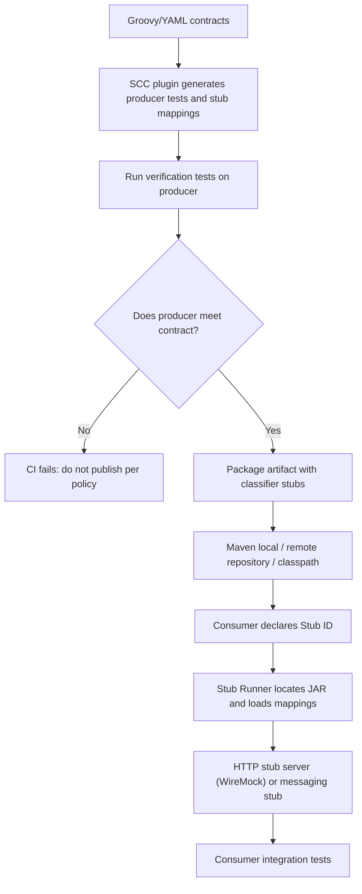
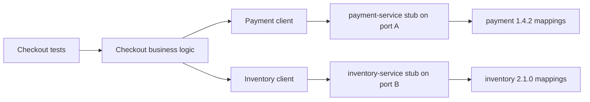
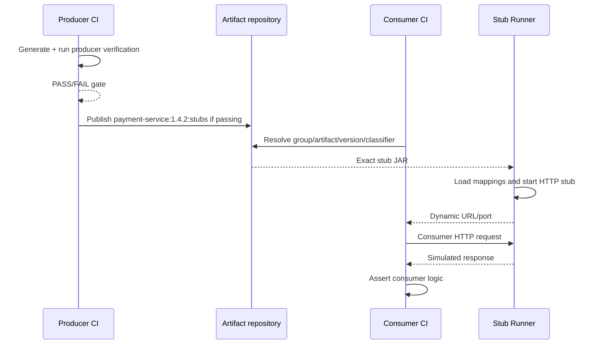

# Declaring Stub IDs and Artifact Coordinates

## 1. Stub Runner needs to know "whose simulation" to run

In a microservices architecture, a **producer** exposes an HTTP API or emits messages, while a **consumer** calls that API or receives those messages. **Spring Cloud Contract (SCC)** helps both teams agree on behavior using **Groovy/YAML DSL**. From the contract, the producer can generate **verification tests** and a **stub artifact**; on the consumer side, **Stub Runner** downloads, starts, and serves those stubs during testing. CI can rely on these results to detect incompatible API changes early.

Suppose `checkout-service` (consumer) calls `payment-service` (producer). When testing checkout, the team does not necessarily want to start the real payment service, payment database, or payment gateway environment. Instead, Stub Runner can start an HTTP stub (typically using WireMock) with requests/responses generated from the contract.

However, Stub Runner must be told explicitly:

- **Which artifact** contains the producer stubs to simulate?
- **Which version** of that artifact?
- **Which classifier** distinguishes the stub JAR from the application JAR?
- If using HTTP, **which port** is allocated for the stub server?
- Is the artifact fetched from the **classpath**, the **local Maven repository**, or a **remote artifact repository**?

These questions are answered by the **stub ID** (also referred to as **Ivy notation ID** in SCC documentation) combined with the stub-loading mode configuration.

**Lesson objectives:** read and write `groupId:artifactId:version:classifier:port` coordinates accurately; distinguish Maven artifact coordinates from HTTP stub addresses; configure `@AutoConfigureStubRunner` or `application-test.yml`; handle dynamic ports, versions, and classifiers; and integrate stub publishing/downloading into CI with proper evidence boundaries.

> **Principle:** A Stub ID identifies the **simulation package to load**, not the live running producer's URL, not a controller name, and does not by itself guarantee the current producer implementation honors the contract.

## 2. From the producer's contract to the consumer's stub artifact

A typical processing pipeline:



Three distinct types of artifacts/objects must be separated:

| Object | Example | Role |
|---|---|---|
| **Source contract** | `src/test/resources/contracts/payment-created.yml` | Describes request/response or input/outputMessage |
| **Producer application artifact** | `payment-service-1.4.2.jar` | Actual producer application binary |
| **Stub artifact** | `payment-service-1.4.2-stubs.jar` | Mappings/contracts that Stub Runner can load |

Do not take a regular application JAR and assume it is a stub JAR. Two artifacts can share the same `groupId`, `artifactId`, and `version` yet have different **classifiers**.

Beyond HTTP, Stub Runner also supports **messaging** integrations, where stub startup/triggering behavior differs from HTTP WireMock. However, the principle of selecting the exact artifact and version remains critical.

### 2.1. Why is the service name alone insufficient?

Within an organization, there might be:

- `com.acme.billing:payment-service`
- `com.acme.sandbox:payment-service`

Both artifacts share `artifactId = payment-service` but have different **groupIds**. Referencing only "payment-service" without full coordinates risks loading the package of another product or environment.

**In CI and contract documentation**, prefer **full coordinates** so everyone knows the exact producer and version under test.

## 3. Stub Runner ID syntax: five components

According to Spring Cloud Contract Stub Runner documentation, the full form is:

```text
groupId:artifactId:version:classifier:port
```

Example:

```text
com.acme.billing:payment-service:1.4.2:stubs:18080
```

| Component | Example value | Meaning | Can be omitted? |
|---|---|---|---|
| `groupId` | `com.acme.billing` | Producer's Maven group | Should be declared explicitly to avoid ambiguity |
| `artifactId` | `payment-service` | Maven artifact name published by producer | Core component |
| `version` | `1.4.2` | Selected artifact version | **Yes**; when omitted, may be interpreted as `+` |
| `classifier` | `stubs` | Distinguishes stub artifact from main JAR | **Yes**; defaults to `stubs` |
| `port` | `18080` | Port on which the HTTP stub server starts | **Yes**; a dynamic port will be chosen |

**Note:** `port` belongs to the **stub server**, not the running producer's HTTP port. `version` belongs to the **stub artifact**; nor is it the version of the `spring-cloud-starter-contract-stub-runner` library.

### 3.1. Common forms

```text
# Full: explicit group, artifact, version, classifier, port
com.acme.billing:payment-service:1.4.2:stubs:18080

# Keep version and classifier, use dynamic port
com.acme.billing:payment-service:1.4.2:stubs

# Omit classifier and port: use default classifier
com.acme.billing:payment-service:1.4.2

# Omit fixed version: resolve latest available version
com.acme.billing:payment-service

# Specify dynamic version '+' while keeping classifier/port explicit
com.acme.billing:payment-service:+:stubs:18080

# Use a custom classifier actually published by the producer
com.acme.billing:payment-service:1.4.2:consumer-stubs:18080
```

Stub Runner documentation states that **`version`, `classifier`, and `port` are optional**. When version is omitted, the system may use `+` to resolve the latest build. When classifier is omitted, it defaults to `stubs`. When port is omitted, Stub Runner picks a dynamic port within the configured range.

**Do not copy the custom classifier example `consumer-stubs` unless the producer actually packages an artifact with that classifier.** Coordinates that look syntactically valid without a matching file still fail with stubs not found.

### 3.2. How does a Stub ID differ from Maven GAV?

Maven typically identifies a dependency by **GAV**: `groupId:artifactId:version`. Stub Runner extends this notation with `classifier` and **`port`**:

```text
Maven dependency identity:
  com.acme.billing:payment-service:1.4.2:stubs
                                           ^ classifier

Stub Runner runtime ID:
  com.acme.billing:payment-service:1.4.2:stubs:18080
                                                 ^ HTTP stub port
```

**Port is never part of a Maven artifact stored in a repository.** A Maven repository has no "payment-service version 18080" artifact; the port merely specifies how the HTTP stub runs at test time.

### 3.3. Do not confuse colons in URLs and IDs

```text
Stub ID: com.acme.billing:payment-service:1.4.2:stubs:18080
HTTP URL: http://localhost:18080/api/payments/PAY-42
```

These two strings serve two different stages: the ID **loads/starts** the stub; the URL lets the **consumer send HTTP requests** to the started stub.

## 4. How is a stub artifact packaged and located?

Suppose a producer has Maven coordinates:

```xml
<groupId>com.acme.billing</groupId>
<artifactId>payment-service</artifactId>
<version>1.4.2</version>
```

When an appropriate plugin/build generates and attaches the stub JAR with the default classifier, the artifact is usually named:

```text
payment-service-1.4.2-stubs.jar
```

In the local Maven repository, the path might be:

```text
~/.m2/repository/com/acme/billing/payment-service/1.4.2/
    payment-service-1.4.2.jar
    payment-service-1.4.2.pom
    payment-service-1.4.2-stubs.jar
```

**This is an illustrative path** when the local repository uses the standard Maven layout. The actual build must be configured to **generate and publish the stub artifact**; a POM declaring `groupId`/`artifactId` alone does not guarantee `-stubs.jar` is produced.

Typically, the stub JAR contains **WireMock mappings** and/or contract definitions arranged in a structure recognized by Stub Runner. For classpath mode, the internal layout inside the JAR and group/artifact names are especially important.

### 4.1. Publishing artifacts at the right time

On the producer, a sound workflow is:

1. Write contracts according to consumer requirements.
2. SCC plugin generates producer verification tests and stub definitions.
3. **Run producer tests** on the current commit/build.
4. Once the CI gate passes, package and `install` (for local testing) or `deploy` (to share via repository) the corresponding stub artifact.
5. Consumer specifies the **exact coordinates** in Stub Runner.

If the producer **skips contract tests** and publishes `-stubs.jar`, the consumer can still pass against the stub without any proof that the producer implementation honors the contract. Release rules must be designed by the team and enforced by CI, not based solely on whether a JAR file exists.

## 5. Three stub sources: `CLASSPATH`, `LOCAL`, `REMOTE`

`stubsMode` specifies the source Stub Runner uses to locate definitions.

| Mode | Where are stubs fetched from? | Suitable for | What must be checked |
|---|---|---|---|
| **`CLASSPATH`** | Stub definitions already on the test classpath | Tests packaged alongside stub JARs, environments without downloading | JAR and internal paths follow expected structure |
| **`LOCAL`** | Local Maven repository, usually `~/.m2` | Local development, producer/consumer on the same machine | Was the right version/classifier `install`ed? |
| **`REMOTE`** | Remote artifact repository, e.g., Nexus/Artifactory | Multi-repo CI, independent teams | Repository URL, credentials, version, and read permissions |

Per Spring Cloud Contract documentation, **`CLASSPATH` is the default mode** if unconfigured. Therefore, an example with only `@AutoConfigureStubRunner(ids="...")` **does not automatically mean it will download from local Maven or remote**.

### 5.1. LOCAL mode: using artifacts installed in `.m2`

```java
@AutoConfigureStubRunner(
    ids = "com.acme.billing:payment-service:1.4.2:stubs",
    stubsMode = StubRunnerProperties.StubsMode.LOCAL
)
```

Flow:

1. Producer build creates and **installs** `payment-service-1.4.2-stubs.jar` in the local Maven repo.
2. Consumer test runs with Stub Runner `LOCAL`.
3. Stub Runner finds the matching GAV/classifier, loads mappings, and starts the stub.
4. Consumer calls the stub URL and verifies client logic.

If only `payment-service-1.4.1-stubs.jar` exists locally, an ID requesting `1.4.2` will not be satisfied just because `artifactId` matches.

### 5.2. REMOTE mode: fetching from an artifact repository

```java
@AutoConfigureStubRunner(
    ids = "com.acme.billing:payment-service:1.4.2:stubs",
    stubsMode = StubRunnerProperties.StubsMode.REMOTE,
    repositoryRoot = "https://repo.example.org/repository/maven-releases/"
)
```

This is an **example URL** and must be replaced with a real repository and securely configured access credentials. Stub Runner must have permission to download the published `groupId/artifactId/version/classifier` artifact.

For CI, this is usually the right approach when producer and consumer have separate pipelines/repositories. Manage **credentials via environment variables or a secret manager**, never hardcoding passwords/tokens in docs or source code.

### 5.3. CLASSPATH mode: stubs bundled in test dependencies

Illustrative Maven dependency:

```xml
<dependency>
    <groupId>com.acme.billing</groupId>
    <artifactId>payment-service</artifactId>
    <version>1.4.2</version>
    <classifier>stubs</classifier>
    <scope>test</scope>
</dependency>
```

And annotation:

```java
@AutoConfigureStubRunner(
    ids = "com.acme.billing:payment-service:1.4.2:stubs",
    stubsMode = StubRunnerProperties.StubsMode.CLASSPATH
)
```

Unlike `LOCAL`, here the test classpath **must already contain a JAR** holding mappings/contracts in the layout supported by Stub Runner classpath scanning. SCC documentation describes packaging stubs under paths like `META-INF/<group>/<artifact>/<version>/...`. If the producer packages the JAR with the wrong structure, the dependency may download fine yet Stub Runner fails to find mappings.

Merely adding the stub artifact to dependencies **does not automatically ensure** the consumer HTTP client points to the stub server. The URL/port of the client under test must still be configured.

### 5.4. LOCAL and REMOTE are not just a `repositoryRoot` parameter

`stubsMode` determines the stub resolution mechanism. `repositoryRoot` specifies the **repository source** when using a mode requiring a remote location or suitable repository protocol. Do not set `repositoryRoot` to Nexus while leaving the mode at default `CLASSPATH` and expect Stub Runner to switch to network downloads automatically.

SCC versions also support specialized sources such as `stubs://` or custom downloaders. Those are **separate mechanisms** requiring specific configuration and do not alter the `groupId:artifactId:version:classifier` nature of standard Maven artifacts.

## 6. Declaring `@AutoConfigureStubRunner` in consumer tests

Assume the consumer is `checkout-service`, while the producer publishes stubs from `payment-service`. Required dependency on the consumer:

```xml
<dependency>
    <groupId>org.springframework.cloud</groupId>
    <artifactId>spring-cloud-starter-contract-stub-runner</artifactId>
    <scope>test</scope>
</dependency>
```

This is a **test dependency**. It differs from `spring-cloud-starter-contract-verifier`, which serves producer verification tests. The project must pick compatible Boot/Cloud/SCC versions along with appropriate HTTP/JUnit dependencies.

JUnit 5 + Spring Boot example:

```java
@SpringBootTest
@AutoConfigureStubRunner(
    ids = "com.acme.billing:payment-service:1.4.2:stubs",
    stubsMode = StubRunnerProperties.StubsMode.LOCAL
)
class CheckoutConsumerContractTest {

    @StubRunnerPort("com.acme.billing:payment-service")
    int paymentStubPort;

    @Test
    void checkoutCanReadPaymentResponse() throws Exception {
        String url = "http://localhost:" + paymentStubPort
            + "/api/payments/PAY-42";

        HttpClient client = HttpClient.newHttpClient();
        HttpRequest request = HttpRequest.newBuilder(
            URI.create(url)).GET().build();
        HttpResponse<String> response = client.send(
            request, HttpResponse.BodyHandlers.ofString());

        assertEquals(200, response.statusCode());
        // Add JSON/DTO or checkout state assertions
        // matching the interface and contract the consumer actually uses.
    }
}
```

**Imports and project data have been omitted** to focus on Stub Runner configuration. The example assumes the stub JAR has a `GET /api/payments/PAY-42` mapping returning HTTP `200`; if missing, the test fails rather than being an ID syntax error.

More importantly, this is only an **illustrative connectivity test**. In a real consumer test, invoke the **consumer's real `CheckoutService`/HTTP client** configured to target the stub, then assert behavior (e.g., checkout transitions to the right state). Creating an ad-hoc `HttpClient` bypassing consumer code does not prove the real consumer flow handles the response.

### 6.1. One annotation with multiple producer stubs

```java
@AutoConfigureStubRunner(
    ids = {
        "com.acme.billing:payment-service:1.4.2:stubs",
        "com.acme.catalog:inventory-service:2.1.0:stubs"
    },
    stubsMode = StubRunnerProperties.StubsMode.REMOTE,
    repositoryRoot = "https://repo.example.org/repository/maven-releases/"
)
```

Stub Runner can start **multiple stub servers** to simulate collaborators. Each artifact ID must match a producer that packaged and published stubs. Never assume two services share the same port. When using dynamic ports, retrieve the URL/port **per artifact**.

## 7. Declaring via `application-test.yml`

Instead of listing IDs in the annotation, configuration can be placed into Spring properties for the test environment:

```yaml
spring:
  cloud:
    contract:
      stubrunner:
        stubs-mode: REMOTE
        repository-root: "https://repo.example.org/repository/maven-releases/"
        ids:
          - "com.acme.billing:payment-service:1.4.2:stubs"
          - "com.acme.catalog:inventory-service:2.1.0:stubs"
        min-port: 10000
        max-port: 15000
```

In Spring tests, enable Stub Runner auto-configuration using the appropriate annotation, such as `@AutoConfigureStubRunner`, and let properties supply IDs and artifact sources if supported by your version/setup. Avoid declaring **conflicting** IDs and modes across annotations, environment variables, and profiles.

Configuration property reference table:

| Property | Function |
|---|---|
| `spring.cloud.contract.stubrunner.ids` | List of Ivy notation Stub IDs |
| `spring.cloud.contract.stubrunner.stubs-mode` | `CLASSPATH`, `LOCAL`, `REMOTE` |
| `spring.cloud.contract.stubrunner.repository-root` | Repository source / protocol for downloading stubs |
| `spring.cloud.contract.stubrunner.classifier` | Default classifier, typically `stubs` |
| `spring.cloud.contract.stubrunner.min-port` | Lower bound of dynamic WireMock port range |
| `spring.cloud.contract.stubrunner.max-port` | Upper bound of dynamic WireMock port range |
| `spring.cloud.contract.stubrunner.username/password` | Repository authentication when required, supplied via secrets |
| `spring.cloud.contract.stubrunner.fail-on-no-stubs` | Controls failing when stubs cannot be found |

**Colons in stub IDs:** wrap strings in quotes in YAML, especially when copying/configuring across tools. For port ranges, ensure ports are available; a single fixed port shared across CI jobs easily causes conflicts.

A LOCAL example for developers:

```yaml
spring:
  cloud:
    contract:
      stubrunner:
        stubs-mode: LOCAL
        ids:
          - "com.acme.billing:payment-service:1.4.2:stubs"
```

LOCAL configuration only reads local artifacts; it does not imply the consumer may rely on artifacts that skipped producer verification. Keep local build/install or cache rules explicit.

## 8. Dynamic ports: how the consumer finds the right stub URL

When a stub ID **omits the port**, Stub Runner picks an available port within the configured range. This reduces collisions when multiple tests/projects run in parallel, though the consumer cannot assume the port is always `8080` or `10000`.

### 8.1. `@StubRunnerPort`

```java
@StubRunnerPort("com.acme.billing:payment-service")
int paymentStubPort;

@StubRunnerPort("com.acme.catalog:inventory-service")
int inventoryStubPort;
```

You can pass just `artifactId` if unambiguous, e.g., `@StubRunnerPort("payment-service")`. When multiple Maven groups share the same artifact ID, use `groupId:artifactId` to disambiguate clearly.

**Never pass stub A's port to service B's HTTP client.** If checkout calls both payment and inventory, each client must be configured with the exact host/port of its respective stub.

### 8.2. `StubFinder` to look up URL by ID

SCC documentation provides `StubFinder` to look up started stubs:

```java
@Autowired
StubFinder stubFinder;

@Test
void canFindPaymentStub() {
    URL url = stubFinder.findStubUrl(
        "com.acme.billing", "payment-service");

    assertNotNull(url);
    // URL is the endpoint of the running stub,
    // not the production producer URL.
}
```

`StubFinder.findStubUrl(groupId, artifactId)` is helpful when you need scheme/host/port or when a test manages multiple collaborators. If no running artifact is found, the lookup may throw `StubNotFoundException`. Do not catch the exception and silently fall back to a production URL.

### 8.3. Spring Environment property

Stub Runner also registers properties for ports, for example:

```text
spring.cloud.contract.stubrunner.runningstubs.payment-service.port
spring.cloud.contract.stubrunner.runningstubs.com.acme.billing.payment-service.port
```

These property names can be referenced in test configuration to pass ports to HTTP clients. Verify the exact artifact ID and property name generated by the version in use, especially when group/artifact names contain hyphens or share artifact IDs across groups.

**When should you avoid fixing ports?** In parallel CI, fixed port `18080` may already be taken. Dynamic ports with `@StubRunnerPort` or `StubFinder` are generally more reliable. Fix a port only when tests/infrastructure strictly require it and collisions are controlled.

## 9. Diagnosing errors: artifact, Stub Runner, or HTTP mapping?

Not every `404` or `Connection refused` test error stems from a Stub ID mistake.

| Symptom | Likely failing layer | First thing to check |
|---|---|---|
| Artifact not found | Wrong `groupId`/`artifactId`/`version` or unpublished | Cross-check producer coordinates and repository |
| Main JAR downloaded without stubs | Missing/wrong `classifier` | Look for `-stubs.jar` and mapping contents |
| `LOCAL` misses artifact | Producer not `install`ed into active local repo | Check local Maven repo/settings |
| `CLASSPATH` misses mappings | Stub JAR not on test classpath or wrong layout | Inspect dependency and internal JAR structure |
| `REMOTE` returns 401/403 | Wrong repo credentials/permissions | Check secret injection, repository auth |
| `REMOTE` returns 404 | Artifact/version missing in repo | Check repository URL and metadata |
| `Connection refused` | Wrong stub port or stub server not running | Check Stub Runner logs, `@StubRunnerPort`, port range |
| HTTP stub returns `404` | Request does not match WireMock mapping | Inspect method, path, headers, body matchers |
| Consumer still calls production | HTTP client not configured to point to stub | Check injected base URL / service discovery |
| Two stubs share a port | Fixed port configuration collision | Use dynamic ports / change ports |
| Stub test green yet new producer broken | Outdated stub version | Run producer verification and pin exact version |
| No mappings yet CI green | Test makes no assertions, config ignores no stubs | Check `fail-on-no-stubs` and test reports |

To debug HTTP mappings, you can inspect registered mappings on the WireMock stub server via its admin API. **Only query the allocated test stub port**—do not accidentally connect to a WireMock instance serving another suite.

**Remember to distinguish:**

- **Artifact resolution failure:** failed to load the stubs package.
- **Stub startup failure:** package exists, yet HTTP stub fails to bind or configuration is invalid.
- **Request matching failure:** stub runs, yet consumer request violates the contract.
- **Consumer logic failure:** stub returns the expected response, yet the application processes it wrongly.
- **Producer compatibility failure:** reliably caught only by producer verification/integration tests on actual producer code.

## 10. Choosing stub versions: pinned or "latest"?

**The version in a stub ID is the producer stub artifact version**, not the consumer app version, not the port, and not the Stub Runner library version.

### 10.1. Pinning versions for reproducible tests

```text
com.acme.billing:payment-service:1.4.2:stubs
```

Benefits of an explicit version:

- Developers and CI run against a well-defined artifact.
- When a test fails, you can identify which contract/stub version changed.
- Release gates have evidence tied to an exact producer version.
- Easier to test whether an older consumer version remains compatible with a newer producer version.

**Warning about SNAPSHOTs:** A `1.4.2-SNAPSHOT` artifact can be republished with different contents; pinning the version name is insufficient if the repository does not guarantee immutability. For releases, prefer immutable release versions and record commit/checksums if auditing is required.

### 10.2. Using `+` to track the latest build

```text
com.acme.billing:payment-service:+:stubs
```

In SCC Stub Runner, `+` selects the latest resolvable version from the artifact source. Once the repository updates, **the same consumer commit can run against different stubs across two CI runs**.

This can be useful for a **forward-compatibility job** to catch producer changes early; however:

- Never assume `+` guarantees backward compatibility by itself.
- Log the **actual resolved version**.
- Do not replace pinned-version release gates when reproducibility is required.
- When a test fails, inspect the latest artifact version and matching producer code instead of relaxing the contract unilaterally.

### 10.3. Version ranges and compatibility matrices

SCC can resolve **version ranges** supported by the artifact resolver mechanism. Do not apply arbitrary range syntax without checking documentation, version, and repository behavior.

A clearer way to test multiple versions is declaring a **CI matrix**:

| Consumer build | Payment stub | What to record |
|---|---|---|
| `checkout 3.0` | `payment 1.4.1` | PASS/FAIL |
| `checkout 3.0` | `payment 1.4.2` | PASS/FAIL |
| `checkout 3.0` | `payment 1.5.0` | PASS/FAIL |

Each combination is verified individually. Passing against `1.4.2` does not imply passing against `1.5.0`.

## 11. Classifier: why is it usually `stubs`?

Classifiers distinguish variants of the same Maven artifact:

```text
Main application:
  com.acme.billing:payment-service:1.4.2
  => payment-service-1.4.2.jar

Stub artifact:
  com.acme.billing:payment-service:1.4.2:stubs
  => payment-service-1.4.2-stubs.jar
```

If developers publish only the main JAR while the consumer requests classifier `stubs`, the resolver will not find the right artifact. Do not set the classifier to empty or bypass checks just to get past the download step.

### 11.1. Omitting the classifier is not the same as an empty classifier

```text
com.acme.billing:payment-service:1.4.2
```

This syntax uses the **default classifier** (`stubs` per SCC docs).

Whereas:

```text
com.acme.billing:payment-service:1.4.2:
```

A trailing colon after the version can denote an **empty classifier**; doing this does not magically turn an application JAR into a stub JAR. Only use it when you have an artifact structured in a way the stub loader supports.

### 11.2. Custom classifiers

```text
com.acme.billing:payment-service:1.4.2:partner-stubs:18080
```

Use only if the producer actually publishes `payment-service-1.4.2-partner-stubs.jar` (or equivalent). Classifiers must be coordinated between producer and consumer builds. If you need consumer-specific stubs, SCC also has a **stubs per consumer** feature; design and verify it on your plugin version rather than picking arbitrary classifier names.

## 12. Multiple producers and multiple ports: managing each collaborator

Suppose `checkout-service` calls two services:

```text
com.acme.billing:payment-service:1.4.2:stubs
com.acme.catalog:inventory-service:2.1.0:stubs
```



Never assume port A and port B are the same. With dynamic ports, use `@StubRunnerPort("groupId:artifactId")` or `StubFinder` to configure each HTTP client individually.

### 12.1. Artifact ID differs from service discovery ID

A project might have:

```text
Maven artifactId: payment-contracts
Spring application name: payment-api
Service discovery name: payment-service
```

They **do not have to match**. Stub IDs use **Maven coordinates**; the URL called by the consumer HTTP client depends on client/discovery configuration. When using Spring Cloud integration with service IDs, `ids-to-service-ids` can map stub artifacts when needed. Verify that the consumer's real client points to the stub, not merely that a WireMock server is running somewhere.

### 12.2. Same producer, multiple versions

If you want to test a consumer against both `1.4.2` and `1.5.0`, it is usually easier to verify via **two CI jobs or two test profiles**. Do not place two stub versions of the same producer into one shared test without a reliable way to steer the client to the exact version/port.

## 13. Remote repositories, access permissions, and caching

With `REMOTE` mode, example configuration:

```yaml
spring:
  cloud:
    contract:
      stubrunner:
        stubs-mode: REMOTE
        repository-root: "https://repo.example.org/repository/maven-releases/"
        ids:
          - "com.acme.billing:payment-service:1.4.2:stubs"
```

This is an **illustrative URL**. `repository-root` is the Maven artifact source accessed by the resolver, **not the producer's HTTP URL**. `ids` specifies the exact package chosen from that repository.

**Security and reproducibility rules:**

- Supply credentials from a secret manager, environment variables, or proper Maven settings; never commit passwords/tokens.
- If repository permissions fail, let the test fail with a clear resolution error; never silently fall back to production.
- When CI uses proxies/mirrors/caches, log the actual resolved version/source.
- Avoid overwriting a release artifact under the same version; caching may cause two machines to run different contents.
- If offline execution is needed, prepare `CLASSPATH` or a local cache with explicit versions rather than arbitrarily loading old builds.

A project may read credentials via `spring.cloud.contract.stubrunner.username` and `password`; bind them to real environment secrets rather than embedding sensitive values in lesson YAML.

## 14. Stub IDs and messaging

Stub Runner can also use **message contracts**; artifact coordinates still identify the producer and version.

Example message contract:

```yaml
description: "Payment completed event"
label: payment_paid
input:
  triggeredBy: emitPaymentPaid()
outputMessage:
  sentTo: payments.events
  headers:
    eventType: PAYMENT_PAID
  body:
    paymentId: "PAY-42"
    state: "PAID"
```

The consumer can use `StubTrigger.trigger("payment_paid")` with an appropriate messaging adapter to trigger the simulated message.

However, **the trailing port of a Stub ID is the HTTP stub server port**, not a Kafka or JMS broker port. Some Stub Runner messaging integrations (such as JMS) may require a running test broker. Passing a message stub test does not prove the producer actually published properly to a production broker; when routing, ack/retry, DLQ, and idempotency matter, add broker integration tests.

## 15. End-to-end exercise: from contract to Stub Runner

Assume producer `payment-service` has Maven coordinates:

```text
groupId    = com.acme.billing
artifactId = payment-service
version    = 1.4.2
```

Consumer `checkout-service` needs an HTTP contract:

```yaml
name: payment_found
description: "Lookup completed payment"
request:
  method: GET
  url: /api/payments/PAY-42
response:
  status: 200
  headers:
    Content-Type: application/json
  body:
    paymentId: "PAY-42"
    state: "CAPTURED"
    amount: 150000
    currency: "VND"
```

### Step 1 — Producer verifies and publishes

The producer must configure the SCC plugin, generate **and run** verification tests with appropriate fixtures. Once tests pass, the build publishes an artifact with classifier `stubs`:

```text
com.acme.billing:payment-service:1.4.2:stubs
→ payment-service-1.4.2-stubs.jar
```

On a developer machine, the package can be `install`ed into the local Maven repository; in CI, it can be `deploy`ed to a remote repository. Seeing a stub JAR exist alone does not prove generated producer tests ran; inspect build logs/test reports.

### Step 2 — Consumer chooses artifact source

If testing locally:

```java
@AutoConfigureStubRunner(
    ids = "com.acme.billing:payment-service:1.4.2:stubs",
    stubsMode = StubRunnerProperties.StubsMode.LOCAL
)
```

If CI uses an internal repository:

```java
@AutoConfigureStubRunner(
    ids = "com.acme.billing:payment-service:1.4.2:stubs",
    stubsMode = StubRunnerProperties.StubsMode.REMOTE,
    repositoryRoot = "https://repo.example.org/repository/maven-releases/"
)
```

The mode must match **where the artifact is stored**. If it only exists in a remote repository, `LOCAL` cannot find it when the machine lacks the artifact in its local Maven repo.

### Step 3 — Consumer obtains stub URL

```java
@StubRunnerPort("com.acme.billing:payment-service")
int paymentPort;
```

Because no port is in the ID, Stub Runner assigns a dynamic port. Pass this port/URL to the **payment HTTP client inside `CheckoutService`** under test. Do not merely construct a separate HTTP client in the test while bypassing the consumer's real code.

### Step 4 — Consumer verifies behavior

The test should verify:

1. `CheckoutService` triggers `GET /api/payments/PAY-42`.
2. The application's HTTP client receives and deserializes `paymentId`, `state`, and `amount` with the right types.
3. The checkout business outcome reflects a completed payment.
4. Supported `404`, `409`, or error branches have dedicated tests if the consumer depends on them.
5. No unexpected connections are made to real/production producers during the test run.

**Evidence:** this test verifies consumer behavior against the stub. Whether the current producer honors the contract must be verified by generated producer tests on the matching build.

## 16. Artifact, version, environment, and URL are different things

A common mistake:

> "Consumer called `http://localhost:18080` and succeeded, so payment-service `1.4.2` is running properly in staging."

You cannot draw that conclusion. `localhost:18080` might just be a WireMock stub.

| Question | Evidence to check |
|---|---|
| Which producer does the stub belong to? | Resolved `groupId/artifactId` |
| Which version does the stub match? | Artifact version, commit/build metadata |
| Was the right classifier selected? | `-stubs.jar` file and internal mappings |
| Which URL is the consumer calling? | Host/port of the started stub |
| Does the producer implementation match the contract? | Generated producer verification tests |
| How does staging/production behave? | Dedicated integration/deployment/observability tests |

Declaring the right stub ID enables **version-accurate evidence**, not an automatic production check.

## 17. Structuring CI so producer and consumer use the exact artifact



### 17.1. Producer CI

- Read Groovy/YAML DSL and generate verification tests.
- Prepare test context/fixtures and **execute** generated tests.
- Fail the build on contract mismatches; never skip just to produce an artifact.
- Package stub mappings/classifier per convention.
- Publish a clearly versioned artifact tied to commit/contract revision.

### 17.2. Consumer CI

- Pin stub ID/version for release gates.
- Select `CLASSPATH`, `LOCAL`, or `REMOTE` matching the artifact source.
- Load mappings and start Stub Runner; do not treat Spring context startup alone as sufficient.
- Read port via `@StubRunnerPort` or URL via `StubFinder`.
- Configure the **consumer's real HTTP client** to point at the stub.
- Assert critical business branches and fail if required artifacts/stubs/mappings are missing.
- Log the resolved version, test report, and artifact metadata properly.

### 17.3. "Latest" jobs vs. release jobs serve different goals

Fixed-version jobs ensure **reproducibility**. Jobs using `+` quickly test the latest producer version to catch compatibility shifts. Keep both reports distinct rather than using an unlogged `+` job as a release gate.

## 18. Diagnosing layer-by-layer before editing the contract

### A. Was the artifact resolved?

Check `groupId`, `artifactId`, `version`, `classifier`, mode, repository/credentials, and stub JAR layout. If download fails, **there is no point debugging request matchers yet**.

### B. Did the stub server start?

Check Stub Runner logs, dynamic port, and `StubFinder` results. `Connection refused` is a connection/startup failure—there is no HTTP response yet to compare against the contract.

### C. Did the request match a mapping?

Check method, URL, headers, query, and body. An HTTP `404` from WireMock can mean **no matching mapping was found**, not necessarily a business `404` defined by the producer.

### D. Did the consumer use the real client and handle the response?

Consumer tests should invoke real checkout code and verify outcomes. If a test crafts a standalone HTTP request bypassing the app, it mainly tests the mapping, not consumer compatibility.

### E. Does the current producer build still honor the contract?

Consumer tests with stubs do not replace generated producer verification. New mismatches in the producer must be caught by producer tests on the matching code and contract version.

**When debugging:** log stub coordinates, resolved version, stub URL, and test name, never printing credentials, tokens, or sensitive data.

## 19. Exercise: declaring two collaborators

**Context:** `order-orchestrator` needs to simulate two producers; both artifacts have been published to an internal test repository:

| Producer | Stub artifact | Function |
|---|---|---|
| `payment-service` | `com.acme.billing:payment-service:2.3.1:stubs` | Returns payment result |
| `inventory-service` | `com.acme.catalog:inventory-service:4.0.0:stubs` | Returns stock reservation result |

Illustrative repository: `https://repo.example.org/repository/maven-releases/`.

### 19.1. Tasks

1. Write two full Stub IDs with fixed ports `18081` and `18082`.
2. Write two IDs **without ports** so Stub Runner picks dynamic ports.
3. Write `@AutoConfigureStubRunner` using `REMOTE` with both artifacts.
4. Write `application-test.yml` with `stubs-mode`, `repository-root`, and the `ids` list.
5. Describe how to retrieve the dynamic port of each artifact using `@StubRunnerPort` or `StubFinder`.
6. Explain why `payment-service-2.3.1.jar` cannot replace `payment-service-2.3.1-stubs.jar`.
7. If `2.3.1` is changed to `+`, name two risks regarding CI and compatibility.
8. When the repository returns artifact-not-found before the HTTP client runs, which layer needs fixing?
9. Propose a CI gate combining producer verification, stub publishing, and versioned consumer test reports.

### 19.2. Suggested IDs

```text
# Fixed ports:
com.acme.billing:payment-service:2.3.1:stubs:18081
com.acme.catalog:inventory-service:4.0.0:stubs:18082

# Dynamic ports:
com.acme.billing:payment-service:2.3.1:stubs
com.acme.catalog:inventory-service:4.0.0:stubs
```

### 19.3. Suggested annotation

```java
@AutoConfigureStubRunner(
    ids = {
        "com.acme.billing:payment-service:2.3.1:stubs",
        "com.acme.catalog:inventory-service:4.0.0:stubs"
    },
    stubsMode = StubRunnerProperties.StubsMode.REMOTE,
    repositoryRoot = "https://repo.example.org/repository/maven-releases/"
)
```

### 19.4. Suggested YAML

```yaml
spring:
  cloud:
    contract:
      stubrunner:
        stubs-mode: REMOTE
        repository-root: "https://repo.example.org/repository/maven-releases/"
        ids:
          - "com.acme.billing:payment-service:2.3.1:stubs"
          - "com.acme.catalog:inventory-service:4.0.0:stubs"
```

### 19.5. Self-check criteria

- Stub IDs match exact **published** producer coordinates.
- Do not confuse stub port with producer port, artifact version, or repo URL.
- `REMOTE` mode is enabled; do not accidentally leave default `CLASSPATH`.
- Each client calls its corresponding stub URL/artifact.
- Missing artifacts/stubs fail tests rather than silently calling production.
- CI pins versions for releases and logs resolved versions when using `+`.
- Both producer verification and consumer tests run and report separately.

## 20. Pre-merge checklist

- [ ] Stub ID follows `groupId:artifactId:version:classifier:port`.
- [ ] `groupId`/`artifactId` match the Maven coordinates published by the producer.
- [ ] `version` is intentionally chosen; release gates prefer pinned versions.
- [ ] `classifier` matches the artifact containing stubs, usually `stubs`.
- [ ] If using dynamic ports, consumer retrieves the right port via Stub Runner.
- [ ] Ports of two collaborators, or stub vs. producer ports, are never confused.
- [ ] `stubsMode` matches the `CLASSPATH`/`LOCAL`/`REMOTE` source.
- [ ] With `CLASSPATH`, the artifact is on the test classpath with the right layout.
- [ ] With `LOCAL`, the artifact is installed in the active local Maven repo.
- [ ] With `REMOTE`, repository root and credentials/permissions are verified.
- [ ] Secrets are never committed or printed to logs.
- [ ] Generated producer verification tests executed for the published artifact.
- [ ] Stub Runner found mappings, not merely started the Spring context.
- [ ] Consumer tests invoke the application's real HTTP client pointing to the stub.
- [ ] Consumer asserts on success/error branches it genuinely depends on.
- [ ] Artifacts/contracts/stubs/test reports have versions and traceability.
- [ ] Messaging stubs have broker integration tests when delivery semantics matter.
- [ ] CI fails explicitly when required artifacts, stubs, or mappings are missing.

## 21. Key takeaways and references

**Stub IDs bridge the producer's artifact and the consumer's test environment.** Full form:

```text
groupId:artifactId:version:classifier:port
```

`version`, `classifier`, and `port` can be omitted, provided their defaults are understood: classifier is typically `stubs`, omitted version can resolve to `+`, and omitted port is chosen dynamically. `CLASSPATH`, `LOCAL`, and `REMOTE` determine **where to fetch artifacts**; `@AutoConfigureStubRunner` or Spring properties determine **which stubs to load**; `@StubRunnerPort` and `StubFinder` tell the consumer **where the stub is running**.

When producer verification, stub publishing, Stub Runner, and consumer tests share exact coordinates/versions, the team obtains a clear compatibility evidence chain. Yet runnable stubs **do not prove the current producer honors the contract** if generated verification tests did not run on that exact build.

**Official Spring Cloud Contract documentation:**

- [Stub Runner — Common Properties and IDs syntax](https://docs.spring.io/spring-cloud-contract/reference/project-features-stubrunner/stub-runner-common.html).
- [Stub Runner — Core, CLASSPATH/LOCAL/REMOTE, and mappings](https://docs.spring.io/spring-cloud-contract/reference/project-features-stubrunner/stub-runner-core.html).
- [Stub Runner — JUnit, StubFinder, @StubRunnerPort, and Spring properties](https://docs.spring.io/spring-cloud-contract/reference/project-features-stubrunner/stub-runner-junit.html).
- [Stub Runner — Configuration Properties](https://docs.spring.io/spring-cloud-contract/reference/configprops.html).
- [Stub Runner — Stub sources using stubs:// protocol](https://docs.spring.io/spring-cloud-contract/reference/project-features-stubrunner/stub-runner-stubs-protocol.html).
