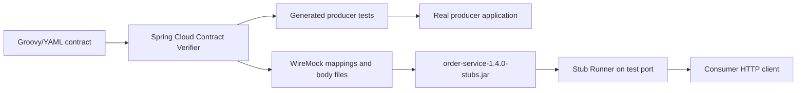
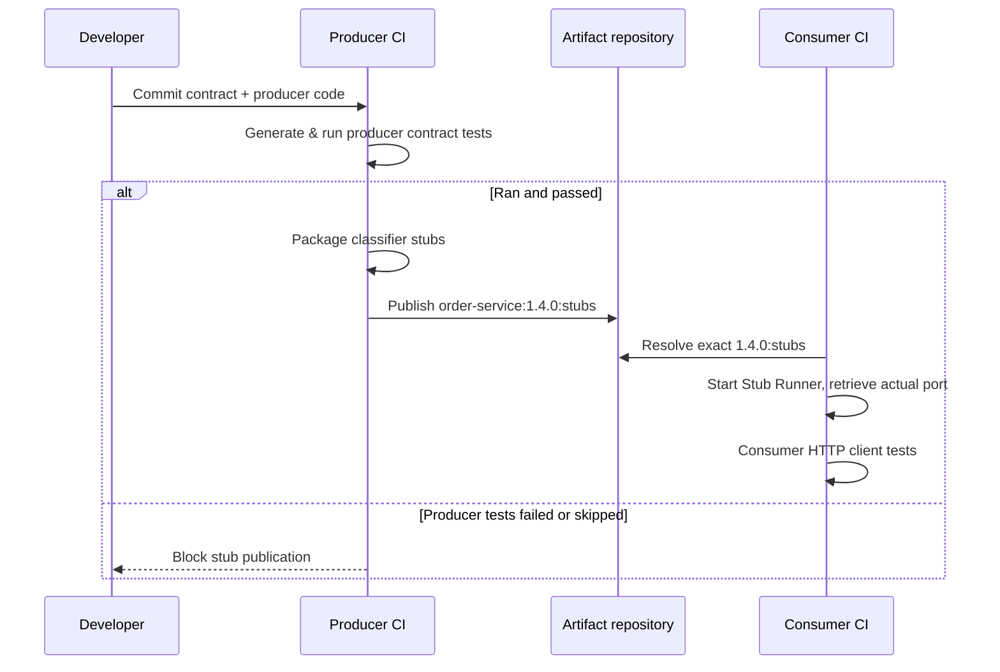

# Version, Classifier, and Port in Stub Configuration

## 1. Why do these three values determine consumer test outcomes?

In **Spring Cloud Contract**, producer and consumer agree on HTTP or messaging behavior using **Groovy DSL** or **YAML DSL**. The Verifier generates producer-side tests and can generate stubs. The producer packages stubs into an artifact, while **Stub Runner** downloads and serves that artifact for consumer tests. CI uses both **producer contract tests** and **consumer stub tests** to detect incompatible API changes.

Suppose `checkout-service` calls an API on `order-service`. The producer team just published stub version `1.4.0`, yet the consumer is running tests against `1.3.0`. Both versions contain a `GET /api/orders/42` mapping, but the new error body adds a `code` field or changes the `quantity` field type. The consumer test may stay **green with the old stub** even though the consumer is incompatible with the new API.

Another mistake: the consumer downloads the JAR without the `stubs` classifier, or tries connecting to `localhost:8080` while Stub Runner starts WireMock on another port. In that case, tests may fail to locate the artifact, fail to connect, or receive responses from the **wrong service**.

The three parameters to understand accurately are:

1. **Version:** selects **which contract version** will be tested.
2. **Classifier:** selects **which artifact type**, typically the JAR containing stubs rather than the application JAR.
3. **Port:** selects **the HTTP address of the stub server** that the consumer actually calls.

After this lesson, you will be able to read Stub Runner coordinate strings, select reproducible versions, distinguish classifiers, configure fixed/dynamic ports, inspect resolved artifacts, and integrate with consumer tests and CI.

## 2. Stub coordinates: `group:artifact:version:classifier:port`

A common identifier format in Spring Cloud Contract Stub Runner:

```text
com.example:order-service:1.4.0:stubs:8090
|_________|_____________|_____|_____|____|
   group     artifact    version classifier port
```

Reading left to right:

| Part | Illustrative value | Meaning |
|---|---|---|
| `group` | `com.example` | Maven `groupId` or publishing organization |
| `artifact` | `order-service` | Producer module/service name publishing the stub |
| `version` | `1.4.0` | Artifact version to fetch |
| `classifier` | `stubs` | JAR variant containing contracts/stubs |
| `port` | `8090` | Port Stub Runner asks WireMock to bind |

In some configurations, the port part can be **omitted** so Stub Runner assigns a free port; in that case, retrieve the actual port after server startup rather than guessing. Syntax variants and defaults must be verified against the library version in use. In this lesson, examples use **all five parts** when a fixed port is needed; dynamic-port examples are explained separately.

**Do not swap the order of classifier and port**:

```text
# Right: classifier=stubs, port=8090
com.example:order-service:1.4.0:stubs:8090

# Wrong semantics: "8090" in the classifier slot
com.example:order-service:1.4.0:8090:stubs
```

Group and artifact names must match the **stub artifact's metadata**, not merely the producer's Docker container name, application name, or HTTP hostname. The consumer cannot resolve a JAR from a Maven repository if coordinates do not match where it was published.

## 3. Distinguishing application artifacts from stub artifacts

A release of `order-service` can produce multiple artifacts:

```text
com.example:order-service:1.4.0
    ├── order-service-1.4.0.jar
    └── order-service-1.4.0-stubs.jar
```

| Artifact | Purpose | What do consumer tests use it for? |
|---|---|---|
| `order-service-1.4.0.jar` | Producer application/library | Usually **not** what Stub Runner needs for HTTP simulation |
| `order-service-1.4.0-stubs.jar` | WireMock mappings and stub resources | Stub Runner reads it and starts HTTP stubs |
| `order-service-1.4.0.pom` | Dependency/publication metadata | Helps repository resolvers locate artifact coordinates |

In Maven, a classifier distinguishes **secondary artifacts** under the same `groupId:artifactId:version`. With Spring Cloud Contract, the common convention is classifier **`stubs`**. Do not replace `stubs` with `stub` or omit the classifier just because filenames look similar.

### 3.1. Contents inside `-stubs.jar`

For HTTP, the artifact can contain WireMock mappings and response body files. An illustrative layout:

```text
order-service-1.4.0-stubs.jar
└── META-INF/
    └── com.example/
        └── order-service/
            └── 1.4.0/
                ├── mappings/
                │   ├── get-order-42.json
                │   └── get-order-9999.json
                ├── __files/
                │   └── orders/
                │       └── order-42.json
                └── contracts/
                    └── ...
```

This is an **explanatory diagram**, not a requirement that every plugin/version outputs that exact directory tree. Some mappings inline `body` or `jsonBody` and need no `__files`. Before concluding an artifact is missing data, inspect the actual mappings and JAR contents.

To **inspect** a built artifact, you can run:

```bash
jar tf target/order-service-1.4.0-stubs.jar
```

The command above is just an example for a Maven project with an artifact at that path; it is **not executed in this lesson**. With Gradle, paths typically start with `build/libs/`, though exact output depends on plugin setup.

### 3.2. Connection between contract, stub, and producer verification



**Successfully generating a stub JAR does not prove producer tests ran and passed.** A reliable pipeline must execute generated producer tests, verify test outcomes, and only then publish the new stub version.

## 4. Pinned version: the foundation for reproducible tests

### 4.1. Why pin versions in main CI?

Compare two configurations:

```text
# Pinned version:
com.example:order-service:1.4.0:stubs:8090

# Dynamically selected version in supported Stub Runner configs:
com.example:order-service:+:stubs:8090
```

With `1.4.0`, consumer CI can rerun against the **exact chosen contract**, provided this version's artifact is not overwritten and repositories/caches are controlled.

The `+` symbol is used in Stub Runner examples to request **resolving a matching version per resolver mechanics**, typically the latest available within the configured scope. That is **no absolute guarantee** that every machine gets the exact same build: repositories, snapshots, metadata, and caches can differ. Always inspect the version actually resolved.

| Choice | Pros | Risks | When to use? |
|---|---|---|---|
| **Pinned `1.4.0`** | Reproducible, easy to compare reports | Requires actively bumping version | Main consumer pipeline, release gates |
| **Dynamic `+`** | Quickly catches new changes right after publish | Results vary by time/cache/repo | Canary jobs or proactive compatibility checks |
| **`1.5.0-SNAPSHOT`** | Used during pre-release development | Snapshots can be updated, not immutable | Controlled integration testing |
| **Immutable release** | Auditable and rollback-friendly | Requires release strategy | Systems needing strict build traceability |

If a test using `+` resolves `1.4.0` today and `1.5.0` next week, the two runs tested **two different contracts**. When debugging, record the resolved version instead of merely reporting "Stub Runner startup passed."

### 4.2. `-SNAPSHOT` is not equivalent to an immutable release

Maven snapshots are frequently republished under the same logical version, e.g., `1.5.0-SNAPSHOT`. Repository resolvers may use timestamped snapshot metadata and local caches. If a producer alters a contract while keeping the same snapshot version, consumer tests may receive different contents depending on timing and update policies.

To reduce risk:

- Use **non-overwritten release versions** for formal release testing.
- For snapshots, log the commit/build ID and artifact checksum or actual downloaded version.
- Actively manage dependency/cache update policies in CI.
- When a run demands strict reproducibility, avoid "fetch latest" configurations lacking evidence of the resolved artifact.

### 4.3. Do code version and contract version always have to match?

In common workflows, `-stubs.jar` is published under the same coordinates/version as the producer module. Yet compatibility between the **API contract** and the **deployed application version** must still be managed: a stub version `1.4.0` does not guarantee staging/prod runs that corresponding build. CI/CD must link artifacts, commits, and release deployments.

**Do not infer Semantic Versioning automatically.** Version `1.4.1` does not automatically guarantee backward-compatible changes only; consumers still need to run contract tests against the exact version they will use.

## 5. Classifier: why omitting `stubs` easily leads to the wrong artifact

### 5.1. An example of coordinate error

Consumer configures:

```text
com.example:order-service:1.4.0
```

while the producer attached the stub archive only under classifier `stubs`:

```text
com.example:order-service:1.4.0:stubs
```

When a resolver receives incomplete coordinates or a wrong classifier, depending on API/mode/defaults, it may fail to find the expected stub archive, try another artifact, or error out. **Do not assume the classifier is inferred across every syntax**, especially when a team customized publishing.

### 5.2. Inspecting the local Maven repository

With a standard local Maven repository, after producer `mvn install` with the stub artifact attached:

```text
~/.m2/repository/com/example/order-service/1.4.0/
├── order-service-1.4.0.pom
├── order-service-1.4.0.jar
└── order-service-1.4.0-stubs.jar
```

Paths and filenames are illustrative. Not every producer module builds an executable JAR; and if the plugin is not configured to publish stubs, `-stubs.jar` may **not exist** even when the application build succeeds.

### 5.3. Publisher and consumer must agree on coordinates

| Value | Producer side | Consumer side |
|---|---|---|
| `groupId` | Publishes `com.example` | Uses `com.example` |
| `artifactId` | Publishes `order-service` | Uses `order-service` |
| `version` | Publishes `1.4.0` | Resolves `1.4.0` |
| `classifier` | Attaches `stubs` | Requests `stubs` |
| Repository | Local or remote Maven holding artifact | Stub Runner knows where to look |

**Port is not metadata published inside the JAR.** The port is chosen when consumer tests **start** the stub server. Thus, the same JAR can run on `8090` on one machine and `9123` on another while remaining the exact same version/classifier.

## 6. Fixed port: easy to understand, easy to collide

Example configuring Stub Runner with port `8090`:

```java
import org.springframework.boot.test.context.SpringBootTest;
import org.springframework.cloud.contract.stubrunner.StubRunnerProperties;
import org.springframework.cloud.contract.stubrunner.spring.AutoConfigureStubRunner;
import org.springframework.cloud.contract.stubrunner.spring.StubRunnerPort;
import org.junit.jupiter.api.Test;

@SpringBootTest
@AutoConfigureStubRunner(
    ids = "com.example:order-service:1.4.0:stubs:8090",
    stubsMode = StubRunnerProperties.StubsMode.LOCAL
)
class OrderStubFixedPortTest {

    @StubRunnerPort("com.example:order-service")
    int actualStubPort;

    @Test
    void portShouldBeAvailable() {
        // Verify the port value retrieved from Stub Runner
        // then use the consumer's HTTP client to call the API.
        // Do not treat having a port alone as proof of client behavior.
    }
}
```

The example above uses **Spring Boot test + Stub Runner annotations** and assumes stub archive `1.4.0` is installed in the local Maven repository. `@StubRunnerPort` retrieves the running stub's port so the test can configure the client.

**Distinguish three ports:**

| Port | Who uses it? | Must they match? |
|---|---|---|
| Producer HTTP port | Real `order-service` app, e.g., `8080` | **Does not need** to match stub |
| Stub Runner WireMock port | Stub server, e.g., `8090` | Chosen in consumer tests |
| Consumer application port | `checkout-service` if running embedded server | Can differ from both |

If the consumer test accidentally calls `localhost:8080`, it might connect to the real producer, an old leftover process, or nothing at all. Then the test no longer verifies the stub artifact you think you are testing.

### 6.1. Drawbacks of fixed ports

- Two test suites starting WireMock on `8090` can collide on the port.
- Parallel CI running multiple modules/jobs on the same host can fail randomly.
- A developer's machine may have another service using that port.
- A port hardcoded into application config may accidentally leak outside test environments.

Use a fixed port only when the test environment is **exclusively coordinated**, such as a test container/runner with an isolated network namespace or a small sequential test group. If multiple tests run in parallel, **dynamic ports** are usually preferable.

## 7. Dynamic port: obtaining the actual port number from Stub Runner

With Stub Runner, omitting an explicit port lets the runtime assign a free port (exact configuration details depend on version). Example:

```java
import java.net.URI;
import org.junit.jupiter.api.Test;
import org.springframework.boot.test.context.SpringBootTest;
import org.springframework.cloud.contract.stubrunner.StubRunnerProperties;
import org.springframework.cloud.contract.stubrunner.spring.AutoConfigureStubRunner;
import org.springframework.cloud.contract.stubrunner.spring.StubRunnerPort;

import static org.assertj.core.api.Assertions.assertThat;

@SpringBootTest
@AutoConfigureStubRunner(
    ids = "com.example:order-service:1.4.0:stubs",
    stubsMode = StubRunnerProperties.StubsMode.LOCAL
)
class OrderStubDynamicPortTest {

    @StubRunnerPort("com.example:order-service")
    int stubPort;

    @Test
    void consumerShouldParsePaidOrder() {
        URI stubBaseUrl = URI.create("http://localhost:" + stubPort);

        // OrderClient is the real HTTP client of the consumer project.
        // Example assumes a constructor accepting base URL.
        OrderClient client = new OrderClient(stubBaseUrl);
        OrderDto result = client.findById(42L);

        assertThat(result.id()).isEqualTo(42L);
        assertThat(result.state()).isEqualTo("PAID");
        assertThat(result.currency()).isEqualTo("VND");
    }
}
```

**Scope limit of the example:** `OrderClient` and `OrderDto` are **illustrative application classes** and must be defined in your project; the snippet cannot run standalone with Spring Cloud Contract alone. The consumer needs a `GET /api/orders/42` stub mapping returning the agreed body.

The key point is that **the test retrieves the port after Stub Runner starts**. Never hardcode `8090` in the HTTP client while Stub Runner is configured for dynamic port allocation.

### 7.1. Retrieving ports via `StubFinder` with multiple stubs

In applications working with multiple stubs, Spring Cloud Contract offers URL lookup mechanisms like `StubFinder` (exact API depends on version):

```java
// Illustrating StubFinder usage; types/imports depend on library version.
@Autowired
StubFinder stubFinder;

void configureClient() {
    URL stubUrl = stubFinder.findStubUrl("com.example", "order-service");
    // Convert this URL into the base URL for the consumer's HTTP client.
}
```

Some versions have different overloads or return types; check the API in your project. By design, **looking up by group/artifact is more reliable than assuming startup order** of stubs.

### 7.2. When can dynamic ports still fail?

- The test still concatenates a fixed URL instead of the injected port.
- The consumer HTTP client is constructed before the test knows the port and never updates its base URL.
- The stub failed to resolve/start so the port field lacks a valid value.
- Multiple producer stubs share one URL/config variable.
- The HTTP client uses HTTPS or a different hostname while WireMock stub serves HTTP on localhost.

Inspect startup logs and actual requests. Do not switch every test to fixed ports just to avoid fixing client wiring; that hampers parallel execution and hides misdirected connections.

## 8. Configuring via YAML/properties instead of annotations

In Spring Boot test applications configured with Stub Runner, you can separate coordinates from Java code using appropriate properties:

```yaml
stubrunner:
  stubs-mode: LOCAL
  ids:
    - com.example:order-service:1.4.0:stubs:8090
```

Or illustrative properties format:

```properties
stubrunner.stubs-mode=LOCAL
stubrunner.ids=com.example:order-service:1.4.0:stubs:8090
```

**Note:** properties only take effect when Stub Runner test infrastructure is actually activated, such as via `@AutoConfigureStubRunner`, and property binding matches the version in use. Do not think dropping a YAML file under `src/test/resources` automatically starts WireMock without proper bootstrapping.

Place these settings in a **test profile** or CI configuration—never put stub localhost addresses into production configuration.

### 8.1. Using placeholders intentionally for versions

In CI, the version to test can be passed from a dependency catalog, pipeline variable, or release manifest. What matters is not the variable name, but that:

1. **There is an explicit resolved version value** for each build.
2. Reports record that version.
3. Consumer CI uses the exact version destined for deployment/compatibility.
4. It never silently switches to `+` when failing to resolve a pinned version.

If placeholders are used in YAML, verify the framework's property binding and build environment actually expand them; never assume an unexpanded placeholder string is a valid Maven coordinate.

## 9. Where does Stub Runner find artifacts? LOCAL, REMOTE, CLASSPATH

Stub Runner supports stub resource lookup modes typically described as `LOCAL`, `REMOTE`, and `CLASSPATH`:

| Mode | Stub source | Use case | Points to note |
|---|---|---|---|
| **LOCAL** | Local Maven repository on the test host | Producer just installed `-stubs.jar` for quick testing | Artifact may be missing or stale on CI runners |
| **REMOTE** | Remote artifact repository, e.g., Maven-compatible repository | Cross-team CI using published stubs | Credentials, repo URL, version, and caching |
| **CLASSPATH** | Stub resources already on the test classpath per config | Test suites bundling resources/stub dependencies | Does not automatically download from remote Maven |

### 9.1. LOCAL

Scenario:

```text
Producer:
  build contract tests
  attach -stubs.jar
  install into local Maven repository

Consumer:
  @AutoConfigureStubRunner(..., stubsMode = LOCAL)
  -> resolve artifact in local repository
  -> start WireMock
```

If consumer tests fail with `Could not find artifact`, check **whether the JAR was actually installed with classifier `stubs`**. Having the file in `target/` is insufficient for `LOCAL` to find it unless installed into the repository or another resolver is configured.

### 9.2. REMOTE

With REMOTE, configure the repository URL and proper authentication. Illustrative annotation example:

```java
@AutoConfigureStubRunner(
    ids = "com.example:order-service:1.4.0:stubs",
    stubsMode = StubRunnerProperties.StubsMode.REMOTE,
    repositoryRoot = "https://repo.example.org/maven-releases"
)
class OrderClientAgainstPublishedStubsTest {
    // Consumer client tests.
}
```

The URL `repo.example.org` is only an **example address**, not a real repository. Credentials must never be hardcoded in code/contracts; use CI environment security settings or supported repository auth mechanisms. For snapshot repositories, paths/policies may differ from releases.

### 9.3. CLASSPATH

`CLASSPATH` makes sense when stub resources already exist on the test classpath in a layout recognized by Stub Runner. It is not a drop-in substitute for REMOTE just by flipping an enum; ensure the classpath **actually contains matching mappings/body files**.

**Avoid ambiguous mixed setups:** if a project uses multiple artifact stores, state clearly which source is allowed per pipeline. A test passing only because the local repository happened to hold an old version is an untrustworthy signal.

## 10. Combining version, classifier, and port: configuration matrix

| Situation | Illustrative coordinates | Expectation |
|---|---|---|
| Stable CI, fixed port | `com.example:order-service:1.4.0:stubs:8090` | Fetches exact build, runs on 8090 if free |
| Stable CI, dynamic port | `com.example:order-service:1.4.0:stubs` | Fetches exact build, gets actual port from Stub Runner |
| Compatibility check against new release | `com.example:order-service:+:stubs` | Dynamically resolved version; must log resolved artifact |
| Snapshot development | `com.example:order-service:1.5.0-SNAPSHOT:stubs` | Uses snapshot per cache/repository policy |
| Wrong classifier | `com.example:order-service:1.4.0:jar:8090` | Not the conventional stub classifier |
| Wrong version | `com.example:order-service:9.9.9:stubs:8090` | Usually artifact-not-found if that build does not exist |
| Port collision | Two stubs both specifying `8090` | Risk of bind failure or testing the wrong server |

A valid coordinate string alone **is not enough**: the repository must hold that artifact, mappings inside the JAR must be valid, the test runner must start the stub, the client must call the right port, and responses must match the scenario.

## 11. Multiple producer stubs in one consumer test

`checkout-service` might need both `order-service` and `payment-service` simultaneously:

```java
@SpringBootTest
@AutoConfigureStubRunner(
    ids = {
        "com.example:order-service:1.4.0:stubs",
        "com.example:payment-service:2.2.1:stubs"
    },
    stubsMode = StubRunnerProperties.StubsMode.LOCAL
)
class CheckoutWithMultipleStubsTest {

    @StubRunnerPort("com.example:order-service")
    int orderPort;

    @StubRunnerPort("com.example:payment-service")
    int paymentPort;

    // Test must configure each HTTP client with its corresponding port.
}
```

**Operational notes:**

- Each stub gets its own server/port when configured this way; **never use `order-service`'s port to call `payment-service`**.
- Avoid assigning the same fixed port to two stubs in one process.
- If one service changes version, record the **version matrix** under test, e.g., `order 1.4.0 + payment 2.2.1`.
- If consumer tests execute sequential multi-step flows, check each stub's request journal/scenario state to prevent cross-interference.
- Never "use latest for everything" in a release pipeline without snapshotting resolved versions.

## 12. A realistic test: stub returns valid JSON, consumer processes it properly

Suppose the producer published the contract:

```http
GET /api/orders/42
Accept: application/json
```

Sample response:

```json
{"id":42,"state":"PAID","currency":"VND"}
```

Consumer tests should use the **consumer's real HTTP client**, not merely hit WireMock directly and check that WireMock returns `200`.

Dynamic-port example assuming the project defines DTO `OrderDto` and client `OrderClient`:

```java
@StubRunnerPort("com.example:order-service")
int stubPort;

@Test
void shouldProcessPaidOrder() {
    OrderClient client = new OrderClient(
        URI.create("http://localhost:" + stubPort));

    OrderDto order = client.findById(42L);

    assertThat(order.id()).isEqualTo(42L);
    assertThat(order.state()).isEqualTo("PAID");
    assertThat(checkoutDecision.forOrder(order))
        .isEqualTo(CheckoutDecision.ALLOW_RECEIPT);
}
```

This is an **illustrative method snippet** depending on project-provided DTO/client/`checkoutDecision`; it is not a standalone test class ready to copy and run directly. The essence is asserting **consumer behavior** driven by stub-supplied data.

### 12.1. Why is asserting HTTP `404` alone insufficient?

If the consumer mistakenly calls `/api/order/42`, WireMock may return `404` because **no mapping matched**. That differs from a business contract `GET /api/orders/9999` returning `404` with body:

```json
{"code":"ORDER_NOT_FOUND","message":"Order does not exist"}
```

When testing error branches, assert the `code`/body the consumer actually relies on. Otherwise, an unmatched-stub 404 could make a consumer test appear green even though the client called the wrong endpoint.

## 13. Safe packaging and publishing flow in CI



**A minimal workflow:**

1. Producer updates Groovy/YAML contracts per the agreed API.
2. Producer CI **generates, compiles, discovers, executes, and passes** generated producer tests; never accept merely generated test files or builds run with `skipTests`.
3. Package `-stubs.jar` and verify mappings/body files exist under the right classifier.
4. Publish an explicitly versioned artifact, ideally without overwriting release versions.
5. Consumer CI selects the version/classifier to test; prefer **pinned versions** in main pipelines.
6. Stub Runner resolves the exact artifact, starts the server, and exposes the port.
7. Consumer client calls the **exact stub host/port** and asserts JSON/business behavior.
8. On incompatible changes, block merge/release or coordinate consumer updates before switching versions.

### 13.1. Minimum metadata to capture in logs/test reports

```text
Stub group        : com.example
Stub artifact     : order-service
Requested version : 1.4.0
Resolved version  : 1.4.0
Classifier        : stubs
Stubs mode        : REMOTE
Repository        : <organization repo, no secrets>
Stub base URL     : http://localhost:<actual port>
Artifact checksum : <CI-computed value if available>
```

Lines in the block above are an **example of observable data**, not a standard format automatically printed by every Stub Runner version. They can be gathered from dependency resolution logs, artifact metadata, and test config, then archived alongside the build ID/report. **Never log repository passwords or access tokens.**

## 14. Diagnosis: wrong version, classifier, or port?

| Symptom | Primary suspect | How to verify |
|---|---|---|
| `Could not resolve artifact` | Wrong group/artifact/version/classifier or repo | Check coordinates and artifact presence |
| Stub Runner starts yet mappings are stale | Resolved old version or snapshot cache | Check resolved version/JAR, not just requested version |
| Application JAR exists, stub JAR missing | Producer failed to attach/publish classifier `stubs` | Check build publication and repository |
| `Connection refused` on `localhost:8090` | Stub did not bind that port or failed startup | Check actual port and startup logs |
| Random CI failures binding port | Multiple tests grabbing the same fixed port | Switch to dynamic ports or isolate runners |
| Consumer receives 404 from stub | Method/path/query/header does not match mapping | Inspect actual request and JAR mappings |
| Consumer gets response from wrong service | Client base URL points to wrong port | Look up port by exact group/artifact |
| LOCAL passes, REMOTE misses JAR | Not deployed / wrong credentials or repo URL | Check published artifact and read permissions |
| REMOTE alternates green/red on snapshot | Metadata/cache changing | Pin release or log checksum/timestamp |
| Adding a new stub breaks old tests | Port collision or shared client config | Separate `StubRunnerPort` and client configs |
| `+` resolves unexpectedly | Repo/cached metadata holds another build | Log resolved version, pin version for gates |
| Stub has valid JSON, real producer fails | Producer verification did not run | Run generated producer tests in producer CI |

### 14.1. Effective investigation sequence

1. **Coordinates:** which producer, group/artifact, version/classifier?
2. **Source:** `LOCAL`, `REMOTE`, or `CLASSPATH`? Right repository/classpath?
3. **Artifact:** does the resolved JAR actually contain the scenario's mappings/body files?
4. **Server:** which WireMock instance started, on which port?
5. **Request:** which method/path/query/headers/body did the HTTP client send?
6. **Response:** do the actual status, content type, and body match the contract?
7. **Provenance:** did producer verification and consumer tests run against the same contract line/version?

When evidence is missing, avoid tweaking URLs, matchers, or randomly pinning another port just to turn a test green: you might be masking the wrong artifact or version.

## 15. Practice: pinning version, controlling classifier, dropping port dependence

**Context:** `checkout-service` depends on `order-service`. The producer published stub `1.4.0` with `GET /api/orders/42` returning `state=PAID`. Consumer tests currently use `+` and fixed port `8090`, occasionally pulling stale builds and occasionally failing on occupied ports.

**Exercise requirement:** migrate consumer tests to a reproducible build using version `1.4.0`, classifier `stubs`, and dynamic ports, while ensuring ways to inspect the actual artifact.

**Steps:**

1. Verify the producer ran generated contract tests and published `com.example:order-service:1.4.0:stubs`.
2. Inspect the JAR to confirm it contains a WireMock mapping for `GET /api/orders/42`, response status `200`, and JSON `id=42`, `state=PAID`, `currency=VND`.
3. Change `ids` from `com.example:order-service:+:stubs:8090` to `com.example:order-service:1.4.0:stubs`.
4. Use `@StubRunnerPort("com.example:order-service")` or an equivalent URL lookup to obtain the **actual port**.
5. Configure the consumer HTTP client with `http://localhost:<actual port>`, not real producer's `8080` and without hardcoding `8090`.
6. Run the consumer test calling `GET /api/orders/42`, asserting DTO `state=PAID` and corresponding checkout logic.
7. In the test environment, intentionally change the request path to `/api/order/42`; the test must detect the **wrong request**, not treat an unmatched-mapping HTTP `404` as expected behavior.
8. Run suites in parallel where supported to verify zero fixed-port collisions.
9. Rerun in CI with `REMOTE` and an internal repository; verify resolved coordinates match `1.4.0:stubs`.
10. Create a separate canary check job using `+` (if your workflow wants canary checks), **kept separate from pinned-version release gates**, logging the resolved version before evaluating compatibility.

### 15.1. Self-check questions

| Question | Answer |
|---|---|
| How many parts are in `com.example:order-service:1.4.0:stubs:8090`? | **Five**: group, artifact, version, classifier, port |
| Is the port packaged into the JAR when the producer publishes? | **No**; port is chosen when Stub Runner runs |
| Why is classifier `stubs` important? | It identifies the stub artifact instead of another application artifact |
| Does `+` guarantee tomorrow's CI uses the same version as today? | **No**; must log resolved version or pin explicitly |
| Is `-SNAPSHOT` an immutable artifact? | **No** by standard convention; metadata/caches must be managed |
| May `8090` be hardcoded when Stub Runner uses dynamic ports? | **No**; retrieve the actual port/URL |
| Does a stub returning `404` prove the producer returns business error `404`? | **No**; it may be an unmatched mapping |
| Do passing consumer stub tests replace producer verification? | **No**; generated producer tests are still required |
| Should ports be fetched by index order of the stubs list? | **No**; look up by group/artifact |

## 16. Stub Runner configuration review checklist

- [ ] Verified exact `groupId` and `artifactId` of the **producer stub artifact**.
- [ ] Version in primary consumer CI is **intentional**, preferring pinned versions for reproducibility.
- [ ] If using `+` or `SNAPSHOT`, resolved versions, cache policies, and compatibility rules are logged.
- [ ] Classifier is `stubs` or a specific classifier published by the producer.
- [ ] Artifact package genuinely contains mappings/body files; application JAR is not mistaken for stub JAR.
- [ ] `LOCAL`, `REMOTE`, or `CLASSPATH` matches where stub resources live.
- [ ] REMOTE has repository URL and secure authentication; no hardcoded secrets.
- [ ] No two stub servers occupy the same fixed port in one environment.
- [ ] With dynamic ports, HTTP clients receive the **actual port** from `@StubRunnerPort`/`StubFinder`.
- [ ] With multiple stubs, each client connects to its matching group/artifact rather than relying on order or guessed ports.
- [ ] Consumer tests invoke real business clients and assert critical response/body/error schemas.
- [ ] Business `404` is distinguished from WireMock unmatched-mapping `404`.
- [ ] Producer CI generated, compiled, executed, and passed generated contract tests before publishing stubs.
- [ ] CI archives reports and resolved version/classifier/port, blocking on wrong artifacts or test failures.

**Remember:** **Version** determines *which contract*, **classifier** determines *which artifact*, and **port** determines *which stub server receives requests*. Selecting all three accurately, inspecting the resolved artifact, and running both producer verification and Stub Runner consumer tests together establish a reliable workflow to catch incompatible API changes.
