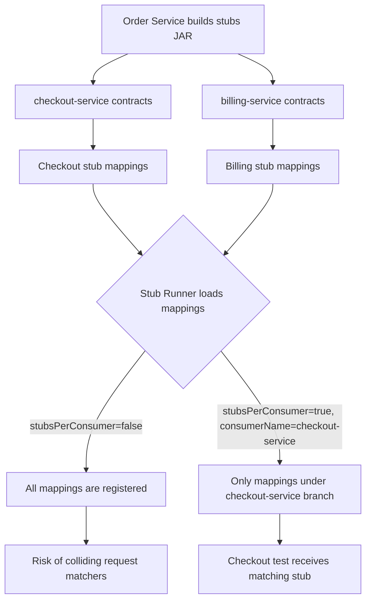
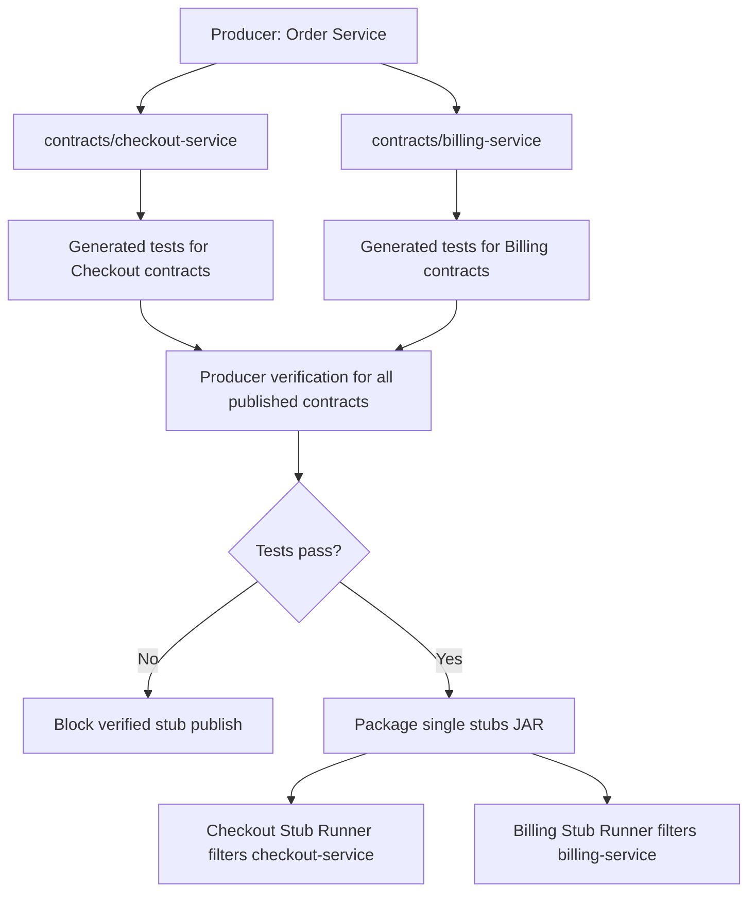
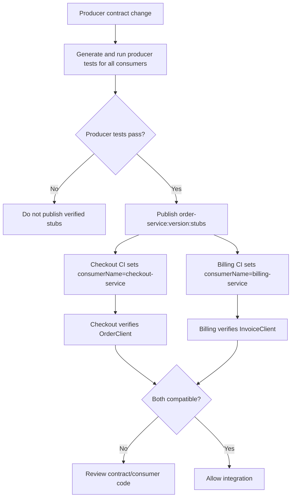

# Selecting Stubs by Consumer Name and Contract Structure

When one producer serves multiple consumers, not every consumer uses the same part of the API. **Checkout Service** cares whether an order is paid, while **Billing Service** cares about total amount and currency. If the same endpoint is described by two contracts serving two consumers, loading **all HTTP mappings** into one WireMock stub server can cause duplicate request conditions or cause a consumer test to receive an unsuitable response.

**Spring Cloud Contract Stub Runner** provides **`stubsPerConsumer`** (*stubs per consumer*) to register only stubs belonging to the selected consumer name. On the producer side, the team organizes contracts into subdirectories named after the **consumer name**; when packaged, that structure is preserved inside the stubs artifact. On the consumer side, Stub Runner downloads the producer's artifact as usual, yet filters mappings according to **`spring.application.name`** or an explicitly specified **`consumerName`**.

This lesson belongs to the **Stub Runner** chapter of the **SPRING_CLOUD_CONTRACT** track. After completing it, you will be able to organize **Groovy/YAML DSL** contracts for multiple consumers, configure `stubsPerConsumer` and `consumerName`, distinguish **producer name** from **consumer name**, inspect stubs JARs and loaded mappings, and integrate consumer-filtered stub selection into CI to detect incompatible API changes.

## 1. The problem: one producer, multiple consumers, one endpoint

Suppose **Order Service** exposes:

```http
GET /api/orders/ORDER-42
Accept: application/json
```

The producer's real implementation returns:

```json
{
  "id": "ORDER-42",
  "status": "PAID",
  "totalAmount": 125000,
  "currency": "VND"
}
```

Two consumers use different slices:

| Consumer | Response fields used | Reason |
|---|---|---|
| **checkout-service** | `id`, `status` | Checkout decides whether the order can proceed with payment |
| **billing-service** | `id`, `totalAmount`, `currency` | Billing generates invoice details |

Both teams can agree on **two separate contracts for the same method and path**:

```text
GET /api/orders/ORDER-42
  - checkout-service: sample response {id, status}
  - billing-service:  sample response {id, totalAmount, currency}
```

This **does not mean the producer returns two different responses depending on the caller's application name**. The implementation must still honor all commitments both consumers need, usually via one response containing every required field. Meanwhile, in **consumer tests**, a per-consumer stub can return just the subset of fields that consumer expects, testing its actual dependencies.

If Stub Runner loads both mappings into **one WireMock server** with identical request matchers, one request matches both. WireMock cannot tell whether a call came from Checkout or Billing solely from the test's application name. The chosen mapping might not match what a given consumer test needs.

**`stubsPerConsumer` handles mapping selection at stub-loading time per consumer**, without changing production API semantics.

### 1.1. Two configurations compared



With consumer selection enabled, a single stubs JAR can **serve multiple consumers while each consumer registers only its matching subset**.

## 2. Three commonly confused names

The following names play **completely different roles**:

| Concept | Example | What is it used for? |
|---|---|---|
| **Producer/artifactId name** | `order-service` | Stub Runner locates and downloads the producer's stubs JAR |
| **Consumer name** | `checkout-service` | `stubsPerConsumer` filters mappings inside the consumer directory |
| **Contract name** | `checkout_get_paid_order_200` | Identifies the scenario for test/mapping generation and debugging |
| **Spring application name** | `spring.application.name=checkout-service` | Default source for Stub Runner to identify the consumer when filtering is enabled |
| **Stub server host/port** | `localhost:8085` | Address the test client connects to |
| **Stubs artifact version** | `1.4.0` | Selects the contract/sample-response set from a producer build |

Example with Stub Runner:

```text
com.example:order-service:1.4.0:stubs:8085
```

This string locates **`order-service`'s stubs artifact**; it does not say which consumer uses it. To filter for `checkout-service`, you must also specify the consumer name and enable `stubsPerConsumer`.

**Core distinction:**

- `ids` answers: **"Which producer's stub to download, which version, and on which port to serve it?"**
- `consumerName` answers: **"Among the loaded stubs, which consumer's contracts should be registered?"**
- `name` inside each contract answers: **"Which test scenario is this?"**

Never substitute one field for another.

## 3. What difference does enabling vs. disabling filtering make?

In Spring Cloud Contract Stub Runner configuration docs, the `stubs-per-consumer` property defaults to **`false`**. When `false`, Stub Runner does not filter by consumer name, so in principle it registers all mappings from the loaded stubs artifact.

When `true`, Stub Runner inspects the stub/mapping path: only stubs under a directory branch matching the selected consumer name are registered. The consumer name defaults to **`spring.application.name`**, or can be overridden via **`spring.cloud.contract.stubrunner.consumer-name`** or the `consumerName` attribute of `@AutoConfigureStubRunner` in supported versions.

| Configuration | Expected result |
|---|---|
| `stubsPerConsumer=false` | Does not filter mappings by consumer name |
| `stubsPerConsumer=true` and name `checkout-service` | Registers only mappings under the `checkout-service` branch |
| `stubsPerConsumer=true` and name `billing-service` | Registers only mappings under the `billing-service` branch |
| `stubsPerConsumer=true` yet name absent in artifact | Expected mappings may not be registered; check logs and fail-on-no-stubs behavior |
| `consumerName` set without enabling `stubsPerConsumer` | Do not expect filtering to occur just from setting the name |

This is a **mapping-filtering feature at Stub Runner startup**, not a runtime authentication, authorization, or request-routing mechanism in production. Nor does it **produce a separate stubs JAR per consumer** unless the producer build is explicitly configured to do so.

### 3.1. The filtering condition lives in the path

Spring Cloud Contract documentation describes filtering based on the **directory segment containing the consumer name in the stub's path**. Therefore, how contract directories are organized on the producer **directly affects** which mappings Stub Runner registers.

Do not merely mention the consumer name inside a contract's `description`; this feature does not select mappings from natural-language descriptions.

## 4. Organizing contract directories on the producer

A clear layout for Order Service:

```text
order-service/
└── src/
    └── test/
        └── resources/
            └── contracts/
                ├── checkout-service/
                │   └── orders/
                │       ├── get_paid_order_200.groovy
                │       └── get_missing_order_404.yml
                └── billing-service/
                    └── orders/
                        ├── get_invoice_data_200.groovy
                        └── get_missing_invoice_data_404.yml
```

Notes:

1. `contracts` is the standard source directory; the **actual path** also depends on Maven/Gradle plugin configuration.
2. `checkout-service` and `billing-service` are **directories grouping contracts by consumer**.
3. You can create subdirectories like `orders` or `invoice` underneath to organize by API or feature; they do not replace the consumer name.
4. Groovy and YAML are both DSL formats supported depending on plugin version; they can coexist as long as contracts **do not accidentally create duplicate scenarios**.
5. Keep spelling, letter casing, and hyphens consistent across the **directory**, `spring.application.name`, and `consumerName`.

The directory name does not have to match the producer's `artifactId`. In the example, **`order-service` is the producer** while **`checkout-service` is the consumer**.

### 4.1. Why pick a stable directory name?

Suppose the producer renames:

```text
contracts/checkout-service/...
```

to:

```text
contracts/checkout/...
```

while the consumer still runs with `consumerName=checkout-service`. The filter will **fail to pick up any mappings** for Checkout. That is an artifact-structure/configuration bug, not necessarily an API bug.

When renaming a service, review the Spring application name, contract directories, Stub Runner config, and CI together. You can set an explicit `consumerName` to keep filtering stable even if the consumer's `spring.application.name` differs from the directory name, provided the mapping is documented.

### 4.2. Should shared contracts live outside consumer directories?

For example:

```text
contracts/
├── common/
│   └── health_check.groovy
├── checkout-service/
└── billing-service/
```

When per-consumer filtering is enabled, **do not assume** contracts under `common` are automatically loaded for every consumer. Under path-based filtering matching the consumer name, a mapping under `common` may be excluded because its path contains neither `checkout-service` nor `billing-service`.

If multiple consumers need the same contract:

- Intentionally place the corresponding contract in each consumer branch; or
- Use a dedicated organization/generation rule supported by your **exact plugin version**; or
- Inspect the actually registered mappings to verify sharing behavior.

Avoid uncontrolled copy-pasting that causes identical contracts to drift when only one side is edited. You can generate from a unified source during the build pipeline, yet never make consumer tests rely on an unverified `common` rule.

## 5. Two contracts for the same endpoint: Groovy DSL example

To see `stubsPerConsumer` in action, we write two contracts for the **same request** with different sample responses covering the data used by each consumer.

### 5.1. Checkout's contract

Path:

```text
src/test/resources/contracts/checkout-service/orders/get_paid_order_200.groovy
```

Contents:

```groovy
import org.springframework.cloud.contract.spec.Contract

Contract.make {
    name 'checkout_get_paid_order_200'
    description 'Checkout needs to know if the order is paid'

    request {
        method GET()
        url '/api/orders/ORDER-42'
        headers {
            header 'Accept', 'application/json'
        }
    }

    response {
        status OK()
        headers {
            contentType(applicationJson())
        }
        body(
            id: 'ORDER-42',
            status: 'PAID'
        )
    }
}
```

Consumer Checkout only requires `id` and `status`. A sample stub may contain fewer fields than the real implementation, provided both teams agreed on that client-testing approach.

### 5.2. Billing's contract

Path:

```text
src/test/resources/contracts/billing-service/orders/get_invoice_data_200.groovy
```

Contents:

```groovy
import org.springframework.cloud.contract.spec.Contract

Contract.make {
    name 'billing_get_invoice_data_200'
    description 'Billing needs totalAmount and currency'

    request {
        method GET()
        url '/api/orders/ORDER-42'
        headers {
            header 'Accept', 'application/json'
        }
    }

    response {
        status OK()
        headers {
            contentType(applicationJson())
        }
        body(
            id: 'ORDER-42',
            totalAmount: 125000,
            currency: 'VND'
        )
    }
}
```

**Both contracts share the same request matcher.** Registering both WireMock mappings simultaneously in the same stub server creates a **mapping selection conflict**. When a consumer uses `stubsPerConsumer=true`, only the relevant branch is loaded, resolving conflicts between **two different consumers** at mapping-selection time.

**However, per-consumer filtering does not resolve conflicts within the same branch.** If `checkout-service` has two contracts with identical method/path/headers/body yet different `200` and `404` responses, both mappings are still selected; distinguish requests by path, query, headers, body matchers, or a properly designed stateful scenario.

### 5.3. What must the real producer satisfy?

The producer can return a combined body:

```json
{
  "id": "ORDER-42",
  "status": "PAID",
  "totalAmount": 125000,
  "currency": "VND"
}
```

This **can** satisfy both contracts if generated producer assertions check the declared fields while permitting extra fields. Still, JSON/extra-property matching behavior must be **verified against generated tests of your Contract Verifier version**.

Do not declare a producer fully compliant just because two stub mappings run. Producer verification must execute both contracts against the implementation, with fixture `ORDER-42` and consistent expectations.

## 6. YAML DSL for a consumer branch

Example separate contract for Checkout's `404` scenario:

```text
src/test/resources/contracts/checkout-service/orders/get_missing_order_404.yml
```

```yaml
name: checkout_get_missing_order_404
description: Checkout handles missing order case
request:
  method: GET
  url: /api/orders/ORDER-MISSING
  headers:
    Accept: application/json
response:
  status: 404
  headers:
    Content-Type: application/json
  body:
    code: ORDER_NOT_FOUND
    message: Order not found
```

Key points:

- The **consumer directory** structure is encoded in the **YAML file's path**, without adding a fake YAML property like `consumerName: checkout-service`.
- The request path `ORDER-MISSING` differs from `ORDER-42` of the success contract.
- The producer test fixture must ensure `ORDER-MISSING` genuinely does not exist.
- The `404` in the contract carries a **business error body**; distinguish it from WireMock's default `404` when a request matches no mapping.
- The YAML `name` identifies the test and stub file, and **does not replace** the consumer directory name.

Depending on plugin version and settings, `.yml` and `.yaml` files may be discovered differently; inspect generated tests/mappings rather than merely checking YAML syntax validity.

## 7. From contract directories to the stubs artifact

The producer's Spring Cloud Contract plugin reads DSL files and generates **producer contract tests** and **stub mappings**. When packaging the stubs JAR, directory paths under `contracts` are normally **mirrored** under `mappings`.

An **illustrative** diagram:

```text
order-service-1.4.0-stubs.jar
└── META-INF/
    └── com.example/
        └── order-service/
            └── 1.4.0/
                ├── contracts/
                │   ├── checkout-service/
                │   │   └── orders/
                │   │       ├── get_paid_order_200.groovy
                │   │       └── get_missing_order_404.yml
                │   └── billing-service/
                │       └── orders/
                │           └── get_invoice_data_200.groovy
                └── mappings/
                    ├── checkout-service/
                    │   └── orders/
                    │       ├── checkout_get_paid_order_200.json
                    │       └── checkout_get_missing_order_404.json
                    └── billing-service/
                        └── orders/
                            └── billing_get_invoice_data_200.json
```

**This is not a byte-for-byte path guarantee across every plugin.** Artifact metadata and file layouts can vary by Spring Cloud Contract version, Maven/Gradle config, DSL format, and naming conventions. What must be verified is that **the consumer branch is preserved so Stub Runner can filter it**.

### 7.1. One stubs JAR, multiple consumers

The producer can publish **one** artifact:

```text
groupId    = com.example
artifactId = order-service
version    = 1.4.0
classifier = stubs
extension  = jar
```

As a file:

```text
order-service-1.4.0-stubs.jar
```

You **do not need** to publish:

```text
order-service-1.4.0-checkout-stubs.jar
order-service-1.4.0-billing-stubs.jar
```

`stubsPerConsumer` is a **runtime content-filtering mechanism** over a properly structured artifact; it does not invent two new classifiers.

### 7.2. Inspecting the JAR with a standard command

In a learner's project, after a successful build you can run:

```bash
jar tf target/order-service-1.4.0-stubs.jar
```

With Gradle, files usually reside in `build/libs/`; adjust the path accordingly. Look for entries containing:

```text
contracts/checkout-service/
mappings/checkout-service/
contracts/billing-service/
mappings/billing-service/
```

If `contracts` exists without `mappings`, or vice versa, inspect the **build plugin, generation mode, or artifact layout** before assuming per-consumer filtering will work. For HTTP stubs packaged as WireMock mappings, Stub Runner requires matching mapping definitions unless a supported runtime generation mechanism is used.

## 8. How is the consumer name determined?

With `stubsPerConsumer=true`, Stub Runner needs **a consumer name** to select the branch.

Common ways:

| Name source | Example | When to use |
|---|---|---|
| `spring.application.name` | `checkout-service` | When the application name matches the contract directory |
| `spring.cloud.contract.stubrunner.consumer-name` | `checkout-service` | When you want to override or pin the filter name |
| `@AutoConfigureStubRunner(consumerName=...)` | `consumerName="checkout-service"` | When you want to declare it explicitly on the test class |

These are **different ways to supply the name to the same filter**, not three separate filters to turn on together. Once an explicit override is used, avoid configuring conflicting values across annotations and properties, as precedence may depend on binding mechanics and version.

### 8.1. Configuring via application name

When Checkout has:

```yaml
spring:
  application:
    name: checkout-service
  cloud:
    contract:
      stubrunner:
        stubs-per-consumer: true
        ids: com.example:order-service:1.4.0:stubs:8085
        stubs-mode: LOCAL
```

Stub Runner can read `checkout-service` from `spring.application.name`, provided the test application enables Stub Runner auto-configuration and your version supports these properties.

`LOCAL` assumes the stubs JAR already exists in the local Maven repository. Never place Stub Runner test settings as a production runtime requirement if production does not use stubs.

### 8.2. Configuring with an explicit `consumer-name`

Suppose the Spring application is currently named `checkout-api`, while the producer's contracts still sit under `checkout-service`:

```yaml
spring:
  application:
    name: checkout-api
  cloud:
    contract:
      stubrunner:
        stubs-per-consumer: true
        consumer-name: checkout-service
        ids: com.example:order-service:1.4.0:stubs:8085
        stubs-mode: LOCAL
```

Thus, the name used to **filter mappings** is `checkout-service`, not `checkout-api`.

**Note:** relaxed-binding properties are shown in standard Spring Boot style; some older docs also mention unprefixed `stubrunner.consumer-name` or `stubrunner.stubs-per-consumer`. In real setups, check the **configuration properties and annotations of the exact version in use**, then verify which mappings actually load.

## 9. `@AutoConfigureStubRunner` example for Checkout

A clear way to enable per-consumer stub selection is declaring it directly on the test class:

```java
import org.junit.jupiter.api.Test;
import org.springframework.boot.test.context.SpringBootTest;
import org.springframework.cloud.contract.stubrunner.spring.AutoConfigureStubRunner;
import org.springframework.cloud.contract.stubrunner.spring.StubRunnerProperties;

@SpringBootTest(properties = {
    "spring.application.name=checkout-service",
    "clients.order.base-url=http://localhost:8085"
})
@AutoConfigureStubRunner(
    ids = "com.example:order-service:1.4.0:stubs:8085",
    stubsMode = StubRunnerProperties.StubsMode.LOCAL,
    stubsPerConsumer = true
)
class CheckoutOrderClientContractTest {

    @Test
    void shouldUseCheckoutSpecificStub() {
        // Inject Checkout's real client and call:
        // GET /api/orders/ORDER-42.
        // Verify id=ORDER-42 and status=PAID.
    }
}
```

This is a **configuration and structural example**, not a self-contained runnable JUnit test: the project needs a real `OrderClient` class, Spring Boot Test and Spring Cloud Contract Stub Runner dependencies, and test methods with assertions. `clients.order.base-url` is an **illustrative Checkout property**, not a property auto-created by Stub Runner.

Prerequisites:

1. Artifact `com.example:order-service:1.4.0:stubs` is installed in the local Maven repository.
2. Spring TestContext runs cleanly and Stub Runner starts the WireMock stub server.
3. Port `8085` is free; consider dynamic ports for parallel CI runs.
4. Checkout client reads the base URL in the test profile and actually calls the stub server.
5. Mappings belonging to `checkout-service` are registered; `billing-service` mappings do not need to be registered.

### 9.1. Overriding the name via annotation

If the application name does not match the contract directory:

```java
@AutoConfigureStubRunner(
    ids = "com.example:order-service:1.4.0:stubs:8085",
    stubsMode = StubRunnerProperties.StubsMode.LOCAL,
    stubsPerConsumer = true,
    consumerName = "checkout-service"
)
```

This configuration explicitly expresses the intent to **use the `checkout-service` branch**. Verify your plugin version supports the annotation's `consumerName` attribute and avoid configuring two conflicting name sources with unclear precedence.

### 9.2. Billing uses the same artifact yet selects a different branch

In Billing's test:

```java
@SpringBootTest(properties = "spring.application.name=billing-service")
@AutoConfigureStubRunner(
    ids = "com.example:order-service:1.4.0:stubs:8085",
    stubsMode = StubRunnerProperties.StubsMode.LOCAL,
    stubsPerConsumer = true
)
class BillingOrderClientContractTest {
    // Billing client needs totalAmount and currency.
}
```

The **artifact** difference is **none**: both consumers load `order-service:1.4.0:stubs`. Yet the consumer name makes Stub Runner **select a different set of mappings**.

Do not run **two independent test contexts sharing port 8085** concurrently if they might start two Stub Runner instances. For parallel runs, use dynamic ports and configure clients with the started port or an integration mechanism supported by your Stub Runner version.

## 10. Mapping selection mechanics and important limitations

Understand the execution order:

1. Stub Runner **downloads the producer's artifact** by `ids` coordinates and `LOCAL`/`REMOTE`/`CLASSPATH` mode.
2. Stub Runner **discovers contracts/mappings** inside the archive using supported layouts.
3. If `stubsPerConsumer` is enabled, it **filters mappings by consumer name in the path**.
4. Once selected, those mappings are **registered** on the HTTP stub server.
5. When the consumer sends an HTTP request, **WireMock matches the request** against registered mappings.
6. WireMock returns the matching mapping's response; if unmatched, it may return a default `404`.

`stubsPerConsumer` is **not**:

- A mechanism identifying consumers via HTTP headers at request time.
- An identity authentication mechanism for calling applications.
- A tool that alters real producer behavior based on `spring.application.name`.
- A filter to download only artifacts named after the consumer; `ids` still names the producer artifact.
- A fix for two mappings with overlapping request matchers **inside the same consumer branch**.
- A guarantee that any contract outside consumer directories will be shared automatically.
- Proof that the producer implementation is valid when generated producer tests did not run.

It is a **stub-definition registration filter for test environments**, not a production business-routing feature.

### 10.1. Two consumers do not automatically mean two API versions

`checkout-service` and `billing-service` can both consume **API v1** of Order Service while relying on different fields. Per-consumer directories do not automatically create two API versions or allow the producer to mutate schemas arbitrarily without impact.

If API v2 is needed, manage versioning/migration through dedicated mechanisms: path/header/schema versions and producer artifact versions. **Consumer name does not replace API version.**

### 10.2. Filtering mappings does not replace matchers

Suppose Checkout's branch has:

```text
GET /api/orders/ORDER-42       -> 200 PAID
GET /api/orders/ORDER-MISSING  -> 404 ORDER_NOT_FOUND
```

Both requests have distinct paths, making them easy to distinguish.

However, if you write:

```text
GET /api/orders/ORDER-42 -> 200 PAID
GET /api/orders/ORDER-42 -> 409 ORDER_LOCKED
```

without distinguishing headers, query parameters, bodies, or stateful conditions, both mappings still match even after consumer filtering. To simulate state transitions properly, design scenarios with distinct requests or stateful WireMock scenarios properly configured/reset for your version; never rely on test execution order.

## 11. Must producer verification run all contracts?

**Yes, if they are published by the producer and selected for verification in the build.** Using per-consumer stubs does not mean the producer only needs to satisfy the contract of whichever consumer happens to be running tests.

In producer Order Service:

- Checkout's contract requires `id` and `status`.
- Billing's contract requires `id`, `totalAmount`, and `currency`.
- The producer must satisfy those requirements across **all committed scenarios**.
- Generated producer tests must be generated and executed against the implementation.
- The stubs artifact should be published as **verified** only after producer verification passes.

One producer build can run contract tests for both branches, while Checkout's Stub Runner loads only **Checkout mappings**, and Billing's Stub Runner loads only **Billing mappings**.



**Note:** if the producer stores contract sources in an external Git/contracts repository instead of `src/test/resources/contracts`, per-consumer grouping must still be preserved in an artifact/layout understood by Stub Runner. Do not assume from a Git directory layout that the plugin automatically detects every consumer: check contracts directory settings and build outputs.

## 12. Inspecting actual mappings instead of guessing

A configuration can look right yet register zero mappings because the directory, name, or artifact is wrong.

### 12.1. Checking before starting Stub Runner

On the producer, after building/packaging:

```bash
jar tf target/order-service-1.4.0-stubs.jar
```

Look for paths matching:

```text
mappings/checkout-service/
mappings/billing-service/
contracts/checkout-service/
contracts/billing-service/
```

If Checkout's branch is missing, the bug lies in the **contract source, generator config, or packaging step**. Changing `consumerName` in consumer tests will never materialize a mapping that was never packaged.

### 12.2. Checking after Stub Runner starts

When using WireMock, the HTTP admin endpoint **can usually** report registered mappings:

```http
GET http://localhost:8085/__admin/mappings
```

Use this endpoint only in **test environments** where the WireMock server permits access. Returned JSON varies by WireMock version; the key point is **verifying the list of active request matchers**.

With `consumerName=checkout-service`, expect:

- Mapping for Checkout's `GET /api/orders/ORDER-42` with `status=PAID`.
- Mapping for Checkout's `GET /api/orders/ORDER-MISSING`, if defined and packaged.
- **No** Billing-only mappings if the filter works properly.
- No two mappings matching the same request with different responses inside the same branch.

In some versions, `spring.cloud.contract.stubrunner.mappings-output-folder` dumps loaded mappings for inspection. Check docs and verify generated data for your exact version; avoid arbitrarily modifying output folders in CI without write permissions.

### 12.3. Using both positive and negative tests

Do not merely check that `GET /api/orders/ORDER-42` returns `200`. Include tests for:

1. **Positive:** Checkout request receives the exact fields Checkout needs.
2. **Negative:** Billing-only request is **not** matched in Checkout mode, if a distinct path exists to verify separation.
3. **Rename test:** intentionally pass a wrong consumer name and verify tests fail cleanly instead of silently passing.
4. **Mapping count/identity check:** post-startup mapping list matches expected contracts.
5. **Regression:** adding a contract for another consumer does not unexpectedly affect existing consumers.

If two consumers share **one endpoint**, sending that request and seeing `200` does not tell you which mapping loaded; inspect the **response body** and **WireMock mapping registry**.

## 13. Default `404` is not a contract `404`

When a request matches no mapping in Stub Runner/WireMock, the server typically returns a default `404`. That differs from a business `404` response:

```json
{
  "code": "ORDER_NOT_FOUND",
  "message": "Order not found"
}
```

For example, Checkout mistakenly sends:

```http
GET /api/orders/ORDER-42
Accept: text/plain
```

If the mapping requires `Accept: application/json`, the request may fail to match and get a default `404`. A test asserting only HTTP status `404` can easily **false-pass**, even though the `ORDER-MISSING` scenario never ran.

Therefore, when testing business `404`s, also verify **body/headers and error codes** from the contract. When troubleshooting missing stubs, inspect **URL, method, headers, request body, port**, and the count of actually selected mappings.

## 14. Stub Runner in Maven/Gradle and CI

To run consumer tests, you need a **properly structured stubs artifact**.

### 14.1. Producer side

On a producer using Maven Wrapper, sample commands:

```bash
./mvnw clean verify
./mvnw install
```

Which phases run depends on your project's plugin/configuration. A single `./mvnw clean install` also typically runs the required lifecycle and installs main/stubs artifacts if the plugin binds the right goals. **Never assume** a green build means producer tests ran or the stub classifier was attached: inspect test reports and artifact lists.

With Gradle:

```bash
./gradlew clean build
./gradlew publishToMavenLocal
```

`publishToMavenLocal` requires `maven-publish` with a publication attaching the stubs artifact. Inspect the task graph, classifier, and archives; never assume the Gradle plugin publishes stubs without configuration.

### 14.2. Consumer side

The consumer needs:

1. Compatible **Spring Cloud Contract Stub Runner** and Spring Boot Test dependencies.
2. Test configuration enabling Stub Runner.
3. `ids` pointing to the **producer artifact with classifier `stubs`**.
4. `stubsPerConsumer=true`.
5. `consumerName` or `spring.application.name` matching the contract branch.
6. Real client targeting the stub server host/port.
7. Assertions verifying the consumer uses the response properly.
8. Pinned artifact version for reproducible testing.

A pipeline can select the stubs version built and published by the producer in the same CI chain. If the consumer always pulls "latest," tests can pull new mappings incompatible with current consumer code, or become untraceable when snapshots are overwritten.

### 14.3. CI with multiple consumers



**Not every consumer** has to run in the same job; yet each consumer must use the **exact artifact/version** and **exact consumer name**, without mixing mappings.

## 15. Backward compatibility and contracts per consumer

Per-consumer contracts offer another benefit: **knowing which consumer depends on which part of the API**.

For instance, suppose the producer wants to remove `currency` from the Order Service response:

- Checkout's contract does not require `currency`.
- Billing's contract requires `currency`.
- When the producer changes the implementation, **Billing's generated producer test** will fail if the contract protects that field properly.
- The team immediately knows to coordinate with Billing before removing `currency`.

This is how contracts catch changes that could break a specific consumer.

### 15.1. Not every change warrants splitting per-consumer

If multiple consumers use the exact same interface with no mapping overlap, one shared contract suite may be easier to maintain. `stubsPerConsumer` is useful when:

- Consumers use different parts of an API.
- Teams want expectations separated by owner.
- One request has multiple sample stub responses serving different consumers.
- You need to avoid loading unrelated mappings into each consumer test.
- You want visibility into API change impact by consuming team.

Yet it also adds overhead:

- Directory names and consumer identities must be maintained.
- Contracts can be duplicated if multiple consumers need identical behavior.
- Individual contracts can be mistaken for consumer-specific production responses.
- When a consumer is renamed, directory layouts and configs must be updated.
- Filters must be checked so shared critical contracts are not dropped.

Choose your strategy based on **system scale and dependency structure**, rather than enabling it just because the option exists.

## 16. Common mistakes

| Mistake | Impact | Fix |
|---|---|---|
| Using `checkout-service` in `ids` instead of `order-service` | Fails to download the producer artifact | `ids` must target the producer GAV/classifier |
| Setting `consumerName=order-service` | Fails to match consumer branch | Use `checkout-service` or `billing-service` |
| Setting `consumerName` while forgetting `stubsPerConsumer=true` | May still load all mappings | Enable filter and inspect loaded mappings |
| `spring.application.name` differs from directory name | Wrong or no mappings selected | Override `consumerName` or align names |
| Putting consumer name in `description` instead of directory | Does not affect path filtering | Organize `contracts`/`mappings` directory layout properly |
| Assuming `common` is shared automatically | Missing mappings in consumer mode | Verify or duplicate controllably |
| Downloading main JAR instead of classifier `stubs` | Stub Runner finds no mappings | Check coordinates and JAR contents |
| Two mappings with identical requests in the same branch | Ambiguous mapping selection | Fix matchers/requests or use scenarios |
| Test asserts only HTTP status `404` | May accept unmatched-request `404` | Assert business error body |
| Stubs artifact has contracts yet lacks mappings | Runtime does not serve expected HTTP response | Check generation/packaging/version |
| Using fixed port in parallel CI | Port conflict | Use dynamic ports and configure test client |
| Producer skips generated tests | Stubs may not reflect implementation | Block publish if verification fails |
| Consumer uses uncontrolled `+` or latest | Hard-to-reproduce results | Pin version/commit |
| Renaming consumer directory without rebuilding artifact | Tests still pull old mappings | Regenerate/publish stubs with new version |
| Treating per-consumer mode as runtime authorization | Security misconception | Security is enforced on the real producer |

### 16.1. Ordered diagnostic workflow

If Checkout does not receive the expected response:

1. Confirm producer `order-service` built/published the right version of the stubs JAR.
2. Check whether `mappings/checkout-service` exists inside the JAR.
3. Confirm `ids` points to `com.example:order-service:version:stubs`.
4. Confirm `stubsPerConsumer=true` is actually active.
5. Check the effective consumer name: `spring.application.name` or override.
6. Inspect mappings currently registered in WireMock/Stub Runner.
7. Inspect the client's request: path, method, headers, body.
8. Distinguish a mapping response from an unmatched `404`.
9. Run consumer tests through the **real client**.
10. If the cause is contract/implementation drift, return to producer verification before publishing the next stub version.

This cleanly separates **artifact**, **per-consumer filtering**, **request matching**, **consumer client**, and **producer behavior**—avoiding misguided business-code edits when the root cause is picking the wrong stubs JAR.

## 17. Hands-on exercise: one Order Service, two consumers

Prompt: Order Service serves Checkout and Billing. Both consumers call `GET /api/orders/ORDER-42` yet use different response fields.

### Phase A — organize contract sources

1. Create directory `contracts/checkout-service/orders`.
2. Create directory `contracts/billing-service/orders`.
3. Write Groovy DSL for Checkout returning `id/status`.
4. Write Groovy DSL for Billing returning `id/totalAmount/currency`.
5. Add a separate YAML contract for Checkout with path `ORDER-MISSING` returning `404 ORDER_NOT_FOUND`.
6. Ensure no two contract names collide and no contract runs twice from duplicate Groovy/YAML definitions.

### Phase B — producer verification

1. Seed `ORDER-42` with `PAID`, `125000`, and `VND`.
2. Ensure `ORDER-MISSING` does not exist.
3. Generate producer contract tests; verify tests exist for **both consumer directories**.
4. Run generated tests against real Order Service.
5. Try removing `currency` from the producer response; confirm Billing's contract catches the change when assertions protect that field.
6. Restore the implementation and verify tests pass.

### Phase C — build and inspect the stubs JAR

1. Package `order-service-1.4.0-stubs.jar` or the actual build version.
2. Use `jar tf` to locate both consumer `contracts` and `mappings` branches.
3. Install the artifact into the local Maven repository or publish to a test repository.
4. Confirm artifact GAV/classifier/version match the consumer tests.

### Phase D — run Checkout Stub Runner

1. Set `stubsPerConsumer=true`.
2. Set `spring.application.name=checkout-service` or `consumerName=checkout-service`.
3. Start Stub Runner with the Order Service artifact.
4. Verify registered WireMock mappings belong solely to Checkout.
5. Invoke Checkout's `OrderClient` and assert `status=PAID`.
6. Call `ORDER-MISSING` and assert `404` alongside `code=ORDER_NOT_FOUND`.

### Phase E — run Billing Stub Runner

1. Use the **same** Order Service artifact, setting `consumerName=billing-service`.
2. Verify Billing mappings are present while Checkout mappings are not registered in Billing's environment.
3. Invoke `InvoiceClient` and assert `totalAmount=125000`, `currency=VND`.
4. Run consumer tests individually, then in CI in any order or in parallel on separate ports.

### Phase F — induce configuration errors

1. Disable `stubsPerConsumer` and observe which mappings load together.
2. Set a wrong consumer name; confirm the test fails clearly instead of assuming the producer API errored.
3. Change `order-service` to `checkout-service` in `ids`; observe the missing-producer-artifact error.
4. Create two overlapping-request mappings in the **same** Checkout branch; distinguish the requests before putting them into CI.
5. Test an old stub version then a new version; record the difference to demonstrate why pinning versions matters.

**Completion criteria:** two consumers use **one properly versioned stubs JAR** yet register mappings matching their own names; producer verification verifies all published contracts, while consumer tests via Stub Runner catch compatibility bugs without interfering with each other's contract branches.

## 18. Checklist for bringing stubs per consumer into CI

- [ ] Consumer directories have stable names matching the name selected in Stub Runner.
- [ ] Groovy/YAML contracts live in the source path configured for the plugin.
- [ ] Contracts have unique `name`s and non-colliding matchers within the same branch.
- [ ] Generated producer tests exist and run for all published consumers.
- [ ] Stubs JAR has classifier `stubs` and a traceable version.
- [ ] Archive preserves `contracts/<consumer>` and `mappings/<consumer>` or the version-appropriate layout.
- [ ] `ids` points to the **producer artifact**, not the consumer artifact.
- [ ] `stubsPerConsumer=true` is active in tests.
- [ ] Effective `consumerName` matches the directory, even when `spring.application.name` differs.
- [ ] Actual registered mappings are inspected after Stub Runner startup.
- [ ] Consumer uses real HTTP clients, with assertions checking both success and error bodies.
- [ ] Stub ports/DB/caches are isolated across CI jobs.
- [ ] Stub artifacts are published **after producer verification**, not merely after generation.
- [ ] No production data/tokens are placed in contracts/stubs.
- [ ] Release artifacts are never overwritten under the same version.

This checklist keeps **technical configuration and operations** clearly separated from Content QA cycles and product release decisions.

## 19. Self-check questions

1. **What is `stubsPerConsumer` used for?** Filtering registered stub mappings based on the consumer name in the contract/mapping path.
2. **How do producer name and consumer name differ?** Producer determines which artifact `ids` to download; consumer name determines which mapping branch is selected.
3. **If `spring.application.name=checkout-service`, what should the corresponding directory be named?** Usually `checkout-service`, unless `consumerName` is intentionally overridden.
4. **Is `stubsPerConsumer` enabled or disabled by default?** Disabled (`false`) by default per Stub Runner documentation.
5. **Does setting `consumerName` alone without enabling `stubsPerConsumer` guarantee filtering?** No. Filtering must be enabled.
6. **Can the same stubs JAR serve both Checkout and Billing?** Yes, if the artifact preserves both contract/mapping branches.
7. **Does enabling `stubsPerConsumer` create two separate stubs JARs?** No. It filters at stub-registration time, not by packaging new classifiers.
8. **Why can two contracts with the same method/path yet different responses cause trouble when loaded together?** WireMock may have two mappings matching the same request and return an unintended response.
9. **Does per-consumer filtering fix two overlapping mappings within the same branch?** No. Matchers or scenarios must be fixed.
10. **Is putting the consumer name in contract `description` enough for filtering?** No. Filtering relies on directory path structure.
11. **Is a `common` directory automatically loaded for every consumer?** Do not assume so; verify behavior for your version.
12. **Why inspect `jar tf` before debugging the client?** To ensure the artifact contains mappings and the expected directories.
13. **Does `ids=com.example:order-service:1.4.0:stubs:8085` select the consumer?** No; it selects producer artifact/classifier/version/port.
14. **When Stub Runner returns `404`, is it definitely `ORDER_NOT_FOUND`?** No. The request might match no mapping.
15. **Why inspect `/__admin/mappings` in test environments?** To know which mappings are actually registered rather than guessing from config.
16. **Does producer verification need to run contracts for both consumers?** Yes, for all contracts published and selected in the producer build.
17. **Does a green consumer Stub Runner test prove the producer implementation is right?** No. Generated producer tests must run on the real producer.
18. **What happens if `checkout-service` directory is renamed without updating `consumerName`?** The filter may fail to find mappings.
19. **How does stubs version differ from consumer name?** Version selects the producer's contract version; consumer name selects the subset of mappings inside that artifact.
20. **When are per-consumer contracts worth using?** When multiple consumers have distinct expectations, contract ownership visibility is needed, or overlapping/unrelated mappings must be avoided.

## 20. References and version boundaries

Mentioned features such as `stubsPerConsumer`, `consumerName`, and `@AutoConfigureStubRunner` appear in Spring Cloud Contract documentation. However, **package names, output layout, configuration rules, and version compatibility** must be verified against the exact version used in your project.

Helpful official sources:

- [Spring Cloud Contract — Consumer-Driven Contracts: Stubs Per Consumer](https://docs.spring.io/spring-cloud-contract/reference/project-features-stubrunner/stub-runner-stubs-per-consumer.html)
- [Spring Cloud Contract — Configuration Properties](https://docs.spring.io/spring-cloud-contract/reference/configprops.html)
- [Spring Cloud Contract — How to Use Git as Storage for Contracts and Stubs](https://docs.spring.io/spring-cloud-contract/reference/howto/how-to-use-git-as-storage.html)
- [Spring Cloud Contract — Reference](https://docs.spring.io/spring-cloud-contract/reference/)

When upgrading Spring Boot, Spring Cloud, and Spring Cloud Contract, re-verify plugin settings, Stub Runner properties, JDK compatibility, build outputs, and generated tests. **Never conclude filtering works just by seeing an annotation on a test**; inspect the mappings actually registered on the running stub server.

## Conclusion

**Selecting stubs by consumer name** lets a producer share **one stubs artifact** across multiple consumers while registering only **mappings belonging to the contract directory of the consumer under test**. Good practice includes organizing `contracts/<consumer-name>/...` on the producer, preserving that layout in `mappings` inside the stubs JAR, setting `stubsPerConsumer=true` with an accurate `consumerName`, and having Stub Runner load the right producer GAV/classifier/version. This reduces stub collisions between consumers, yet **does not replace request matching, producer contract verification, or real integration tests**. When generated producer tests, Stub Runner consumer tests, and CI release gates are cleanly organized, teams can catch incompatible API changes per consumer while keeping tests reproducible.
