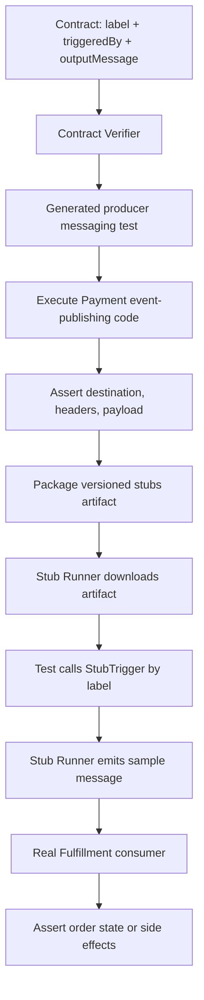
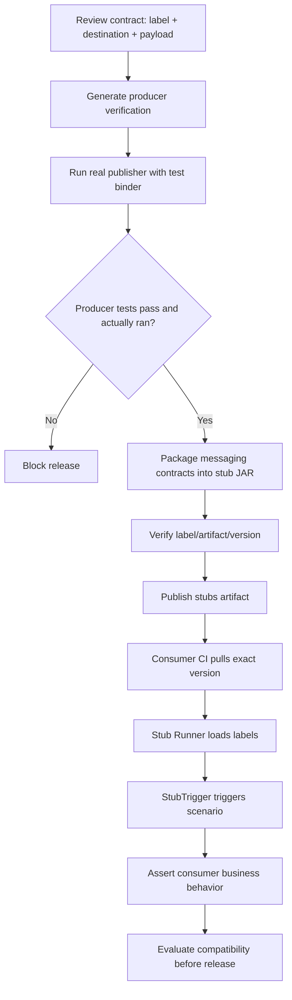

# Triggering Messaging Stubs by Label

## 1. Why trigger messages by label?

Suppose an e-commerce system has two microservices:

- `payment-service` is the **producer**: after capturing a payment successfully, it emits a `PaymentCaptured` event.
- `fulfillment-service` is the **consumer**: it receives the event to mark the order as paid and start the shipping workflow.

In production, events may travel over Kafka or RabbitMQ. Yet to test Fulfillment in CI, the team does not want to spin up the entire Payment service and execute real transactions just to receive a sample event.

With **Spring Cloud Contract**, the team writes message contracts in **Groovy DSL or YAML DSL**, generates producer verification tests, publishes an artifact containing stubs, and lets the consumer use **Stub Runner**. Unlike HTTP stubs — which respond when an incoming request matches — a messaging stub **may need the test to proactively ask it to emit an event**.

Spring Cloud Contract solves this via the contract's **`label`** and the **`StubTrigger`** interface. Consumer tests can invoke:

```java
stubTrigger.trigger("payment_captured_1001");
```

Stub Runner finds the matching messaging contract, sends the sample message to the described destination, and real consumer code receives and processes it. **A label identifies the scenario to trigger**, not a Kafka topic name, not a Spring Cloud Stream binding name, and not the event payload.

### Lesson objectives

After this lesson, you will be able to:

1. Write messaging contracts with `label`, `triggeredBy`, and `outputMessage.sentTo`.
2. Distinguish label, stub artifact, destination, binding, and event type.
3. Configure Stub Runner with the Spring Cloud Stream test binder for consumer tests.
4. Use `trigger(label)`, `trigger(groupId:artifactId, label)`, `labels()`, and `trigger()` appropriately.
5. Write assertions on **consumer business outcomes**, not merely the trigger's boolean return value.
6. Handle duplicate labels, wrong mappings, stale artifacts, side effects, and asynchronous tests in CI.

## 2. Producer verification and consumer stub test flows

Both sides share **the same contract meaning**, yet verify different things.



| Side | Real components under test | Substituted components |
| --- | --- | --- |
| **Producer verification** | Payment code building and emitting events, data mapping, destination, and headers per test setup. | External broker may be replaced by test binder/message verifier. |
| **Consumer test** | Consumer handler/functional bean, payload deserialization, validation, idempotency, and Fulfillment business decisions. | Real Payment is replaced by a messaging stub triggered by Stub Runner. |

Seeing `stubTrigger.trigger(...)` return `true` only tells us Stub Runner **managed to trigger** the corresponding scenario; **it does not prove Fulfillment read or processed it properly**. You must observe business outcomes or downstream consumer messages.

Likewise, green consumer tests with a stub **do not prove the current producer emits real messages properly**. Payment must still run generated producer tests before publishing artifacts.

## 3. Four commonly confused names

Example event:

```json
{
  "eventId": "EVT-1001",
  "eventType": "PaymentCaptured",
  "paymentId": "PAY-1001",
  "orderId": "ORD-2001",
  "amount": 250000,
  "currency": "VND"
}
```

| Name / value | Kind | Who uses it? |
| --- | --- | --- |
| `payment_captured_1001` | **Contract label** | Test calls `StubTrigger.trigger(...)` to choose a scenario. |
| `com.example:payment-service:1.4.2:stubs` | **Stub artifact coordinates** | Stub Runner uses this to locate and download the right package. |
| `payments.captured` | **Messaging destination** | Publisher sends messages here; consumer binding listens here. |
| `recordCapturedPayment-in-0` | **Spring Cloud Stream binding name** | Maps the `recordCapturedPayment` bean to the destination. |
| `PaymentCaptured` | **Event type** | Consumer decides how to handle the business event. |
| `EVT-1001` | **Event ID** | Consumer can use this to detect duplicate event deliveries. |

**Do not use `payment_captured_1001` as the destination name just because it is the label.** A label is the test API used to request emitting a message. The destination is part of inter-service communication and must be defined and versioned per your system's API/event policy.

A label might convey "payment PAY-1001 captured event," yet the **actual payload must still be verified**, as a descriptive name does not guarantee a valid body.

## 4. Groovy DSL: declaring label at contract level

Here is a complete messaging contract for Payment:

```groovy
import org.springframework.cloud.contract.spec.Contract

Contract.make {
    name 'payment_captured_for_order_2001'
    description 'Emit event after payment capture succeeds'
    label 'payment_captured_1001'

    input {
        triggeredBy('publishCapturedPayment()')
    }

    outputMessage {
        sentTo('payments.captured')
        body([
            eventId: 'EVT-1001',
            eventType: 'PaymentCaptured',
            paymentId: 'PAY-1001',
            orderId: 'ORD-2001',
            amount: 250000,
            currency: 'VND'
        ])
        headers {
            messagingContentType(applicationJson())
            header('eventType', 'PaymentCaptured')
        }
    }
}
```

Meaning of each element:

1. **`label`** at contract level: `payment_captured_1001` is the label consumer tests use to trigger the messaging stub.
2. **`input.triggeredBy(...)`**: during **producer verification**, the generated test invokes `publishCapturedPayment()` to make the Payment application execute its event-emitting behavior.
3. **`outputMessage.sentTo(...)`**: specifies destination `payments.captured` to observe.
4. **`outputMessage.body`**: business data Fulfillment will receive from the stub.
5. **`outputMessage.headers`**: metadata required for payload conversion or routing per contract.

**Very common confusion:** `triggeredBy('publishCapturedPayment()')` is **not** an expression the consumer calls via `StubTrigger`. On the producer side, this method must exist on the base test class or be validly referenced to invoke **real producer code**. On the consumer side, test code calls the **label** `payment_captured_1001`.

### What must the producer base test do?

Sketch example with Spring Cloud Stream:

```java
@SpringBootTest(classes = PaymentApplication.class)
@AutoConfigureMessageVerifier
@Import(TestChannelBinderConfiguration.class)
public abstract class PaymentMessagingContractBase {

    @Autowired
    PaymentEventPublisher publisher;

    public void publishCapturedPayment() {
        publisher.publishCaptured(
            new PaymentCaptured(
                "EVT-1001",
                "PaymentCaptured",
                "PAY-1001",
                "ORD-2001",
                250000L,
                "VND"
            )
        );
    }
}
```

This is **illustrative code**, not a standalone compilable class. The project needs imports for annotations, DTOs, publisher, test dependencies, Contract Verifier base-class mapping, and the matching test binder. Depending on Spring Cloud Stream version, activating the test binder may use `@Import(TestChannelBinderConfiguration.class)`, `@ImportAutoConfiguration(...)`, or `@EnableTestBinder`; **pick the mechanism matching your project version**. Generated producer tests must genuinely call the publisher and inspect the message, rather than constructing sample JSON inside the test itself.

If Spring Cloud Contract Verifier is configured for JUnit 5, ensure the base test and JUnit Jupiter engine are aligned. Having contract DSL and sample stubs does not replace configuring the producer test framework.

## 5. YAML DSL: labels carry the exact same meaning

Equivalent YAML contract:

```yaml
description: Emit event after payment capture succeeds
name: payment_captured_for_order_2001
label: payment_captured_1001
input:
  triggeredBy: publishCapturedPayment()
outputMessage:
  sentTo: payments.captured
  body:
    eventId: EVT-1001
    eventType: PaymentCaptured
    paymentId: PAY-1001
    orderId: ORD-2001
    amount: 250000
    currency: VND
  headers:
    contentType: application/json
    eventType: PaymentCaptured
```

In YAML, the label is a top-level `label:` field, **not** nested inside `outputMessage.body`. When Stub Runner reads contracts inside the artifact, it looks up declared labels to enable triggering.

Groovy and YAML in sections 4–5 are **two representations of the same scenario**; do not keep both as separate contracts when only one stub is intended. Different Spring Cloud Contract versions may differ slightly in converter/header handling, so when switching DSL formats, regenerate tests/stubs and verify the label is recognized.

## 6. Packaging messaging contracts before triggering

For HTTP, a WireMock JSON mapping usually suffices for the stub server to respond to requests. For messaging, **Stub Runner needs information from the contract** to know how to emit messages by label and destination. Hence, source Groovy/YAML definitions must be packaged in the stub artifact using the layout expected by your Stub Runner version.

Example artifact:

```text
payment-service-1.4.2-stubs.jar
└── META-INF/
    └── com.example/
        └── payment-service/
            └── 1.4.2/
                ├── contracts/
                │   └── messaging/
                │       └── payment-captured.groovy
                └── mappings/
                    └── http/
                        └── get-paid-payment.json
```

This is an **illustrative layout** matching a common JAR packaging format. Actual paths vary by plugin/version, artifact download mode, and source structure; legacy layouts also use different folders. What is mandatory is that the **consumer's Stub Runner can read the contracts and labels**. An artifact containing only WireMock HTTP mappings without messaging contracts cannot expose the expected label.

Hypothetical coordinates:

```text
groupId     = com.example
artifactId  = payment-service
version     = 1.4.2
classifier  = stubs

Stub Runner ID:
com.example:payment-service:1.4.2:stubs
```

After producer verification, you can inspect the package on the build machine:

```bash
jar tf target/payment-service-1.4.2-stubs.jar
```

The path applies only to the Maven example and matching artifact name. **Never assume the JAR is valid solely from its filename**: inspect entries inside, verify `label` is intact, verify producer tests executed, and confirm the artifact consumed in smoke tests is the **exact same version/bytes** intended for release.

### Why pin versions?

When Checkout tests with stub `1.4.2`, sample messages come from that version's contracts. Using dynamic version notation could cause the same consumer commit to receive different stub contents tomorrow. For CI requiring reproducible outcomes, pin specific versions or lock artifacts per organizational policy. Never republish an existing release version just to alter stub contents.

## 7. Spring Cloud Stream consumer: binding to the destination

Suppose Fulfillment handles events using the **functional model** recommended in modern Spring Cloud Stream versions:

```java
@Configuration
class FulfillmentStreamConfiguration {

    @Bean
    Consumer<PaymentCaptured> recordCapturedPayment(
            FulfillmentService service) {
        return event -> service.registerPaidOrder(
            event.eventId(),
            event.orderId(),
            event.paymentId()
        );
    }
}
```

This is illustrative code; `PaymentCaptured` can be a consumer record/DTO, and `FulfillmentService` needs a real implementation and appropriate test probe/fixture.

With functional bean `recordCapturedPayment`, the default input binding name is:

```text
recordCapturedPayment-in-0
```

Configuration mapping that binding to the destination stated in the contract:

```yaml
spring:
  cloud:
    function:
      definition: recordCapturedPayment
    stream:
      bindings:
        recordCapturedPayment-in-0:
          destination: payments.captured
          content-type: application/json
```

Points to remember:

- `recordCapturedPayment` is the **function bean name**.
- `recordCapturedPayment-in-0` is the **binding name** generated by Spring Cloud Stream convention.
- `payments.captured` is the **logical destination** on both sides, mapped by the binder to the messaging transport.
- `payment_captured_1001` is only the **label for Stub Runner to trigger the message**, not a bean or binding.

If the producer test uses `sentTo('payments.captured')` yet the consumer binds `payments.refunded`, triggering the label may still succeed in Stub Runner while Fulfillment **never receives the event**. Verify the exact destination the consumer listens to.

### Why use the test binder?

In consumer tests, the Spring Cloud Stream test binder allows sending/receiving messages in-JVM without connecting to a shared Kafka/RabbitMQ cluster. Example Maven dependencies:

```xml
<dependency>
    <groupId>org.springframework.cloud</groupId>
    <artifactId>spring-cloud-stream-test-binder</artifactId>
    <scope>test</scope>
</dependency>
<dependency>
    <groupId>org.springframework.cloud</groupId>
    <artifactId>spring-cloud-starter-contract-stub-runner</artifactId>
    <scope>test</scope>
</dependency>
```

These are **sketch dependencies**: the project also needs Spring Cloud Stream, Spring Boot Test, a management BOM, and compatible binders/serializers. Never arbitrarily mix legacy `spring-cloud-stream-test-support` with the newer test binder; follow the compatibility matrix of your Spring Boot, Spring Cloud Stream, and Spring Cloud Contract versions.

## 8. Consumer test: triggering a label and verifying business outcomes

Spring Boot/JUnit 5 test example:

```java
@SpringBootTest(
    classes = FulfillmentApplication.class,
    properties = {
        "spring.cloud.function.definition=recordCapturedPayment",
        "spring.cloud.stream.bindings.recordCapturedPayment-in-0.destination=payments.captured",
        "spring.cloud.stream.bindings.recordCapturedPayment-in-0.content-type=application/json"
    }
)
@Import(TestChannelBinderConfiguration.class)
@AutoConfigureStubRunner(
    ids = "com.example:payment-service:1.4.2:stubs",
    stubsMode = StubRunnerProperties.StubsMode.LOCAL
)
class FulfillmentMessagingStubTest {

    @Autowired
    StubTrigger stubTrigger;

    @Autowired
    FulfillmentProbe fulfillmentProbe;

    @Test
    void createsFulfillmentWhenPaymentCapturedStubIsTriggered() {
        boolean triggered = stubTrigger.trigger(
            "com.example:payment-service",
            "payment_captured_1001"
        );

        assertThat(triggered).isTrue();

        await().atMost(Duration.ofSeconds(5))
            .untilAsserted(() -> {
                assertThat(
                    fulfillmentProbe.hasProcessedEvent("EVT-1001")
                ).isTrue();
                assertThat(
                    fulfillmentProbe.hasOrder("ORD-2001")
                ).isTrue();
            });
    }
}
```

**This example intentionally omits boilerplate:** you must import `@Test`, `@Autowired`, `@SpringBootTest`, `@Import`, `@AutoConfigureStubRunner`, `StubRunnerProperties`, `StubTrigger`, `Duration`, AssertJ/Awaitility, and application classes. `FulfillmentProbe` is a standalone test component observing outcomes produced by the **real `FulfillmentService`** (e.g., an in-memory repository), not a mock hardcoded to return `true`. Pick `TestChannelBinderConfiguration`/`@EnableTestBinder` according to your version.

### Analyzing exactly what the test does

1. `@AutoConfigureStubRunner` loads stub artifact `com.example:payment-service:1.4.2:stubs` from the local Maven repository.
2. Stub Runner reads the packaged messaging contract and finds `label 'payment_captured_1001'`.
3. `trigger("com.example:payment-service", "payment_captured_1001")` selects the message from the **exact producer stub**.
4. Stub Runner publishes the described body/headers to `payments.captured` via the configured messaging integration.
5. Spring Cloud Stream routes the message to Fulfillment's `recordCapturedPayment` bean.
6. The handler uses the payload to update business state.
7. The test waits with a **bounded timeout** and verifies the event ID and order ID were processed.

**The `true` return value from `trigger` only confirms the trigger action ran per the API**—it does not confirm the consumer finished processing, committed a transaction, or avoided duplicate handling. The business assertions in step 7 verify consumer behavior.

**Note on artifact source:** `StubsMode.LOCAL` requires the matching stub JAR to be installed in the test environment's local Maven repository. Never rely on a stale leftover artifact and conclude the newly built producer is compatible. In CI, switch to `REMOTE` with a clearly configured artifact repository and credentials.

## 9. Supported ways to invoke StubTrigger

Spring Cloud Contract provides `org.springframework.cloud.contract.stubrunner.StubTrigger`. Official docs list the following operations:

```java
// 1. Trigger by label (appropriate when the label is unique).
boolean ok1 =
    stubTrigger.trigger("payment_captured_1001");

// 2. Trigger by stub identity and label.
boolean ok2 =
    stubTrigger.trigger(
        "com.example:payment-service",
        "payment_captured_1001"
    );

// 3. Using artifactId alone where supported by the API.
boolean ok3 =
    stubTrigger.trigger(
        "payment-service",
        "payment_captured_1001"
    );

// 4. Trigger all available events.
boolean allTriggered =
    stubTrigger.trigger();

// 5. List registered labels per artifact.
Map<String, Collection<String>> registered =
    stubTrigger.labels();
```

This snippet illustrates the API in **test scope**, assuming `StubTrigger` is injected and `Map/Collection` are imported. The boolean tells whether triggering ran per the interface; **never use that boolean in place of asserting that the consumer received and handled the message**.

### 9.1. Specifying label only

```java
stubTrigger.trigger("payment_captured_1001");
```

Appropriate when the test loads only **one** producer stub or all stub artifacts have clearly distinct labels. Label names should express the scenario rather than depending on source file paths.

### 9.2. Specifying producer and label

```java
stubTrigger.trigger(
    "com.example:payment-service",
    "payment_captured_1001"
);
```

Helpful when one consumer loads stubs from multiple producers, or multiple producers share identical label names. Here `groupId:artifactId` is **not** `groupId:artifactId:version:classifier`; docs specify the group/artifact pair or artifactId alone as the stub selector for this overload. The stub version was already fixed in `ids` configuration.

### 9.3. Listing labels before triggering

```java
Map<String, Collection<String>> available = stubTrigger.labels();

boolean hasExpectedLabel = available.values().stream()
    .anyMatch(labels -> labels.contains("payment_captured_1001"));

assertThat(hasExpectedLabel).isTrue();
```

`labels()` returns a map of **artifact notation → collection of labels**. You can log labels (excluding secret payloads) when investigating failures, yet never write tests relying on `Map` or `Collection` iteration order.

### 9.4. Triggering all labels

```java
stubTrigger.trigger();
```

This can be useful as a smoke test for a dedicated artifact, yet **should not be the default** in isolated consumer tests. If the package contains `PaymentCaptured`, `PaymentRefunded`, and `PaymentCaptureDeclined`, triggering all of them can produce conflicting side effects, making tests hard to interpret and causing cross-interference. Prefer triggering **one specific label** matching the scenario under assertion.

## 10. Distinguishing label triggering from manual message sending

When writing Spring Cloud Stream tests, you can craft a message manually and send it via `InputDestination.send(...)`:

```java
inputDestination.send(
    MessageBuilder.withPayload(
        json.getBytes(StandardCharsets.UTF_8)
    ).setHeader(
        MessageHeaders.CONTENT_TYPE,
        MimeTypeUtils.APPLICATION_JSON
    ).build(),
    "payments.captured"
);
```

That approach is **useful for unit/integration testing consumer bindings**, yet differs from `StubTrigger`:

| Criterion | Manual `InputDestination` send | `StubTrigger` by label |
| --- | --- | --- |
| Payload source | Consumer test crafts JSON/headers itself. | Contract published by producer inside stub artifact. |
| Producer version binding | Not present by default. | Present via the artifact/version Stub Runner loads. |
| Primary goal | Test binding/handler with local test data. | Test consumer handling **messages belonging to producer contracts**. |
| Risk | Consumer test invents payloads diverging from producer. | Stale artifact, wrong label, or unverified producer stub. |
| Needs real producer running? | No. | No, though producer verification must run before publishing the artifact. |

The two approaches **complement each other**. Local test binder sends can probe tiny variations or edge cases. Stub Runner by label ties consumer tests to **published cross-team commitments**.

## 11. Asynchrony: verify outcomes, avoid fixed sleeps

Messaging may run on another thread or a Reactor scheduler. Immediately after `trigger(...)` returns, the consumer may not yet have committed to the database or updated a read model.

Avoid writing:

```java
stubTrigger.trigger("payment_captured_1001");
Thread.sleep(3000);
assertThat(repository.hasOrder("ORD-2001")).isTrue();
```

Three seconds might be too short on slow CI or needlessly slow when the app finishes rapidly. A better way is **polling an observable condition with an explicit timeout**:

```java
assertThat(
    stubTrigger.trigger("payment_captured_1001")
).isTrue();

await().atMost(Duration.ofSeconds(5))
    .untilAsserted(() ->
        assertThat(
            fulfillmentRepository.hasOrder("ORD-2001")
        ).isTrue()
    );
```

This example requires Awaitility and a test repository free from shared database interference. The timeout is a **test bound**, not a guarantee that production must always process events within five seconds. Choose an appropriate timeout and capture sufficient logs/metrics to diagnose failures.

When the consumer processes events via transactions or async workflows, assert **business completion signs** such as order status, persisted result records, or downstream output messages; do not merely verify a mock method was called when the goal is protecting consumer behavior.

## 12. Avoiding false passes from artifacts, labels, and destinations

### 12.1. Label exists but belongs to another artifact

Suppose Fulfillment loads:

```text
com.example:payment-service:1.4.2:stubs
com.example:refund-service:2.1.0:stubs
```

Both happen to define label `payment_captured_1001`. Calling:

```java
stubTrigger.trigger("payment_captured_1001");
```

does not express test intent clearly when labels are non-unique. Specify the **exact producer**:

```java
stubTrigger.trigger(
    "com.example:payment-service",
    "payment_captured_1001"
);
```

And establish clear label naming conventions, such as `payment_captured_success_1001`, avoiding reliance on loader ordering or guessing which artifact gets picked.

### 12.2. Label is right yet consumer receives nothing

When `trigger(...)` returns success yet the probe never changes, check:

1. Does the contract define `outputMessage.sentTo('payments.captured')`?
2. Does the Spring Cloud Stream consumer binding set `destination: payments.captured`?
3. Does `spring.cloud.function.definition` activate the `recordCapturedPayment` bean?
4. Are the right **test binder/messaging integration** present on the classpath and inside Spring TestContext?
5. Does the `contentType=application/json` header enable the converter to deserialize the payload to DTO?
6. Does the producer stub artifact contain the label from the **right version**?
7. Did consumer processing fail due to validation, an exception, or fixture write errors while triggering still reported success?

Each bug lives at a different layer; **never fix it by renaming the label to match the destination**.

### 12.3. Label is missing inside the JAR

The reviewed Groovy contract might contain `label 'payment_captured_1001'` while the published artifact came from an older build without that label. Check:

- List entries inside the stub JAR.
- Confirm the Groovy/YAML contract file contains the exact label.
- Inspect `stubTrigger.labels()` at consumer runtime.
- Compare the checksum of the running artifact against the CI-produced artifact.
- Rerun producer verification and packaging from the same commit.

If Spring Cloud Contract DSL sources exist yet the build failed to generate/publish messaging contracts properly, **never mark tests successful** just because HTTP mappings happen to work.

## 13. When multiple messaging frameworks are on the classpath

Stub Runner supports several messaging integrations such as Spring Cloud Stream, Spring Integration, Spring JMS, or Apache Camel. If multiple frameworks are present on the classpath simultaneously, **the selected auto-configuration may differ from what you intended**.

Spring Cloud Contract docs describe configuration flags to disable unwanted integrations, for example:

```properties
spring.cloud.contract.stubrunner.stream.enabled=true
spring.cloud.contract.stubrunner.integration.enabled=false
```

In this example, the team wants to use Spring Cloud Stream. These properties can tune integration selection **if your version supports those exact property names**. Do not copy legacy config blindly without checking namespaces: older docs use shorthand `stubrunner.stream.enabled` or `stubrunner.integration.enabled`.

Disable only what is truly unneeded. Disabling Stream integration when the consumer only defines a Spring Cloud Stream binding will prevent Stub Runner from delivering messages even when the artifact and label are right.

**Important note:** the test binder verifies in-JVM communication, not real Kafka/RabbitMQ. When you need to verify partitions, ack/nack, routing keys, TLS, rebalances, or dead-letter queues, write separate integration tests against a dedicated test broker—never infer those from `StubTrigger` succeeding.

## 14. Testing business branches using multiple labels

A payment producer may publish multiple events:

| Label | Destination | Key payload | Consumer behavior to verify |
| --- | --- | --- | --- |
| `payment_captured_1001` | `payments.captured` | `PAY-1001`, `ORD-2001`, `PAID` | Create shipment request for the exact order. |
| `payment_capture_declined_1002` | `payments.declined` | `PAY-1002`, `ORD-2002`, business error code | Do not ship; record decline reason. |
| `payment_refunded_1003` | `payments.refunded` | `PAY-1003`, `ORD-2003`, `REFUNDED` | Initiate return/refund workflow if designed. |

Each label should have **its own contract** or traceable definition with meaningful sample body/headers. Never trigger one `PaymentCaptured` stub and test every branch by editing the payload inside consumer tests; doing so severs the link to the producer-published contract.

Each consumer test should usually **trigger one label at a time** with an independent fixture:

```java
@Test
void doesNotShipWhenPaymentIsDeclined() {
    assertThat(stubTrigger.trigger(
        "com.example:payment-service",
        "payment_capture_declined_1002"
    )).isTrue();

    await().atMost(Duration.ofSeconds(5))
        .untilAsserted(() -> {
            assertThat(
                fulfillmentProbe.hasOrder("ORD-2002")
            ).isFalse();
            assertThat(
                fulfillmentProbe.hasDecline("PAY-1002")
            ).isTrue();
        });
}
```

Scope limit of this example: asserting `hasOrder(...).isFalse()` inside an await loop **does not by itself prove permanent absence**; the test also needs a signal that the consumer finished processing the decline event and policy guarantees no shipment is created afterwards. Here `hasDecline("PAY-1002")` signals completion of the decline branch. Testing negative behavior should rely on **stable final states or completion events**, not merely "it hasn't happened yet by the time we checked."

## 15. Redelivering the same label and idempotency

Real brokers can deliver an event multiple times due to retries or redelivery. If Fulfillment receives `EVT-1001` again, it must not create two shipment requests when the system promises idempotency.

With Stub Runner, you can trigger **the same label twice** to test consumer logic:

```java
assertThat(
    stubTrigger.trigger("payment_captured_1001")
).isTrue();
assertThat(
    stubTrigger.trigger("payment_captured_1001")
).isTrue();

await().atMost(Duration.ofSeconds(5))
    .untilAsserted(() ->
        assertThat(
            fulfillmentProbe.shipmentCountFor("ORD-2001")
        ).isEqualTo(1)
    );
```

This is **a helpful test yet insufficient** if checked before the handler finishes processing both deliveries. Ensure your probe/test infrastructure observes **two deliveries processed** (or records the second delivery as a duplicate), then assert a single side effect. You can add a message counter or a time-bounded completion barrier.

**The contract schema** ensures `eventId` is emitted in the right format and business fields stay consistent. **Idempotency** is separate consumer logic requiring additional tests. Nor does Stub Runner simulate all retries, partitions, or acknowledgments of real brokers; broker integration tests at the proper layer are still needed.

## 16. Triggering a label differs from simulating a broker outage

The `PaymentCaptured` event is a **business outcome**. Triggering a label means Stub Runner constructs a message with the agreed payload/destination. It does **not** automatically simulate:

- Kafka losing connectivity or a partition lacking a leader.
- RabbitMQ rejecting a publish or dead-lettering a message.
- Consumer group rebalances or offset commit failures.
- Message loss when a producer crashes between database commit and publish.
- Event reordering when dispatched across multiple partitions.

Those behaviors require dedicated fault injection, broker tests, or end-to-end tests. If a test solely checks that the consumer reads and processes the payload, **test binder + Stub Runner** is fast and well-focused on the contract goal. When delivery guarantees matter, use a dedicated test broker environment rather than treating label triggering as proof of production infrastructure health.

## 17. Diagnosing failures by symptom

| Symptom | Common cause | How to check and fix |
| --- | --- | --- |
| `trigger(label)` returns `false` | Missing label, wrong artifact version, no messaging contracts loaded. | Check `labels()`, artifact coordinates, and JAR contents. |
| Label exists yet fails to emit | Messaging integration not enabled, missing test binder, or destination unresolved. | Check auto-configuration, classpath, binding/destination, and logs. |
| Trigger succeeds yet consumer receives nothing | Consumer binds wrong destination or function not activated. | Check `spring.cloud.function.definition` and `*-in-0.destination`. |
| Consumer receives body yet fails conversion | Missing Content-Type, DTO/schema type mismatch, or incompatible serializer. | Inspect headers, actual payload, and message conversion. |
| Flaky tests | Using `Thread.sleep`, shared fixtures, leftover events from prior tests. | Use Awaitility with timeouts, reset state, and isolate tests. |
| Triggers another producer's label | Using label-only overload when multiple stubs share a label name. | Use `trigger("groupId:artifactId", "label")` overload. |
| Stub Runner runs yet reads stale event | Local Maven cache or artifact version mismatches current build. | Pin version, inspect JAR/checksum and source repository. |
| Producer test passes, consumer test fails | Mismatched destination, headers, function binding, or business handler. | Compare contract, generated stub, consumer config, and assertions. |
| Consumer test passes yet producer does not emit real event | Consumer used stub only or producer tests were skipped. | Run Contract Verifier producer tests on Payment code. |
| Calling `trigger()` produces unexpected records | Emits all events registered in test context. | Trigger one specific label and reset fixtures. |
| Real Kafka test fails to connect to Kafka | Test binder auto-configured instead of Kafka binder. | Separate real-broker integration tests and verify connections. |

### A short debugging workflow

1. **Check stub inventory:** does `stubTrigger.labels()` contain the expected label?
2. **Check artifact identity:** does classpath/local/remote repository hold the right `stubs` version?
3. **Trigger with scope:** call `trigger("com.example:payment-service", "payment_captured_1001")`.
4. **Check destination:** contract sends to `payments.captured`; does the consumer binding target the same destination?
5. **Check content type/payload:** does the DTO parse cleanly with the right event ID and order ID?
6. **Check handler outcome:** did expected business state changes or downstream events occur?
7. **Check timing and isolation:** do tests wait for completion, reset state, and avoid shared brokers?

Never settle for making `triggered=true` pass while ignoring handler errors. The consumer itself is the subject under test here.

## 18. Bringing label-based testing into CI

Suggested pipeline:



In producer CI:

1. Include messaging contracts in build scope, keeping `label` values stable.
2. Generate and **actually execute** generated producer tests.
3. Tests invoke real producer event-emitting code, verifying `sentTo`, payload, and headers.
4. Stub artifacts are built from the **exact verified contract commit/version**.
5. Packages never include unverified labels or `inProgress` contracts accidentally published as official releases.

In consumer CI:

1. Pull a pinned stub version (isolated local test repo or REMOTE artifact repository).
2. Verify `labels()` and artifact identity before triggering.
3. Trigger **only the label relevant to the scenario**.
4. Verify the real consumer handler, schema, order/IDs, and business outcomes.
5. Bring all asynchronous tests to deterministic completion before exiting.
6. Keep separate broker integration tests for critical messaging guarantees that stubs cannot verify.

**Do not use dynamic versions** to "always get the latest stub" if the job's goal is certifying compatibility at a specific commit/release. For release gates, cross-reference source contract, producer verification, and the exact artifact loaded by Stub Runner.

## 19. Practice exercise: emitting an event by label

An `inventory-service` emits a `StockReserved` event to destination `stock.reserved` when reserving stock for Checkout. Consumer `shipping-service` consumes the event to create a picking slip.

Sample event:

```json
{
  "eventId": "EVT-STOCK-1001",
  "eventType": "StockReserved",
  "orderId": "ORD-2001",
  "sku": "SKU-001",
  "quantity": 2,
  "warehouse": "HN01"
}
```

Both teams agree on the label:

```text
stock_reserved_1001
```

**Tasks:**

1. Write a Groovy messaging contract with `label 'stock_reserved_1001'`, `input.triggeredBy('publishStockReserved()')`, and `outputMessage.sentTo('stock.reserved')`. The body must include event ID, order ID, SKU, quantity, and warehouse.
2. Write the equivalent YAML DSL version, keeping **only one definition** as the source contract in the repository.
3. Write the producer base test with `publishStockReserved()` calling real publisher code; configure `@AutoConfigureMessageVerifier` and the test binder for Contract Verifier.
4. Package the hypothetical stub artifact `com.example:inventory-service:2.3.0:stubs`; verify the JAR contains the messaging contract and label, not just HTTP mappings.
5. Write a `Consumer<StockReserved>` bean for Shipping; configure the default binding name and destination `stock.reserved`.
6. Write a consumer test using `@AutoConfigureStubRunner`, inject `StubTrigger`, and call `trigger("com.example:inventory-service", "stock_reserved_1001")`.
7. After triggering, use a probe/fixture to observe **the picking slip for `ORD-2001`**, not just asserting boolean `true`.
8. Add another stub with the same label from a different producer; explain why using the two-argument trigger avoids ambiguity.
9. Try changing the consumer's destination to `stock.cancelled` while the contract still sends to `stock.reserved`. Which test must fail, and what does this tell you about bindings?
10. Trigger the same event ID twice. Design an idempotency check so two picking slips are not created.
11. Propose a CI pipeline running producer verification → stub packaging → consumer Stub Runner tests and a separate broker integration stage.

**Self-check hint:** a solid solution distinguishes **label**, **destination**, **binding name**, and **artifact version**, has producer tests emitting real messages per contract, and has consumer tests verifying **business outcomes after triggering**.

## 20. Key takeaways

- **`label`** at contract level identifies a messaging stub scenario; it is neither a destination nor an event type.
- The producer uses `triggeredBy(...)` in generated verification tests to invoke **real event-emitting code**. The consumer uses `StubTrigger.trigger(label)` or the `groupId:artifactId` overload to ask the **stub** to emit a sample payload.
- `labels()` helps inspect loaded labels; `trigger()` fires all labels, so use it cautiously.
- Stub artifacts must include **verified messaging contracts** with a pinned version; HTTP mappings alone are not enough.
- Spring Cloud Stream functional bindings must point to the **same destination** described by `sentTo(...)`, with matching headers/codecs for payload decoding.
- **A successful trigger does not mean successful consumer processing**. Business assertions and bounded asynchronous waiting mechanisms are required.
- Stub Runner verifies the consumer against published payloads; producer verification and broker integration tests remain essential for contract compliance and infrastructure guarantees.

### References

- [Spring Cloud Contract — Messaging](https://docs.spring.io/spring-cloud-contract/reference/project-features-messaging.html): `label`, `triggeredBy`, `sentTo`, `StubTrigger` overloads, and `labels()`.
- [Spring Cloud Contract — Stub Runner](https://docs.spring.io/spring-cloud-contract/reference/project-features-stubrunner.html): downloading artifacts and running stubs on the consumer side.
- [Spring Cloud Contract — Stub Runner Core](https://docs.spring.io/spring-cloud-contract/reference/project-features-stubrunner/stub-runner-core.html): artifact identity, Stub Runner configuration, and stub layout.
- [Spring Cloud Stream — Functional Binding Names](https://docs.spring.io/spring-cloud-stream/reference/spring-cloud-stream/functional-binding-names.html): `-in-0` binding names and destination mapping.
- [Spring Cloud Stream — Testing](https://docs.spring.io/spring-cloud-stream/reference/spring-cloud-stream/spring_integration_test_binder.html): test binder and how to test consumer functions.
