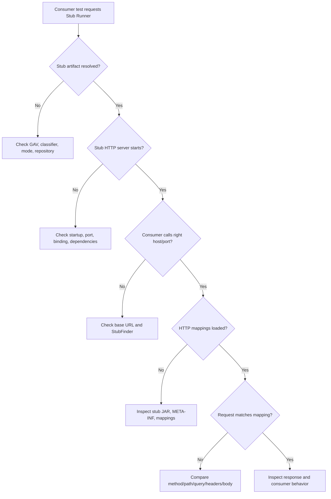
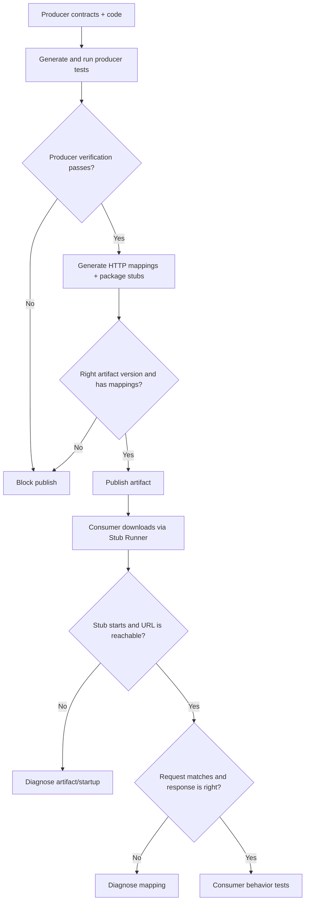

# Troubleshooting Artifact Download, Stub Startup, and Missing Mapping Errors

## 1. Why does Stub Runner fail even when contracts are already written?

In the **SPRING_CLOUD_CONTRACT** module, Spring Cloud Contract supports contract testing between **producer** and **consumer** for HTTP and messaging. Contracts are described via **Groovy/YAML DSL**, used to generate producer tests, converted into stubs, and packaged and published as versioned artifacts. The consumer uses **Stub Runner** to download artifacts and run simulated scenarios in CI to detect incompatible API changes early.

Three failures commonly lumped together as "Stub Runner is broken" actually occur at completely different layers:

1. **Failed to download artifact**: Stub Runner cannot locate or access the JAR containing stubs.
2. **Failed to start stub**: the artifact may have downloaded, yet the WireMock server or messaging integration failed to initialize.
3. **Stub runs yet no matching mapping is found**: the request reached the server, yet failed to match conditions in any loaded HTTP mapping.

Each layer requires a different fix. If the artifact does not exist, tweaking request regexes is futile. If WireMock is running and returning a "not matched" response, increasing artifact download timeouts will not help. If the client hits the wrong port, editing the contract can erase a valid commitment.

**Lesson objectives:** diagnose errors in order from artifact source to stub port, mappings, and consumer logic; gather evidence at each layer; and fix root causes without inadvertently weakening contracts.

After this lesson, you will know how to:

- Read `groupId:artifactId:version:classifier:port` coordinates accurately and select `CLASSPATH`, `LOCAL`, or `REMOTE` mode.
- Inspect JAR contents, version, classifier, `contracts`, and `mappings`.
- Identify whether a stub failed to start, hit a port bind error, or the consumer called the wrong address.
- Use HTTP requests and WireMock's admin endpoints (when available) to track down unmatched mappings.
- Distinguish an HTTP `404` from **no stub mapping** versus a business HTTP `404`.
- Build smoke tests, consumer contract tests, and CI checks that catch failures early.

## 2. Outside-in diagnostic flowchart



### 2.1. Failure-layer identification table

| First symptom | Primary suspect | Evidence to gather |
| --- | --- | --- |
| Build fails to resolve dependency, `artifact not found` | **Artifact download layer** | Coordinates, mode, repository, and local Maven contents |
| Repository connection error, `401`/`403` from artifact repo | **Artifact download layer** | Repository URL, permissions, and credentials |
| `Address already in use` on startup | **Startup layer** | Port already occupied by another process |
| Consumer gets `Connection refused` | **Startup or client address** | Whether stub actually started, which port, which host |
| Stub returns "Request was not matched" | **Matching layer** | WireMock received the request yet no mapping matched |
| Stub returns `404` with body `ORDER_NOT_FOUND` | Likely a **business branch** | Verify the exact mapping for the `404` scenario |
| Stub returns `200` yet consumer parse fails | **Response/consumer layer** | `Content-Type`, body, DTO/deserializer |
| Test fails only in CI | **Environment & reproducibility** | Stub version, cache, port, network, parallel jobs |

Error messages in the table are **common examples**, not guaranteed verbatim logs across every Spring Cloud Contract or WireMock version.

## 3. Reading stub artifact coordinates accurately

Suppose the producer published the stub:

```text
com.example:orders-producer:1.4.2:stubs
```

In Stub Runner configuration, when a fixed port `8090` is desired, an ID string typically looks like:

```text
com.example:orders-producer:1.4.2:stubs:8090
```

| Part | Value | Meaning |
| --- | --- | --- |
| groupId | `com.example` | Artifact group in the Maven repository |
| artifactId | `orders-producer` | Producer publishing the stub |
| version | `1.4.2` | Stub version to load |
| classifier | `stubs` | Identifies the stub artifact, distinct from regular application JAR |
| port | `8090` | WireMock port requested when configuring HTTP mode |

Do not confuse the order of `version`, `classifier`, and `port`. A consumer looking for `orders-producer:1.4.1` will miss contracts added in `1.4.2`. Coordinates missing or misspelling `stubs` may resolve the application JAR containing no HTTP mappings.

**Port is not part of the artifact coordinates in the repository.** It is a stub runtime parameter. The same artifact can run on a different port in another environment; you do not republish the JAR when changing ports.

### 3.1. Why avoid relying on `+` or "latest" in CI?

Some Stub Runner configs support dynamic version expressions like `+`. That helps when quickly testing a new build, yet makes consumer CI hard to reproduce: the same consumer commit might pull `1.4.2` today and `1.4.3` tomorrow.

For release-blocking checks, **pin an explicit version**. You can add a separate job proactively pulling candidate stubs to test compatibility against a new producer.

### 3.2. JAR path inside a Maven repository

With the example coordinates, a `LOCAL` file typically lives at a path like:

```text
~/.m2/repository/com/example/orders-producer/1.4.2/
    orders-producer-1.4.2-stubs.jar
```

Note that Maven repository layout splits dot-separated `groupId` into directory levels `com/example`. That **does not necessarily match** the `META-INF/com.example/...` layout **inside the JAR**. Mixing up those two layouts is a common source of error when inspecting manually.

## 4. Choosing the right stub loading mode

Stub Runner supports these common stub sources:

| Mode | Data source | When to use | Common errors |
| --- | --- | --- | --- |
| `CLASSPATH` | Stubs placed on the test classpath | Testing projects with pre-declared stub dependencies | Artifact not added to classpath or missing `META-INF` |
| `LOCAL` | Local Maven repository | Development after `install`ing the stub artifact | `-stubs.jar` missing for the requested version |
| `REMOTE` | Maven-compatible artifact repository | CI or sharing stubs via Nexus/Artifactory | Wrong `repositoryRoot`, permissions, URL, TLS, or unpublished artifact |

These three modes determine **where artifacts come from**, not which requests match mappings. Once the right JAR is downloaded, all three still require a validly packaged stub directory layout.

### 4.1. `LOCAL` example in a Spring Boot test

```java
import org.junit.jupiter.api.Test;
import org.springframework.boot.test.context.SpringBootTest;
import org.springframework.cloud.contract.stubrunner.StubRunnerProperties;
import org.springframework.cloud.contract.stubrunner.spring.AutoConfigureStubRunner;

@SpringBootTest
@AutoConfigureStubRunner(
    ids = "com.example:orders-producer:1.4.2:stubs:8090",
    stubsMode = StubRunnerProperties.StubsMode.LOCAL
)
class OrdersConsumerContractTest {
    @Test
    void readsOrderFromStub() {
        // Call the consumer's real HTTP client targeting localhost:8090,
        // then assert handling of the returned data.
    }
}
```

This is a **configuration skeleton**, not a complete test: the consumer needs the Stub Runner dependency, an HTTP client pointed to the stub base URL, real assertions, and the stub artifact installed in the local repository.

### 4.2. `REMOTE` example

```java
@AutoConfigureStubRunner(
    ids = "com.example:orders-producer:1.4.2:stubs:8090",
    stubsMode = StubRunnerProperties.StubsMode.REMOTE,
    repositoryRoot = "https://artifacts.example.test/repository/maven-releases"
)
```

This is an illustrative annotation; the URL above is not a real repository. Never put usernames/passwords directly in source code or logs. When authentication is required, configure CI secrets and resolver credentials in the manner supported by your Stub Runner version.

**REMOTE has two separate dependencies:** the repository must be reachable **and** the artifact with exact version/classifier must be published. `HTTP 200` on the repository homepage **does not prove** the expected JAR file exists.

### 4.3. `CLASSPATH` example

If the consumer puts the stub artifact on the test classpath and chooses `CLASSPATH`, Stub Runner scans supported stub locations on the classpath. Even with a valid classpath setup, if the JAR lacks `mappings` or nests directories incorrectly inside, the server still fails to load endpoints.

Do not switch from `LOCAL` to `CLASSPATH` just to bypass an unpublished-artifact error without verifying the test uses the right contract source/version. Doing so can accidentally run against an outdated stub copy tucked inside the consumer repository.

## 5. Layer one: artifact download errors

When startup reports artifact not found, check in order:

1. **Read Stub Runner IDs accurately**: `groupId`, `artifactId`, `version`, and `classifier`.
2. **Confirm mode**: `LOCAL` does not fall back to a remote repository; `REMOTE` requires a valid repository URL.
3. **Confirm producer packaged stubs**: not just the application JAR.
4. **Confirm publish/install**: the artifact sits in the exact location the consumer searches.
5. **Check cached versions**: local Maven may hold a stale build, or remote has not synced yet.
6. **Distinguish permission errors from missing artifacts**: `401`/`403` from the repository does not mean the artifact is absent.

### 5.1. Producing the artifact on the producer before consumer use

With a Maven producer configured with `spring-cloud-contract-maven-plugin`:

```bash
# Producer: generate and run tests per configured lifecycle.
./mvnw -B clean verify

# Producer: install artifact and stub JAR into local Maven repository.
./mvnw -B install
```

These are **illustrative commands**, not executed in this lesson. The plugin must create and attach the `-stubs.jar` artifact in the lifecycle; a green build whose configuration skips generating the stub artifact is insufficient.

With a Gradle producer:

```bash
./gradlew contractTest
./gradlew verifierStubsJar
./gradlew publishToMavenLocal
```

Publishing classifier `stubs` depends on `publishing` and the Gradle plugin. Confirm `verifierStubsJar` is actually attached to the publication before assuming `publishToMavenLocal` installs it. Never use flags that skip producer tests to "fix" an artifact download error.

### 5.2. Inspecting the artifact file at its source

Example on a machine with a JDK and default local Maven repository:

```bash
jar tf "$HOME/.m2/repository/com/example/orders-producer/1.4.2/orders-producer-1.4.2-stubs.jar"
```

If the file does not exist, verify `install`/`publish` succeeded and coordinates match. If the file exists yet lacks expected contents, the issue shifts to **packaging**, no longer purely a repository issue.

On Windows PowerShell, use the appropriate path under `$HOME\.m2\repository` or obtain the actual path from Maven settings; `jar tf` works with the JAR path wrapped in quotes.

### 5.3. Distinguishing remote errors

| Symptom | Suspect | Resolution path |
| --- | --- | --- |
| Repository returns `404` downloading artifact | Wrong coordinates/version/classifier or unpublished | Verify release and actual Maven path |
| Repository returns `401` | Missing or wrong credentials | Check credentials from secrets/CI settings |
| Repository returns `403` | Account lacks access permissions | Check ACLs and service account permissions |
| DNS fails to resolve hostname | Wrong host or network/DNS issue | Check URL, DNS, CI network |
| TLS handshake/certificate error | Certificate chain, truststore, proxy | Fix valid truststore/certificates; never disable TLS verification casually |
| Interrupted download or timeout | Proxy, network, overloaded repository | Check bounded timeout/retries and repository health |
| Local cache lacks newest build | Dynamic/SNAPSHOT version or stale metadata | Pin release version and recheck resolution |

A dangerous shortcut is using a public repository or disabling authentication just to grab an artifact with "the same name." Stubs are part of your software supply chain; fetch them from a **trusted source** with the exact version and verifiable provenance.

## 6. Middle layer: artifact downloaded yet stub fails to start

After resolving the JAR, Stub Runner must initialize the stub environment. For HTTP, that environment is typically **WireMock**. Failures here involve **ports**, **Spring context**, and **dependency compatibility**:

| Symptom | Likely explanation | How to resolve |
| --- | --- | --- |
| `Address already in use` or socket bind error | Port `8090` already occupied | Free the port or switch to dynamic ports |
| `Connection refused` when consumer calls | No server listening at the address client uses | Check startup logs and actual port |
| Bean/auto-configuration exception | Missing dependency or incompatible Spring versions | Check root cause stack trace and project dependency tree |
| Stub server starts yet mappings are empty | Artifact missing mappings, wrong layout, or scan filter | Open JAR and inspect generated mappings |
| Single test passes, parallel runs fail | Port collision or shared server state | Isolate ports/contexts, avoid shared fixed ports |
| Context fails because repository is unreachable | Artifact download failure before startup | Return to download layer; do not tweak HTTP client |

### 6.1. Fixed port vs. dynamic port

Declaring `:8090` in the Stub Runner ID forces binding to that port. It works for readable examples or statically configured consumer clients, yet causes conflicts whenever multiple suites use `8090`.

When configuration allows dynamic port allocation (e.g., omitting the port in ID), **retrieve the actual port from Stub Runner** rather than hardcoding an assumed value. Spring Cloud Contract provides `StubFinder` to query running stub addresses.

Points to remember:

- **Declared port** is not guaranteed to be a **successfully bound port** if startup failed.
- **Consumer application port** differs from **HTTP stub port**.
- If the consumer runs in a separate Docker/container, `localhost` points to that container itself, not a Stub Runner server in another container.
- Some setups/proxies add a context path or host mapping; always use the **actual address reachable by the test**.

### 6.2. Finding the started stub address with `StubFinder`

In a test annotated with `@AutoConfigureStubRunner`:

```java
import org.junit.jupiter.api.Test;
import org.springframework.beans.factory.annotation.Autowired;
import org.springframework.boot.test.context.SpringBootTest;
import org.springframework.cloud.contract.stubrunner.StubFinder;
import org.springframework.cloud.contract.stubrunner.StubRunnerProperties;
import org.springframework.cloud.contract.stubrunner.spring.AutoConfigureStubRunner;

import static org.assertj.core.api.Assertions.assertThat;

@SpringBootTest
@AutoConfigureStubRunner(
    ids = "com.example:orders-producer:1.4.2:stubs",
    stubsMode = StubRunnerProperties.StubsMode.LOCAL
)
class StubAddressTest {
    @Autowired
    private StubFinder stubFinder;

    @Test
    void findsStartedStub() {
        Object stubUrl = stubFinder.findStubUrl("com.example", "orders-producer");
        assertThat(stubUrl).isNotNull();
        // Pass this address to the HTTP client in the consumer test.
    }
}
```

`StubFinder.findStubUrl` is the API for querying loaded stubs, avoiding fixed-port coupling. The snippet uses `Object` to stay focused on checking address availability; in real tests, use the **exact return type of your library version** and configure the consumer's HTTP client with the returned address.

**Limitation:** finding an address does not mean a given endpoint has a mapping or a request will match. It only proves you got past stub discovery.

## 7. Port is open yet HTTP mappings may still be missing

Stub Runner can start WireMock cleanly with **zero mappings**, or load only partial mappings from an older artifact. Then calling:

```http
GET /api/orders/ord-1001 HTTP/1.1
Host: localhost:8090
```

may return HTTP `404` because WireMock finds no matching request mapping. Some versions return a diagnostic body explaining the unmatched request; actual output depends on WireMock version/config.

### 7.1. Expected contents inside the JAR

Suppose the artifact is:

```text
com.example:orders-producer:1.4.2:stubs
```

Typical layout:

```text
orders-producer-1.4.2-stubs.jar
└── META-INF/
    └── com.example/
        └── orders-producer/
            └── 1.4.2/
                ├── contracts/
                │   └── http/orders/
                │       ├── get_order_success.groovy
                │       └── get_order_not_found.groovy
                └── mappings/
                    └── http/orders/
                        ├── get_order_success.json
                        └── get_order_not_found.json
```

The filename `get_order_success.json` and group paths in the example are **illustrative**, not rigid names every generator produces. What matters is ensuring Stub Runner finds HTTP mappings in a supported location with accurate request/response conditions.

### 7.2. Why is having only `contracts` insufficient for HTTP?

Groovy/YAML contracts are the **behavioral source**. JSON HTTP mappings produced by the converter are the format WireMock uses to serve requests. If an artifact contains only Groovy sources without required HTTP mappings, do not assume WireMock compiles them into stubs at runtime.

For **messaging contracts**, things work differently: `label`, `outputMessage`, and messaging integration emit message stubs; there does not need to be a corresponding WireMock HTTP JSON mapping for each message contract.

### 7.3. Inspecting with `jar tf`

```bash
jar tf target/orders-producer-1.4.2-stubs.jar
```

When reviewing the listing:

1. Look for `META-INF/.../contracts/...` and expected Groovy/YAML files.
2. Look for `META-INF/.../mappings/...` and HTTP JSON mapping files.
3. Confirm `groupId`, `artifactId`, and `version` in the paths match `ids`.
4. If mappings reference external body files, confirm the **referenced body files are also inside the artifact**.
5. Confirm the artifact loaded by the consumer is the exact file you inspected, not a stale copy in cache.

**Never edit mappings directly inside the JAR** to make tests pass. Fix the source contract or conversion/packaging config, run producer verification, and produce a properly versioned artifact.

## 8. Layer three: mapping exists yet request does not match

Suppose the producer contract is:

```groovy
import org.springframework.cloud.contract.spec.Contract

Contract.make {
    name 'get_order_success'
    request {
        method GET()
        url '/api/orders/ord-1001'
    }
    response {
        status 200
        headers {
            contentType(applicationJson())
        }
        body([
            id    : 'ord-1001',
            status: 'CREATED'
        ])
    }
}
```

A **semantically equivalent** WireMock mapping could look like:

```json
{
  "request": {
    "method": "GET",
    "url": "/api/orders/ord-1001"
  },
  "response": {
    "status": 200,
    "headers": {
      "Content-Type": "application/json"
    },
    "jsonBody": {
      "id": "ord-1001",
      "status": "CREATED"
    }
  }
}
```

This is an **explanatory** WireMock JSON example, not a claim that generated mappings in every Spring Cloud Contract version use `jsonBody` or identical filenames. Now examine these requests:

| Request sent by consumer | Comparison against illustrative mapping |
| --- | --- |
| `GET /api/orders/ord-1001` | Matches method and URL |
| `POST /api/orders/ord-1001` | Wrong method |
| `GET /api/orders/ord-1002` | Wrong URL |
| `GET /api/orders/ord-1001/` | Trailing `/`; fails exact URL match |
| `GET /api/orders/ord-1001?lang=vi` | Has query string; if mapping matches exact `url`, check full-URL conditions |

When writing tests, inspect the **actual request after the HTTP client builds the URL**, not just the string a developer intended to send.

### 8.1. Distinguishing `url` and `urlPath`

In WireMock, a full `url` condition includes the query string; a path-only condition does not behave identically. If the contract intends to allow query parameters, express them in the DSL explicitly rather than assuming queries will be ignored.

If the producer exposes `GET /api/orders/ord-1001?includeItems=true`, contract authors must decide:

- Is the query parameter mandatory to receive that response?
- Without the parameter, does the producer return different content or the same behavior?
- Is `true` text or boolean, and how is it URL-encoded?

Publishing a path-only mapping when business behavior branches on query parameters can cause the stub to serve the wrong branch.

## 9. Headers, query, body: frequently overlooked conditions

A mapping checks more than just the URL. It can constrain headers, query parameters, cookies, and JSON request bodies. **One mismatched field is enough to break matching**, even when method and path match.

### 9.1. `Content-Type` and `Accept` headers

A `POST /api/orders` contract may require:

```groovy
request {
    method POST()
    url '/api/orders'
    headers {
        contentType(applicationJson())
        header 'X-Request-Id': 'req-1234'
    }
    body([
        productId: 'SKU-001',
        quantity : 2
    ])
}
```

A client sending a JSON body while omitting `Content-Type: application/json` can fail to match even when the body looks identical. Likewise, if the mapping requires `X-Request-Id`, omitting that header causes no-match.

`Content-Type` describes the **request body**, whereas `Accept` indicates the **response** format the client accepts. Do not edit mappings by adding/removing `Accept` if the API never declared that constraint; check which headers are genuinely in the contract and sent by the client.

### 9.2. Precision of JSON bodies

A contract contains:

```groovy
body([
    productId: 'SKU-001',
    quantity : 2
])
```

The consumer might send:

```json
{
  "productId": "SKU-001",
  "quantity": "2"
}
```

Here `quantity` is a **string** `"2"` instead of number `2`; depending on the mapping's matcher, the request may fail to match. Inspect the generated JSON matcher conditions: object comparison, JSONPath, regex, or other JSON matchers.

Another pitfall is the consumer sending extra new fields. Under some JSON matching modes, extra properties are tolerated; under others, they are rejected. **Never assume by default that "WireMock ignores all unknown fields"**; inspect the actual mapping and verify matcher semantics for your version.

### 9.3. Cookies, Authorization, and charset

If the contract specifies `Cookie`, `Authorization`, query parameters, or specific encoding, those also affect matching. Never embed real tokens in stub artifacts or CI logs. For dynamic data, use proper matchers and dummy test values; never swap in `.*` regexes just to silence matching errors.

## 10. Using the WireMock admin API to inspect mappings

With **HTTP Stub Runner running WireMock**, some versions/configurations allow accessing the WireMock admin API on the **same stub port**.

### 10.1. Listing currently loaded mappings

```bash
curl -i http://localhost:8090/__admin/mappings
```

When enabled and reachable, this endpoint returns the mappings loaded by the server. Look for conditions such as:

```text
request.method = GET
request.url = /api/orders/ord-1001
response.status = 200
```

If the list is empty, return to **checking artifact and conversion**. If the mapping exists yet the request doesn't match, move to comparing the concrete request.

### 10.2. Sending a minimal request with curl

```bash
curl -i http://localhost:8090/api/orders/ord-1001
```

If curl matches while the consumer application fails to match, the prime suspect shifts to **HTTP client configuration**: different base URL, added context path, query, headers, or body.

For requests with a body:

```bash
curl -i -X POST http://localhost:8090/api/orders \
  -H "Content-Type: application/json" \
  -H "X-Request-Id: req-1234" \
  -d '{"productId":"SKU-001","quantity":2}'
```

The multi-line command above uses Bash syntax. On Windows PowerShell, use `curl.exe` with shell-appropriate escaping or `Invoke-WebRequest`; ensure the shell **does not alter JSON contents** when sending.

### 10.3. Inspecting unmatched requests

In many WireMock versions, the admin API exposes an endpoint listing unmatched requests:

```bash
curl -i http://localhost:8090/__admin/requests/unmatched
```

This helps compare the actual request (method, URL, headers) against loaded mappings. Some WireMock versions also provide **near misses** or "closest stub" details highlighting the mismatched condition.

**Limitation:** the admin API, request journal, and near-miss reporting depend on WireMock version/config; when disabled or restricted, these commands may error even while the stub serves normal HTTP cleanly. Never expose public admin endpoints in untrusted environments solely for debugging.

## 11. Unmatched `404` vs. business `404`

This is the most critical distinction when diagnosing Stub Runner.

Suppose the producer published two contracts:

```text
GET /api/orders/ord-1001    -> 200 {id:"ord-1001",status:"CREATED"}
GET /api/orders/ord-missing -> 404 {code:"ORDER_NOT_FOUND"}
```

If the consumer sends `GET /api/orders/ord-missing` and the `404` mapping is loaded, the stub returns the **business** response:

```http
HTTP/1.1 404 Not Found
Content-Type: application/json

{"code":"ORDER_NOT_FOUND"}
```

If the consumer sends `GET /api/orders/ord-xyz` matching no mapping, WireMock may return a `404` of type **stub request not matched**. Both outcomes share the same HTTP status code yet **mean completely different things**.

| Criterion | Business contract `404` | WireMock unmatched `404` |
| --- | --- | --- |
| Source | `response.status 404` in DSL | Stub server found no mapping for the request |
| Dedicated contract exists? | Yes | Not necessarily |
| Body | Follows error schema, e.g., `ORDER_NOT_FOUND` | WireMock diagnostic/default body depending on version |
| Consumer test should assert | HTTP status **and** committed error code/body | Test setup needs fixing; do not assume valid business behavior |
| How to fix? | Update producer/contract when behavior intentionally changed | Add or fix mapping / match request / load right artifact |

**Never write a consumer test asserting only `statusCode == 404`** for the `ORDER_NOT_FOUND` branch if the body/error code is part of the contract. It could pass because WireMock failed to match, hiding a missing contract in the stub artifact.

### 11.1. A dedicated contract is needed for the not-found branch

```groovy
import org.springframework.cloud.contract.spec.Contract

Contract.make {
    name 'get_order_not_found'
    request {
        method GET()
        url '/api/orders/ord-missing'
    }
    response {
        status 404
        headers {
            contentType(applicationJson())
        }
        body([code: 'ORDER_NOT_FOUND'])
    }
}
```

This contract makes Stub Runner serve a **clearly defined error branch**, while generated producer tests verify the real producer returns `404 ORDER_NOT_FOUND` when the ID is absent in test fixtures.

## 12. Detecting overlapping mappings and wrong priorities

Not every mapping bug causes WireMock to return `404`. Sometimes **two mappings both match**, and an overly broad mapping makes the stub return `200` instead of `404`.

Example:

```text
Mapping A:
  GET /api/orders/ord-1001 -> 200

Mapping B:
  GET /api/orders/.*       -> 200

Mapping C:
  GET /api/orders/ord-missing -> 404
```

If Mapping B was indeed generated as a regex accepting any order ID, it can also match `ord-missing`. The outcome depends on how WireMock orders/prioritizes mappings, so you should never rely on incidental ordering or filenames.

**Sustainable resolution:**

1. Find the overly broad mapping or recently added regex.
2. Determine which class of requests should genuinely share one response.
3. Narrow matchers or add header/body/query conditions to keep branches distinct.
4. If priority must be used, declare it explicitly per plugin/WireMock capabilities and inspect generated mappings; never use priority to mask a broken business DSL.
5. Run consumer tests for both success and failure branches after fixing.

**Different directories inside a stub JAR do not prevent mappings from overlapping.** WireMock evaluates method/URL/headers/body and matching rules, not treating `http/orders/success` as a branch separator.

## 13. Spring Boot test: verify the stub endpoint before testing consumer logic

When diagnosis is tricky, split into a **stub server smoke test** and a **consumer behavior test**.

### 13.1. Smoke test confirming the mapping is served

Example using JUnit 5, Java 11+, and the JDK HTTP client:

```java
import java.net.URI;
import java.net.http.HttpClient;
import java.net.http.HttpRequest;
import java.net.http.HttpResponse;
import org.junit.jupiter.api.Test;
import org.springframework.beans.factory.annotation.Autowired;
import org.springframework.boot.test.context.SpringBootTest;
import org.springframework.cloud.contract.stubrunner.StubFinder;
import org.springframework.cloud.contract.stubrunner.StubRunnerProperties;
import org.springframework.cloud.contract.stubrunner.spring.AutoConfigureStubRunner;

import static org.assertj.core.api.Assertions.assertThat;

@SpringBootTest
@AutoConfigureStubRunner(
    ids = "com.example:orders-producer:1.4.2:stubs",
    stubsMode = StubRunnerProperties.StubsMode.LOCAL
)
class OrdersStubSmokeTest {

    @Autowired
    StubFinder stubFinder;

    @Test
    void getOrderMappingIsAvailable() throws Exception {
        Object stubUrl = stubFinder.findStubUrl("com.example", "orders-producer");
        assertThat(stubUrl).isNotNull();

        String baseUrl = stubUrl.toString().replaceAll("/+$", "");
        HttpRequest request = HttpRequest.newBuilder(
            URI.create(baseUrl + "/api/orders/ord-1001")
        ).GET().build();

        HttpResponse<String> response = HttpClient.newHttpClient()
            .send(request, HttpResponse.BodyHandlers.ofString());

        assertThat(response.statusCode()).isEqualTo(200);
        assertThat(response.body()).contains("ord-1001");
        assertThat(response.body()).contains("CREATED");
    }
}
```

This snippet requires compatible Spring Cloud Contract Stub Runner and JUnit/AssertJ dependencies. `stubUrl` is read from `StubFinder`, keeping tests free of hardcoded ports. In a concrete project, check the exact URL type and return form for your `StubFinder` version.

**Smoke test limitation:** it confirms the HTTP stub runs and serves a sample mapping; it **does not verify real consumer logic**. Therefore, keep a second test calling `OrdersClient` or the consumer service configured with the stub base URL.

### 13.2. Consumer tests must invoke real consuming code

A consumer has `OrdersClient` and processes orders based on the result:

```java
// Illustrative snippet inside a test already configured with the stub URL.
OrderView order = ordersClient.getOrder("ord-1001");

assertThat(order.id()).isEqualTo("ord-1001");
assertThat(order.status()).isEqualTo("CREATED");
```

`OrdersClient` and `OrderView` are **illustrative application-defined types**, not Spring Cloud Contract APIs. Tests must configure the client to pick up the exact Stub Runner URL; if it still calls the real producer or staging environment, the run is not the consumer contract test you intended.

### 13.3. Only fix "port 8090" when it is truly a port failure

If the smoke test queries `StubFinder` and calls the stub successfully while `ordersClient` still hits `Connection refused`, inspect the **client base URL**. If the smoke test itself fails to find a URL, return to startup/artifact checks. If the server returns a no-match response, inspect mappings. This narrows down root causes far faster than swapping port numbers randomly.

## 14. Messaging stubs: missing label differs from missing HTTP mapping

Spring Cloud Contract also supports message contracts:

```groovy
import org.springframework.cloud.contract.spec.Contract

Contract.make {
    name 'order_created_event'
    label 'order_created'
    input {
        triggeredBy('publishOrderCreated()')
    }
    outputMessage {
        sentTo('orders.events')
        body([
            eventType: 'ORDER_CREATED',
            orderId  : 'ord-1001'
        ])
        headers {
            messagingContentType(applicationJson())
        }
    }
}
```

A consumer messaging test can call:

```java
boolean triggered = stubTrigger.trigger("order_created");
assertThat(triggered).isTrue();
```

Prerequisites: Stub Runner must be configured with the matching **messaging integration**, the label must exist in the right artifact version, and `stubTrigger` must be injected from a Stub Runner-enabled Spring context.

Different error patterns:

| Symptom | What to check |
| --- | --- |
| `trigger("order_created")` returns `false` | Label absent in loaded stub or wrong artifact selected |
| Trigger succeeds yet consumer receives no event | Binding, destination, transport, or subscriber not ready |
| Consumer receives message yet parse fails | `contentType`, payload, headers, and message converter |
| Consumer receives event yet read model stays unchanged | Handler logic, test fixture, or asynchronous execution |

**Do not look for an `order_created.json` file under HTTP `mappings` and conclude the message contract is missing.** Messaging stubs are not necessarily represented as WireMock HTTP mappings.

For producer message tests, `triggeredBy('publishOrderCreated()')` is a helper running real producer behavior; whereas `StubTrigger.trigger("order_created")` is a consumer test triggering a **stub sample message**. These are two separate operations.

## 15. Diagnosing when CI fails while local dev passes

A local workflow can accidentally rely on Maven cache, an old installed stub JAR, or an unoccupied port. In CI, a clean environment exposes those hidden assumptions.

| Situation | Local | CI | What to do? |
| --- | --- | --- | --- |
| `LOCAL` artifact missing | Dev machine ran `install` | Clean runner lacks JAR | Publish artifact and use `REMOTE`, or install explicitly in job |
| Dynamic version used | Dev downloaded one version | CI resolved a newer version | Pin version |
| Fixed port `8090` | Single test runs | Multiple jobs run concurrently | Dynamic ports or isolation |
| Credentials from dev machine | Personal Maven settings exist | CI lacks repository permissions | Configure service account / secret |
| Slow repository | Fast download | Timeout in CI network | Check network/proxy, bounded retries |
| Different JSON/headers due to client config | Dev profile matches | CI profile differs | Align test config and log requests |
| Timestamp or random ID | Coincidentally matches fixture | Sample differs | Use fixed fixtures / proper matchers |
| Cache holds stale mappings | Tests old endpoint only | CI pulls new artifact | Verify coordinates, version, and JAR contents |

### 15.1. Three CI principles

1. **Reproducibility**: same consumer commit + same stub coordinates + same config must yield deterministic outcomes.
2. **Observability**: logs must state stub ID/version, mode, actual port, and which test failed to match.
3. **Isolation**: tests must not rely on leftover data, shared ports, or arbitrary artifact caches.

If the producer changed a response, run producer verification on the new build and consumer tests against the exact candidate stub version. Editing `@AutoConfigureStubRunner` to point at an older stub "just to make tests green" can let incompatible API changes slip past.

## 16. Verification flow in CI: from artifact to consumer assertion



A trustworthy pipeline should retain evidence:

- Producer commit and stub coordinates `groupId:artifactId:version:stubs`.
- Number of contracts read; number of generated tests actually executed.
- List of packaged HTTP mappings and messaging contracts.
- Artifact download logs: mode, source, and version.
- WireMock startup logs: bound address/port.
- Request/response details of mismatched cases (redacting sensitive data).
- Consumer test outcomes: which assertions failed.

### 16.1. Never let "0 mappings" pass as a fake green build

Suppose a pipeline builds a JAR with empty `mappings` because the plugin pointed at the wrong contracts root. If CI only checks whether the JAR exists, the build looks green yet the consumer has zero stubs to call.

Set CI checks:

1. Required contracts must be discovered and parsed cleanly.
2. Generated producer tests for every critical branch must **execute**.
3. The artifact must contain mappings for critical HTTP endpoints and required message contracts.
4. Consumer smoke tests must hit at least one critical mapping from the exact artifact.
5. Consumer behavior tests must verify both success and failure branches.

Counting JSON mappings is only one signal. When messaging contracts exist or one file contains multiple contracts, mapping count does not necessarily equal source file count. Verify the **required behaviors**.

## 17. Practice: fixing three failures at different layers

### 17.1. Context

Producer `inventory-producer` published:

```text
com.example:inventory-producer:2.1.0:stubs
```

Expected contents inside the JAR:

```text
GET /api/products/SKU-001     -> 200
GET /api/products/SKU-MISSING -> 404 PRODUCT_NOT_FOUND
POST /api/reservations        -> 201 / 409 depending on body and fixture
```

The consumer uses Stub Runner to test its product lookup and reservation creation client. The three exercises below are **independent** failures and should not be patched together by altering expected HTTP statuses.

### 17.2. Failure A — Unable to download artifact

Consumer configures:

```java
@AutoConfigureStubRunner(
    ids = "com.example:inventory-producer:2.0.0:stubs:8090",
    stubsMode = StubRunnerProperties.StubsMode.LOCAL
)
```

Yet local Maven only contains `2.1.0-stubs.jar`.

**Tasks:**

1. Identify why Stub Runner failed to locate the artifact.
2. Update the ID to version `2.1.0` or install the exact version the consumer needs for its test goal.
3. Confirm the JAR exists and inspect contents with `jar tf`.
4. Explain why switching to version `+` just to get tests running is risky.

**Suggested answer:** the bug sits at the **artifact download layer**, unrelated to HTTP matchers. Fix coordinates/version and check the `LOCAL` source first.

### 17.3. Failure B — Stub fails to start

Test A and Test B run in parallel, both attempting to bind `localhost:8090`.

**Tasks:**

1. Identify the `Address already in use` symptom.
2. Remove the fixed port constraint in the appropriate suite; use `StubFinder` to fetch the actual address.
3. Configure the consumer HTTP client to use the retrieved URL.
4. Rerun both tests concurrently and verify zero port collisions.

**Suggested answer:** the bug sits at **startup/port**, so do not rewrite `GET /api/products/SKU-001` into another endpoint or delete contracts.

### 17.4. Failure C — Server runs yet request fails to match

Stub started on `8090` with mapping:

```json
{
  "request": {
    "method": "POST",
    "url": "/api/reservations",
    "headers": {
      "Content-Type": {
        "equalTo": "application/json"
      }
    },
    "bodyPatterns": [
      {
        "equalToJson": "{\"productId\":\"SKU-001\",\"quantity\":2}"
      }
    ]
  },
  "response": {
    "status": 201,
    "headers": {
      "Content-Type": "application/json"
    },
    "jsonBody": {
      "reservationId": "res-1001"
    }
  }
}
```

Meanwhile the consumer sends:

```http
POST /api/reservations HTTP/1.1
Content-Type: text/plain

{"productId":"SKU-001","quantity":"2"}
```

**Tasks:**

1. Point out the **two differences** from the mapping: content type and the type of `quantity`.
2. Fix the HTTP client to send `Content-Type: application/json` and `quantity` as numeric `2`.
3. Inspect the actual request via WireMock admin/request journal (if enabled).
4. Rerun the smoke test and consumer tests.
5. Explain why replacing the mapping with regex `.*` just to accept the request is wrong.

**Suggested answer:** the bug sits at **request matching**; no artifact republish is needed if the consumer itself is sending payloads violating the agreed contract.

### 17.5. Bonus exercise — Which `404` is the right one?

Consumer calls `GET /api/products/SKU-MISSING` and expects:

```json
{"code":"PRODUCT_NOT_FOUND"}
```

If you only see HTTP `404` with diagnostic body "Request was not matched", verify that the `get_product_not_found` mapping actually exists with the exact URL. A business `404` requires the contract-defined body/error code, not just matching status code.

### 17.6. Failure investigation sheet

| Question | Result to record |
| --- | --- |
| Requested stub coordinates | Group, artifact, version, classifier |
| Stub mode | `CLASSPATH` / `LOCAL` / `REMOTE` |
| Artifact resolved? | Yes/no, which source |
| JAR has `META-INF/.../mappings`? | Yes/no, right path? |
| Server bound cleanly? | Actual host and port |
| Actual request sent by client | Method, URL, headers, body (secrets redacted) |
| Expected mapping | Which file/matcher in artifact |
| Actual response | HTTP status, `Content-Type`, body |
| Failing layer | Artifact download / startup / matching / consumer |
| Where to fix | Producer contract, packaging, Stub Runner config, or consumer client |
| Post-fix verification | Smoke test, error branch, consumer behavior test |

## 18. Stub Runner diagnostic checklist

- [ ] `groupId:artifactId:version:classifier` coordinates match the target producer build.
- [ ] `port` is not confused with `version` or `classifier` in Stub Runner IDs.
- [ ] `CLASSPATH`, `LOCAL`, or `REMOTE` matches the actual artifact source.
- [ ] Artifact is packaged and installed/published; not just the application JAR.
- [ ] Repository URL/credentials/TLS are valid and come from trusted sources.
- [ ] JAR contains `META-INF/.../contracts` and required **HTTP mappings**.
- [ ] Stub Runner started and bound successfully to an actual address/port.
- [ ] Consumer client uses the stub URL, not accidentally calling staging producer.
- [ ] Fixed ports do not collide across parallel or multi-test runs.
- [ ] Compared method, URL/path, query, headers, cookies, and JSON body against mappings.
- [ ] No overly broad regex allows success branches to swallow error branches.
- [ ] Business `404` is distinguished from WireMock unmatched-stub `404`.
- [ ] For messaging, checked `label`, messaging integration, and destination—not only HTTP mappings.
- [ ] Smoke tests verify server/mappings; consumer tests verify **real client behavior**.
- [ ] CI pins artifact versions, retains useful logs, isolates fixtures, and checks executed test counts.
- [ ] Contracts are never loosened and producer verification is never skipped just to force green tests.

### References

- [Spring Cloud Contract — Stub Runner Core](https://docs.spring.io/spring-cloud-contract/reference/project-features-stubrunner/stub-runner-core.html): running Stub Runner, locating stubs, configuring modes and artifacts.
- [Spring Cloud Contract — Stub Runner for JUnit](https://docs.spring.io/spring-cloud-contract/reference/project-features-stubrunner/stub-runner-junit.html): integrating Stub Runner in tests.
- [Spring Cloud Contract — Maven Project](https://docs.spring.io/spring-cloud-contract/reference/maven-project.html): generating tests and packaging stubs from contracts.
- [WireMock — Request Matching](https://wiremock.org/docs/request-matching/): rules for method, URL, headers, query, and body.
- [WireMock — Verifying / Request Journal](https://wiremock.org/docs/verifying/): observing requests and tracking down unmatched cases.

**Remember:** with Stub Runner, follow the sequence **did the right artifact download → did the stub start → did mappings load → did the request match → did the consumer handle it properly**. Each step demands concrete evidence. Diagnosing the exact layer avoids corrupting valid contracts, protects critical API branches, and keeps producer–consumer testing reliable in CI.
