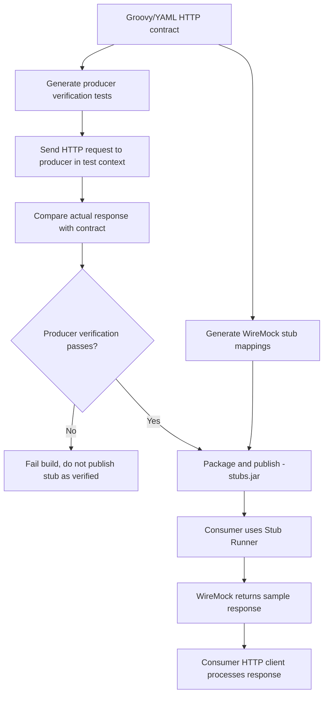
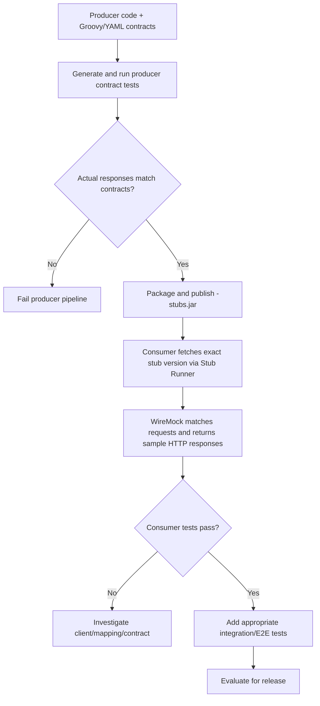

# WireMock in Spring Cloud Contract and Responsibility Boundaries

## 1. Why understand WireMock when learning Spring Cloud Contract?

In a multi-service system, `Checkout Service` (consumer) often calls the HTTP API of `Payment Service` (producer). If the Checkout test environment always has to start the real Payment Service, results may depend on the database, network, authentication credentials, and the state of other services. A small change in the producer can also cause many consumer pipelines to fail before the root cause is identified.

**WireMock** is a tool that simulates an **HTTP server**. It receives a request, checks whether the request matches a declared **stub mapping**, and then returns a sample response. Spring Cloud Contract can generate WireMock mappings from Groovy/YAML DSL contracts and use **Stub Runner** to run them for the consumer.

However, **WireMock does not replace Spring Cloud Contract Verifier**. An HTTP stub returning `200 OK` does not prove that the real Payment Service is returning `200`; a stub accepting a string bearer token does not prove that the real backend verifies the token signature. Properly distinguishing their roles helps projects avoid the **"green tests, broken real integration"** problem.

After this lesson, you will be able to:

1. Describe the roles of WireMock, Contract Verifier, and Stub Runner in producer–consumer testing.
2. Write a Groovy/YAML HTTP contract and visualize the generated stub mapping format.
3. Understand how WireMock matches method, URL, query, headers, and body, and returns status/headers/body.
4. Configure a consumer to use a stub artifact via `@AutoConfigureStubRunner` and distinguish it from `@AutoConfigureWireMock`.
5. Recognize the limitations of WireMock regarding producer verification, security, messaging, and business behavior.
6. Diagnose unmatched requests, duplicate mappings, incorrect sample data, wrong versions, and common CI failures.

## 2. Three components: Contract Verifier, Stub Runner, and WireMock

An HTTP contract testing system has three distinct jobs:

| Component | Primary responsibility | Target under test |
| --- | --- | --- |
| **Spring Cloud Contract DSL** | Record the request/response agreement in Groovy or YAML | Shared expectation definition |
| **Spring Cloud Contract Verifier** | Generate and execute tests against the **real producer** | Controllers, filters, serialization, and actual responses |
| **Stub Runner + WireMock** | Load generated stubs, start a simulated HTTP server | HTTP client and logic of the **consumer** |

Two-sided workflow:



**Meaning of the two PASS results:**

- Producer test PASS: the producer implementation satisfies **the interactions and assertions that were actually executed**.
- Consumer test with WireMock PASS: the consumer sends requests and handles the corresponding sample responses; there is no guarantee the latest producer still satisfies them if the stub is stale.

The two testing directions **complement**, rather than replace, each other. If generated producer tests are skipped, Stub Runner starting successfully does **not** prove the contract has been verified.

## 3. What does WireMock do when it receives an HTTP request?

WireMock typically works with one or more **stub mappings**. Each mapping consists of:

1. **Request pattern:** the conditions for a request to be considered a match.
2. **Response definition:** the response the stub server should return.
3. **Advanced options:** priority, scenario state, delay, connection fault, or response templating if configured.

Conceptual example:

```text
Request:
  method = GET
  url    = /api/payments/42

Response:
  status       = 200
  Content-Type = application/json
  body         = {"paymentId":42,"status":"PAID"}
```

When the consumer actually calls `GET /api/payments/42` against WireMock, the matching mapping is selected and returns the JSON above.

WireMock does **not** talk to the Payment Service database, does not run payment logic, does not know whether the user has actually paid, and does not automatically enforce the producer's authorization policies. It only executes what has been described or configured in the stub server.

### 3.1. Request parts that WireMock can match

| Component | Example | Risk when omitted |
| --- | --- | --- |
| HTTP method | `GET` instead of `POST` | Consumer calls the wrong operation yet the test still hits another stub |
| URL path | `/api/payments/42` | Client calls the wrong route |
| Query params | `?currency=VND` | Missing filter/pagination parameters |
| Headers | `Accept: application/json` | Different media type or API version |
| Request body | JSON `{"orderId":42}` | Wrong structure, fields, or types |
| Cookies | Session or test state | Consumer fails to send required information |
| Multipart parts | Metadata/file upload | Client sends wrong part name or content |

Not every mapping checks all components. **Only conditions present in the mapping create matching constraints**. If only method and URL are described, a request carrying an unexpected header can still match.

## 4. From a Spring Cloud Contract to a sample response

For example, `Payment Service` provides:

```http
GET /api/payments/42
Accept: application/json
```

Expectation:

```http
HTTP/1.1 200 OK
Content-Type: application/json

{"paymentId":42,"status":"PAID","receiptId":"RC-42"}
```

### 4.1. Groovy DSL

```groovy
import org.springframework.cloud.contract.spec.Contract

Contract.make {
    description 'Look up completed payment'

    request {
        method GET()
        url '/api/payments/42'
        headers {
            header('Accept', 'application/json')
        }
    }

    response {
        status OK()
        headers {
            contentType(applicationJson())
        }
        body(
            paymentId: 42,
            status: 'PAID',
            receiptId: 'RC-42'
        )
        bodyMatchers {
            jsonPath('$.receiptId', byRegex('RC-[0-9]+'))
        }
    }
}
```

Here:

- `request` describes the request the consumer must send.
- `response` describes the stub's sample response and the expectation the producer must fulfill.
- `bodyMatchers` allows the real producer to return a different receipt ID from the sample as long as it has the **same format**.

**Important:** `response.body.receiptId = 'RC-42'` is the concrete data the stub can return. The `byRegex('RC-[0-9]+')` matcher serves **producer verification** for the actual response, not an instruction telling WireMock to randomly generate a different receipt ID each time.

### 4.2. Equivalent YAML DSL

```yaml
description: Look up completed payment
request:
  method: GET
  url: /api/payments/42
  headers:
    Accept: application/json
response:
  status: 200
  headers:
    Content-Type: application/json
  body:
    paymentId: 42
    status: PAID
    receiptId: RC-42
  matchers:
    body:
      - path: '$.receiptId'
        type: by_regex
        value: 'RC-[0-9]+'
```

In YAML, the sample body is placed in `response.body` and matchers are placed in `response.matchers.body`. Both DSL formats share the same goal; exact syntax and matcher types must be checked against the **pinned Spring Cloud Contract version** in the project.

### 4.3. Why not just write WireMock mappings instead of contracts?

You can write JSON mapping files for WireMock by hand, but doing only that does **not automatically generate a producer contract test**. If you want a single source of truth that both verifies the producer and provides stubs for the consumer, Spring Cloud Contract's Groovy/YAML contracts are the right approach.

A plain WireMock mapping usually only answers: "If I receive this request, what do I return?" Whereas Spring Cloud Contract also answers: "**Does the current producer actually respond as promised?**"

## 5. What does a generated WireMock mapping look like?

WireMock reads JSON mapping configurations to identify requests and responses. A **hand-written mapping illustrating the meaning** of the contract in section 4:

```json
{
  "request": {
    "method": "GET",
    "url": "/api/payments/42",
    "headers": {
      "Accept": {
        "equalTo": "application/json"
      }
    }
  },
  "response": {
    "status": 200,
    "headers": {
      "Content-Type": "application/json"
    },
    "jsonBody": {
      "paymentId": 42,
      "status": "PAID",
      "receiptId": "RC-42"
    }
  }
}
```

**This is not a guarantee of the exact file Spring Cloud Contract will generate verbatim.** Filenames, `body`/`jsonBody` structure, request matcher representations, and metadata may differ by plugin/version. When diagnosing issues, you must **open the actual mapping inside the stub artifact** or inspect WireMock diagnostics.

### 5.1. Matching rules vs. response definitions

In the JSON mapping:

- `request.method = GET` is a **condition**.
- `request.url = /api/payments/42` is a **condition**.
- `headers.Accept.equalTo` is a **condition**.
- `response.status = 200` is the **returned result**, not a matching condition.
- `response.jsonBody` is the **sample data** sent to the client.

If Checkout sends `POST` instead of `GET`, this mapping will not match; if it sends the wrong `Accept`, the mapping may also fail to match. However, that alone does not mean the real Payment Service will handle invalid requests identically to WireMock; the stub only expresses the configured rules.

## 6. Choosing a JSON matcher: formatting whitespace independence

The consumer might send:

```json
{"orderId":42,"amount":125000}
```

or:

```json
{
  "amount": 125000,
  "orderId": 42
}
```

These two bodies carry the same JSON object data even though line breaks and key order differ. WireMock provides several request body matcher types:

| WireMock Matcher | Compares | Use when |
| --- | --- | --- |
| `equalTo` | Character string | Text must match the exact formatting |
| `equalToJson` | JSON structure | JSON does not need exact whitespace |
| `matchesJsonPath` | Data at a JSONPath | Only specific fields need to be checked |
| `matches` | Regex on string | Text body has a flexible format |
| `binaryEqualTo` | Bytes | Binary data must match exactly |

Example of a **plain WireMock body pattern**, not a Spring Cloud Contract DSL block:

```json
{
  "request": {
    "method": "POST",
    "url": "/api/payments",
    "bodyPatterns": [
      {
        "matchesJsonPath": {
          "expression": "$.orderId",
          "equalTo": "42"
        }
      }
    ]
  },
  "response": {
    "status": 202
  }
}
```

The matcher above focuses on the `orderId` field. If the client changes whitespace formatting while keeping the value intact, the condition can continue to pass. However, **checking only one JSONPath does not guarantee the entire JSON schema is valid**. If the consumer is required to send `amount` and `currency`, corresponding matchers must be added.

### 6.1. Do not confuse formatting whitespace with whitespace inside strings

```json
{"message":"Payment approved"}
```

differs from:

```json
{"message":"Payment  approved"}
```

Because the two spaces inside the string value are **data**, not JSON pretty-printing. When designing contracts, do not strip all whitespace from the raw body with regex and treat the two cases as equivalent; instead, parse the JSON and compare the values/components that need to be protected.

### 6.2. Arrays, extra fields, and data types

`[1,2]` is not equivalent to `[2,1]` by default. `42` (number) is also different from `"42"` (string). WireMock has JSON comparison options to ignore array order or allow extra fields, but those options are **different** from ignoring whitespace and can hide compatibility bugs if enabled too broadly.

If a Spring Cloud Contract declares `request.bodyMatchers`, the plugin can translate them into JSONPath/regex conditions in the WireMock mapping. Do not copy WireMock's `bodyPatterns` structure directly into YAML `request.matchers` and assume the DSL accepts every WireMock property.

## 7. Stub Runner starts WireMock for the consumer

Once the producer has verified the contract, the build can publish an artifact with the `stubs` classifier, for example:

```text
com.example:payment-service:1.0.0:stubs
```

In the Checkout Service project, a test can use:

```java
import org.junit.jupiter.api.Test;
import org.springframework.boot.test.context.SpringBootTest;
import org.springframework.cloud.contract.stubrunner.spring.AutoConfigureStubRunner;
import org.springframework.cloud.contract.stubrunner.spring.StubRunnerProperties;

@SpringBootTest(properties = {
    "payment.client.base-url=http://localhost:8090"
})
@AutoConfigureStubRunner(
    ids = "com.example:payment-service:1.0.0:stubs:8090",
    stubsMode = StubRunnerProperties.StubsMode.LOCAL
)
class PaymentClientContractTest {

    @Test
    void checkoutReadsPaidStatus() {
        // Call the real PaymentClient configured to localhost:8090.
        // Verify that the client decodes status=PAID and receiptId=RC-42.
    }
}
```

This is an **illustrative test skeleton**: it requires the stub artifact to exist in the Maven local repository, the HTTP client configured using the application's actual property key, the Stub Runner dependency, and consumer assertions. If the test body is left empty, the test has no value even though WireMock starts up.

Coordinate breakdown:

| Component | Value in example |
| --- | --- |
| Producer groupId | `com.example` |
| Producer artifactId | `payment-service` |
| Artifact version | `1.0.0` |
| Classifier | `stubs` |
| Stub port | `8090` |
| Stubs mode | `LOCAL` |

A fixed port is easy to read but can collide when CI runs in parallel. For real tests, consider a **dynamic port**, then retrieve the URL from Stub Runner/StubFinder instead of hardcoding or guessing the port. Stub Runner also supports finding stubs via remote repositories or other runtime environments, depending on configuration.

### 7.1. Distinguishing Stub Runner from standalone WireMock

**Standalone WireMock** can run from hand-written JSON mappings without Spring Cloud Contract. **Stub Runner** adds locating/downloading stub artifacts, starting stub servers, and integrating with the Spring test context. The underlying HTTP stub engine can still be WireMock.

Therefore, when learning **Spring Cloud Contract**, observe all of the following:

- Producer Groovy/YAML contracts.
- Generated producer tests.
- Published `-stubs.jar` artifact.
- WireMock mappings registered by Stub Runner.
- Behavior of the consumer's real HTTP client when calling the simulated server.

You should not look at only a single JSON mapping file while ignoring the source contract and the producer verification step.

## 8. How does `@AutoConfigureWireMock` differ from `@AutoConfigureStubRunner`?

Spring Cloud Contract also provides WireMock integration that lets Spring Boot tests start WireMock directly. It is suitable when a service **under test** needs to mock an **external HTTP dependency**.

For example, Order Service must call `Tax Service` to calculate tax. We want to test Order Service logic without calling the real Tax Service:

```java
import org.springframework.boot.test.context.SpringBootTest;
import org.springframework.cloud.contract.wiremock.AutoConfigureWireMock;

@SpringBootTest
@AutoConfigureWireMock(port = 0)
class OrderTaxClientIntegrationTest {
    // Set up the Tax Service stub and call the real OrderService.
    // The random WireMock port is provided via wiremock.server.port.
}
```

In the test application configuration, point `TaxClient` to:

```yaml
tax:
  client:
    base-url: "http://localhost:${wiremock.server.port}"
```

This example assumes the module has the `spring-cloud-contract-wiremock` dependency and `TaxClient` reads the right property. **`@AutoConfigureWireMock` does not automatically load Tax Service's stub artifact unless you configure the mappings**.

| Tool/configuration | Primary usage |
| --- | --- |
| `@AutoConfigureWireMock` | Creates a WireMock server for a Spring test; the test declares/loads appropriate mappings itself |
| `@AutoConfigureStubRunner` | Locates and loads the producer's stub artifact, runs the stub server in consumer tests |
| Spring Cloud Contract Verifier | Generates tests to verify the **producer's actual response** against the contract |

A producer test can also use WireMock to mock a **downstream dependency** while verifying its own actual response. In that case, WireMock acts as a test double for another service, **not** as a replacement for the producer implementation being verified.

## 9. Responsibility boundaries: what WireMock can and cannot do

### 9.1. What WireMock does well

- **Predictable HTTP responses:** status, headers, JSON/text/binary body.
- **Testing the HTTP client:** method, URL, query, headers, payload, and response decoding.
- **Simulating error scenarios:** `404`, `429`, `500`, `503`, timeouts/delays, or certain faults to test client error handling.
- **Running isolated tests:** avoiding spinning up the entire producer and its database for every consumer test.
- **Checking request variants:** based on regex, JSONPath, headers, or stateful matching when configured.

### 9.2. What WireMock cannot prove on its own

| Requirement | Why WireMock is insufficient | Appropriate complement |
| --- | --- | --- |
| Current producer still serves the right API | Stub only returns declared data | Generated producer contract tests |
| Database transactions are correct | Stub does not execute producer persistence | Repository/service integration tests |
| JWT, mTLS, IAM, or ACLs work in production | Stub only matches headers/strings, cannot replicate full policies | Security integration and E2E tests |
| Gateway, DNS, load balancing, service discovery work | Stub runs in a simplified test environment | Deployment/network integration tests |
| Consumer handles **every** valid response | Stub usually uses a limited set of sample data | Consumer unit/property-based/negative tests |
| Schema evolution across all versions | Stub only reflects packaged contracts | Compatibility policies and multi-version tests |
| Kafka/RabbitMQ broker operates properly | WireMock mainly simulates HTTP | Message test binder, broker integration tests |
| Retry, backoff, circuit breaker, and real outages | WireMock simulates some faults but not all network conditions | Resilience tests and controlled fault injection |
| Cross-system business policies | Stub does not ensure multi-service logic consistency | Integration/E2E/business-flow tests |

**Key takeaway:** WireMock provides a **useful simulation**, not a "miniature clone" of the real producer. Every test assertion is only valid within the scope of the **request patterns, response definitions, and assertions** actually executed.

## 10. Specific notes on security and caller identity

If a WireMock mapping has the condition:

```json
{
  "headers": {
    "Authorization": {
      "matches": "Bearer .+"
    }
  }
}
```

then that condition only checks that the header starts with the string `Bearer ` followed by a non-empty suffix. It does **not prove** that the token was decoded properly, has a valid signature, is unexpired, has the right issuer/audience, or holds the required scopes.

Therefore you need:

1. Consumer tests verifying that the HTTP client **sends the credentials/headers per the agreed interface**.
2. Producer security tests running through the **real `SecurityFilterChain`** with test identities/authorities.
3. Integration tests when you need to verify the IdP, gateway, mTLS, or broker authentication.

Do not commit real tokens into contracts or WireMock mappings in the repository. If a JWT sample is needed, use test tokens and an isolated environment.

### 10.1. `401` and `403` responses in stubs

WireMock can return `401` or `403` for sample requests so the consumer can test error handling. However, **if a `401` mapping matches only the URL without requiring the Authorization header to be absent**, it can match valid requests too and conflict with the `200` mapping.

When simulating authentication branches, ensure mappings have **clearly distinct conditions** and check WireMock priority. A stub has no built-in notion of an "unauthenticated user" if the mapping only specifies the URL.

## 11. Limitations with messaging: an HTTP stub is not a broker

Spring Cloud Contract also supports messaging contracts:

```groovy
import org.springframework.cloud.contract.spec.Contract

Contract.make {
    label 'payment_completed'
    input {
        triggeredBy('completePaymentAndPublish()')
    }
    outputMessage {
        sentTo('payments.completed')
        body(
            eventType: 'PaymentCompleted',
            paymentId: 42
        )
    }
}
```

This is a **messaging contract**, not an HTTP request–response. Producer tests need a message verifier/binder or appropriate transport; the consumer can use Stub Runner and `StubTrigger` with the corresponding messaging framework.

**Do not expect WireMock to simulate Kafka topics, RabbitMQ queues, acknowledgements, partitions, or message ordering.** Those characteristics require the Spring Cloud Stream test binder or integration tests against a real broker when needed.

Because Spring Cloud Contract uses the same `Stub Runner` concept for both HTTP and messaging, the tool name can be misleading: **Stub Runner orchestrates stubs**, while **WireMock is only the HTTP engine** for its part of the work.

## 12. Response templating, delays, and scenarios: use in moderation

WireMock has useful capabilities for testing HTTP clients, but **not every capability has a one-to-one syntax in the Spring Cloud Contract DSL**.

### 12.1. Static vs. dynamic responses

A standard mapping returns a static response. If you want the stub to echo part of the request data, WireMock supports **response templating** in appropriate configurations. Spring Cloud Contract also has ways to reference request values in the response at the DSL level for certain scenarios.

For example, the `POST /api/receipts` business flow requires the response to return the `orderId` from the request. If every test only returns a fixed order ID, the client might not be tested on this relationship. Consider templating mechanisms when the **request → response** relationship is part of the interface.

**Do not confuse response templating with producer response matchers.** Matchers like `byRegex` verify whether the **actual** response value is valid; templating controls the value returned by the **simulated stub**.

### 12.2. Simulated delays and faults

Example of a **hand-written** WireMock mapping to return a transient error:

```json
{
  "request": {
    "method": "GET",
    "url": "/api/payments/42"
  },
  "response": {
    "status": 503,
    "fixedDelayMilliseconds": 400,
    "headers": {
      "Content-Type": "application/json"
    },
    "jsonBody": {
      "code": "TEMPORARILY_UNAVAILABLE"
    }
  }
}
```

The client can be tested for timeouts, fallbacks, and `503` handling. However, intentionally adding delay in a consumer test does **not** prove that retry/backoff policies will behave identically under all real network conditions.

### 12.3. Stateful scenarios

WireMock supports **stateful scenarios** to return different responses across consecutive calls in a defined sequence (e.g., `503` on the first call, `200` on the next). This feature is helpful when testing clients with retry logic.

However, scenario state must be reset/isolated between tests. If an earlier test transitions the state, a subsequent test may receive unexpected results. Also, whether Spring Cloud Contract directly supports generating specific WireMock scenario structures must be checked against the DSL/plugin version in use.

## 13. Overlapping mappings and priority

Suppose there are two stubs:

```text
Mapping A: GET /api/payments/42 -> 200, PAID
Mapping B: GET /api/payments/42 -> 404, PAYMENT_NOT_FOUND
```

If both share the same request pattern with no differentiating condition, WireMock **cannot infer** which response is business-correct. You should:

- Differentiate by request: ID, query, `Accept`, version header, or body.
- Separate scenarios under a different endpoint/ID when it makes business sense.
- Use priority/scenarios only when that is intentional simulation logic.
- If each consumer has a distinct set of contracts, consider `stubsPerConsumer` so all mappings are not loaded simultaneously.

**Important:** Filtering stubs per consumer does not allow the real producer to return two conflicting responses for the exact same HTTP request. If the API has no request-level distinction while contracts for two consumers expect different behavior, you must resolve the **contract conflict**, rather than relying solely on WireMock.

## 14. Debugging when the consumer does not receive the expected response

Common failure scenarios:

| Symptom | Likely cause | What to check |
| --- | --- | --- |
| Cannot connect to stub | Stub server not running, wrong host/port | Stub Runner logs, assigned port, client URL |
| Receives `404` with no business error body | No mapping matched | WireMock unmatched/near-miss requests |
| Response belongs to another scenario | Overlapping mappings or priority | Request patterns, registered mappings |
| Body returned with wrong fields | Stale stub artifact or wrong sample contract | Artifact version, mapping contents |
| JSON parse failure | `Content-Type` or body format mismatch | Actual stub response headers/body |
| Tests pass locally but fail on CI | Port collision, stub missing on CI, wrong repository/credentials | Stubs mode, publication, network/artifact repository |
| Consumer tests green yet deployment breaks | Producer changed, contract verification skipped, or simulation missed cases | Producer CI, compatibility, integration tests |
| `401` mapping catches valid requests | Missing header/priority condition | Actual request Authorization, competing mappings |
| Another consumer's stub appears | Wrong `stubsPerConsumer` or `consumerName` | Artifact structure, actual consumer name |

### 14.1. Distinguishing WireMock "no match" from an agreed HTTP `404`

An intentional stub:

```json
{
  "request": {
    "method": "GET",
    "url": "/api/payments/999"
  },
  "response": {
    "status": 404,
    "jsonBody": {
      "code": "PAYMENT_NOT_FOUND"
    }
  }
}
```

is different from **no mapping** matching the request. WireMock can return a default `404` status when unmatched; the status code is the same, but the meaning is different. Inspect the body, headers, and diagnostic logs to tell them apart.

In test environments, WireMock has an **Admin API** to inspect the request journal, unmatched requests, and mappings when configured. When debugging, expose admin endpoints only within trusted test scopes; never expose a stub server with mapping modification rights to the Internet.

### 14.2. In what order should you investigate?

1. **Confirm where the consumer is calling:** URL, port, scheme, and path; avoid accidentally calling the real producer.
2. **Confirm the stub artifact:** correct group/artifact/version/classifier and containing mappings.
3. **Inspect the actual request** sent by the client, not just the request you intended to send.
4. **Compare against the mapping:** method, URL, query, headers, bodyPatterns.
5. **Check the selected mapping** and response definition.
6. **Check response body/headers** and how the consumer deserializes them.
7. **Re-run producer verification** if you suspect the contract/stub diverges from current producer behavior.

Do not modify a contract just to "make WireMock return the right thing" if doing so drops an obligation the producer promised to the consumer.

## 15. How should a CI pipeline be layered?

A Spring Cloud Contract pipeline can clearly separate stages:



Valuable controls:

1. **Do not publish stubs as verified if producer tests fail.**
2. **Do not accept a green pipeline when generated producer tests are skipped** or not generated.
3. **Pin artifact versions** so consumer tests can be reproduced with the same sample data.
4. **Verify the number of loaded mappings**, especially when using `stubsPerConsumer`.
5. **Have consumer tests for critical errors** such as `404`, `429`, `503`, or timeouts if the client actually needs to handle them.
6. **Keep security, broker, database, and E2E tests separate** for properties WireMock cannot prove.
7. **Check version compatibility** across Spring Boot, Spring Cloud, Spring Cloud Contract plugins/dependencies, Stub Runner, and the WireMock version they use; do not force a different WireMock version onto the classpath without checking support.

WireMock makes consumer tests faster and more independent, but it should not become the sole place where cross-service integration is tested.

## 16. Practice exercise: spotting the boundaries of an HTTP stub

Suppose `Billing Service` uses `Invoice Service` via:

```http
GET /api/invoices/900
Accept: application/json
```

Expected producer contract:

```json
{
  "invoiceId": 900,
  "state": "ISSUED",
  "total": 220000,
  "currency": "VND"
}
```

### 16.1. Tasks

1. Write a Groovy or YAML contract for the request above, `200 OK`, `Content-Type: application/json`, and the body fields.
2. Describe a corresponding WireMock mapping with method, URL, header, and sample response.
3. If Billing sends `GET /api/invoices/900` with `Accept: text/plain`, what happens when the mapping requires `Accept: application/json`?
4. If the real producer renames `state` to `invoiceStatus` while the old stub artifact still returns `state`, how can producer tests and consumer tests yield different outcomes?
5. If WireMock returns `401` when the `Authorization` header is missing, can we conclude that Invoice Service's JWT validation is verified properly?
6. If the producer only has an HTTP API here, but after issuing an invoice it must also emit a Kafka event `InvoiceIssued`, is WireMock sufficient to test this entire business flow?

### 16.2. Suggested YAML contract

```yaml
description: Billing looks up invoice
request:
  method: GET
  url: /api/invoices/900
  headers:
    Accept: application/json
response:
  status: 200
  headers:
    Content-Type: application/json
  body:
    invoiceId: 900
    state: ISSUED
    total: 220000
    currency: VND
```

### 16.3. Suggested explanations

| Question | Key point |
| --- | --- |
| 2 | The WireMock mapping contains `request.method`, `request.url`, `request.headers.Accept`, and `response.status/headers/body` |
| 3 | The request fails to match the mapping if the header is an exact-match condition; check diagnostics rather than guessing about the real producer |
| 4 | The consumer may stay green against the old stub, while producer verification on the new code must catch the missing `state` field if the contract still requires it |
| 5 | No; WireMock only matches the header and does not verify JWT signature/issuer/expiry on its own |
| 6 | No; you need a messaging contract, message verifier/test binder, and broker integration tests when needed |

### 16.4. Negative test

Try changing `state` from `ISSUED` to `CANCELLED` in the producer implementation in a test environment and verify that the producer contract test **fails**. At the same time, run the consumer test with the packaged stub to observe that it can still pass using the `ISSUED` sample. This experiment helps illustrate why **both sides need independent verification**.

## 17. Checklist before concluding integration is safe

- Is this **producer verification** or a **consumer test using WireMock**? Have we named the goal accurately?
- Do Groovy/YAML contracts describe the requests/responses the consumer actually needs?
- Do generated producer tests run against the real implementation and compare status/headers/body?
- Is Stub Runner loading the right `-stubs.jar`, version, and consumer group?
- Do WireMock mappings specify sufficient method, URL, headers, and body conditions? Are there conflicting mappings?
- Does the consumer test invoke the real HTTP client and verify response handling, rather than just starting the stub?
- Are `404`s from failed matching distinguished from business `404`s defined in stubs?
- Are we avoiding using WireMock as the sole proof for real-environment security, database, Kafka, or retries?
- Does CI block publishing stubs when producer verification fails and include integration/E2E tests for risks outside stub scope?

**Official references to check by version:**

- [Spring Cloud Contract Reference](https://docs.spring.io/spring-cloud-contract/reference/).
- [Spring Cloud Contract — Stub Runner](https://docs.spring.io/spring-cloud-contract/reference/project-features-stubrunner.html).
- [WireMock — Stubbing](https://wiremock.org/docs/stubbing/).
- [WireMock — Request Matching](https://wiremock.org/docs/request-matching/).
- [WireMock — Response Templating](https://wiremock.org/docs/response-templating/).

**Remember:** WireMock is an **HTTP stub engine** used by Spring Cloud Contract together with Stub Runner to simulate HTTP responses for consumers. **Contract Verifier** is the component that generates and runs tests to verify that the producer actually fulfills the contract. WireMock makes client tests fast and reproducible and simulates selected HTTP errors, but it does not replace implementation tests, real authentication, messaging brokers, databases, or cross-system business flows.
