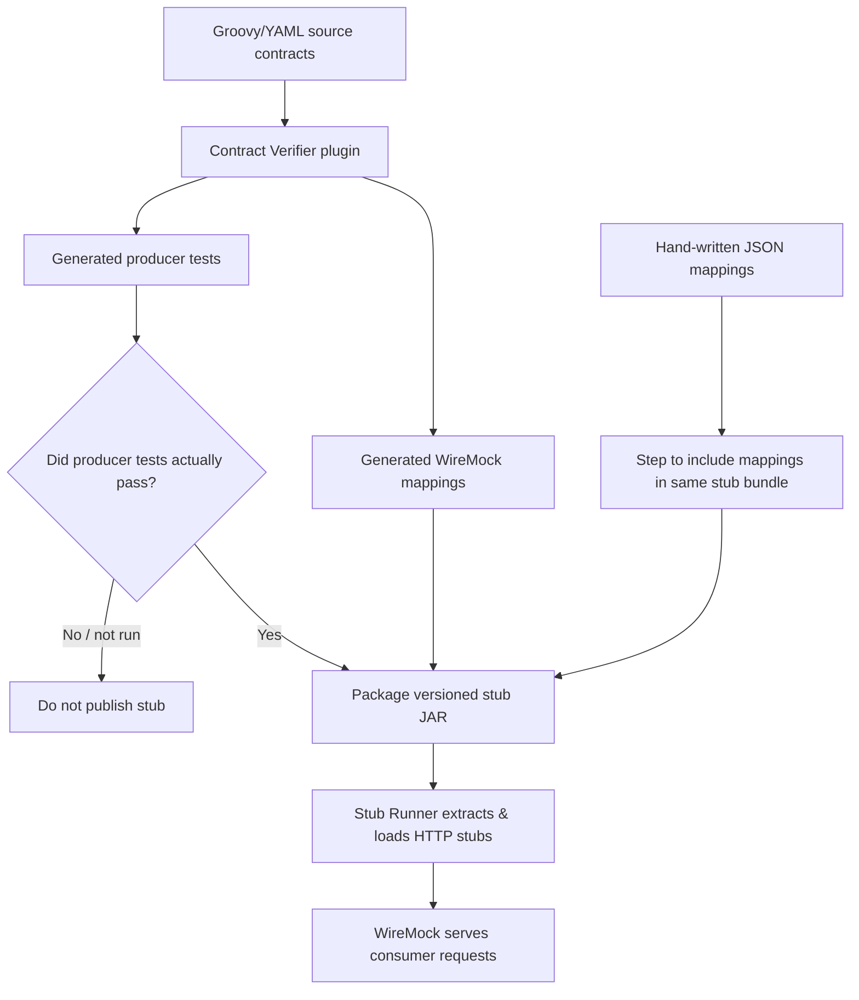
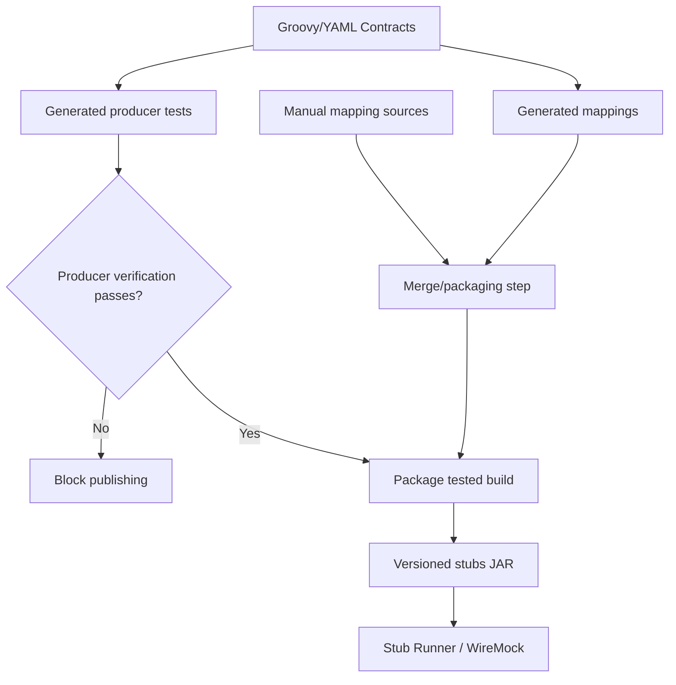
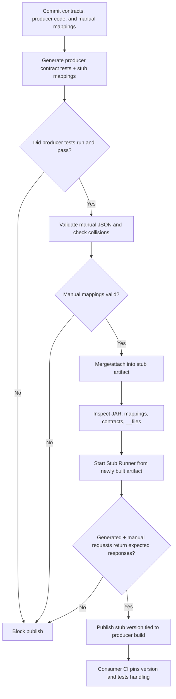

# Loading Generated Mappings and Hand-Written Mappings

In **Spring Cloud Contract**, a Groovy/YAML HTTP contract can be transformed into a **WireMock stub mapping** so the consumer calls a simulated API instead of starting the real producer. Sometimes the generated mapping set is not enough for testing needs: the consumer needs to simulate timeouts, failures from an external dependency, an endpoint without a contract yet, or a stateful multi-step scenario. In those cases, the team can add **hand-written mappings**.

The problem is not writing extra JSON. The problem is **how both generated mappings and hand-written mappings are loaded properly into WireMock**, using a single reproducible versioned source, without overwriting one another, without producing false-green tests, and without drifting from producer-verified contracts.

This lesson belongs to the **WireMock** chapter of the **SPRING_CLOUD_CONTRACT** module. Within the module's scope, we connect HTTP specifications via Groovy/YAML DSL, generating producer tests, creating stubs, using **Stub Runner**, and integrating **CI** to detect incompatible API changes. The content focuses on HTTP stubs: messaging contracts have their own transport/trigger mechanisms, and not every message stub can be treated as a WireMock HTTP mapping file.

After this lesson, you will be able to:

- Distinguish between source contracts, generated WireMock mappings, and hand-written JSON mappings.
- Understand `mappings/`, `__files/`, and the `META-INF/.../mappings/` layout inside a stub JAR.
- Load mappings from the filesystem, classpath, Java API, or Stub Runner artifacts using the right mechanism.
- Write supplementary JSON mappings with request matchers, responses, and body files.
- Detect overlapping mappings and control precedence using `priority`.
- Understand the difference between **packaged files** and **files actually loaded by WireMock**.
- Build a build/CI workflow ensuring mappings reflect contracts verified by the producer.

## 1. When are two sources of mappings needed?

Suppose `OrderService` is the consumer and `InventoryService` is the producer. The consumer calls:

```http
POST /api/v1/reservations HTTP/1.1
Content-Type: application/json

{"sku":"SKU-001","quantity":2}
```

The producer promises:

```http
HTTP/1.1 201 Created
Content-Type: application/json

{"reservationId":"RES-701","status":"HELD"}
```

Contract Verifier can generate an HTTP mapping that responds to this request. However, `OrderService` also needs to test another branch:

```http
GET /api/v1/reservations/RES-MISSING HTTP/1.1
Accept: application/json
```

with a `404` response:

```json
{"code":"RESERVATION_NOT_FOUND"}
```

If the second branch is not yet part of the formal contract suite, the team can use a hand-written mapping to **simulate the supplementary scenario** in a consumer test. What to distinguish:

| Source | Purpose | Protected by producer verification? |
| --- | --- | --- |
| **Groovy/YAML Contract** | Express the producer–consumer agreement | Can generate producer verification tests if the pipeline is configured and run properly |
| **Contract-generated mapping** | Stub that receives requests and returns sample responses | Linked to the source contract; trustworthy only if producer verification actually passed |
| **Hand-written JSON mapping** | Simulate an additional scenario, fault, or test state | **Not automatically**. To protect the same promise, a contract or separate producer test is required |

A hand-written mapping can be useful without necessarily becoming a contract. However, if the consumer **depends long-term** on `404 RESERVATION_NOT_FOUND`, this behavior should be turned into a producer-verified contract rather than living only in a consumer-side mock.

## 2. From contract to stub artifact: how many layers are there?



The diagram has a critical step: **"Step to include mappings in same stub bundle"**. Simply creating `somewhere/manual.json` does not mean Contract Verifier will automatically discover and insert it into the JAR. How files are picked up depends on plugin/version configuration, Gradle/Maven, and packaging conventions. You must verify the actual artifact.

Three separate facts need verification:

1. **Created:** the JSON mapping exists on disk or in generator output.
2. **Packaged:** the mapping appears in the right location inside the stub JAR or in the directory the runtime reads.
3. **Loaded:** the running WireMock server lists that mapping as active and a matching request returns the expected response.

Never replace these three checks with "the file exists, so Stub Runner can use it."

## 3. What does a WireMock JSON mapping contain?

A basic mapping describes **request conditions** and the **response to return**. Example for a not-found endpoint:

```json
{
  "name": "get-missing-reservation",
  "priority": 5,
  "request": {
    "method": "GET",
    "url": "/api/v1/reservations/RES-MISSING",
    "headers": {
      "Accept": {
        "contains": "application/json"
      }
    }
  },
  "response": {
    "status": 404,
    "headers": {
      "Content-Type": "application/json"
    },
    "jsonBody": {
      "code": "RESERVATION_NOT_FOUND"
    }
  }
}
```

Key fields:

| Field | Role |
| --- | --- |
| `name` | Human-readable name to locate the mapping in logs or the Admin API |
| `priority` | Precedence when multiple mappings match; **lower number means higher priority** |
| `request.method` | HTTP method, e.g., `GET` or `POST` |
| `request.url` | Matches the full URL including path and query when using this form |
| `request.urlPath` | Matches only the path, separating query matchers when needed |
| `request.headers` | Header conditions; here `Accept` contains `application/json` |
| `request.bodyPatterns` | Body conditions, e.g., `equalToJson` or `matchesJsonPath` |
| `response.status` | Simulated HTTP status |
| `response.headers` | Headers returned to the consumer |
| `response.jsonBody` | JSON object serialized by WireMock into the response body |

`jsonBody` is WireMock's convenience helper for JSON bodies. You can use `body` with a JSON string, or `bodyFileName` to load from `__files`, depending on the case. With a manually typed JSON string in `body`, you must handle quotes/escaping properly; with `jsonBody`, ensure JSON types reflect the agreement.

**Note on the `Accept` header:** some clients default to sending `*/*` or omit an explicit header. If a mapping requires `Accept: application/json` and the consumer omits it, the mapping **does not match** even if method and URL are right. Only constrain headers that truly matter to the agreed interface.

## 4. Mappings generated by Spring Cloud Contract

Assumed source contract:

```groovy
import org.springframework.cloud.contract.spec.Contract

Contract.make {
    name 'create_reservation_success'
    description 'OrderService successfully requests reservation hold'

    request {
        method 'POST'
        url '/api/v1/reservations'
        headers {
            contentType(applicationJson())
        }
        body([
            sku     : 'SKU-001',
            quantity: 2
        ])
    }

    response {
        status 201
        headers {
            contentType(applicationJson())
        }
        body([
            reservationId: $(consumer('RES-701'),
                             producer(regex('RES-[0-9]+'))),
            status       : 'HELD'
        ])
    }
}
```

Explanation:

- In the **generated producer test**, the request uses the sample data; the real producer is checked for status `201` and an ID matching `RES-[0-9]+`.
- In the **stub response**, `consumer('RES-701')` provides a concrete ID for consumer code to process further.
- If the generated producer test has not run or failed, generating the mapping is still just **simulating a promise**, without proving the producer complies.

The JSON below illustrates the **equivalent meaning** of the generated mapping; **it is not an exact plugin snapshot**:

```json
{
  "request": {
    "method": "POST",
    "url": "/api/v1/reservations",
    "headers": {
      "Content-Type": {
        "contains": "application/json"
      }
    },
    "bodyPatterns": [
      {
        "equalToJson": "{\"sku\":\"SKU-001\",\"quantity\":2}"
      }
    ]
  },
  "response": {
    "status": 201,
    "headers": {
      "Content-Type": "application/json"
    },
    "jsonBody": {
      "reservationId": "RES-701",
      "status": "HELD"
    }
  }
}
```

Mapping names, matcher expressions (e.g., `equalToJson`, `matchesJsonPath`), field ordering, and metadata are determined by the **plugin + WireMock version**. Therefore, inspect the **actual generated mapping** when diagnosing differences between contract and stub.

### Why not edit generated mappings directly?

When the generator runs again, generated files can be overwritten. More importantly, tweaking a mapping so consumer tests pass **without updating the contract/producer** breaks consistency between both sides.

If a `201` response changes to `200`:

1. Confirm whether the consumer accepts the change.
2. If the contract changes, update the reviewed Groovy/YAML contract.
3. Update the producer implementation to satisfy the new contract.
4. Regenerate producer tests and stubs; run verification.
5. Publish a new stub version if the change is accepted.

Hand-written mappings should not be used to silently **override an active contract**.

## 5. Directory layout WireMock reads when run directly

For standalone WireMock or a `WireMockServer` configured to use the filesystem, a typical root looks like:

```text
wiremock-root/
├── mappings/
│   ├── get-missing-reservation.json
│   ├── create-reservation-success.json
│   └── fallback-invalid-request.json
└── __files/
    ├── reservation-not-found.json
    └── reservation-created.json
```

- `mappings/*.json` holds stub definitions.
- `__files/*` holds external body payloads referenced via `bodyFileName`.
- Filenames are arbitrary; mapping resolution depends on **request matchers, priority, and scenario state**, not alphabetical filename order.

**Distinguish the directories:** this root is not equivalent to Spring Cloud Contract's `src/test/resources/contracts`. The `contracts` directory holds source DSLs; `mappings` holds data WireMock can load. A Groovy contract file cannot be read directly by standalone WireMock as a JSON mapping.

## 6. Loading mappings from the filesystem with WireMockServer

Java example for a test that explicitly owns a WireMock instance:

```java
import static com.github.tomakehurst.wiremock.core.WireMockConfiguration.options;

import com.github.tomakehurst.wiremock.WireMockServer;

WireMockServer server = new WireMockServer(
    options()
        .dynamicPort()
        .usingFilesUnderDirectory("src/test/resources/wiremock-root")
);

server.start();
try {
    System.out.println("WireMock port: " + server.port());
    // Run the consumer HTTP client pointing to http://localhost:<port>.
} finally {
    server.stop();
}
```

This is an **illustrative snippet**, placed in an appropriate method/test and requiring a compatible WireMock dependency. `usingFilesUnderDirectory(...)` configures the root; WireMock reads valid mapping files in `mappings` at startup using the corresponding file source mechanism.

Points to remember:

- Do not place the root in an arbitrary directory and expect WireMock to know; pass the right root configuration.
- Relative paths depend on the working directory used by the test runner. In multi-module Maven/Gradle builds, use stable paths based on module configuration.
- If you edit JSON **after the server has started**, reload/reset or call the Admin API per your version's mechanism; do not assume continuous hot reload.
- Use `dynamicPort()` to reduce port collisions in CI; read `server.port()` after `start()`.
- Do not leave a server from an earlier test running and sharing a request journal or scenario state.

### Loading mappings with standalone WireMock

If you have a standalone WireMock JAR compatible with your Java runtime, you can specify the root:

```bash
java -jar wiremock-standalone.jar --port 8089 --root-dir ./wiremock-root
```

This command only illustrates execution; the actual JAR filename may include a version. Do not expose this port publicly in production. Test with `curl` or an HTTP client from the test machine against the port opened by the process.

### Loading from the classpath

When a test JAR has resources on the classpath, WireMock's Java API provides options for a suitable filesystem/classpath resource root (for example `usingFilesUnderClasspath(...)` in supported versions). The layout must match:

```text
src/test/resources/
└── wiremock-root/
    ├── mappings/
    │   └── get-missing-reservation.json
    └── __files/
        └── reservation-not-found.json
```

A different classpath setting **cannot automatically read filesystem files outside the classpath**. When running tests after packaging resources, relative `bodyFileName` paths are still resolved under the selected file source's `__files` root.

**Do not say "having the stubs JAR on the classpath means WireMock loads everything automatically."** A standalone Java `WireMockServer` does not natively understand Spring Cloud Contract's `META-INF/<group>/<artifact>/<version>/mappings` layout. Stub Runner has its own mechanism to locate stub artifacts and prepare the file source.

## 7. Using `bodyFileName` for hand-written responses

For large responses, storing payloads separately keeps JSON mappings concise and easy to review.

Create mapping file `mappings/get-missing-reservation.json`:

```json
{
  "name": "missing-reservation-from-file",
  "request": {
    "method": "GET",
    "url": "/api/v1/reservations/RES-MISSING"
  },
  "response": {
    "status": 404,
    "headers": {
      "Content-Type": "application/json"
    },
    "bodyFileName": "reservation-not-found.json"
  }
}
```

File `__files/reservation-not-found.json`:

```json
{
  "code": "RESERVATION_NOT_FOUND",
  "message": "Reservation does not exist"
}
```

When the mapping matches, WireMock reads the file contents from the `__files` root used by the runtime. A few notes:

1. `bodyFileName` is normally a **relative path under `__files`**, not an arbitrary system path.
2. When packaging into a stub JAR, **package both the mapping and the body file** in the exact location the runtime file source can read.
3. Copying only the JSON mapping while forgetting `__files` can cause failed or unexpected responses when requests match.
4. Do not place large files containing sensitive data into stub artifacts; use dummy test data.
5. If you want dynamic responses via response templating, enable/configure the extension and check your WireMock version; it is not an automatic default required for every stub.

## 8. Loading hand-written mappings via the Java API

Besides JSON files, a test can register mappings directly on a running server:

```java
import static com.github.tomakehurst.wiremock.client.WireMock.*;

WireMockServer server = new WireMockServer(options().dynamicPort());
server.start();
try {
    server.stubFor(get(urlEqualTo("/api/v1/reservations/RES-MISSING"))
        .atPriority(1)
        .willReturn(aResponse()
            .withStatus(404)
            .withHeader("Content-Type", "application/json")
            .withBody("{\"code\":\"RESERVATION_NOT_FOUND\"}")));

    // Run the client test, then verify request/response.
} finally {
    server.stop();
}
```

Builders like `get(...)`, `urlEqualTo(...)`, `atPriority(...)`, and `aResponse()` describe mappings directly in Java tests. The advantage is tying them to fixture logic or triggering an error for a single scenario; the drawback is that the mapping **is not automatically included in the stub JAR** if it only lives inside consumer test code.

When using the Java API, import `WireMockServer` and `options()` as in the earlier example; snippets are split by section for explanation, not as two independent programs to paste verbatim into one file.

### When to use JSON files vs. the Java API

| Loading method | Best suited when | Considerations |
| --- | --- | --- |
| `mappings/*.json` | Version-controlled mappings reused across tests/runtimes | Managing root, packaging, and collisions |
| `bodyFileName` + `__files` | Long payloads or separate fixtures | Missing files break responses |
| `server.stubFor(...)` | One test needs specific response/latency/fault behavior | Not automatically published into stub artifacts |
| Admin API `/__admin/mappings` | Adding mappings to a running test instance | Restrict access, reset between tests |
| Stub Runner with `*-stubs.jar` | Consumer tests using versioned published contracts | Requires exact artifact coordinates and internal mappings |

## 9. How does Stub Runner load generated mappings?

In a typical Spring Cloud Contract workflow:

```text
Producer contracts (Groovy/YAML)
       |
       v
Contract Verifier / stub generation
       |
       v
inventory-service-1.4.2-stubs.jar
       |
       v
Stub Runner (resolve artifact)
       |
       v
WireMock runtime with the HTTP mappings inside the artifact
       |
       v
Consumer calls localhost:<stub-port>
```

A Spring Cloud Contract stub artifact can have a layout close to:

```text
META-INF/
  com.example/
    inventory-service/
      1.4.2/
        mappings/
          create_reservation_success.json
        contracts/
          create_reservation_success.groovy
```

This is a **common layout example**, not an immutable file structure across every plugin version. For messaging contracts, `contracts` also supports trigger mechanisms; WireMock handles **HTTP mappings**.

Consumer-side example:

```java
import org.springframework.boot.test.context.SpringBootTest;
import org.springframework.cloud.contract.stubrunner.spring.AutoConfigureStubRunner;
import org.springframework.cloud.contract.stubrunner.spring.StubRunnerProperties;

@SpringBootTest
@AutoConfigureStubRunner(
    ids = "com.example:inventory-service:1.4.2:stubs:8090",
    stubsMode = StubRunnerProperties.StubsMode.LOCAL
)
class ReservationConsumerTest {
    // Consumer test calls its client adapter to localhost:8090.
}
```

This example assumes the artifact is available in local Maven, port `8090` is free, and the appropriate Stub Runner dependency is present. In CI using a remote repository, configure repository URLs and credentials properly, and pin versions (avoid `+`/`latest` at release gates).

**Important:** `ids` specifies the stub artifact and serving port. It does not mean "automatically load every JSON in the consumer's `src/test/resources/manual-mappings`." To make a hand-written mapping appear in the **same Stub Runner WireMock instance**, you must either **include the mapping in the artifact** or register it via a controlled runtime API.

## 10. Three strategies for combining generated and hand-written mappings

Every project does not have to use the same approach. First determine **who owns the hand-written mapping** and whether consumers need it as part of the published artifact or only inside a local test.

| Strategy | Loading path | When to use | Weakness |
| --- | --- | --- | --- |
| **A. Package together** | Generated mappings + manual mappings → stub JAR → Stub Runner | Multiple consumers need the same extra scenarios, versioned reproducibility required | Must configure merge/packaging step, check collisions |
| **B. Register at runtime** | Stub Runner starts → WireMock Admin API creates temporary mapping | One consumer test needs a very specific fault or response | Mapping is not in the artifact; must reset and manage permissions |
| **C. Two WireMock instances** | Stub Runner serves generated mappings; separate test WireMock serves manual ones | Clean separation of contract stubs and auxiliary simulations | Consumer test must switch base URLs; not merged onto one port |

**Strategy A** fits when hand-written mappings need to be distributed as part of the contract-stub release. **Strategy B** fits simulating an intentional failure, such as a timeout for one test, but should not be used to silently alter responses of producer-verified mappings. **Strategy C** fits when you want to avoid modifying the producer artifact and both servers handle distinct request sets.

### Strategy A diagram: packaging together



**Constraint:** hand-written mappings inside the same artifact are **not automatically verified by generated producer tests**. If it represents official API behavior the consumer relies on, promote it to a contract or write corresponding producer verification before release.

## 11. Packaging together: source and output rules

A **suggested source layout**, not a mandatory default plugin directory:

```text
inventory-service/
├── src/test/resources/contracts/
│   └── create-reservation-success.groovy
├── src/test/resources/manual-wiremock/
│   ├── mappings/
│   │   └── get-missing-reservation.json
│   └── __files/
│       └── reservation-not-found.json
└── target/ or build/
    └── ... generated stub output ...
```

In the repository:

- Commit reviewed Groovy/YAML contracts and manual mapping **sources**.
- Do not commit generated files just because they appear in `target`/`build`.
- Separate names and purposes of manual mappings so nobody mistakes one for a new contract.
- Document why a mapping is not in the DSL, e.g., simulating network errors or consumer-only behavior.

**In the build**, include explicit steps:

1. Generate mappings from contracts into the plugin's output area.
2. Read the list of manual mappings and accompanying `__files`.
3. Check target filenames, request overlaps, and valid JSON.
4. Place files into the **right location inside the stub artifact** before packaging or via a controlled build extension.
5. Verify the final JAR contains **both mapping sets** and corresponding response body files.
6. Load the final artifact via Stub Runner to verify requests can match both types.

No `src/test/resources/manual-wiremock` source path is guaranteed to be auto-detected by Spring Cloud Contract across all versions. For different Maven/Gradle setups, read the **exact version's plugin documentation** and configure a copy/merge step with transparent inputs/outputs. Also never assume running a copy into `target` **after the JAR was created** automatically updates the artifact.

### Note on colliding filenames

If a generated mapping is `create-reservation-success.json` and a manual mapping uses the same name at the same destination, the merge step may **overwrite the file** or fail depending on configuration. Both are dangerous if undetected.

You should:

- Use stable names with a clear prefix for manual mappings, e.g., `manual-inventory-missing-reservation.json`.
- Add a check to detect duplicate target filenames before building the JAR.
- Never "allow overwrite to make the build green."
- After merging, verify the actual mapping count and contents of key mappings.

**Filenames do not solve request overlap.** Two differently named mappings can still match the same request if their method, URL, headers, and body matchers are identical or intersect.

### Inspecting the stub JAR

For the example artifact:

```bash
jar tf target/inventory-service-1.4.2-stubs.jar
```

In the output list, look for:

- The mapping generated from `create-reservation-success.groovy`.
- The hand-written mapping `manual-inventory-missing-reservation.json`.
- `__files/reservation-not-found.json` if the mapping uses `bodyFileName`.
- Contract definitions for tracing the producer version (when packaged per plugin convention).

Seeing both paths in `jar tf` only proves they were **packaged**; you must still **load the artifact into the runtime** and send test requests to verify behavior. A JAR with all files present can still fail to serve requests if file source config or mapping JSON is wrong.

## 12. Registering mappings via the WireMock Admin API

When a WireMock server is running at `http://127.0.0.1:8090`, you can query active mappings:

```bash
curl http://127.0.0.1:8090/__admin/mappings
```

To add a hand-written mapping for a **controlled test**, WireMock provides a stub mapping creation endpoint:

```bash
# Run in a shell supporting curl; the JSON path is your test file.
curl -X POST \
  -H "Content-Type: application/json" \
  --data-binary @manual-wiremock/mappings/get-missing-reservation.json \
  http://127.0.0.1:8090/__admin/mappings
```

A few notes:

- Target the **exact WireMock port used by Stub Runner**, not the real producer's port or another instance.
- The Admin API may be disabled, restricted, or use a different endpoint in specific setups.
- A POSTed mapping is **runtime state**, not persisted into the published JAR.
- If a later test shares the instance without resetting, the mapping may remain and make results order-dependent.
- Never expose the Admin API to the Internet or use it outside controlled test environments; this endpoint allows modifying stub behavior.

On Windows PowerShell 5.1, `curl` may be an alias for `Invoke-WebRequest` and will not accept curl CLI flags directly. In that case use `curl.exe` if installed, or `Invoke-RestMethod` with the appropriate JSON body and headers.

### Runtime registration vs. packaging

Suppose consumer test A creates `GET /RES-MISSING → 404` via the Admin API and passes. When consumer test B runs in CI with a fresh Stub Runner loading the **same artifact** without performing that POST step, the mapping is **not present**. That is the expected outcome: runtime registration does not alter the versioned stub artifact.

Therefore, for mappings that are part of an interface needed long-term, do not rely on "an earlier test will POST the mapping for me." Put the source in the artifact or set up **independent fixture registration per test suite**, and document the coverage scope clearly.

## 13. Request matching decides which mapping wins

WireMock finds mappings that satisfy the request, then applies its mapping selection rules. Two factors commonly cause confusion:

1. **Specificity:** which fields, headers, path, or full URL a JSON matcher requires; a mapping can be broader than intended.
2. **Priority:** a mapping with a **numerically lower** `priority` takes precedence over one with a higher number. In many WireMock versions, the default priority is `5`; verify on the current runtime when diagnosing.

Example:

| Mapping | Request matcher | Priority | Response |
| --- | --- | --- | --- |
| Generated success | `POST /api/v1/reservations` with JSON `quantity=2` and `sku=SKU-001` | Default or decided by generator | `201 HELD` |
| Manual invalid input | `POST /api/v1/reservations` with JSON `quantity=0` | `1` | `400 INVALID_QUANTITY` |
| Manual fallback | Any `POST /api/v1/reservations` | `10` | `422 UNSUPPORTED_REQUEST` |

The first two mappings **do not need to overlap** because `quantity` differs. The fallback mapping is intentionally broad, so it must have **lower priority** (higher number) than specific mappings.

### Hand-written mapping for specific invalid input

```json
{
  "name": "manual-invalid-quantity",
  "priority": 1,
  "request": {
    "method": "POST",
    "url": "/api/v1/reservations",
    "headers": {
      "Content-Type": {
        "contains": "application/json"
      }
    },
    "bodyPatterns": [
      {
        "equalToJson": "{\"sku\":\"SKU-001\",\"quantity\":0}"
      }
    ]
  },
  "response": {
    "status": 400,
    "headers": {
      "Content-Type": "application/json"
    },
    "jsonBody": {
      "code": "INVALID_QUANTITY"
    }
  }
}
```

With this mapping, a request with `quantity: 0` and `sku: SKU-001` matches; a request with quantity `2` fails the body condition. `equalToJson` checks JSON structure per WireMock's matcher rules; options like ignoring array order or extra fields should only be enabled when actually promised by the API.

### Low-priority fallback mapping

```json
{
  "name": "manual-fallback-unknown-reservation-request",
  "priority": 10,
  "request": {
    "method": "POST",
    "url": "/api/v1/reservations"
  },
  "response": {
    "status": 422,
    "headers": {
      "Content-Type": "application/json"
    },
    "jsonBody": {
      "code": "UNSUPPORTED_REQUEST"
    }
  }
}
```

**This is a mapping for consumer-only simulation.** It does not mean the real producer guarantees `422` for every unknown request. If the consumer truly depends on that error code, specify it in a contract and test the producer. Also, if generated mappings carry a custom `priority`, do not blindly assume fallback `10` will always lose; **inspect active mappings and test sample requests**.

### There is no "file order equals priority"

Do not rely on:

- File `a.json` loading before `b.json`.
- Generated mappings "always beating" hand-written mappings.
- Hand-written mappings "always winning" because they were POSTed later.

When two mappings match at the same priority, the winner can depend on registration-order details. A reliable design **avoids conflicting overlaps**, or sets explicit priorities and proves which mapping is selected via tests.

## 14. Matchers that look like they match but actually fail

When combining two sets, small differences cause WireMock's default 404:

| Difference | Example | Fix |
| --- | --- | --- |
| Method | Mapping expects `POST`, consumer calls `GET` | Check the HTTP client adapter |
| Path vs. query | Mapping `url` includes a different query than the real request | Use `urlPath` and query matchers if needed |
| Header | Mapping requires `Accept: application/json`, client sends `*/*` | Constrain only necessary headers |
| JSON type | Contract expects `quantity: 2`, client sends `"2"` | Fix consumer-side serialization |
| Body matcher | Mapping uses strict `equalToJson` but body adds a new field | Decide whether extra fields are allowed |
| Regex | Pattern is too narrow or too broad | Test both valid and invalid samples |
| Content-Type | Client sends `application/json;charset=UTF-8` | Matcher should reflect agreed media type rules |
| Scenario state | Mapping requires `CONFIRMED` while server is still in `Started` | Initialize sequence and reset scenarios properly |
| Port | Consumer calls real producer or a different WireMock instance | Check resolved stub URL/port |

**Do not fix every failure with a `.*` matcher.** It can make tests pass even when the consumer sends malformed requests; contract testing loses its value.

## 15. Stateful mappings: loading files is not enough—state must also match

A mapping can be restricted to a specific scenario state. For instance, `GET /reservations/RES-100` returns `HELD` before confirmation:

```json
{
  "scenarioName": "reservation-RES-100",
  "requiredScenarioState": "Started",
  "request": {
    "method": "GET",
    "url": "/api/v1/reservations/RES-100"
  },
  "response": {
    "status": 200,
    "headers": {
      "Content-Type": "application/json"
    },
    "jsonBody": {
      "reservationId": "RES-100",
      "status": "HELD"
    }
  }
}
```

State-transition mapping:

```json
{
  "scenarioName": "reservation-RES-100",
  "requiredScenarioState": "Started",
  "newScenarioState": "CONFIRMED",
  "request": {
    "method": "POST",
    "url": "/api/v1/reservations/RES-100/confirm"
  },
  "response": {
    "status": 200,
    "jsonBody": {
      "reservationId": "RES-100",
      "status": "CONFIRMED"
    }
  }
}
```

And the GET mapping after confirmation:

```json
{
  "scenarioName": "reservation-RES-100",
  "requiredScenarioState": "CONFIRMED",
  "request": {
    "method": "GET",
    "url": "/api/v1/reservations/RES-100"
  },
  "response": {
    "status": 200,
    "jsonBody": {
      "reservationId": "RES-100",
      "status": "CONFIRMED"
    }
  }
}
```

Only when **all three mappings are loaded into the same runtime** can the consumer test the `GET → POST confirm → GET` sequence. You must also reset the scenario back to `Started` before each independent test if an earlier test transitioned it to `CONFIRMED`.

**Limitation:** this is still **stub** state, not the producer's database. A generated contract test for a `200` response does not automatically verify cross-request state transitions, idempotency, or producer transactions. If the consumer relies on those, add producer integration tests.

## 16. Observe active mappings rather than just looking at files

To answer "Which mapping is WireMock using?", inspect the **runtime**.

### Querying the Admin API

```bash
# The commands below are for a shell with curl CLI.
curl http://127.0.0.1:8090/__admin/mappings
curl http://127.0.0.1:8090/__admin/requests
```

`/__admin/mappings` shows active stub definitions; `/__admin/requests` shows the request journal of requests received by the server. In Java tests directly, use the corresponding verification/request journal APIs.

Then send test requests:

```bash
curl -i -X POST http://127.0.0.1:8090/api/v1/reservations \
  -H "Content-Type: application/json" \
  -d '{"sku":"SKU-001","quantity":2}'

curl -i http://127.0.0.1:8090/api/v1/reservations/RES-MISSING
```

Expected results in the sample scenario:

- POST `quantity=2` receives `201` with `status=HELD` from the generated mapping.
- GET `RES-MISSING` receives `404` with `RESERVATION_NOT_FOUND` from the hand-written mapping.

If either request is not served properly, check active mappings, URL/port, actual request headers/body, and mapping responses. On WireMock's default 404, do not jump to the conclusion that the producer returned a business 404; **no mapping may have matched**.

### Counting mappings does not mean scenarios are covered

Suppose the JAR contains 10 JSON files and the Admin API displays 10 mappings. That **does not prove** every contract has a producer test or every mapping works properly. Run representative requests, especially:

- A successful request from a generated mapping.
- A request from a manual mapping.
- A request that **should not match** the success mapping.
- A request intentionally matching multiple mappings to verify priority.
- A request sequence when a WireMock Scenario is used.

When adding hand-written mappings, these tests catch regressions that simple file listing misses.

## 17. Resetting mappings, request journal, and scenarios between tests

WireMock holds runtime state consisting of:

- Currently registered stub mappings.
- The request journal for verification/debugging.
- Scenario states when using stateful behavior.

Different reset APIs have different scopes. For example, Java's `resetAll()`, resetting mappings to defaults, or resetting scenarios may not mean the same thing depending on the WireMock API and version. **Do not call an arbitrary reset method assuming it only clears request history**; it might also wipe mappings just registered at runtime.

A solid test isolation plan:

1. Start the server from fixed file sources/artifacts per test suite or per test when needed.
2. Register runtime-only mappings in the setup of the test that owns them.
3. Reset scenario state before sequence tests begin.
4. Clear the request journal when asserting per-test request counts.
5. If resetting mappings, reload selected generated/manual mappings or restart the runtime.
6. When tests run in parallel, use separate instances/ports or explicit state isolation.

**Never let one test depend on another test having POSTed a mapping via the Admin API.** Only independent tests are meaningful for CI and local reproduction.

## 18. CI gates must check both producer verification and mapping loading

If publishing a JAR containing both generated and manual mappings, the pipeline needs to distinguish:

| Verification layer | Question | Example |
| --- | --- | --- |
| **Contract source** | Does the DSL describe the API to protect? | `201 HELD` for `quantity=2` request |
| **Producer verification** | Do generated tests call real producer code and pass? | Real controller returns `201`, valid ID format |
| **Manual mapping validation** | Are hand-written files valid WireMock JSON? | `404` mapping has valid method/URL/body |
| **Packaging** | Does the stub JAR contain all source mappings and response files? | Contains generated mapping, manual mapping, `__files` |
| **Runtime loading** | Does Stub Runner actually load both sets? | Admin API lists active mappings |
| **Behavior smoke tests** | Are representative requests handled right by stubs? | Success POST and missing GET |
| **Consumer integration** | Does the consumer handle responses as expected? | OrderService takes the right error branch |

**Important:** manual mapping validation **does not replace producer verification**. A hand-written JSON mapping for `404` can pass JSON validation and consumer tests while the real producer returns `200`. If `404` is an official promise, a matching contract/producer test is required.

### A sound CI workflow



A baseline command for a **properly plugin-configured** Maven producer:

```bash
mvn -B -ntp clean verify
```

This is only the starting point. In CI, also verify:

1. Contract tests are generated from source DSLs and the test runner **executes** them.
2. No `skipTests`, exclude patterns, or JUnit version mismatch causes the test count to be 0.
3. Generated mappings correspond to the same build's contract revision.
4. Manual mappings are added **before final packaging** with verified inputs/outputs.
5. The final artifact is loaded in a **fresh Stub Runner**, not relying on a previously running local developer WireMock.
6. Regression request tests pass; no manual mapping accidentally shadows a generated one.
7. Published builds map to the right producer commit, contract revision, and stub version without overwriting released versions.

With Gradle, the principles stay the same, though you must wire the proper test/stub generation tasks, test runner, resource merging, and publication tasks. **Do not copy Maven task names into Gradle** or assume every plugin version shares the same output conventions.

## 19. Smoke-test script after loading stubs

Suppose a CI job has started WireMock on port `8090` from the newly built JAR. A minimal shell script can send probe requests:

```bash
# Check generated mapping: successful request.
curl -fsS -i -X POST \
  http://127.0.0.1:8090/api/v1/reservations \
  -H "Content-Type: application/json" \
  --data '{"sku":"SKU-001","quantity":2}'

# Check manual mapping: non-existent reservation.
curl -sS -i \
  http://127.0.0.1:8090/api/v1/reservations/RES-MISSING
```

**The snippet above only sends requests and prints output** without automated status/body assertions. In a real pipeline, you must:

- Assert the first request's status is `201` and body has `status = HELD`.
- Assert the second request's status is `404` and code is `RESERVATION_NOT_FOUND`.
- Verify a request that should not match the success mapping, such as quantity `0`.
- Fail the job when results diverge from expectations, rather than logging and leaving readers to guess.

If using an HTTP testing library on the consumer (RestAssured, WebTestClient, or the app's client adapter), write assertions in JUnit for clear reporting and failures. In Windows PowerShell 5.1, translate shell `curl` syntax to `curl.exe`/`Invoke-RestMethod` accordingly.

### Watch out for WireMock-generated HTTP errors, not producer errors

WireMock can return `404` when **no mapping matches**. If you only assert status `404`, the test for `RES-MISSING` can pass even when the manual mapping was never loaded. Always assert the **specific error code**, media type, or a distinguishing field as well.

This is a key reason to check **body content and active mapping names**, not just status codes.

## 20. Why not treat a manual mapping as a producer patch?

Suppose the contract specifies:

```text
POST /api/v1/reservations
  -> 201 {"reservationId":"RES-701","status":"HELD"}
```

But the real producer currently returns:

```text
POST /api/v1/reservations
  -> 200 {"holdId":"RES-701","status":"PENDING"}
```

A developer could write a manual WireMock mapping returning `201 HELD` to make consumer tests pass. This does not solve compatibility:

- The consumer is testing against an "as-wished" stub.
- The real producer **still fails to satisfy** the agreed fields/status.
- If the manual mapping shadows the generated mapping, consumer tests may stop exercising the contract-generated mapping altogether.
- If CI skips producer verification, the divergence goes undetected.

The proper resolution:

1. Keep source contracts as the reviewed agreement between both sides.
2. Run generated producer tests and observe the failure.
3. Fix the producer implementation or negotiate a contract change.
4. Regenerate mappings from the agreed contract.
5. Use manual mappings only for an isolated simulation scope with documented reasons and independent assertions.

Cases where manual mappings are **especially justified** include: simulating network errors, delayed responses, downstream service unavailability, malformed payloads to test defensive parsing, or complex stateful sequences inside a consumer test suite. Those test **consumer resilience**, and should not be interpreted as the producer promising to emit malformed payloads or regular timeouts.

## 21. WireMock and plugin versions can affect loading behavior

Spring Cloud Contract integrates WireMock through plugin and Stub Runner versions. Changes across WireMock major versions can affect dependencies, extensions, request/response matching, and additional APIs.

When encountering "mapping works in local standalone WireMock but fails via Stub Runner", check:

| Component | What to confirm |
| --- | --- |
| Spring Cloud Contract version | Which schema/features the generator produces mappings for |
| Stub Runner version | Matches the release train/version compatible with the producer artifact |
| WireMock runtime version | Supports the matchers/extensions used |
| File root | Runtime reads the right `mappings` and `__files` |
| Response templating | Whether the extension is enabled if mappings use templates |
| Java/JUnit/Spring Boot | Whether test context and server initialize cleanly |
| Artifact coordinates | Whether Stub Runner resolves the exact version/classifier |
| Test isolation | Whether runtime-only mappings or scenarios get reset/deleted |

**Do not upgrade WireMock alone** while Stub Runner depends on a specific compatible version. Likewise, do not copy a mapping using a new matcher/extension into an older project without checking runtime support.

When upgrading versions, run at least:

1. Producer contract verification.
2. A test loading generated mappings into Stub Runner.
3. A test loading/registering manual mappings.
4. Overlap/priority tests.
5. Body file and scenario state tests if used.
6. Consumer tests against the exact artifact to be published.

## 22. Security and data hygiene rules when using WireMock

WireMock is a testing tool, yet misconfiguration can introduce risks:

- **Admin API** can add/remove mappings and view the request journal. Never expose it publicly; allow only inside test networks/trusted environments.
- **Request journal** can capture headers, bodies, and test tokens. Never send real secrets and never persist logs containing sensitive data outside policy.
- **Response templating** or custom extensions can broaden how output is produced; enable only what is needed and use controlled inputs.
- **Proxying/recording** (if used) can forward requests to live systems. Never point at production by mistake or record real user data.
- **Body files** must use fake data and contain no credentials, access tokens, or personal information.
- **Ports** should bind inside isolated test environments; prefer dynamic ports to avoid CI collisions.

A manual mapping should never embed real tokens in `headers` or `jsonBody`. Exercise data should remain fictional to avoid leaking information when artifacts are shared across teams.

## 23. Common troubleshooting table when combining two mapping sets

| Symptom | Common cause | How to check |
| --- | --- | --- |
| Generated mapping works but manual mapping does not | Manual file not packaged or not POSTed at runtime | `jar tf` and `/__admin/mappings` |
| Manual mapping works standalone but not via Stub Runner | Different file root/artifact layout | Check Stub Runner loading path and file sources |
| Stub returns 404 without error JSON | No mapping matched | Check request journal and active mapping names |
| Mapping returns wrong body despite matching URL | Another mapping has overlapping matcher/priority | List active mappings; send distinguishing requests |
| Runtime-added stub mapping disappears after a test | Mappings reset or new server started | Register in setup or package into the artifact |
| `bodyFileName` returns errors or wrong payload | Missing `__files` entry in package/root | Check both mapping and response file |
| Mapping loads but requests with query fail to match | Used `url` instead of `urlPath`/query matcher | Inspect actual URL sent by client |
| JSON requests look identical yet fail to match | Number/string type mismatch or extra fields | Inspect body in request journal |
| Scenario test passes first run, fails second | Scenario not reset back to `Started` | Reset state or start an isolated server |
| Parallel CI tests flake | Shared port, journal, or scenario state | Use dynamic ports and test isolation |
| Consumer test green while real producer broken | Only manual mapping used, generated tests skipped | Check producer test report and contract |
| Stub JAR has right version yet stale data | Cache/merge from another commit or overwritten artifact | Check SHA, build inputs, and resolved version |
| Mapping using new extension fails to load | WireMock/Stub Runner version mismatch | Check dependencies and compatibility |
| Admin API POST succeeds yet test calls different URL | Wrong port/base URL or different server | Check resolved Stub Runner endpoint |

## 24. Checklist before loading or publishing mappings

- [ ] Identified which mappings are **generated from contracts** and which are **hand-written**.
- [ ] Groovy/YAML source contracts are versioned and producer verification actually runs.
- [ ] Manual mappings have a clear rationale; official API commitments are not silently altered.
- [ ] JSON mappings are valid; method/path/headers/body matchers accurately model requests.
- [ ] For body files, `bodyFileName` points to an existing file under the `__files` root.
- [ ] Clear understanding of whether WireMock runtime loads from **filesystem**, **classpath**, **Java API**, **Admin API**, or **stub JAR**.
- [ ] Not assuming any arbitrary manual directory is automatically packaged by Spring Cloud Contract.
- [ ] Verified the merge step does not overwrite generated files or body files.
- [ ] Mappings have no conflicting request overlaps; `priority` checked where needed.
- [ ] If using fallbacks, priority is low enough and does not swallow official requests.
- [ ] If using scenarios, all states have mappings and are reset before tests.
- [ ] Listed final artifact contents and verified both generated and manual mappings.
- [ ] Checked Admin API or runtime introspection to see active mappings.
- [ ] Added smoke tests invoking at least one generated mapping and one manual mapping.
- [ ] Added negative tests to detect overly broad manual mappings.
- [ ] Stub Runner uses the exact version/classifier and does not depend on stale local caches.
- [ ] CI detects zero generated tests, skipped tests, and producer verification failures.
- [ ] Admin API is not exposed outside the test environment.
- [ ] Published stubs are immutable and traceable to a producer commit/contract revision.

### Practice exercise

Suppose you maintain `OrderService` (consumer) which needs stubs for `InventoryService`. Producer and consumer agreed on this API:

```text
POST /api/v1/reservations
  Request: {"sku":"SKU-001","quantity":2}
  Response: 201 {"reservationId":"RES-701","status":"HELD"}

GET /api/v1/reservations/RES-MISSING
  Response: 404 {"code":"RESERVATION_NOT_FOUND"}
```

**Tasks:**

1. Create a Groovy contract for the successful `POST` request; use a `consumer` sample for `reservationId` and a `producer` regex to validate dynamic IDs.
2. Generate producer contract tests and the WireMock mapping in a configured Spring Cloud Contract project; verify the **tests actually run**.
3. Write the JSON mapping file `GET RES-MISSING → 404`; give it a clear name and use `jsonBody`.
4. Start a `WireMockServer` reading from `wiremock-root/mappings`; ensure the generated mapping is placed under the same root to test alongside the manual mapping.
5. Replace the 404 body with `bodyFileName` and create `__files/reservation-not-found.json`; explain why copying only the JSON mapping is insufficient.
6. Use `/__admin/mappings` to confirm both mappings are active. Send `POST` and `GET` requests, checking status **and** JSON body.
7. Add a `POST` invalid quantity `0` mapping returning `400` and a low-priority fallback mapping returning `422`. Send all three request types to observe which mapping wins.
8. Intentionally create a manual mapping with the same method/URL/body as the generated mapping but returning `200`; observe the overlap and fix it by removing the override or redesigning conditions.
9. Build the `GET HELD → POST confirm → GET CONFIRMED` scenario, resetting before a second test runs.
10. Package generated + manual mappings into **one stub JAR** via a controlled build configuration. Verify the JAR contains both mappings and the corresponding `__files`.
11. Start Stub Runner from that JAR with a pinned version; confirm both mappings are served by the right runtime.
12. Design CI gates to detect: producer tests not running, invalid manual JSON, missing JAR files, mapping shadowing, and Stub Runner failing to load the right artifact.
13. Explain when a hand-written mapping should be promoted into a **producer-verified contract** instead of remaining consumer-only forever.

**Completion criteria:** you can point out **where each mapping originates**, **where it is packaged**, **which WireMock instance loaded it**, **which request matches which mapping**, and **whether CI verified the real producer or only simulated behavior**.

## References

- [WireMock — Stubbing](https://wiremock.org/docs/stubbing/): JSON mappings, priority, request/response stubs, and Java API.
- [WireMock — Running as a Standalone Process](https://wiremock.org/docs/standalone/java-jar/): configuring the root directory and running standalone WireMock.
- [WireMock — Request Matching](https://wiremock.org/docs/request-matching/): method, URL, headers, and body matchers.
- [WireMock — Statefulness](https://wiremock.org/docs/stateful-behaviour/): scenario states, state transitions, and resets.
- [WireMock — Admin API](https://wiremock.org/docs/standalone/admin-api-reference/): querying/creating mappings and inspecting the request journal.
- [Spring Cloud Contract — Reference](https://docs.spring.io/spring-cloud-contract/reference/): producer verification, stub generation, packaging, and Stub Runner.
- [Spring Cloud Contract — HTTP Contracts](https://docs.spring.io/spring-cloud-contract/reference/project-features-contract/http.html): producer/consumer HTTP contract DSL.
