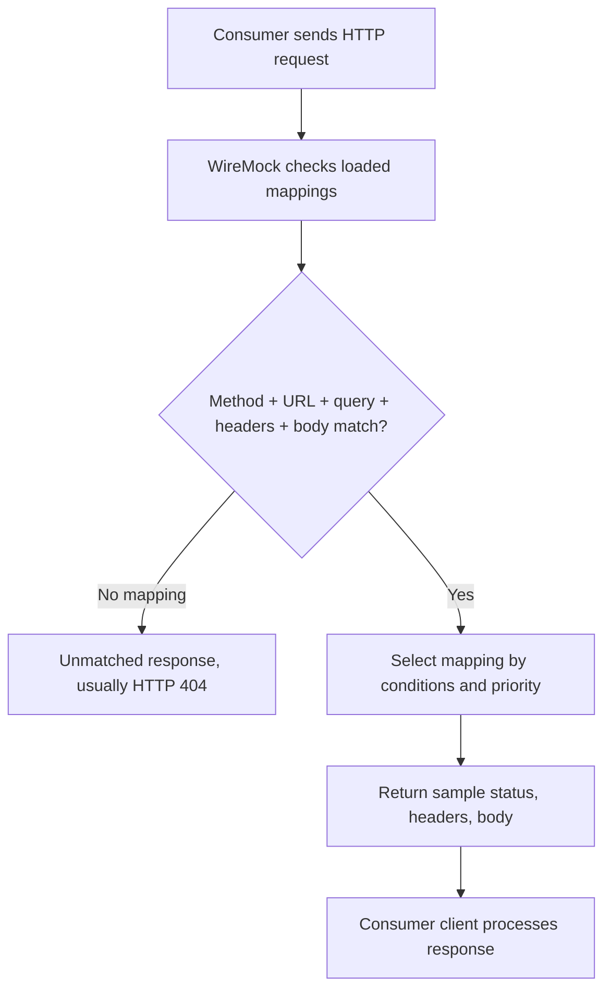
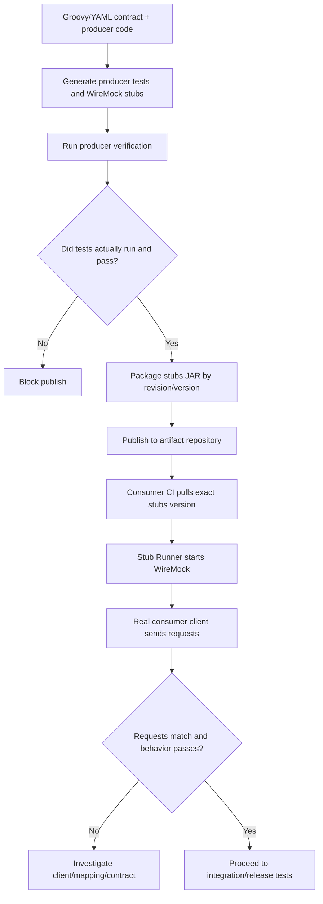

# Matching Method, URL, Query, Headers, and Body

## 1. What is WireMock actually matching?

In **Spring Cloud Contract**, producers and consumers agree on the HTTP or messaging behaviors services must uphold. From **Groovy/YAML DSL** contracts, Contract Verifier can generate **producer tests** and **HTTP stubs**. For HTTP, stubs are typically served with **WireMock**; the consumer uses **Stub Runner** to call a simulated server instead of starting the real producer. Integrated into CI, this workflow helps catch incompatible API changes.

An HTTP stub can be read by this rule:

> **If a request satisfies the declared matching conditions, WireMock returns the response configured for that mapping.**

For example, producer `order-service` promises to create an order when the consumer calls:

```http
POST /api/orders?source=checkout HTTP/1.1
Content-Type: application/json
X-Request-Id: req-abc123

{"customerId":"cust-123","quantity":2}
```

Sample response:

```http
HTTP/1.1 201 Created
Content-Type: application/json

{"orderId":"ord-501","status":"CREATED"}
```

A WireMock mapping can guard multiple dimensions at once: **HTTP method, path, query parameters, request headers, and request body**. If the consumer sends the wrong value for a required condition, the mapping may not be selected. When no stub matches, WireMock usually returns a **404 unmatched response**, not automatically a business `ORDER_NOT_FOUND` error defined by the producer.

**Lesson objectives:** write and read WireMock matching conditions accurately; express the same intent in Spring Cloud Contract; distinguish producer-side vs. consumer-side request values; diagnose unmatched stubs; and build reliable positive/negative tests in consumer CI.

## 2. Matching model and the difference between contracts and mappings

A stub mapping typically has two sections:

- `request`: conditions for WireMock to select the mapping, such as `method`, `urlPath`, `queryParameters`, `headers`, and `bodyPatterns`.
- `response`: HTTP `status`, `headers`, `body`, or `jsonBody` the mock server returns when the request matches.



When a mapping declares **multiple conditions**, they must **all hold simultaneously** for that mapping to match. Conversely, **omitting a condition** does not mean WireMock checks it implicitly. For example, a mapping that checks only `urlPath` and `method` may accept many unrelated bodies if there is no body matcher.

| Condition type | Example | If left unchecked |
| --- | --- | --- |
| HTTP method | `POST` | `GET` might be accepted if `ANY` or a broad mapping is used |
| URL/path | `/api/orders` | Another endpoint could trigger by mistake |
| Query | `source=checkout` | Stub accepts wrong or missing source if unconstrained |
| Header | `Content-Type: application/json` | Stub accepts requests with a different media type |
| Body | `customerId` and `quantity` | Different payloads could trigger the success response |
| Scenario state | `Started`, `Created` | Cannot simulate stateful sequences if the test needs them |

**Spring Cloud Contract DSL is the source of the agreement**, whereas **WireMock JSON mappings** are the executable HTTP mock representation generated by the tool. When using Spring Cloud Contract as the shared source of truth, do not edit generated mappings directly inside the stubs JAR: such edits can disappear on the next build or drift from producer verification.

## 3. Matching HTTP method

WireMock typically uses `request.method` to select the method:

```json
{
  "request": {
    "method": "GET",
    "urlPath": "/api/orders/42"
  },
  "response": {
    "status": 200,
    "jsonBody": {"orderId": 42, "status": "CONFIRMED"}
  }
}
```

This mapping expresses **GET** on that exact path. `POST /api/orders/42` is not the same request. In a REST API, the same URL can support multiple operations:

| Request | Example semantics | Mapping should distinguish |
| --- | --- | --- |
| `GET /api/orders/42` | Read order | `method = GET` |
| `PATCH /api/orders/42` | Partially update order | `method = PATCH` |
| `DELETE /api/orders/42` | Cancel/delete per API contract | `method = DELETE` |
| `POST /api/orders` | Create new order | `method = POST` |

WireMock may support broad matching like `ANY`, but for contracts where the consumer relies on a specific method, **use the exact method** to catch requests using the wrong HTTP verb. Never create an `ANY /api/orders/42` mapping just to stop tests from getting 404: it can hide a client bug sending `GET` instead of `POST`.

### An easily overlooked question

When a consumer test receives HTTP `404` from WireMock after a `POST`, check the **method before checking the data**. A `GET` stub on the same path is not proof that the `POST` route is simulated. For `HEAD` or `OPTIONS`, check how your WireMock/runtime handles them; do not assume a `GET` mapping equals a dedicated `HEAD` contract.

## 4. Matching URLs: full request URL or path only?

WireMock distinguishes several common URL matcher types:

| Field in WireMock | Primary scope | Example |
| --- | --- | --- |
| `url` | Path **plus query string** by exact value | `/api/orders?source=checkout` |
| `urlPattern` | Regex across path and query string | `/api/orders\\?.*` |
| `urlPath` | **Path** only, excluding query | `/api/orders` |
| `urlPathPattern` | Regex on **path** | `/api/orders/[0-9]+` |

Example matcher requiring only the path:

```json
{
  "request": {
    "method": "GET",
    "urlPath": "/api/orders"
  },
  "response": {
    "status": 200,
    "jsonBody": {"items": []}
  }
}
```

If the consumer sends `GET /api/orders?page=0`, the path is still `/api/orders`; the mapping above can match because no query constraints were declared. This may be **intentional** when an endpoint allows optional parameters, or a **test gap** if the consumer is required to send a specific query.

### Choose `urlPath` when checking query parameters separately

Example:

```json
{
  "request": {
    "method": "GET",
    "urlPath": "/api/orders",
    "queryParameters": {
      "status": {"equalTo": "CONFIRMED"},
      "page": {"equalTo": "0"}
    }
  },
  "response": {
    "status": 200,
    "jsonBody": {"items": []}
  }
}
```

This configuration is clearer than locking the full `?status=CONFIRMED&page=0` string in `url`: when the client sends query parameters in a different order with equivalent values, separate parameter matchers can still accept the request.

### Use path regex at the right time

If the consumer can query multiple IDs with the same format, you can use:

```json
{
  "request": {
    "method": "GET",
    "urlPathPattern": "/api/orders/[0-9]+"
  },
  "response": {
    "status": 200,
    "jsonBody": {"orderId": 42}
  }
}
```

This regex expresses **numeric path IDs**, yet the response still returns `orderId = 42` for every matched ID! It is **a sample stub**, not a real producer backed by a database or automatically echoing the path ID. If the consumer needs to verify a "path ID must equal response ID" relationship, use appropriate request/response transformers or write separate scenarios, backed by producer integration tests to protect correctness.

**Note:** Regex `urlPattern` across full path+query is sensitive to parameter order and escaping; to check query parameters cleanly, prefer `urlPath` + `queryParameters`.

## 5. Matching query parameters

Query parameters follow `?` in the URL, for example:

```http
GET /api/orders?status=CONFIRMED&page=0&size=20
```

In WireMock, `queryParameters` lets you write conditions by **parameter name**, independent of URL order:

```json
{
  "request": {
    "method": "GET",
    "urlPath": "/api/orders",
    "queryParameters": {
      "status": {"equalTo": "CONFIRMED"},
      "page": {"matches": "[0-9]+"},
      "size": {"equalTo": "20"}
    }
  },
  "response": {
    "status": 200,
    "jsonBody": {"items": []}
  }
}
```

Meaning:

- `status` must equal the string `CONFIRMED`.
- `page` must look like a non-negative integer matching regex `[0-9]+`. This is only a **format check**; it does not guarantee the number falls within an API-allowed range.
- `size` must equal `20` in this scenario.

| Request | Satisfies conditions above? | Reason |
| --- | --- | --- |
| `?status=CONFIRMED&page=0&size=20` | Yes | All three conditions met |
| `?size=20&page=1&status=CONFIRMED` | Yes | Changing query order does not alter each parameter value |
| `?status=PENDING&page=0&size=20` | No | `status` differs |
| `?status=CONFIRMED&page=abc&size=20` | No | `page` fails regex |
| `?status=CONFIRMED&size=20` | No | Missing required `page` |

**Additional query parameters are not rejected by default** when a mapping declares only these three conditions. WireMock usually does not treat an unmentioned parameter as an error. If the API must reject unknown queries, write a dedicated contract for the error behavior or test validation on the producer rather than assuming `queryParameters` enforces an automatic allowlist.

### Query pitfalls

**1. Strings vs. numbers.** HTTP queries are fundamentally strings. `page=0` is read by matchers as `"0"`, not a JSON number. Do not write a numeric body matcher as a substitute for query rules.

**2. Missing vs. empty.** `?status=` is not identical to omitting `status` completely. If the API distinguishes both cases, write tests for both; do not assume all empty values are handled identically.

**3. Repeated parameters.** `?tag=a&tag=b` carries multiple values under the same name. If the contract relies on a tag list, use multi-value matchers (per your WireMock version) or specialized tests; a single `equalTo: "a"` condition does not express "exactly two tags".

**4. Encoding.** Spaces, `+`, `%`, and Unicode characters in queries can be URL-encoded. When debugging, inspect both the raw URL and how the HTTP client/WireMock decodes values. Avoid writing regexes against raw URL strings just to match an accidental encoding form.

**5. Absence conditions.** WireMock offers an `absent` matcher for supported parts in corresponding versions. If a scenario requires a parameter to be absent, declare an **explicit absence condition** in that version's syntax; never assume omitting a field from the mapping forbids sending it.

## 6. Matching request headers

Headers distinguish JSON content, API versions, correlation IDs, authentication, and request routing mechanisms. Example:

```http
POST /api/orders HTTP/1.1
Content-Type: application/json; charset=UTF-8
Accept: application/json
X-Request-Id: req-abc123
```

One WireMock declaration:

```json
{
  "request": {
    "method": "POST",
    "urlPath": "/api/orders",
    "headers": {
      "Content-Type": {"contains": "application/json"},
      "Accept": {"equalTo": "application/json"},
      "X-Request-Id": {"matches": "req-[A-Za-z0-9-]+"}
    }
  },
  "response": {
    "status": 201
  }
}
```

| Matcher | Example | Interpretation |
| --- | --- | --- |
| `equalTo` | `Accept = application/json` | Exact value match per matcher |
| `contains` | `Content-Type` contains `application/json` | Substring match |
| `matches` | `X-Request-Id` matches regex | String pattern match |
| `absent` | Header does not exist | Use when **absence** is meaningful |

**Header names are case-insensitive per HTTP**, whereas **header values must still be evaluated according to each header's semantics**. For example, certain media types or tokens have strict casing rules; do not assume all header values are case-insensitive.

### Is using `contains` for Content-Type safe?

`contains: "application/json"` is convenient because it accepts `application/json; charset=UTF-8`, yet it can be **too broad**: an unusual string might still contain `application/json`. If the consumer strictly depends on media types, use a media-type matcher or sufficiently precise regex for your version, and include negative cases. For example, in a system accepting only JSON, `Content-Type: application/json-and-text` should not match just because it contains the target substring.

### Do not lock dynamic headers to a single example

`X-Request-Id`, `traceparent`, or correlation tokens can change on every call. Use regex/format matchers when the consumer only needs a valid value. Never commit real tokens into mappings/fixtures and never log `Authorization`, cookies, or secrets from test runs. If the consumer needs to test `401`/`403`, those error contracts must be explicitly defined rather than tossing in a random sample header.

### When should Accept be checked?

`Accept` is the client's **desired response media type**; `Content-Type` describes the **media type of the request body**. A bodyless `GET` may only need `Accept`; a JSON `POST` typically needs `Content-Type`. If a mock unreasonably requires both, consumer tests may fail despite valid API requests. Constrain only the headers the producer and consumer genuinely agreed upon.

## 7. Matching request body

For `POST`/`PUT`/`PATCH`, the body is often a key condition identifying the scenario. In WireMock, `bodyPatterns` supports several matcher types:

| Type | Applies to | Key note |
| --- | --- | --- |
| `equalTo` | Exact text body | Sensitive to whitespace and character order unless normalized |
| `contains` | Text body containing a substring | Fast, but risks being overly broad |
| `matches` | Regex over text body | Does not understand JSON structure; watch escaping |
| `equalToJson` | JSON body by JSON content | Can be configured to ignore array order or extra fields |
| `matchesJsonPath` | JSON matching selected paths/conditions | Presence of one path does not prove the entire object is valid |
| `equalToXml` / XPath | XML body | Use when the API is XML-based and integration supports it |

### 7.1. Compare JSON instead of raw strings

These two bodies are usually equivalent as JSON objects:

```json
{"customerId":"cust-123","quantity":2}
```

```json
{
  "quantity": 2,
  "customerId": "cust-123"
}
```

Text matcher `equalTo` may consider them different due to whitespace/key order. `equalToJson` is usually better when the consumer needs to verify **JSON structure and values**.

```json
{
  "bodyPatterns": [
    {
      "equalToJson": "{\"customerId\":\"cust-123\",\"quantity\":2}"
    }
  ]
}
```

This is a **`bodyPatterns` fragment inside `request`**, not a complete HTTP mapping. WireMock parses JSON structurally, so differing object key order does not necessarily cause a failure.

### 7.2. Array ordering and extra JSON fields

Common options with `equalToJson`:

```json
{
  "bodyPatterns": [
    {
      "equalToJson": "{\"customerId\":\"cust-123\",\"quantity\":2}",
      "ignoreArrayOrder": true,
      "ignoreExtraElements": true
    }
  ]
}
```

- `ignoreArrayOrder: true` allows ignoring array element order during JSON comparison. **Do not use** if array order is part of the contract.
- `ignoreExtraElements: true` allows the actual JSON to contain extra fields/elements beyond the template per matcher semantics. **Do not use** if the API must reject undeclared fields.

These two options are **choices about matching strictness**, not universal defaults for every API. If a consumer only needs `customerId` and `quantity`, allowing extra metadata may be fine. If the consumer sends signed requests or uses a strict schema, ignoring extra fields can mask violations.

### 7.3. JSONPath for conditions on fields or arrays

When you only need to ensure a field exists, you can use:

```json
{
  "bodyPatterns": [
    {"matchesJsonPath": "$.customerId"}
  ]
}
```

However, that matcher **does not prove `customerId` has a valid format**, nor does it check `quantity`. If the test needs exact values, use `equalToJson` or version-appropriate advanced JSONPath matchers; if you need "every item has a positive quantity", add separate assertions/contracts to protect that invariant.

Example body with an array:

```json
{
  "items": [
    {"sku": "SKU-101", "quantity": 2},
    {"sku": "SKU-102", "quantity": 1}
  ]
}
```

JSONPath `$.items[*].sku` finds `sku` values **that exist**, without proving every item has `sku` or `quantity > 0`. For collection constraints, verify paths, array sizes, and per-element assertions if the consumer depends on them.

### 7.4. Null, empty, form, and binary bodies

```http
POST /api/orders HTTP/1.1
Content-Type: application/json

{}
```

A `{}` body is an empty JSON object, distinct from an empty body `""`, JSON `null`, or a request with no body. When the API performs validation, define the corresponding `400`/`415` error accurately.

WireMock supports matchers for text, JSON, XML, form, multipart, or binary depending on version/extensions. Never apply `equalToJson` to `application/x-www-form-urlencoded`, raw protobuf, or multipart hoping the parser infers the schema. Pick matchers based on the **media type and data the consumer actually sends**.

## 8. A WireMock mapping combining all five conditions

Returning to the `checkout-service` order creation scenario, a complete HTTP mapping can be saved as `mappings/create-order.json` on a practice WireMock server:

```json
{
  "name": "Create order from checkout",
  "priority": 1,
  "request": {
    "method": "POST",
    "urlPath": "/api/orders",
    "queryParameters": {
      "source": {"equalTo": "checkout"}
    },
    "headers": {
      "Content-Type": {"contains": "application/json"},
      "X-Request-Id": {"matches": "req-[A-Za-z0-9-]+"}
    },
    "bodyPatterns": [
      {
        "equalToJson": "{\"customerId\":\"cust-123\",\"quantity\":2}"
      }
    ]
  },
  "response": {
    "status": 201,
    "headers": {
      "Content-Type": "application/json",
      "Location": "/api/orders/ord-501"
    },
    "jsonBody": {
      "orderId": "ord-501",
      "status": "CREATED"
    }
  }
}
```

This is a **WireMock JSON mapping used to explain stub selection**; it is not a Spring Cloud Contract Groovy/YAML source file. In systems generating stubs from contracts, verify whether the generated mapping matches the intended conditions. Do not maintain a hand-written mapping with different conditions and call it proof of what the producer promised.

### Condition breakdown

| Condition | What the request must do | Change that causes non-match |
| --- | --- | --- |
| `method = POST` | Send HTTP POST | Switch to GET |
| `urlPath = /api/orders` | Call the exact path | Call `/api/order` |
| `source = checkout` | Include query with exact value | Send `source=mobile` |
| `Content-Type` contains `application/json` | Send JSON body with proper header | Send `text/plain` |
| `X-Request-Id` matches regex | Send request ID formatted `req-...` | Send `broken` or omit header |
| `equalToJson` | Body has `customerId = cust-123` and `quantity = 2` | Change `quantity` to 0, change type, or drop field |

Note that `priority = 1` here only matters **when multiple mappings compete**. It does not make WireMock bypass request conditions. A high-priority mapping must still match all its conditions to be selected.

### Probing via HTTP

Suppose WireMock loaded the mapping above and is listening on `http://localhost:8089`:

```bash
curl -i -X POST \
  'http://localhost:8089/api/orders?source=checkout' \
  -H 'Content-Type: application/json' \
  -H 'X-Request-Id: req-abc123' \
  -d '{"customerId":"cust-123","quantity":2}'
```

The expected result is HTTP `201` with body `orderId = ord-501`, `status = CREATED`. In a genuine consumer test, call via the **application's HTTP client**, not only `curl`.

Try changing `X-Request-Id` to `invalid` or `quantity` to `0`. If no other mapping applies, the request becomes unmatched and WireMock usually returns a default 404. This is a **matcher quality check**, not a business contract saying "invalid quantity returns 404"; the real API might return `400` when validation fails.

## 9. The same mapping in WireMock's Java DSL

WireMock also provides a Java API to declare stubs inside tests. Equivalent in intent:

```java
import static com.github.tomakehurst.wiremock.client.WireMock.*;

// Place inside a setup/test method where the WireMock server is already running.
stubFor(
    post(urlPathEqualTo("/api/orders"))
        .withQueryParam("source", equalTo("checkout"))
        .withHeader("Content-Type", containing("application/json"))
        .withHeader("X-Request-Id", matching("req-[A-Za-z0-9-]+"))
        .withRequestBody(
            equalToJson("{\"customerId\":\"cust-123\",\"quantity\":2}")
        )
        .willReturn(
            aResponse()
                .withStatus(201)
                .withHeader("Content-Type", "application/json")
                .withHeader("Location", "/api/orders/ord-501")
                .withBody("{\"orderId\":\"ord-501\",\"status\":\"CREATED\"}")
        )
);
```

This API is handy when you want to spin up a WireMock server directly in a test **without using the producer's stubs artifact**. However, in a Spring Cloud Contract workflow, if the consumer keeps rewriting mappings manually, two separate sources of truth can easily drift apart.

**Role separation rule:**

- **Groovy/YAML Contract DSL:** shared source of agreement used by both producer verification and stub generation.
- **WireMock JSON/Java DSL:** HTTP request-response mock implementation, either generated or configured directly for isolated tests.

Both syntaxes describe requests and responses, but **you cannot copy a WireMock `bodyPatterns` block into Spring Cloud Contract's `bodyMatchers` and assume identical schemas**.

## 10. Expressing matching requirements in Spring Cloud Contract Groovy DSL

For producer `order-service`, the source file `src/test/resources/contracts/orders/create-order.groovy` can declare:

```groovy
import org.springframework.cloud.contract.spec.Contract

Contract.make {
    description 'Create order from checkout'

    request {
        method POST()
        urlPath('/api/orders') {
            queryParameters {
                parameter 'source': 'checkout'
            }
        }
        headers {
            contentType(applicationJson())
            header(
                'X-Request-Id',
                $(consumer(regex('req-[A-Za-z0-9-]+')),
                  producer('req-abc123'))
            )
        }
        body([
            customerId: $(consumer(regex('cust-[0-9]{3}')),
                          producer('cust-123')),
            quantity: 2
        ])
    }

    response {
        status CREATED()
        headers {
            contentType(applicationJson())
        }
        body([
            orderId: $(consumer('ord-501'),
                       producer(regex('ord-[0-9]+'))),
            status: 'CREATED'
        ])
    }
}
```

This illustrates Spring Cloud Contract's **dual-sided value** model in Groovy DSL. For the request:

| Request part | What does the **consumer-side stub** use? | What does the **generated producer test** use? |
| --- | --- | --- |
| Method/path | `POST /api/orders` | Sends `POST /api/orders` |
| Query `source` | Must be `checkout` | Sends `checkout` |
| Header `X-Request-Id` | Regex `req-[A-Za-z0-9-]+` | Sends example `req-abc123` |
| Body `customerId` | Regex `cust-[0-9]{3}` | Sends example `cust-123` |
| Body `quantity` | Value `2` | Sends `2` |

In the **response**, the stub returns `orderId = ord-501` as a sample for the consumer, while producer verification can accept `ord-502` or `ord-999` if it satisfies `ord-[0-9]+`. `status` must be `CREATED` in this scenario.

**Do not misunderstand:** a generated producer test sending only `cust-123` **does not prove** the producer handles every customer ID matching the regex. `consumer(regex(...))` allows the stub to accept a range of valid consumer requests; the generated producer test uses the `producer`-side example value. Important data domains need additional scenario/validation tests.

### Why not write only WireMock JSON?

If a developer edits a mapping so the stub returns `201` while the real producer returns `200`, consumer tests with WireMock can still pass. By sharing a Groovy contract source and running producer verification before publishing the stubs JAR, the pipeline gains a way to detect HTTP status/body mismatches in the real implementation.

## 11. Same scenario in YAML DSL

Spring Cloud Contract also supports YAML DSL. A corresponding representation:

```yaml
description: Create order from checkout
request:
  method: POST
  urlPath: /api/orders
  queryParameters:
    source: checkout
  headers:
    Content-Type: application/json
    X-Request-Id: req-abc123
  body:
    customerId: "cust-123"
    quantity: 2
  matchers:
    headers:
      - key: X-Request-Id
        regex: 'req-[A-Za-z0-9-]+'
    body:
      - path: $.customerId
        type: by_regex
        value: 'cust-[0-9]{3}'
response:
  status: 201
  headers:
    Content-Type: application/json
  body:
    orderId: "ord-501"
    status: "CREATED"
  matchers:
    body:
      - path: $.orderId
        type: by_regex
        value: 'ord-[0-9]+'
```

In YAML, **concrete body/header values** and **matchers** can be declared separately:

- `request.body.customerId = cust-123`: example sent in the generated producer test.
- `request.matchers.body`: condition the stub uses to accept `customerId` from the consumer.
- `response.body.orderId = ord-501`: value the stub returns.
- `response.matchers.body`: condition the generated producer test checks on the real `orderId`.

**Version note:** YAML structure, header/body matcher names, and query matcher capabilities vary across Spring Cloud Contract releases. Check the **schema and actual generated mappings/tests** for your project's version; successful YAML parsing alone does not prove WireMock matchers and producer assertions are right. Do not leave both Groovy and YAML duplicates of the same scenario in the source root after migrating.

## 12. When multiple mappings can match: priority and specificity

A stub server often holds dozens of mappings. A subtle problem is an **overly broad mapping shadowing a specific mapping**.

Suppose there are two mappings for the same endpoint:

```json
{
  "priority": 10,
  "request": {
    "method": "POST",
    "urlPath": "/api/orders"
  },
  "response": {
    "status": 400,
    "jsonBody": {"code": "BAD_REQUEST"}
  }
}
```

And:

```json
{
  "priority": 1,
  "request": {
    "method": "POST",
    "urlPath": "/api/orders",
    "queryParameters": {
      "source": {"equalTo": "checkout"}
    },
    "bodyPatterns": [
      {"equalToJson": "{\"customerId\":\"cust-123\",\"quantity\":2}"}
    ]
  },
  "response": {
    "status": 201,
    "jsonBody": {"orderId": "ord-501", "status": "CREATED"}
  }
}
```

In WireMock, **lower numeric priority wins** when multiple mappings match the same request. For example, `1` takes precedence over `10`. For a valid request satisfying the specific mapping, the server returns `201`. For a `POST /api/orders` request failing the specific conditions while still matching the broad mapping, the server can return `400`.

This is only a **simulated fallback in a lab**, not an automatic producer validation rule. A real API may return `401`, `415`, `422`, or other responses depending on the error, so do not treat a broad `BAD_REQUEST` mapping as a complete specification.

### Principles for managing overlapping mappings

1. Prefer **specific** request matchers for scenarios with distinct behavior.
2. Use a broad fallback only when tests genuinely need it and the fallback response reflects agreed requirements.
3. When two mappings share the same priority and matching conditions, **never rely on file load order** to infer deterministic outcomes.
4. Use `scenarioName`/`requiredScenarioState` properly if responses depend on **prior requests**, not just the path.
5. Test both a valid request and an invalid request to catch overly broad mappings matching unintentionally.

**Spring Cloud Contract can generate many WireMock mappings from many contracts.** If different contracts describe the exact same `method + path + query + headers + body` with different responses and no state distinction, consumer tests may not reliably know which stub will be returned. Design **clearly distinct requests or scenarios**, rather than patching with arbitrary priorities when the API promise itself conflicts.

## 13. Debugging unmatched requests with WireMock admin tools

In a lab, suppose WireMock runs on `localhost:8089`. Useful admin endpoints typically include:

```bash
# Inspect loaded mappings
curl -s http://localhost:8089/__admin/mappings

# Inspect unmatched requests
curl -s http://localhost:8089/__admin/requests/unmatched
```

Admin API response structure, request journal retention, and "near misses" display depend on WireMock version and configuration. Some test setups may disable the journal or restrict admin access. Verify actual availability before relying on these endpoints.

### Investigation steps for an unexpected 404

Suppose the consumer expects `201` but receives `404`. Do not immediately add a broad `POST /api/orders` mapping to make the test pass. Investigate in order:

1. **Server:** Did Stub Runner/WireMock start on the expected port? Is the client calling the right host/port?
2. **Artifact:** Does the stubs JAR have the right group/artifact/version/classifier and contain this mapping?
3. **Method:** Did the consumer send `POST` rather than `GET`?
4. **Path:** Does the request use `/api/orders` or omit the `/api` prefix?
5. **Query:** Is `source=checkout` present? Are there case, whitespace, or encoding differences?
6. **Headers:** Are `Content-Type` and `X-Request-Id` present with valid values?
7. **Body:** Is the JSON an object or a JSON string? Is `quantity` the number `2`?
8. **Priority/state:** Did another mapping intercept the request first, or is a scenario in a different state?
9. **Response:** If the mapping matched yet status is still unexpected, inspect the mapping's `response` and artifact version.

Example investigation table:

| Actual request | Expected condition | Issue |
| --- | --- | --- |
| `GET /api/orders?source=checkout` | `POST` | Wrong method |
| `POST /orders?source=checkout` | `/api/orders` | Wrong path |
| `POST /api/orders?source=mobile` | `source=checkout` | Wrong query |
| `Content-Type: text/plain` | Contains `application/json` | Wrong header |
| `X-Request-Id: abc` | Regex `req-...` | Invalid ID |
| `{"customerId":"cust-123","quantity":"2"}` | JSON with number `2` | Wrong body type |

**Distinguish two kinds of 404:**

- **Business 404**: a mapping matched and intentionally returned `404` with a body like `{"code":"ORDER_NOT_FOUND"}`.
- **Unmatched 404**: WireMock found no matching mapping and returned its default error; the body may contain diagnostics rather than business error JSON.

If the consumer branches on `code`, assert **both status and body error code**, not status alone. A test passing on a 404 caused by calling the wrong URL is a **false positive**.

### When to use the request journal?

The request journal is especially helpful for comparing the **actual request reaching the mock server** against **mapping matchers**, instead of staring only at HTTP client code. However, the journal can capture auth headers, cookies, or payloads with private data; enable and store it only in secure test environments, and scrub/mask sensitive values before sharing logs.

## 14. Positive and negative testing at each matching layer

A mapping works properly not just when a "happy" request returns `201`. It must also **avoid falsely returning success** for requests violating contract requirements.

| Test case | Change from standard request | Should `Create order` mapping (section 8) match? |
| --- | --- | --- |
| Standard | Valid POST, path/query/header/body | **Yes** |
| Wrong method | `GET` instead of `POST` | **No** |
| Wrong path | `/api/order` instead of `/api/orders` | **No** |
| Wrong query | `source=mobile` | **No** |
| Missing query | Omit `source` | **No** |
| Extra unconstrained query | Add `debug=true` | **Possibly yes**, since the mapping does not forbid extra queries |
| Wrong media type header | `Content-Type: text/plain` | **No** |
| Different valid Request ID | `req-xyz999` | **Yes**, regex matcher allows it |
| Invalid Request ID format | `X-Request-Id: xyz999` | **No** |
| Reordered JSON keys | `quantity` before `customerId` | **Yes**, if JSON content is equivalent |
| Number replaced by string | `quantity: "2"` | **No** under standard `equalToJson` |
| Wrong body value | `quantity: 0` | **No** |
| Missing body field | Omit `customerId` | **No** |
| Extra body field | `coupon: "X"` | Depends on mapping's matcher/`ignoreExtraElements` |

If a **fallback mapping** exists on the same server, a request failing the order-creation mapping may still receive **a valid response from another mapping**. Therefore, negative checks should verify that the **specific success mapping's result is not erroneously returned**, rather than always asserting WireMock must return `404`.

### Do not test with curl alone

`curl` is useful for debugging, but consumer tests should invoke the **application's real client**: RestTemplate, WebClient, Feign, or another HTTP client. Only then do you protect how the client builds URLs, encodes queries, sets headers, serializes request bodies, and handles responses.

Writing JSON mappings and calling `curl` tests the **WireMock mapping**, not whether consumer code sends the right requests.

## 15. Wiring matching into @AutoConfigureStubRunner on the consumer

Suppose the producer ran verification and published `order-service-1.5.0-stubs.jar`. A Spring Boot consumer can run:

```java
import org.junit.jupiter.api.Test;
import org.springframework.beans.factory.annotation.Autowired;
import org.springframework.boot.test.context.SpringBootTest;
import org.springframework.cloud.contract.stubrunner.StubRunnerProperties;
import org.springframework.cloud.contract.stubrunner.spring.AutoConfigureStubRunner;

import static org.assertj.core.api.Assertions.assertThat;

@SpringBootTest(properties =
    "clients.order.base-url=http://localhost:9090")
@AutoConfigureStubRunner(
    ids = "com.example:order-service:1.5.0:stubs:9090",
    stubsMode = StubRunnerProperties.StubsMode.LOCAL
)
class CheckoutOrderContractTest {

    @Autowired
    OrderClient orderClient;

    @Test
    void shouldCreateOrderUsingPublishedStub() {
        OrderDto order = orderClient.createOrder(
            "checkout", "req-abc123", "cust-123", 2);

        assertThat(order.orderId()).isEqualTo("ord-501");
        assertThat(order.status()).isEqualTo("CREATED");
    }
}
```

`OrderClient` and `OrderDto` are **hypothetical application types** that must be implemented/registered in your project. The test is meaningful when `createOrder` actually sends `POST /api/orders?source=checkout`, JSON `Content-Type`, a regex-valid `X-Request-Id`, and the matching request body. Having `@AutoConfigureStubRunner` present **does not automatically rewire HTTP clients** to point to `9090`; the `clients.order.base-url` property is just an application-defined example.

A frequent mistake is Stub Runner starting cleanly while the HTTP client still targets `http://order-service:8080` because it reads a property from another profile. The test may then call a real service or fail to connect; nothing about mapping quality can be inferred from that result.

### Stub loading modes and artifact reliability

| `StubsMode` | Source | Notes |
| --- | --- | --- |
| `LOCAL` | Maven local repository | Stubs artifact must be installed beforehand; prone to staleness |
| `REMOTE` | Artifact repository | Pin versions, configure repositories and credentials securely |
| `CLASSPATH` | Stubs resources on test classpath | Must match Stub Runner's expected layout; avoid stale fixtures |

If the team uses dynamic ports instead of `9090`, the HTTP client must obtain the **actual port** from Stub Runner via the appropriate API/integration. Never assume stub server names, ports, and base URLs sync automatically unless the test configures them.

## 16. Do not confuse stub matching with producer verification

In Spring Cloud Contract, distinguish two kinds of checks:

1. **Consumer-side request matching:** WireMock must accept valid requests sent by the consumer per the contract.
2. **Producer-side assertion:** Generated tests must verify that the real producer returns the expected status/headers/body when given sample request data.

For the `create-order.groovy` contract in section 10:

```text
Stub:
  POST /api/orders?source=checkout
  X-Request-Id: req-abc123, req-xyz999, ...
  customerId: cust-123, cust-456, ... (per regex)
  quantity: 2
  → returns 201, orderId=ord-501, status=CREATED

Generated producer test:
  sends X-Request-Id=req-abc123
  sends customerId=cust-123, quantity=2
  → checks real producer returns 201, status=CREATED,
    orderId matches ord-[0-9]+
```

These are **two uses of the same contract**, not two systems verifying each other automatically:

- If the producer changes `201` to `200`, the generated producer test should fail.
- If the consumer changes `source=checkout` to `source=mobile`, the specific WireMock stub should not match.
- If the producer produces a valid `ord-999`, the generated producer test should pass; the stub can still return `ord-501` as a stable example.
- If the consumer sends `customerId=cust-999`, the stub regex can match; the generated producer test **does not automatically prove** the producer handles that specific ID.

**Contract test limits:** It guards declared scenarios/conditions, not every business rule. For instance, a producer returning the wrong total price for a multi-item order can still pass a schema-only contract; add appropriate business assertions and integration tests.

### Generated stubs may differ from hand-written sample mappings

The WireMock mapping in section 8 is a **hand-written example with exact body matching**; the Groovy contract in section 10 allows `customerId` to match a regex on the consumer side. Therefore, **never treat them as identical mappings**. Both illustrate five matching layers, but their accepted request sets differ:

| Sample file | Allowed `customerId` in stub |
| --- | --- |
| Section 8 WireMock JSON | `cust-123` (per example `equalToJson`) |
| Section 10 Groovy contract | Values matching `cust-[0-9]{3}` when generated mapping preserves the matcher properly |

This is a strong reason to **inspect actual generated mappings** rather than assuming the tool generates every line identically to a tutorial example. When converting Groovy to YAML, confirm both producer assertions and WireMock request-matching conditions preserve the intended semantics.

## 17. CI: protecting both producer verification and consumer requests

A reliable pipeline separates two gates:



### Producer stage

Example for a Maven producer with Contract Verifier plugin and base class configured:

```bash
./mvnw -B clean verify
```

Check:

- Contracts are discovered from the intended source root/filters.
- Generated producer tests are generated, compiled, **actually executed**, and pass.
- Key response matchers are applied accurately in generated assertions.
- The stubs artifact contains mappings/responses of the verified contracts.
- Publication is tied to a **deterministic version/revision**; never publish a JAR that no longer matches source.

**A green build with 0 contract tests is not proof of compatibility.** If `verify` skips generated tests because plugin tasks are not bound to the lifecycle, fix the build/test configuration. With Gradle, check actual task names and `check`/`build` behavior for your plugin version instead of guessing from command names.

### Consumer stage

Consumer CI should:

1. Download the **exact stubs artifact** at the agreed coordinates.
2. Start Stub Runner/WireMock in the configured LOCAL/REMOTE/CLASSPATH mode.
3. Confirm the HTTP client targets the mock server's exact port and base path.
4. Run at least one **positive** request for every scenario the consumer uses.
5. Run meaningful **negative** requests: wrong query, missing header, wrong JSON type, wrong method/path.
6. Verify **consumer logic**: parsing, DTO mapping, error-response handling, retries if any.
7. Record stub version, test counts, key mappings, and redacted diagnostics.

Negative tests should reflect the **API contract**, not just expect "WireMock always returns 404". If the real producer returns `400 VALIDATION_ERROR` for `quantity=0`, create a dedicated contract/mapping for that error scenario. An unmatched 404 only proves the **success mapping was not selected**, not that producer validation works.

### Invariants requiring tests outside WireMock

| What to protect | Does a WireMock HTTP stub prove it alone? | Appropriate test |
| --- | --- | --- |
| Producer serializes JSON per current schema | **No** | Generated producer tests |
| Consumer builds right method/query/headers/body | **Yes**, if mappings are strict enough | Consumer tests via real HTTP client |
| Producer persists order to DB | **No** | Producer integration tests |
| No duplicate orders on POST retries | **No** | Idempotency/concurrency tests |
| Security/gateway behaves correctly | No if stubs bypass them | Security/integration/E2E tests |
| Service handles network outages properly | Not from static stubs | Fault-injection/resilience tests |
| State-dependent responses across requests | Only with stateful scenarios/fakes | Stateful tests and producer integration |

## 18. Practice exercise: protecting checkout order creation requests

### Context

`checkout-service` calls `order-service` to create orders. The contract specifies:

| Component | Commitment |
| --- | --- |
| Method | `POST` |
| URL path | `/api/orders` |
| Query | `source=checkout` |
| Headers | `Content-Type: application/json`, `X-Request-Id` formatted `req-...` |
| JSON body | `customerId` matching `cust-[0-9]{3}`, `quantity = 2` in this scenario |
| Response | `201`, `orderId` matching `ord-[0-9]+`, `status = CREATED` |

**This exercise should be run in an isolated test environment with WireMock**, not against public mock servers. When using Stub Runner, choose only artifacts verified by producer verification.

### Part A — Write matching in WireMock JSON

1. Create a mapping as in section 8 with `method`, `urlPath`, `queryParameters`, `headers`, and `bodyPatterns`.
2. Test a valid `curl` call; confirm WireMock returns `201` with order-creation JSON.
3. Try changing `quantity` to a string, setting `source=mobile`, and omitting `X-Request-Id`.
4. Confirm invalid requests **do not match the success mapping**; inspect `/__admin/requests/unmatched` if the journal is enabled.
5. Decide between `equalToJson` and `matchesJsonPath` for the body and explain why.

### Part B — Write the Spring Cloud Contract source

1. Translate the intent to Groovy DSL (section 10) or YAML DSL (section 11).
2. Add `consumer` matchers for **variable request values** like `customerId` and `X-Request-Id`; supply valid producer-side examples.
3. In the response, use example `orderId = ord-501` for the stub and producer-side matcher `ord-[0-9]+`.
4. Run producer verification; intentionally change `status` to `FAILED` or HTTP status to `200` to watch generated tests catch it.
5. Read the plugin-generated mapping and compare it against the hand-written WireMock mapping. Note **intentional differences** in matcher breadth.

### Part C — Test the consumer with Stub Runner

1. Publish/install the producer's stubs JAR, selecting a specific version in `ids`.
2. Enable `@AutoConfigureStubRunner` in the consumer test.
3. Point the consumer's real HTTP client to the stub server.
4. Call order creation with `cust-123`, `req-abc123` and verify response handling.
5. Call again with another regex-matching ID, such as `cust-987`; verify whether the generated stub **actually** accepts it as expected.
6. Test invalid query/headers/body. If the test suddenly gets `201` on invalid conditions, check whether the mapping lacks matchers or is shadowed by an overly broad mapping.

### Part D — Debug a failing case

Scenario: Consumer sends:

```http
POST /api/orders?source=checkout HTTP/1.1
Content-Type: application/json
X-Request-Id: req-xyz999

{"customerId":"cust-987","quantity":2}
```

The stub from the Groovy contract in section 10 is **expected** to accept this request because `customerId` and `X-Request-Id` match the regexes. However, the hand-written WireMock JSON in section 8 is **expected not to match** because its body matcher locks `cust-123`.

**Question:** Is this necessarily a WireMock or producer bug? **No.** The two mappings have different matching conditions. To test the `cust-[0-9]{3}` contract, use the mapping **generated from the contract** and inspect whether the generator preserved the regex. If your goal is simply mocking one fixed input, a hand-written mapping may suffice, but it cannot substitute for the broader contract.

### Expected outcome matrix

| Test | Outcome |
| --- | --- |
| POST meeting all conditions | Success stub returns `201` |
| POST missing `source` | Fails to match success mapping |
| POST with `quantity` as string | Fails to match if matcher enforces JSON number |
| POST with invalid request ID format | Fails to match if regex was generated properly |
| POST with `customerId = cust-987` | Matches contract regex when preserved; fails `equalToJson` locked to `cust-123` |
| Producer changes `status` to `FAILED` | Generated producer test must fail for this scenario |
| Consumer asserts only `201` without reading body | Insufficient to prove client handles response properly |
| CI loads stale stubs JAR out of sync with contract | Report artifact/versioning error; do not claim new API compatibility |

## 19. WireMock request matching review checklist

- [ ] Method is strictly constrained; `ANY` is avoided when the consumer relies on a specific method.
- [ ] `url`/`urlPattern` or `urlPath`/`urlPathPattern` chosen intentionally.
- [ ] Important query parameters matched individually, independent of URL string order.
- [ ] Tests cover missing, empty, repeated, or encoded queries when the API depends on them.
- [ ] `Accept`/`Content-Type` and custom headers checked with proper semantics.
- [ ] Dynamic headers matched by format rather than locking arbitrary sample tokens/IDs.
- [ ] Body uses a media-type-appropriate matcher; JSON uses structure/types rather than raw strings when appropriate.
- [ ] `ignoreArrayOrder` and `ignoreExtraElements` relaxed only when the contract permits.
- [ ] JSONPath checks exact paths/conditions; presence of one field is not confused with all items being valid.
- [ ] Competing mappings have distinct requests or intentionally configured priority/scenarios.
- [ ] Verified that business 404s differ from unmatched 404s; consumer assertions check error codes when needed.
- [ ] Tested both valid requests and invalid method/path/query/headers/body.
- [ ] Groovy/YAML contracts serve as shared source; generated mappings and producer assertions are inspected/verified.
- [ ] Stub Runner loads the right stubs artifact and version, and the client calls the right host/port.
- [ ] Generated producer tests run before publication; CI does not accept accidental 0-test runs.
- [ ] DB, security, retry, idempotency, and distributed-system invariants have complementary tests.

**Remember:** WireMock selects stubs by matching declared HTTP conditions. **Method, URL/path, query, headers, and body** can all determine whether a request matches. Constrain tightly enough to catch client bugs while avoiding locking dynamic values the producer is allowed to vary. When using Spring Cloud Contract, trace **source contract → generated producer tests → generated WireMock mappings → consumer Stub Runner tests**. That turns request matching into a verifiable API compatibility safeguard rather than a static JSON mock.
