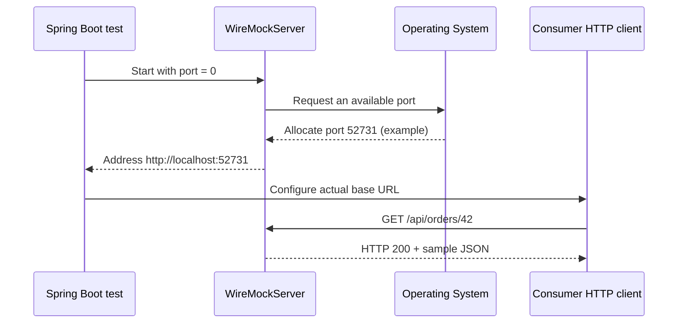
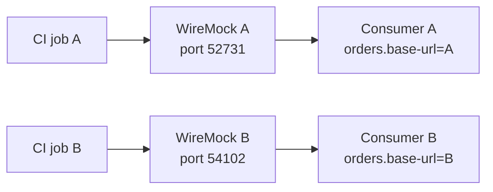
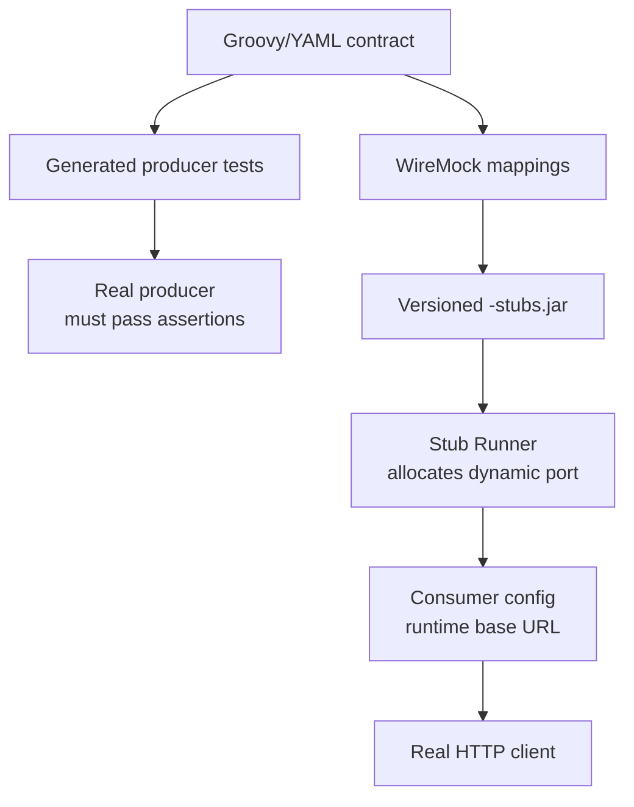

# Random Ports and Passing the Address into Consumer Configuration

## 1. Why should WireMock use a random port in tests?

In **Spring Cloud Contract**, teams describe HTTP or messaging behavior between **producer** and **consumer** using the Groovy/YAML DSL. The producer runs generated contract tests to prove the real API meets the contract; stubs are published for **Stub Runner** or WireMock so the consumer can test its HTTP client and logic. When running many consumer tests locally or on CI, **hardcoding stub ports** is a common source of hard-to-reproduce failures.

For example, `checkout-service` needs to call `order-service`:

```text
Consumer HTTP client  →  http://localhost:8080/api/orders/42
```

If another application is already occupying port `8080`, WireMock cannot start there. Conversely, if Stub Runner starts WireMock on `52731` while the consumer client still calls `8080`, the test connects to the **wrong process** or fails with `Connection refused`. The test outcome no longer proves that the consumer is compatible with the selected stub.

The solution is to **let the operating system pick an available port**, then **pass WireMock's actual runtime address into consumer configuration before the client is initialized**.

After this lesson, you will be able to:

1. Explain the meaning of `port = 0` or `dynamicPort()`.
2. Use `@AutoConfigureWireMock(port = 0)` with the `wiremock.server.port` property in Spring Boot tests.
3. Configure a real consumer HTTP client using a **test-supplied base URL** instead of hardcoding.
4. Apply `@DynamicPropertySource` when managing `WireMockServer` yourself.
5. Retrieve the actual port when using **Stub Runner** and distinguish stub startup mechanisms.
6. Diagnose wrong host/port, initialization order, parallel test, and CI issues.

## 2. Port `0`, actual port, and base URL

When a server opens a socket on port `0`, **the operating system allocates an available port at bind time**. Once the server starts, the actual port is a positive integer such as `52731`; **port `0` is not an address for an HTTP client to connect to**.



| Component | Example | Meaning |
|---|---|---|
| Requested port at startup | `0` | Let the OS choose automatically; never use in a URL |
| Actual port after bind | `52731` | Runtime value, may differ across test runs |
| Stub server host | `localhost` | Valid when client and stub share the same network namespace |
| Scheme | `http` | Must match the protocol the WireMock server actually exposes |
| Base URL | `http://localhost:52731` | Configuration source that should be supplied to the HTTP client |
| Endpoint | `/api/orders/42` | Client appends this to the base URL when sending requests |

**A port is not a URL.** The consumer needs **scheme + host + port**, sometimes including a base path. If tests run inside Docker, `localhost` inside a container **does not necessarily point to a WireMock process on the host or another container**. The address must match the **network perspective of the running consumer**.

### 2.1. Three ports that are easily confused

| Port | Belongs to | Do not use it to... |
|---|---|---|
| `server.port` or `@LocalServerPort` | HTTP server of the **application under test**, if the test starts one | Substitute for the external service's WireMock port |
| `wiremock.server.port` | WireMock managed by `@AutoConfigureWireMock` | Guess the real producer's port |
| Port allocated by **Stub Runner** | WireMock instance loading a `-stubs.jar` artifact | Connect a different client when multiple stubs exist |

For instance, `@SpringBootTest(webEnvironment = RANDOM_PORT)` makes the **consumer application** listen on a random port. It **does not make WireMock listen on a random port**, nor does it automatically update the upstream address used by the consumer.

## 3. The simple approach with Spring Cloud Contract WireMock

In a Spring Boot test with a compatible **Spring Cloud Contract WireMock** module, you can use:

```java
@SpringBootTest
@AutoConfigureWireMock(port = 0)
class OrderClientContractTest {
    // WireMock starts on an available port.
}
```

The `@AutoConfigureWireMock` annotation belongs to `org.springframework.cloud.contract.wiremock.AutoConfigureWireMock`. You need an appropriate test dependency, such as:

```xml
<dependency>
    <groupId>org.springframework.cloud</groupId>
    <artifactId>spring-cloud-contract-wiremock</artifactId>
    <scope>test</scope>
</dependency>
```

This is a **Maven dependency snippet**, not a complete POM. The library version must be compatible with the project's Spring Boot/Spring Cloud versions and can be managed by dependency management/BOM.

When `port = 0`, Spring Cloud Contract WireMock starts the server and publishes the **chosen port** via the commonly used `wiremock.server.port` property. Tests can reference that property to configure the external service address.

**What does not happen automatically:** simply adding `@AutoConfigureWireMock(port = 0)` **does not automatically make an HTTP client with hardcoded `http://localhost:8080` switch to the right port**. You must pass the address into the consumer client's configuration.

## 4. Passing the base URL into consumer configuration before creating the client

Suppose the consumer defines an application property `clients.orders.base-url`, and the HTTP client reads it from the Spring Environment:

```yaml
# Example consumer runtime configuration.
clients:
  orders:
    base-url: https://orders.example.internal
```

In production, the value points to the real service via appropriate DNS/service discovery/gateway. **In tests**, override it to point to WireMock without modifying production URLs or hardcoding ports.

### 4.1. An HTTP client that actually reads the property

Example using `RestClient` (Spring Framework 6.1+). The Java snippets below illustrate application components:

```java
package com.example.checkout.client;

public record OrderDto(long id, String state, String currency) {}
```

```java
package com.example.checkout.client;

import org.springframework.beans.factory.annotation.Value;
import org.springframework.stereotype.Component;
import org.springframework.web.client.RestClient;

@Component
public class OrderClient {
    private final RestClient restClient;

    public OrderClient(
            RestClient.Builder builder,
            @Value("${clients.orders.base-url}") String baseUrl) {
        this.restClient = builder.baseUrl(baseUrl).build();
    }

    public OrderDto findById(long id) {
        return restClient.get()
                .uri("/api/orders/{id}", id)
                .retrieve()
                .body(OrderDto.class);
    }
}
```

When Spring constructs the `OrderClient` bean, `clients.orders.base-url` is read **once** to build `RestClient`. Therefore, for tests to use WireMock, the property must hold the right value **before bean creation**. Reading the port inside `@BeforeEach` and mutating another Java variable may be **too late** for a client already initialized in the application context.

### 4.2. Test using the `wiremock.server.port` placeholder

A clean setup passes the property into the Spring test context upfront:

```java
package com.example.checkout;

import com.example.checkout.client.OrderClient;
import com.example.checkout.client.OrderDto;
import com.github.tomakehurst.wiremock.WireMockServer;
import org.junit.jupiter.api.BeforeEach;
import org.junit.jupiter.api.Test;
import org.springframework.beans.factory.annotation.Autowired;
import org.springframework.boot.test.context.SpringBootTest;
import org.springframework.cloud.contract.wiremock.AutoConfigureWireMock;
import org.springframework.test.context.TestPropertySource;

import static com.github.tomakehurst.wiremock.client.WireMock.*;
import static org.assertj.core.api.Assertions.assertThat;

@SpringBootTest
@AutoConfigureWireMock(port = 0)
@TestPropertySource(properties = {
    "clients.orders.base-url=http://localhost:${wiremock.server.port}"
})
class OrderClientContractTest {

    @Autowired
    private WireMockServer wireMockServer;

    @Autowired
    private OrderClient orderClient;

    @BeforeEach
    void resetStub() {
        wireMockServer.resetAll();
    }

    @Test
    void shouldReadPaidOrderFromDynamicPort() {
        wireMockServer.stubFor(get(urlEqualTo("/api/orders/42"))
            .willReturn(okJson(
                "{\"id\":42,\"state\":\"PAID\",\"currency\":\"VND\"}")));

        OrderDto order = orderClient.findById(42L);

        assertThat(order.id()).isEqualTo(42L);
        assertThat(order.state()).isEqualTo("PAID");
        assertThat(order.currency()).isEqualTo("VND");

        wireMockServer.verify(
            1, getRequestedFor(urlEqualTo("/api/orders/42")));
    }
}
```

**Test execution flow:**

1. `@AutoConfigureWireMock(port = 0)` tells WireMock to bind an available port.
2. The `wiremock.server.port` property holds the **selected port**.
3. `@TestPropertySource` sets `clients.orders.base-url` to `http://localhost:<actual port>` via Spring placeholder resolution.
4. Spring constructs `OrderClient` with the overridden base URL.
5. The test registers a stub returning JSON for `GET /api/orders/42`.
6. The **consumer's real HTTP client** sends a request to WireMock; the test verifies the deserialized DTO and checks the request received by the stub.

**Note:** the example code assumes the consumer app has `OrderClient` in a Spring-scanned package, a `RestClient.Builder` bean in the context, and the required dependencies installed. Tests must import the WireMock version integrated with Spring Cloud Contract. `okJson(...)` is a WireMock convenience method in supported versions; on other versions, use `aResponse().withStatus(200).withHeader("Content-Type","application/json").withBody(...)` for the equivalent.

### 4.3. Why not inject `@Value` into a port field and mutate configuration too late?

This pattern is **prone to failure** when the HTTP client is already initialized:

```java
@Value("${wiremock.server.port}")
int port;

@BeforeEach
void setup() {
    // Assigning another variable here does not necessarily
    // update the base URL already locked inside the OrderClient bean.
    someLocalUrl = "http://localhost:" + port;
}
```

`@BeforeEach` runs **after** the application context is created. If you need to override a property used by a bean at initialization time, do it during **context preparation** via placeholders as shown above, `@DynamicPropertySource`, or an appropriate test configuration mechanism.

## 5. Using `@DynamicPropertySource` when managing `WireMockServer` yourself

If not using `@AutoConfigureWireMock`, you can instantiate `WireMockServer` yourself, have it bind a random port, and register the **dynamic base URL** with Spring via `@DynamicPropertySource`.

### 5.1. Self-managed server example

```java
package com.example.checkout;

import com.example.checkout.client.OrderClient;
import com.github.tomakehurst.wiremock.WireMockServer;
import org.junit.jupiter.api.AfterAll;
import org.junit.jupiter.api.BeforeEach;
import org.junit.jupiter.api.Test;
import org.springframework.beans.factory.annotation.Autowired;
import org.springframework.boot.test.context.SpringBootTest;
import org.springframework.test.context.DynamicPropertyRegistry;
import org.springframework.test.context.DynamicPropertySource;

import static com.github.tomakehurst.wiremock.client.WireMock.*;
import static com.github.tomakehurst.wiremock.core.WireMockConfiguration.wireMockConfig;
import static org.assertj.core.api.Assertions.assertThat;

@SpringBootTest
class OrderClientDynamicPropertyTest {

    private static final WireMockServer WIREMOCK =
        new WireMockServer(wireMockConfig().dynamicPort());

    static {
        // Start before Spring resolves properties and creates OrderClient.
        WIREMOCK.start();
    }

    @DynamicPropertySource
    static void orderServiceProperties(DynamicPropertyRegistry registry) {
        registry.add("clients.orders.base-url", WIREMOCK::baseUrl);
    }

    @Autowired
    OrderClient orderClient;

    @BeforeEach
    void resetStub() {
        WIREMOCK.resetAll();
    }

    @Test
    void shouldUseTheServerThatActuallyStarted() {
        WIREMOCK.stubFor(get(urlEqualTo("/api/orders/42"))
            .willReturn(okJson(
                "{\"id\":42,\"state\":\"PAID\",\"currency\":\"VND\"}")));

        assertThat(orderClient.findById(42L).state()).isEqualTo("PAID");
        WIREMOCK.verify(
            1, getRequestedFor(urlEqualTo("/api/orders/42")));
    }

    @AfterAll
    static void stopServer() {
        WIREMOCK.stop();
    }
}
```

This is an **alternative approach**, not something to combine blindly with `@AutoConfigureWireMock`. Enabling both in the same test without a clear reason can accidentally start **two different servers** and point the client to the wrong address.

### 5.2. Why must the server start before registering the property?

`@DynamicPropertySource` registers a supplier for Spring to fetch dynamic property values. In this example, `WIREMOCK.start()` executes at class initialization time, before Spring builds client beans; thus `WIREMOCK.baseUrl()` returns a valid address.

An anti-pattern:

```java
@DynamicPropertySource
static void configure(DynamicPropertyRegistry registry) {
    registry.add("clients.orders.base-url",
        () -> "http://localhost:" + wireMockServer.port());
}

@BeforeEach
void startServer() {
    wireMockServer.start();
}
```

If Spring resolves `clients.orders.base-url` **before** `@BeforeEach`, the server has not bound a port yet, so the value can be invalid. Coordinate server lifecycle **before context creation** or use `@AutoConfigureWireMock`, which manages binding and exposing the property.

### 5.3. Watch out for Spring Test context caching

Spring can **cache the application context across multiple test classes**. If a cached context holds an `OrderClient` initialized with the URL of a server stopped in `@AfterAll`, another class reusing that bean may call a **dead port**. When sharing base tests, tie the server lifecycle to the context scope, use distinct test configurations when needed, or mark contexts for recreation appropriately. Avoid sprinkling `@DirtiesContext` everywhere when a cleaner resource lifecycle works.

In parallel CI runs, each test class/server should own independent resources; random ports reduce **port bind collisions**, but **do not automatically isolate** databases, request journals, or singleton beans.

## 6. Distinguishing direct WireMock from Stub Runner

So far there are two ways to create HTTP stubs:

| Approach | Who supplies mappings? | How it starts | Runtime address |
|---|---|---|---|
| **Direct WireMock** | Test registers mappings or loads files itself | `@AutoConfigureWireMock(port=0)` or `WireMockServer` | `wiremock.server.port`, `WireMockServer.baseUrl()` |
| **Stub Runner** | `-stubs.jar` artifact generated from Spring Cloud Contract | `@AutoConfigureStubRunner(ids=...)` or equivalent mechanism | `@StubRunnerPort` / `StubFinder` and runtime metadata |

This is an important distinction in the Spring Cloud Contract module:

- Direct WireMock is helpful when tests need to mock a specific HTTP dependency and actively control responses.
- Stub Runner is helpful when consumer tests should run against **contracts published by the producer**, avoiding hand-written mappings that may drift from the producer contract.
- **Dynamic ports** are a shared need for both, yet **how you obtain the port differs**.

Never use `@AutoConfigureWireMock`'s `wiremock.server.port` to guess the port of a stub **started by Stub Runner**. When both mechanisms coexist, multiple WireMock servers may exist, each owning its own port.

## 7. Stub Runner: getting the port of the right producer artifact

For example, the producer publishes:

```text
groupId    = com.example
artifactId = order-service
version    = 1.4.0
classifier = stubs
```

Consumer test uses:

```java
import org.junit.jupiter.api.Test;
import org.springframework.boot.test.context.SpringBootTest;
import org.springframework.cloud.contract.stubrunner.StubRunnerProperties;
import org.springframework.cloud.contract.stubrunner.spring.AutoConfigureStubRunner;
import org.springframework.cloud.contract.stubrunner.spring.StubRunnerPort;

import static org.assertj.core.api.Assertions.assertThat;

@SpringBootTest
@AutoConfigureStubRunner(
    ids = "com.example:order-service:1.4.0:stubs",
    stubsMode = StubRunnerProperties.StubsMode.LOCAL
)
class CheckoutWithPublishedStubTest {

    @StubRunnerPort("com.example:order-service")
    int orderStubPort;

    @Test
    void shouldUsePublishedContractStub() {
        // OrderClient/OrderDto are types provided by the consumer project.
        OrderClient client = new OrderClient(
            "http://localhost:" + orderStubPort);
        OrderDto result = client.findById(42L);
        assertThat(result.state()).isEqualTo("PAID");
    }
}
```

This is a **conceptual illustration**: `OrderClient(String baseUrl)` must be a real constructor in the project (or use an equivalent factory). If the client is only created via DI when the Spring context initializes, **injecting `@StubRunnerPort` into a test field afterward cannot automatically update that bean's URL**.

### 7.1. Passing the Stub Runner port into a Spring-managed client

With Stub Runner versions that publish ports into the Spring Environment, you can use a runtime property such as:

```properties
stubrunner.runningstubs.order-service.port=<port of order-service stub>
```

After checking the **exact property name your Stub Runner version exposes and when it is registered**, the consumer can map that property to `clients.orders.base-url` via placeholder or suitable test config. Example of **configuration intent**:

```yaml
clients:
  orders:
    base-url: http://localhost:${stubrunner.runningstubs.order-service.port}
```

Do not treat this example as a guarantee across **every version and startup mode**. If the property does not yet exist before the client bean is built, the test will fail placeholder resolution or connect to the wrong target. In that case, use the early property registration mechanism supported by Stub Runner integration, or **construct the client with the actual port at test execution time**. Avoid hardcoding a fixed port just to skip verifying lifecycle behavior.

### 7.2. Looking up URLs when multiple producer stubs exist

Stub Runner also offers a stub-lookup mechanism such as `StubFinder`, allowing tests to resolve URLs by group/artifact rather than relying on list position:

```java
// Lookup illustration; imports and overloads vary by project version.
@Autowired
StubFinder stubFinder;

void configureConsumer() {
    URL orderBaseUrl = stubFinder.findStubUrl(
        "com.example", "order-service");
    // Use the actual URL for OrderClient.
}
```

**Never assume** the first WireMock server in a test is `order-service` if the consumer also uses `payment-service` or `inventory-service`. Each client must receive the URL of the right stub. `StubFinder` and `@StubRunnerPort` are two lookup approaches depending on context; you do not necessarily need both.

## 8. Random ports help CI run in parallel, but are not enough alone



Compared to two tests trying to bind `8080`, dynamic ports greatly reduce port bind collisions. However:

- Two tests can still share the **same database**, cache, or message broker.
- A Spring singleton HTTP client can retain the **previous test's** base URL if contexts are improperly reused.
- WireMock's request journal/mappings can retain history across test methods.
- Stub Runner can share one server across multiple tests in the same context; one test resetting mappings can affect another running test.
- When running in Docker/Kubernetes, `localhost` across containers **does not point to each other**; use a hostname/service reachable from where the consumer runs.

**Random ports do not replace test isolation.** When running in parallel, ensure the stub server, data, and consumer client belong to the same test scope or are deliberately synchronized.

### 8.1. Managing the request journal and mappings

If you register stubs dynamically:

```java
@BeforeEach
void clearWireMockState() {
    wireMockServer.resetAll();
}
```

`resetAll()` typically clears both mappings and request history; this fits when **each test registers every mapping it needs**, yet can wipe preloaded mappings or mappings used by other tests. When you only want to clear the request journal, use the dedicated request-reset API rather than clearing mappings unintentionally.

For Stub Runner loading mappings from an artifact, **do not call reset-all indiscriminately** without a reload step. If a reset deletes loaded mappings, subsequent tests can get `404` because no stubs match.

## 9. Recognizing address errors vs. contract errors

| Symptom | Most likely cause | How to verify |
|---|---|---|
| `Address already in use` | Requesting a fixed port that is occupied | Use port `0` or isolate tests |
| `Connection refused` | Client calls wrong port or WireMock not started | Check base URL and actual `server.port()` |
| Calling `localhost:0` | Read requested port instead of bound port | Use `wiremock.server.port` or `server.baseUrl()` |
| Test calls real producer instead of stub | Test base URL did not override production URL | Inspect Spring property sources and client constructor |
| HTTP `404` from WireMock | No matching mapping or wrong client path | Inspect request journal/mappings |
| HTTP `404` with error body | Likely a stub simulating business not-found | Assert `code`/error schema to tell them apart |
| Server starts but client still uses `8080` | Client bean created before property changed | Pass URL before context initialization |
| `Could not resolve placeholder` | Dynamic property not registered yet or wrong key | Check lifecycle and actual key name |
| Single test passes, full suite fails | Context caching or cross-test mapping/journal reset | Check lifecycle/server scope |
| Passes locally, fails in CI container | `localhost` in a different network namespace | Use hostname/network alias from consumer's perspective |
| Multiple stubs present, client hits wrong service | Grabbed port by index or shared config | Look up by group/artifact |
| Stub Runner starts with no mappings | Wrong artifact/version/classifier or reset wiped them | Inspect `-stubs.jar` and mapping loader |

### 9.1. An effective diagnostic sequence

1. **Which server is running?** — `@AutoConfigureWireMock`, self-managed `WireMockServer`, or Stub Runner?
2. **Which port did that server bind?** — From property, `WireMockServer.port()`, or `@StubRunnerPort`.
3. **Which URL does the consumer see?** — Check the active property and HTTP client instance.
4. **Where is the consumer on the network?** — Same JVM/machine/container or different host?
5. **What request is sent?** — Method, path, query, headers, body.
6. **Did a mapping match?** — Inspect WireMock's request journal and unmatched requests.
7. **Is the stub artifact the right version?** — When using Stub Runner, verify group/artifact/version/classifier.
8. **Does the producer satisfy the contract?** — Check generated producer test reports if stub and real API seem out of sync.

Never weaken matchers like "drop all headers/URL checks to match every request" before confirming the consumer actually **called the right server**.

## 10. Alternatives and lifecycle pitfalls

### 10.1. `@AutoConfigureWireMock(port = 0)` is not `@SpringBootTest(RANDOM_PORT)`

```java
@SpringBootTest(
    webEnvironment = SpringBootTest.WebEnvironment.RANDOM_PORT)
@AutoConfigureWireMock(port = 0)
class CheckoutHttpIntegrationTest {
}
```

This example can start **two HTTP servers**: the consumer application on one random port and the WireMock stub on another random port. `@LocalServerPort` (if used) receives the **application's** port, whereas `wiremock.server.port` receives **WireMock's** port.

### 10.2. JUnit 5 WireMock extension and startup timing

WireMock has a JUnit Jupiter extension supporting random ports. However, if the extension only starts in the JUnit lifecycle **after Spring needs to build the application context**, reading `extension.getPort()` inside `@DynamicPropertySource` can be too late. Verify startup order before combining two framework lifecycles.

The early-started `WireMockServer` approach in section 5 avoids that ordering bug. For projects already using Spring Cloud Contract WireMock, `@AutoConfigureWireMock(port=0)` with placeholders is usually simpler.

### 10.3. Why not "find a free port yourself and start WireMock on it"?

The pattern:

```text
1. Open a socket to find a free port.
2. Close the socket.
3. Ask WireMock to bind that exact port number.
```

has a **race condition**: between steps 2 and 3, another process can grab the port. Let WireMock bind port `0` directly and read the actual port **after binding succeeds**.

### 10.4. HTTP vs. HTTPS ports

If the consumer requires HTTPS, you cannot just swap the port and keep using `http://`. Configure WireMock's HTTPS listener, client TLS/certificate trust, and pass the right **scheme/host/port**. Prefer obtaining the **full base URL** from the server when supported by the API; never hardcode the wrong scheme.

## 11. Combining with Spring Cloud Contract producer verification

When using Stub Runner, the stub source is typically the producer's Groovy/YAML contract:

```groovy
import org.springframework.cloud.contract.spec.Contract

Contract.make {
    description 'Fetch paid order'

    request {
        method GET()
        url '/api/orders/42'
    }

    response {
        status OK()
        headers {
            contentType(applicationJson())
        }
        body(id: 42, state: 'PAID', currency: 'VND')
    }
}
```

This contract is used by Verifier to generate **producer tests** and **stub mappings**. How the consumer passes dynamic ports **does not change the contract content**; it only determines where the consumer sends requests during tests.



**Do not equate them:** WireMock on a random port successfully returning `PAID` JSON does not prove the real producer returns `PAID`. If generated producer tests are skipped or never run, CI can still be green with a stale stub. Verify both the producer test report and the consumer test report.

## 12. CI: using dynamic ports and traceable stub versions

A reliable pipeline should:

1. Have the producer update contracts and code, running generated contract tests with reproducible fixtures.
2. Only when producer tests **have executed and passed**, package and publish `-stubs.jar` with an explicit version/classifier.
3. Have consumer CI resolve the exact stub artifact to test; never assume dynamic version symbols always resolve to the same artifact across runs.
4. Start Stub Runner or WireMock with a **dynamic port** when environments may run in parallel.
5. Inject the **runtime base URL** into client configuration without hardcoded ports.
6. Have consumer tests invoke the real client and assert data/error branches the application relies on.
7. Save test reports, resolved stub coordinates, and **non-sensitive** connection details in CI for debugging failures.

### 12.1. Example diagnostic log to observe

```text
Stub type         : Stub Runner (HTTP/WireMock)
Producer artifact : com.example:order-service:1.4.0:stubs
Bind request      : random port
Resolved stub URL : http://localhost:<actual port>
Client property   : clients.orders.base-url
Consumer endpoint : GET /api/orders/42
Producer tests    : executed and passed
Consumer tests    : executed and passed
```

This is a **sample of useful log content**, not Spring Cloud Contract's default log format. Never log access tokens, auth cookies, or artifact repository secrets.

## 13. Practice exercise: removing dependency on port `8080`

**Context:** `checkout-service` has an `OrderClient` configured to `http://localhost:8080` in tests. When running on CI alongside another project, the test flakes. The team wants to switch to a WireMock random port, keep JSON body assertions, and then adopt the producer's stub artifact.

**Goal:** consumer tests must obtain the right runtime base URL and never call the real producer. The `GET /api/orders/42` scenario must return `200` and JSON with `state=PAID`, `currency=VND`.

### 13.1. Practice steps

1. Check where the consumer client reads its base URL; if `http://localhost:8080` is hardcoded, move it to a Spring property like `clients.orders.base-url`.
2. Add a compatible `spring-cloud-contract-wiremock` test dependency.
3. Use `@AutoConfigureWireMock(port = 0)` and map `clients.orders.base-url` via the `${wiremock.server.port}` placeholder in test configuration.
4. Register a WireMock mapping for `GET /api/orders/42`; return JSON with numeric `id`, `state=PAID`, `currency=VND`.
5. Use the **real Spring-injected `OrderClient`** to call the endpoint and assert the deserialized DTO.
6. Verify WireMock received exactly one request on the expected path, instead of asserting only status `200`.
7. Run the test twice and observe that the port can vary across runs while results stay valid. **Do not require ports to differ**: the OS can still reuse a freed port.
8. Run in parallel in an isolated environment to confirm `Address already in use` errors from fixed stub ports are gone.
9. Switch to `@AutoConfigureStubRunner` with artifact `com.example:order-service:1.4.0:stubs`, obtaining the port via `@StubRunnerPort` or an appropriate runtime URL registration mechanism.
10. Confirm the consumer test uses the **producer-published stub** and that generated producer tests for that version have passing execution reports.

### 13.2. Intentional error scenarios

| Action | What to observe |
|---|---|
| Keep HTTP client at `localhost:8080` while WireMock uses a random port | Test fails or connects to wrong target; inspect client base URL |
| Use placeholder `${server.port}` instead of `${wiremock.server.port}` | Client may call the app itself instead of WireMock |
| Register mapping `/api/order/42` while client calls `/api/orders/42` | Unmatched request, usually stub `404` |
| Skip resetting request journal between test methods | Request-count assertions can be polluted by earlier tests |
| Stop WireMock while keeping cached Spring client/context | Next test connects to a closed port |
| Use payment-service's `@StubRunnerPort` for OrderClient | Consumer calls the wrong stub and receives the wrong response |
| Run across two containers while still using `localhost` | Connection fails when WireMock runs in another container |

### 13.3. Self-check questions

| Question | Answer |
|---|---|
| Does `port = 0` mean the client should call port 0? | **No**; the OS allocates an actual port after bind |
| Does `@SpringBootTest(RANDOM_PORT)` change WireMock's port automatically? | **No**; that is the application's port |
| When using `@AutoConfigureWireMock(port=0)`, what is the port property? | Typically `wiremock.server.port` |
| Why is `@BeforeEach` sometimes too late to change client URL? | The HTTP client bean may already have been created by Spring |
| When is `@DynamicPropertySource` useful? | When registering a runtime base URL before the context builds beans |
| Can `@StubRunnerPort` replace `wiremock.server.port` in all contexts? | **No**; they belong to two different startup mechanisms |
| Do dynamic ports eliminate cross-test database/broker interference? | **No**; they only solve one part of port contention |
| Does passing a consumer stub test replace producer verification? | **No**; both sides must run |

## 14. Random port configuration review checklist

- [ ] WireMock uses `port = 0` or `dynamicPort()` instead of a fixed port when parallel runs are needed.
- [ ] Distinguished the **consumer application** port, **real producer** port, and **WireMock/Stub Runner** port.
- [ ] Consumer HTTP client reads base URL from configuration, never hardcoding `localhost:8080` in production code.
- [ ] Base URL is built from the **actual post-bind port**, with the right scheme and host for the network environment.
- [ ] Property is registered **before** Spring initializes the client bean consuming it.
- [ ] When using `@AutoConfigureWireMock(port=0)`, the `wiremock.server.port` placeholder resolves properly.
- [ ] When managing `WireMockServer` manually, `@DynamicPropertySource` supplies `baseUrl()` of an already-started server.
- [ ] Avoided accidentally starting two WireMock servers and pointing the client to the wrong one.
- [ ] When using Stub Runner, port/URL is retrieved for the exact artifact groupId/artifactId and version/classifier.
- [ ] Request journal/mappings are reset with proper scope without wiping another test's stubs.
- [ ] Safeguards are in place against context-caching bugs, lifecycle mismatches, and parallel contention.
- [ ] Consumer tests invoke the real HTTP client, assert business response data, and distinguish unmatched `404`s.
- [ ] CI stores reports, verifies generated producer tests ran/passed, and confirms consumer tests use the exact stub version.

**Remember:** A random port is a **runtime value**, not a static configuration constant. The right workflow is **start WireMock → read the actual address → pass it into consumer configuration before client creation → run assertions through the real HTTP client**. Combined with Spring Cloud Contract, Stub Runner, and CI, this keeps compatibility tests stable without depending on a fixed port on developer machines or build servers.
