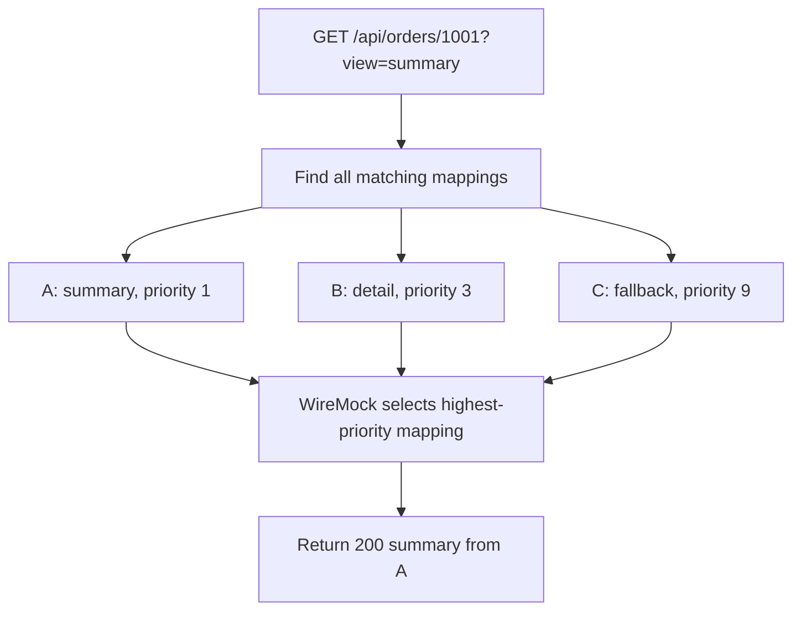
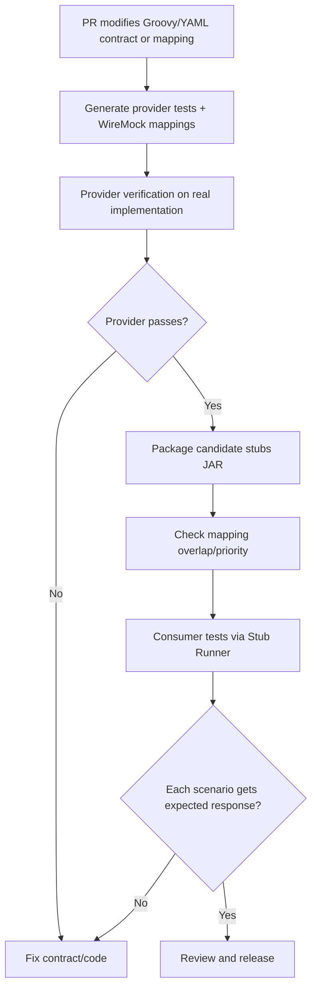

# Controlling Priority When Multiple WireMock Mappings Match

When testing consumers with **Spring Cloud Contract (SCC)**, the producer writes contracts in **Groovy/YAML DSL**, generates provider verification tests, and publishes a **stubs JAR**. On the consumer side, **Stub Runner** can start **WireMock** to return HTTP responses based on mappings generated from those contracts. This lets the consumer test the API without starting the real producer.

A practical issue arises when **multiple WireMock stub mappings match the same request**. For instance, `GET /api/orders/1001?view=summary` might match a general order mapping, a summary-specific mapping, and a fallback mapping for any ID. Without explicit control, the consumer can receive a **response from the wrong scenario**, even though each individual mapping looks valid.

This lesson belongs to the **WireMock** chapter on **Controlling priority when multiple mappings match**, covering mapping selection rules, declaring `priority` in JSON and Java DSL, detecting overlaps when using Spring Cloud Contract/Stub Runner, and verification strategies in CI. The running example uses `order-producer` and `checkout-consumer`.

## 1. Opening scenario: one request, three mappings

Suppose the consumer sends:

```http
GET /api/orders/1001?view=summary HTTP/1.1
Accept: application/json
```

Three stubs are loaded into the same WireMock server:

| Mapping | Match conditions | Declared response |
| --- | --- | --- |
| **A — Summary** | `GET`, path `/api/orders/1001`, query `view=summary` | 200, summary JSON |
| **B — Order detail** | `GET`, path `/api/orders/1001` | 200, full JSON |
| **C — Not-found fallback** | `GET`, path matches `/api/orders/[0-9]+` | 404, `ORDER_NOT_FOUND` JSON |

**A, B, and C can all match the same request.** Why: B specifies no condition on query `view`, so it still matches when that query is present; C matches any order path with a numeric ID, including `1001`. WireMock must decide which mapping serves the response.

If A is chosen, the consumer gets summary data as designed. If B is chosen, the consumer gets the full body. If C is chosen, the consumer unexpectedly receives 404. Thus, **"a mapping matches" and "a mapping is selected to return the response" are two distinct events**.



The direct solution is to **assign different priorities to overlapping mappings**, while keeping request conditions sufficiently specific.

## 2. WireMock's two steps: matching and mapping selection

When a request reaches WireMock, distinguish two steps:

1. **Request matching:** does the mapping match the request's method, URL, query, headers, cookies, body, or scenario state?
2. **Mapping selection:** if multiple mappings match, which mapping wins the right to serve the response?

A mapping with **more specific** conditions usually expresses the business case more accurately, yet **WireMock does not infer that the "most specific" mapping always wins**. When you want deterministic outcomes, you must declare **priority**.

Example:

```text
Request: GET /api/orders/1001?view=summary

A: method GET + urlPath /api/orders/1001 + view=summary  -> MATCH
B: method GET + urlPath /api/orders/1001                 -> MATCH
C: method GET + urlPathPattern /api/orders/[0-9]+         -> MATCH

Selection:
  A priority = 1
  B priority = 3
  C priority = 9

Result: A
```

**Remember:** Omitting a condition for a header or query parameter **does not mean requiring it to be absent**. Mapping B without a `view` condition will still match requests containing `view=summary`, unless another condition excludes it.

### 2.1. Query parameters and URL path are two separate parts

WireMock offers multiple URL matcher styles. Two common options:

- `urlEqualTo("/api/orders/1001?view=summary")`: matches the URL string as declared, which can make tests overly rigid about query parameter ordering.
- `urlPathEqualTo("/api/orders/1001")` combined with `withQueryParam("view", equalTo("summary"))`: separates path and query to express intent more clearly.

When testing queries, prefer **path matcher + query matcher** in the Java DSL, and inspect the JSON mappings generated by Spring Cloud Contract. Avoid relying on query parameter order in a URL string unless the API guarantees that ordering.

### 2.2. Matching does not equal business validation

A mapping constraining `id` with a regex does not prove the ID exists in a database. WireMock responds using the loaded stub, **without running the producer's real repository or controller**. Consumer tests are only testing the simulated interface.

## 3. Priority rule: smaller number means higher priority

In WireMock, `priority` is an **integer expressing the precedence of a stub mapping**:

| Priority | Relative meaning | Example |
| --- | --- | --- |
| `1` | Highest priority in examples | Special case, very narrow match |
| `2`–`4` | Higher than default | Mapping specific to query/header/body |
| `5` | **Default level** when a mapping omits priority | Many tool-generated stubs |
| `6`–`9` | Lower than default | General mapping |
| `10` | Low level in examples | Fallback/catch-all |

Core rule:

**`priority: 1` is chosen before `priority: 3`; `priority: 3` is chosen before `priority: 9`, assuming all match the request.**

Never interpret priority as "larger number wins," nor as a chronological sequence of requests. Priority **picks a mapping for a single request**; it does not turn multiple responses into an automatic sequence.

If a mapping omits `priority`, WireMock's default is **5**. This matters greatly when **Spring Cloud Contract auto-generated mappings** and **hand-written mappings** are loaded together.

### 3.1. When mappings share the same priority

If multiple mappings match with the same priority, **never rely on file order, filenames, or load order** to guarantee the expected response. WireMock has tie-breaking behavior among equal-priority mappings (in some situations registration order affects selection), yet relying on that makes tests fragile across build/plugin/suite changes.

Fragile example:

```text
A: GET /api/orders/1001?view=summary -> 200 summary, priority 5
B: GET /api/orders/1001              -> 200 detail,  priority 5
C: GET /api/orders/[0-9]+            -> 404,         priority 5
```

**Reliable fix:** assign distinct priorities per policy, or **make match conditions mutually exclusive** so each request belongs to only one scenario. The second option can be better if a request should not have multiple valid interpretations.

### 3.2. Priority cannot fix a broken mapping

If the summary mapping has `priority: 1` yet has a typo in the path `/api/order/1001` (missing `s`), it **does not match** `/api/orders/1001`. WireMock can then select B or C. Priority only takes effect **after a mapping matches**.

Never raise priority while skipping verification of the mapping's method, path, query, headers, cookies, and body.

## 4. Complete JSON mapping example: summary → detail → fallback

WireMock can load JSON mappings; the example below is for a server simulating an orders API. Files in code blocks are shown **standalone for readability**, not as external files to create outside this Markdown lesson.

### 4.1. Mapping A: summary case with priority 1

```json
{
  "name": "get-order-summary",
  "priority": 1,
  "request": {
    "method": "GET",
    "urlPath": "/api/orders/1001",
    "queryParameters": {
      "view": { "equalTo": "summary" }
    }
  },
  "response": {
    "status": 200,
    "headers": {
      "Content-Type": "application/json"
    },
    "jsonBody": {
      "id": 1001,
      "status": "CREATED",
      "view": "summary"
    }
  }
}
```

The `urlPath` condition checks only the path, while `queryParameters.view` checks the query separately. Mapping A **does not require other queries to be absent**; if the contract forbids extra queries, add application tests or configure appropriate matchers.

### 4.2. Mapping B: detail payload, priority 3

```json
{
  "name": "get-order-detail",
  "priority": 3,
  "request": {
    "method": "GET",
    "urlPath": "/api/orders/1001"
  },
  "response": {
    "status": 200,
    "headers": {
      "Content-Type": "application/json"
    },
    "jsonBody": {
      "id": 1001,
      "status": "CREATED",
      "currency": "VND",
      "totalMinor": 125000,
      "view": "detail"
    }
  }
}
```

B places no condition on `view`. Consequently:

- Request without `view` query → B can match.
- Request with `view=summary` → B can also match, yet **A takes priority**.
- Request with `view=unknown` → B can still match and return detail. If the API must reject this value, add a contract/test for invalid query values.

### 4.3. Mapping C: 404 fallback, priority 9

```json
{
  "name": "get-order-not-found",
  "priority": 9,
  "request": {
    "method": "GET",
    "urlPathPattern": "/api/orders/[0-9]+"
  },
  "response": {
    "status": 404,
    "headers": {
      "Content-Type": "application/json"
    },
    "jsonBody": {
      "code": "ORDER_NOT_FOUND",
      "message": "Order does not exist"
    }
  }
}
```

C matches GET requests on numeric-ID order paths at a lower priority than A and B. It acts as a fallback for IDs **without specific stubs** in this example.

**Important warning:** such a fallback mapping returns 404 because **the stub set lacks a mapping**, which is not necessarily the real producer's behavior for all those IDs. Left unchecked, a fallback can **mask missing contracts** with a "valid" response that never came from the producer. Use it only when a general 404 is genuinely an agreed scenario, and add tests specifying which requests must hit specific mappings.

### 4.4. Result table for the three-mapping set

| Request | Matching mappings | Selected mapping | Response |
| --- | --- | --- | --- |
| `GET /api/orders/1001?view=summary` | A, B, C | A, priority 1 | 200 summary |
| `GET /api/orders/1001` | B, C | B, priority 3 | 200 detail |
| `GET /api/orders/2002` | C | C, priority 9 | 404 |
| `POST /api/orders/1001` | None | No matching stub | WireMock unmatched response |
| `GET /api/orders/abc` | None | No matching stub | WireMock unmatched response |

The last two rows differ from the **404 fallback mapping**: when no mapping matches, WireMock also typically returns a default 404, yet its body and the request journal show it is an **unmatched request**, not a selected 404 contract.

## 5. Same idea in WireMock's Java DSL

To control priority in a pure WireMock test, register mappings with the Java DSL:

```java
import static com.github.tomakehurst.wiremock.client.WireMock.*;

wireMockServer.stubFor(
    get(urlPathEqualTo("/api/orders/1001"))
        .withQueryParam("view", equalTo("summary"))
        .atPriority(1)
        .willReturn(okJson(
            "{\"id\":1001,\"status\":\"CREATED\",\"view\":\"summary\"}"
        ))
);

wireMockServer.stubFor(
    get(urlPathEqualTo("/api/orders/1001"))
        .atPriority(3)
        .willReturn(okJson(
            "{\"id\":1001,\"status\":\"CREATED\",\"view\":\"detail\"}"
        ))
);

wireMockServer.stubFor(
    get(urlPathMatching("/api/orders/[0-9]+"))
        .atPriority(9)
        .willReturn(
            aResponse()
                .withStatus(404)
                .withHeader("Content-Type", "application/json")
                .withBody("{\"code\":\"ORDER_NOT_FOUND\"}")
        )
);
```

Assumptions in the snippet:

- `wireMockServer` is an already-started `WireMockServer` instance.
- `get`, `urlPathEqualTo`, `withQueryParam`, `equalTo`, `atPriority`, and `willReturn` are WireMock Java DSL builders.
- `okJson(...)` builds a success JSON response.
- `urlPathMatching` applies a regex to the **path**, not the request body.
- All mappings are registered on the **same server**, so they compete when requests arrive.

### 5.1. JSON and Java DSL control the same concepts

| JSON mapping | Java DSL | Meaning |
| --- | --- | --- |
| `"priority": 1` | `.atPriority(1)` | Set priority |
| `"method": "GET"` | `get(...)` | Match HTTP method |
| `"urlPath": "/api/orders/1001"` | `urlPathEqualTo(...)` | Match exact path |
| `"urlPathPattern": "...regex..."` | `urlPathMatching(...)` | Match path regex |
| `"queryParameters": { ... }` | `.withQueryParam(...)` | Match query |
| `"response": {"status": 404}` | `aResponse().withStatus(404)` | Return status |

Use JSON when packaging mappings into artifacts; use the Java DSL when configuring WireMock programmatically in a test. **Do not assume JSON and Java registrations must run simultaneously**: creating two identical sets of mappings without separating environments can reintroduce conflicts.

## 6. Priority does not replace tight matcher design

Priority numbers arbitrate between matched mappings, yet you still must **write match conditions that reflect intent**.

### 6.1. Overly broad path

Dangerous example:

```json
{
  "name": "catch-all-api",
  "priority": 1,
  "request": {
    "method": "ANY",
    "urlPattern": ".*"
  },
  "response": {
    "status": 200,
    "body": "OK"
  }
}
```

Conceptually, this mapping matches almost any request and holds the **highest priority**. It can shadow every other specific mapping. This is an **anti-pattern**, not how production-like contract tests should be configured.

If you genuinely need a catch-all for diagnostics, give it a lower priority (e.g., 10), make the response clearly identifiable as a fallback, and inspect the request journal to find which requests lacked specialized mappings.

### 6.2. Specific path matcher without constraining the body

For `POST /api/orders`, these two requests can have different meanings:

```json
{"externalRef":"EXT-100001","quantity":2}
```

```json
{"externalRef":"EXT-100001","quantity":0}
```

If the 201 mapping matches only `POST` and `/api/orders`, both requests can receive 201 success. Setting `priority: 1` on that mapping **does not prevent invalid request bodies from matching**.

Add appropriate request body matchers or separate validation error contracts. Priority only controls **mapping selection**, not automatic business validation.

### 6.3. Undeclared headers are usually not absence conditions

If the detail mapping does not declare `Authorization`, it does not mean the mapping matches only when the header is missing. Likewise, omitting a `view` query matcher does not require the query to be absent.

To test APIs safely, write explicit scenarios and matchers; never rely on "the right priority" to imply conditions the mapping never declared.

## 7. Query overlap: specific vs. general cases

Suppose an order-search API supports:

```text
GET /api/orders?status=CREATED
GET /api/orders?status=CREATED&limit=10
GET /api/orders?status=PAID
```

A general mapping `GET /api/orders` will match all three if it constrains only the path. A specialized mapping for `status=CREATED` and `limit=10` may need higher priority.

Example:

| Mapping | Conditions | Priority |
| --- | --- | --- |
| CREATED list limited to 10 | `status=CREATED`, `limit=10` | 1 |
| Default CREATED list | `status=CREATED` | 3 |
| General list | `GET /api/orders` only | 8 |

`GET /api/orders?status=CREATED&limit=10` matches all three, yet the first mapping wins. `status=PAID` matches only the general mapping.

**Key review question:** should `status=UNKNOWN` receive the general list or return 400? If it must return 400, add conditions or a dedicated error scenario. Priority does not detect invalid query values on its own.

### 7.1. Avoid cramming every query into one big URL regex

A regex like `/api/orders.*` can accidentally match `/api/orders/1001` or other paths. To match only the orders list, match the **exact path `/api/orders`** and declare queries separately.

### 7.2. Default responses can produce false-green tests

If a general mapping returns `200 []` for any query, a consumer accidentally sending the wrong `status` might receive an empty list and pass without failing. In contract testing, **failing to match and surfacing a clear error** is sometimes more valuable than a "friendly" fallback.

## 8. Header overlap: Accept, version, and tenant

An API can pick responses based on `Accept` or `X-Api-Version` headers.

Example:

```text
GET /api/orders/1001
Accept: application/json
X-Api-Version: v1
```

Mappings might look like:

| Mapping | Header matcher | Priority |
| --- | --- | --- |
| For API v2 | `X-Api-Version: v2` | 1 |
| For API v1 | `X-Api-Version: v1` | 2 |
| Default | No version constraint | 8 |

When v1/v2 mappings are fully specified, a request with `X-Api-Version: v1` selects the v1 mapping. If a "default" mapping has priority 1, it can shadow all versioned mappings.

**Never treat forgeable headers as proof of authorization.** A WireMock mapping checking an `X-Tenant-Id` string only helps the consumer test sending that header; it does not verify the real producer's Spring Security, JWT, or tenant authorization. Those require producer tests running security filters/authorization logic or integration tests at the right layer.

### 8.1. Exact vs. pattern header matchers

- Exact matchers make sense for fixed versions like `v1`.
- Regex helps for dynamic `X-Correlation-Id` values when the API specifies a format rule.
- The `Accept` media type can contain multiple values/quality parameters; if the consumer relies on content negotiation, pick matchers reflecting the agreement rather than accepting any string containing `json`.

If a header is mandatory in the API, consumer tests should assert that requests missing/having a wrong header are rejected. Another mapping's priority can hide this if an overly broad stub remains active.

## 9. JSON body overlap: validation errors vs. success

For `POST /api/orders`, the success mapping might match any request body containing `externalRef`, while an error mapping targets `quantity=0`.

Intent:

```text
POST /api/orders
Body {"externalRef":"EXT-100001","quantity":0}

Mapping INVALID_QUANTITY:
  body quantity == 0
  priority 1
  response 400

Mapping CREATE_ORDER:
  body has externalRef and quantity
  priority 5
  response 201
```

For that request, both mappings can match; the error mapping must win if validation failure is the promised behavior.

Example error JSON mapping using `equalToJson`:

```json
{
  "name": "post-order-invalid-quantity",
  "priority": 1,
  "request": {
    "method": "POST",
    "urlPath": "/api/orders",
    "headers": {
      "Content-Type": {
        "contains": "application/json"
      }
    },
    "bodyPatterns": [
      {
        "equalToJson": "{\"quantity\":0}",
        "ignoreExtraElements": true
      }
    ]
  },
  "response": {
    "status": 400,
    "headers": {
      "Content-Type": "application/json"
    },
    "jsonBody": {
      "code": "INVALID_QUANTITY"
    }
  }
}
```

This mapping illustrates **request body matching**: `ignoreExtraElements: true` lets the JSON contain fields beyond `quantity`, so a payload with `externalRef` still matches. If the producer requires other fields or quantity bounds, write corresponding tests/contracts. A single JSON mapping **does not replace application validation**.

**Note on contract source:** creating mappings by hand only on the consumer side without a matching producer contract splits you from the shared source of truth. For public API errors, describe them in Groovy/YAML contracts and verify the real status/body with producer tests; priority/overlays only control stub selection.

## 10. Fallbacks: handy for debugging, easy to mask integration bugs

A general mapping can help when many endpoints share one stub set, yet weigh the trade-offs:

| Fallback type | Benefit | Risk |
| --- | --- | --- |
| 404 for IDs outside fixtures | Easy to simulate "not found" scenarios | Hides missing mappings for valid IDs |
| 503 for unready APIs | Simulates dependency outages | Hides wrong methods/paths that lack contracts |
| 200 with empty body | Stops some tests from throwing exceptions | **Most likely to cause false positives** |
| Diagnostic response with marker | Makes it obvious you hit a fallback | Still must ensure tests do not accept it by mistake |

When no mapping matches, WireMock usually returns a default HTTP 404. A custom fallback can also return 404. To tell them apart:

- Read the **request journal** and the selected mapping.
- Add a diagnostic header on fallbacks in the test suite, e.g., `X-Stub-Source: fallback`, if it does not affect consumer contracts.
- Ensure key tests assert specific bodies/metadata, not just `status=404`.
- Never let fallbacks mask path, method, header, or body errors the consumer needs to catch.

### 10.1. Markers are not public interfaces

An `X-Stub-Source` header can be useful in a test stub suite, yet **does not necessarily belong to the producer's API**. When used purely for debugging, keep it out of public contracts and never let consumer runtime code depend on that marker.

## 11. Direct connection to Groovy/YAML Contract DSL

WireMock priority belongs to the **stub mapping execution layer**. Meanwhile, Spring Cloud Contract's Groovy/YAML DSL primarily describes the **producer's communication behavior**.

A Groovy contract for summary:

```groovy
import org.springframework.cloud.contract.spec.Contract

Contract.make {
    description 'GET order in summary view'

    request {
        method GET()
        urlPath('/api/orders/1001') {
            queryParameters {
                parameter 'view': 'summary'
            }
        }
    }

    response {
        status OK()
        headers {
            contentType(applicationJson())
        }
        body(
            id: 1001,
            status: 'CREATED',
            view: 'summary'
        )
    }
}
```

An equivalent YAML contract:

```yaml
description: "GET order in summary view"
request:
  method: GET
  urlPath: /api/orders/1001
  queryParameters:
    view: summary
response:
  status: 200
  headers:
    Content-Type: application/json
  body:
    id: 1001
    status: CREATED
    view: summary
```

DSL syntax should be verified against the **Spring Cloud Contract version in use**, especially for URL/query mapping generation. During builds, open the generated WireMock JSON mapping to verify it constrains `view=summary` properly.

### 11.1. Do not assume Contract DSL shares WireMock's `priority` field

Never add `priority: 1` into a YAML contract just because WireMock JSON mappings have that field and assume Verifier will generate a priority-1 mapping. **Spring Cloud Contract schema and WireMock schema are two different things**. Specific versions/options may support customization mechanisms, which must be verified in generated output.

A safe workflow:

1. Write contracts so scenarios **overlap as little as possible**, using meaningful method/path/query/header/body constraints.
2. Generate WireMock mappings from contracts with the project's plugin version.
3. Inspect the generated mappings, especially `request` and `priority`.
4. If explicit priority is truly needed, use **mapping customization or WireMock server options supported by your build version**.
5. Add a test verifying mapping selection order in CI.
6. Ensure the final published stub artifact contains those exact verified mappings.

**Never hand-edit a file in the generated output folder hoping it survives `mvn clean`.** Every customization must have a versioned/reproducible source via the project's build mechanism.

### 11.2. Prefer distinct request inputs in contracts when possible

If two scenarios need different responses, try giving them **distinct request conditions**. For example:

| Contract | Request | Response |
| --- | --- | --- |
| Read summary | `GET /api/orders/1001?view=summary` | 200 summary |
| Read detail | `GET /api/orders/1001?view=detail` | 200 detail |
| Non-existent ID | `GET /api/orders/9999` | 404 error |

Here detail also requires `view=detail`, making query conditions clearer than omitting `view`. However, if the public API still allows queryless GET for detail, keep the default scenario and test priority/overlap across all three real requests. **Never alter a public interface just to make stubs easier to disambiguate.**

## 12. Does Stub Runner resolve priority conflicts?

Stub Runner resolves and starts **stub mappings**. For HTTP, WireMock executes request matching/priority. Stub Runner **does not infer business semantics** to decide that a general mapping should have lower priority than a specialized one.

When a consumer test uses:

```java
import org.springframework.boot.test.context.SpringBootTest;
import org.springframework.cloud.contract.stubrunner.spring.AutoConfigureStubRunner;
import org.springframework.cloud.contract.stubrunner.spring.StubRunnerProperties;

@SpringBootTest
@AutoConfigureStubRunner(
    ids = "com.example:order-producer:1.0.0:stubs:8085",
    stubsMode = StubRunnerProperties.StubsMode.LOCAL
)
class OrderConsumerTest {
    // The consumer's client must point to port 8085.
}
```

WireMock serves the mappings loaded from the stubs artifact or additional configuration.

**If the stubs JAR contains two equally matching mappings with no distinguishing priority**, the consumer may receive an unexpected response. Stub Runner starting cleanly **does not prove mappings do not overlap**.

### 12.1. When is direct mapping customization needed?

It may be needed when:

- Contracts express the request/response, yet the generator produces overlapping conditions.
- You need a low-priority fallback alongside high-priority specialized mappings.
- Consumer integration tests add a temporary WireMock scenario outside public contracts.
- A project needs an explicit mapping override to test an error branch or compatibility case.

Options include **source-managed JSON mappings packaged cleanly into the stubs artifact**, or registering dedicated mappings in the server/test via framework-supported WireMock APIs. Packaging/overriding must match your Spring Cloud Contract/Stub Runner and build plugin versions; no single file path is guaranteed across every setup.

Do not let test overlays hide missing producer contracts. For public API behavior, put the requirement into the **producer's contract source** and verify the real producer.

### 12.2. Do not casually share one server for mappings from multiple producers

If the same WireMock server loads mappings from both `order-producer` and `inventory-producer`, both having `GET /api/items/1001`, collisions can happen even when each artifact is individually valid. A better approach is usually **a separate stub server/port and base URL per producer**, with pinned artifact versions.

## 13. Priority and WireMock scenarios are two different concepts

Some consumer tests need multi-step sequences:

```text
Attempt 1: GET /api/orders/1001 -> 503
Attempt 2: GET /api/orders/1001 -> 200
```

**Merely setting priority 1 on 503 and priority 2 on 200 will not create this sequence.** When requests are identical, the high-priority 503 mapping keeps winning every time. To serve responses by state, use **WireMock scenarios** or a stateful test double.

Java DSL example:

```java
import static com.github.tomakehurst.wiremock.client.WireMock.*;
import com.github.tomakehurst.wiremock.stubbing.Scenario;

wireMockServer.stubFor(
    get(urlEqualTo("/api/orders/1001"))
        .inScenario("recovering-order-api")
        .whenScenarioStateIs(Scenario.STARTED)
        .atPriority(1)
        .willReturn(
            aResponse()
                .withStatus(503)
                .withHeader("Retry-After", "1"))
        .willSetStateTo("AVAILABLE")
);

wireMockServer.stubFor(
    get(urlEqualTo("/api/orders/1001"))
        .inScenario("recovering-order-api")
        .whenScenarioStateIs("AVAILABLE")
        .atPriority(1)
        .willReturn(okJson(
            "{\"id\":1001,\"status\":\"CREATED\"}"
        ))
);
```

Both mappings can share the same priority because **scenario states are mutually exclusive**: in `STARTED` only the first mapping is active; in `AVAILABLE` only the second is active.

However, if another general `GET /api/orders/1001` mapping also matches simultaneously, **priority still arbitrates among mappings eligible at that moment**. Therefore:

- Scenarios handle **sequencing across multiple calls**.
- Priority handles **conflicts among matching mappings at one moment**.
- Reset scenario state between tests to avoid order-dependent test suites.
- Use dedicated retry tests to verify consumer attempt counts, backoff, timeouts, and stop conditions; scenarios only supply ordered responses.

## 14. Observing the selected mapping via the WireMock Admin API

When stub output surprises you, do not guess which mapping WireMock used. Inspect the test server directly.

For example, with WireMock running on port 8085:

```bash
curl -s http://localhost:8085/__admin/mappings
```

This endpoint lists registered mappings, including ID, name, request conditions, and priority. To inspect received requests:

```bash
curl -s http://localhost:8085/__admin/requests
```

To list requests that **matched no mapping**:

```bash
curl -s http://localhost:8085/__admin/requests/unmatched
```

These endpoints belong to the **WireMock Admin API**; how they are enabled/restricted can vary by WireMock mode, version, and Stub Runner config. Use them only in suitable test environments; never expose an uncontrolled public Admin API.

### 14.1. What to inspect when debugging

| Evidence | Meaning |
| --- | --- |
| `request.method` | Does it match the right GET/POST verb |
| `urlPath` / `urlPathPattern` | Exact path or overly broad regex |
| `queryParameters` | Missing or extra query conditions |
| `headers` | Are headers constrained as required by the contract |
| `bodyPatterns` | Does JSONPath/equalToJson match the actual body |
| `priority` | Does the selected mapping have the expected precedence |
| Mapping ID/name | Used to trace back to source file/contract |
| Request journal | Shows which requests reached the stub and which mapping served them |
| Unmatched requests | Distinguishes no-match from a 404 fallback |
| Scenario state | Whether current state makes a mapping ineligible |

If WireMock returns 404, **do not immediately conclude the producer returned 404**. Distinguish: 404 from a contract error mapping; 404 from a fallback; or default 404 because the request was completely unmatched.

### 14.2. Near misses: requests that almost match

WireMock can diagnose requests that nearly match a stub, helping pinpoint minor differences such as a missing header, different query, typo in path, or body mismatch. Use request journal/near-miss diagnostics per the WireMock API/library matching your project version. Never just raise priority to "fix" a request that actually **fails to match**.

## 15. Writing a test that truly proves priority

The code below illustrates JUnit 5 with an independent WireMock server using Java's standard HTTP client to send requests. This is a **test of mapping selection behavior**, not an SCC generated provider test.

```java
import static com.github.tomakehurst.wiremock.client.WireMock.*;
import static org.junit.jupiter.api.Assertions.assertEquals;

import com.github.tomakehurst.wiremock.WireMockServer;
import java.net.URI;
import java.net.http.HttpClient;
import java.net.http.HttpRequest;
import java.net.http.HttpResponse;
import org.junit.jupiter.api.AfterEach;
import org.junit.jupiter.api.BeforeEach;
import org.junit.jupiter.api.Test;

class WireMockPriorityTest {

    private WireMockServer server;
    private final HttpClient httpClient = HttpClient.newHttpClient();

    @BeforeEach
    void setUp() {
        server = new WireMockServer(0); // dynamic port
        server.start();

        server.stubFor(get(urlPathEqualTo("/api/orders/1001"))
            .withQueryParam("view", equalTo("summary"))
            .atPriority(1)
            .willReturn(okJson(
                "{\"view\":\"summary\",\"id\":1001}")));

        server.stubFor(get(urlPathEqualTo("/api/orders/1001"))
            .atPriority(3)
            .willReturn(okJson(
                "{\"view\":\"detail\",\"id\":1001}")));

        server.stubFor(get(urlPathMatching("/api/orders/[0-9]+"))
            .atPriority(9)
            .willReturn(aResponse()
                .withStatus(404)
                .withBody("ORDER_NOT_FOUND")));
    }

    @AfterEach
    void tearDown() {
        if (server != null) {
            server.stop();
        }
    }

    private HttpResponse<String> get(String path) throws Exception {
        HttpRequest request = HttpRequest.newBuilder()
            .uri(URI.create("http://localhost:"
                + server.port() + path))
            .GET()
            .build();

        return httpClient.send(
            request, HttpResponse.BodyHandlers.ofString());
    }

    @Test
    void summaryWinsOverDetailAndFallback() throws Exception {
        var response = get("/api/orders/1001?view=summary");
        assertEquals(200, response.statusCode());
        assertEquals(
            true, response.body().contains("\"view\":\"summary\""));
    }

    @Test
    void detailWinsOverFallback() throws Exception {
        var response = get("/api/orders/1001");
        assertEquals(200, response.statusCode());
        assertEquals(
            true, response.body().contains("\"view\":\"detail\""));
    }

    @Test
    void unmatchedIdUsesFallback() throws Exception {
        var response = get("/api/orders/2002");
        assertEquals(404, response.statusCode());
        assertEquals("ORDER_NOT_FOUND", response.body());
    }
}
```

In the example above:

- `new WireMockServer(0)` illustrates using a dynamic port; another option is configuring `options().dynamicPort()` in the corresponding WireMock version.
- Both mappings for `/api/orders/1001` intentionally overlap.
- The test inspects the response body to tell **which mapping won**, rather than asserting only HTTP 200.
- The 404 fallback is tested separately.

In a real project, you can use `assertTrue(...)` instead of `assertEquals(true, ...)` for cleaner expression. What matters is that tests assert **which branch was selected**.

### 15.1. Do not stop at a single summary test

A minimum test suite should include:

| Input | Required assertion |
| --- | --- |
| Summary | 200, `view=summary` field |
| No query | 200, `view=detail` field |
| ID with no specific mapping | 404 fallback (if that is a real contract) |
| Wrong HTTP method | Does not accidentally receive 200 success |
| Wrong required header | Does not accidentally hit a success mapping |
| Unsupported query | Rejected or handled per public policy |
| Invalid request body | Does not fall into a general 201 mapping |
| New mapping added | Existing priority tests keep passing unchanged |

If you only assert `statusCode=200`, two different success mappings can be swapped by mistake without the test noticing.

## 16. Establishing a reviewable priority policy

In a large codebase, standardize priority rules by **scenario specificity** rather than letting everyone pick numbers by feel.

Example internal convention **for illustration only**:

| Priority | Mapping group | Intent |
| --- | --- | --- |
| 1 | Special multi-condition scenarios | Clearly distinct response by query/header/body |
| 3 | Specific resource scenarios | GET for a specific ID |
| 5 | Standard non-conflicting scenarios | Leave at default when no override is needed |
| 8 | Permitted general mappings | Serves a broad set of requests |
| 9–10 | Controlled fallbacks | Only when business/test needs require it |

Not every organization needs this exact scale. Especially, **higher priority does not mean more important business logic**; it only means **when multiple mappings match, that mapping is chosen**.

### 16.1. The best optimization is usually reducing overlap

If you can design A and B so each request matches only one mapping, you reduce dependence on priority. For instance, two scenarios with distinct headers/versions or queries may not need different priorities.

However, if the real API defines **default behavior** when a query is absent while also supporting a special query, overlap between general and specific mappings is natural. Then priority is the right tool, provided tests cover both cases.

### 16.2. Never let priority become a band-aid hiding contract bugs

Any fix that merely flips `priority: 1` to make a test pass needs review:

- Does the high-priority mapping genuinely describe a valid public scenario?
- Are request conditions specific enough?
- Does the general mapping return wrong responses for invalid inputs?
- Do generated provider tests prove the real producer satisfies the same scenario?
- Does the final stubs JAR contain the updated mapping?
- Do consumer tests verify the specific response rather than a generic status code?

## 17. Common mistakes

| Mistake | Consequence | Fix |
| --- | --- | --- |
| Thinking `priority: 10` beats `1` | Fallback can win unexpectedly | Remember **smaller numbers have higher priority** |
| Omitting priority on overlapping mappings | Outcome depends on registration/selection details | Use distinct levels or mutually exclusive matchers |
| Catch-all mapping set to `priority: 1` | Shadows specialized mappings | Lower its priority and add negative tests |
| Assuming specific mappings always win | WireMock does not infer business intent | Declare priority explicitly |
| Using only `urlPattern: .*` | Matches too many paths | Use bounded `urlPath`/`urlPathPattern` |
| Omitting query and assuming it means absent | Detail mapping matches summary too | Add query matcher/priority |
| Not constraining request body | POST with invalid data still gets 201 | `equalToJson`, JSONPath, and error tests |
| Two identical mappings | Ambiguous response source | Remove duplicate or differentiate conditions |
| Asserting only status code | Misses 200 response from wrong scenario | Assert distinguishing fields |
| Ignoring generated mappings | Contract and WireMock output may differ | Inspect mappings after build |
| Editing generated files then running clean | Edits are lost | Keep changes in reproducible source/build |
| Using stale stubs JAR | New priority/contract is never tested | Pin candidate artifact |
| Confusing fallback 404 with unmatched 404 | Misdiagnoses failures | Check request journal and mapping IDs |
| Using priority to simulate retry sequences | 503 wins every time | Use WireMock scenarios |
| Order-dependent tests | Flaky in parallel CI | Reset server/scenarios and isolate tests |

A warning sign worth checking right away: consumer tests fail right after adding an "unrelated" new contract. The new contract may have generated a broader mapping that **shadows** an older mapping. Before loosening matchers or updating expected bodies, compare **all mappings matching the request**.

## 18. Integrating priority checks into Spring Cloud Contract CI

Recommended verification chain:



With Maven and the plugin configured:

```bash
mvn clean verify
```

This command **only means the contract gate ran** if generated provider tests were actually generated and executed. It **does not automatically ensure** you have overlap-detection tests or consumer tests via Stub Runner. Wire those test suites into the pipeline explicitly.

### 18.1. Intentional fault-injection test set

| Change in mapping/contract | Test that should fail |
| --- | --- |
| Change priority of A from 1 to 10 | Summary is no longer selected properly |
| Change priority of C from 9 to 1 | Known ID can hit 404 fallback |
| Remove query matcher on A | Non-summary request can receive summary |
| Change path of A to `/api/order/1001` | Summary test fails to match A |
| Add a priority-1 catch-all | Specific tests get shadowed |
| Remove body condition on POST 201 | Request with invalid quantity can receive success |
| Consumer uses wrong URL/port | Stub mapping receives no request or test fails |
| Consumer still resolves stale stubs JAR | CI artifact/version check reports mismatch |
| Provider implementation changes response while stubs stay unchanged | Generated provider test catches it |

What matters is having **tests that probe actual conflicts**, rather than testing each mapping in isolation.

### 18.2. Test the candidate artifact rather than local mappings

If you edit priority in a local test WireMock server while the published artifact still holds the old version, consumer CI can still fail. Therefore:

1. Generate mappings tied to a pinned build version.
2. Track sources for any custom overlays.
3. Package the artifact with the final mappings.
4. Run consumer tests against that exact candidate artifact.
5. Record the artifact's ID/version/source commit for traceability.

## 19. Self-verifiable practice exercise

Prepare a consumer test project using WireMock or Stub Runner and a Spring Cloud Contract producer publishing stubs. Follow step by step:

1. **Three mappings:** Create A (summary), B (detail), and C (fallback) as in section 4. Set priorities `1`, `3`, `9` respectively.
2. **Test summary:** Call `GET /api/orders/1001?view=summary`; assert body contains `view=summary`.
3. **Test detail:** Call `GET /api/orders/1001`; assert body contains `view=detail`.
4. **Test fallback:** Call `GET /api/orders/2002`; assert 404 and `ORDER_NOT_FOUND`.
5. **Equal priority:** Remove `priority` fields so all three default to 5; observe how requests can receive different responses and explain why relying on registration order is unsafe.
6. **Reversed priority:** Set fallback priority to 1 and rerun; verify summary/detail tests catch the wrong response.
7. **Unknown query:** Call `view=unknown`, decide whether the real API should return detail or 400 error; update conditions and tests accordingly.
8. **POST overlap:** Create a 400 mapping for `quantity=0` and a general 201 mapping. Verify 400 wins on invalid body.
9. **Admin API:** Use `/__admin/mappings` and `/__admin/requests` to identify which mapping served each request.
10. **Groovy/YAML SCC:** Write summary and detail contracts; generate mappings and compare them against hand-written mappings. Never assume Contract DSL has WireMock's exact priority schema.
11. **Stub Runner:** Package the candidate stubs JAR and run the consumer's real HTTP client via `@AutoConfigureStubRunner`; verify the right responses are chosen.
12. **Scenario:** Build a `503 → 200` sequence and explain why changing priority alone cannot create a retry sequence.
13. **CI:** Add tests for mapping overlap, artifact versions, and response markers. Intentionally add a high-priority catch-all to confirm the pipeline fails.

Self-assessment table:

| Competency | Evidence |
| --- | --- |
| Understand selection | Distinguishes request match vs. selected mapping |
| Know the rule | `priority=1` beats 3 and 9; default is 5 |
| Use WireMock JSON/Java DSL | Can write `priority` / `atPriority` |
| Analyze overlap | Finds mappings matching the same method/path/query/body |
| Use Stub Runner properly | Inspects mappings inside the candidate artifact |
| Avoid hiding bugs | Fallbacks are low-priority with separate assertions |
| Debug | Uses Admin API/request journal to distinguish fallback vs. unmatched |
| Scenarios | Distinguishes mapping selection from multi-attempt retry sequences |
| CI | Breaking priority changes fail tests meaningfully |

## 20. Conclusion: priority is a tool, contract clarity is the goal

When multiple WireMock mappings match one request, **priority selects the response in deterministic order**: **smaller numbers mean higher priority**, while mappings omitting priority typically default to **5**. A common strategy puts **very specific** mappings at 1–3, general mappings lower, and fallbacks at 9–10.

Still, priority never replaces precise matcher design or testing the real producer. With **Spring Cloud Contract**, use the **Groovy/YAML DSL** to capture public API behavior, verify the producer with generated tests, inspect **generated WireMock mappings**, ensure stub artifacts package well-sourced customizations, and run **consumer tests with Stub Runner** against candidate versions.

**Final principle:** instead of asking "how do I make WireMock always return one response," ask "which response must each valid request receive, which mappings overlap, and will CI catch it if selection order changes?" When you can answer those three questions with explicit contracts and tests, your stub suite genuinely catches incompatible API changes early.
