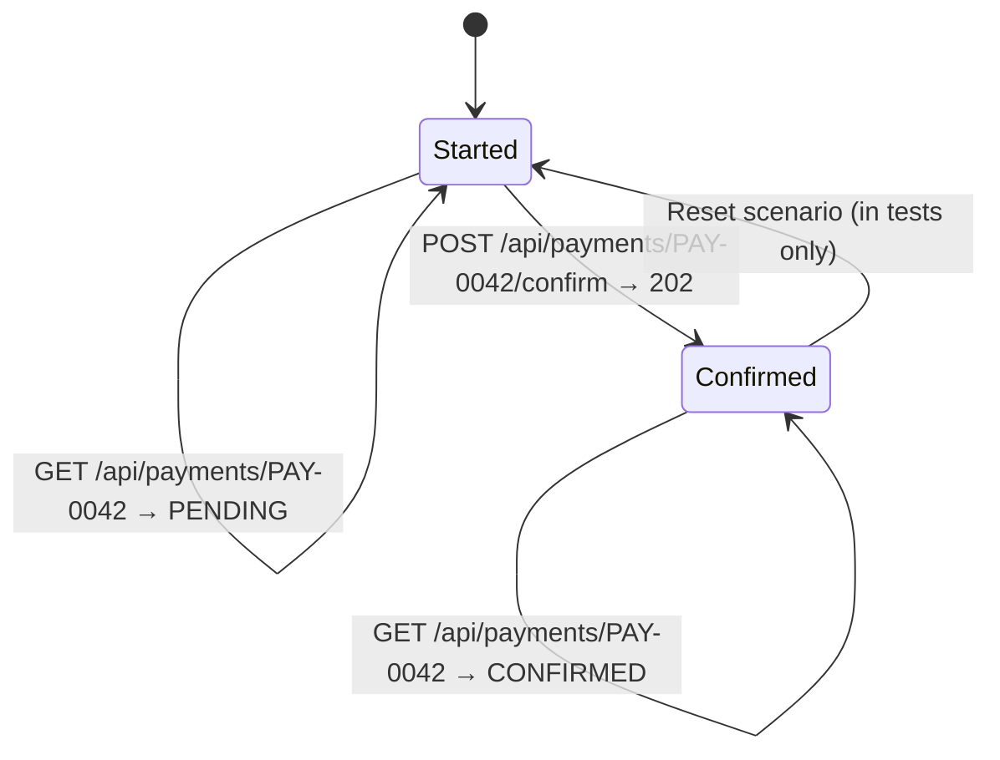
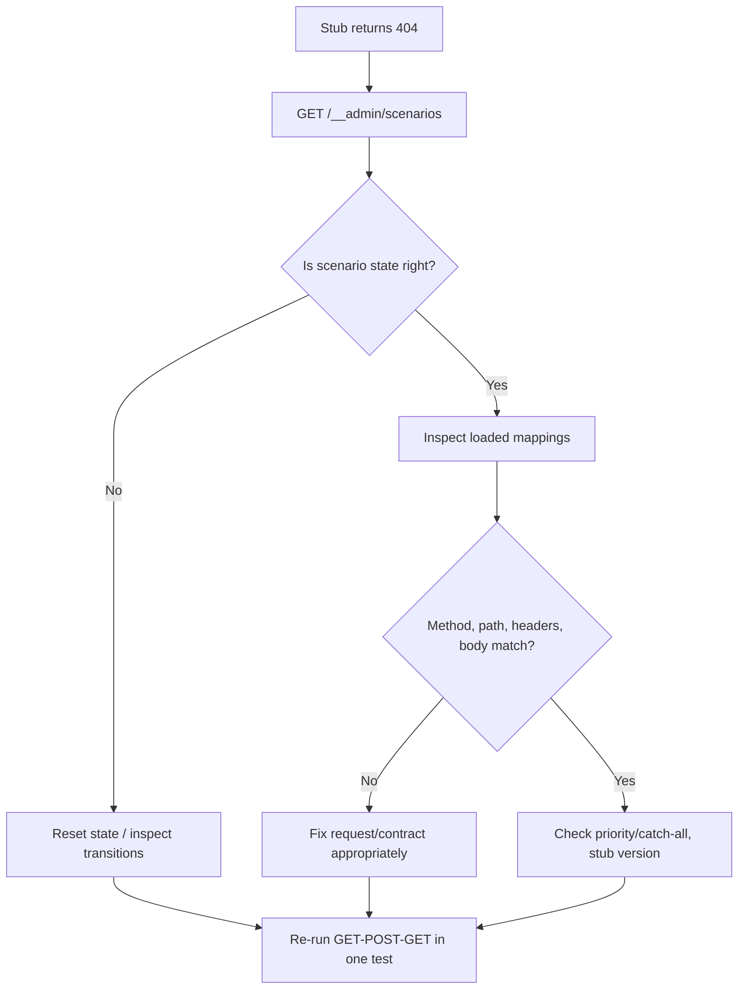
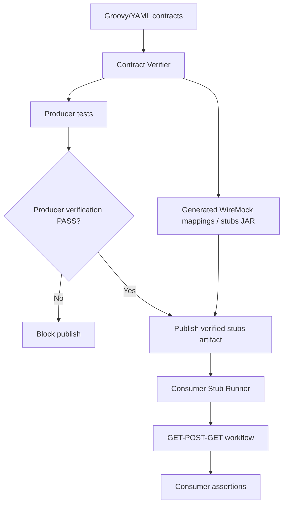
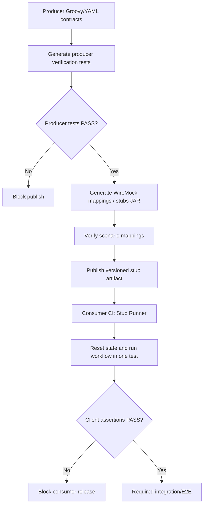

# Scenarios and State in Stubs

> **Chapter:** WireMock  
> **Module:** Spring Cloud Contract (`SPRING_CLOUD_CONTRACT`) — learning contract testing between producer and consumer, describing HTTP/message behavior in Groovy or YAML DSL, generating provider-side tests, publishing stubs, using Stub Runner, and integrating CI to catch incompatible API changes.

## Learning Objectives

After this lesson, you will be able to:

1. Explain **WireMock Scenario** as a state machine for HTTP stubs and distinguish stub state from the producer's real business state.
2. Correctly use `scenarioName`, `requiredScenarioState`, and `newScenarioState` to model responses changing across a request sequence.
3. Simulate a **PENDING → CONFIRMED** transaction flow using JSON mappings and the Java DSL.
4. Understand that `Scenario.STARTED` in Java corresponds to `"Started"` in JSON mappings; inspect, reset, and set state via the WireMock Admin API.
5. Organize **ordered** contracts in Spring Cloud Contract by naming files `1_...`, `2_...`, `3_...` inside the same scenario directory.
6. Understand why Spring Cloud Contract **recommends stateless producer contract tests**, and when simulating stateful workflows on the consumer side is still valuable.
7. Isolate state across test cases, avoid races under parallel execution, inspect mappings, and troubleshoot 404s when a stub is in the wrong state.
8. Integrate producer verification, stub publishing, and consumer Stub Runner tests into CI without turning scenarios into false proof of production system consistency.

## 1. Why does the same request need different responses?

A **stateless stub** typically returns the same response for the same request. However, some real user journeys involve sequential steps:

1. Consumer checks payment status: `PENDING`.
2. Consumer sends a confirmation command.
3. Consumer checks payment status again: `CONFIRMED`.

Notice: both step 1 and step 3 use the exact same HTTP request:

```http
GET /api/payments/PAY-0042 HTTP/1.1
Accept: application/json
```

Yet the two responses differ in `status`:

```json
{
  "paymentId": "PAY-0042",
  "status": "PENDING"
}
```

and:

```json
{
  "paymentId": "PAY-0042",
  "status": "CONFIRMED"
}
```

If you create **two stateless stub mappings** for the exact same method and path, WireMock must pick one mapping via matching rules and priority, without knowing when each response makes sense. The result usually fails to simulate the journey the consumer needs.

**WireMock Scenario** solves this by tracking a **current state** for a scenario and letting a mapping match only when its required state matches the held state. Once a mapping is served, it can transition to a new state.



The `Started` and `Confirmed` states in the diagram are **internal stub states**. They are not records in the producer's database, create no real transaction, and do not guarantee a production payment was confirmed.

## 2. Three concepts that make up a Scenario

WireMock describes a scenario using these attributes in a stub mapping:

| Attribute | Meaning | Example |
| --- | --- | --- |
| `scenarioName` | Name of the state machine shared by mappings in the same workflow | `payment-confirmation` |
| `requiredScenarioState` | Mapping is eligible only when the scenario is in this state | `Started` or `Confirmed` |
| `newScenarioState` | State recorded **after the mapping is served** | `Confirmed` |

When a new scenario begins, WireMock uses the **default state `Started`**. In the Java DSL, the corresponding constant is `Scenario.STARTED`.

**Watch spelling and casing:** `"Started"` (JSON) is the standard initial value; do not arbitrarily replace it with `"STARTED"` in mappings. Custom state names you choose such as `Confirmed`, `Step1`, or `PaymentCaptured` are strings and must stay consistent across all mappings.

### 2.1. Scenario states do not have to be business statuses

The example uses `Confirmed` for both business status and scenario state for clarity. You could just as easily name the scenario state `"AfterConfirmationRequest"`. WireMock understands no business semantics in names; it only compares **state strings**.

Therefore do not confuse:

- `response.jsonBody.status = "CONFIRMED"`: **HTTP data received by the consumer**.
- `newScenarioState = "Confirmed"`: **internal state used to select the next mapping**.

Changing the response body **does not automatically** change the scenario state unless the mapping declares `newScenarioState`. Conversely, a mapping can transition state even if its response has no `status` field.

### 2.2. When does a mapping not transition state?

A mapping with `scenarioName` and `requiredScenarioState` but **no** `newScenarioState` can be served repeatedly in the same state. This is how read operations are modeled:

```text
Started + GET payment status -> 200 PENDING -> stays Started
```

To transition state, the corresponding mapping must declare `newScenarioState` or the test must explicitly set state via the Admin API.

## 3. Simulating payment with three WireMock JSON mappings

We will create three mappings on a **test-dedicated WireMock server**. They share `scenarioName: payment-confirmation` because they are steps of one state machine.

Assumed directory layout when running standalone WireMock:

```text
wiremock/
├── mappings/
│   ├── payment-01-pending.json
│   ├── payment-02-confirm.json
│   └── payment-03-confirmed.json
└── __files/
```

This is the **WireMock mappings** layout, distinct from `src/test/resources/contracts` used for Spring Cloud Contract DSLs. Mappings can be created manually as shown here or generated from contracts (see section 10).

### 3.1. Mapping A — reading the initial state

File `mappings/payment-01-pending.json`:

```json
{
  "name": "payment-pending",
  "scenarioName": "payment-confirmation",
  "requiredScenarioState": "Started",
  "request": {
    "method": "GET",
    "url": "/api/payments/PAY-0042",
    "headers": {
      "Accept": {
        "contains": "application/json"
      }
    }
  },
  "response": {
    "status": 200,
    "headers": {
      "Content-Type": "application/json"
    },
    "jsonBody": {
      "paymentId": "PAY-0042",
      "status": "PENDING"
    }
  }
}
```

In state `Started`, a consumer calling GET receives `200` with `PENDING`. The mapping has **no** `newScenarioState`, so reading status does not advance the workflow.

### 3.2. Mapping B — confirming and transitioning state

File `mappings/payment-02-confirm.json`:

```json
{
  "name": "payment-confirm",
  "scenarioName": "payment-confirmation",
  "requiredScenarioState": "Started",
  "newScenarioState": "Confirmed",
  "request": {
    "method": "POST",
    "url": "/api/payments/PAY-0042/confirm"
  },
  "response": {
    "status": 202,
    "headers": {
      "Content-Type": "application/json"
    },
    "jsonBody": {
      "paymentId": "PAY-0042",
      "status": "PROCESSING"
    }
  }
}
```

When POST matches in state `Started`, WireMock returns `202` and transitions the scenario to `Confirmed`. Returning `PROCESSING` in the confirm response here is **a design choice of the sample API**, illustrating that the consumer may need to re-read to see the final status.

**Do not infer** that HTTP `202 Accepted` automatically transitions state: `newScenarioState` on the mapping does that, not an inherent meaning of the status code.

### 3.3. Mapping C — reading the state after confirmation

File `mappings/payment-03-confirmed.json`:

```json
{
  "name": "payment-confirmed",
  "scenarioName": "payment-confirmation",
  "requiredScenarioState": "Confirmed",
  "request": {
    "method": "GET",
    "url": "/api/payments/PAY-0042",
    "headers": {
      "Accept": {
        "contains": "application/json"
      }
    }
  },
  "response": {
    "status": 200,
    "headers": {
      "Content-Type": "application/json"
    },
    "jsonBody": {
      "paymentId": "PAY-0042",
      "status": "CONFIRMED"
    }
  }
}
```

Now the exact same GET request from section 3.1 returns `CONFIRMED` instead of `PENDING`, because the state transitioned. This mapping also has **no** `newScenarioState`, so subsequent GET calls continue returning `CONFIRMED`.

### 3.4. Summary of matching logic

| State before request | Request | Mapping | HTTP response | State after |
| --- | --- | --- | --- | --- |
| `Started` | GET `/api/payments/PAY-0042` | A | 200, `PENDING` | `Started` |
| `Started` | POST `/api/payments/PAY-0042/confirm` | B | 202, `PROCESSING` | `Confirmed` |
| `Confirmed` | GET `/api/payments/PAY-0042` | C | 200, `CONFIRMED` | `Confirmed` |
| `Confirmed` | POST `/api/payments/PAY-0042/confirm` | *No mapping in the trio* | Typically 404 unmatched | `Confirmed` |
| After reset | GET `/api/payments/PAY-0042` | A | 200, `PENDING` | `Started` |

The repeated POST row shows that the trio models **a single confirmation**. If the consumer needs to retry POST and the API guarantees idempotency, you must define that behavior explicitly. WireMock **does not automatically** know whether a second POST should return success, 409, or 404.

## 4. Exercising the workflow over HTTP

Start a standalone/test WireMock server with the `mappings` directory from section 3. Suppose it listens on `http://localhost:8089`. **This port is only an example**, not a mandatory default.

### 4.1. Reset and first read

```bash
curl -X POST http://localhost:8089/__admin/scenarios/reset

curl -i \
  -H "Accept: application/json" \
  http://localhost:8089/api/payments/PAY-0042
```

Expected: `200`, body `status: PENDING`.

### 4.2. Confirm the transaction

```bash
curl -i -X POST \
  http://localhost:8089/api/payments/PAY-0042/confirm
```

Expected: `202` with body `status: PROCESSING`.

### 4.3. Re-read the same URL

```bash
curl -i \
  -H "Accept: application/json" \
  http://localhost:8089/api/payments/PAY-0042
```

Expected: `200`, body `status: CONFIRMED`.

### 4.4. What happens if the order is wrong?

If a test **skips POST** and demands `CONFIRMED` immediately, mapping C fails the state condition and mapping A returns `PENDING`. The consumer test must **FAIL** because the workflow was not executed properly.

If POST is called after the scenario has already moved to `Confirmed`, this sample mapping set does not match that POST. WireMock may return `404` as an unmatched request. Do not confuse a **mock server 404 due to missing mapping** with a **real API rule returning 404** on duplicate confirmation.

## 5. Inspecting and resetting state via the Admin API

WireMock provides an Admin API to view and modify scenario state. On a **test-only** server:

### 5.1. View the state of all scenarios

```http
GET /__admin/scenarios HTTP/1.1
Host: localhost:8089
```

Sample response:

```json
{
  "scenarios": [
    {
      "id": "payment-confirmation",
      "name": "payment-confirmation",
      "state": "Confirmed",
      "possibleStates": ["Started", "Confirmed"]
    }
  ]
}
```

Command:

```bash
curl http://localhost:8089/__admin/scenarios
```

Values in the response represent **stub state**, not the payments table in the producer's database. When debugging tests, inspect `state` right after POST to check whether the transition happened.

### 5.2. Reset all scenarios to Started

```bash
curl -X POST http://localhost:8089/__admin/scenarios/reset
```

This command **resets only scenario states** while preserving mappings; it fits when re-running a workflow from the start without wiping loaded stubs.

### 5.3. Set the state of a specific scenario

```bash
curl -X PUT \
  -H "Content-Type: application/json" \
  --data '{"state":"Confirmed"}' \
  http://localhost:8089/__admin/scenarios/payment-confirmation/state
```

This is a **test setup/debug** operation. It is useful for testing the consumer handler when a payment is already `Confirmed`, yet if a test must prove the consumer **actually executed the confirm POST**, forcing state manually skips that critical step.

To reset **a single scenario** back to `Started`, WireMock also supports `PUT /__admin/scenarios/{scenarioName}/state` with an empty body, per your version's documentation. URL-encode scenario names containing spaces or special characters.

### 5.4. Resetting scenarios vs. resetting the entire server

| Command/API | Intent | Effect |
| --- | --- | --- |
| `POST /__admin/scenarios/reset` | Reset scenario states only | Mappings stay intact |
| `PUT /__admin/scenarios/{name}/state` | Set/reset one scenario | Does not wipe all mappings |
| `POST /__admin/reset` | Full WireMock server reset | Can wipe runtime mappings and request log |
| `POST /__admin/mappings/reset` | Reload default mappings from backing store | Not meant for just restarting a state machine |
| `GET /__admin/scenarios` | Observe | Does not change state |

**Do not call `/__admin/reset` while Stub Runner is serving mappings loaded from a stub JAR and assume mappings will stay intact.** When the goal is merely resetting state between tests, use the scenario-specific API.

**Safety:** the Admin API can modify or delete mock configuration. Call it only against test-owned WireMock instances; never expose it on untrusted networks or run reset commands in shared environments.

## 6. Writing scenarios with the Java DSL

WireMock provides Java DSL equivalents for the JSON fields:

| JSON mapping | Java DSL |
| --- | --- |
| `scenarioName` | `.inScenario("payment-confirmation")` |
| `requiredScenarioState` | `.whenScenarioStateIs(...)` |
| `newScenarioState` | `.willSetStateTo(...)` |
| `request` | `get(urlEqualTo(...))`, `post(...)` |
| `response` | `.willReturn(aResponse()...)` |
| `priority` | `.atPriority(1)` when resolving overlapping mappings |

An example starting WireMock via JUnit Jupiter and registering the three mappings:

```java
package com.example.checkout;

import com.github.tomakehurst.wiremock.junit5.WireMockExtension;
import com.github.tomakehurst.wiremock.stubbing.Scenario;
import org.junit.jupiter.api.BeforeEach;
import org.junit.jupiter.api.Test;
import org.junit.jupiter.api.extension.RegisterExtension;

import java.net.URI;
import java.net.http.HttpClient;
import java.net.http.HttpRequest;
import java.net.http.HttpResponse;

import static com.github.tomakehurst.wiremock.client.WireMock.*;
import static com.github.tomakehurst.wiremock.core.WireMockConfiguration.wireMockConfig;
import static org.junit.jupiter.api.Assertions.*;

class PaymentWorkflowTest {

    private static final String SCENARIO = "payment-confirmation";

    @RegisterExtension
    static WireMockExtension wm = WireMockExtension.newInstance()
        .options(wireMockConfig().dynamicPort())
        .build();

    @BeforeEach
    void registerMappings() {
        // By default, the JUnit extension resets mappings and the request log before each test.
        // Re-register here so each test has isolated state.
        wm.stubFor(get(urlEqualTo("/api/payments/PAY-0042"))
            .withHeader("Accept", containing("application/json"))
            .inScenario(SCENARIO)
            .whenScenarioStateIs(Scenario.STARTED)
            .willReturn(aResponse()
                .withStatus(200)
                .withHeader("Content-Type", "application/json")
                .withBody("""
                    {"paymentId":"PAY-0042","status":"PENDING"}
                    """)));

        wm.stubFor(post(urlEqualTo("/api/payments/PAY-0042/confirm"))
            .inScenario(SCENARIO)
            .whenScenarioStateIs(Scenario.STARTED)
            .willSetStateTo("Confirmed")
            .willReturn(aResponse()
                .withStatus(202)
                .withHeader("Content-Type", "application/json")
                .withBody("""
                    {"paymentId":"PAY-0042","status":"PROCESSING"}
                    """)));

        wm.stubFor(get(urlEqualTo("/api/payments/PAY-0042"))
            .withHeader("Accept", containing("application/json"))
            .inScenario(SCENARIO)
            .whenScenarioStateIs("Confirmed")
            .willReturn(aResponse()
                .withStatus(200)
                .withHeader("Content-Type", "application/json")
                .withBody("""
                    {"paymentId":"PAY-0042","status":"CONFIRMED"}
                    """)));
    }

    @Test
    void getPostGetTraVeTrangThaiTheoThuTu() throws Exception {
        HttpClient client = HttpClient.newHttpClient();
        URI getUri = URI.create(wm.getRuntimeInfo().getHttpBaseUrl()
            + "/api/payments/PAY-0042");
        URI confirmUri = URI.create(wm.getRuntimeInfo().getHttpBaseUrl()
            + "/api/payments/PAY-0042/confirm");

        HttpRequest get = HttpRequest.newBuilder(getUri)
            .header("Accept", "application/json").GET().build();
        HttpRequest confirm = HttpRequest.newBuilder(confirmUri)
            .POST(HttpRequest.BodyPublishers.noBody()).build();

        HttpResponse<String> before = client.send(
            get, HttpResponse.BodyHandlers.ofString());
        assertEquals(200, before.statusCode());
        assertTrue(before.body().contains("\"PENDING\""));

        HttpResponse<String> accepted = client.send(
            confirm, HttpResponse.BodyHandlers.ofString());
        assertEquals(202, accepted.statusCode());

        HttpResponse<String> after = client.send(
            get, HttpResponse.BodyHandlers.ofString());
        assertEquals(200, after.statusCode());
        assertTrue(after.body().contains("\"CONFIRMED\""));
    }
}
```

**Example limitations:** the test uses `String.contains` to illustrate the flow; in a real project parse JSON/DTOs and assert exact types, fields, and domain semantics. Imports/DSL here target modern WireMock Java and Java 17+; use compatible JUnit/WireMock versions. This snippet is an **isolated WireMock test**, not yet using Stub Runner.

### 6.1. Do not call the static WireMock DSL against the wrong server

When using `WireMockExtension` with multiple servers, register stubs via **`wm.stubFor(...)`** as shown. If using static `stubFor(...)`, configure the static DSL to point to the right server; a wrong port can send mappings to the wrong server or target a non-existent one.

### 6.2. Is state reset automatically between tests?

Per WireMock JUnit Jupiter documentation, the extension defaults to **resetting stubs and the request log before each test method**; hence the example re-registers mappings in `@BeforeEach`. If changed to `resetOnEachTest(false)` (on supported versions), state can leak across tests; actively reset or isolate it.

Never split workflow steps across **three separate `@Test` methods** and rely on JUnit ordering: independent tests can run in another order or in parallel. A single `@Test` should execute the **entire GET → POST → GET sequence** when verifying ordering.

## 7. Same URL, two responses: why state matters more than registration order

If you have two mappings:

```json
{
  "request": {"method": "GET", "url": "/api/payments/PAY-0042"},
  "response": {"status": 200, "jsonBody": {"status": "PENDING"}}
}
```

and:

```json
{
  "request": {"method": "GET", "url": "/api/payments/PAY-0042"},
  "response": {"status": 200, "jsonBody": {"status": "CONFIRMED"}}
}
```

they **both** match the same request. Without `requiredScenarioState`, WireMock has no idea which response applies before vs. after POST. Most-recent registration or priority picks a winner, rather than forming a workflow.

Scenario conditions fix this:

```text
GET + Started   → PENDING
POST + Started  → PROCESSING, transitions to Confirmed
GET + Confirmed → CONFIRMED
```

### 7.1. Priority does not replace scenarios

WireMock has an integer `priority`; **smaller numbers mean higher priority**. For example:

```json
{
  "priority": 1,
  "request": {
    "method": "GET",
    "url": "/api/payments/PAY-0042"
  },
  "response": {
    "status": 200,
    "jsonBody": {"status": "PENDING"}
  }
}
```

This mapping can win when multiple mappings match, yet it **does not automatically switch to CONFIRMED** after POST. Use priority to resolve intentional **overlap/catch-all** conflicts; use scenarios to model **state across interactions**.

An overly broad catch-all mapping can mask scenario failures when a request fails to match the expected state. In suites using scenarios, audit fallback mappings and priorities so out-of-order requests do not receive a seemingly valid dummy response.

## 8. Classic scenario-related 404 failures

When the consumer gets `404` from WireMock, do not immediately change the contract to 404. WireMock may return 404 because **no mapping matched**; common causes are:

1. State already moved to `Confirmed`, yet the client sends POST again when the POST mapping only accepts `Started`.
2. Client sends GET after POST, yet the `Confirmed` GET mapping was never loaded.
3. `requiredScenarioState` says `"STARTED"` while WireMock holds `"Started"`.
4. Two mappings have slightly different `scenarioName` values due to a typo.
5. Request JSON body, headers, URL/query, or HTTP method mismatches.
6. An earlier test left state in `Confirmed` without resetting.
7. A catch-all or higher-priority mapping interfered unexpectedly.

### 8.1. 404 investigation workflow



Use WireMock's test-only Admin API and inspect the **request journal/unmatched request details** when available. Compare actual requests against mappings generated by Spring Cloud Contract; do not compare solely against DSL source files, because stub mappings are what WireMock actually executes.

## 9. Resetting state so tests do not interfere with one another

Scenario state lives inside the **WireMock server instance**. When multiple tests or consumers call the same instance, mappings sharing a scenario name share state.

Leakage scenario:

```text
Test A: GET → PENDING
Test B: POST → state Confirmed
Test A: GET → CONFIRMED (even though A has not POSTed)
```

Design principles:

- **Before each workflow test:** reset the scenario to `Started`, if the test owns the stub server exclusively.
- **After a workflow test:** ensure no lingering async tasks can still fire requests.
- **Across parallel test cases:** prefer **separate WireMock server instances** or distinct scenario names with dedicated mappings.
- **When sharing a static/Stub Runner server:** avoid resetting while another test is mid-flight; run shared-scenario tests sequentially with resource locks or allocate separate servers.
- **With timeouts or retries:** finish the case only after related requests have been verified or cleanly stopped.

A full-server reset while multiple tests share a server can wipe another test's mid-workflow state. When only one scenario needs resetting, prefer targeting it **by name** rather than resetting everything.

### 9.1. State is per scenario name, not per user

A common mistake is assuming each `paymentId` or each consumer gets isolated state. In standard WireMock Scenarios, **state is tracked per scenario name on the server**.

If two consumers interact with `payment-confirmation` on one instance, one consumer can advance state for the other. WireMock does not automatically partition state machines by path parameter or `X-User-Id` header.

When simulating multiple independent sessions, consider:

- One WireMock instance per test.
- Generating separate mappings/`scenarioName` per test fixture.
- Using advanced stateful mocking utilities or an in-memory fake service with a state map if requirements are complex.
- Avoiding turning one scenario into a fake database for many payment IDs it cannot properly distinguish.

### 9.2. When should you verify there are no extra requests?

A workflow can PASS GET–POST–GET even if the client sent **POST confirm twice** due to a buggy retry. When business rules require at most once, add request journal verification:

```java
wm.verify(1, postRequestedFor(
    urlEqualTo("/api/payments/PAY-0042/confirm")
));
```

This checks the **call count against the HTTP stub**, not that the production producer guarantees exactly-once processing. It helps verify the consumer sends no redundant requests inside an isolated test case.

## 10. How does Spring Cloud Contract generate stateful contracts?

This is where WireMock connects to **Spring Cloud Contract**. Spring Cloud Contract 5.0.3 documentation includes **Stateful Contracts**, using a **directory + numbered underscore-prefixed file convention**.

Example:

```text
src/test/resources/contracts/
  payment-confirmation/
    1_getPending.yml
    2_confirm.yml
    3_getConfirmed.yml
```

Contracts in `payment-confirmation` are read in filename order. Spring Cloud Contract can generate **WireMock scenario mappings** with:

- Scenario name derived from the directory name, such as `payment-confirmation`.
- Initial step at `Started`.
- Subsequent steps at intermediate states, illustrated in Spring Cloud Contract docs with names like `Step1` and `Step2`.

**Two critical points:**

1. This is a **Spring Cloud Contract convention**, not a `scenarioName` field in the core YAML Contract DSL. Do not manually stuff `requiredScenarioState` into YAML DSL assuming the schema understands it.
2. Spring Cloud Contract **discourages stateful producer contract tests** because tests can become order- and state-dependent. The most common value is simulating **the same endpoint returning different responses** for consumer workflows.

### 10.1. Three ordered YAML contracts

File `1_getPending.yml`:

```yaml
name: payment_pending
request:
  method: GET
  url: /api/payments/PAY-0042
  headers:
    Accept: application/json
response:
  status: 200
  headers:
    Content-Type: application/json
  body:
    paymentId: PAY-0042
    status: PENDING
```

File `2_confirm.yml`:

```yaml
name: payment_confirmation_accepted
request:
  method: POST
  url: /api/payments/PAY-0042/confirm
response:
  status: 202
  headers:
    Content-Type: application/json
  body:
    paymentId: PAY-0042
    status: PROCESSING
```

File `3_getConfirmed.yml`:

```yaml
name: payment_confirmed
request:
  method: GET
  url: /api/payments/PAY-0042
  headers:
    Accept: application/json
response:
  status: 200
  headers:
    Content-Type: application/json
  body:
    paymentId: PAY-0042
    status: CONFIRMED
```

These snippets **are three separate files**, not concatenated into one YAML document, and require no `scenarioName`, `requiredScenarioState`, or `newScenarioState` in the YAML Contract DSL. Spring Cloud Contract handles the stateful convention when generating stubs.

### 10.2. Differences between hand-written and generated mappings

In the hand-written JSON mappings in section 3, we explicitly defined:

- `Started` GET **does not transition state**.
- `Started` POST transitions to `Confirmed`.
- `Confirmed` GET preserves state.

With Spring Cloud Contract's **ordered-files** convention, the generator may create a transition **after every step** based on `1_`, `2_`, `3_`. For instance, the first GET might transition to `Step1`, and POST might require `Step1` and transition to `Step2`.

**That is not identical** to the three hand-written mappings! For workflows generated from numbered files, inspect the actual output JSON mappings to learn exact transitions and ordering rules. If the consumer must be allowed to **GET PENDING multiple times** before POST, a "strictly advance one step per request" convention may not fit.

When repeatable GETs must not advance state, you can:

- Write dedicated WireMock mappings for consumer tests.
- Redesign contracts or tests to keep workflows simpler.
- Check additional features supported by your actual Spring Cloud Contract/WireMock version before building custom converters.

**Never assume** simply having `1_...`, `2_...`, `3_...` guarantees all API idempotency and retry rules are accurately simulated.

### 10.3. Same convention applies to Groovy DSL

Example contract tree:

```text
src/test/resources/contracts/
  checkout-flow/
    1_login.groovy
    2_viewCart.groovy
    3_logout.groovy
```

Sample Groovy file in a sequence:

```groovy
org.springframework.cloud.contract.spec.Contract.make {
    name 'login_success'
    request {
        method 'POST'
        url '/api/session/login'
        headers {
            contentType(applicationJson())
        }
        body(username: 'demo', password: 'not-a-real-password')
    }
    response {
        status 200
        headers {
            contentType(applicationJson())
        }
        body(status: 'AUTHENTICATED')
    }
}
```

This Groovy snippet is a **standalone single-step example** showing the filename convention is independent of DSL language; do not merge it into the payment scenario above. The `password` field is dummy data for teaching DSL syntax; never store real credentials in contracts.

## 11. What do producer and consumer tests protect?

Spring Cloud Contract has two flows:



### 11.1. Producer verification

Producer tests generated from contracts primarily verify the **real API implementation** against committed requests and responses. For example:

- PENDING-scenario GET returns `200` and `status: PENDING`.
- Confirm POST returns `202` with expected body.
- CONFIRMED-scenario GET returns `200` and `status: CONFIRMED`.

To test **CONFIRMED GET** on the producer, the base test must set up a **fixture in the confirmed state** or equivalent integration setup. **Do not count on the GET test automatically running after the POST test**: test frameworks can reorder methods, run in parallel, or roll back/reset databases between tests.

A stateful contract used to generate stubs **does not replace** producer integration tests verifying real database state transitions, transactions, and consistency.

### 11.2. Consumer workflows with Stub Runner

The consumer fetches the producer-verified stubs JAR and Stub Runner starts WireMock. There, scenarios simulate responses changing across a request sequence.

Tests can:

1. Obtain the stub URL via `StubFinder` or `StubRunnerExtension`.
2. Reset scenario state **on the test-owned server**.
3. Use the **consumer's real HTTP client** to call GET, POST, GET.
4. Assert status and payload after each step.
5. Verify confirmation call counts when duplicate-prevention rules apply.
6. Tear down cleanly without leaking state to later tests.

If the consumer uses an outdated stubs version, a PASS **does not prove** the latest producer still stays compatible. Producer CI must verify and publish the matching artifact version first.

### 11.3. Scenarios are not contracts for the real database

A workflow test using scenarios can verify that:

- The client sends requests in the right order.
- The client reads/decodes responses at each step.
- The client avoids duplicate confirmations if verification is added.
- The client updates UI or local state properly as payment moves from PENDING to CONFIRMED.

However, it **does not** verify that:

- The producer committed the transaction to the database.
- The POST actually confirmed payment with a third-party processor.
- Concurrent requests maintain consistency.
- Timeouts and retries behave safely after network partitions.
- Production message brokers, ledgers, or audit logs work properly.

To protect those, write producer integration/E2E or component tests against real infrastructure.

## 12. Stub Runner, mappings, and state

With a producer stub artifact:

```text
com.example:payment-service:1.0.0:stubs
```

A Spring Boot consumer test can configure:

```java
@SpringBootTest(properties = {
    "payments.base-url=http://localhost:8090"
})
@AutoConfigureStubRunner(
    ids = "com.example:payment-service:1.0.0:stubs:8090",
    stubsMode = StubRunnerProperties.StubsMode.LOCAL
)
class PaymentClientContractTest {
    // Autowire the real client; run the GET-POST-GET steps in one test.
}
```

This is an **illustrative configuration**. In a real project, you need proper imports/dependencies, `PaymentClient`, and an application-defined `payments.base-url` property. `LOCAL` finds only artifacts already installed in the local Maven repository.

**Do not hardcode `8090`** unless a fixed port is required. Let Stub Runner pick an available port, retrieve the URL via `StubFinder` or `StubRunnerExtension.findStubUrl(...)`, and pass it into the HTTP client to avoid CI conflicts.

### 12.1. When you need to reset state on a Stub Runner-managed server

You can call WireMock's Admin API with a separate HTTP client after obtaining the **test-owned stub's base URL**:

```http
POST /__admin/scenarios/reset HTTP/1.1
Host: localhost:{stubPort}
```

Never reset while multiple tests share the server mid-sequence. Also never use reset APIs to "fix" a broken producer implementation; the Admin API affects only the stub.

### 12.2. Inspect generated mappings before writing assertions

When using Spring Cloud Contract's `1_`, `2_`, `3_` convention, open the plugin-generated mappings inside the `stubs` artifact or configured output folder. Look for:

```json
{
  "scenarioName": "payment-confirmation",
  "requiredScenarioState": "Started",
  "newScenarioState": "Step1"
}
```

This is an **illustrative mapping fragment**, not a complete JSON file. Always verify the exact state names produced by your generator rather than copying this fragment and assuming every version uses `Step1` in all cases.

If `scenarioName` or state fields are missing from output, the generator likely failed to recognize the scenario due to directory path or naming issues. Read the **actual mappings**, plugin logs, and Spring Cloud Contract version.

## 13. Designing scenarios with idempotency and retries

A common need: the consumer may resend confirmation POST after a timeout. The real API might specify that a second POST still returns `200` with `CONFIRMED`, or `409`. The mapping trio in section 3 does not cover that.

Example adding a mapping **for the Confirmed state**:

```json
{
  "name": "payment-confirm-retry",
  "scenarioName": "payment-confirmation",
  "requiredScenarioState": "Confirmed",
  "request": {
    "method": "POST",
    "url": "/api/payments/PAY-0042/confirm"
  },
  "response": {
    "status": 200,
    "headers": {
      "Content-Type": "application/json"
    },
    "jsonBody": {
      "paymentId": "PAY-0042",
      "status": "CONFIRMED"
    }
  }
}
```

This mapping **does not transition state**. It is valid only if **the real API guarantees that exact retry handling**. If the API must return 409 or require an `Idempotency-Key`, the mapping must reflect that real behavior.

### 13.1. Do not use scenarios to hide infinite retry bugs

A consumer might resend POST 10 times; a retry mapping always returning 200 makes the test look green. If business rules allow at most 1 retry or require backoff, check the request journal, retry policy, and client state. Scenarios simulate endpoints; they do not replace testing retry strategy.

### 13.2. Distinguish delays, fault injection, and state

WireMock also simulates delays, timeouts, and faults. These differ from scenarios:

| Capability | Used to test | Stores workflow state? |
| --- | --- | --- |
| `fixedDelayMilliseconds` or faults | Client tolerates slow responses/broken connections | **Not automatically** |
| Request matching | Client sends right headers/body | **No** |
| Stub priority | Choosing a mapping on overlap | **No** |
| Scenario state | Same request gets different responses per step | **Yes** |
| Request journal verification | Counting/inspecting sent requests | Records request history, **does not change scenario state** |

They can be combined, yet keep each scenario small and clearly document what is being protected.

## 14. Shared state and subtle race conditions

### 14.1. Parallel execution

If two consumer tests share the same WireMock instance and scenario name:

```text
Test A: GET → PENDING
Test B: POST → state Confirmed
Test A: GET → CONFIRMED (even though A has not POSTed)
```

Test A can pass falsely or fail depending on assertions. Resetting before each test cannot prevent races while both tests **share the same state machine**.

**Safest approach:** one **dedicated WireMock/Stub Runner server per test case** needing a stateful workflow, or execute tests sharing a scenario sequentially using resource locks.

### 14.2. One scenario for multiple payment IDs

If you define a broad URL regex `/api/payments/.*` under one `scenarioName`, a confirm request for `PAY-0001` can advance state and cause GET `PAY-0002` to return confirmed—because state is **per scenario**, not per payment ID.

Therefore:

- Avoid overly broad `urlPattern` across multiple entities inside one state machine.
- Use separate mappings/scenarios per fixture where needed.
- When simulating many entities with independent lifecycles, consider a fake service with a state map or WireMock extensions with richer state models.
- Never use results from a simple scenario to claim the real application enforces tenant/entity isolation.

### 14.3. Background tasks and late state transitions

A consumer executing an async POST after a test already reset state can unexpectedly flip a new workflow into `Confirmed`. Tests should await completion/shutdown of client tasks before teardown and avoid leaving background retries alive from previous cases.

Arbitrary `Thread.sleep(...)` calls slow down suites while staying flaky; use futures, bounded timeouts, or observable status signals.

## 15. Testing strategy: when to use scenarios vs. when not to

| Case | Use a WireMock scenario? | Reason |
| --- | --- | --- |
| GET a resource always returning a fixed fixture | **No need** | Stateless mapping is simpler |
| Client calls GET → POST → GET and must observe state change | **Yes** | Tests consumer orchestration |
| Client polls PENDING several times before seeing CONFIRMED | **Yes, if steps/transitions are well defined** | Simulates eventual consistency |
| Verify producer persists payments durably | **Insufficient** | Needs integration/database tests |
| Two concurrent clients mutate state across multiple payment IDs | **With caution** | Scenario state is not partitioned per entity |
| Verify HTTP status and JSON body of one endpoint | **Usually unnecessary** | Stateless producer contract tests suffice |
| Retry after 503, then 200 | **Yes** | A 2-step scenario is helpful, provided retry policy is verified |
| Consumer reads events from Kafka/RabbitMQ | **Never use HTTP scenarios as proof** | Separate messaging contract/broker tests |

Spring Cloud Contract officially **discourages stateful contracts** as the default testing model. Order dependence makes producer tests brittle. Use them purposefully for consumer workflows a stateless stub cannot express.

## 16. Integrating workflows into CI while keeping reproducibility

Recommended pipeline:



### 16.1. Producer side

```bash
mvn clean verify
```

With the Spring Cloud Contract Maven plugin properly configured, this generates/runs producer tests. Read the test report to confirm **generated tests actually executed**, not just that Java files were generated. Publish stubs only after verification passes:

```bash
mvn clean install
```

If CI uses separate runners, publish the stub JAR to a Maven-compatible repository or pass the artifact to the consumer job. **Never treat a stub JAR published with skipped tests as proof the producer complies with the contract**.

### 16.2. Consumer side

An effective quality gate should:

- Use a **pinned version** of `payment-service:...:stubs`.
- Initialize the scenario to `Started` **before the workflow**.
- Execute requests in order within **one test**.
- Assert HTTP statuses, bodies, and business invariants.
- Verify call counts when business rules forbid duplicate requests.
- Prevent two tests from contending over one scenario server.
- On FAIL, capture request/mapping logs and state from `/__admin/scenarios` for debugging.
- After tests, stop async retries/listeners and return resources to a clean state.

**A green test against an old stub does not prove the current producer still honors the contract.** Link stub versions to verified producer commits/builds.

## 17. Common mistakes and fixes

| Symptom | Cause | Fix |
| --- | --- | --- |
| GET always returns PENDING | POST failed to match the state-transition mapping | Check path/method/body and `newScenarioState` |
| GET always returns CONFIRMED | Scenario not reset, or mapping lacks state guard | Reset the scenario and check `requiredScenarioState` |
| Second POST returns 404 | No POST mapping for `Confirmed` state | Define retry contract; add mapping if truly promised |
| Mapping fails to match at start | Wrote `STARTED` instead of `Started` | Use exact casing / `Scenario.STARTED` |
| Same request picks wrong response | Overlapping mappings, priority, or missing state | Add scenario conditions, check priority |
| Reset wipes stubs | Called `/__admin/reset` instead of resetting scenarios | Use `/__admin/scenarios/reset` |
| Passes alone, fails in suite | Shared state across tests | Reset/isolate server and avoid parallel runs on one scenario |
| Enabling JUnit parallel makes tests flaky | Two tests mutate one state machine | Separate WireMock instances or resource locks |
| SCC does not generate scenarios | Filenames missing `1_`, `2_`, `3_` or wrong directory | Check path convention and generated mappings |
| Producer verification test depends on prior test | Stateful contract without isolated fixtures | Split stateless tests or prepare state in base test |
| Consumer test green while producer DB fails | WireMock returns canned responses only | Add producer integration tests |
| WireMock mappings missing on CI | Missing/wrong stubs JAR version | Check plugin, artifact coordinates, and CI repo |
| Polling test hangs | Scenario lacks a path to final state | Define clear transitions and bounded timeouts |
| Client GET for wrong payment gets CONFIRMED | Overly broad URL matcher with global scenario state | Isolate per payment fixture or use a fake service |

## 18. Practice exercises

**Exercise 1 — Trace states.** From mappings A, B, and C in section 3, fill out the before/after state table for GET, POST, GET. Why does the second GET return a different response even though the URL is identical to the first GET?

**Exercise 2 — Fix casing mistake.** A mapping specifies `requiredScenarioState: "STARTED"`. After reset, the first request fails to match. Explain why and fix it to the standard value.

**Exercise 3 — 404 after confirmation.** The consumer sends confirm POST twice. With the current three mappings, what does the second POST receive? If the API promises idempotent retries, add an extra mapping for state `Confirmed` without transitioning state again.

**Exercise 4 — Write Java DSL.** Convert the three JSON mappings into three `wm.stubFor(...)` calls inside `@BeforeEach` of a JUnit 5 test using `WireMockExtension`. Run `GET → POST → GET` inside a single `@Test`.

**Exercise 5 — Safe resets.** Explain the differences among `POST /__admin/scenarios/reset`, `PUT /__admin/scenarios/payment-confirmation/state`, `POST /__admin/reset`, and `POST /__admin/mappings/reset`. Which command is right for re-running a workflow over the same mappings?

**Exercise 6 — SCC naming.** Create three YAML contracts `1_getPending.yml`, `2_confirm.yml`, `3_getConfirmed.yml` in one folder. Open the generated WireMock mappings and identify the actual `scenarioName`, `requiredScenarioState`, and `newScenarioState`. Why should you not assume the first GET preserves state like a hand-written mapping?

**Exercise 7 — Producer verification.** Suppose the generator creates three producer tests from the ordered contracts. Should you force JUnit to execute `1`, `2`, `3` sequentially to test the producer? Propose a database/fixture setup that keeps tests independent plus a separate integration test to verify real state transitions.

**Exercise 8 — Parallel tests.** Two tests share `payment-confirmation` on one WireMock server. Sketch an interleaving that makes Test A receive the wrong response. Propose a solution for CI running many tests in parallel.

**Exercise 9 — Guard against extra requests.** The consumer must send confirm exactly once. Write a WireMock verification for POST call count and explain why a passing GET–POST–GET flow alone is insufficient to prove no extra retry occurred.

**Exercise 10 — CI.** Design a producer → stubs → consumer pipeline with gates verifying generated tests ran, checking scenario mappings, pinning stub versions, resetting before workflows, and testing real production state integration.

### Answer hints

1. Started/GET→Started, Started/POST→Confirmed, Confirmed/GET→Confirmed.
2. Use `"Started"` in JSON or `Scenario.STARTED` in Java.
3. The POST mapping requires Started, so POST in Confirmed fails to match; add a retry mapping matching the API if promised.
4. `.inScenario`, `.whenScenarioStateIs`, and `.willSetStateTo` drive the state machine; use a dynamic port.
5. Reset scenarios preserves mappings; full server reset can delete mappings/request log; reset mappings is not intended for rewinding scenario state.
6. SCC uses file ordering to generate StepN states; inspect actual output instead of guessing.
7. Never rely on generated test execution order. Prepare independent fixtures and add an integration test for the real workflow.
8. Use separate WireMock instances per test or locked resources; resetting alone does not prevent races.
9. `wm.verify(1, postRequestedFor(urlEqualTo(...)))` in an isolated test.
10. Producer tests PASS → publish versioned stubs → consumer tests exact scenario → complementary integration/E2E.

## 19. Key takeaways

**A WireMock Scenario is an HTTP stub state machine**, allowing the same request to return different responses across an interaction sequence. The three core attributes are `scenarioName`, `requiredScenarioState`, and `newScenarioState`. The initial state is `Started`; it can be inspected, set, and reset via the WireMock Admin API. When multiple mappings share method/path, **scenario state** resolves sequencing, while **priority** resolves competition among currently eligible mappings.

In **Spring Cloud Contract**, you can generate stateful stubs by placing **numbered Groovy/YAML files** inside a scenario folder. However, SCC recommends **stateless**, self-isolated producer contract tests; never infer JUnit execution order from filenames. Consumers use Stub Runner to test GET–POST–GET workflows against **versioned stubs**; tests must reset state, avoid sharing scenarios in parallel runs, and assert real client logic.

A passing scenario does not mean the producer persisted a transaction or that a broker works. To catch breaking API changes, pair **producer verification before publishing stubs**, **consumer tests on Stub Runner**, and **integration/E2E tests** for real state, concurrency, retries, and persistence.

## References

- [WireMock — Stateful Behaviour](https://wiremock.org/docs/stateful-behaviour/) — `scenarioName`, `requiredScenarioState`, `newScenarioState`, `Started`, and Admin API.
- [WireMock — Stubbing](https://wiremock.org/docs/stubbing/) — JSON mappings, priority, reset, and unmatched responses.
- [WireMock — JUnit 5 Jupiter](https://wiremock.org/docs/junit-jupiter/) — `WireMockExtension`, dynamic ports, and reset lifecycle.
- [WireMock — Request Matching](https://wiremock.org/docs/request-matching/) — path, headers, and body matchers.
- [Spring Cloud Contract 5.x — Contract DSL / Stateful Contracts](https://docs.spring.io/spring-cloud-contract/reference/project-features-contract.html) — `1_...`, `2_...`, `3_...` convention and warnings on stateful producer tests.
- [Spring Cloud Contract — Stub Runner Core](https://docs.spring.io/spring-cloud-contract/reference/project-features-stubrunner/stub-runner-core.html) — consuming HTTP stubs on the consumer side.
- [Spring Cloud Contract — Maven Project](https://docs.spring.io/spring-cloud-contract/reference/maven-project.html) — generating producer verification tests and packaging stubs.
