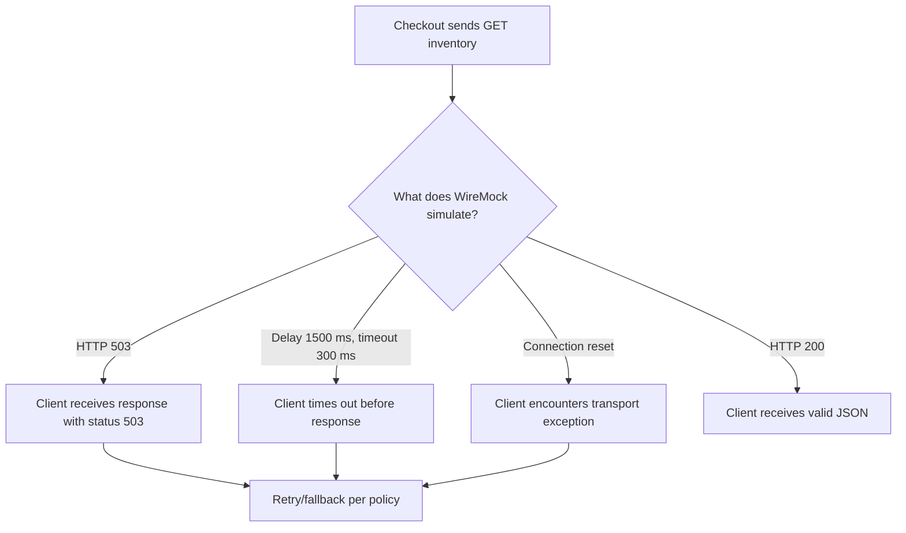

# Simulating Latency, Error Statuses, and Faulty Connections

When microservices call each other over HTTP, failures do not come solely from **API schema changes**. A producer can respond slowly, return `503 Service Unavailable`, rate-limit with `429 Too Many Requests`, or drop the connection before sending a response. If the consumer is only tested against `200 OK` and valid JSON, the team will struggle to catch bugs in **timeouts, retries, circuit breakers, fallbacks, and side-effect management**.

**WireMock** lets you run an HTTP stub server capable of controlling all these behaviors. Within the **SPRING_CLOUD_CONTRACT** learning path, teams use the **Groovy/YAML DSL** to describe contracts between **producer** and **consumer**, generate producer tests, and package stubs for **Stub Runner**. WireMock helps consumers verify failure paths alongside happy paths, yet you must distinguish **HTTP contracts promised by the producer** from **infrastructure faults simulated to test resilience**.

This lesson belongs to the **WireMock** chapter on **Simulating latency, error statuses, and faulty connections**. The goal is to practice WireMock JSON mappings and Java DSL, identify the exact failure types a client observes, design reproducible tests, and bring those scenarios into CI without mistaking WireMock for a full network emulator.

## 1. Three failure categories that must be tested differently

Suppose **Checkout Service** calls **Inventory Service** to check stock:

```http
GET /api/inventory/SKU-42
Accept: application/json
```

A normal response:

```http
HTTP/1.1 200 OK
Content-Type: application/json

{"sku":"SKU-42","available":true,"quantity":5}
```

In production, the consumer can encounter:

| Category | Example | Complete HTTP response? | What to verify |
|---|---|---|---|
| **Latency** | Server waits 1,500 ms before returning `200` | Yes if client waits long enough; no if client times out first | Deadlines, timeouts, cancellation |
| **HTTP error codes** | `404`, `429`, `500`, `503`, `504` | **Yes**, with status/headers/body | Error mapping, policy-compliant retries, fallbacks |
| **Connection faults** | TCP reset, empty or malformed response | Usually **no** | Transport exception handling and retry bounds |
| **Unreachable target** | No listener, DNS failure, TLS handshake error | No | Connect timeout/refused, fail-fast, and fallbacks |

**Key point:** HTTP `504 Gateway Timeout` is **a response from a gateway/server**, whereas a client timing out locally raises an exception **without receiving a `504`**. A TCP reset is likewise not equivalent to a `503`.

### 1.1. Diagram of outcomes observed by the consumer



A strong resilience test suite checks each branch with **appropriate observability**, rather than trying to force one assertion across every failure mode.

## 2. Boundary between Spring Cloud Contract and WireMock

There are two different kinds of evidence:

- **Producer verification:** Spring Cloud Contract Verifier reads the Groovy/YAML DSL, generates tests, and executes them against the **real Inventory implementation**. If a contract specifies `404` or `503` with a specific body, producer tests protect that expectation using appropriate fixtures.
- **Consumer verification:** **Stub Runner** loads mappings from the stubs artifact, or consumer tests start **`WireMockServer`** directly, so Checkout calls a simulated API. This verifies **Checkout's client** and error-handling branches.

WireMock can produce any response or fault defined by a test without proving the real producer ever emits that same failure. Never substitute a handful of consumer WireMock tests for producer contract verification.

| Stub source | What it is used for | Notes |
|---|---|---|
| Generated mapping from Spring Cloud Contract | Consumer verifies agreed interactions | Must confirm producer tests actually run |
| Custom WireMock JSON mapping | Simulate specific HTTP errors, delays, or faults | Does not automatically become a producer contract |
| WireMock Java DSL in JUnit | Set up/reset isolated scenarios per test | Actively manage server and request journal |
| Stub Runner | Fetch producer's `stubs` artifact and serve mappings | Does not run producer controllers/databases |

### 2.1. Do not use DSL features unsupported by your version

Some Spring Cloud Contract DSL versions support **response delays**, yet **do not assume** every WireMock feature such as `fault`, `delayDistribution`, `chunkedDribbleDelay`, or stateful scenarios has a matching Groovy/YAML Contract DSL syntax.

For infrastructure faults lacking DSL support, write **dedicated WireMock mappings** or Java DSL inside consumer resilience tests; when packaging mappings into a stubs artifact is required, check your plugin's packaging mechanism.

## 3. Simulating HTTP error codes with JSON mappings

A WireMock JSON mapping has two primary sections: `request` conditions and `response` definition.

Example `503 Service Unavailable`:

```json
{
  "request": {
    "method": "GET",
    "url": "/api/inventory/SKU-42"
  },
  "response": {
    "status": 503,
    "headers": {
      "Content-Type": "application/json",
      "Retry-After": "1"
    },
    "jsonBody": {
      "code": "INVENTORY_TEMPORARILY_UNAVAILABLE",
      "message": "Please retry later"
    }
  }
}
```

Here Checkout receives a **valid HTTP response**. `Retry-After: 1` uses delay-seconds syntax; the client can honor that value in its retry policy, while WireMock **does not drive client retries itself**.

Equivalent Java DSL example, where `server` is an already-started `WireMockServer`:

```java
import static com.github.tomakehurst.wiremock.client.WireMock.*;

server.stubFor(
    get(urlEqualTo("/api/inventory/SKU-42"))
        .willReturn(aResponse()
            .withStatus(503)
            .withHeader("Content-Type", "application/json")
            .withHeader("Retry-After", "1")
            .withBody(
                "{\"code\":\"INVENTORY_TEMPORARILY_UNAVAILABLE\"}"
            ))
);
```

### 3.1. Choose error status codes per protocol semantics

| Status | Common meaning | Client behavior to examine |
|---|---|---|
| `400 Bad Request` | Invalid request data | Do not blindly retry an unchanged request |
| `401 Unauthorized` | Unauthenticated or invalid token | Appropriate auth/token refresh flow |
| `403 Forbidden` | Authenticated but insufficient permissions | Surface/reject per policy |
| `404 Not Found` | Resource does not exist | Distinguish business error from unmatched mapping |
| `409 Conflict` | Resource state conflict | Domain handling; do not retry blindly |
| `429 Too Many Requests` | Rate limited | `Retry-After` and retry budget |
| `500 Internal Server Error` | General server failure | Retry only when policy permits |
| `502 Bad Gateway` | Gateway received upstream error | Check proxy/retry policy |
| `503 Service Unavailable` | Service temporarily unavailable | Bounded retry/fallback |
| `504 Gateway Timeout` | Gateway timed out waiting for upstream | Has an HTTP response; differs from client-side timeout |

Some errors require a **structured error body** so the consumer can read `code` and `message`. If the contract publishes `code=SKU_NOT_FOUND`, assert `code` too, not just status `404`.

### 3.2. Example business `404`

```json
{
  "request": {
    "method": "GET",
    "url": "/api/inventory/SKU-MISSING"
  },
  "response": {
    "status": 404,
    "headers": {"Content-Type": "application/json"},
    "jsonBody": {"code": "SKU_NOT_FOUND"}
  }
}
```

If a request **matches no mapping**, WireMock can also return a default `404`. That is **not** the producer's `SKU_NOT_FOUND` business error. When consumer tests check `404`, assert the expected body/headers and verify the request matcher.

## 4. Simulating fixed latency

Use `fixedDelayMilliseconds` in a JSON mapping:

```json
{
  "request": {
    "method": "GET",
    "url": "/api/inventory/SKU-42"
  },
  "response": {
    "status": 200,
    "headers": {"Content-Type": "application/json"},
    "jsonBody": {
      "sku": "SKU-42",
      "available": true,
      "quantity": 5
    },
    "fixedDelayMilliseconds": 1500
  }
}
```

The server **waits roughly 1,500 ms** before sending the response. It does **not** turn the response into a `504`. If the client only waits up to `300 ms`, the request fails on the client side with a **timeout**.

Java DSL:

```java
server.stubFor(
    get(urlEqualTo("/api/inventory/SKU-42"))
        .willReturn(aResponse()
            .withStatus(200)
            .withHeader("Content-Type", "application/json")
            .withBody("{\"sku\":\"SKU-42\",\"quantity\":5}")
            .withFixedDelay(1500))
);
```

### 4.1. Why use a fixed delay instead of a random delay?

Suppose the client timeout is `500 ms` and stub delay is `505 ms`. Scheduling jitter on CI runners can make the test alternate between passing and timing out. A clear gap like **1,500 ms vs. 300 ms** makes tests reproducible.

| Parameter | Exercise configuration |
|---|---|
| WireMock delay | 1,500 ms |
| Client request timeout | 300 ms |
| Expectation | Client timeout/fallback |
| Avoid asserting | Total test runtime equals **exactly 300 ms** |

Some WireMock versions also offer **delay distributions** and **chunked dribble delays** to trickle responses in chunks. These features are helpful for exploring resilience but can introduce non-determinism. For contract CI, prefer fixed delays; when using advanced delay features, verify the JSON schema/Java API against your project's pinned **WireMock version**.

### 4.2. Delay is not heavy load

A slow response from fixed delay does not prove the server handles real CPU/memory pressure, DB contention, or network congestion. WireMock only controls response timing. To test throughput limits, head-of-line blocking, or queue saturation, add proper performance/chaos tests.

## 5. Simulating connection failures with `fault`

WireMock can inject certain **network faults** at the HTTP stub server level. Example mapping that resets the connection:

```json
{
  "request": {
    "method": "GET",
    "url": "/api/inventory/SKU-42"
  },
  "response": {
    "fault": "CONNECTION_RESET_BY_PEER"
  }
}
```

Unlike `503`, this case usually **returns no complete HTTP response**. The client receives a transport-level exception rather than a response object with a `statusCode`.

Java DSL:

```java
import com.github.tomakehurst.wiremock.http.Fault;

server.stubFor(
    get(urlEqualTo("/api/inventory/SKU-42"))
        .willReturn(aResponse()
            .withFault(Fault.CONNECTION_RESET_BY_PEER))
);
```

### 5.1. Faults you may encounter

| Fault | Simulated meaning | What to verify |
|---|---|---|
| `EMPTY_RESPONSE` | Closes connection without sending a valid response | Client does not treat it as `200`/empty JSON |
| `CONNECTION_RESET_BY_PEER` | Resets connection while serving request | Transport exception branch/retry policy |
| `MALFORMED_RESPONSE_CHUNK` | Sends invalid HTTP response chunk | Client detects framing/parse error |
| `RANDOM_DATA_THEN_CLOSE` | Sends invalid bytes then closes connection | Not deserialized into business data |

Fault names and runtime details depend on WireMock version, HTTP client, and transport stack. Never assert an exact `"Connection reset by peer"` message across different JDKs/OSes. Assert the **translated application error type** and business outcome.

### 5.2. WireMock is not a complete network emulator

WireMock faults **do not prove** behavior under failures such as:

- DNS resolution failures.
- Invalid TLS certificates or handshake failures.
- Firewalls dropping packets indefinitely.
- Network partitions across regions or clusters.
- OS-level packet loss, latency jitter, or TCP congestion.
- Multi-tier load balancers/proxies with layered timeouts and retries.

For those goals, use a network fault proxy, staging/integration environments, or chaos engineering tools. WireMock primarily verifies how the **client handles configured response/transport anomalies**.

## 6. Distinguishing timeout types

HTTP clients often expose multiple independent deadlines:

| Timeout | Scope | Simulation approach |
|---|---|---|
| **Connect timeout** | Waiting to establish TCP connection | Unreachable server or network fault proxy |
| **Response/read timeout** | Waiting for server to send data | WireMock `fixedDelayMilliseconds` |
| **Per-request timeout** | Total duration of one HTTP request | Client request deadline + delay |
| **Total operation deadline** | Includes retries, backoff, and downstream calls | Verify at business/service layer |
| **Gateway timeout** | Gateway waited too long on upstream | WireMock returns HTTP `504` to simulate gateway response |

If Checkout uses Spring `WebClient`, an HTTP error status flows through `onStatus(...)` or `WebClientResponseException` depending on the call chain. Timeouts/resets can take a different exception path. With `RestTemplate`, OpenFeign, or Java `HttpClient`, exact exception types differ further.

Do not write every test with the same `catch (HttpStatusException)` when a scenario may **produce no HTTP status at all**.

## 7. Spring Cloud Contract DSL for producer-promised HTTP errors

When the producer explicitly commits to returning `503` in a defined case, express it in Groovy DSL:

```groovy
import org.springframework.cloud.contract.spec.Contract

Contract.make {
    name 'checkout_get_inventory_unavailable_503'

    request {
        method GET()
        url '/api/inventory/SKU-UNAVAILABLE'
        headers {
            header 'Accept', 'application/json'
        }
    }

    response {
        status 503
        headers {
            contentType(applicationJson())
            header 'Retry-After', '1'
        }
        body(
            code: 'INVENTORY_TEMPORARILY_UNAVAILABLE'
        )
    }
}
```

Equivalent YAML DSL:

```yaml
name: checkout_get_inventory_unavailable_503
request:
  method: GET
  url: /api/inventory/SKU-UNAVAILABLE
  headers:
    Accept: application/json
response:
  status: 503
  headers:
    Content-Type: application/json
    Retry-After: '1'
  body:
    code: INVENTORY_TEMPORARILY_UNAVAILABLE
```

**Keep only one DSL source** per scenario in the producer's contract suite. Generated producer tests must run against the real implementation with fixtures causing `SKU-UNAVAILABLE` to return `503` as agreed. If Inventory does not implement that behavior, do not invent a fake `503` producer contract just for resilience testing; use a **separate WireMock mapping**.

### 7.1. Delays/faults may not be supported in the Contract DSL

Some Spring Cloud Contract versions let you specify response delays in the DSL, yet `fault: CONNECTION_RESET_BY_PEER` or WireMock fault matchers are **not universally available** in the YAML Contract DSL.

When you need to simulate a TCP reset:

1. Use WireMock JSON mappings or Java DSL inside consumer tests.
2. If you must include the mapping in the stubs JAR, verify that your build plugin collects and packages custom mappings at the right path.
3. Inspect the **actual** mappings loaded by Stub Runner.
4. Avoid having a generated mapping and a custom fault mapping share the exact same request matcher with conflicting responses.
5. Label the test as a **resilience test**, not proof that the producer intentionally triggers connection resets.

## 8. Complete JUnit example with `WireMockServer` on a dynamic port

The following test demonstrates the difference between **receiving a `503` response** and a **request timeout**. It uses Java's `HttpClient` to keep the example compact and runnable when the project has compatible JDK 11+, JUnit Jupiter, and WireMock Core.

```java
import com.github.tomakehurst.wiremock.WireMockServer;
import org.junit.jupiter.api.AfterAll;
import org.junit.jupiter.api.BeforeAll;
import org.junit.jupiter.api.BeforeEach;
import org.junit.jupiter.api.Test;

import java.net.URI;
import java.net.http.HttpClient;
import java.net.http.HttpRequest;
import java.net.http.HttpResponse;
import java.net.http.HttpTimeoutException;
import java.time.Duration;

import static com.github.tomakehurst.wiremock.client.WireMock.*;
import static com.github.tomakehurst.wiremock.core.WireMockConfiguration.*;
import static org.junit.jupiter.api.Assertions.*;

class InventoryWireMockTest {

    private static WireMockServer server;
    private static HttpClient client;

    @BeforeAll
    static void start() {
        server = new WireMockServer(wireMockConfig().dynamicPort());
        server.start();
        client = HttpClient.newBuilder()
            .connectTimeout(Duration.ofSeconds(2))
            .build();
    }

    @AfterAll
    static void stop() {
        if (server != null) server.stop();
    }

    @BeforeEach
    void reset() {
        server.resetAll();
    }

    private HttpRequest request(Duration timeout) {
        return HttpRequest.newBuilder()
            .uri(URI.create(server.baseUrl() + "/api/inventory/SKU-42"))
            .timeout(timeout)
            .GET()
            .build();
    }

    @Test
    void receivesServiceUnavailable() throws Exception {
        server.stubFor(
            get(urlEqualTo("/api/inventory/SKU-42"))
                .willReturn(aResponse()
                    .withStatus(503)
                    .withHeader("Content-Type", "application/json")
                    .withHeader("Retry-After", "1")
                    .withBody("{\"code\":\"TEMPORARILY_UNAVAILABLE\"}"))
        );

        HttpResponse<String> response = client.send(
            request(Duration.ofSeconds(3)),
            HttpResponse.BodyHandlers.ofString()
        );

        assertEquals(503, response.statusCode());
        assertTrue(response.body().contains("TEMPORARILY_UNAVAILABLE"));
        assertEquals("1",
            response.headers().firstValue("Retry-After").orElse(null));
    }

    @Test
    void timesOutBeforeSlowResponse() {
        server.stubFor(
            get(urlEqualTo("/api/inventory/SKU-42"))
                .willReturn(aResponse()
                    .withStatus(200)
                    .withBody("{\"sku\":\"SKU-42\",\"quantity\":5}")
                    .withFixedDelay(1500))
        );

        assertThrows(HttpTimeoutException.class, () ->
            client.send(
                request(Duration.ofMillis(300)),
                HttpResponse.BodyHandlers.ofString()
            )
        );
    }
}
```

**Example limitations:** this snippet exercises the test's Java `HttpClient`, **not Checkout's real `InventoryClient`**. To test the consumer, instantiate or inject the **actual HTTP client/adapter Checkout uses**, point its base URL to `server.baseUrl()`, and assert application-level retries, fallbacks, and error translation.

### 8.1. Why reset?

`server.resetAll()` typically clears mappings, the request journal, and scenario state on the WireMock server. Each test then **re-registers mappings** for its own scenario. This keeps tests independent whether run individually or as a suite.

When using Stub Runner loaded with mappings from a stubs JAR, **never call reset-all on that server** and expect mappings to survive. Reset using the right API/lifecycle or use a separate `WireMockServer` for resilience tests.

### 8.2. Use dynamic ports

`wireMockConfig().dynamicPort()` avoids port collisions when multiple CI jobs run on the same host. For dependency-injected consumer clients, configure the base URL **after obtaining WireMock's actual port** or via Spring Test properties support.

Never hardcode `localhost:8080` in parallel tests and never accidentally send HTTP requests to a production producer.

## 9. Testing connection resets on the consumer side

In a new test, register:

```java
import com.github.tomakehurst.wiremock.http.Fault;

server.stubFor(
    get(urlEqualTo("/api/inventory/SKU-42"))
        .willReturn(aResponse()
            .withFault(Fault.CONNECTION_RESET_BY_PEER))
);
```

When calling through the real `InventoryClient`, verify:

1. The failure is recognized as a **transport failure** (or translated properly by the adapter).
2. No status/body is read from a **non-existent** HTTP response.
3. Retries occur only when policy and HTTP method permit.
4. Fallbacks do not swallow critical domain errors.
5. Total execution duration remains bounded.
6. Logs never leak tokens, cookies, or personal data.

Avoid asserting an exact exception message string across every JDK/OS/HTTP stack. When the client wraps errors into a domain exception, assert the type and fields **published by Checkout's internal API**, keeping root-cause checks flexible.

### 9.1. Connection refused vs. connection reset

- **Reset:** the peer abruptly tears down an established connection. WireMock can emit a matching fault.
- **Refused:** no process is listening at the endpoint, typically with no HTTP server to map a response.

To test refused connections, point to a test endpoint guaranteed to have no listener or a connection-controlling fault-injection proxy. Never assume an arbitrary fixed port is always free on every CI runner.

## 10. Using WireMock scenarios: fail once, then recover

A client might retry `GET` after `503` and then succeed. WireMock **stateful scenarios** let the first call return a different response from subsequent calls.

```java
import static com.github.tomakehurst.wiremock.stubbing.Scenario.STARTED;

server.stubFor(
    get(urlEqualTo("/api/inventory/SKU-42"))
        .inScenario("inventory-transient-failure")
        .whenScenarioStateIs(STARTED)
        .willReturn(aResponse().withStatus(503))
        .willSetStateTo("RECOVERED")
);

server.stubFor(
    get(urlEqualTo("/api/inventory/SKU-42"))
        .inScenario("inventory-transient-failure")
        .whenScenarioStateIs("RECOVERED")
        .willReturn(aResponse()
            .withStatus(200)
            .withHeader("Content-Type", "application/json")
            .withBody("{\"sku\":\"SKU-42\",\"quantity\":5}"))
);
```

A proper consumer scenario:

1. Checkout calls Inventory the first time → receives `503`.
2. Client executes its retry/backoff policy.
3. Second call → receives `200`.
4. Client completes without making a third call.
5. Test asserts final result and attempt count.

Check the request journal:

```java
server.verify(
    2,
    getRequestedFor(urlEqualTo("/api/inventory/SKU-42"))
);
```

**WireMock does not retry automatically.** It merely responds based on scenario state; retries must be performed by the **client or resilience layer**. Asserting `verify(2, ...)` catches clients that fail to retry or exceed expected attempt counts.

### 10.1. Reset scenarios between tests

A scenario moves between `STARTED` and `RECOVERED`. If test B shares the server and state is not reset after test A, B's first call may get `200` immediately.

Some WireMock versions support **resetting scenario state** while keeping mappings; `resetAll()` is broader and clears stub definitions too. When running multiple stateful tests, define a clear lifecycle:

- Dedicated server per test/suite.
- Reset state at deterministic points.
- Re-register mappings after a full reset.
- Never let parallel tests mutate a shared scenario.

## 11. Retry policies, idempotency, and duplicate side-effect risks

Retrying is not always safe.

| Situation | Should retry? | Notes |
|---|---|---|
| `GET` returns transient `503` | Possibly | Bound attempts and deadline |
| `GET` hits connection reset | Possibly | Per client policy |
| `400` from invalid request | Usually no | Retrying identical bad input rarely helps |
| `401` from bad token | Do not retry blindly | Refresh/handle authentication |
| `429` | Possibly | Respect `Retry-After` per policy |
| `POST` order creation loses response | **Extreme caution** | Server may already have created the order |
| Business validation error | Usually no | Fix input or guide caller |

For example, `POST /api/orders` might **commit to the DB** before the connection resets prior to reading `201`. Retrying without idempotency can create a second order.

For mutating requests, agree on and test:

- `Idempotency-Key` or deduplication mechanism.
- How the producer stores and recognizes duplicate requests.
- Timeout/retry budgets.
- Side effects after retries.
- Traceable errors/fallbacks without silently losing transactions.

A WireMock scenario returning `503` then `200` **does not prove** the real producer's DB enforces idempotency; add dedicated integration tests.

## 12. Overall deadlines, backoff, and circuit breakers

A resilience test checks more than the final status:

| Criterion | Question |
|---|---|
| **Retryable status** | Does it retry only `503/429` or the designated subset? |
| **Max attempts** | Does it stop after the allowed attempts? |
| **Backoff** | Does it wait appropriately between calls? |
| **Jitter** | Do we avoid synchronized retry storms across clients? |
| **Request timeout** | Does each attempt have a deadline? |
| **Total deadline** | Including retries and backoff, does it stay within SLA? |
| **Circuit breaker** | Under sustained failures, does the client stop calling upstream per policy? |
| **Fallback** | Does it return a business-safe result/exception? |
| **Observability** | Do metrics/logs/traces classify `503`, timeouts, and resets? |

Never assert exact millisecond wall-clock timings. CI runner scheduling and load vary. To test backoff timing or circuit breaker state transitions, test separately using a **virtual scheduler/test clock** or resilience library test utilities, and use WireMock integration tests to prove the client sends the right number of requests.

## 13. Using WireMock with Spring Boot tests

Spring Cloud Contract provides the `@AutoConfigureWireMock` annotation in supported versions. Example structure:

```java
import org.springframework.boot.test.context.SpringBootTest;
import org.springframework.cloud.contract.wiremock.AutoConfigureWireMock;

@SpringBootTest
@AutoConfigureWireMock(port = 0)
class CheckoutWireMockIntegrationTest {
    // Stub server is created on a dynamic port.
    // Point InventoryClient to WireMock's port.
}
```

In supported versions, the chosen port is typically exposed in `wiremock.server.port`. An application test property can reference that name to construct `InventoryClient`'s base URL.

**Important:**

- `@AutoConfigureWireMock` has its own lifecycle and JSON mapping discovery rules.
- **Stub Runner** fetches stubs artifacts from repositories/classpath and has its own lifecycle.
- Do not assume both tools share one server or port if you enable both in a test.
- When needing custom faults/delays for a single test, a dedicated `WireMockServer` with explicit setup/reset is often easier to control.

### 13.1. Hand-written JSON mappings

One consumer test layout might look like:

```text
checkout-service/
└── src/test/
    ├── java/
    │   └── .../InventoryResilienceTest.java
    └── resources/
        └── wiremock/
            └── mappings/
                ├── inventory_503.json
                ├── slow_inventory.json
                └── reset_connection.json
```

This path is a **project resource organization example**, not a guarantee that `@AutoConfigureWireMock` discovers every file there automatically. Configure `stubs`/classpath paths per your version or register directly via the Java DSL.

**Do not load all three mappings** matching `GET /api/inventory/SKU-42` at once in a test without scenario/priority separation. Tests must know deterministically which response a request receives.

## 14. Avoiding overlapping mappings and false `404`s

Example of three mappings for the same request:

```text
GET /api/inventory/SKU-42 -> 200
GET /api/inventory/SKU-42 -> 503
GET /api/inventory/SKU-42 -> CONNECTION_RESET_BY_PEER
```

If registered simultaneously with identical request conditions, WireMock may select an unexpected mapping. WireMock supports **priority** (smaller numbers usually take precedence) and **scenarios**, yet for isolated tests the simplest approach is:

1. Reset the server.
2. Register **exactly one mapping** for the scenario.
3. Call via the real client.
4. Check outcome and request journal.

When multiple mappings must coexist, differentiate them intentionally by method/path/query/headers/body or scenario state.

### 14.1. Overly broad matchers

A mapping with a `urlPattern` matching `/api/inventory/.*` can accidentally respond for the wrong SKU. A consumer test could stay green even when `InventoryClient` sends the wrong path.

Match the exact method/path and relevant headers. For authentication contracts, check required headers without storing **production tokens** in test resources.

### 14.2. A `404` from WireMock is not necessarily from the real API

When WireMock returns `404`, check:

- Right server and port?
- Stub mapping loaded?
- Method/path/query/headers/body matchers satisfied by the request?
- Is this a default `404` from an unmatched request or a `404` with body `SKU_NOT_FOUND`?
- Accidentally calling a stub server started by Stub Runner?

Never edit the producer's controller when the bug is a test client calling the wrong URL on a WireMock server.

## 15. Request journal checks and data hygiene

WireMock records requests to support verification. For retry tests:

```java
server.verify(
    2,
    getRequestedFor(urlEqualTo("/api/inventory/SKU-42"))
);
```

Counting requests confirms attempt counts, yet the request journal can retain `Authorization` headers, cookies, or sensitive payloads.

Good practices:

- Use dummy fixture data.
- Never commit real tokens, passwords, private keys, or PII into mappings.
- Never dump full request journals containing secrets into CI logs.
- Clear the journal between tests before counting requests.
- Use distinct correlation IDs when running concurrent requests.
- Log only necessary metadata: status, attempt count, timeout classification, contract name.

## 16. Why can WireMock tests become flaky?

| Cause | Symptom | Fix |
|---|---|---|
| Fixed delay too close to timeout | Alternates between success and timeout | Widen the margin |
| Mappings not reset | Fault from test A leaks into test B | Reset and re-register |
| Leftover scenario state | First call immediately returns `200` | Reset scenario state |
| Stale entries in request journal | `verify(2)` sees `4` | Reset request journal |
| Hardcoded port occupied | Server fails to bind or wrong target hit | Dynamic port |
| HTTP client reuses stale connection pool | Test sees abnormal connection errors | Manage client/pool lifecycle |
| Background retry still running | Late request from prior test arrives | Await completion and cancel cleanly |
| Stub Runner fetches stale artifact | Response mismatches latest source | Pin and check versions/caches |
| Parallel tests mutate one server | Mappings/state overwritten mid-test | Dedicated servers or synchronization |
| JSON mappings never loaded | Every request returns `404` | Check resource paths and logs |

Never use blind `Thread.sleep` instead of conditional waiting. Re-running flaky tests until green also never fixes non-deterministic root causes.

## 17. Practice: Checkout surviving Inventory failures

Context: Checkout has an HTTP client calling `GET /api/inventory/SKU-42`. Target test policy:

- `200`: parse `sku/quantity`.
- `404`: distinguish `SKU_NOT_FOUND`.
- `429`: respect published rate-limit rules.
- `503`: retry up to two attempts total, then fall back.
- Response timeout: request does not hang indefinitely.
- Connection reset: handle as a transport error without assuming an HTTP status.

### Phase A — test setup

1. Start `WireMockServer` on a dynamic port.
2. Point Checkout's **real `InventoryClient`** to `server.baseUrl()`.
3. Reset mappings, scenarios, and journal before each test.
4. Confirm the client never calls production Inventory.

### Phase B — HTTP statuses

1. Create a `200` mapping and verify successful parsing.
2. Create `404 SKU_NOT_FOUND` and verify error mapping.
3. Create `429` with `Retry-After` and verify rate-limit policy.
4. Create `503 INVENTORY_TEMPORARILY_UNAVAILABLE` and verify retry/fallback.
5. Create `504` and contrast it with a client request timeout.

### Phase C — latency

1. Register `withFixedDelay(1500)` on a `200` response.
2. Set client timeout around `300 ms` in the test.
3. Verify client timeout and proper fallback/cancellation.
4. Increase timeout sufficiently to verify the `200` response succeeds.
5. Avoid asserting exact millisecond elapsed times.

### Phase D — transport faults

1. Configure `Fault.CONNECTION_RESET_BY_PEER`.
2. Call through the real `InventoryClient`.
3. Assert the client does not attempt to parse a non-existent JSON body.
4. Verify retry budget and error classification.
5. Confirm logs leak no secrets.

### Phase E — retry then recover

1. Build a scenario returning `503` first, then `200`.
2. Call Checkout's service layer once.
3. Verify the final result succeeds.
4. Use `verify(2, ...)` to count HTTP attempts.
5. Reset the scenario before the next test.

### Phase F — Spring Cloud Contract and CI

1. Keep formal Groovy/YAML contracts for statuses, headers, and bodies Inventory **actually promises**.
2. Run generated producer contract tests against real Inventory.
3. Package and publish the verified stubs artifact.
4. Have Checkout use Stub Runner with the right artifact/version for consumer contract tests.
5. Run the WireMock resilience test suite separately to test delays/faults.
6. Surface reports, test timeouts, retry counts, and artifact provenance in CI.

**Completion criteria:** Checkout accurately distinguishes HTTP errors, timeouts, and transport failures; retries stay bounded; tests are deterministic; producer verification and consumer Stub Runner tests continue protecting real contracts.

## 18. Pre-CI checklist

- [ ] WireMock, Spring Cloud Contract, Spring Boot, and HTTP client versions are compatible.
- [ ] Tests use dynamic ports or collision-free port allocation.
- [ ] Consumer tests exercise the **real client**.
- [ ] Every fault/delay mapping targets the right request.
- [ ] `503`/`429` tests verify status/headers/body rather than confusing them with transport exceptions.
- [ ] Delays exceed deadlines with a clear margin without asserting exact milliseconds.
- [ ] Connection resets are not asserted as HTTP `500`.
- [ ] Stateful scenarios are reset.
- [ ] Request journal is cleared before `verify(...)`.
- [ ] Retry attempts, fallbacks, and total deadlines are tested.
- [ ] `POST`/side-effect requests have idempotency protections if retried.
- [ ] No real tokens/PII appear in mappings or logs.
- [ ] Stub Runner resolves a valid artifact/version.
- [ ] Generated producer tests **actually execute** before publishing.
- [ ] Network faults beyond WireMock's scope have separate integration tests.

## 19. Common misconceptions

**"`504` means the client timed out."** No. `504` is an HTTP response from a gateway; a client timeout typically throws an exception with no HTTP response.

**"`503` is the same as a connection reset."** No. With `503` the client reads status/body; with a reset the client may receive no response at all.

**"WireMock automatically retries a request when returning `503`."** No. Retries must be implemented by the client; WireMock only serves responses.

**"Using a 500 ms fixed delay with a 500 ms timeout is an exact test."** No. Thresholds that close flake due to runner scheduling.

**"A JSON mapping containing `fault` is also Spring Cloud Contract YAML DSL."** No. The two formats/schemas differ; use only features supported by your exact version.

**"`resetAll` resets only request counts."** Never assume that. A full reset can wipe mappings/scenarios too, so re-register them.

**"Green Stub Runner tests prove the real producer survives network failures."** No. Stubs simulate responses; producer verification and integration/network tests have distinct scopes.

**"Retrying every POST is safe."** No. If side effects already occurred before the connection broke, retrying can create duplicates.

**"An illustrative Java HttpClient test proves Checkout's client works."** No. You must test the actual consumer adapter.

## 20. Self-check questions

1. **What are the three failure categories in this lesson?** Latency, HTTP error statuses, and transport/connection faults.
2. **How do `fixedDelayMilliseconds` and `withFixedDelay` differ?** One is JSON mapping syntax and one is Java DSL; both add latency.
3. **Does WireMock fixed delay automatically emit `504`?** No.
4. **Does HTTP `503` have a status/body?** Yes, as defined in the response.
5. **Does a connection reset guarantee the client can read an HTTP status?** No.
6. **What does `Retry-After: 1` express?** A suggested one-second wait before retrying, if the client honors that policy.
7. **Why must timeout tests use a delay noticeably larger than the deadline?** To prevent flakiness.
8. **Does WireMock fully emulate DNS/TLS/packet loss?** No.
9. **What does `Fault.CONNECTION_RESET_BY_PEER` test?** How the client reacts to a reset connection.
10. **What can stateful scenarios simulate?** `503` on the first call, `200` on the next.
11. **Who executes the retry?** The client or resilience layer, not WireMock.
12. **What does `server.verify(2, ...)` check?** The actual number of matching requests received.
13. **Why reset scenarios between tests?** So the next test does not inherit `RECOVERED` state.
14. **How does WireMock's default `404` differ from `SKU_NOT_FOUND`?** One comes from an unmatched request; the other is a mapped business error body.
15. **Why not blindly put `fault` into the YAML Contract DSL?** Your Contract Verifier version may not support it.
16. **What must Spring Cloud Contract producer tests run against?** The real producer implementation with appropriate fixtures.
17. **Does Stub Runner run the real Inventory Service?** No; it serves stubs.
18. **Why is retrying POST risky?** Side effects may have already succeeded before the response was lost.
19. **When are network chaos tests needed beyond WireMock?** When testing DNS, TLS, packet loss, or network partitions.
20. **What test groups should a solid CI suite include?** Producer contract verification, consumer Stub Runner tests, WireMock resilience tests, and integration tests when needed.

## 21. Version-specific references

When applying examples, verify APIs for the **WireMock 2/3** and **Spring Cloud Contract** integration versions your project uses. Mapping schemas, server setup, annotations, and custom mapping loading can differ across releases.

- [WireMock — Simulating Latency](https://wiremock.org/docs/simulating-latency/)
- [WireMock — Simulating Faults](https://wiremock.org/docs/simulating-faults/)
- [WireMock — Stateful Behaviour](https://wiremock.org/docs/stateful-behaviour/)
- [WireMock — Stubbing](https://wiremock.org/docs/stubbing/)
- [Spring Cloud Contract — Reference](https://docs.spring.io/spring-cloud-contract/reference/)

These pages are starting points to verify syntax for your **pinned version**, not replacements for inspecting generated producer tests, WireMock mappings, and test reports.

## Conclusion

**WireMock lets you proactively test three critical failure modes when a consumer calls an API: HTTP error statuses, slow responses, and broken connections.** Each requires different assertions: `503` is a valid response, fixed delays trigger **client timeouts**, and TCP resets cause **transport exceptions without an HTTP status**. JSON mappings, Java DSL, stateful scenarios, dynamic ports, and the request journal help build reproducible tests to verify retries, fallbacks, and timeout budgets.

In **Spring Cloud Contract**, keep Groovy/YAML contracts for **API promises genuinely fulfilled by the producer**, while faults/delays unsupported by the DSL or infrastructure-focused belong in dedicated **WireMock resilience tests**. When generated producer tests, consumer tests via **Stub Runner**, and CI release gates each operate within their proper scope, teams catch incompatible API changes and client resilience bugs early without mistaking a stub for a real network.
