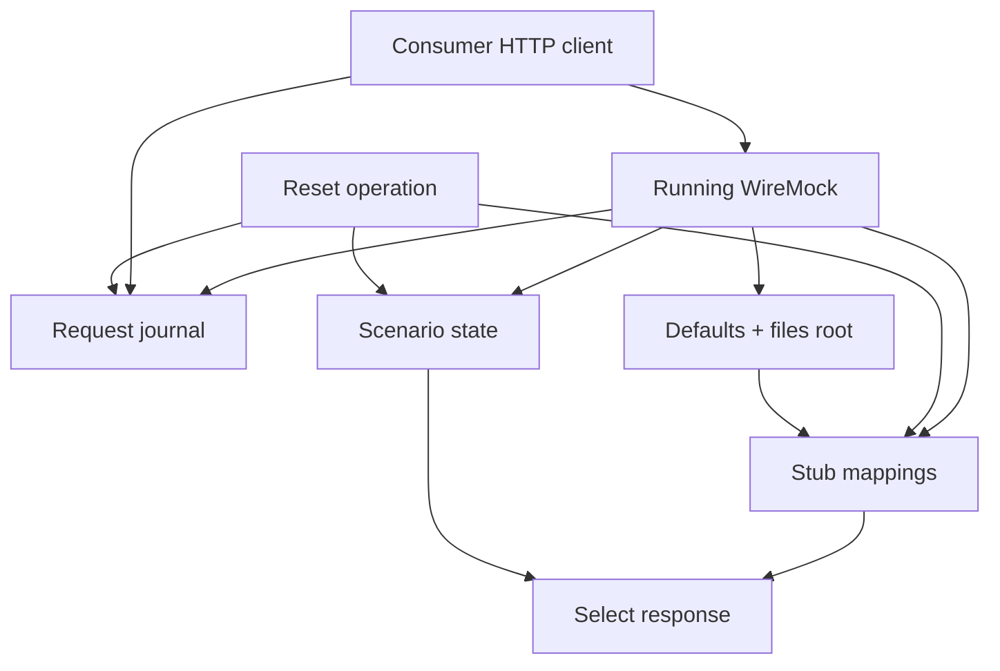
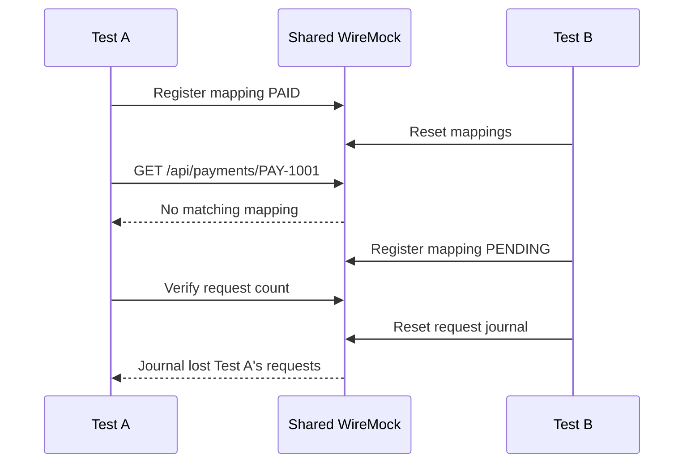
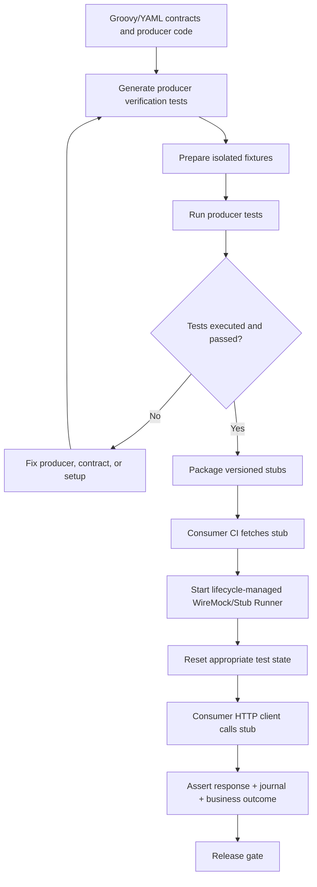

# Resetting Mappings, Request Journal, and Lifecycle Across Tests

## 1. The problem: one passing test can break the next test

Suppose `checkout-service` uses an HTTP client to call `payment-service`. In integration tests, the team replaces the real Payment service with **WireMock** to return simulated payment data. The first test adds a stub for `GET /api/payments/PAY-1001` with status `PAID`; the second test wants the same URL to return `PENDING`. If both tests share one WireMock server without cleaning up state, the second test may receive the previous test's response, or fail request-count checks because the **request journal** still holds earlier calls.

The problem gets harder to spot under parallel execution: the same HTTP client can hit the right server while responses vary by mapping registration order, and an assertion checking "sent exactly one POST" may count requests from another test.

In **Spring Cloud Contract**, HTTP or messaging contracts are written in **Groovy/YAML DSL**, Verifier generates tests checking the producer, stubs are packaged for consumers to run via **Stub Runner**, and CI uses both sides to catch incompatible API changes. WireMock is commonly used to simulate HTTP on the consumer side or an outbound dependency of the producer. Therefore, managing **WireMock state and lifecycle** is essential for reliable contract testing.

In this lesson, you will learn to:

- Distinguish **stub mappings**, **request journal**, **scenario state**, **file-based default mappings**, and **server lifecycle**.
- Choose the right reset level: clear requests only, clear mappings only, restore defaults, or reset everything.
- Structure tests using the **WireMock JUnit Jupiter extension** and Spring Cloud Contract's **`@AutoConfigureWireMock`**.
- Verify requests without interference from other tests.
- Avoid wiping mappings loaded by Stub Runner, targeting the wrong port, or leaking shared state in CI.

**Core principle:** resetting is not "run one command to wipe everything and hope tests pass." You must know **which state is being cleared**, **which state must stay intact**, and **who is responsible for recreating fixtures before a test**.

## 2. Four kinds of state to manage

| Component | What it holds | If kept across tests |
| --- | --- | --- |
| **Stub mappings** | Rules matching method, URL, headers/body and corresponding responses. | Subsequent tests get the wrong response; stale mappings shadow new ones. |
| **Request journal** | Records of requests WireMock received, including unmatched requests. | `verify(1, ...)` counts prior tests' requests; may leak test data in logs. |
| **Scenario state** | State of multi-step flows, e.g., `Started → PAID`. | Next test starts at step two instead of step one. |
| **Default/file mappings and body files** | Mappings loaded from `mappings/`, `stubs=...` option, `__files`. | Incorrect resets remove base stubs, or body files become unavailable. |

In addition, there is **process/server lifecycle**: startup, port binding, client configuration, and server shutdown. Stopping a server releases resources, yet a test failing due to a stale journal is not fixed simply by switching to another fixed port.

### State diagram



The final arrow does not mean every reset command automatically reloads all default files. **The chosen reset operation and loader mechanism determine that**, especially when Spring Cloud Contract loads additional stubs via annotations.

## 3. How do reset operations differ?

WireMock exposes both a Java DSL and an Admin HTTP API. In the table below, `WireMock` is the static DSL class configured to point to the **right server instance**; when running multiple servers, avoid static calls without confirming the target host/port.

| Goal | Common Java API | Admin HTTP API | Outcome to understand |
| --- | --- | --- | --- |
| **Clear request journal only** | `WireMock.resetAllRequests()` | `DELETE /__admin/requests` | Preserves mappings; subsequent assertions see only new requests. |
| **Delete current mappings** | Use version-appropriate mapping management API. | `DELETE /__admin/mappings` | Removes mappings; **not meant for clearing the request log**. |
| **Restore mappings to defaults** | `WireMock.resetToDefault()` or version-supported equivalent. | `POST /__admin/mappings/reset` | Drops runtime mappings and reloads what **WireMock considers default mappings**. |
| **Reset all of WireMock** | `WireMock.reset()` | `POST /__admin/reset` | Restores default mappings and clears the request journal. |
| **Reset scenario states** | `WireMock.resetAllScenarios()` | `POST /__admin/scenarios/reset` | Resets scenarios to initial state while mappings can remain intact. |
| **Reset a single scenario** | `WireMock.resetScenario("name")` | `PUT /__admin/scenarios/name/state` per supported API. | Only the named scenario returns to `Started`. |

These operations are **not interchangeable**. For instance:

- Want to check "the client called the API twice in the **current test**" while keeping loaded mappings: **reset the journal**, do not delete mappings.
- Want each test to register its own independent mappings: **reset mappings** or use a JUnit extension that resets before tests.
- Want to revert to mappings on the filesystem: **reset to defaults**, not just wipe everything.
- Want to replay a scenario from the start: **reset scenario state**, not just clear the request journal.

WireMock documentation confirms `POST /__admin/reset` resets mappings and the journal; it also provides separate operations for requests, mappings, and scenarios. However, for **mappings loaded by Spring Cloud Contract via `@AutoConfigureWireMock(stubs=...)`**, reloading defaults has an important exception explained in section 11.

### Admin API examples

Suppose WireMock is running **exclusively for the test environment** at `http://localhost:8089`:

```bash
# Clear the request journal while keeping mappings:
curl -X DELETE http://localhost:8089/__admin/requests

# Delete mappings; use cautiously if Stub Runner is running:
curl -X DELETE http://localhost:8089/__admin/mappings

# Restore default mappings per WireMock loader:
curl -X POST http://localhost:8089/__admin/mappings/reset

# Reset all mappings and the journal:
curl -X POST http://localhost:8089/__admin/reset

# Reset scenario states only:
curl -X POST http://localhost:8089/__admin/scenarios/reset
```

These are **independent illustrative commands**, not a script to run all five back-to-back. Each serves a different purpose; running all blindly can wipe mappings needed by tests. **Call the Admin API only on test servers you own**, never on shared stub servers used by other teams.

## 4. Failure example caused by an unreset journal

We want to confirm Checkout calls Payment exactly **once** when an order is approved.

Test A:

```text
1. Stub: POST /api/payments/PAY-1001/capture -> 200
2. Checkout calls POST once
3. Journal: [POST /api/payments/PAY-1001/capture]
4. verify(1, ...) -> PASS
```

Test B runs on the same server without clearing the journal:

```text
1. Stub is retained
2. Checkout calls POST one more time
3. Journal: [POST (test A), POST (test B)]
4. verify(1, ...) -> FAIL even though B's logic sent only one request
```

If another test only asserts "called at least once," it can **pass falsely** even if that test's own code never called the API.

Solution when keeping mappings intact:

```java
// WireMock DSL already configured to target the right test server.
WireMock.resetAllRequests();

// Execute the behavior under test in the current test.
checkoutService.capturePayment("PAY-1001");

// Only requests sent AFTER the reset are counted.
WireMock.verify(1,
    postRequestedFor(
        urlEqualTo("/api/payments/PAY-1001/capture")
    )
);
```

This example requires version-appropriate WireMock DSL imports, `checkoutService`, and an HTTP client pointing to the server. **If tests run in parallel on the same WireMock instance**, clearing the journal in test A also erases requests test B is about to verify. In that case, use separate servers, isolate processes, or disable parallel execution for tests sharing a journal.

## 5. Writing clear mappings for clean teardown

Suppose the Payment API returns:

```http
GET /api/payments/PAY-1001 HTTP/1.1
Accept: application/json
```

Response:

```json
{
  "paymentId": "PAY-1001",
  "orderId": "ORD-2001",
  "status": "PAID",
  "amount": 250000,
  "currency": "VND"
}
```

WireMock Java DSL:

```java
stubFor(
    get(urlEqualTo("/api/payments/PAY-1001"))
        .willReturn(
            okJson("""
                {"paymentId":"PAY-1001","orderId":"ORD-2001",
                 "status":"PAID","amount":250000,"currency":"VND"}
                """)
        )
);
```

`stubFor(...)` registers a mapping on a WireMock instance. If a later test uses the same URL and wants `PENDING`, **do not just add a second mapping hoping WireMock selects it in your expected order**. Priority, matcher specificity, and registration order can create confusing behavior; the safe route is resetting mappings and registering **only the stubs required for that test**.

An illustrative corresponding WireMock JSON mapping:

```json
{
  "request": {
    "method": "GET",
    "urlPath": "/api/payments/PAY-1001"
  },
  "response": {
    "status": 200,
    "headers": {"Content-Type": "application/json"},
    "jsonBody": {
      "paymentId": "PAY-1001",
      "orderId": "ORD-2001",
      "status": "PAID",
      "amount": 250000,
      "currency": "VND"
    }
  }
}
```

In the Spring Cloud Contract ecosystem, mappings can be **generated from Groovy/YAML DSL** and packaged into a stubs JAR. When testing consumers, use stub artifacts verified by producer verification; never replace all contracts with hand-written mappings and claim the producer passed contract tests.

## 6. WireMock lifecycle with JUnit Jupiter

WireMock provides a JUnit 5 extension that does not require Spring Boot. A typical test:

```java
import com.github.tomakehurst.wiremock.junit5.WireMockTest;
import com.github.tomakehurst.wiremock.junit5.WireMockRuntimeInfo;

import static com.github.tomakehurst.wiremock.client.WireMock.*;
import org.junit.jupiter.api.Test;

@WireMockTest
class CheckoutPaymentClientTest {

    @Test
    void readsPaymentWithTheRightId(WireMockRuntimeInfo wm) {
        stubFor(get(urlEqualTo("/api/payments/PAY-1001"))
            .willReturn(okJson("""
                {"paymentId":"PAY-1001","status":"PAID"}
                """)));

        String baseUrl = "http://localhost:" + wm.getHttpPort();
        PaymentClient client = new PaymentClient(baseUrl);

        PaymentView response = client.getPayment("PAY-1001");

        assertThat(response.paymentId()).isEqualTo("PAY-1001");
        assertThat(response.status()).isEqualTo("PAID");
        verify(1, getRequestedFor(
            urlEqualTo("/api/payments/PAY-1001")
        ));
    }
}
```

`PaymentClient`, `PaymentView`, and AssertJ imports represent application code to adapt during implementation. The key point is that `@WireMockTest` creates a WireMock instance on a **random port** and configures the static DSL for stubbing/verifying. There is no reason for the test to hardcode `8080`.

### When does the JUnit Jupiter extension reset?

Per WireMock JUnit Jupiter documentation:

- The **declarative `@WireMockTest`** starts the server before the first test method in the class and stops it after the last method; **stub mappings and the request journal are reset before each test method**.
- The **programmatic `@RegisterExtension static WireMockExtension`** also starts the server for the class and resets before each test method by default.
- If the extension field is **non-static**, a server instance can be started/stopped **per test method** instead of shared across the class.
- Since WireMock **3.13.0**, the programmatic builder includes `resetOnEachTest(false)` to override the default; disable it only when you have an explicit alternative isolation strategy.

Therefore, with default `@WireMockTest`, **there is no need to add `WireMock.reset()` at the start of every test**. Manually resetting after the extension already loaded needed mappings can wipe required test data. If a test intentionally tries to carry a scenario across multiple methods, that test design is order-dependent; model the steps inside **one test method** with clean teardown.

### Programmatic extension: server control

```java
@RegisterExtension
static WireMockExtension wm = WireMockExtension.newInstance()
    .options(wireMockConfig().dynamicPort())
    .build();
```

This snippet requires WireMock extension/config and JUnit imports. Use `wm.getRuntimeInfo().getHttpPort()` to configure the client; use the **instance DSL** to prevent the static DSL from targeting the wrong server when multiple instances run. With a static extension as above, it still **resets between test methods by default**.

## 7. Reset before each test or after each test?

Both strategies have different trade-offs:

| Strategy | Strengths | Risks/limitations |
| --- | --- | --- |
| **Reset before each test** | Each test guarantees a clean starting state regardless of whether the previous test's teardown ran. | If run after the framework loaded defaults, it can wipe needed mappings. |
| **Reset after each test** | Reduces leftover state for the next test. | If a test aborts/skips teardown or async work is still in flight, cleanup may miss requests. |
| **Dedicated server per test** | Isolates mappings, journal, scenarios, and ports. | Higher server startup/shutdown overhead. |
| **Shared server + restore defaults** | Saves startup time and preserves base stubs. | Must understand how defaults load, especially with SCC `@AutoConfigureWireMock`. |

**Recommendation:** pick a single lifecycle owner—JUnit extension, Spring `TestExecutionListener`, or self-managed fixture/test resource—to avoid overlapping resets. For parallel tests, **instance isolation** is usually clearer than a global reset.

An async test can keep calling WireMock after the test method returns. If teardown wipes the journal right then, the next test will see "post-reset" requests that do not belong to it. Thus resetting solves only half the problem: ensure **async tasks finish and resources are no longer shared**.

## 8. Using the request journal for verification and diagnostics

The journal records requests received by the server, including unmatched requests. It helps answer:

- Did the client send the request?
- **How many times?** Were there unintended retries?
- Do URL, query parameters, headers, and body satisfy the contract?
- Why did the server report "no matching stub"?

Example verifying a POST:

```java
verify(1, postRequestedFor(
    urlEqualTo("/api/payments/PAY-1001/capture"))
    .withHeader(
        "Idempotency-Key", equalTo("CAP-ORD-2001-01"))
    .withRequestBody(
        matchingJsonPath("$.currency", equalTo("VND")))
);
```

For payment capture, **call count** matters because duplicate requests can cause side effects if the producer lacks idempotency. Yet `verify` is only accurate when the journal contains no requests from other tests.

### Inspecting via the Admin API

```http
GET /__admin/requests HTTP/1.1
Host: localhost:8089
```

Useful endpoints:

| Admin endpoint | Purpose |
| --- | --- |
| `GET /__admin/requests` | List the request journal. |
| `GET /__admin/requests/unmatched` | Inspect requests matching no stub. |
| `DELETE /__admin/requests` | Clear journal without deleting mappings. |
| `GET /__admin/mappings` | Inspect currently registered mappings. |
| `GET /__admin/scenarios` | Check the state of each scenario. |

The Admin API is **WireMock's administrative surface**, intended only for controlled test servers. Never expose it to public networks; the journal can contain sample tokens, mock payloads, or sensitive data if tests are carelessly written.

### Why "no request in journal" is not enough

If the request journal is disabled via `disableRequestJournal()` or `--no-request-journal`, journal-based verification APIs will not work normally and may error out. Similarly, journal size limits can evict older requests past the cap, undercounting calls. For integration/contract tests verifying request counts, **keep the journal enabled** and reset deliberately.

In long-running performance/load tests, disabling the journal can reduce memory pressure, but that is a different test goal. Never disable the journal to "fix" a failing verification test.

## 9. Stateful scenarios: resetting the journal does not rewind steps

WireMock supports **scenarios** to simulate stateful APIs. Suppose a payment starts as `PENDING` and becomes `PAID` after a test request.

```java
import static com.github.tomakehurst.wiremock.stubbing.Scenario.STARTED;

stubFor(get(urlEqualTo("/api/payments/PAY-1001"))
    .inScenario("payment-status")
    .whenScenarioStateIs(STARTED)
    .willReturn(okJson(
        "{\"paymentId\":\"PAY-1001\",\"status\":\"PENDING\"}"))
    .willSetStateTo("CAPTURED"));

stubFor(get(urlEqualTo("/api/payments/PAY-1001"))
    .inScenario("payment-status")
    .whenScenarioStateIs("CAPTURED")
    .willReturn(okJson(
        "{\"paymentId\":\"PAY-1001\",\"status\":\"PAID\"}")));
```

Two calls to the same URL within **one test** receive:

```text
Call 1: PENDING -> Scenario transitions to CAPTURED
Call 2: PAID    -> Scenario remains CAPTURED
```

If after the second call you only invoke `resetAllRequests()`, the journal is empty yet **the scenario can remain in CAPTURED**. The next test, expecting `Started`, immediately gets `PAID`.

Restoring scenario state:

```java
WireMock.resetAllScenarios();
// Or a single scenario: WireMock.resetScenario("payment-status");
```

Corresponding HTTP API:

```bash
curl -X POST http://localhost:8089/__admin/scenarios/reset
```

In multi-step testing, execute the **PENDING → PAID** sequence inside one test method, then deliberately reset the scenario if the server will be reused. Never rely on `@Test` execution order to pass state from one test to the next.

**Note:** resetting all mappings can also remove scenario definitions; afterward, both mappings must be re-registered. Choose the reset level based on what you actually want to keep.

## 10. Spring Cloud Contract: `@AutoConfigureWireMock` has its own lifecycle

When testing a Spring Boot application whose HTTP client calls an external dependency, Spring Cloud Contract offers:

```java
@SpringBootTest
@AutoConfigureWireMock(port = 0)
class CheckoutPaymentIntegrationTest {
    // ...
}
```

`port = 0` asks the **WireMock server to pick a random port**; the Spring test environment exposes `wiremock.server.port` so test code can configure the client. Never confuse this port with `@LocalServerPort` of the **Spring Boot application** when running with `RANDOM_PORT` web environment.

### Default lifecycle differs from the JUnit Jupiter extension

Per Spring Cloud Contract documentation:

- `@AutoConfigureWireMock` adds configuration/beans to the **Spring TestContext**, which can be **cached across test methods and compatible test classes**.
- The server is reset by the framework **after each test class** via a listener mechanism.
- If you need to reset mappings **after each test method**, set the property:

```properties
wiremock.reset-mappings-after-each-test=true
```

Do not apply the rule "JUnit Jupiter `@WireMockTest` always resets before each method" onto `@AutoConfigureWireMock`. They use **different lifecycle managers**. Notice the property explicitly mentions **reset mappings**; if tests inspect sensitive request journals or scenario states, verify and manage those states per your integration version.

### Spring Boot integration test example

```java
@SpringBootTest(properties = {
    "wiremock.reset-mappings-after-each-test=true"
})
@AutoConfigureWireMock(port = 0)
class CheckoutPaymentIntegrationTest {

    @Autowired
    Environment environment;

    @Autowired
    PaymentGatewayClient gatewayClient;

    @BeforeEach
    void prepareStub() {
        String baseUrl = "http://localhost:"
            + environment.getRequiredProperty("wiremock.server.port");

        gatewayClient.setBaseUrl(baseUrl);

        stubFor(get(urlEqualTo("/api/payments/PAY-1001"))
            .willReturn(okJson(
                "{\"paymentId\":\"PAY-1001\",\"status\":\"PAID\"}")));
    }

    @Test
    void readsCapturedPayment() {
        PaymentView payment =
            gatewayClient.getPayment("PAY-1001");

        assertThat(payment.status()).isEqualTo("PAID");
        verify(1, getRequestedFor(
            urlEqualTo("/api/payments/PAY-1001")));
    }
}
```

This is **illustrative application code**, requiring imports for JUnit 5, Spring Boot Test, `@AutoConfigureWireMock`, `Environment`, WireMock DSL, DTOs, AssertJ, and a real HTTP client. `PaymentGatewayClient.setBaseUrl(...)` is an example placeholder method; if your project's HTTP client reads its URL from configuration properties at bean creation time, **supply `wiremock.server.port` through the configuration mechanism** instead of mutating the bean post-startup.

In tests needing multiple auto-loaded mappings, avoid calling `WireMock.reset()` in `@BeforeEach` if it wipes file stubs the test relies on. **Let the listener and reset properties handle it**, or provide a fixture setup that reloads everything cleanly.

## 11. Exception: stubs loaded via `stubs=...` are not default mappings

Spring Cloud Contract allows loading mappings from classpath/filesystem:

```java
@AutoConfigureWireMock(
    port = 0,
    stubs = "classpath:/payment-wiremock-stubs"
)
```

A subtle detail from the official documentation:

> Mappings loaded via the `stubs` attribute **are not treated as default mappings** under WireMock's default reset semantics.

Consequently, calling `WireMock.resetToDefaultMappings()` or an equivalent reset-to-default call **is not guaranteed** to restore files from `stubs=...`. Spring Cloud Contract provides `WireMockTestExecutionListener` to **re-register mappings from `stubs`** as well, when resetting after a class or after a method if `wiremock.reset-mappings-after-each-test=true` is enabled.

Distinction:

| Mapping source | Loaded by | After pure WireMock reset-to-default |
| --- | --- | --- |
| Mapping files at WireMock's default file root | WireMock loader | Can be reloaded as defaults. |
| Mappings added via `stubFor(...)` during test | Test code | Usually **not** restored automatically; test must re-register. |
| Mappings from `@AutoConfigureWireMock(stubs="...")` | Spring Cloud Contract test integration | **Not** considered default mappings; rely on listener or reload properly. |
| HTTP mappings in Stub Runner's `stubs.jar` | Stub Runner | Depends on loader/runtime; never assume reset-to-default restores them. |

This is why "just call `resetToDefault()` between tests" can suddenly cause a suite to return `404 No matching stub`. Inspect active mappings after a reset or run a simple smoke request to confirm needed mappings are still present.

## 12. Stub Runner is not a self-managed WireMock server

In Spring Cloud Contract, a consumer test can use:

```java
@AutoConfigureStubRunner(
    ids = "com.example:payment-service:1.4.2:stubs",
    stubsMode = StubRunnerProperties.StubsMode.LOCAL
)
```

Stub Runner downloads the producer-published stubs artifact, starts the HTTP stub runtime, and registers mappings from the artifact. It may run WireMock underneath. **However, when using Stub Runner, Stub Runner owns mapping loading**; do not casually call `DELETE /__admin/mappings` on that server to "clean up a test" and expect JAR mappings to reappear on their own.

To isolate consumer tests using Stub Runner:

1. Pin artifact versions, e.g., `1.4.2`; never use "latest" in reproducible tests.
2. Initialize test contexts or Stub Runner per framework-supported lifecycle.
3. Have each test prepare independent consumer application state.
4. If checking call counts on Stub Runner's WireMock, identify the **exact server for that producer** and reset only the journal rather than wiping all mappings.
5. If you need response variants the artifact does not provide, review the **contract and scenarios** or use a self-managed WireMock server for separate unit/integration tests—never overwrite official stubs and still call it a "producer contract test."
6. For parallel runs, use separate server instances/namespaces or explicit access coordination.

This is the distinction between **WireMock as a self-configured test double** and **WireMock managed by Stub Runner for consumer-driven contracts**.

## 13. Contract Verifier producer tests differ from tests calling WireMock

An HTTP contract:

```groovy
import org.springframework.cloud.contract.spec.Contract

Contract.make {
    name 'get_paid_payment'

    request {
        method 'GET'
        urlPath '/api/payments/PAY-1001'
    }

    response {
        status 200
        headers {
            contentType(applicationJson())
        }
        body([
            paymentId: 'PAY-1001',
            status: 'PAID',
            currency: 'VND'
        ])
    }
}
```

Spring Cloud Contract Verifier generates a **producer verification test** sending requests to the producer endpoint set up in proper test mode and asserting responses. If the producer test depends on an HTTP bank gateway, it may use WireMock to mock the **outbound bank call**, yet the contract's HTTP request must still be handled by **producer code**.

| Test | Real target that must execute | What does WireMock simulate? |
| --- | --- | --- |
| Producer verification | Payment controller/service producing the promised HTTP response. | Optional: bank gateway or external API called by the producer. |
| Consumer stub test | Checkout HTTP client and logic. | Payment HTTP response from the stub artifact. |
| Isolated WireMock unit/integration test | A specific HTTP client/adapter. | HTTP dependency per test-authored fixtures. |

Never register WireMock to return `PAID`, call that same WireMock, and conclude the producer complies with the contract. That only tests a **WireMock mapping**, not Payment's implementation.

### Equivalent YAML DSL

```yaml
name: get_paid_payment
request:
  method: GET
  urlPath: /api/payments/PAY-1001
response:
  status: 200
  headers:
    Content-Type: application/json
  body:
    paymentId: PAY-1001
    status: PAID
    currency: VND
```

Groovy and YAML are two representations of the same scenario; **there is no need to keep both as separate contracts** without a clear reason. Resetting WireMock state in consumer tests **never changes source contracts or generated producer tests**.

## 14. When should you keep the journal while changing mappings?

Some tests need to observe all requests across multiple steps, for example:

```text
1. Client GET /api/payments/PAY-1001  -> receives PENDING
2. Client POST /api/payments/PAY-1001/capture -> receives 200
3. Client GET /api/payments/PAY-1001  -> receives PAID
4. Verify GET/POST counts and logical order of the whole workflow
```

If you clear the journal between steps 2 and 3, you lose evidence of requests from the start of the workflow. Instead of resetting the journal, preserve it **throughout the entire test method**. Use scenario state for the two different GET responses, or update mappings intentionally if the mock simulates a system permitted to change state.

When the workflow finishes, verify call counts, then let the **framework reset before the next test**. Never split this flow into three test methods relying on JUnit order and shared state.

### Never treat the journal as a business database

The journal shows **requests reached WireMock**, not that a real bank processed a transaction, a database committed, or an event was published. For mutating POST operations, assert consumer state/logic and idempotency conditions separately. The journal assists interaction verification; it does not replace business outcomes.

## 15. Parallel execution: global resets can break other tests

Suppose two test methods run concurrently in one JVM, sharing WireMock on port `8089`:



Every individual piece of code looks sensible, yet the suite flakes because **resets mutate server-wide state**.

### Isolation strategies

| Option | When appropriate | Notes |
| --- | --- | --- |
| **One WireMock server per test method** | Many parallel tests with different mappings. | Ensure clients bind each instance's port. |
| **One server per class, reset before each method** | Tests inside the class run sequentially. | Do not enable parallel methods sharing a server with global resets. |
| **One shared Spring context, sequential tests** | High startup cost, slow integration tests. | Listener resets and fixtures must be explicitly managed. |
| **One server per separate CI process** | Parallel jobs isolated by JVM/container. | Each process has independent filesystem/ports and journal. |
| **Mapping metadata and selective deletion** | Server cannot be stopped or teams share a test server. | Complex; journal/scenarios still need isolation. Not recommended for basic contract gates. |

**Do not use a fixed port as a way to "stabilize the environment."** Random ports reduce collisions when multiple processes share a host; inject the resolved base URL into the HTTP client. With multiple WireMock instances in one JVM, avoid shared static `WireMock.configureFor(...)` calls during parallel execution; use the instance DSL or test-scoped resources.

## 16. Request journal and sensitive data

WireMock's request journal can store headers and bodies. In payment testing, these can include:

- Mock `Authorization` headers or API keys.
- Order IDs, payment IDs, or customer details if fixtures accidentally use real data.
- POST/PUT bodies containing amounts, identifiers, or tokens.

Never dump the entire journal in CI and publish it as a public artifact. Use **synthetic** fixtures, redact sensitive fields, and limit log retention. If a test only counts requests, avoid printing entire bodies in reports. For long load tests you may cap journal size, remembering that truncation invalidates assertions requiring full request history.

Contract tests may run in CI across pull requests from many teams; **clearing the journal** also avoids leaving another suite's data on long-lived servers. Still, clearing the request log **never substitutes for proper access controls** on the server's Admin API.

## 17. Deterministic testing strategy in CI

A typical Spring Cloud Contract pipeline:



An operational checklist:

1. Contract sources, generated producer tests, and **executed test counts greater than 0** exist; never equate JAR creation with passing producer verification.
2. Consumer fetches the exact `groupId:artifactId:version:stubs`, without silently reusing stale cached artifacts.
3. Every test clearly knows **who owns the WireMock lifecycle**: Jupiter extension, Spring Cloud Contract listener, or Stub Runner.
4. Test mappings are loaded **before HTTP requests execute** and are not wiped accidentally.
5. Journal starts clean whenever tests count requests; scenarios start at the right initial state.
6. Async tests finish completely before cleanup or moving to the next test.
7. Parallel tests never share a WireMock server undergoing global resets.
8. When using `@AutoConfigureWireMock(stubs=...)`, check mappings after resets to confirm the listener re-registered file stubs.
9. Never expose the Admin API or journals containing sensitive data.
10. When tests fail, selectively capture unmatched requests and mappings for diagnosis instead of tweaking stubs to pass at any cost.

### Release-blocking conditions

- Producer verification did not run or contract tests failed.
- Consumer tests ran against an artifact version other than the one under review.
- Shared journals/fixtures make tests pass or fail falsely depending on execution order.
- Stub mappings were wiped by a reset, yet the suite reports success because no real HTTP call was made.
- Tests only prove WireMock returns JSON without verifying consumer or producer responsibilities.

## 18. Symptoms and remediations

| Symptom | Likely cause | Action |
| --- | --- | --- |
| Passes alone, fails in suite | Mappings or journal from earlier test persisted. | Check reset scope, reverse run order, isolate instances. |
| `verify(1, ...)` reports 2 calls | Journal retained old request or client actually retried. | Reset journal before scenario; inspect retry policy. |
| Request gets response from another fixture | Competing mappings or unreset scenario state. | Clear/restore mappings and reset scenarios as needed. |
| Every request returns 404 after reset | Test mappings wiped; `stubs=...` not restored as defaults. | Check listener or re-register mappings. |
| `@WireMockTest` loses stubs between methods | Extension resets before each method by default. | Register fixtures inside each method/`@BeforeEach` as needed. |
| `@AutoConfigureWireMock` keeps mappings across methods | Spring context cached; resets after class by default. | Enable `wiremock.reset-mappings-after-each-test=true` when needed. |
| Stub Runner suddenly loses API mappings | Test called mapping reset on Stub Runner-managed server. | Do not delete mappings; initialize runtime cleanly. |
| Admin request journal empty after HTTP calls | Client hit wrong server/port, journal disabled, or reset ran. | Check base URL, instance, and journal config. |
| Parallel tests fail intermittently | Global reset from another test or static DSL hit wrong server. | Separate servers/processes; use instance DSL. |
| Scenario always returns final step | State never returned to `Started`. | Reset scenario state or create a fresh server. |
| CI slow due to restarting WireMock constantly | Too many per-method servers. | Consider per-class reuse with clear resets/isolation. |
| Tokens appear in request logs | Journal dumped uncontrolled. | Use dummy data, redact, and secure log artifacts. |

## 19. Practice exercise: two tests that must not affect each other

You are building `checkout-service` integrating with `payment-service`. Endpoints in this exercise:

```text
GET  /api/payments/PAY-1001
POST /api/payments/PAY-1001/capture
```

Scenario A needs a GET stub returning `PAID`. Scenario B needs a GET stub returning `PENDING` and a POST capture stub returning `200`. The consumer must send POST exactly once with header `Idempotency-Key: CAP-ORD-2001-01`.

**Tasks:**

1. Write a JUnit 5 test using `@WireMockTest` on a random port for Scenario A. Register the stub in the test, call the real HTTP client, assert status/body, and `verify(1, getRequestedFor(...))`.
2. Write a second test for Scenario B in the same class. Explain why the JUnit Jupiter extension's default reset of mappings/journal before each method keeps both tests independent.
3. If using `@AutoConfigureWireMock(port=0)` in Spring Boot, add `wiremock.reset-mappings-after-each-test=true` and explain the lifecycle difference compared to the JUnit extension.
4. Use `GET /__admin/requests` and `DELETE /__admin/requests` to inspect the journal before/after reset. Prove mappings remain intact.
5. Try `POST /__admin/reset`, then call GET. What behavior changes? What is needed for runtime mappings to work again?
6. Create a two-state scenario: `PENDING` in `Started`, `PAID` in the second step. After the first call, try resetting only the journal and explain why the response can still be `PAID`.
7. Reset only scenarios via `POST /__admin/scenarios/reset` and re-run the workflow; confirm state ordering matches the fixture.
8. Configure `@AutoConfigureWireMock(stubs="classpath:/payment-wiremock-stubs")`. Why does plain `resetToDefaultMappings()` not guarantee restoring these mappings? Which Spring Cloud Contract mechanism reloads them?
9. Run two parallel tests sharing a server and demonstrate the failure when one test resets the journal while the other verifies. Propose an isolation strategy without fixed ports.
10. Write a Groovy or YAML contract for `PAID` GET status; describe the roles of producer verification and Stub Runner vs. hand-writing WireMock mappings.
11. Design a CI checklist ensuring every test starts from a deterministic state and generated producer tests actually execute.

**Self-assessment:** a solid solution distinguishes **mappings**, **request journal**, **scenario state**, **default stubs**, and **server lifecycle**; avoids using "reset everything" for every situation; and never confuses passing WireMock tests with proof the producer satisfies the contract.

## 20. Key takeaways

- **Stub mappings** determine which response WireMock returns; the **request journal** records received requests; **scenario state** tracks state across steps.
- `DELETE /__admin/requests` clears only the journal; `DELETE /__admin/mappings` deletes mappings; `POST /__admin/mappings/reset` restores defaults per loader; `POST /__admin/reset` resets mappings and the journal.
- For stateful scenarios, use `resetAllScenarios()` or `POST /__admin/scenarios/reset` when replaying from step one.
- **JUnit Jupiter `@WireMockTest` resets mappings and the journal before each method by default**; the server typically lives for the class lifecycle.
- **Spring Cloud Contract `@AutoConfigureWireMock` uses the cached Spring TestContext**, resetting after the class by default; set `wiremock.reset-mappings-after-each-test=true` when resetting between methods is needed.
- Mappings loaded via `@AutoConfigureWireMock(stubs=...)` **are not considered default mappings by WireMock**; Spring Cloud Contract's listener provides re-registration.
- When using **Stub Runner**, avoid resetting/deleting mappings managed by its runtime; let the runner load stubs from pinned artifact versions.
- In CI, every test must know its lifecycle, reset at the right granularity, avoid shared journals in parallel runs, and verify **consumer behavior alongside producer contracts** on both sides.

### References

- [WireMock — Stubbing and Reset](https://wiremock.org/docs/stubbing/): resetting mappings, request logs, and default mappings.
- [WireMock — Verifying](https://wiremock.org/docs/verifying/): request journal, verification, and resetting requests.
- [WireMock — Stateful Behaviour](https://wiremock.org/docs/stateful-behaviour/): scenarios, resetting scenarios, and initial state.
- [WireMock — JUnit Jupiter](https://wiremock.org/docs/junit-jupiter/): `@WireMockTest`, extension lifecycle, and per-method resets.
- [WireMock — Configuration](https://wiremock.org/docs/configuration/): request journal and server configuration.
- [Spring Cloud Contract — WireMock](https://docs.spring.io/spring-cloud-contract/reference/project-features-wiremock.html): `@AutoConfigureWireMock`, `wiremock.reset-mappings-after-each-test`, default stubs, and test listener.
- [Spring Cloud Contract — Stub Runner](https://docs.spring.io/spring-cloud-contract/reference/project-features-stubrunner.html): runtime loading of artifact mappings and consumer tests.
