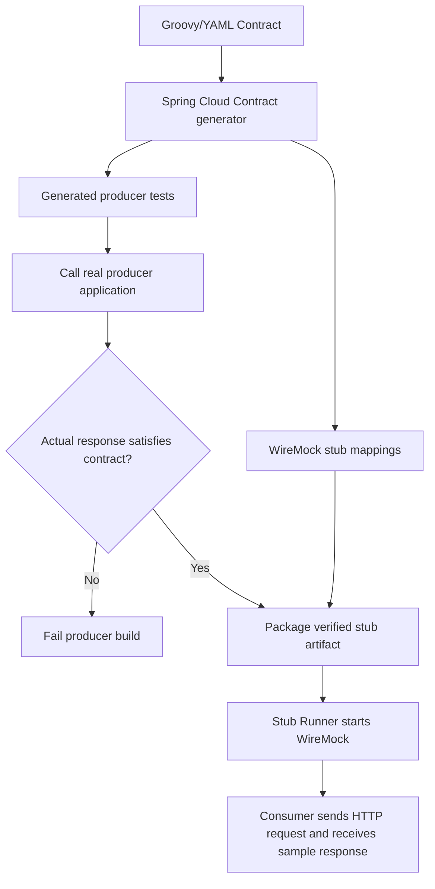
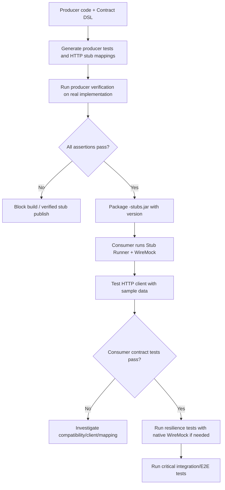

# Distinguishing WireMock Capabilities from Stub-Generating DSL Capabilities

## 1. The problem: WireMock can do it, but can the contract express it?

In a multi-service system, `Checkout Service` calls `Payment Service`'s HTTP API to check payment status. The Checkout team wants to run tests without starting Payment Service, so they use **Spring Cloud Contract** to generate stubs and **Stub Runner** to run HTTP stubs via **WireMock**.

The initial requirement is straightforward: call `GET /api/payments/42` and return `200 OK` with JSON:

```json
{
  "paymentId": 42,
  "status": "PAID",
  "receiptId": "RC-42"
}
```

Then the consumer team asks:

- Can it accept other `paymentId` values via regex or JSONPath?
- Can it return `503` on the first call and `200` on the second call?
- Can it simulate dropped connections, slow responses, or proxy requests to another server?
- Can it use request data to build a dynamic response?
- Can it record live requests and generate stubs from the recording?
- Can every WireMock configuration property be stuffed into a Groovy/YAML contract?

**The answer is not the same for every question.** WireMock is an HTTP mocking engine with rich runtime capabilities; **Spring Cloud Contract DSL** is an interface specification language used to **generate producer tests and stub mappings**. The stub generator does not expose WireMock's entire configuration API as one-to-one DSL keywords.

This topic belongs to the **WireMock** chapter of the `SPRING_CLOUD_CONTRACT` module. After this lesson, you will be able to:

1. Distinguish WireMock's capabilities, the expressive power of the Groovy/YAML DSL, and the stub-generator plugin's capabilities.
2. Recognize when a single contract suffices vs. when matchers or separate WireMock configurations are needed.
3. Understand how producer verification differs from consumer tests running HTTP stubs.
4. Evaluate advanced features such as priority, scenarios, delays, faults, proxying, recording, and templating.
5. Decide how to structure CI so simulated stubs are never mistaken for proof of real API compatibility.

## 2. Separating three layers: contract, code generation, and stub execution

Three layers must be examined separately:

| Layer | Role | Examples |
| --- | --- | --- |
| **Spring Cloud Contract Groovy/YAML DSL** | Describes shared interactions and expectations between producer and consumer | `request`, `response`, `bodyMatchers`, `matchers` |
| **Spring Cloud Contract Verifier / Stub generator** | Reads DSL to generate **producer tests** and **stub mappings** | Generated JUnit test; WireMock mapping JSON |
| **WireMock runtime** | Receives HTTP requests, selects matching mappings, returns responses | Request matching, stateful scenarios, delays, faults |



Do not invert responsibilities:

- WireMock does not execute `Payment Service` code to prove the real producer generates `receiptId` in the right format.
- Spring Cloud Contract DSL does not automatically turn **every** native WireMock option into a Groovy/YAML keyword.
- Stub Runner does not invent business logic; it orchestrates locating/loading stub artifacts and starting the appropriate mock server.

**Key rule:** A feature **available in WireMock** does not necessarily have a direct expression in the **DSL of your Spring Cloud Contract version**. Conversely, a DSL expression like `byRegex` in a response can primarily serve **producer assertions**, not tell WireMock to randomly generate regex-matching data.

## 3. Capability comparison table by goal

This is a design-orientation table, **not a fixed API promise across all versions**:

| Goal | Groovy/YAML Contract DSL | Native WireMock | Keep in mind |
| --- | --- | --- | --- |
| Method, URL, query, headers | Described directly in `request` | Request patterns | Inspect generated mappings |
| Response status/headers/body | Described directly in `response` | Response definition | Stub returns sample data |
| Field regex or data type | DSL matchers | Regex/JSONPath patterns | Request vs. response directions differ |
| JSON objects, arrays, nested fields | DSL supports structured bodies | JSON equality/JSONPath | Types, array order, extra fields must be explicit |
| Copy request values into response | DSL supports selected dynamic data mechanisms | Response templating | Not the `byRegex` matcher |
| Return response after a delay | Depends on version syntax/support or extra config | Fixed/random delay | Inspect generated mapping |
| Drop connection instead of HTTP response | Do not assume 1-to-1 DSL support | Fault simulation | Usually separate resilience tests |
| First call `503`, next call `200` | Do not assume 1-to-1 DSL support | Stateful scenarios | Requires state resets and test isolation |
| Mapping priority | May need metadata/extension or separate mappings by version | Mapping priority | Never use priority to mask conflicting contracts |
| Forward requests to upstream | Not a typical HTTP contract obligation | Proxying | Can depend on network/upstream |
| Record requests/responses to build mappings | Not a mandatory contract-generation step | Recording/snapshotting | Recorded data needs manual review |
| Webhooks or custom transformers | No automatic matching DSL keywords | WireMock Extension API | Verify extension and version support |
| Verify the real producer | Yes: Verifier generates tests from DSL | No, if only running HTTP stubs | Producer tests must run separately |
| Messaging topics/brokers | Messaging DSL and dedicated verifier/binder | HTTP WireMock does not replace brokers | Never use HTTP stubs to prove Kafka/RabbitMQ |

To determine whether a feature **passes through the stub generator**, check the full chain: **DSL version → generator output → WireMock runtime version**. A feature in WireMock 3.x cannot be assumed available if your project runs a different WireMock version or the generator does not emit it.

## 4. Standard example: one contract producing two kinds of tests

Suppose producer `Payment Service` exposes `POST /api/payments`:

```http
POST /api/payments
Content-Type: application/json

{"orderId":42,"amount":125000,"currency":"VND"}
```

Expected response:

```http
HTTP/1.1 201 Created
Content-Type: application/json

{"paymentId":900,"status":"CREATED","receiptId":"RC-900"}
```

### 4.1. Spring Cloud Contract Groovy DSL

```groovy
import org.springframework.cloud.contract.spec.Contract

Contract.make {
    description 'Create payment from order'

    request {
        method POST()
        url '/api/payments'
        headers {
            contentType(applicationJson())
        }
        body(
            orderId: 42,
            amount: 125000,
            currency: 'VND'
        )
        bodyMatchers {
            jsonPath('$.orderId', byType())
            jsonPath('$.currency', byEquality())
        }
    }

    response {
        status CREATED()
        headers {
            contentType(applicationJson())
        }
        body(
            paymentId: 900,
            status: 'CREATED',
            receiptId: 'RC-900'
        )
        bodyMatchers {
            jsonPath('$.paymentId', byType())
            jsonPath('$.status', byEquality())
            jsonPath('$.receiptId', byRegex('RC-[0-9]+'))
        }
    }
}
```

Both `bodyMatchers` blocks serve **opposite sides**:

- `request.bodyMatchers` typically helps the **stub** match incoming requests from the consumer. For instance, `orderId` is a number, not required to always equal `42` when the matcher relaxes that constraint.
- `response.bodyMatchers` helps **producer verification** check the actual response. For example, the producer can generate `receiptId="RC-18372"` instead of `RC-900`, provided it matches the pattern.

The `response.body` section still supplies **concrete values** for WireMock to return to the consumer. `byRegex('RC-[0-9]+')` does not make WireMock invent a random `receiptId`.

### 4.2. Equivalent YAML DSL

```yaml
description: Create payment from order
request:
  method: POST
  url: /api/payments
  headers:
    Content-Type: application/json
  body:
    orderId: 42
    amount: 125000
    currency: VND
  matchers:
    body:
      - path: '$.orderId'
        type: by_type
      - path: '$.currency'
        type: by_equality
response:
  status: 201
  headers:
    Content-Type: application/json
  body:
    paymentId: 900
    status: CREATED
    receiptId: RC-900
  matchers:
    body:
      - path: '$.paymentId'
        type: by_type
      - path: '$.status'
        type: by_equality
      - path: '$.receiptId'
        type: by_regex
        value: 'RC-[0-9]+'
```

This is **Spring Cloud Contract** YAML, not WireMock JSON configuration. `request.matchers.body` and `response.matchers.body` belong to Contract Verifier's DSL.

### 4.3. What does producer verification check?

The generated producer test uses the contract's concrete request to call the real API, then checks:

| Response property | Test expectation |
| --- | --- |
| HTTP status | `201` |
| Content-Type | `application/json` |
| `paymentId` | Data type compatible with sample `900` |
| `status` | Exactly `CREATED` |
| `receiptId` | Matches regex `RC-[0-9]+` |

A type-only constraint on `paymentId` does **not** guarantee the ID is greater than 0. If the consumer relies on value ranges, add stricter matchers or business assertions.

## 5. Native WireMock mapping for a similar scenario

This is a **hand-written WireMock mapping**, illustrating semantics **without guaranteeing the generator emits it verbatim**:

```json
{
  "request": {
    "method": "POST",
    "urlPath": "/api/payments",
    "headers": {
      "Content-Type": {
        "contains": "application/json"
      }
    },
    "bodyPatterns": [
      {
        "matchesJsonPath": {
          "expression": "$.orderId",
          "matches": "[0-9]+"
        }
      },
      {
        "matchesJsonPath": {
          "expression": "$.currency",
          "equalTo": "VND"
        }
      }
    ]
  },
  "response": {
    "status": 201,
    "headers": {
      "Content-Type": "application/json"
    },
    "jsonBody": {
      "paymentId": 900,
      "status": "CREATED",
      "receiptId": "RC-900"
    }
  }
}
```

**Understanding the WireMock structure:**

- `request.method`, `request.urlPath`, `request.headers`, and `bodyPatterns` are **conditions for the stub to pick this mapping**.
- `response.status`, `response.headers`, and `response.jsonBody` are the **sample response**.
- A JSON request with different pretty-printing can still satisfy JSONPath matching.
- WireMock does not know what `receiptId` the real `Payment Service` generates; this mapping simply returns `RC-900`.

Never copy `request.bodyPatterns` or `response.jsonBody` directly into a YAML contract expecting Spring Cloud Contract to understand them. They are **two different schemas**.

### 5.1. Why inspect the actual generated mapping?

From a single DSL, the generator can choose different matchers, body representations, and metadata depending on plugin/version. Therefore, if a consumer test fails to match:

1. Check the source contract used by the build.
2. Confirm the producer build generated stub mappings.
3. Open the exact mapping inside the `-stubs.jar` artifact.
4. Read that mapping's actual request patterns.
5. Compare the client's actual HTTP request against the mapping loaded by WireMock.

Never tweak a contract by guessing what JSON mapping might look like without checking **generated output**.

## 6. WireMock request matchers and Contract DSL matchers are not synonymous

Native WireMock supports many matching strategies:

| Native WireMock | Purpose | Closest Spring Cloud Contract DSL |
| --- | --- | --- |
| `equalTo` | Exact text/field match | Concrete values, `byEquality` by context |
| `matches` | Regex on strings | `regex`, `byRegex` by side |
| `equalToJson` | Structural JSON comparison | Object/list `body` and corresponding JSON matchers |
| `matchesJsonPath` | Select value inside JSON body | `jsonPath` / `matchers.body` |
| `matchesXPath`, `equalToXml` | XML matching | XML body, XPath matchers when DSL/version supports |
| `binaryEqualTo` | Byte matching | Binary/file bodies per DSL support |
| Header/cookie/query patterns | Match request parts | Header, query, cookie blocks in `request` |

The last column shows **corresponding concepts**, not a promise that the DSL shares the same names, defaults, or supports every WireMock matcher combination.

### 6.1. Consumer vs. producer sides create the difference

Consider a `receiptId` field in a Groovy **response**:

```groovy
receiptId: $(consumer('RC-900'),
             producer(regex('RC-[0-9]+')))
```

- Consumer-side `RC-900`: the stub returns that string.
- Producer-side regex: the generated producer test verifies the **actual** response.

Conversely, in a **request**:

```groovy
orderId: $(consumer(regex('[0-9]+')), producer(42))
```

- Consumer-side regex: lets the stub accept valid consumer requests.
- Producer-side `42`: the producer test needs a concrete request value.

**DSL matchers are meaningful by side and communication direction.** A regex inside a response does not automatically become a WireMock request matcher, and a regex inside a request does not force the producer test to call the API with a regex literal.

### 6.2. JSON whitespace, arrays, and data types

```json
{"orderId":42,"currency":"VND"}
```

and:

```json
{
  "currency": "VND",
  "orderId": 42
}
```

are the same JSON object in content, yet:

- `42` (number) differs from `"42"` (string).
- `"A B"` differs from `"A  B"` when whitespace is inside string values.
- `[1,2]` can differ from `[2,1]` when array order is meaningful.
- Allowing extra fields is a **different choice** from ignoring formatting whitespace.

When a contract defines specific JSONPath matchers, those matchers may protect only the targeted fields. Inspect remaining generator assertions and how WireMock handles the full JSON body; never assume any `jsonPath` equals "full schema validation."

## 7. Advanced WireMock capabilities: no automatic 1-to-1 DSL

Beyond ordinary HTTP mappings, WireMock offers features useful for **resilience testing, statefulness, or simulating downstream systems**.

### 7.1. Mapping priority

When multiple mappings match one request, WireMock can use `priority` to prefer a specific mapping—for example, a broad pattern for `/api/payments/.*` and an exact one for `/api/payments/42`.

```json
{
  "priority": 1,
  "request": {
    "method": "GET",
    "url": "/api/payments/42"
  },
  "response": {
    "status": 200,
    "jsonBody": {"paymentId": 42, "status": "PAID"}
  }
}
```

This example is a **native WireMock mapping**, not a YAML contract. In WireMock, smaller priority numbers mean higher precedence.

**Responsibility boundary:** Priority helps the stub server pick a mapping on overlap; it cannot decide how the real producer API must resolve business conflicts. If two contracts define the exact same request with conflicting responses, clarify **API semantics** first instead of picking one mapping with priority.

### 7.2. Stateful scenarios: `503` first, `200` next

WireMock can vary responses by scenario state. Two mappings collaborate to test client retries:

**First mapping — initial state:**

```json
{
  "scenarioName": "payment-retry",
  "requiredScenarioState": "Started",
  "newScenarioState": "Recovered",
  "request": {
    "method": "GET",
    "url": "/api/payments/42"
  },
  "response": {
    "status": 503,
    "jsonBody": {"code": "SERVICE_UNAVAILABLE"}
  }
}
```

**Second mapping — after state transition:**

```json
{
  "scenarioName": "payment-retry",
  "requiredScenarioState": "Recovered",
  "request": {
    "method": "GET",
    "url": "/api/payments/42"
  },
  "response": {
    "status": 200,
    "jsonBody": {"paymentId": 42, "status": "PAID"}
  }
}
```

These are **two separate native WireMock mapping files** sharing `scenarioName`; do not stick two JSON objects side-by-side in one JSON file. WireMock picks the first mapping only in `Started`, then transitions to `Recovered`; on the next call, the second mapping can match.

Testing precautions:

- Scenario state can persist across multiple requests and interfere across tests unless reset.
- If parallel tests share a server/scenario, outcomes become non-deterministic.
- Contract DSLs may offer version-specific extensions, yet **never assume** declaring two contracts with two responses automatically generates a stateful scenario.
- Producer verification of two static contracts **does not mean** consumer retry/backoff was tested.

### 7.3. Fixed delay, random delay, and fault injection

Native WireMock can add a delay before returning a response:

```json
{
  "request": {
    "method": "GET",
    "url": "/api/payments/slow"
  },
  "response": {
    "status": 200,
    "fixedDelayMilliseconds": 500,
    "jsonBody": {"status": "PAID"}
  }
}
```

This is useful when testing client timeouts. Some WireMock versions also support delay distributions and faults simulating broken connections, for example:

```json
{
  "request": {
    "method": "GET",
    "url": "/api/payments/broken"
  },
  "response": {
    "fault": "CONNECTION_RESET_BY_PEER"
  }
}
```

**Distinction:** `503` is an **HTTP response** with a status code; a connection reset is a **transport failure** that can cause the HTTP client to throw an exception before any response exists. Test them along separate error-handling branches.

The WireMock attributes `fixedDelayMilliseconds` and `fault` above are not keys you can freely copy into a Spring Cloud Contract YAML `response`. If your DSL/version supports delays or extensions, use documented syntax; otherwise, keep native WireMock config in **separate resilience tests**.

### 7.4. Proxying and recording

Native WireMock can also forward requests upstream or record live interactions to build mappings. This is convenient for **exploration/debugging** when an external service lacks contracts.

However, proxying/recording carries risks:

- Test results depend on a live upstream, breaking isolation.
- Recordings may capture **tokens, cookies, PII, or sensitive data**; scrub and audit them.
- Recorded mappings may reflect a transient state rather than a stable producer–consumer interface agreement.
- Automatic recordings **do not generate producer verification** ensuring the implementation still complies.

Use recording to **gather controlled reference data**, then review and formalize into Groovy/YAML contracts when the goal is contract testing. Never publish raw recorded mappings as proof of a committed API.

### 7.5. Extensions, webhooks, and transformers

WireMock supports extension points, such as response transformers or webhooks in supported versions/configurations. Some plugins can extend stub mappings with version-specific metadata, transformers, or custom hooks.

**Safety principle:** Never assume that because the WireMock runtime supports extensions, Spring Cloud Contract automatically manages extension lifecycles, translates the entire DSL to extensions, or produces equivalent producer tests. To use an extension, verify:

1. Exact WireMock runtime version inside Stub Runner.
2. How the extension is registered in the test context/server.
3. How metadata/config attaches to mappings after generator runs.
4. How state is reset and tests are isolated.
5. How producer verification continues checking the agreed interface.

## 8. Response templating differs from producer matchers

A producer API may need to echo `orderId` in its response. If a stub always returns `orderId=42`, consumer tests may fail to check the request–response relationship when sending different IDs.

Native WireMock supports **response templating** (Handlebars) in appropriate configurations, illustrated as:

```json
{
  "request": {
    "method": "GET",
    "urlPathPattern": "/api/orders/[0-9]+"
  },
  "response": {
    "status": 200,
    "headers": {
      "Content-Type": "application/json"
    },
    "body": "{\"orderId\":{{request.pathSegments.[2]}},\"status\":\"CREATED\"}",
    "transformers": ["response-template"]
  }
}
```

This is a **native WireMock mapping illustrating Handlebars**, requiring WireMock's templating extension to be enabled. Path-segment indexing and transformer support depend on WireMock version; verify actual output before relying on it in CI.

Spring Cloud Contract provides mechanisms to reference **values from the request** in Groovy DSL, such as the `fromRequest()` family, for certain dynamic response cases. However:

- You cannot replace `fromRequest` with `byRegex`, because matchers do not generate responses.
- Not every native Handlebars helper has a DSL equivalent.
- JSON bodies must be properly serialized; never interpolate user-supplied strings into JSON without escaping.
- Inspect **generated mappings and run real probe requests** rather than assuming a DSL expression implies full templating details.

**Distinguish three goals:**

| Goal | Primary tool/concept |
| --- | --- |
| Allow producer to return real non-sample IDs in valid format | `response.bodyMatchers` / producer matcher |
| Have stub return a fixed sample value | Concrete `response.body` |
| Have stub return data varying per request | Supported request-reference / response-templating mechanism |

## 9. Should you use DSL or native WireMock mappings?

A useful decision criterion:

**Choose the DSL when the requirement is an interface both producer and consumer commit to.** For example: method, URL, request schema, HTTP status, headers, and response body. Contracts should be verified by Verifier on the producer and consumed by Stub Runner on the consumer.

**Choose native WireMock config or supplementary tests** when simulating infrastructure conditions or resilience edge cases for a consumer test only—such as connection resets, proxying, recording, or complex stateful retry scenarios.

**Choose a deliberate combination** when one project needs both:

- Keep shared API obligations in Groovy/YAML Contract DSL.
- Place fault/scenario/recorded mappings inside separate resilience test scopes.
- If customizing stub artifacts is required, verify generation, packaging, and extension loading on your exact versions.
- Document clearly what is a **contract requirement** vs. a **test fixture**.

### 9.1. Decision matrix

| Need | Recommended starting point | Why? |
| --- | --- | --- |
| GET returns `200`, valid JSON body | Spring Cloud Contract DSL | Both producer and consumer need verification |
| POST with JSONPath matchers | Spring Cloud Contract DSL | Protects input format and values |
| Dynamically generated Receipt ID on producer | DSL response matcher | Avoids brittle hardcoded values |
| Echo order ID from request | DSL dynamic value mechanism if supported | Must verify stub and producer share semantics |
| First `503`, next `200` | Native WireMock scenario or verified extension | Stateful stub behavior, not two static contracts by default |
| Simulated TCP connection drop | Separate WireMock fault test | No HTTP status for ordinary assertions |
| Record upstream requests | WireMock recording with data controls | Recorded traffic is not yet a reviewed contract |
| Broker emits `PaymentCompleted` event | Messaging DSL + message verifier/binder | HTTP WireMock is not Kafka/RabbitMQ |
| Verify real JWT signatures | Producer security/integration tests | Stub header matching does not verify signatures |

## 10. Stub Runner vs. direct WireMock

### 10.1. Using Stub Runner in consumer contract tests

After the producer publishes `com.example:payment-service:1.0.0:stubs`, the consumer can use:

```java
import org.junit.jupiter.api.Test;
import org.springframework.boot.test.context.SpringBootTest;
import org.springframework.cloud.contract.stubrunner.spring.AutoConfigureStubRunner;
import org.springframework.cloud.contract.stubrunner.spring.StubRunnerProperties;

@SpringBootTest(properties = {
    "payment.client.base-url=http://localhost:8090"
})
@AutoConfigureStubRunner(
    ids = "com.example:payment-service:1.0.0:stubs:8090",
    stubsMode = StubRunnerProperties.StubsMode.LOCAL
)
class CheckoutPaymentClientContractTest {

    @Test
    void checkoutHandlesCreatedPayment() {
        // Call the real PaymentClient against WireMock on port 8090.
        // Verify DTO mapping and application logic upon receiving 201.
    }
}
```

This is a **skeleton**; real tests must configure the HTTP client and assertions rather than leaving comment-only method bodies. The stub artifact must be installed in the local Maven repository when using `LOCAL`, or configured with an appropriate repository mode in CI.

Stub Runner handles **locating/downloading artifacts**, starting stub servers, and loading mappings; the WireMock runtime executes **HTTP request matching and responses**.

### 10.2. Using direct WireMock for resilience tests

When testing `PaymentClient` against `503` errors or connection resets, you can start WireMock directly and register dedicated mappings. Depending on your project's Spring Cloud Contract/WireMock versions, one option is `@AutoConfigureWireMock(port = 0)`:

```java
import org.springframework.boot.test.context.SpringBootTest;
import org.springframework.cloud.contract.wiremock.AutoConfigureWireMock;

@SpringBootTest
@AutoConfigureWireMock(port = 0)
class PaymentClientResilienceTest {
    // Use WireMock Java API or mapping files to simulate faults.
    // The dynamic WireMock port can be retrieved via wiremock.server.port.
}
```

This does not automatically download `-stubs.jar` from the producer artifact. If a test loads native mappings directly, **no producer verification is generated** from them. Keep goals distinct: contract compatibility tests vs. HTTP client resilience/integration tests.

### 10.3. Code depends on actual versions

Spring Cloud Contract, WireMock, and Spring Boot packages evolve across release trains. You should:

1. Pin compatible Spring Boot and Spring Cloud BOM versions.
2. Select matching Spring Cloud Contract Maven/Gradle plugin versions.
3. Confirm the actual WireMock version brought onto the classpath by Stub Runner or `spring-cloud-contract-wiremock`.
4. Verify DSL syntax, `@AutoConfigureStubRunner`, `@AutoConfigureWireMock`, and extension configuration against your exact versions.

Never force a newer WireMock version solely for a native feature without checking compatibility with the stub generator and Boot test classpath.

## 11. Security boundary: WireMock header matching does not verify identity

Suppose a WireMock mapping has:

```json
{
  "request": {
    "method": "GET",
    "url": "/api/payments/42",
    "headers": {
      "Authorization": {
        "matches": "Bearer .+"
      }
    }
  },
  "response": {
    "status": 200
  }
}
```

The mapping only checks that the header starts with `Bearer ` followed by a non-empty suffix. It does **not** prove the token is valid, has the right issuer/audience, is unexpired, or carries required authorities.

Combine layers:

- **Consumer tests with stubs:** verify the HTTP client sends the header and handles agreed `200`, `401`, `403` statuses.
- **Producer security integration/contract tests:** verify requests pass through the real `SecurityFilterChain` and authorization rules are enforced.
- **E2E tests:** verify gateways, mTLS, IdP, or auth infrastructure as needed.

Never store production tokens, real passwords, or PII in contracts, native mappings, or recordings. When a demo bearer token is needed, use dummy test values incapable of accessing production resources.

## 12. Messaging boundary: WireMock simulates HTTP only

Spring Cloud Contract also provides a messaging DSL, for example:

```groovy
import org.springframework.cloud.contract.spec.Contract

Contract.make {
    label 'payment_completed'
    input {
        triggeredBy('completePaymentAndPublish()')
    }
    outputMessage {
        sentTo('payments.completed')
        body(
            eventType: 'PaymentCompleted',
            paymentId: 42
        )
    }
}
```

This is a **message contract**. To verify it, the producer needs a message verifier/transport (such as Spring Cloud Stream test binder or matching integration); the consumer needs a properly configured message stub/trigger.

**HTTP WireMock does not create Kafka topics, RabbitMQ queues, or guarantee acknowledgements, ordering, retries, or exactly-once delivery.** Even though Stub Runner participates in both HTTP and messaging, **WireMock does not replace a message broker**. Choose the right testing layer.

## 13. Loading extra native mappings into Stub Runner: handle packaging carefully

Some projects want one stub server to serve both contract-generated mappings and custom native mappings. That may be possible depending on packaging and WireMock setup, yet never happens automatically just because you placed a JSON file somewhere in the repository.

Distinguish three sources:

1. **Groovy/YAML contracts:** the generator creates producer tests and stub mappings.
2. **Hand-written native WireMock mappings:** act only as HTTP stubs when loaded by the server; they never generate producer tests.
3. **`-stubs.jar` artifact:** holds mappings/contracts packaged by the build per plugin version and configuration.

To combine them safely:

- Inspect mapping paths inside the artifact and Stub Runner's resource loader settings.
- Prevent new native mappings from silently overwriting generated mappings.
- Document which mappings belong to contracts and which serve resilience/negative tests.
- Configure reset and lifecycle rules if using stateful scenarios/extensions.
- Never treat a native mapping packaged in the JAR as producer behavior verified by Verifier.

**Never edit generated mappings inside output directories and treat them as a source of truth.** They will be overwritten on the next build. Update DSL sources/generator config or keep native mappings in separate test sources with an explicit loading mechanism.

## 14. Troubleshooting: WireMock has the feature, yet the test fails

| Symptom | Possible cause | How to check |
| --- | --- | --- |
| Added `fault` to Contract YAML and parsing failed | Native structure is not DSL schema | Use supported DSL syntax or separate WireMock tests |
| WireMock runtime supports templating yet response stays unrendered | Transformer disabled or incompatible helper syntax | Check runtime extensions and loaded mappings |
| Scenario always returns `200` or `503` | Leftover state from prior test or overlapping mapping | Inspect request journal, reset scenarios |
| `@AutoConfigureStubRunner` does not load hand-written mapping | File missing from artifact or loader skips it | Inspect `-stubs.jar` and startup logs |
| Consumer gets `404` from stub | Unmatched request or intentional `404` stub | Distinguish unmatched requests from business responses |
| JSON body differs from expectations | Sample stub differs from real producer or stale artifact | Check contract, artifact version, and generated mapping |
| Producer test green yet consumer hits timeout | Producer test does not model network failure conditions | Add separate resilience tests for delays/faults |
| Priority resolves stub conflict yet API stays wrong | Two contracts describe conflicting behavior | Review request conditions/API versions |
| Passes locally, fails in CI | Port collision, missing artifact, different clock/state | Use dynamic ports, isolate state, pin versions |
| Security test passes with dummy token | WireMock only matched header string | Run producer security integration tests |

### 14.1. Minimal investigation workflow

1. **Identify what is running:** generated producer test, Stub Runner consumer test, or native WireMock integration test?
2. **Verify versions:** Spring Cloud Contract plugin, WireMock runtime, related dependencies.
3. **Trace mapping origin:** Groovy/YAML contract, hand-written native mapping, or recorded mapping?
4. **Inspect loaded generated mapping:** method, URL, `bodyPatterns`, response, transformers, priority, scenario state.
5. **Compare actual request** from the HTTP client against the request pattern, not just what you intended to send.
6. **Check state and extensions:** reset scenarios/request journal, confirm transformers are registered.
7. **Run producer verification** whenever you suspect the stub and current implementation drifted out of sync.

For test WireMock servers, the Admin API helps inspect mappings, request journals, and unmatched requests. Never expose admin endpoints capable of modifying mappings to public networks; use them only in trusted test environments.

## 15. CI workflow: two test suites should not be merged into one

A pipeline can separate clearly:



CI considerations:

- **Generated producer tests must actually execute**, not merely be generated.
- **Stub artifacts count as verified** only after producer verification passes.
- **Consumers must pin the right artifact version** and invoke the real client instead of only checking that WireMock starts.
- **Native fault/scenario tests** must isolate state, ports, timeouts, and cleanup to avoid flakiness.
- **Do not cram every fault into the Contract DSL** when it is not a shared producer–consumer interface obligation.
- **Do not treat passing native WireMock tests as proof the producer implementation works**; they serve different goals.
- **Flag compatibility changes** whenever status codes, headers, required fields, or URLs change.

## 16. Practice exercise: classifying requirements by tool

Suppose `Inventory Service` provides `GET /api/stock/sku-1`. Consumer `Order Service` needs stock data:

```json
{
  "sku": "sku-1",
  "available": 12
}
```

The QA team lists six requirements:

1. `GET /api/stock/sku-1` must return `200` with JSON containing `sku` and `available`.
2. Client sends `Accept: application/json` and decodes the `available` field.
3. When upstream responds 800 ms late, the client must time out/fall back properly.
4. Across two calls, the stub returns `503` then `200` to verify retries.
5. Producer must reject spoofed JWTs with `401` through the real security filter.
6. Inventory also emits a Kafka event `StockReserved` on reservation requests.

### 16.1. Classifying test approaches

| Requirement | Primary recommended tool | Explanation |
| --- | --- | --- |
| 1 | Spring Cloud Contract Groovy/YAML + producer verification | Guards shared HTTP behavior |
| 2 | Stub Runner/WireMock consumer test | Guards client requests and DTO mapping |
| 3 | Native WireMock delay/fault test | Guards client resilience without treating latency as an API obligation |
| 4 | WireMock stateful scenario | Verifies consumer stateful retry behavior |
| 5 | Spring Security/producer integration test, optionally plus a `401` contract | WireMock does not decode/verify real JWTs |
| 6 | Messaging DSL + message verifier/binder + broker tests when needed | HTTP WireMock does not simulate Kafka |

### 16.2. Self-authored YAML contract exercise

Complete this contract and explain what it can generate:

```yaml
description: Fetch stock for an item SKU
request:
  method: GET
  url: /api/stock/sku-1
  headers:
    Accept: application/json
response:
  status: 200
  headers:
    Content-Type: application/json
  body:
    sku: sku-1
    available: 12
  matchers:
    body:
      - path: '$.sku'
        type: by_equality
      - path: '$.available'
        type: by_type
```

**Answer hint:** The DSL can generate a producer test checking HTTP `200`, media type, `sku`, and the type of `available`, as well as an HTTP stub mapping returning the sample body to the consumer. It **does not automatically generate** a stateful `503 → 200` retry scenario, reset WireMock between tests, or start Kafka.

### 16.3. Three critical-thinking questions

1. If WireMock supports proxying yet the producer's stub artifact contains no proxy config, can we conclude Stub Runner will proxy? **No**; runtime capability does not mean a mapping enabled it.
2. If a DSL response regex matcher allows `available` to be any number, will WireMock return a random number on each call? **No**; stub responses use configured sample data or templating.
3. If consumer tests with WireMock pass after the producer drops the `available` field, is the pipeline safe? **Not yet**; producer verification must run with the matching contract against the current implementation.

## 17. Checklist before choosing how to create stubs

- Is the goal **interface commitment** or client **fault/resilience simulation**?
- Have you distinguished the Contract DSL, stub generator, and WireMock runtime?
- Did you verify the specific feature is supported by **your active DSL/plugin version** rather than just seeing it in WireMock docs?
- For any matcher, did you identify whether it serves **stub request matching** or **producer response assertion**?
- If using templating, did you verify escaping, sample responses, extensions, and generated mappings?
- If using stateful scenarios, did you configure resets/cleanup and prevent parallel test interference?
- If using native mappings, did you document that they **do not automatically generate producer tests**?
- Does Stub Runner load the right mappings, artifact version, transformers, and priorities?
- Does producer verification actually run and publish stubs only after passing?
- Have you kept necessary security, messaging, broker, and E2E tests outside HTTP stub scope?

**References to check by version:**

- [Spring Cloud Contract — Reference](https://docs.spring.io/spring-cloud-contract/reference/).
- [Spring Cloud Contract — Contract DSL and Dynamic Properties](https://docs.spring.io/spring-cloud-contract/reference/project-features-contract/dsl-dynamic-properties.html).
- [Spring Cloud Contract — Stub Runner](https://docs.spring.io/spring-cloud-contract/reference/project-features-stubrunner.html).
- [WireMock — Stubbing](https://wiremock.org/docs/stubbing/).
- [WireMock — Request Matching](https://wiremock.org/docs/request-matching/).
- [WireMock — Stateful Behaviour](https://wiremock.org/docs/stateful-behaviour/).
- [WireMock — Response Templating](https://wiremock.org/docs/response-templating/).

**Remember:** **WireMock is an HTTP stub engine with rich runtime capabilities**; **Spring Cloud Contract DSL is a contract definition language**, and the **generator** determines what becomes producer tests and stub mappings. Not every WireMock option has a 1-to-1 DSL syntax, and not every DSL matcher affects the stub response. Use the DSL for API obligations verified on both producer and consumer; use native WireMock deliberately for advanced simulation scenarios; inspect generated artifacts and run both producer verification and consumer tests before trusting integration compatibility.
