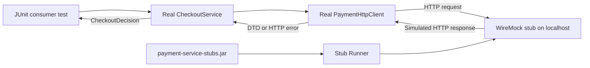
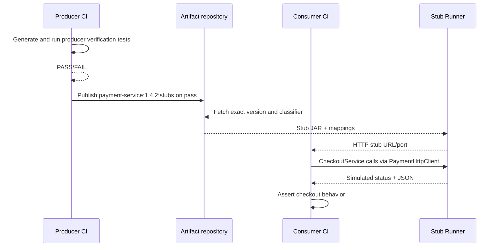

# Testing Consumer HTTP Client Code with a Real Stub

## 1. What Does a "Real Stub" Mean in Consumer Tests?

In a system using **Spring Cloud Contract (SCC)**, the **producer** implements an HTTP API (or emits messages), while the **consumer** calls that API or receives those messages. Both sides agree on the behavior using the **Groovy/YAML DSL**, the producer generates **verification tests** and **stub artifacts**, and the consumer uses **Stub Runner** to start the stub and verify its service-calling code. CI can connect these steps to detect incompatible API changes early.

Here, a **"real stub" is not the production producer**. It is an **actual HTTP stub server listening on a network port** (typically WireMock managed by Stub Runner) that loads request/response mappings from the published stub package. The consumer test sends HTTP requests through the **consumer application's own HTTP client code** to the stub, receives the status/headers/body, and verifies how the consumer handles them.

Suppose `checkout-service` calls `payment-service` to determine whether a payment has been completed. Mocking only the client method with Mockito:

```java
when(paymentHttpClient.loadPayment("PAY-42"))
    .thenReturn(new PaymentDto("PAY-42", "CAPTURED", 150000L, "VND"));
```

can help unit test the checkout logic. However, it **does not verify** whether the client uses the right method, URL, headers, JSON decoder, and error handling. Testing an HTTP client with a stub requires **running real consumer code** and replacing the **producer dependency** with an HTTP stub, rather than replacing the HTTP client itself with a mock object.

### Learning Objectives

- Distinguish between a mock client, an HTTP stub, a real producer, and the role of each testing layer.
- Understand how Stub Runner resolves artifacts by `groupId:artifactId:version:classifier` from `CLASSPATH`, `LOCAL`, or `REMOTE`.
- Write Spring Boot + Stub Runner tests that invoke the real **PaymentHttpClient** and **CheckoutService**.
- Configure the base URL and fixed/dynamic ports, avoiding accidental calls to production or merely exercising WireMock directly.
- Verify `200`, `404`, business states, and required error paths.
- Diagnose missing artifacts, requests not matching mappings, wrong port connections, and false-green tests.
- Integrate producer verification, stub versioning, and consumer tests into CI.

> **Scope of evidence:** A green consumer test against a stub only proves that **the consumer interacts properly with the loaded simulated behavior**. To verify the producer implementation, you must run the **generated producer verification tests against the actual producer build**.

## 2. Four Testing Levels and Their Boundaries

| Testing Approach | Consumer Code Executed | HTTP Over Socket? | Real Producer? | Evidence |
|---|---|---|---|---|
| Mockito mock of `PaymentHttpClient` | CheckoutService, bypassing the real HTTP client | No | No | Consumer logic reacts properly to a mock object |
| Mock transport / client unit test | HTTP client class, fake transport | No | No | Request building/parsing/error mapping at client level |
| **Stub Runner + real HTTP client** | Client + CheckoutService | **Yes**, to WireMock stub | No | Consumer calls the simulated interface correctly |
| Consumer + producer running together in test | Both implementations | Yes | Yes, in the test environment | Implementation integration across tested scenarios |

A single test does not need to verify everything at once. Unit tests can be fast and precise for checkout algorithms; **consumer HTTP integration tests with Stub Runner** add evidence at the collaborator call boundary; producer verification protects the producer code.



The difference from "mocking everything" is that the **real client builds and sends HTTP requests**, the real parser processes JSON, and the real business logic determines the outcome. The difference from an end-to-end test is that the **real producer is not in the call path**.

## 3. Preparing the Stub Artifact from the Producer

Suppose the producer publishes:

```text
groupId    = com.acme.billing
artifactId = payment-service
version    = 1.4.2
classifier = stubs
```

Stub ID:

```text
com.acme.billing:payment-service:1.4.2:stubs
```

The package may be named `payment-service-1.4.2-stubs.jar` and contain WireMock mappings. Depending on the infrastructure, Stub Runner resolves artifacts using:

| Mode | Source | When to Use |
|---|---|---|
| `CLASSPATH` | Stub artifact on the test classpath | Projects that include stubs in test dependencies |
| `LOCAL` | Local Maven repo such as `~/.m2` | The producer has already run `install` for the stub JAR locally |
| `REMOTE` | Remote artifact repository | CI uses Nexus/Artifactory or an authorized repository |

These three modes have **different semantics**. If the artifact only exists in a remote repository, `LOCAL` will not automatically download it when the local repo does not have that version yet. If only `payment-service-1.4.1-stubs.jar` exists, a request for `1.4.2` will not be satisfied automatically.

On the producer side, the reliable workflow is **generate verification tests → run tests → package & publish the stub artifact**. If a contract is published early to unblock a consumer before the producer has an implementation (for example, an in-progress contract), it must be noted that the stub **has not yet been verified by the producer**.

### 3.1. Stub ID vs. HTTP Stub URL

```text
Stub ID:
  com.acme.billing:payment-service:1.4.2:stubs:18081

Stub URL at test runtime:
  http://localhost:18081/api/payments/PAY-42

Producer URL in a real environment:
  https://payments.example.internal/api/payments/PAY-42
```

Port `18081` is the **HTTP stub server** port, not part of the Maven artifact GAV. Tests must never silently fall back to the real producer URL when Stub Runner fails to start.

## 4. Designing Three HTTP Scenarios Before Writing Tests

Suppose both sides agree on an illustrative API:

| Scenario | Request | Stub Response | Checkout Behavior |
|---|---|---|---|
| Completed payment | `GET /api/payments/PAY-42` | `200`, `state: CAPTURED` | Allow checkout |
| Pending payment | `GET /api/payments/PAY-17` | `200`, `state: PENDING` | Do not allow checkout yet |
| Non-existent payment | `GET /api/payments/PAY-404` | `404`, `code: PAYMENT_NOT_FOUND` | Report not found |

**These are illustrative API rules for this lesson**, not default SCC behavior.

### 4.1. YAML Contract for `200 CAPTURED`

```yaml
name: payment_captured
description: "Consumer looks up a captured payment"
request:
  method: GET
  url: /api/payments/PAY-42
  headers:
    Accept: application/json
response:
  status: 200
  headers:
    Content-Type: application/json
  body:
    paymentId: "PAY-42"
    state: "CAPTURED"
    amount: 150000
    currency: "VND"
```

### 4.2. YAML Contract for `200 PENDING`

```yaml
name: payment_pending
description: "Pending payment"
request:
  method: GET
  url: /api/payments/PAY-17
response:
  status: 200
  headers:
    Content-Type: application/json
  body:
    paymentId: "PAY-17"
    state: "PENDING"
    amount: 150000
    currency: "VND"
```

### 4.3. YAML Contract for `404`

```yaml
name: payment_missing
description: "Payment PAY-404 does not exist"
request:
  method: GET
  url: /api/payments/PAY-404
response:
  status: 404
  headers:
    Content-Type: application/json
  body:
    code: "PAYMENT_NOT_FOUND"
    message: "Payment not found"
```

**Pay special attention to `404`:** if a request does not match any WireMock mapping, the stub may also return `404`. A test that only asserts status `404` risks a false green. You should verify the error body/code (if exposed by the HTTP client), request matching, and a clear consumer outcome.

### 4.4. An Equivalent Groovy DSL Definition

Example for the CAPTURED scenario alone:

```groovy
import org.springframework.cloud.contract.spec.Contract

Contract.make {
    name('payment_captured')
    request {
        method GET()
        url '/api/payments/PAY-42'
        headers {
            accept(applicationJson())
        }
    }
    response {
        status OK()
        headers {
            contentType(applicationJson())
        }
        body(
            paymentId: 'PAY-42',
            state: 'CAPTURED',
            amount: 150000,
            currency: 'VND'
        )
    }
}
```

The same scenario can be written in Groovy **or** YAML; there is no need to create two duplicate request definitions unless the project has a clear reason. Stub Runner uses the post-build mappings, so the consumer test code does not need to know which DSL the original contract was written in.

## 5. HTTP Client Code Must Be Consumer Production Code

The example uses **Spring Boot 3.2+ / Spring Framework 6.1+** with `RestClient`. Projects using `RestTemplate` or `WebClient` follow the same principle: **test the real HTTP client class used by the application**, rather than replacing it with a custom client written solely for tests.

### 5.1. DTO in the Consumer

```java
package com.acme.checkout.payment;

public record PaymentDto(
    String paymentId,
    String state,
    long amount,
    String currency
) {}
```

Using `long amount` is only appropriate when the API agrees on integer units. If the API uses decimal currency values, both sides must agree on the format and type (for example `BigDecimal`) instead of guessing.

### 5.2. PaymentHttpClient: Configurable Base URL, Real Calls

```java
package com.acme.checkout.payment;

import org.springframework.beans.factory.annotation.Value;
import org.springframework.stereotype.Component;
import org.springframework.web.client.RestClient;

@Component
public class PaymentHttpClient {
    private final RestClient client;

    public PaymentHttpClient(
            RestClient.Builder builder,
            @Value("${payment.api.base-url}") String baseUrl) {
        this.client = builder.baseUrl(baseUrl).build();
    }

    public PaymentDto loadPayment(String paymentId) {
        return client.get()
            .uri("/api/payments/{id}", paymentId)
            .header("Accept", "application/json")
            .retrieve()
            .body(PaymentDto.class);
    }
}
```

Here, `@Value("${payment.api.base-url}")` reads the **base URL from Spring configuration**. In tests, the `payment.api.base-url` property is pointed to the HTTP stub instead of the producer URL; the `PaymentHttpClient` code remains identical between production runtime and the test environment.

**Key point:** `PaymentHttpClient` builds a real `RestClient` and parses `PaymentDto`, so testing through the stub can catch HTTP method, URL, header, and serialization/decoder bugs. Never hard-code the production host in code, and never silently fall back to production when test configuration is missing.

### 5.3. CheckoutService: Business Decision

```java
package com.acme.checkout;

import com.acme.checkout.payment.PaymentDto;
import com.acme.checkout.payment.PaymentHttpClient;
import org.springframework.stereotype.Service;
import org.springframework.web.client.HttpClientErrorException;

@Service
public class CheckoutService {
    private final PaymentHttpClient payments;

    public CheckoutService(PaymentHttpClient payments) {
        this.payments = payments;
    }

    public CheckoutDecision evaluate(String paymentId) {
        try {
            PaymentDto payment = payments.loadPayment(paymentId);
            if (payment != null
                    && paymentId.equals(payment.paymentId())
                    && "CAPTURED".equals(payment.state())) {
                return new CheckoutDecision(true, "READY");
            }
            return new CheckoutDecision(false, "PAYMENT_PENDING");
        } catch (HttpClientErrorException.NotFound exception) {
            return new CheckoutDecision(false, "PAYMENT_NOT_FOUND");
        }
    }

    public record CheckoutDecision(boolean accepted, String reason) {}
}
```

The example handles the three agreed branches without catching every HTTP error and turning it into `404`. With default `RestClient.retrieve()`, HTTP error responses are typically converted into `RestClientResponseException` and its corresponding subclasses. If your project uses `onStatus(...)` or a custom error handler, the tests must assert the **actual code behavior** rather than assuming it matches this snippet.

## 6. Adding the Stub Runner Dependency in **Consumer Test Scope**

Maven dependencies (excerpt):

```xml
<dependencies>
    <dependency>
        <groupId>org.springframework.boot</groupId>
        <artifactId>spring-boot-starter-web</artifactId>
    </dependency>

    <dependency>
        <groupId>org.springframework.boot</groupId>
        <artifactId>spring-boot-starter-test</artifactId>
        <scope>test</scope>
    </dependency>

    <dependency>
        <groupId>org.springframework.cloud</groupId>
        <artifactId>spring-cloud-starter-contract-stub-runner</artifactId>
        <scope>test</scope>
    </dependency>
</dependencies>
```

Gradle Groovy DSL:

```groovy
dependencies {
    implementation 'org.springframework.boot:spring-boot-starter-web'
    testImplementation 'org.springframework.boot:spring-boot-starter-test'
    testImplementation 'org.springframework.cloud:spring-cloud-starter-contract-stub-runner'
}
```

These are **illustrative snippets**, excluding the BOM and version management. Verify Boot/Cloud/SCC compatibility before running.

The producer needs **Contract Verifier + SCC plugin** to generate producer tests and the stub artifact; the consumer test needs **Stub Runner** to download/run the artifact. Do not put Stub Runner into production runtime just to run consumer tests, and do not install the SCC generator plugin on the consumer expecting it to rewrite HTTP client URLs automatically.

## 7. Real Consumer Test with Stub Runner on a Fixed Port

To make the wiring mechanism easy to follow, the first example uses port **18081**. This works for isolated test runs, but you should switch to dynamic ports or environment isolation when multiple CI jobs run concurrently.

Assume `payment-service-1.4.2-stubs.jar` has been installed via `install` into the local Maven repo and contains the three mappings from Section 4.

```java
package com.acme.checkout;

import org.junit.jupiter.api.Test;
import org.springframework.beans.factory.annotation.Autowired;
import org.springframework.boot.test.context.SpringBootTest;
import org.springframework.cloud.contract.stubrunner.spring.AutoConfigureStubRunner;
import org.springframework.cloud.contract.stubrunner.spring.StubRunnerProperties;

import static org.junit.jupiter.api.Assertions.*;

@SpringBootTest(
    webEnvironment = SpringBootTest.WebEnvironment.NONE,
    properties = "payment.api.base-url=http://localhost:18081"
)
@AutoConfigureStubRunner(
    ids = "com.acme.billing:payment-service:1.4.2:stubs:18081",
    stubsMode = StubRunnerProperties.StubsMode.LOCAL
)
class CheckoutConsumerContractTest {
    @Autowired CheckoutService checkoutService;

    @Test
    void capturedPaymentAllowsCheckout() {
        var result = checkoutService.evaluate("PAY-42");
        assertTrue(result.accepted());
        assertEquals("READY", result.reason());
    }

    @Test
    void pendingPaymentDoesNotAllowCheckout() {
        var result = checkoutService.evaluate("PAY-17");
        assertFalse(result.accepted());
        assertEquals("PAYMENT_PENDING", result.reason());
    }

    @Test
    void missingPaymentIsHandled() {
        var result = checkoutService.evaluate("PAY-404");
        assertFalse(result.accepted());
        assertEquals("PAYMENT_NOT_FOUND", result.reason());
    }
}
```

**Why this test is valuable:**

1. `@SpringBootTest` creates the application context with the real `CheckoutService` and `PaymentHttpClient`.
2. Stub Runner loads the `LOCAL` stub artifact and starts the HTTP stub on `18081`.
3. `payment.api.base-url` is injected into the client when the Spring bean is created, pointing to the stub.
4. `checkoutService.evaluate(...)` calls the real production client and receives the simulated HTTP response.
5. Assertions verify the **checkout decision**, not just that the stub returns `200`.

If Stub Runner fails to download/resolve the artifact, the test must fail clearly. If the mappings `PAY-42`, `PAY-17`, or `PAY-404` are missing, the results may fail; this helps surface mismatches between test data assumptions and the actual artifact.

### 7.1. Anti-Example: Creating a Separate Client Just to Call the Stub

```java
@Test
void onlyTestsStubMapping() {
    var dto = RestClient.create("http://localhost:18081")
        .get()
        .uri("/api/payments/PAY-42")
        .retrieve()
        .body(PaymentDto.class);

    assertEquals("CAPTURED", dto.state());
}
```

This test only proves that **the stub is running and an ad hoc client can read the response**. It does not test configuration, error handlers, retries, timeouts, or the logic of `PaymentHttpClient` or `CheckoutService` in the application. In consumer contract testing, exercise the **actual production path**, do not bypass it.

### 7.2. Drawbacks of a Fixed Port

Two test JVMs sharing `18081` can collide. Another service might already occupy the port, causing the test to call the wrong server. A fixed port is a **choice for illustrating wiring**, not a good default for parallel CI. Dynamic port usage is covered next.

## 8. Dynamic Ports with `@StubRunnerPort` and `StubFinder`

In CI, dynamic ports reduce collisions. When **no port is specified** in the Stub ID, Stub Runner picks an available port within its configured range. You can obtain the actual port after the stub starts using:

```java
@StubRunnerPort("com.acme.billing:payment-service")
int paymentStubPort;
```

or look up the full URL using `StubFinder`:

```java
@Autowired
StubFinder stubFinder;

URL paymentStubUrl = stubFinder.findStubUrl(
    "com.acme.billing", "payment-service");
```

This is the **stub's URL**, not the real producer URL. Use `groupId:artifactId` when multiple producers share the same `artifactId`; use only `artifactId` if there is no ambiguity.

### 8.1. Example Test Using a Dynamic Port While Still Running Real Consumer Code

When the consumer client is designed to accept its base URL via constructor, you can instantiate the **actual production classes** `PaymentHttpClient` and `CheckoutService` in the test to avoid hard-coding a port:

```java
@SpringBootTest(webEnvironment = SpringBootTest.WebEnvironment.NONE)
@AutoConfigureStubRunner(
    ids = "com.acme.billing:payment-service:1.4.2:stubs",
    stubsMode = StubRunnerProperties.StubsMode.LOCAL
)
class CheckoutDynamicPortTest {

    @StubRunnerPort("com.acme.billing:payment-service")
    int paymentPort;

    @Autowired
    RestClient.Builder restClientBuilder;

    @Test
    void checkoutCallsStubOnAssignedPort() {
        String stubUrl = "http://localhost:" + paymentPort;

        // These two classes are consumer production code, not mocks.
        PaymentHttpClient client =
            new PaymentHttpClient(restClientBuilder, stubUrl);
        CheckoutService checkout = new CheckoutService(client);

        var result = checkout.evaluate("PAY-42");

        assertTrue(result.accepted());
        assertEquals("READY", result.reason());
    }
}
```

This **genuinely runs the consumer's HTTP client code and business logic** over a dynamic port. However, it **does not verify Spring auto-wiring `payment.api.base-url` into the bean**, because the test invokes the constructor directly. If dependency injection wiring is a risk area you need to guard, choose one of these approaches:

- A fixed-port test as in Section 7 to verify application Spring configuration from startup; or
- Creating a **test configuration**/client factory that obtains the stub URL once Stub Runner is ready and injects the real production classes, verifying bean initialization order; or
- For HTTP clients using service discovery, configuring **Stub Runner Spring Cloud integration** so discovery routes to the stub, according to your version.

Avoid a `@DynamicPropertySource` solution that reads `@StubRunnerPort` inside a **static method**: the stub port field is injected into the test instance only after Stub Runner starts, whereas dynamic properties are evaluated while building the application context. Getting the lifecycle wrong can point the test to port 0 or a stale port.

### 8.2. Getting the URL Directly via StubFinder

```java
@Autowired StubFinder stubFinder;

@Test
void checkoutWithFoundStubUrl() {
    String url = stubFinder
        .findStubUrl("com.acme.billing", "payment-service")
        .toString();

    PaymentHttpClient realClient =
        new PaymentHttpClient(restClientBuilder, url);
    CheckoutService service = new CheckoutService(realClient);

    assertTrue(service.evaluate("PAY-42").accepted());
}
```

This is an **excerpt** requiring `restClientBuilder` and the appropriate imports. `StubFinder` has the advantage of automatically reflecting the host/port the stub started on; it throws an exception if the ID is wrong or the server was not created. Never catch that error and fall back to the production URL.

### 8.3. Environment Properties and When Spring Initializes Beans

Stub Runner can register port properties for running stubs, such as `stubrunner.runningstubs.payment-service.port` or the full form including the group ID; check the exact prefix for your **Spring Cloud Contract version**. In particular, **do not assume** properties registered by Stub Runner will be available at every arbitrary phase of bean configuration.

If the client needs its base URL immediately when the application context initializes, use a solution with a verified lifecycle rather than setting a non-existent placeholder port and tolerating flaky tests. Inspect generated runtime logs and try a test case where you intentionally alter the URL to confirm the test does not accidentally point to production.

## 9. Avoiding False-Green Tests When Stub Runner Returns `404`

A subtle pitfall: **WireMock can also return `404` for requests that do not match any mapping**. If the consumer catches every HTTP `404` and returns `PAYMENT_NOT_FOUND`, the `missingPaymentIsHandled` test in Section 7 may pass even if the `payment_missing` contract was never loaded properly.

### 9.1. Verify the Error Body Matches the Contract

Keep the test on CheckoutService's output, and add an HTTP-client-level assertion for the error branch:

```java
@Autowired PaymentHttpClient paymentHttpClient;
@Autowired ObjectMapper objectMapper;

@Test
void notFoundResponseHasDomainErrorCode() throws Exception {
    var exception = assertThrows(
        HttpClientErrorException.NotFound.class,
        () -> paymentHttpClient.loadPayment("PAY-404")
    );

    JsonNode errorBody =
        objectMapper.readTree(exception.getResponseBodyAsString());

    assertEquals(
        "PAYMENT_NOT_FOUND",
        errorBody.path("code").asText()
    );
}
```

This snippet is an **addition** to the test class in Section 7 and requires appropriate Jackson/JUnit imports. It verifies that the **real client** receives the expected error envelope. If Stub Runner returns a default `404` without the `PAYMENT_NOT_FOUND` body, the assertion will fail.

In a stronger design, `PaymentHttpClient` can translate a `404` with code `PAYMENT_NOT_FOUND` into a **structured domain exception**; `CheckoutService` then checks that explicit business error type instead of mapping every `404` to a single meaning. This design should be agreed upon with the producer, since some APIs return multiple error codes under the same HTTP status.

### 9.2. Verify the Expected Mapping Was Hit

You can inspect received requests via the **WireMock request journal/admin API** when needed, or write integration tests with assertions on specific errors and payloads/headers. Checking only that the "stub server is running" or calling `/__admin/mappings` without exercising consumer code **does not replace** testing the client.

If Stub Runner supports dumping mappings via configuration, use that export for debugging. Do not assume access to a separate WireMock port or edit mappings inside the test and treat them as mappings from the published producer artifact.

## 10. Testing HTTP Details That Consumers Commonly Get Wrong

| What the Consumer Actually Depends On | Example | How to Verify It |
|---|---|---|
| Method and path | `GET /api/payments/PAY-42` | Stub request matcher fails to match if the client switches to POST or a wrong path |
| Query parameter | `?includeHistory=true` | Contract defines matching query/matchers; test calls the real code path |
| Header | `Accept: application/json` | Stub requires the header if it is part of the committed interface |
| Request body | JSON with numbers, booleans, arrays | Contract body/matchers and the real client serializer |
| Status code | `200`, `404`, `409` | Test both success and critical error branches |
| Content-Type | `application/json` | Ensure the decoder works and the stub returns the right media type |
| JSON types | `amount: 150000` (number) | Real DTO parses properly without turning into a string |
| Required fields | `paymentId`, `state` | Test consumer output or explicit validation |
| Dynamic fields | paymentId/token/timestamp | Use appropriate regex/matchers in the contract; avoid brittle hard-coding |
| Authentication | `Authorization`/API key | Safe test fixtures; stub verifies the header if the consumer relies on it |
| Redirect/HTTP cache | `Location`, `ETag` | Test separately if the consumer relies on them |
| Timeout/retry | `503` or delayed response | Test bounded policies, idempotency, and side effects |

A static stub is not necessarily designed to test *every* case. Use meaningful **contract scenarios** for the consumer, and supplement with unit/integration tests for retries, timeouts, authentication, and response validation when needed.

### 10.1. Query and Header Example

If the consumer must send an `X-Client-Version` header and an `includeDetails` query parameter, the YAML contract can describe:

```yaml
name: payment_details
request:
  method: GET
  urlPath: /api/payments/PAY-42
  queryParameters:
    includeDetails: "true"
  headers:
    Accept: application/json
    X-Client-Version: "3"
response:
  status: 200
  headers:
    Content-Type: application/json
  body:
    paymentId: "PAY-42"
    state: "CAPTURED"
```

This is an **additional scenario** that producer and consumer must agree on. It does not automatically appear in the existing `1.4.2` artifact; it must be added to the contracts and rebuilt/republished under the proper version. Check the documentation for URL/query syntax according to your DSL version. When testing a client with the wrong header or missing query parameter, the stub should not match the constrained mapping.

### 10.2. Business Errors vs. Connection Errors

HTTP `409 Conflict` means the server/stub returned a **valid response** rejecting the operation per the interface. `Connection refused`/DNS failure happens **before any HTTP response exists**. Never catch every exception and turn it into `PAYMENT_NOT_FOUND`; doing so distorts error semantics for the consumer.

If the API defines `429` or `503` with `Retry-After`, test the client policy separately; never retry indefinitely, especially for operations with side effects. A single `200` contract does not prove timeouts/retries are properly designed.

## 11. With Reactive WebClient, Still Call Real Consumer Code

A WebFlux consumer may use `WebClient` instead of `RestClient`:

```java
@Component
class PaymentWebClient {
    private final WebClient webClient;

    PaymentWebClient(
            WebClient.Builder builder,
            @Value("${payment.api.base-url}") String baseUrl) {
        this.webClient = builder.baseUrl(baseUrl).build();
    }

    Mono<PaymentDto> loadPayment(String id) {
        return webClient.get()
            .uri("/api/payments/{id}", id)
            .accept(MediaType.APPLICATION_JSON)
            .retrieve()
            .bodyToMono(PaymentDto.class);
    }
}
```

If `ReactiveCheckoutService` returns `Mono<CheckoutDecision>`, the consumer test should use `StepVerifier` on the **real service pipeline**:

```java
StepVerifier.create(reactiveCheckout.evaluate("PAY-42"))
    .assertNext(decision -> {
        assertTrue(decision.accepted());
        assertEquals("READY", decision.reason());
    })
    .verifyComplete();
```

**Requirement:** `PaymentWebClient` must have its base URL configured to Stub Runner, and `ReactiveCheckoutService` must be the real implementation. Do not put `Mono.just(new PaymentDto(...))` in a test and consider the HTTP client tested.

StepVerifier verifies reactive signals in the test; Stub Runner backs the simulated HTTP response. It does not by itself prove network backpressure or the real producer's behavior. If the client uses retries or cancellation, write dedicated reactive tests with timeouts/virtual time where appropriate.

## 12. Feign, Service Discovery, and Fixed URLs

Not every consumer configures a single `payment.api.base-url` property. Some applications use **Spring Cloud OpenFeign** or `@LoadBalanced RestTemplate/WebClient` to call services by **service ID** rather than an explicit URL.

Stub Runner Spring Cloud can integrate with `DiscoveryClient` and `ReactorServiceInstanceLoadBalancer` to resolve dependency names to stub servers managed by Stub Runner. This is useful when you do not want to override URLs manually in every client.

However:

- The **Maven artifactId** does not necessarily equal `spring.application.name` or the service discovery ID.
- `ids-to-service-ids` can be used when you need to map an artifact ID to a service ID according to your SCC version.
- If a Feign client configures an explicit `url`, it may **bypass discovery**, so Stub Runner discovery integration will not rewrite that URL automatically.
- In tests, disable or stub out unnecessary real discovery/config servers to avoid reaching external environments.
- Verify that actual requests hit the **stub URL**, rather than merely assuming annotations are configured correctly.

In systems with multiple collaborators, declare the ID and port/URL of each stub explicitly; never let the payment client accidentally call the inventory stub.

## 13. Structuring Fixtures So Consumer Tests Are Independent and Repeatable

Stub Runner does not prepare the consumer's database. If CheckoutService reads/writes internal state, the consumer test needs its own fixtures before each test.

Key criteria:

- **No order dependency:** test A does not create data required by test B.
- **No production dependency:** never accidentally hit a real port or address when Stub Runner fails.
- **No dynamic version dependency:** release gates should pin stub versions.
- **No stale cache dependency:** if HTTP/domain caching exists, reset it or scope tests properly.
- **No real external payment gateway calls:** stub the target collaborator cleanly while keeping other dependencies in an appropriate test mode.
- **Finite timeouts:** connection-error/retry tests must never hang CI indefinitely.
- **Watch out for parallel tests:** do not share a fixed port if multiple JVMs run on the same host.

### 13.1. Stub State Is Not Producer Database State

A WireMock stub returns responses based on request mappings, not by querying a producer database. For two contracts with **identical requests** that return different responses based on producer state, you need a request discriminator or an appropriate scenario/stateful stub mechanism. In this foundational guide, using distinct IDs `PAY-42`, `PAY-17`, and `PAY-404` keeps requests distinct and tests deterministic.

### 13.2. Avoiding False-Green Tests Caused by Caching

If CheckoutService caches payment responses, the second test might not actually call the stub. A test that only asserts the return value does not guarantee every call went over HTTP. When the network path matters, clear caches or verify the WireMock stub's request journal/count using proper fixtures and mappings. Only assert call counts when that is a genuinely committed behavior, since retries and caching can intentionally change call counts.

## 14. Avoiding Scattered Tests: What Belongs in Each Layer?

| Test Group | Primary Responsibility |
|---|---|
| **Consumer unit tests** | Checkout logic with a mocked PaymentClient, internal state combinations |
| **Consumer HTTP tests with Stub Runner** | URL/method/header/JSON, status/error handling, behavior using responses from collaborator stubs |
| **Producer verification tests** | Producer implementation satisfies every contract DSL on the actual build |
| **Integration/E2E tests** | Real client and producer running together, auth/network/database/gateway in a test environment |
| **Resilience tests** | Timeouts, retries, circuit breakers, fallbacks, idempotency |
| **Load/security tests** | High load, TLS, authorization, limits, and data leakage |

A single test does not need to check every aspect. However, you must never use **results from one layer** to claim another layer has been verified.

## 15. Stub Runner vs. Hand-Written WireMock Mappings

In an isolated test, you can use **WireMock directly**, write a mapping for `GET /api/payments/PAY-42`, and run `PaymentHttpClient`. This is valuable for hard-to-reproduce fault cases like connection resets, response delays, or malformed responses that the producer contract does not describe.

However, there is a major difference:

| Stub Setup Approach | Where Mappings Come From | Risk |
|---|---|---|
| Hand-written WireMock in consumer tests | Created and maintained by the consumer team | May **diverge from the contract verified by the producer** |
| **Stub Runner from producer artifact** | From the mappings/contracts package published by the producer | May use an outdated version or one that skipped producer verification |
| Real producer server in test | Running producer implementation | Complex setup; test environment may differ from production |

For **consumer-driven contracts**, Stub Runner backed by the producer's package provides a clear link between the two teams. For **fault injection**, hand-written WireMock or resilience testing tools can complement it. Never accidentally replace a published mapping with a consumer-written mapping and claim compatibility with the producer contract has been verified.

### 15.1. Technical Failure Tests Need Specific Goals

Several cases should be separated from the three core contract examples:

- **503 Service Unavailable:** does the consumer return a fallback or fail fast? Does it retry?
- **Timeout:** are the client's connect/read timeouts short enough, and does it react properly?
- **Connection reset:** test retries/circuit breakers/cancellation where risk exists.
- **Malformed JSON:** how does the client reject or handle it; it must not silently treat bad data as "pending".
- **401/403:** does the client send tokens and distinguish authentication from authorization?
- **409 Conflict:** if the endpoint performs state-changing actions like capturing payment, does the client decode the error code properly?

For **POST payment creation/capture** operations, retries can cause duplicate side effects. Idempotency must be tested at the business/integration layer; **Stub Runner does not prove by itself** that the producer will not execute two transactions.

### 15.2. Do Not Catch All Exceptions into Success or Not-Found

An anti-example:

```java
try {
    return paymentClient.loadPayment(id);
} catch (Exception ignored) {
    return new PaymentDto(id, "CAPTURED", 0, "VND");
}
```

This can mask DNS errors, HTTP 500s, or malformed JSON and return a false success state. Likewise, catching all errors as `PAYMENT_NOT_FOUND` conflates business errors with infrastructure failures.

In consumer HTTP tests, include **at least one explicit error case** to verify the client's failure policy, not just the `200` happy path.

## 16. Managing Stub Versions in CI

A reliable pipeline consists of two independent flows connected by an artifact:



### 16.1. Producer Side

1. Author or receive contracts per consumer requirements.
2. Run the SCC Maven/Gradle plugin to generate producer tests and mappings.
3. Set up test contexts/fixtures so generated tests genuinely exercise the implementation.
4. Fail CI if the producer returns a different status/header/body or if tests fail to run.
5. Publish a stub artifact with an explicit version and classifier after passing policy gates.
6. Retain the corresponding commit/contract revision/test report.

### 16.2. Consumer Side

1. Select the stub ID and a **pinned version** for release gates.
2. Choose `CLASSPATH`, `LOCAL`, or `REMOTE` matching where the artifact is stored.
3. Start Stub Runner and verify **required mappings are present**, not just that the application context starts.
4. Configure the real HTTP client to point to the stub URL/port.
5. Run assertions for both happy paths and key error paths.
6. Let missing artifacts/mappings or failing consumer logic fail CI; never silently ignore them.
7. Record the resolved stub version in build/test reports for regression investigation.

Stub Runner documents a `failOnNoStubs` option; when stubs are required, **do not** casually set it to `false` just to make CI green when the stub package is missing. Fix the root cause in the repository/version/classifier or producer build.

### 16.3. Pinned Versions vs. `+`

```text
com.acme.billing:payment-service:1.4.2:stubs
com.acme.billing:payment-service:+:stubs
```

Pinned versions make tests reproducible and comparable across runs. `+` resolves the latest version found by the resolver, which can change in the repository at test time. A practical strategy is:

- **Release compatibility gate:** pin a specific version.
- **Forward compatibility monitoring:** a separate job may use `+`, but must log the exact resolved version.

If multiple producer and consumer versions run concurrently, maintain a **testing matrix** across actually supported versions rather than inferring compatibility from "latest" alone.

### 16.4. `REMOTE` Configuration

Example (illustrative repository URL only):

```java
@AutoConfigureStubRunner(
    ids = "com.acme.billing:payment-service:1.4.2:stubs",
    stubsMode = StubRunnerProperties.StubsMode.REMOTE,
    repositoryRoot =
        "https://repo.example.org/repository/maven-releases/"
)
```

Repository access must use proper secrets/configuration; never commit passwords/tokens. `repositoryRoot` is **where artifacts are downloaded from**, not the base URL of the payment HTTP API. In air-gapped CI environments without network access, use `CLASSPATH` dependencies or a pre-populated versioned cache, avoiding any fallback to the production producer.

## 17. Diagnostic Table: Where Is the Test Failing?

| Symptom | Likely Failure Layer | Check and Resolution |
|---|---|---|
| `-stubs.jar` not found | Wrong GAV/classifier/version, or not published yet | Cross-check producer artifact and repository |
| `LOCAL` cannot find package | Not installed via `install` or different local repo | Check Maven settings/local repo path |
| `REMOTE` 401/403 | Missing permissions/credentials | Configure test secrets securely |
| Stub Runner starts with no mappings | Wrong stub JAR layout or missing mappings | Inspect artifact contents and logs |
| `Connection refused` | Wrong stub port or HTTP server not bound | Check `@StubRunnerPort`, `StubFinder`, startup logs |
| HTTP `404` | No matching mapping or contract actually specifies `404` | Inspect request matching **and error code** |
| `415` or decoder failure | Wrong Content-Type/serialization | Check response headers, DTO, and HTTP client |
| `401/403` | Auth header/test security differs from contract | Check token fixtures and headers |
| `200` but consumer reports pending | Different state/field names/types/logic | Inspect JSON, DTO, and business assertions |
| Test stays green with wrong stub URL | Mocked HTTP client or cache/fallback | Verify real consumer code and outgoing requests |
| Passes locally, fails in CI | Different port/version/cache/profile | Pin artifact and test configuration deterministically |
| Parallel execution fails | Port/cache/fixture contention | Use dynamic ports or isolated runners |
| Consumer test green, new producer breaks | Stale stub or missing producer gate | Run generated producer tests on the right build |
| `0 tests` in CI | Test discovery/task skipped | Check JUnit engine, reports, and build lifecycle |

### 17.1. A Short Debugging Workflow

**Step A: Artifact.** Did Stub Runner download the exact `groupId:artifactId:version:classifier`? If not, do not debug HTTP matchers yet.

**Step B: Stub server.** Did WireMock start and load mappings? What is the actual stub URL/port? If no socket is listening, the fault is in setup.

**Step C: HTTP request.** What method, path, headers, and body did the consumer send? Do they match the contract? If not, inspect the client/serialization.

**Step D: HTTP response and consumer behavior.** Status/error code/JSON are right, yet the app behaves wrong? Inspect DTO, error handler, and business logic.

**Step E: Producer implementation.** A valid stub does not guarantee the current producer is valid; independent producer verification is required.

When logging debug info, you may log the stub artifact ID, resolved version, and `localhost` URL; **never log credentials, access tokens, or sensitive payment data**.

## 18. Exercise: Protecting Consumer Inventory-Calling Code

### 18.1. Context

Consumer `order-orchestrator` calls producer `inventory-service` when placing an order. The producer has published the stub:

```text
com.acme.catalog:inventory-service:2.1.0:stubs
```

Agreed API:

- `GET /api/stock/SKU-100` → `200` with JSON `sku: SKU-100`, `available: true`, `quantity: 8`.
- `GET /api/stock/SKU-200` → `200` with `available: false`, `quantity: 0`.
- `GET /api/stock/SKU-404` → `404` with `code: SKU_NOT_FOUND`.

OrderOrchestrator must return `ACCEPTED` for in-stock SKUs, `OUT_OF_STOCK` for out-of-stock SKUs, and `UNKNOWN_SKU` for non-existent codes.

### 18.2. Hands-On Tasks

1. Write **three YAML contracts** for the scenarios above, preserving proper JSON boolean and number types.
2. Create `InventoryDto` and `InventoryHttpClient` using `RestClient` or `WebClient`, with a configurable base URL.
3. Write `OrderOrchestrator` calling the **real client** to determine the result.
4. Configure Stub Runner in `LOCAL` mode with ID `com.acme.catalog:inventory-service:2.1.0:stubs` and choose a dynamic port.
5. Write three tests calling **OrderOrchestrator** (without mocking InventoryHttpClient) and assert `ACCEPTED/OUT_OF_STOCK/UNKNOWN_SKU`.
6. Add a test for the `SKU_NOT_FOUND` error body to avoid false greens when WireMock fails to match a mapping.
7. If Spring creates the HTTP client before the dynamic port is injected, explain how you would wire the base URL safely.
8. Propose a pipeline for producer verification → stub publishing → consumer tests with pinned versions.

### 18.3. YAML Hint for the In-Stock Scenario

```yaml
name: stock_available
request:
  method: GET
  url: /api/stock/SKU-100
  headers:
    Accept: application/json
response:
  status: 200
  headers:
    Content-Type: application/json
  body:
    sku: "SKU-100"
    available: true
    quantity: 8
```

### 18.4. Test Hint with Production Classes

```java
@StubRunnerPort("com.acme.catalog:inventory-service")
int inventoryPort;

@Autowired RestClient.Builder builder;

@Test
void availableStockAllowsOrder() {
    InventoryHttpClient client = new InventoryHttpClient(
        builder, "http://localhost:" + inventoryPort);

    OrderOrchestrator orchestrator = new OrderOrchestrator(client);

    assertEquals(
        "ACCEPTED",
        orchestrator.check("SKU-100").status()
    );
}
```

This is a skeleton example; `InventoryHttpClient`, `OrderOrchestrator`, and `check(...)` are classes/methods for you to implement. If you want to verify **Spring bean wiring**, replace manual construction with a test configuration that injects production classes in the proper lifecycle, or test with a fixed port and an explicit property.

### 18.5. Passing Criteria

- Stub artifact and version are explicitly specified; production services are never called by mistake.
- The consumer's **real HTTP client** sends requests over a socket to the stub.
- Tests assert **OrderOrchestrator behavior** rather than just hitting WireMock with `curl`.
- Responses have proper JSON boolean/number types; the client DTO decodes them cleanly.
- The 404 branch with its error body/correlation is explicitly verified.
- Dynamic port is obtained from Stub Runner before making HTTP calls.
- CI runs producer verification, artifact publishing, and consumer tests with separate reports.

## 19. Pre-Merge Checklist

- [ ] Request/response/headers/JSON schema agreed upon with the producer.
- [ ] Required contracts are included in the published stub artifact.
- [ ] Producer verification tests actually ran on the right build (or the stub is marked as unverified).
- [ ] Stub ID has the correct group/artifact/version/classifier.
- [ ] `CLASSPATH`, `LOCAL`, or `REMOTE` matches where the artifact resides.
- [ ] Stub Runner loaded mappings and started the HTTP stub; did not merely boot the context.
- [ ] Stub port/URL is wired into **production HTTP client code**.
- [ ] Tests do not mock the HTTP client under test.
- [ ] Tests execute through the real consumer use case/service wherever possible.
- [ ] Business assertions cover both the happy path and critical error branches.
- [ ] Generic `404` is not treated as proof that the business error mapping matched.
- [ ] Content-Type, data types, and error handlers are verified when the consumer depends on them.
- [ ] When using dynamic ports, `@StubRunnerPort` is not read before injection time.
- [ ] Feign/load balancer/service discovery routes to the stub, not an external environment.
- [ ] Tests have timeouts, isolated fixtures, and handle port contention in CI.
- [ ] `failOnNoStubs` is not disabled unintentionally, hiding missing stubs.
- [ ] Stub versions are pinned for release gates; `+` is restricted to dedicated jobs if used.
- [ ] Consumer tests and producer verification produce test reports without reporting `0 tests`.
- [ ] Tests fail when intentionally changing the URL/mapping/required field in a safe test run.

## 20. Key Takeaways and References

**Testing consumer HTTP client code with a real stub** means running the **consumer's production HTTP client and use cases**, while replacing the **producer service** with a WireMock stub started by **Spring Cloud Contract Stub Runner**. This is a critical testing layer between mocked-client unit tests and full end-to-end tests.

For meaningful results, loading a stub artifact is not enough: you must pick the right version, wire the actual URL/port into the HTTP client, cover error branches, and assert consumer behavior. **Stub Runner verifies the consumer**, while **generated producer verification tests verify the producer**; CI must link both sides through a traceable artifact version.

**Official documentation to consult for your Spring Cloud Contract/Boot version:**

- [Spring Cloud Contract — Step-by-step Guide to Consumer Driven Contracts](https://docs.spring.io/spring-cloud-contract/reference/getting-started/cdc.html).
- [Spring Cloud Contract — Stub Runner Core: loading stubs, WireMock mappings and modes](https://docs.spring.io/spring-cloud-contract/reference/project-features-stubrunner/stub-runner-core.html).
- [Spring Cloud Contract — Stub Runner JUnit / StubFinder / @StubRunnerPort](https://docs.spring.io/spring-cloud-contract/reference/project-features-stubrunner/stub-runner-junit.html).
- [Spring Cloud Contract — Stub Runner Spring Cloud: discovery/load balancer](https://docs.spring.io/spring-cloud-contract/reference/project-features-stubrunner/stub-runner-cloud.html).
- [Spring Cloud Contract — Stub Runner failOnNoStubs](https://docs.spring.io/spring-cloud-contract/reference/project-features-stubrunner/stub-runner-fail-on-no-stubs.html).
- [Spring Framework — REST Clients: RestClient](https://docs.spring.io/spring-framework/reference/integration/rest-clients.html).
- [Spring Framework — WebClient](https://docs.spring.io/spring-framework/reference/web/webflux-webclient.html).
