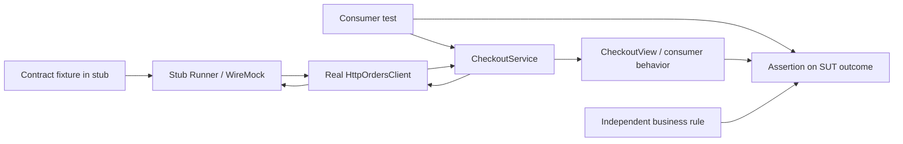
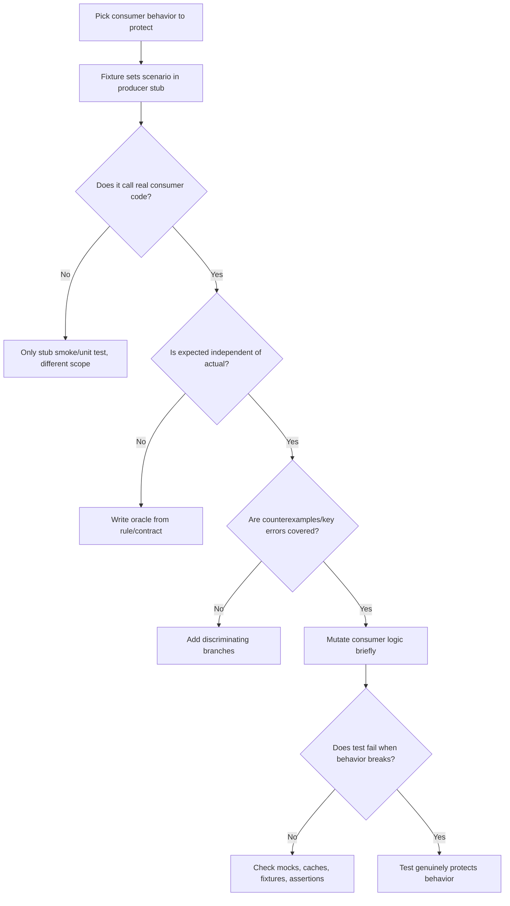

# Avoiding Assertions That Only Check Fixture Data

## 1. What Must a Consumer Test Prove?

In the **SPRING_CLOUD_CONTRACT** module, Spring Cloud Contract helps the **producer** and **consumer** agree on integration behavior using the **Groovy/YAML DSL** for HTTP or messaging. The producer uses the contracts to generate verification tests for the real application; stubs are then packaged and published by version. The consumer uses **Stub Runner** to test against sample responses or messages in CI, catching incompatible API changes early.

However, a consumer test can **pass without actually testing the consumer**. For example, a test loads an HTTP stub, calls the WireMock endpoint directly, receives `{"id":"ord-1001","status":"CREATED"}`, and asserts that the received JSON matches the exact data written in the fixture. That test partially confirms that the **stub was loaded and responds**; it does not prove that the consumer's HTTP client, deserializer, error-handling rules, or services work properly.

That is the problem addressed in this lesson: **assertions that merely verify fixture data** (*tautological assertions*, or "false-green tests"). Even riskier examples exist: tests that call no production code at all, or that use the exact same fixture object as both **actual** and **expected**.

**Core principle:** a fixture is the **test input/precondition**; assertions must observe the **behavior of the system under test** (*SUT*) and compare it against a **meaningful independent expectation** (*test oracle*).

After this lesson, you will be able to:

1. Distinguish **fixture**, **stub**, **SUT**, and **oracle** in consumer contract tests.
2. Spot assertions that only compare pre-populated data against itself.
3. Design tests that execute **real consumer client code and logic**, not merely calling WireMock directly.
4. Test success paths, HTTP errors, data transformations, and business outcomes.
5. Write asynchronous messaging tests that do not pass solely due to a pre-seeded read model.
6. Use sensitivity/mutation checks to detect tests that do not genuinely protect consumer behavior.
7. Integrate producer verification, versioned stub artifacts, and consumer assertions into CI.

## 2. Four Distinct Elements in a Consumer Test

Suppose the Checkout application needs to read an order from the Orders API.

| Element | Role | Example |
| --- | --- | --- |
| **Fixture** | Data arranged to establish a specific scenario | Order `ord-1001` has status `CREATED`, total amount `125000` |
| **Stub** | Entity simulating an external dependency boundary, returning data per contract | Stub Runner/WireMock simulating the Orders API |
| **SUT** | The **real consumer code** under test | `HttpOrdersClient` + `CheckoutService` |
| **Oracle** | Condition that the SUT's outcome must satisfy | Checkout allows payment when order status is `CREATED` |

A valuable test requires a clear execution path:



In this diagram, Stub Runner **does not replace the SUT**. It only replaces the **external producer**. The consumer's own `CheckoutService` and `HttpOrdersClient` must execute so the test verifies integration compatibility.

### 2.1. Where Must "Expected" Come From?

The expected value does not have to come from a completely separate file from the fixture. For pass-through fields, asserting `id == "ord-1001"` is still useful when **actual** was decoded and returned by the real consumer. However, tests should not **only** compare a copy of the payload against itself, especially when consumer code applies additional processing rules.

A good oracle can be:

- A business rule: a `CREATED` order can be paid; a `PAID` order cannot.
- A transformation outcome: amount and currency are preserved with the right types/values by the consumer.
- Error classification: `404 ORDER_NOT_FOUND` becomes a "not found" state rather than a valid empty order.
- State impact: after receiving an event, the read model is genuinely updated.
- Function interface: the consumer returns the right DTO/domain object with the fields the real application needs.

**The oracle must be logically independent**, even when test inputs are fixed. If expected is computed by calling the very function under test with the same inputs, a bug can appear on both sides while the assertion still passes.

## 3. Four Common Types of False-Green Tests

### 3.1. Comparing a Fixture Against Itself

```java
OrderDto expected = OrderFixtures.createdOrder();
OrderDto actual = expected; // Does not call any consumer code.

assertThat(actual).isEqualTo(expected);
```

This test passes even if `HttpOrdersClient` or `CheckoutService` is deleted, rewritten, or hits the wrong endpoint. It is effectively an **identity** assertion.

A similar variant:

```java
String json = """
    {"id":"ord-1001","status":"CREATED"}
    """;

assertThat(json).contains("ord-1001");
```

This checks a string literal, not the consumer.

### 3.2. Calling the Stub Directly and Asserting It Returns the Fixture

```java
String body = RestClient.create("http://localhost:8090")
    .get()
    .uri("/api/orders/ord-1001")
    .retrieve()
    .body(String.class);

assertThat(body).contains("ord-1001");
assertThat(body).contains("CREATED");
```

This **has one valid purpose**: a smoke test confirming WireMock has the mapping, the URL works, and the stub returns the expected payload. However, if the goal is **consumer testing**, it does not call the application's `OrdersClient` and does not verify business handling.

Name it accurately, such as `stubMappingIsAvailable`, and write a **separate test** that runs through real consumer code. Do not equate "the stub works" with "the consumer is compatible."

### 3.3. Mocking the Exact Client Class You Meant to Test

```java
// This can be a UNIT TEST of CheckoutService,
// but it does not verify the HTTP client or Stub Runner.
when(ordersClient.getOrder("ord-1001"))
    .thenReturn(OrderFixtures.createdOrder());

CheckoutView result = checkoutService.load("ord-1001");
assertThat(result.canPay()).isTrue();
```

This is **not necessarily a useless test**: if the goal is solely to unit test `CheckoutService` rules, mocking `OrdersClient` is reasonable. However, if this test is meant to serve as a **consumer contract test via stub**, it must use the **real HTTP client** and replace only the external producer with Stub Runner instead of mocking across the boundary you want to verify.

### 3.4. Reusing the Same Logic to Compute Expected

```java
CheckoutView actual = checkoutService.load("ord-1001");
boolean expectedCanPay = checkoutService.load("ord-1001").canPay();

assertThat(actual.canPay()).isEqualTo(expectedCanPay);
```

If `CheckoutService` has a bug that always returns `true`, both sides still match. It also makes two network calls, complicating diagnostics. Expected should come from an **independent rule**: for `PAID`, `canPay` must be `false`, not the result of calling the same service a second time.

### 3.5. Quick Distinction Table

| What Is the Test Doing? | Where Is It Useful? | Enough to Protect the Consumer Contract? |
| --- | --- | --- |
| `assertThat(fixture).isEqualTo(fixture)` | Almost no value | **No** |
| Direct HTTP GET to WireMock asserting status/body | Stub smoke test | **Insufficient** |
| Mock `OrdersClient` and assert `CheckoutService` | Business unit test | **Does not protect the HTTP boundary** |
| Call `CheckoutService` with real client and Stub Runner | Consumer integration/contract test | **Yes**, with proper assertions |
| Call `StubTrigger.trigger(label)` and only assert `true` | Messaging stub label check | **Insufficient** |
| Trigger event and assert handler updates new state | Consumer messaging test | **Yes**, with isolated fixtures |

## 4. Running Example: Consumer Checkout Reading the Orders API

Let us define an illustrative API agreement:

```http
GET /api/orders/ord-1001 HTTP/1.1
Accept: application/json
```

Success response:

```json
{
  "id": "ord-1001",
  "status": "CREATED",
  "totalAmount": 125000,
  "currency": "VND"
}
```

Checkout needs to build a `CheckoutView` for the payment UI:

- Preserve `orderId`, `totalAmount`, and `currency` from the order.
- Set `canPay = true` if the order status is `CREATED`.
- Set `canPay = false` if the order is already `PAID`.
- When the Orders API returns `404 ORDER_NOT_FOUND`, the consumer must not treat it as a payable order.

These IDs, statuses, and amounts are **illustrative fixtures**. Concrete rules must be confirmed against your real project's API and logic.

### 4.1. Producer Groovy Contract: CREATED Branch

Example file `get_order_created.groovy`:

```groovy
import org.springframework.cloud.contract.spec.Contract

Contract.make {
    name 'get_order_created'
    description 'Reads an unpaid order'

    request {
        method GET()
        url '/api/orders/ord-1001'
        headers {
            header 'Accept': 'application/json'
        }
    }

    response {
        status 200
        headers {
            contentType(applicationJson())
        }
        body([
            id         : 'ord-1001',
            status     : 'CREATED',
            totalAmount: 125000,
            currency   : 'VND'
        ])
    }
}
```

Producer verification needs fixture `ord-1001` to exist and return these values. Stub Runner can then serve the same scenario to the consumer.

### 4.2. Contract for the PAID State

The consumer cannot prove branching with a single `CREATED` sample. A bug like `return true` would pass the success test above. You need a counterexample scenario:

```groovy
import org.springframework.cloud.contract.spec.Contract

Contract.make {
    name 'get_order_paid'

    request {
        method GET()
        url '/api/orders/ord-2002'
        headers {
            header 'Accept': 'application/json'
        }
    }

    response {
        status 200
        headers {
            contentType(applicationJson())
        }
        body([
            id         : 'ord-2002',
            status     : 'PAID',
            totalAmount: 89000,
            currency   : 'VND'
        ])
    }
}
```

This branch helps catch a consumer bug that **always allows payment**. Two different IDs and two different amounts also help catch hard-coded IDs/amounts.

### 4.3. Contract for the Not-Found Branch

```groovy
import org.springframework.cloud.contract.spec.Contract

Contract.make {
    name 'get_order_not_found'

    request {
        method GET()
        url '/api/orders/ord-missing'
        headers {
            header 'Accept': 'application/json'
        }
    }

    response {
        status 404
        headers {
            contentType(applicationJson())
        }
        body([code: 'ORDER_NOT_FOUND'])
    }
}
```

A good consumer test must verify that this error **is recognized by the consumer**. Never just assert HTTP `404` from WireMock: a request matching no mapping can also return `404` without the `ORDER_NOT_FOUND` business body.

### 4.4. Equivalent YAML DSL for the CREATED Branch

If the project uses YAML instead of Groovy:

```yaml
name: get_order_created
description: Reads an unpaid order
request:
  method: GET
  url: /api/orders/ord-1001
  headers:
    Accept: application/json
response:
  status: 200
  headers:
    Content-Type: application/json
  body:
    id: ord-1001
    status: CREATED
    totalAmount: 125000
    currency: VND
```

This is an **alternative representation**; do not register duplicate contracts for the same request/response in the same build. Which DSL you write does not change the consumer assertion rule: tests must run through consumer code, not just inspect data inside the mapping.

## 5. Real Consumer Code That Tests Must Exercise

Suppose the consumer uses **Spring Boot with Spring Framework supporting `RestClient`** (e.g., Spring Framework 6.1+, Java 17+ for `record`). Older projects may use `RestTemplate`, `WebClient`, or OpenFeign; the testing concept is identical.

### 5.1. DTOs Decoding the Response

```java
// OrderDto.java
public record OrderDto(
    String id,
    String status,
    long totalAmount,
    String currency
) {}

// CheckoutView.java
public record CheckoutView(
    String orderId,
    long totalAmount,
    String currency,
    boolean canPay
) {}
```

`OrderDto` is the structure the consumer uses to parse JSON. `CheckoutView` is the **consumer's business outcome**, not the raw stub payload itself.

### 5.2. HTTP Client Using a Configured Address

```java
import org.springframework.beans.factory.annotation.Value;
import org.springframework.stereotype.Component;
import org.springframework.web.client.HttpClientErrorException;
import org.springframework.web.client.RestClient;

@Component
public class HttpOrdersClient {

    private final RestClient restClient;

    public HttpOrdersClient(
            RestClient.Builder builder,
            @Value("${clients.orders.base-url}") String baseUrl) {
        this.restClient = builder.baseUrl(baseUrl).build();
    }

    public OrderDto getOrder(String orderId) {
        try {
            return restClient.get()
                .uri("/api/orders/{id}", orderId)
                .header("Accept", "application/json")
                .retrieve()
                .body(OrderDto.class);
        } catch (HttpClientErrorException.NotFound exception) {
            throw new OrderNotFoundException(orderId, exception);
        }
    }
}
```

`OrderNotFoundException` is a **consumer-defined exception**, for example:

```java
public class OrderNotFoundException extends RuntimeException {
    public OrderNotFoundException(String orderId, Throwable cause) {
        super("Order not found: " + orderId, cause);
    }
}
```

This illustrates mapping HTTP `404` to a domain error. In a real application, if the consumer distinguishes multiple error codes within `404` responses, the client must **parse the agreed error body** rather than catching every `404` identically.

### 5.3. Service Applying Business Rules

```java
import org.springframework.stereotype.Service;

@Service
public class CheckoutService {

    private final HttpOrdersClient ordersClient;

    public CheckoutService(HttpOrdersClient ordersClient) {
        this.ordersClient = ordersClient;
    }

    public CheckoutView load(String orderId) {
        OrderDto order = ordersClient.getOrder(orderId);
        if (order == null) {
            throw new IllegalStateException("Empty response from Orders");
        }
        return new CheckoutView(
            order.id(),
            order.totalAmount(),
            order.currency(),
            "CREATED".equals(order.status())
        );
    }
}
```

The `load` method is the **SUT entry point** that consumer tests must observe. For `CREATED`, the result has `canPay = true`; for `PAID`, it has `canPay = false`. If code breaks in JSON decoding, URL construction, header selection, `404` classification, or `canPay` calculation, the tests must be able to fail.

### 5.4. Data Flow During the Test

```text
Test -> CheckoutService.load("ord-1001")
     -> HttpOrdersClient.getOrder("ord-1001")
     -> GET http://localhost:8090/api/orders/ord-1001
     <- Stub Runner returns CREATED JSON
     <- HttpOrdersClient deserializes into OrderDto
     <- CheckoutService applies canPay rule
Test <- CheckoutView
Assertion: canPay == true, id/amount/currency match
```

In this diagram, the stub is only the **external dependency**. The test observes the consumer's `CheckoutView` object, distinguishing it from calling WireMock directly as in Section 3.

## 6. Consumer Integration Test with Stub Runner

In this example, we use a **fixed port `8090`** to keep the code easy to read. The stub artifact has already been built by the producer and installed into the local Maven repository:

```text
com.example:orders-producer:1.4.2:stubs
```

Consumer test:

```java
import org.junit.jupiter.api.Test;
import org.springframework.beans.factory.annotation.Autowired;
import org.springframework.boot.test.context.SpringBootTest;
import org.springframework.cloud.contract.stubrunner.StubRunnerProperties;
import org.springframework.cloud.contract.stubrunner.spring.AutoConfigureStubRunner;

import static org.assertj.core.api.Assertions.assertThat;
import static org.assertj.core.api.Assertions.assertThatThrownBy;

@SpringBootTest(properties = {
    "clients.orders.base-url=http://localhost:8090"
})
@AutoConfigureStubRunner(
    ids = "com.example:orders-producer:1.4.2:stubs:8090",
    stubsMode = StubRunnerProperties.StubsMode.LOCAL
)
class CheckoutConsumerContractTest {

    @Autowired
    private CheckoutService checkoutService;

    @Test
    void createdOrderCanBePaid() {
        CheckoutView actual = checkoutService.load("ord-1001");

        assertThat(actual.orderId()).isEqualTo("ord-1001");
        assertThat(actual.totalAmount()).isEqualTo(125000L);
        assertThat(actual.currency()).isEqualTo("VND");
        assertThat(actual.canPay()).isTrue();
    }

    @Test
    void paidOrderCannotBePaidAgain() {
        CheckoutView actual = checkoutService.load("ord-2002");

        assertThat(actual.orderId()).isEqualTo("ord-2002");
        assertThat(actual.totalAmount()).isEqualTo(89000L);
        assertThat(actual.canPay()).isFalse();
    }

    @Test
    void missingOrderBecomesDomainError() {
        assertThatThrownBy(() -> checkoutService.load("ord-missing"))
            .isInstanceOf(OrderNotFoundException.class)
            .hasMessageContaining("ord-missing");
    }
}
```

**Execution prerequisites:** this code assumes the Spring Boot application actually registers `HttpOrdersClient`, `CheckoutService`, and the illustrated records/exceptions; it requires JUnit 5, AssertJ, Spring Web, Stub Runner dependencies, and artifact `1.4.2` in the local Maven repository. These code snippets are **illustrative excerpts** to place into your project's corresponding files/packages.

This is a **meaningful consumer contract test** because:

1. `HttpOrdersClient` is not mocked. The client sends real requests to the stub.
2. Response JSON is deserialized into `OrderDto`.
3. `CheckoutService` runs business rules on the received data.
4. Assertions check the **consumer's outcome**, not just raw JSON strings in the stub.
5. It includes a **`PAID` counterexample**, catching an "always `canPay = true`" bug.
6. It includes a **`404` error branch**, verifying how the consumer interprets failures.

### 6.1. Why Is a Fixed Port Only for Illustration?

Port `8090` can collide when running tests in parallel; the consumer might also accidentally call another server listening on that port. In larger projects, use a **dynamic port** and obtain the URL from `StubFinder` or a dynamic configuration mechanism supported by your Spring Cloud Contract version, passing the URL to the client **before the client is used**.

If you prefer keeping a fixed port for simplicity, **isolate the job/test suite** and verify Stub Runner actually bound successfully. Never hard-code staging or production URLs in consumer contract tests.

### 6.2. Smoke Tests Are Still Useful, But Separate Their Name and Scope

A separate test can hit the HTTP stub and assert `200`/JSON to help diagnose mappings. It answers:

> Was the stub loaded properly, started cleanly, and serving the declared payload?

The consumer test above answers a different question:

> Does Checkout code **genuinely consume** data from that API and process it per the committed rules?

Both are useful, but **never substitute smoke-test results for consumer behavior test evidence**.

## 7. Designing Assertions from Consumer Behavior, Not Copying Raw JSON

A common reflex is opening the stub JSON and copying every field into assertions. Checking data flowing through the client is necessary at the right level, yet when the consumer also performs **transformations and business decisions**, tests should observe those outcomes.

| Stub Value | Consumer Behavior to Protect | Recommended Assertion |
| --- | --- | --- |
| `status = CREATED` | Allow payment | `canPay == true` |
| `status = PAID` | Disallow duplicate payment | `canPay == false` |
| `totalAmount = 125000` | Preserve exact amount when parsing/mapping | `totalAmount == 125000L` |
| `currency = VND` | Preserve currency unit | `currency == "VND"` |
| `404 ORDER_NOT_FOUND` | Report not found instead of returning empty order | `OrderNotFoundException` or explicit domain result |
| `401 UNAUTHORIZED` | Re-trigger login/session per design | Consumer authentication state/requirement |
| `409 OUT_OF_STOCK` | Show out-of-stock error, do not confirm order | Domain error and corresponding UI/service behavior |

Do not make tests guess **UI presentation details** outside the integration boundary. For example, if `CheckoutService` only returns `canPay` while button styling is the frontend's job, the service's consumer contract test should assert `canPay`; UI rendering is tested at its own level.

### 7.1. Expected Values Must Be Business Constants or Computed by an Independent Rule

In a test:

```java
CheckoutView actual = checkoutService.load("ord-2002");

// Expected per business rule: a PAID order cannot be paid again.
assertThat(actual.canPay()).isFalse();
```

Do not write:

```java
CheckoutView actual = checkoutService.load("ord-2002");
boolean expected = actual.canPay(); // Deriving expected from actual.
assertThat(actual.canPay()).isEqualTo(expected);
```

If expected is computed from actual, the test cannot catch bugs. Expected must be established **before** or independently of the call under test.

### 7.2. Choosing Fixtures That Separate Common Bugs

The `CREATED` and `PAID` fixtures expose hard-coded boolean conditions. Two IDs `ord-1001` and `ord-2002` expose clients ignoring the `orderId` parameter. Two totals `125000` and `89000` expose mappers returning a constant.

That is the criterion for choosing **discriminating** data, not random numbers:

| Hypothetical Bug | Can One Fixture Mask It? | Counterexample Fixture |
| --- | --- | --- |
| `canPay` always true | Yes, if only testing `CREATED` | Add `PAID` |
| Client always calls `ord-1001` | Yes, if only testing `ord-1001` | Add `ord-2002` |
| Amount always `125000` | Yes, if using only one order | Add order with `89000` |
| Client treats `404` as empty response | Yes, if only testing `200` | Add `404` contract |
| Client ignores `currency` | Yes, if asserting only ID | Assert currency and use it where business requires |

You do not need infinite fixtures. Pick **values that separate the branches the consumer actually depends on**.

## 8. Testing HTTP Errors Without Being Fooled by Unmatched Stubs

A request matching no WireMock mapping can often return HTTP `404`. Therefore, this test:

```java
assertThatThrownBy(() -> checkoutService.load("ord-does-not-exist"))
    .isInstanceOf(OrderNotFoundException.class);
```

is **not strong enough** if `ord-does-not-exist` has no contract and the client catches every HTTP `404`. The test can pass because WireMock found no mapping, not because the producer defined the `ORDER_NOT_FOUND` branch.

The right approach:

1. Write a **dedicated contract** for `GET /api/orders/ord-missing -> 404` with body `{"code":"ORDER_NOT_FOUND"}`.
2. Producer verification tests the real error branch with a missing-order fixture.
3. Consumer tests use the exact ID from the published `404` branch.
4. If the client classifies by `code`, assert the **domain error corresponding to `ORDER_NOT_FOUND`**, rather than lumping every `404` into one case.
5. Add a smoke test or inspect mappings to confirm the error branch is loaded, especially when CI needs to distinguish unmatched requests from business `404`s.

### 8.1. Modeling Multiple Distinct Errors

For example, an ordering API might return:

| HTTP | Error Code | What Should the Consumer Do? |
| --- | --- | --- |
| `400` | `INVALID_QUANTITY` | Prompt user to fix quantity |
| `401` | `AUTHENTICATION_REQUIRED` | Prompt login |
| `404` | `ORDER_NOT_FOUND` | Show not found |
| `409` | `OUT_OF_STOCK` | Suggest updating cart |
| `500` | `INTERNAL_ERROR` | Show temporary error or retry per policy |

These error codes are an **illustrative agreement**. A test that only asserts "some exception was thrown" does not verify the consumer picks the right behavior for `400` vs. `409`. Classify properly by status/body when that is part of the public API.

### 8.2. Do Not Loosen Mappings Just to Turn Tests Green

Suppose the consumer sends `quantity` as string `"2"` while the contract requires number `2`. If the stub fails to match, never change the JSON matcher to `.*`. Inspect the real request, debug the client's serialization bug, and fix the request sender when the consumer violates the contract.

Contract tests must **catch meaningful differences**, not merely make every request "get a response."

## 9. Consumer Test Fixtures Must Be Independent of Actual Outcomes

Independence does not necessarily require separate fixture files. It means **tests do not derive conclusions from the very outcome under test** and setup does not pre-build the final result.

### 9.1. Fixtures Set Inputs, Not Pre-Built SUT Outputs

For HTTP consumers:

- **Input:** stub configured to return a `CREATED` order.
- **Output to assert:** `CheckoutService.load` returns `canPay = true` after calling the client and applying rules.

Do not set `CheckoutView(canPay=true)` directly in the test and assert it against itself.

For messaging consumers:

- **Input:** stub emits an `ORDER_CREATED` event.
- **Output to assert:** the consumer's read model gains a new record created by the handler.

Do not pre-seed the record into the read model and assert "the record exists" after triggering the event.

### 9.2. Do Not Compute Expected by Deserializing the Same Payload with the Same Mapper

Poor example:

```java
OrderDto expected = objectMapper.readValue(stubJson, OrderDto.class);
OrderDto actual = objectMapper.readValue(stubJson, OrderDto.class);

assertThat(actual).isEqualTo(expected);
```

Both variables take the **exact same path, same input, and same mapper**; no consumer HTTP client or business logic is called. If the mapper consistently mishandles a data type, both sides still match.

Better:

```java
CheckoutView actual = checkoutService.load("ord-1001");

assertThat(actual.canPay()).isTrue();
assertThat(actual.totalAmount()).isEqualTo(125000L);
```

The expected conditions here reflect the behavior the consumer must provide, while actual comes from consumer code running against the stub.

### 9.3. Do Not Use the Function Under Test to Compute the Oracle

For example, when the consumer calculates shipping fees per a rule: orders of `125000 VND` qualify for free shipping above the `100000 VND` threshold.

If `shippingFeeService` is the SUT, do not compute `expectedFee = shippingFeeService.calculateFee(125000)` and compare it to `actualFee` from the same method. Establish the independent rule: `expectedFee = 0`. For orders below the threshold, add a fixture expecting a non-zero fee.

This is a universal principle for consumer transformations: **expected comes from the specification**, not from running production code twice.

## 10. Messaging Consumers: Preventing Tests from Passing on Pre-Existing Data

In message contracts, this anti-pattern can be even subtler. Suppose Orders Producer emits an event:

```groovy
import org.springframework.cloud.contract.spec.Contract

Contract.make {
    name 'order_created_event'
    label 'order_created'

    input {
        triggeredBy('publishOrderCreated()')
    }

    outputMessage {
        sentTo('orders.events')
        body([
            eventType: 'ORDER_CREATED',
            orderId  : 'ord-1001',
            productId: 'SKU-001',
            quantity : 2
        ])
        headers {
            header('eventType', 'ORDER_CREATED')
            messagingContentType(applicationJson())
        }
    }
}
```

### 10.1. Poor Test: Asserting Only Pre-Seeded Fixture Data

```java
// Test pre-seeded the read model before triggering.
readModel.save("ord-1001", "SKU-001", 2);

assertThat(stubTrigger.trigger("order_created")).isTrue();
assertThat(readModel.hasOrder("ord-1001")).isTrue();
```

Even if the consumer handler never runs, the last line passes because `readModel.save` created the data beforehand. The test also passes if Stub Runner emits the message while the consumer is not even bound to the destination.

### 10.2. Better Test: Verifying a State Transition

```java
// Setup: ensure the order does not exist in the read model yet.
readModel.deleteByOrderId("ord-1001");
assertThat(readModel.hasOrder("ord-1001")).isFalse();

// Action: emit the sample event using Stub Runner.
assertThat(stubTrigger.trigger("order_created")).isTrue();

// Assertion: the real handler processes the event and creates the data.
await().atMost(Duration.ofSeconds(5))
       .untilAsserted(() -> {
           var saved = readModel.findByOrderId("ord-1001");
           assertThat(saved).isPresent();
           assertThat(saved.get().productId()).isEqualTo("SKU-001");
           assertThat(saved.get().quantity()).isEqualTo(2);
       });
```

This snippet belongs in a **consumer messaging test configured with Stub Runner, Awaitility, and the appropriate message binder**. `readModel` and its methods are illustrative project APIs, not built-in framework APIs.

The test provides two pieces of evidence:

1. **Before trigger:** the read model does not contain `ord-1001`.
2. **After trigger:** the consumer handler processes the message and writes the expected record.

Because the before and after states differ, the test is sensitive to a disabled handler. Also assert event types/headers, business state, or side effects whenever the consumer genuinely relies on them.

### 10.3. Why Must Asynchronous Waiting Have a Timeout?

Messages may arrive after a short delay. Using `Thread.sleep(1000)` makes tests flaky. **Polling until the business condition holds**, within a bounded timeout, reduces flakiness and produces clear assertion failures.

Still, if the read model was already pre-seeded before triggering, even Awaitility **cannot save the test**: the condition succeeds immediately. Design the **precondition** first, then choose how to wait.

### 10.4. Idempotency Also Needs Its Own Oracle

When messages may be redelivered, the consumer may need to avoid creating duplicate records or deducting stock twice. A test can trigger the same label twice and assert:

- Record count equals 1.
- Stock decreases only once, if that is the consumer rule.
- Event ID is recorded as processed to prevent duplicates.

Do not merely assert that both `trigger(...)` calls return `true`. That only proves you can **request emitting the sample message** twice, not that idempotency logic works.

## 11. Do Not Confuse the Three Testing Levels

| Level | Real Components Running | Simulated Components | Properly Scoped Assertions |
| --- | --- | --- | --- |
| **Consumer unit test** | A service/mapper | Mocked OrdersClient | Transformation rules, domain branching |
| **Consumer contract test** | Consumer HTTP client/handler and related logic | Producer via Stub Runner | Contract interaction and consumer behavior after receiving data |
| **End-to-end/integration with real producer** | Producer, consumer, and required infrastructure | Possibly out-of-scope external dependencies | Communication, serialization, network, broker, cross-service data |

**Unit tests with mocks are not bad.** The mistake is calling a unit test that only uses `when(ordersClient...)` proof that the consumer is compatible with the real producer API. Every testing level should have a name, scope, and oracle matched to what it actually proves.

### 11.1. When Is Asserting Raw JSON Appropriate?

If the consumer itself is a **pass-through gateway forwarding payloads** without business transformations, checking exact body/header fidelity from input to output **can be a legitimate assertion**. Even then, it must pass through the real gateway rather than reading the fixture directly. Verify the commitments the gateway publishes: Content-Type, status propagation, error handling, payload preservation, or header translation.

In other words, **comparing data is not forbidden**; just make sure the comparison observes **real behavior** and fails when that behavior breaks.

## 12. Testing Test Sensitivity with Intentional Code Changes

A very useful way to evaluate a test is to ask:

> If I intentionally introduce a bug in the consumer that the contract ought to catch, does the test fail?

This is the mindset of **mutation testing** and **test sensitivity**, even without a dedicated mutation-testing framework.

### 12.1. Trial Bugs You Can Temporarily Introduce

| Trial Change in Consumer | Which Test Should Fail? |
| --- | --- |
| `"CREATED".equals(status)` changed to `true` | `paidOrderCannotBePaidAgain` |
| Hard-code URL `/api/orders/ord-1001` regardless of input | `paidOrderCannotBePaidAgain` |
| Drop `currency` mapping and return empty string | `createdOrderCanBePaid` |
| Remove converting `404` into domain error | `missingOrderBecomesDomainError` |
| Unsubscribe from `orders.events` | Messaging test checking precondition then waiting for read model update |
| Set `quantity = 0` regardless of event | Messaging test asserting `quantity = 2` |

These are **temporary edits in a scratch branch**—never merge bugs into production. Once done, revert all changes and re-run the tests. In this workflow, the lesson's authoring environment does **not** build or modify real consumer code; the table is a study guide.

### 12.2. What If the Test Still Passes After Changing Code?

Check:

1. Did the test actually invoke the modified class/method?
2. Is there a mock in between bypassing the modified code branch?
3. Is the test using the right stub artifact version?
4. Was expected derived from actual or by calling the same logic?
5. Do fixtures include both passing and failing values?
6. Are assertions checking an unrelated field instead of the modified behavior?
7. Did the test runner actually execute that test, or was it skipped/filtered?

Specifically, if changing `canPay` to `true` still passes when the test only exercises `CREATED`, that outcome is **predictable**; add the `PAID` scenario. If a test passes even after deleting the HTTP call completely, it may just be asserting the fixture.

## 13. Pitfalls Related to Stub Runner and Fixtures

### 13.1. Stale Stub Versions Hide API Changes

The consumer tests against `orders-producer:1.4.1:stubs` while the producer is preparing `1.4.2`, which renames `status`. Tests pass on the old stub yet say nothing about compatibility with the new release.

In CI, run consumer tests against the **candidate artifact** and pin versions. If rolling upgrades must be checked, run a matrix of old/new consumers against supported producer versions.

### 13.2. Stub Lacks a Mapping Yet the Test Still Passes

If the client calls the wrong URL and the test only asserts "received 404," WireMock can return `404` because no mapping matched. The test passes even though the artifact lacks the required error contract.

Fix:

- Assert the **business error code/body** in error branches.
- Separate a stub smoke test to confirm expected mappings are present.
- Use `StubFinder`/request journal when diagnosing URL/port bugs.
- Never broaden matchers so every request turns into "success."

### 13.3. Fixtures Pre-Populating the Final Outcome

If a consumer test seeds `CheckoutView(canPay = true)` into a cache before calling the service, the service may read from the cache and skip calling the Orders API. That may match cache design, yet the test **does not verify the path to the producer** as intended.

When testing the API call path, clear caches or force a cache miss. When testing cache hits, name the test accordingly and assert cache behavior. Do not claim one test proves both paths when it only executes one.

### 13.4. Repeated Fixtures Mask Hard-Coding Bugs

If every contract returns `ord-1001` and `125000 VND`, a client hard-coding those values can pass many tests. Varying values intentionally **across branches** separates genuinely parsed data from hard-coded constants.

### 13.5. Replacing the Producer with a Mock at the Wrong Layer

In consumer contract tests, replacing the HTTP producer with **Stub Runner** makes sense. However, if you also mock `HttpOrdersClient`, you skip URLs, headers, deserialization, and HTTP status handling. The test may still be a valid unit test, yet it is **not API compatibility evidence**.

## 14. Diagnosing Suspiciously Easy Green Tests

A test that passes "too easily" deserves investigation as a test-quality signal.

| Symptom | Suspicion | How to Verify |
| --- | --- | --- |
| Comment says "verify stub data" without calling a service | Only a stub smoke test | Look for SUT calls and assertions on consumer outcomes |
| Expected initialized from actual variable | Tautological assertion | Derive expected from rules/contracts |
| `@MockBean`/Mockito replaces the HTTP client itself | Bypassed integration boundary | Use real client with producer stub |
| Only `CREATED` case present | Cannot catch `canPay` always true | Add `PAID` case |
| Only asserts `404` | May pass via WireMock no-match | Assert business error code and exact mapping |
| Pre-seeded read model before trigger | Broken handler still passes | Assert absent state before event, then change after |
| Test passes even with HTTP call deleted | Integration path not executed | Inspect mocks, caches, fixtures, and real coverage |
| Test passes across every stub version | Calling another server or static fixture | Check URL, version, and request journal |
| One test has many assertions on one case without branching | Multiple assertions on identical data add no branch coverage | Add counterexample inputs, not just more fields |
| CI reports 0 tests | Build green without running tests | Inspect test discovery/engine/filters |

### 14.1. Process for Evaluating a Consumer Test



## 15. CI: Protecting Compatibility Instead of Just Sample Data

A Spring Cloud Contract CI pipeline should verify **both real sides of the commitment**:

```text
Producer:
  - Read Groovy/YAML contracts
  - Generate producer tests
  - Prepare producer fixtures and run tests
  - Package/publish stub only when producer verification passes

Consumer:
  - Download exact stub artifact version
  - Start stub and point consumer client to it
  - Invoke real client/service/handler code
  - Assert business outcomes and error/counterexample branches
  - Fail if consumer code breaks expected behavior
```

### 15.1. Recommended Verification Gates

| CI Stage | Evidence to Collect | Risk If Omitted |
| --- | --- | --- |
| Contract parsing | Contracts exist for required branches | Build passes while reading no files |
| Producer verification | Tests generated and run with real fixtures | Stub no longer reflects producer |
| Stub packaging | Artifact has right version and mappings/definitions | Consumer uses stale/empty stub |
| Consumer smoke test | Stub runs at right address and returns expected sample | Hard to separate infra bugs from consumer bugs |
| Consumer behavior tests | Real consumer code runs with meaningful assertions | Tests only check fixtures |
| Negative/counterexample tests | `PAID`, `404`, business errors handled properly | Hard-coding or dropped branches go undetected |
| Test discovery report | Clear pass/fail/skip counts | CI passes with 0 tests |

Retain **stub artifact coordinates**, producer commit/version, scanned contract list, and count of generated tests actually executed. On failure, secret-redacted request/response logs help isolate whether the fault is in the stub, client, or consumer logic.

### 15.2. Reviewing Assertions in a Pull Request

For every consumer test, a reviewer can ask:

1. **What is the actual SUT?** Can you point to the consumer method/class invoked?
2. **What precondition does the fixture create?** Does it pre-build the final outcome being asserted?
3. **Which agreement does expected come from?** Is it copied from actual or computed by calling the same function twice?
4. **Which bug must this test catch?** Is there an example code edit that makes it fail?
5. **Is there a counterexample scenario?** If logic has two branches, are both tested?
6. **Is the artifact right?** Could the test accidentally use an old version or point the client at a real service?

This prevents verbose tests packed with assertions on a single fixture that add zero defect-detection power.

## 16. Practice Exercise: From Fixture to Business Assertions

### 16.1. Context

Consumer `Shipping Checkout` reads shipping rates from the Pricing API:

```http
GET /api/shipping/quotes/q-1001 HTTP/1.1
Accept: application/json
```

Response:

```json
{
  "quoteId": "q-1001",
  "baseFee": 30000,
  "discount": 5000,
  "currency": "VND",
  "status": "AVAILABLE"
}
```

Consumer produces:

```text
ShippingSummary(
  quoteId = "q-1001",
  finalFee = 25000,
  currency = "VND",
  canConfirm = true
)
```

Rules defined by the exercise:

- `finalFee = max(0, baseFee - discount)`.
- `canConfirm = true` only when `status = AVAILABLE`.
- If the quote is `EXPIRED`, `canConfirm = false`.
- If the API returns `404 QUOTE_NOT_FOUND`, the consumer returns the corresponding domain error.

### 16.2. Poor Test to Fix

```java
String fixtureJson = """
    {"quoteId":"q-1001","baseFee":30000,
     "discount":5000,"currency":"VND","status":"AVAILABLE"}
    """;

assertThat(fixtureJson).contains("q-1001");
assertThat(fixtureJson).contains("AVAILABLE");
```

This tests a static string without invoking any consumer code.

### 16.3. Practice Tasks

1. Write a Groovy/YAML contract for `GET /api/shipping/quotes/q-1001 -> 200` with the body above.
2. Write a counterexample contract for `q-2002` with `baseFee = 12000`, `discount = 0`, and `status = EXPIRED`.
3. Write an error contract `GET /api/shipping/quotes/q-missing -> 404` with `code = QUOTE_NOT_FOUND`.
4. Write a real `ShippingQuotesClient` calling the Pricing stub started by Stub Runner; do not mock the client itself.
5. Write `ShippingCheckoutService` computing `finalFee` and `canConfirm` from the DTO.
6. In consumer tests, assert the `ShippingSummary` outcome rather than re-asserting the fixture string.
7. Choose expected values **independently from the rules**: `25000`, `true` for `q-1001`; `12000`, `false` for `q-2002`.
8. Temporarily edit the consumer to `finalFee = baseFee`; which test must fail?
9. For the `404` branch, verify the domain error truly comes from the **error contract**, not an unmatched WireMock request.
10. Explain why a stub smoke test is useful yet does not replace a consumer behavior test.

### 16.4. Guided Solution for Assertions

```java
@Test
void appliesDiscountToAvailableQuote() {
    ShippingSummary actual = shippingCheckoutService.load("q-1001");

    assertThat(actual.quoteId()).isEqualTo("q-1001");
    assertThat(actual.finalFee()).isEqualTo(25000L);
    assertThat(actual.currency()).isEqualTo("VND");
    assertThat(actual.canConfirm()).isTrue();
}

@Test
void expiredQuoteCannotBeConfirmed() {
    ShippingSummary actual = shippingCheckoutService.load("q-2002");

    assertThat(actual.finalFee()).isEqualTo(12000L);
    assertThat(actual.canConfirm()).isFalse();
}

@Test
void missingQuoteIsReportedAsDomainError() {
    assertThatThrownBy(() -> shippingCheckoutService.load("q-missing"))
        .isInstanceOf(QuoteNotFoundException.class);
}
```

These are **illustrative test methods** that belong inside a test class configured with `@AutoConfigureStubRunner`, consumer beans, and appropriate dependencies. `ShippingSummary`, `shippingCheckoutService`, and `QuoteNotFoundException` are exercise-specific types, not default Spring Cloud Contract APIs.

### 16.5. Self-Check Questions

**Question 1.** Does a test calling `http://localhost:8090/api/shipping/quotes/q-1001` directly and asserting JSON contains `baseFee = 30000` verify `ShippingCheckoutService`?

**Answer:** No. That is a stub smoke test. You must call the real consumer client/service and assert `finalFee` and `canConfirm`.

**Question 2.** Why can a single `AVAILABLE` test fail to catch a bug where `canConfirm` is always true?

**Answer:** Because the wrong value `true` still matches the expected value for `AVAILABLE`. Adding an `EXPIRED` fixture distinguishes the two branches.

**Question 3.** Why shouldn't you compute the expected fee with `shippingCheckoutService.load("q-1001").finalFee()`?

**Answer:** Because that runs the exact same logic under test. A calculation bug would appear in both actual and expected.

**Question 4.** Is a consumer test sufficient if it asserts the read model has `ord-1001` after pre-seeding that record before triggering the event?

**Answer:** No. The test must confirm the record is absent initially, then verify the handler processes the event and creates it.

**Question 5.** Can you mock `ShippingQuotesClient` in unit tests?

**Answer:** Yes. That is valid when testing `ShippingCheckoutService` rules in isolation. However, you still need consumer contract tests running the real `ShippingQuotesClient` against Stub Runner to protect the API boundary.

## 17. Checklist to Ensure Assertions Do Not Only Test Fixtures

- [ ] Clearly identified the **SUT** and the real consumer method invoked.
- [ ] The stub only replaces the **producer/external dependency**, not the client or handler under test.
- [ ] Fixtures set up inputs rather than pre-building the final outcome asserted by the test.
- [ ] Actual comes from **executed consumer behavior**, not from string literals/fixtures.
- [ ] Expected is logically independent of actual and tied to the API agreement/business rules.
- [ ] Never compares an object to itself or two results produced by the same function.
- [ ] Includes branch-discriminating fixtures, such as `CREATED` and `PAID`.
- [ ] Verifies domain errors rather than relying solely on HTTP status from a possible WireMock no-match.
- [ ] Response fields are asserted within the scope the consumer genuinely depends on.
- [ ] For messaging, state is verified **before** and **after** triggering.
- [ ] For async flows, uses bounded condition polling; pre-seeded read models never mask broken handlers.
- [ ] Considered at least one mutation that ought to make the test fail.
- [ ] Stub artifact/version matches the producer build under test.
- [ ] Producer verification and consumer behavior tests actually execute in CI.
- [ ] Stub smoke tests are named accurately for their scope and never treated as sole proof.

### References

- [Spring Cloud Contract — Stub Runner](https://docs.spring.io/spring-cloud-contract/reference/project-features-stubrunner/stub-runner-core.html): mechanics of running and loading published stubs.
- [Spring Cloud Contract — HTTP Contracts](https://docs.spring.io/spring-cloud-contract/reference/project-features-contract/http.html): specifying requests/responses and HTTP mappings.
- [Spring Cloud Contract — Messaging](https://docs.spring.io/spring-cloud-contract/reference/project-features-messaging.html): message contracts, producer verification, and triggering stubs by label.
- [Martin Fowler — Test Double](https://martinfowler.com/bliki/TestDouble.html): distinguishing test doubles from real collaborators in testing.

**Key takeaway:** A verbose assertion block has little value if it only confirms **the very data you seeded**. Real consumer contract tests must run **real consumer code**, pass stub data across the integration boundary, and verify results using **independent business oracles and counterexample branches**. Combining producer verification, versioned stubs, negative tests, and sensitivity checks ensures your suite catches incompatible API or consumer changes.
